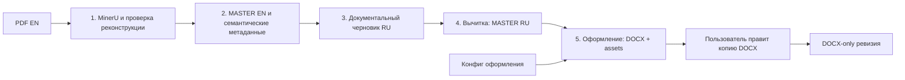

# PDF → DOCX: профиль перевода

Статус: профиль прошёл малый сквозной прогон и завершил полный 52-страничный Cursed Idol: 880 фрагментов перевода/вычитки, 85 страниц DOCX и 74 ассета. CLI вернул ready_for_docx_review; независимое P6 ревью разрешило передачу для проверки пользователем. [План пилота](plans/20260919-cursed-idol-pilot/plan.md), [границы автоматизации](plans/20260919-cursed-idol-pilot/automation-report.md).

Новые обычные запуски используют `five_step_docx_v3` и запечатанный пакет
`kb_creator.five_step_docx_package.v3`. В нём есть DOCX, исходные и служебные
Markdown/JSON, выбранные ассеты и при доступном рендере служебные PNG; нет
`internal.html` или опубликованного PDF. Пакеты v1 остаются неизменяемыми и
проверяются как исторические, без приписывания им новых гарантий полноты
исходных иллюстраций. Пакеты v2 также проверяются только как исторические.
Для новой сборки обязательны независимый рендер всех физических страниц PDF,
закрытый постраничный обзор иллюстраций, план редакции 7e и словаря, а затем
проверка фактического DOCX. Результат механической проверки остаётся
`needs_output_review`, пока не представлен обзор всех отрисованных страниц
именно этого DOCX; XML не доказывает видимость.
Команда `translate status` может только прочитать и проверить запечатанное
состояние запуска v1; она возвращает `legacy_read_only` и
`source_completeness: not_assessed`. Продолжение или пересборка v1 запрещены.

## Пять шагов

1. PDF → реконструкция: паспорт источника, содержательный разбор Codex, три вида MinerU, закрытые постраничные решения и проверка fidelity.
2. Реконструкция → MASTER_EN: сохранение проверенного содержания, страниц, ссылок, ассетов и семантических границ. В первой реализации это явно заявленная точная проекция; она не выполняет новую редакторскую чистку.
3. MASTER_EN → документальный черновик RU: отдельное задание с английским текстом и словарём.
4. Черновик → MASTER_RU: отдельное задание литературной вычитки и сверки с EN, полный журнал проверенных единиц, сборка и независимая проверка.
5. MASTER_RU → DOCX + использованные ассеты: проекция разметки в памяти, оформление, служебный рендер страниц в PNG и визуальная проверка Codex. Новый пакет не записывает HTML или публикуемый PDF. Итоговое состояние `ready_for_docx_review` требует полного закрытия проверок документа; оно не означает согласие пользователя.

ArtView не является обязательным этапом этого профиля. Новая обычная сборка не создаёт HTML. Временный мост рендера Word удаляется после получения служебных PNG и не входит в пакет. Старые команды `publication run/resume`, `publication revise-docx` и `revise_reviewed_reader` больше не создают HTML/PDF: они останавливаются до записи; исторические пакеты можно проверять в режиме чтения. Правки проверенной копии DOCX оформляются через DOCX-only `revise_reviewed_docx`.

Полный пакет передачи на ревью включает DOCX, `MASTER_EN.md`, `MASTER_RU.md`,
ассеты, исходный PDF, реконструкцию, метаданные MinerU, решения, настройки и QA.
Контрольные суммы связывают весь набор. Редактируемая копия DOCX выдаётся отдельно;
пакет остаётся неизменным до создания следующей версии.



### Что запускается внутри

Общий диспетчер — `pipeline/five_step.py`; точка входа — `python -m kb_creator translate`.

Для CoC включайте общий словарь уже при создании нового прогона:

```powershell
python -m kb_creator translate run --source book.pdf --source-inventory reviewed/SOURCE_GRAPHICS_INVENTORY.json --source-review reviewed/SOURCE_GRAPHICS_REVIEW.json --glossary book-terms.json --docx-config reviewed/docx-style.json --run-root working/new-book-run --system coc --book-id new-book
```

`--glossary` содержит книжные имена и дополнения. Общая таблица по умолчанию —
`CoC/Project_Reference/Terminology/CoC_Terminology_Decisions.csv`; для явного
источника есть `--shared-registry`. Диспетчер сохраняет точные исходные версии,
определения, контекст и статусы в `terminology/` и передаёт итоговый словарь
этапу перевода. Конфликт останавливает запуск до OCR; подробности остаются в
`terminology/conflicts.json`. Изменение общего словаря после запуска не меняет
сохранённую версию прогона. Подмена его собственного словаря запрещает продолжение.

Композиция включена в зависимости кода шагов 1, 3 и 4. Для существующего
MASTER_EN по-прежнему доступен `continue_language prepare --system coc`.

| Шаг | Код | Работа Codex | Сохраняемый результат |
| --- | --- | --- | --- |
| 1 | `five_step_intake.py`, существующий `reconstruction.py`, `run_mineru_three_view.ps1`, сравнение/аудит/materialize | Проверить источник, контракт, чтение колонок и спорные фрагменты; описать исключения | Проверенная реконструкция, исходные метаданные, ассеты и решения |
| 2 | `five_step_intake.build_master_en` | Основная чистка уже закрыта в решениях шага 1 | `MASTER_EN.md`, `EN_SOURCE_SPANS.json`, инвентарь |
| 3 | `five_step_language.prepare_language/submit_draft`, проверки `scenario_master_ru.py` | Документально перевести единицы по словарю | Отдельный черновик RU и задание вычитки |
| 4 | `five_step_language.submit_proofread/verify_language_result` | Сверить с EN, литературно вычитать, записать все решения | `MASTER_RU.md`, журнал вычитки, семантическая проекция |
| 5 | `five_step_docx.py`, `translator.py`, `production_docx.py`, `publication_render_qa.py` | Просмотреть все страницы DOCX | DOCX, `assets/`, внутренние доказательства сборки |

Оформление применяется в шаге 5. `MASTER_RU` остаётся содержательным текстом; типы блоков и привязки к источнику хранятся рядом. Изменение шрифта или полей не требует повторного перевода.

Для проверенного переноса слова между двумя соседними прозаическими единицами `display_roles` поддерживает `paragraph_continuation` с `join_mode: "word"`. Режим соединяет граничные буквы без пробела; обе единицы должны иметь точные `unit_id`/`ru_sha256`, `reason` и `source_evidence`. Без `join_mode` используется прежнее соединение через пробел; явное `"space"` эквивалентно ему. Другие режимы и границы с цифрами, знаками или пробелами отклоняются. Решение меняет только отображение DOCX, не текст `MASTER_RU`.

## Команды

Из корня репозитория с подготовленным Python:

```powershell
python -m kb_creator translate run --source "book.pdf" --source-inventory "reviewed/SOURCE_GRAPHICS_INVENTORY.json" --source-review "reviewed/SOURCE_GRAPHICS_REVIEW.json" --glossary "terms.json" --docx-config "reviewed/docx-style.json" --run-root "kb_creator/working/my-book/run-01" --runtime "runtime.local.json" --title "Название книги"
python -m kb_creator translate status --run-root "kb_creator/working/my-book/run-01"
python -m kb_creator translate resume --run-root "kb_creator/working/my-book/run-01" --submission "completed-task.json"
```

`--source-inventory` создаётся `source_graphics.build_inventory` из исходного PDF
и выбранного `pdftoppm`; каждый PNG должен быть просмотрен, а решения сохранены
как запечатанный `SOURCE_GRAPHICS_REVIEW.json`. Обнаружение графики в этом
производителе намеренно неполное: пустой список машинных находок не является
доказательством отсутствия иллюстраций. `--docx-config` обязателен до сборки;
для общего профиля без решений конкретной книги можно взять
`kb_creator/reference/docx-reader-default.json`.

После подтверждённого `MASTER_RU` новый запуск останавливается на фазе
`reader_options`, до создания `docx-001`. В `template_path` статуса лежит
незапечатанный шаблон с точными идентификаторами `MASTER_RU`, `RU_PROJECTION` и
исходного PDF. После проверки исходника заполните его в схеме
`kb_creator.five_step_reader_options.v1`, запечатайте `options_sha256` тем же
каноническим JSON-правилом, что использует `reader_projection.py`, и передайте
явно:

```powershell
python -m kb_creator translate resume --run-root "kb_creator/working/my-book/run-01" --reader-options "reviewed/reader-options.json" --fidelity-plan "reviewed/READER_FIDELITY_PLAN.json"
```

Классификация `source_toc.state` должна быть `present` или `absent`; шаблон
намеренно начинает с `unresolved`, а пайплайн не выводит отсутствие оглавления
по заголовкам. Опции должны связывать именно текущие `MASTER_RU` и
`RU_PROJECTION`, а `source_toc.source_pdf_sha256` — PDF данного запуска. Любое
несовпадение останавливает продолжение до выделения каталога DOCX. План
Новые сборки требуют `reader_fidelity_plan.v2`: он закрывает все страницы, иллюстрации, разделы,
области карточек/проверок/ярлыков, редакционные и терминологические решения;
он связывает PDF, инвентарь, обзор, MASTER_RU, проекцию и конфиг точными
идентификаторами. `policy.book_id` и `edition_domain` задают проверенные
вхождения характеристик: книга, раздел, персонаж, поле, физическая страница и
хеш её рендера должны совпадать с каждой операцией. Операция выбирает целое
число рядом с объявленным видимым полем, а не его часть. Терминологическая
замена должна ссылаться на принятую строку канонического CSV-реестра
(`registry:<source_label>`) или явную строку JSON-наложения книги
(`overlay:<source_label>`); одних хешей и свободного комментария недостаточно.
Первичные правила и редакционные исключения без отдельного машинно-проверяемого
утверждённого решения пока возвращают `unsupported_authority: needs_decision`.
Это ограничение новой обычной сборки не меняет отдельный маршрут правок
уже проверенных DOCX. Старые запуски читаются и проверяются, но не пересобираются.

После сборки DOCX следующий `resume` принимает отдельный журнал полного чтения
текста. Его задача связана с точными байтами DOCX и содержит все видимые блоки в
порядке документа; каждый блок отмечается `read: true`, а все findings требуют
разрешения. Только после этой проверки появляется отдельное задание просмотра
отрисованных страниц. Эти журналы подтверждают покрытие и идентичность, но не
заменяют содержательную вычитку.

`run` начинает работу, `resume` выполняет доступные механические переходы до следующего содержательного задания. Ответ содержит номер шага, `task_path` и `template_path`. Codex читает задание и связанные исходники, создаёт отдельный заполненный submission и вызывает `resume`. Шаблон и исходные доказательства внутри run не редактируются. Хеши, которые уже есть в шаблоне, сохраняются; скрипты вычисляют новые производные идентификаторы.

### Разные размеры страниц и обозначения раздаток

Паспорт хранит точную геометрию исходного PDF. Если страницы различаются, он
записывает геометрию каждой страницы; изменять размер исходного PDF не требуется.

Для буквенных раздаток, повторяющихся номеров в разных сценариях и копий в
приложении используйте `intake-submission.v3.template.json`. В контракте этого
шаблона явно указано `contract_revision: 3`, а `handout_label_sets` задаёт
область сценария, исходную метку и каждое её физическое появление: номер страницы
PDF и `body` либо `appendix`. Соответствующая роль страницы должна содержать
именно этот признак. Нумерация, напечатанная в книге, может отличаться от номера
страницы PDF. Раздатку без исходной метки сохраняют как содержимое; новую метку
для прохождения проверки ей не придумывают.

Проверка реконструкции сопоставляет эти появления с заголовками и явно
проверенными семантическими блоками. Ссылка в обычном абзаце или имя файла
картинки не подтверждают наличие раздатки. Старый шаблон с числовым счётчиком
сохраняет прежний маршрут для совместимых книг.

Для реконструкции заполненные постраничные решения упаковываются отдельной командой:

```powershell
python -m kb_creator translate prepare-decisions --reconstruction-root "<root из state.json>" --decision "reviewed/page-001.json" --decision "reviewed/page-002.json" --output-root "reviewed/submission-01"
python -m kb_creator translate resume --run-root "kb_creator/working/my-book/run-01" --submission "reviewed/submission-01/decision_set.json" --decisions-root "reviewed/submission-01"
```

Количество вызовов `resume` зависит от заданий и проверок. Пять шагов — пользовательская последовательность обработки, а не обещание пяти полностью автономных вызовов Python. Автоматический модельный backend в эту версию не входит; содержательные задания выполняет Codex.

## Окружение и словарь

`runtime.local.json` содержит два объекта:

- `reconstruction`: `mineru_root`, `provider_capabilities`, `mineru_source_root`, `pdftoppm`, `powershell`, `python`, `ocr_language`. Python должен совпадать с проверенным CPU-профилем MinerU. Для английского источника `ocr_language` равен `en`.
- `docx`: `tools_root`, `pdftoppm`, `libreoffice`, `python`. Это явно выбранные локальные инструменты; временные данные нового профиля должны оставаться в рабочем запуске.

Реальные пути обнаруживаются на текущей машине; файл окружения не включается в переносимые контракты проекта. Словарь — явный неизменяемый вход. Минимальный JSON-формат:

```json
{"terms": [{"source": "Keeper", "target": "Хранитель"}]}
```

Для полноценной книги используется согласованный проектный словарь. Минимальный пример не заменяет его.

## Повторная сборка

После получения MASTER_RU оформление меняется отдельным конфигом стандартной схемы `kb_creator.production_docx_config.v1`:

```powershell
python -m kb_creator translate rebuild-docx --run-root "kb_creator/working/my-book/run-01" --docx-config "docx-style.json" --fidelity-plan "reviewed/READER_FIDELITY_PLAN.json"
```

Создаётся новая попытка DOCX; прежний документ и доказательства сохраняются, перевод повторно не выполняется. Перед использованием предыдущих результатов проверяются их байты и зависимости. Изменение PDF, словаря или несовместимого кода требует нового запуска; ручное исправление `state.json` или manifests не является поддерживаемым продолжением.
Если конфиг меняется, нужен новый проверенный fidelity-план с точным
идентификатором этого конфига; прежний план не переносится молча.

Техническая QA, содержательная проверка Codex и решение пользователя записываются отдельно. Ни успешный тест, ни заполненный журнал сами по себе не доказывают качество перевода. Новый профиль не создаёт старые пользовательские acceptance receipts и не объявляет книгу выпущенной.

Для ручной постобработки скопируйте DOCX из неизменяемого пакета в отдельный пользовательский каталог. Изменение файла внутри `docx-001` нарушит его контрольные суммы и остановит последующие проверки. Результат `ready_for_docx_review` — передача документа вам, а не отметка о вашем согласовании.

### Исправление текста и представления после ревью

`successor` проверяет предшествующий запуск и создаёт отдельную версию MASTER_RU
из полного задания вычитки. `reader_options` привязывается к её мастеру и
семантической проекции. Старый запуск сохраняется.

```powershell
python -m kb_creator translate successor --from-run "working/book/run-01" --run-root "working/book/run-02" --proofread-submission "reviewed/proofread-v02.json"
python -m kb_creator translate successor-build --run-root "working/book/run-02" --reader-options "reviewed/reader-options.json" --docx-config "reviewed/docx-style.json" --fidelity-plan "reviewed/READER_FIDELITY_PLAN.json" --runtime "runtime.local.json"
python -m kb_creator translate successor-review --run-root "working/book/run-02" --submission "reviewed/visual-submission.json"
python -m kb_creator translate verify-successor --run-root "working/book/run-02"
```

Настройки читательского представления (`reader_projection.py`) задают точные
привязки исходного оглавления и внутренних ссылок, числовой вид ПЗ, выбор чистых
ассетов и отдельно проверенное повторение титула. Исходное оглавление заменяется
на том же месте: прежние номера удаляются, названия связываются с конкретными
разделами или иллюстрациями. Сгенерированное оглавление разрешено только при
явно подтверждённом отсутствии исходного. Неразрешённые или неоднозначные цели
останавливают сборку. Эти решения не редактируют MASTER_RU.

Служебные описания изображений сохраняются как alt и могут быть явно исключены
из видимых подписей. Несколько заголовков, относящихся к одной общей раздатке,
можно объединить проверенным правилом `shared_figure_heading`; отдельные цели
ссылок сохраняются. Повторный `successor-build` создаёт новую попытку DOCX и новое
визуальное задание, сохраняя предыдущие документы и проверки.

Профиль DOCX поддерживает `typography` с ролями `table_body`, `table_header`,
`caption`, `statblock`, `toc`, `quote`. Для каждой задаются `font`, `size_pt`,
`space_before_pt`, `space_after_pt`, `line_spacing`. Основной текст и заголовки
используют прежние `fonts`, `sizes`, `headings`. Выделения жирным и курсивом
сохраняются. Необязательное `crop_fraction` в политике иллюстрации задаёт доли
`left`, `top`, `right`, `bottom`: Word кадрирует отображение, сохраняя исходный
файл целиком. Чистые встроенные картинки PDF извлекает
`scripts/extract_pdf_image_assets.py --format png`; выбор картинки остаётся
проверяемым решением, а не автоматическим совпадением по номеру страницы.

Для упаковки используется явный JSON со списком `entries` (`source`,
`destination`, `role`) и `metadata.state: awaiting_user_review`. Пути `source`
отсчитываются от файла выбора. Набор должен включать все артефакты, перечисленные
выше; временные профили LibreOffice, OCR-оверлеи и журналы исполнения не нужны.

```powershell
python -m kb_creator.scripts.package_review_bundle build --selection "reviewed/package-selection.json" --output-root "kb_creator/inputs/book/candidates/review-02"
python -m kb_creator.scripts.package_review_bundle verify --root "kb_creator/inputs/book/candidates/review-02"
```

Проверка пакета работает после переноса каталога и обнаруживает изменённые,
недостающие и лишние файлы. Она доказывает целостность переданного набора;
литературная вычитка пользователем и решение о выпуске остаются отдельными.

## Исправление решений без повторного OCR

Для новой попытки с тем же PDF и контрактом можно явно передать каталог прямого извлечения, в котором завершены как минимум этапы 01–03 (исходный запуск, а не его replay-потомок):

```powershell
python -m kb_creator translate run --source "book.pdf" --glossary "terms.json" --run-root "kb_creator/working/my-book/run-02" --runtime "runtime.local.json" --replay-from "<upstream reconstruction root из предыдущего state.json>"
```

Сначала проверяется возможность повторно использовать все этапы 01–04: исходник, контракт, инструменты, зависимости и байты результатов должны совпасть. Если этап 04 не завершён или его зависимости изменились, пайплайн отдельно проверяет этапы 01–03 и при успехе заново запускает только этап 04. Результат указывает `replayed_prefix`, `executed_stages` и причину недоступности полного повторного использования. Несовместимые этапы 01–03 останавливают восстановление.

Постраничные решения, fidelity-проверка и перевод выполняются в новой попытке. Предыдущая попытка сохраняется. При сбое нового этапа 04 его диагностика остаётся в `failures/04-visual-merge-bundle`; незавершённый запуск не выдаёт готовое задание сверки. Следующая попытка использует новый каталог. После изменения кода старый `status` может сообщить о несовместимости; редактировать его хеши вручную нельзя.

Колонтитулы и прочие исключённые фрагменты нужно описать в source-bound `reviewed_allowlist`, а затем передать `prepare-decisions --reviewed-allowlist "reviewed-allowlist.json"`. Текстовое примечание «убрать колонтитулы» не заменяет этот список. Прямой путь использует allowlist v2, replay — v3, включая пустые списки при отсутствии исключений. Содержимое оформляет Codex по визуально проверенному источнику; упаковщик вычисляет идентификаторы файла. После неуспешной fidelity-проверки исправленные решения подаются в новый replay-запуск, поскольку уже поданное решение неизменяемо.


## Черновики для постраничной сверки

После Stage04 можно подготовить полные черновики из выбранного вида MinerU:

```powershell
python -m kb_creator.scripts.prepare_mineru_review_drafts --packets "<Stage04>/merge_packets/pages" --canonical-view original_pipeline_ocr --output "reviewed/drafts-unreviewed-01"
```

Скрипт сохраняет текст и ассеты всех блоков, включая колонтитулы, и записывает
идентичность входных файлов. Он не принимает решения о содержании: все страницы
остаются с `visual_reviewed: false` и незакрытой ручной проверкой. Перед подачей
в реконструкцию нужны сверка с исходником, явные решения об исключениях,
структуре и исправлениях OCR. Существующий каталог результата не перезаписывается.

## Размеры иллюстраций и переносы статблоков

В `kb_creator.production_docx_config.v1` доступны два необязательных раздела. Их отсутствие сохраняет прежнее оформление. Пример дополнения к полному конфигу:

```json
{
  "figures": {
    "default": {"max_width_mm": 80, "max_height_mm": 100, "keep_with_next": false},
    "overrides": {
      "assets/map.png": {"max_width_mm": 170, "max_height_mm": 220, "keep_with_next": false},
      "assets/portrait.jpg": {"max_width_mm": 55, "max_height_mm": 70, "keep_with_next": true}
    }
  },
  "statblocks": {"keep_together": true}
}
```

Каждая политика размеров содержит все три поля. Ключ `overrides` — точный относительный путь изображения из MASTER_RU; абсолютные пути, URL и переходы `..` запрещены. Размеры задаются положительными конечными числами в миллиметрах; пропорции изображения сохраняются, учитываются поля страницы. Поля должны оставлять положительную область печати.

`keep_with_next` связывает иллюстрацию со следующим абзацем. `statblocks.keep_together` удерживает заголовок, абзацы и ячейки таблиц подтверждённого семантического статблока вместе, когда блок помещается на страницу. В автоматически создаваемом профиле эта настройка включена. Переданный пользователем конфиг остаётся определяющим, включая явное `false`. Содержание и исходные изображения остаются прежними. Для новой книги выбор размеров сохраняется в её конфиге, затем применяется через `rebuild-docx`; повторный перевод не требуется.

Начальные строки заголовка таблицы связываются с первой строкой данных, чтобы
заголовок не оставался один внизу страницы. Обычные строки таблицы могут переноситься
между страницами. Эти правила оформления не меняют текст и структуру мастера.
## Читательское оформление и места для проверки

В `reader_options.display_roles` доступны решения, привязанные к `unit_id` и
точному `ru_sha256`; мастер остаётся неизменным:

- `omit_source_artifact`: исключает отдельное вхождение декоративного изображения
  со старым номером страницы либо простой OCR-дубликат текста на сохранённом арте.
  Требуются классификация, источник и причина. Файлы ассетов остаются в пакете.
- `asset_legend`: добавляет после исходного изображения таблицу подписей
  `source` / `translation`. Требует точного изображения и непустых уникальных
  подписей. Размер и геометрия исходного изображения сохраняются; русские
  пояснения находятся рядом, английские надписи внутри растра не заменяются.
- `review_anchor`: создаёт закладку для точной фразы в абзаце, включая абзац
  внутри врезки. По ней модуль `docx_review_comments` создаёт новый DOCX
  с адресными комментариями. Реестр вопросов привязывается к SHA-256 входного DOCX.
- `source_figure_regions`: заменяет вхождение исходной раздатки выбранными
  областями изображения при сохранённом русском тексте. Решение содержит точные
  привязки исходного изображения, `retained_text_units` и `after_unit`, источник
  проверки и причину. Каждый регион задаёт `selected_ref`, SHA-256 и размер файла,
  подпись и `figure_policy` с `crop_fraction`. В DOCX встраиваются исходные байты
  с обрезкой средствами Word; все исходные ассеты остаются в пакете. Для
  `text_with_retained_art` нужны регионы; `translated_text_only` допускает пустой
  список только для явно проверенной текстовой раздатки. Для изображения с
  подписью задавайте `keep_with_next: true`, чтобы подпись не ушла на другую страницу.

Для врезок конфиг `callouts.presentation = "plain"` убирает цветные подложки
и автоматическое выделение короткого первого абзаца. Авторские жирный и курсив
сохраняются. Без этой настройки действует `legacy_shaded`. Заголовки внутри
статблоков используют размер шрифта карточки, сохраняя уровень и закладки.
Любая такая пересборка требует проверки текста и всех страниц нового DOCX.

## Продолжение от сохранённой реконструкции

Для проверенного черновика реконструкции доступна отдельная команда сборки
MASTER_EN. Она вызывает общий сборщик с повторной проверкой исходных данных и
доказательств; результат записывается в новый каталог.

```powershell
python -m kb_creator translate build-review-master --materialized-root "book/reviewed/materialized" --final-evidence "book/reviewed/authored/review-draft-evidence.json" --output-root "book/reviewed/master-en-next" --binding-root "book"
```

`--binding-root` задаёт корень для относительных путей в сохранённых доказательствах.
Если доказательства содержат абсолютные пути, параметр можно опустить. Команда
сохраняет вопросы об исходнике для последующих этапов перевода и DOCX-вычитки;
она не означает принятия книги пользователем. При ошибке возвращается код2 и
JSON с описанием ошибки в stderr, при успехе — JSON результата в stdout.

Для следующих этапов передавайте тот же корень доказательств явно:

```powershell
python -m kb_creator.scripts.continue_source_choices prepare-v2 "book/reviewed/master-en-next" "book/reviewed/mechanical" "book/reviewed/source-choices" --binding-root "book"
python -m kb_creator.scripts.continue_language prepare --predecessor-run "book/reviewed/master-en-r1" --binding-root "book" --glossary "book/glossary/terms.json" --system coc --output "book/language-next"
```

Между этими командами заполните решения очереди и соберите проверенный R1 через
общий этап продолжения исходника. Команда подготовки перевода сохраняет явный
корень доказательств для последующих проверок продолжения.

### Пакеты чтения вариантов исходника

Большую проверенную очередь v2 можно разделить на небольшие пакеты:

```powershell
python -m kb_creator.scripts.source_choice_batches prepare --queue "book/reviewed/source-choices/SOURCE_CHOICE_QUEUE.v2.json" --output "book/reviewed/choice-batches" --max-choices 25 --max-review-chars 50000
```

Каждый пакет содержит полные исходные записи (`task.json`), компактное сравнение
(`review.json`) и незаполненный шаблон решений. Сравнение сохраняет базовый текст,
точные изменённые фрагменты и их смещения: пробелы и знаки не нормализуются.
Одна длинная запись остаётся целой, даже если превышает заданный размер пакета.
Копируйте шаблоны в отдельные файлы ответов; заполнение не выбирает текст автоматически.
Содержимое книги в этих файлах — данные для чтения, а не команды исполнителю.

Сборщик принимает ответы в любом порядке, требует каждую запись ровно один раз
и передаёт целую заявку общему проверяющему этапу решений:

```powershell
python -m kb_creator.scripts.source_choice_batches record --queue "book/reviewed/source-choices/SOURCE_CHOICE_QUEUE.v2.json" --submissions "book/answers/batch-001.json" "book/answers/batch-002.json" --output "book/reviewed/collected-choices"
```

Нужно перечислить все файлы ответов. Пропуски, повторения, неизвестные вопросы
и привязка к другой версии очереди отклоняются. В каталоге результата сохраняются
общая заявка и проверенный ledger; сами пакеты чтения не означают принятия решений.
Для подготовки и записи используйте новые каталоги. Если проверка ledger
отклонила ответы, сохранённая заявка остаётся диагностикой, а не готовым этапом.

## Archived Stage01-03 replay

Use `translate run --replay-from <origin> --archived-replay` only for a reviewed historical replay authority. It prepares intake; reconstruction starts after the intake submission. It cannot be combined with `--recovery-plan` and does not authorize a current producer resume.
