# THE INNSMOUTH TERROR

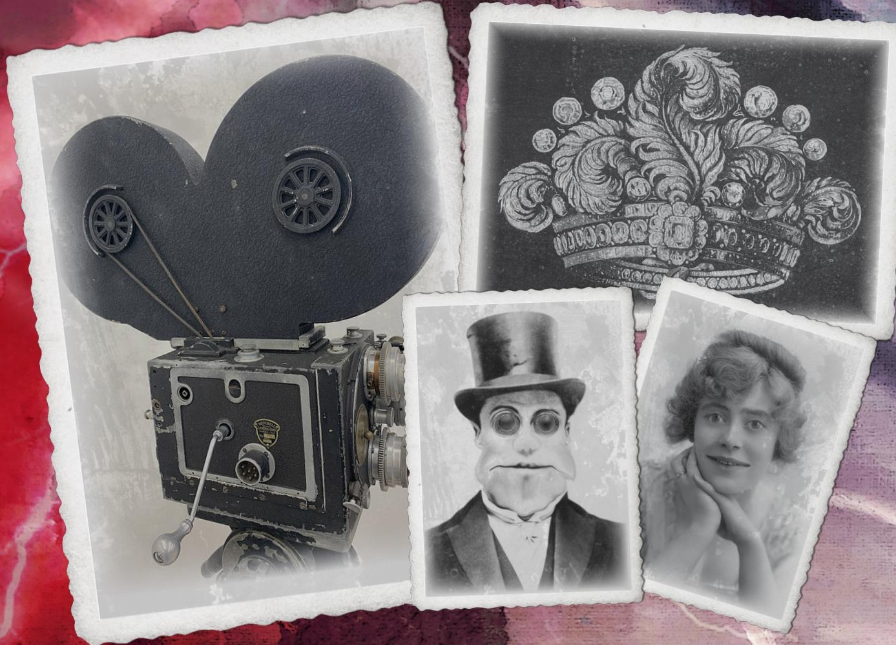

Lights, Camera, Action! It is 1923 and the era of silent film is in full swing. 'The Innsmouth Terror' will be a full-length three-act moving picture of a glamorous dame kidnapped by a tentacled monstrosity. In Technicolor!

The Innsmouth Terror is a classic 1920s scenario for Call of Cthulhu 7   edition, perfect for those looking for a pick-up-and-play scenario set in Arkham County. Designed for three to five players, it can be run over one to two sessions (4-8 hours).

## The booklet contains:

- A scenario designed for all levels of experience;
- Staging advice for running at conventions;
- Full colour handouts;
- Five pre-generated investigators;
- An additional print-friendly version.

This scenario can be run as a stand alone, or as a sequel to Stage Fright at the Playhouse by the same author.

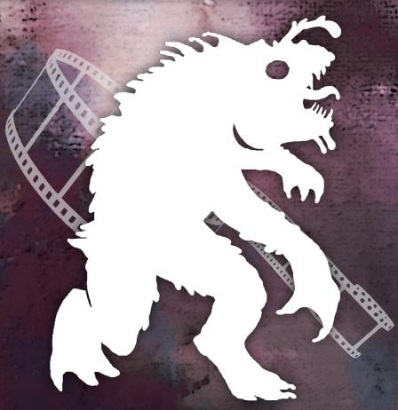
# THE INNSMOUTH TERROR

Written by

John Hedge, with The Playhouse Staff

Editing

Matt 'Doc' Tracey

Cover Art: Ann-Sofie Hall, with Pete Burgess

Handouts & Layout: SR Sellens

Proofreading: Aaron Adler, Matt Crouch, Maverick Haenze

Miskatonic University Seal artwork created by Propnomicon, used with

permission under Creative Commons license.

Miskatonic Playhouse logo created by Pete Burgess.

Mythos Monster Silhouettes by Simon Bray

Other photo assets from Pixabay and Unsplash

All other artwork, unless specified, is in the public domain.

MISKATONIC
PLAYHOUSE

This is a work of fiction. This book includes descriptions and portrayals of real places, real events, and real people; these may not be presented accurately or with conformity to the real-world nature of these places, people, and events, and are reinterpreted through the lens of the Cthulhu Mythos and the Call of Cthulhu game in general. No offense to anyone living or dead, or to the inhabitants of any of these places, is intended.

Call of Cthulhu is a Trademark of Chaosium Inc. and is used with their permission via the OBS Community Content program.

For more information please visit Chaosium's website: www.chaosium.com

Not for resale. Permission granted to print or photocopy this document for personal use only.
# CONTENTS

## [INTRODUCTION](#nri-h-1e7c84a4e9f5927381bc3dd4)

[Preparing for play](#nri-h-47551367143746af596d3df2)

[The Innsmouth Terror](#nri-h-e1e4abee7d665d664b579640)

[Involving the Investigators](#nri-h-5a1d3f11fa74d5bae7cbc1e7)

## [DRAMATIS PERSONAE](#nri-h-b1afc3d2767828f22a3d7b87)

[Genevieve 'Ginny' Dubois](#nri-h-88dac050ed1ec36f91e4b6fe)

[P.A. Bazzledon](#nri-h-4ad8df2678e05f458f288662)

[Anna Díaz](#nri-h-cd6a958ad9223013558284e5)

[Christopher McGuire](#nri-h-96bc6a07453b7b19ecf06440)

[Sammy Brewster](#nri-h-e0857213264e131c714fa054)

[The Crew](#nri-h-eb898a1c80749cbdbb6a2241)

[Minor NPCs](#nri-h-bf21a56d117d74edde8c045e)

## [START: ARKHAM](#nri-h-29da96049102775b4dcc2b3a)

[Orne Library](#nri-h-0712e7e461fd02534398a35f)

[The Arkham Advertiser](#nri-h-f81478a90f8941232106712e)

[The Miskatonic Playhouse](#nri-h-27b1ad17b7316f09136b83bc)

## [INNSMOUTH](#nri-h-640be35ee56417677f8750f5)

[Arrival](#nri-h-e6c805ba31dc84425c90fbc6)

[The Gilman House Hotel](#nri-h-591edd5bcf58d378b27f28cc)

[The Production Train Car](#nri-h-a6cc5383a39e0ec74e8769a8)

## [INVESTIGATION](#nri-h-579f6cee9279aa85f459d268)

[The Producer's Office](#nri-h-988fb78c5b2cac516d5570bf)

[Around the Train](#nri-h-62a8c5d75b10782b4e475a55)

[Bazzledon's Office](#nri-h-1e72d19ab832ccee9c380a67)

[Ginny's Trailer](#nri-h-9af9701e3f85a91ab3b92009)

[McGuire's Lab](#nri-h-7eae4a85cb793259eb9ed053)

[On Set](#nri-h-4a3bb4ef4c7d762c63fef3b4)

[The Railway Entrance](#nri-h-6e9d2e67b27162302be156fe)

[The Cave System](#nri-h-0377b0cfaf5eda9da814e2d8)

[Moving Through the Caves](#nri-h-d5b878609b4bc64831d97150)

[The Brewster Residence](#nri-h-f6184124151c4142421b1af0)

[Stumbling onto Set](#nri-h-b741e3b3e62d814b592d4419)

## [INTO INNSMOUTH](#nri-h-1e82f0c963d8a023793fa18e)

[The General Store](#nri-h-d012304a399a1e520aefdba5)

[The Fire Station](#nri-h-1b70234c4ece0af6255492e8)

[The Esoteric Order of Dagon](#nri-h-04a91268c2b7afffd26817db)

[Entering through the Caves](#nri-h-03dd1ed10876ac8ee6d9eb7e)

## [THE EPIC FINALE](#nri-h-9e45e6c31b8f513fdfc0cbcb)

[The Last Train out of Innsmouth](#nri-h-7b4e91617daf61336c70a8cf)

[Playing the Hero](#nri-h-db7abf043f1d139a51dd4c3f)

## [EPILOGUE](#nri-h-784561a8c2d6538c46980f3f)

[Rewards](#nri-h-ee0dadea1c956d399c954d44)

## [CHARACTERS AND MONSTERS](#nri-h-216abf1f13f006ed96ddabfd)

## [PRE-GENERATED INVESTIGATORS](#nri-h-cef5699cd74c24cd894040ee)

## [HANDOUTS](#nri-h-9eb21ebd1012f4d0e1572e0a)
# THE INNSMOUTH TERROR

"We shall swim out to that brooding reef in the sea and dive down through black abysses to Cyclopean and many-columned Y'ha-nthlei, and in that lair of the Deep Ones we shall dwell amidst wonder and glory for ever."

—H.P. Lovecraft, The Shadow over Innsmouth

## INTRODUCTION

Lights, Camera, Action! It is 1923 and the era of silent film is in full swing. 'The Innsmouth Terror' will be a full-length three-act moving picture of a glamorous dame kidnapped by a tentacled monstrosity. In Technicolor!

But when a valuable tiara is loaned to, and then summarily lost by, the production company, the investigators are sent to find it. They meet a disenfranchised film crew plagued by delays, a high-strung starlet desperate to get filming over with, and a new-fangled camera that keeps breaking. The sense of simmering boredom and frustration grows as the film crew find little mirth or distraction in the creaking town of Innsmouth. Just a sea of stoic, salty, scornful faces wishing these city folks would leave them in peace.

Can the investigators uncover the truth before the stakes get raised and the Innsmouth Terror shifts into something more horrifying than what is captured through the lens of a camera?

### PREPARING FOR PLAY

The Innsmouth Terror borrows heavily from the story The Shadow over Innsmouth (1936) by H.P. Lovecraft and utilizes some of the extended world building from Chaosium's Escape from Innsmouth (1992). However, knowledge of these books is not required to play in, or run this investigation.

This scenario is intended to follow on from the scenario Stage Fright at the Playhouse, itself a sequel to Edge of Darkness. However, the scenario stands on its own and can be thought of as sharing a universe and some NPCs with these other scenarios, rather than being a direct sequel.

Short on time? The investigation can start in Innsmouth (Investigation, [link](#nri-h-579f6cee9279aa85f459d268)). You'll just need to quickly explain how the investigators got to this point.

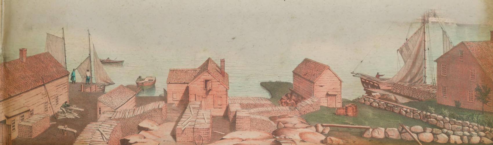
### KEEPER INFORMATION

The town of Innsmouth is a strange place. New England society has done its level best to ignore and forget this decrepit seaside village. Once a thriving port town, these days the harbor is full of silt, and only local fishing boats come and go with the tide. The train connection was abandoned not long after it was opened, the operators calling it the ‘least profitable line’ they had ever serviced. No one wanted to go to Innsmouth. And no one ever seemed to leave.

Back in the 1830s, Captain Obed Marsh of Innsmouth made a deal with the creatures that live below the Devil Reef, a dangerous set of shallows offshore from the harbor. The creatures supplied him with golden-alloy trinkets in exchange for glass and rubber jewelry. Marsh smelted down the trinkets and sold the pure gold, bringing wealth into the town and making the Marsh family rich and powerful. Those who benefited from the gold trade started a church they called the 'Esoteric Order of Dagon', a cult worshiping Dagon, god of the sea. The Esoteric Order slowly conquered the town of Innsmouth, driving out or converting everyone. But the embattled authorities fought back, jailing Obed Marsh and his disciples. The creatures, known as Deep Ones, then moved in to protect their worshipers, killing local law enforcement, and cementing Obed Marsh as the unspoken leader of the town of Innsmouth. This support came at a cost, and the members of the order were forced to take three oaths:

The First Oath: *“Iä! Dagon! I, (speaker’s name), do solemnly swear that I will neither interfere with, nor inform upon, the activities of the Deep Ones. Iä! Dagon!”*

The Second Oath: *“Iä! Dagon! I, (speaker’s name) do solemnly swear that, if requested to do so, I will render aid to the Deep Ones to the best of my ability, and in whatever form or manner is required of me. Iä! Dagon!”*

The Third Oath: *“Iä! Dagon! I, (speaker’s name) do solemnly swear that I take this entity [a Deep One] as my wife/husband, that I shall take them to my home, and that with them I will endeavor to have and raise children, so that the race, and the faith, can continue to prosper. Iä! Dagon! Iä! Hydra!”*

And so, with the third oath, Hybrids were born—offspring from the union between Deep One and human. Hybrids are born looking entirely human, but as they reach adulthood and mature, they begin to take on Deep One traits, such as enlarged eyes, webbed fingers and other markers of their heritage. This tends to be called the ‘Innsmouth look’. Eventually, most of the Hybrids become able to breathe underwater, and they slip into the sea and join their people down in the depths below.

**Ginny Dubois** (Born Ginny Brewster, [link](#nri-h-88dac050ed1ec36f91e4b6fe)) is one such child. Precocious and unreasonable, as many children are, Ginny ran away to study theatre. In doing so, she set a new standard in outrageously awful acting. Ginny is the prototypical starlet: she bought her way into various roles using stolen family money, but eventually even that wasn't enough to convince Directors to let her anywhere near a paying audience.

It is now 1923, and Ginny has struck luck once more. She is to play the leading role in an experimental new film, The Innsmouth Terror, and it's going to make her a star! Sure, she has to go back home for filming, but she's made a few adjustments to the script to poke fun at her backwards little village and their backwards ways.

When a Deep One artifact turned up on set, Ginny was asked to wear it as part of her costume. Disgusted by the idea, Ginny stole it and hid it in her old bedroom in Innsmouth.

Ginny doesn't know that the Director of the film, **P.A. Bazzledon** ([link](#nri-h-4ad8df2678e05f458f288662)) is himself in league with Mother Hydra. He hasn't hired Ginny for her looks, her money, or her talent. He has hired her to be sacrificed to a Star Spawn of the god emperor Cthulhu in front of the citizenry of Innsmouth, to be an unwitting stooge in a terrifying ritual, and to let all of Innsmouth know the fate of those that would betray their oaths.

**Table 1: timeline of events**

<table><tr><td>1922</td><td>Mother Hydra haunts the dreams of P.A. Bazzledon, driving him to Arkham.</td></tr><tr><td>3 weeks ago</td><td>P.A Bazzledon arrives in Arkham.</td></tr><tr><td>2 weeks ago</td><td>P.A Bazzledon convinces Henry Armitage to give him the Atlantean Jewel.</td></tr><tr><td>10 days ago</td><td>The Production heads off to Innsmouth by train.</td></tr><tr><td>9 days ago</td><td>Shooting begins, but is plagued by camera failures.</td></tr><tr><td>3 days ago</td><td>Ginny Dubois steals the Jewel from McGuire&#x27;s lab.</td></tr><tr><td>Now</td><td>The investigators are dispatched to Innsmouth to recover the Jewel.</td></tr><tr><td>Evening of the 2nd day</td><td>The Epic finale begins filming.</td></tr></table>
### THE INNSMOUTH TERROR

Technology is changing rapidly! Moving pictures are the latest big thing and there is a rush to develop color in film. While post-production coloring has been around for a while, the dream has always been to capture color in real time. In 1923, technicolor refers to a prism beam-splitting system, where two black and white films are recorded simultaneously, one behind a red filter, and another behind a green filter. The process is complex, prone to slipping out of alignment and, at best, finicky. Production constantly must stop while the engineer fixes and tinkers with the single camera capable of this feat.

The working title of this movie is The Innsmouth Terror. In the story, a young girl (played by Ginny Dubois) is fleeing from an abusive family. She then finds herself captured by evil frog-like creatures whilst running dramatically across a field. The frog-like men trap her inside a cave and taunt her. They then attempt to feed her to a giant tentacled monster. Luckily, the girl is saved at the last minute by an ingenious young man in a bowler hat, who throws a packet of Tum-Eez, an antacid, down the monster's throat.

Many of the finer details of the movie, such as the appearance of the frog-like men, have been adapted by Ginny to be particularly offensive towards Innsmouth locals, who have noticed that the cheaply-made costumes of the frog-men bear a not-so-striking resemblance to the Deep Ones.

During the scenario, production moves chronologically through the movie:

- When the investigators arrive, filming is taking place across a dramatic field beside the train tracks, just outside of Innsmouth.
- During the investigation, filming moves into the caves of Innsmouth, where the prison scene is being shot.
- In the finale, filming has moved to a cliff directly above Innsmouth, where the Star Spawn is summoned in full view of the citizenry.

**Keeper note:** The Innsmouth Terror isn't going to be a 'Talkie'. It's a silent film. The drive for color and sound in film all happened around the same time, but both at once? Madness.

### INVOLVING THE INVESTIGATORS

The investigators receive a letter from the Vice Chancellor of Miskatonic University informing them that the Orne Library, the main library of the University, loaned out one of its treasured artifacts to Bazzledon Productions for use in an experimental film. However, while onsite in the seaside town of Innsmouth, the production company has lost the artifact and suspects theft. The investigators have been tasked with recovering the jewelry and bringing back any evidence of the culprit so that it can be handed over to the local constabulary ([**Handout 1-a**](#nri-h-94205138fca7aa22510e0aca): letter).

The Innsmouth Terror assumes that the investigators are members of the Society for the Exploration of the Unexplained (SEU) and are students or employees of the Miskatonic University. However, they could equally be professionals or another group hired to work for the University; the Keeper simply needs to use [**Handout 1-b**](#nri-h-f8e3b2764c3b8f24c4c83bfa) (letter).

**Keeper note:** the Society for the Exploration of the Unexplained (SEU) is informal society made up of students and professors of the Miskatonic University. This society is established in the Call of Cthulhu Starter Set. Each time the SEU finds an interesting avenue of exploration, they choose the members that seem most capable of tackling the mystery. The SEU meets once a month in a private reading room of the Orne Library.

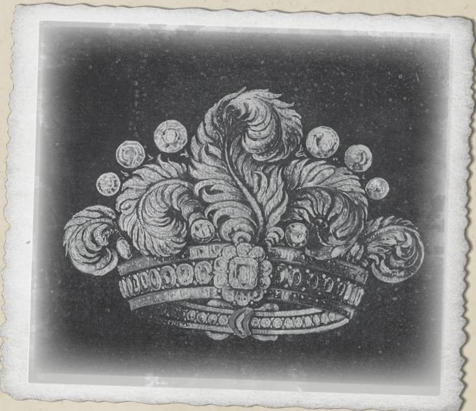

## DRAMATIS PERSONAE

### Genevieve 'Ginny' Dubois, age 25, starlet

In bad light, one might mistake Ginny's too-wide eyes and stretched-out smile for innocent beauty. But once the lights are shining and the cameras are rolling, only the thick makeup and dramatic angles can hide her slow transformation into a hybrid. She is determined to 'hit it big' before her transformation takes hold and will go to any lengths to make it so. Born in Innsmouth to a loving mother and a terrifying, Deep One father in 1897. It was assumed that one day, Ginny would join her brothers and sisters down below. However, Ginny had other plans. After running off with the family gold to study Theatre, she bought her way into various productions at the Miskatonic Playhouse. Sponsoring the productions in exchange for the leading role. However, the shows all bombed. She has now attached herself to the lead role of The Innsmouth Terror.

Ginny has milky-white skin, and wears far too much makeup. Her bleached blonde hair is up in curls; her bright red dress is the same colour as her lipstick and she smells faintly of lavender. A closer look notes that slightly wide-set eyes, the slightly cracked skin and the slightly oversized teeth.

Genevieve 'Ginny' Dubois

### P.A. Bazzledon, age 40, director & conman

Phineas Arthur Bazzledon is an up-and-coming director straight out of New York. Or at least, that's who he claims to be. With a tailored suit, a shiny top hat, and an amaranthine waist coat, he stands out in the crowd. A white man, sporting an impeccably groomed mustache that sits atop a strong, square jaw so often associated with power and leadership. The light touch of gray appearing in his hair only adds to his effortless sophistication. He rolled into Arkham a few weeks ago and started throwing money around the local acting scene like it was water. It wasn't long before he had the entire dramatic scene circling around him in a death spiral of devotion. When he announced his plans to shoot a silent movie in color, he had his pick of local talent.

Bazzledon is not who he appears to be. A con artist, in his youth, he joined a cult worshiping Dagon, thinking to make a quick buck. But he found that his oaths to Dagon were not easily broken. At night his dreams are wracked by Mother Hydra, the leader of the Deep Ones. She has instructed him to return the child, Ginny Brewster to Innsmouth and to sacrifice her above the town. The line of credit he is using to fund this shooting is entirely phony and it is only a matter of time before he is hunted down by one of the many loan sharks he has leaned on to funnel money into this moving picture. But by then, he plans to be well on his way to his next town, his next mark, and his next con.

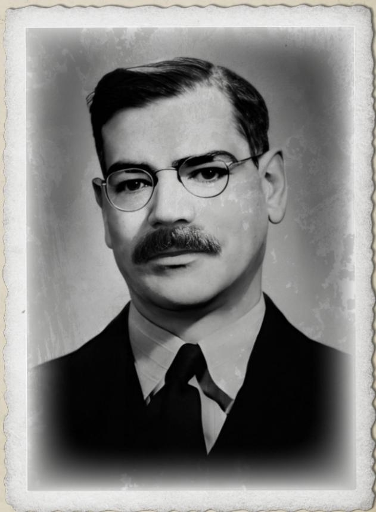

P.A. Bazzledon

### Anna Díaz, age 26, producer

A technically brilliant, funny, well read, hard-working actress, Anna long ago gave up on her chances of ever making it big. The starring roles go to elegant, blond-haired bombshells, not solid-looking farm girls with dark brown skin and acne scars.

However, her near encyclopedic knowledge of the Arkham scene and her ability to sort out just about anything made her the perfect hire for producer of The Innsmouth Terror. Not that Anna has ever produced a film before, but she's done plenty of stage shows and it can't be that different, right?

It was Anna who sourced the old train cart that the crew are living in. She got it at a steal, and it's far comfier than the tents that the crew would normally sleep in when on-site. It's also been a complete life saver now that production is dragging on day after day, as there are no decent hotels in Innsmouth.

Working with a ‘cinematic genius’ like Bazzledon has been difficult for Anna. His demands are often unexpected and unlike anything Anna would ever imagine. However, she is just happy to be learning from someone with so much experience. And mostly she’s learning on the job, figuring things out herself. Even if that’s not exactly what she expected to be learning.

Anna didn't get to where she was by not seizing every opportunity presented to her, so she's going to make this production a success, if she has to drag it kicking and screaming across the line.

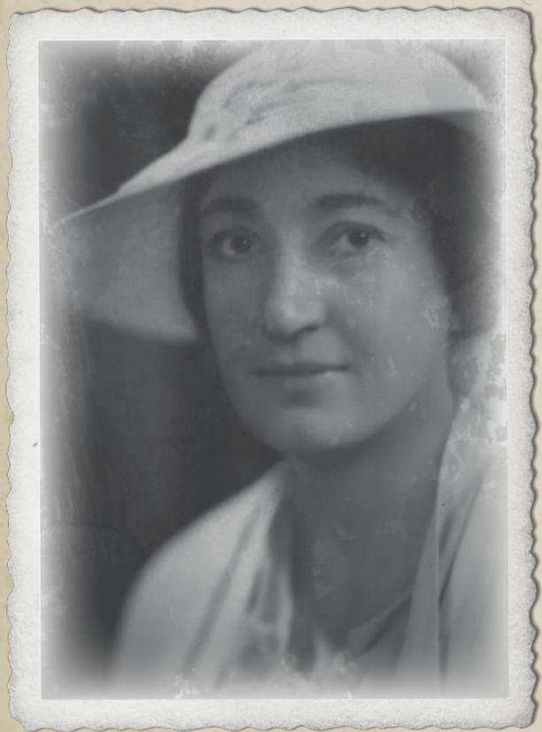

Anna Díaz

### Christopher McGuire, age 37, engineer

A tall, gangly looking white man with curly ginger hair tucked under a flat cap, Christoper McGuire is an awkward soul who only seems to come to life when he is working with technology. Incredibly tall and perennially hunched over his camera, he owns a small workshop just outside the grounds of the Miskatonic University. He has been known to give the occasional guest lecture to the Engineering department, though less frequently these days, as none of the academics are quite sure what he's up to.

It was McGuire that pitched the idea of filming in technicolor to Bazzledon not long after he arrived in Arkham. And Bazzledon seized on the idea as the perfect long con.

Sadly, the technology really isn't ready for a full-length film. It isn't really ready to be taken out of the lab. The camera keeps breaking, prompting multi-hour pauses during filming where production grinds to a halt. McGuire is doing everything he can to keep the process going.

McGuire is desperate to make the film work and has invested all his savings into this endeavor. He needs the film to be completed and will keep the camera rolling to the very end.

Christopher McGuire

### Sammy Brewster, age 21, dilettante & sibling

A perfectly pleasant young white man from a rich family, Sammy is just starting to show the infamous Innsmouth look: his too large eyes and slightly fishy features make him more boyish than handsome; his slick blond hair gives off the impression of being slightly... damp.

Sammy has been hanging around the production camp trying to speak to his sister, Ginny. A couple of days ago, he was caught by the crew, who gave him the black eye he's now sporting on his right eye. Ginny has made no move to contact him. She's just not interested.

Sammy Brewster

### The Crew

An unruly mob of heavyset men and women that do the lifting, the organizing, and occasionally play secondary roles in the film such as ‘Scary fish-man number 2’. They can mostly be found hanging around the production train or doing a variety of jobs around the set. Infinitely interchangeable and of indeterminate number, the Crew enjoy getting drunk and hanging around a fire pit in the evening. A simmering tension exists between the Crew and the residents of Innsmouth, and more than one fight has broken out between the groups.

## MINOR NPCs

### Diane Loring

The diligent head of research at the Orne Library. She helps the investigators in their search through the archives and point them towards the Arkham Advertiser. She is a serious, dark-skinned woman in her late 40s with naturally graying hair. Diane Loring is courteous to the investigators, though stops short of being friendly. If any investigators are students, they'll be aware of Loring's fierce reputation. She is always willing to help students with serious questions, but she dislikes noise or complications in the library.

### Henry Armitage

The famous Head Librarian of the Orne Library may already be known to the investigators. He may choose to help the investigators in place of Diane Loring.

### Karen Jeffries

The slightly tetchy, opinionated, bossy head of the Arkham Advertiser, Karen is a firm believer that people never show her enough respect and will absolutely not have time for a group of investigators who think their investigation is more important than the news. However, if they sweet talk her or seem useful, she will fall over herself to help them out.

### Franc Turner

Janitor of the late Miskatonic Playhouse. Franc is a slightly graying Black man wearing blue overalls and sporting an impressive mustache. He is tall and broad shouldered and barely fits into his shirt.

### Jeremiah Brewster

Second highest ranking priest in the Esoteric Order of Dagon. He keeps the residents of the town firmly under control so as not to upset the Deep Ones. His transformation into a Deep One is almost complete.

### Pete

Proprietor of the Innsmouth General Store. He is cheery and friendly to the investigators. He clearly doesn't get much business and is glad to see some new faces.

### Zadok Allen

The infamous drunk from Shadow over Innsmouth. He knows the full story of Obed Marsh, his deal with the Deep Ones and the three oaths the people of Innsmouth were forced to swear.

## START: ARKHAM

### ORNE LIBRARY (MISKATONIC UNIVERSITY)

Our mystery opens in the quiet surroundings of the Orne Library in the Miskatonic University. The Society for the Exploration of the Unexplained (SEU) normally only meets once a month in a private reading room, but this unscheduled meeting has been quickly pulled together due to a request coming in from the Vice Chancellor of Miskatonic University themselves! The Vice Chancellor requires their help in recovering the Atlantean Jewel, a bizarre looking tiara made of alloyed gold ([**Handout 1-a**](#nri-h-94205138fca7aa22510e0aca): letter). It is the only one of its kind and an archaeological treasure. The note from the Board says little, other than to encourage the investigators to contact Diane Loring for further information.

As events transpired, Henry Armitage, the Head Librarian, simply unlocked the glass case and handed the artifact over to P.A. Bazzledon after he provided a signed note from the Vice Chancellor of the University stating that he had been given permission to take the item. The note was, of course, a forgery. An internal review will eventually find Armitage was tricked into providing the artifact and dock him one week's wages. Investigators may be tempted to try and find out who was responsible for lending out the Jewel to Bazzledon. If they do so, they find the university staff incredibly uncooperative. Armitage is well-loved and his employees fiercely protective.

The investigators' first port of call is most likely to be Diane Loring, the diligent Head of Research, who works at the main desk.

Loring explains that the Atlantean Jewel is a treasure that was housed securely in the Orne Library behind a thickened glass case. Its exact history and precise origin are the subject of some fevered debate in certain archaeological circles. Most scholars believe that it was forged by an ancient, now lost, civilization, hence the rather uninspiring, name for the artifact. It was ‘erroneously’ lent out to a production company for the filming of an experimental film. The production appears to be in Innsmouth, a small town northeast of Ipswich. No major roads go to the town, and the only rail connection was through Rowley closed a few years ago. She believes there is a bus service to Innsmouth that leaves at 9pm from Dyer Street.

- Investigators asking how the artifact came to be let out get a dismissive glare from Loring. She explains that she believes phony credentials were provided to an ‘important’ member of the library, who handed the artifact over in good faith.
- If asked how the university found out about the theft, Loring responds that the producer Anna Díaz reported the loss of the Jewel to the University.

Diane Loring

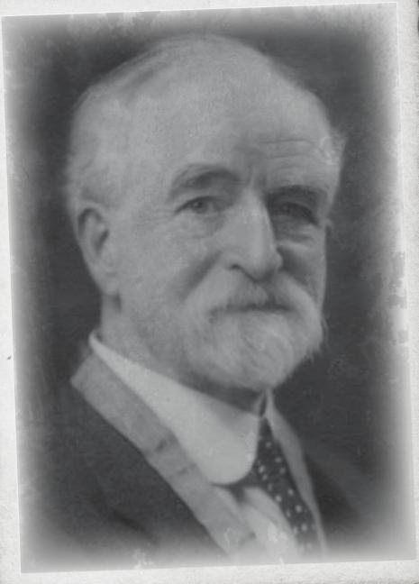

Dr. Henry Armitage

**Keeper note:** it is very common for Investigators to come up with elaborate theories and ask questions that are not contained within the bounds of the scenario. If they do ask a question to which there exists no obvious answer, feel free to improvise an answer that ideally leads them back to information relevant to the scenario.
- On a successful Archaeology roll, investigators pull a little more information from Loring about the artifact. It is a tiara of an unusual gold alloy, one that modern science is unable to replicate. Such treasures are occasionally pulled up from the sea floor by fishermen, who then go on to sell them. This one is vaguely associated with the town of Innsmouth, which is why it was likely taken.
- Loring is not aware of any of the details of the film or its crew and recommends that investigators contact the local paper The Arkham Advertiser (adjacent) to find out more. She further mentions that, of course, the resources of the Orne Library are available to them should they need it.

Investigators may take many different avenues of research when using the Orne Library. To uncover general information about Innsmouth and the artifact, they can use a general Library Use roll. They may also use different avenues of research to come to some general conclusions about the theft:

On a successful Occult roll, investigators are aware that such artifacts are often highly prized by cults and secret organizations, who often revere items from lost cultures.

On a successful Anthropology roll, investigators intuit that the most likely people to steal a cultural treasure are those that it originally belonged to. They have this rather unusual belief that the treasure somehow belongs to them.

On a successful Law roll, investigators think it's probably best to just follow the money. Who are Bazzledon Productions? And would they benefit from selling the item?

For more up-to-date information, they would need to talk to people or visit The Arkham Advertiser (adjacent).

**Keeper note:** the description of the Jewel will be familiar to any player who has read The Shadow Over Innsmouth, and the Keeper can be relatively open with the players that the tiara is clearly linked to Innsmouth. The Jewel was made by the Deep Ones and traded to the people of Innsmouth as part of their ongoing deal. Tiaras like the Atlantean Jewel are often worn by priests of the Order of Dagon or melted down to produce gold.

### THE ARKHAM ADVERTISER

While the Orne Library may be the ideal place for delving into the past, nowhere can quite beat the upbeat Arkham Advertiser for the latest news and gossip around town. Its proprietor, Karen Jeffries, is perhaps, the most self-important gossip in town. If the investigators arrive during the day, there is a flurry of activity in the new room as Jeffries and her employees sit around one large desk, talking excitedly on their phones, chain smoking cigarettes, passing notes between each other, all while intermittently typing away at their typewriters. The place is vibrant and bustling. Investigators attempting to interrupt Jeffries before she is ready to speak to them get an earful and are told to wait to the side, where a set of incredibly uncomfortable green chairs sit. However, if they wait patiently, Jeffries turns her attention to them after what seems like forever.

**Keeper note:** if the investigators have met Karen before, then she may react differently to them. Karen is best approached with offers of large sums of money to support the work of the Arkham Advertiser. Failing that, she is quite shallow and likes those with high Credit Rating or Appearance scores.

Karen Jeffries
Investigators asking Karen for help get nothing for nothing, and Karen must be convinced with a successful Charm or Persuade roll, unless they bring her an exclusive story about how the Orne Library lost a priceless artifact. That interests her and she is then willing to share what she knows about the various players if the investigators are willing to provide an anonymous quote that would bring the great Miskatonic University into disrepute.

Once Karen does open up though, she is absolutely brimming with gossip about The Innsmouth Terror.

- The Director, P.A Bazzledon, appeared in Arkham about three weeks ago. He came up from New York, where his name is associated with a number of off-Broadway hits. It seems he's a bit of a rising star.
- Bazzledon has been absolutely throwing money around. Jeffries would love to know how he made his fortune; she's written multiple articles about the mysterious sources of this theatrical dilettante and rumors abound. Everything from family money, to piracy, to striking gold in the west has been suggested. However, the man remains an enigma.
- The project is apparently to be filmed in 'Technicolor'. The claim is that this produces real color! Jeffries published a piece about the inventor Christopher McGuire recently. He's an oddball that occasionally works with the University.
- The star of the film is one Ginny Dubois, who recently had a run of shows at The Miskatonic Playhouse (adjacent), before it burned down in mysterious circumstances. Her acting skills are 'limited' but Jeffries has taken a shine to her. (On a successful Psychology roll, investigators realize that Ginny donated money to the Advertiser in exchange for positive reviews. Actually, it's pretty obvious on a failed roll, too.)
- The producer purchased an old rail sleeper train and had it driven out onto the abandoned rail line from Innmouth to Rowley. The whole crew are staying there as the town of Innmouth apparently lacks hotels of sufficient quality.

If asked about Innsmouth, Jeffries makes a face. Apparently, nothing of importance has happened in Innsmouth in a hundred years. The only paper, the Innsmouth Courier, went out of business back in the 1840s. She considers it almost beneath her to even discuss it. Though, and her voice drops into a whisper, rumors have it that the starlet Ginny Dubois is, in fact, originally from Innsmouth. Though she claims she's from Newburyport.

### THE MISKATONIC PLAYHOUSE

Investigators may have connected Ginny Dubois to the Playhouse and go there searching for clues. Sadly, the Miskatonic Playhouse has burned down. As the investigators stand outside the wreckage of this once proud building, the only person visible is an older Black man, who appears to be cleaning in amongst the wreckage. This is Franc Turner, the handyman of the Playhouse.

Franc remembers Ginny Dubois as the starlet of the show. He describes her as ‘trouble’ and he’s glad to be rid of her. Ginny seemed to have one aim in mind, and that was to get herself to Hollywood and become a star. She didn’t seem to care about who got in her way or why. If investigators pass a Social roll with Franc, he admits that he heard rumors that all her money came from her family, and that they’d sent some lawyer after her attempting to get it back.

**Keeper note:** if the Miskatonic Playhouse did not burn down in your run through of Stage Fright, then it burned down soon afterwards in another mishap. Never fear though, it will shortly be rebuilt!

Ryan Turner
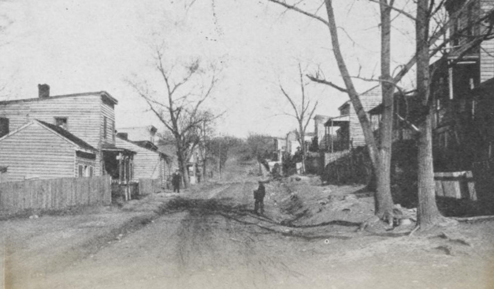

## INNSMOUTH

### ARRIVAL

The investigators can take the 9pm coach to Innsmouth from Dyer Street. It costs 40c and takes a little over 45 minutes. The coach itself is rickety and travels slowly, however, it drops them off in New Town Square, Innsmouth. Investigators with a car may instead choose to travel there in style. However, the road to Innsmouth is small, bumpy, and badly maintained. The driver should pass a Drive Auto roll or find they were driving too fast, blowing out the rear axle on the way to Innsmouth. They are then forced to hitch a ride with the bus anyway.

**Keeper note:** it is better that the investigators don't have a car as this will limit their ability to remove themselves from the situation in the town.

It is getting late when the investigators arrive in town. As the bus rolls in, a distinctive fishy odor overwhelms their senses. The smell is unpleasant and ubiquitous in the center of town, getting worse as they slowly approach the harbour. It mixes in with the seaside breeze that is constantly blowing through the town. The streetlights aren't on and the night is only lit by the orange-lamp headlights of the bus. The thundering sound of multiple waterfalls is audible throughout the town, masking the queer sounds that emanate from many of the dark, ruined houses.

The investigators could not telephone ahead to book rooms in a hotel, as Innsmouth does not have a phone line. The bus driver croaks quietly to them that there are always rooms available nearby in The Gilman House Hotel ([link](#nri-h-591edd5bcf58d378b27f28cc)), and he points at a building just off the square. Light falls out into the street from a downstairs window, and the front doors are open. If one were to squint slightly, it would almost appear inviting.

Investigators can stay at the Gilman House Hotel, or they spot a firelight at the edge of town. This is the Production Train Car ([link](#nri-h-a6cc5383a39e0ec74e8769a8)), where Anna Díaz will find beds for them.

### THE GILMAN HOUSE HOTEL

The Gilman House is the infamous hotel from The Shadow over Innsmouth by H.P. Lovecraft. Some groups may beeline straight there, anticipating the horror, while others will do their utmost to avoid it.

Regardless, this once upmarket hotel was built in the 1830s and is now showing its age. Creaking floorboards and dusty carpets greet the investigators; flickering gas lights illuminate the reception. Behind the desk, a pleasant, avuncular looking receptionist takes their names and assigns them the ‘freshest’ rooms on the top floor. He comments in a smiling way that they generally use the top floors for ‘out of towners,’ as they are quieter and the ‘odor’ is ‘less overt’. He knows it takes some getting used to.

The hotel lacks any semblance of a concierge service and the receptionist's advanced age tells the investigators that they will have to carry their own luggage up the creaking wooden steps to the top floor in the darkness. The receptionist hands them a spare lantern if they think to ask for it. He informs them there will be a lantern in each room and a ‘bedpan’ under each bed. (The actual toilets are at the far end of the hallway).

As the investigators wander up the stairs, they should all make Listen rolls. Successful rolls alert the investigators to an array of odd wheezes, croaks, gasps, and one stifled scream coming from the lower floors of the hotel. This prompts a Sanity roll (0/1 loss) from whomever hears the noises.

When they enter their rooms, they find a no-nonsense, though slightly dated, hotel room. A pail of fresh water sits by the window, there's a small writing desk, and a single bed. The investigators' rooms are not beside each other, spread out across the building. The bolt locks on their rooms are flimsy, almost pointless.

On a successful Spot Hidden roll, investigators notice that each of their rooms has a connecting door to the one beside it So two rooms (or more) could be connected to create a small suite. A more paranoid investigator may realize that someone could easily enter their room even if they have their door bolted and barred.

It is at this point that many investigators may choose to flee the Gilman House Hotel. Nothing bars their way as they make their apologies and leave. If they do stay the night, the investigator with the lowest Luck wakes around 3am to the sound of someone attempting to open their door. If they took no precautions and didn't bar the door, instead they hear the door softly closing, as if someone has been watching them sleep.

### THE PRODUCTION TRAIN CAR

On the edge of Innsmouth, to the north-west, a firelight glows. It is the only point of light visible from sleepy Innsmouth in the dark—most of the windows are covered up by thick curtains to keep the light (and sound) in. Investigators following the light can quickly pick up the abandoned train track and follow it to the Production Train Car.

Investigators may arrive at the Production Train late in the evening or early the next morning after spending a disturbing sleepless night in the Gilman House Hotel.

If they arrive in the evening, then they find various crew members sitting around a fire sharing stories, drinks, and laughing together. One of the crew, a well-built woman, stands up to greet them. This is Anna Díaz, the producer. She introduces herself but quickly packs them off to one of the sleeper cars to get some rest, promising to answer all questions in the morning. They are accommodated in a small, but surprisingly comfortable room in the train car, with enough beds for the entire group. They fall asleep to the sounds of laughter and merriment on the edge of their hearing.

## INVESTIGATION

### THE PRODUCER'S OFFICE

It is early morning; though the sun is attempting to pierce its way through, it will be hours before it can burn off the mist blanketing the Manuxet valley. Anna Díaz sits at her crowded desk, retrofitted into a sleeping compartment of the Production Train. The smell of fresh coffee fills the room, the window is open, and birdsong can be heard in the distance. The investigators crowd into the remaining space of the room. There's not enough room for them all to sit, and only one other chair.

Díaz thanks the investigators for coming and apologizes again for losing the Atlantean Jewel. She understands that it is a treasure of utmost value and notes how incredibly thankful the production was that the University agreed to share it with them in the first place.

As soon as she realized that the Jewel was missing, she notified the University and conducted a thorough search. In retrospect, she is embarrassed to admit that she immediately suspected the Crew. Which isn't very class conscious of her. She had the Crew search through each other's personal effects and paired them up to look through the entire train. It's not like the Jewel is small. So she is fairly certain that it is not hidden on the carriage.

Díaz is unsure of where the Jewel was taken from and no-one seems to know where it was being stored. Bazzledon believed it was in McGuire's Lab. McGuire thought it was stored in a safe in Bazzledon's office.

Díaz doesn't want to prejudice the investigators' inquiries and wants them to consider all options. That being said, there are only three places she has been unable to search:

- P.A Bazzledon's office: "But why would he steal the Jewel, he is furious that it's missing, and he's the one that went to such trouble to get it for filming anyway."
- Ginny Dubois' trailer: "But she literally comes from money. I can't think of one single reason why she'd engage in petty theft."
- Christopher McGuire's lab: "He absolutely forbids anyone from entering there. And for good reason. That's where all the delicate technology is stored."

Her only other lead is that there has been a young man from Innsmouth hanging around the set. Most of the locals have been staying well clear of the production, but this one has been spotted amongst the train cars more than once. Some members of the crew ran him off a few nights ago. Díaz suspects he is their strongest lead.

The investigators are also, of course, free to speak to everyone on the crew. This morning they are doing some ‘re-shoots’ out on the field beside the train tracks, so everyone will be in one place.

Díaz is overtly helpful, detail oriented, and entirely honest with the investigators. She will do anything, within reason, in her power to help the investigation. With a successful Social roll, investigators can even convince her to ‘accidentally’ leave the spare keys for the various train cars on the desk when she heads out. Otherwise, investigators can attempt to snatch them with a Sleight of Hand roll, or sneak back into the office and take them with a successful Stealth roll.

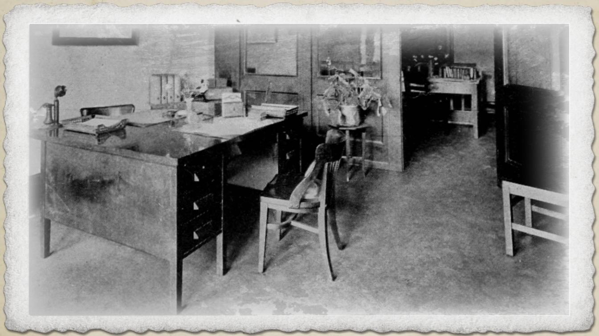

### AROUND THE TRAIN

Set beside the sleeper car, attached to the antiquated steam engine, a diner car has been hastily converted into a number of large spaces. Entering from the steam engine side leads to Bazzledon's Office (below), the center leads into Ginny's Trailer ([link](#nri-h-9af9701e3f85a91ab3b92009)), and the far side has a small ramp built into it that leads into McGuire's Lab ([link](#nri-h-7eae4a85cb793259eb9ed053)). All three doors are locked, requiring keys or a successful Lockpick roll. Once the investigators have access to one, the walls are cardboard thin and can be peeled back, allowing them to move between trailers.

### Bazzledon's Office

The curtains are lazily pulled in this office, letting sharp beams of light cut through the dim, dusty haze. For the most part, Bazzledon is never in his office; instead he is always on set, shouting directions, making plans, and working to bring about the final scene, the culmination of his plans.

In one corner, a tangled mess of bedsheets indicates the location of a bed. Beside it, a large trunk full of clothes and a large mirror takes pride of place. A cold iron rests beside it. In front of the mirror, a half dozen vials of make-up, gels, and ointments are neatly stacked. His desk is built out of an old train table and it is covered in papers. The other side of the room contains two comfortable looking armchairs, between them sits a small table with a number of expensive looking liquor bottles on top.

Investigators can take many different avenues of investigation while in this room, uncovering different information:

The papers on the desk are rather overwhelming and nothing of value comes out on a quick glance through the dense sheets of numbers and words.

- On a successful Accounting roll, investigators realize that Bazzledon's numbers don't add up. There's no attempt to budget or forecast costs for the film. Whatever reason he has for making this movie, it's not about cash.
- A Spot Hidden roll uncovers a letter scrunched up and tossed in the bin. It is from someone named 'Fat Tony' politely explaining to Bazzledon that Fat Tony knows Bazzledon has moved up to Arkham and that if Tony's money doesn't make its way back into Tony's hands by the end of the month, then he will be forced to take 'regrettable steps' to secure his investments.
- Investigators looking into the scripts can use a Language (English) or Library Use roll to sift through the various drafts abandoned in a pile. It becomes clear that earlier drafts of the script called for the kidnapping to take place by human cultists rather than frog-men. The frog-like additions appear to have been added by Ginny Dubois.
- Anyone reading the correspondence discovers there was a bidding war by various companies to sponsor the film. While a major cough syrup company offered \$6000 to be paid on release, a new antacid company called Tum-Eez offered Bazzledon \$4000 upfront. He appears to have chosen the lower bid and taken the money.

- Investigators trying to get into the mind of Bazzledon may use a Psychology or Psychoanalysis while looking around his room. On a success, they see the disrepair and disorganization in his private affairs, and compare it to the detail and care he takes in his appearance and his make-up. They note that this is a man who cares about how he is perceived, caring for his makeup supplies with the same care as one would see from an artisan caring for his tools.
- Investigators interested in the makeup may attempt a Disguise roll to realize that these are the tools of someone familiar with changing their appearance regularly, and not just those of a showman who likes to look good.

Eventually, the investigators notice the locked floor safe hidden under a creaky floorboard. Breaking in requires a successful Lockpick roll. They could also unscrew it with a successful Mechanical Repair roll. Inside, the investigators uncover \$4000 in cash, as well as an old Derringer handgun. But no tiara.

Investigators can conduct a thorough search of Bazzledon's office and come away with no evidence that he has taken the tiara. They also find no evidence connecting him to Mother Hydra, as he receives instructions in his dreams and never writes any of it down.

### Ginny's Trailer

Ginny's trailer is bright, the windows open, catching a little of the sea breeze, intermingled with that fishy scent that seems to follow everything in Innsmouth. Alongside these familiar scents are spikes of strong perfumes. At first, the investigators might think that the place has been ransacked. Clothes cover every conceivable surface and the only clear floor space is around a large mirror, surrounded by incandescent bulbs. Even here, the discarded mascara brushes and dried-up make-up sponges are piled up and messy. It's only possible to infer the location of the bed, as it is effectively just a pile of clothes at the far end of the room, almost a nest.

Underneath the mess, a fragmented car-crash of pink, frilly cushions and blood-red coverings are lazily arranged over modern, expensive-looking furnishings. As the investigators step in and around the mess, they choose to stand near the windows to survey the room, as the mixture of scents is drastically unpleasant.

Investigators trying to open the windows up further or passing a Spot Hidden roll find a scribbled note attached to the frame ([**Handout 2**](#nri-h-1701b4c74a5e58fac76c83d3): note).

If the investigators don't find the note on the windowsill, they instead find [**Handout 2**](#nri-h-1701b4c74a5e58fac76c83d3) dropped into the trash can in one corner while searching the room.

The only things that are not clothes in the dressing room are a few scattered frames of Ginny posing with minor local celebrities and a framed news article from the Arkham Advertiser telling the ‘tragic’ story of the burning down of the Miskatonic Playhouse, tragically cutting short a celebrated (three star) run of Woman in Bronze fronted by the ‘rising star’ Ginny Dubois.

Investigators can look at the wall between Ginny and McGuire's rooms. On a successful Track roll, they note light marks and folds in the cardboard, indicating this wall has been pulled back before. It's difficult to tell which side the marks come from.

There is nothing else in the room of value or interest, and investigators can quickly make their exit.

If the investigators don't bother searching the trailer, or fail to enter, have them spot [**Handout 2**](#nri-h-1701b4c74a5e58fac76c83d3) flapping against the trailer window frame as they pass by.

### McGuire's Lab

Wooden lab benches cover one entire length of this room, whilst on the other side, spikes are interspersed along the wall with heavy film roll hanging from them. Film is strewn just about everywhere, like a drunken spider's web, and all the windows are blacked out by thick curtains. McGuire's main workspace is lit by a pair of harsh incandescent bulbs without any lampshades. A partially disassembled camera is in pieces on the workbench. An investigator passing a Science (Engineering), or Electronic Repair roll marvels at the quality of workmanship that has gone into this camera. This truly is cutting edge technology. It seems to use a prism to split the light in two and then there are filters set up to record two identical scenes at the same time.

Though the lab may be messy, there's not really anywhere to hide in it, and none of his drawers are locked. While investigators come across a wide variety of unsafe chemicals, they find no hidden treasures.

On McGuire's desk, they find a short map of a cave system. Drawn using a ruler and many right-angles, it's more of a conceptual cave map. However, the map seems to lead.... somewhere.

This might look suspicious, but it's actually just a guide on how to reach the cave where the prison scene is going to be shot later today. McGuire and Bazzledon explored the caves a few days ago and have picked a great location. If the investigators follow the map, they Stumble onto Set ([link](#nri-h-b741e3b3e62d814b592d4419)).

**Keeper note:** none of these chemicals burn well, and the most dangerous of them is only a light acid. They are however, toxic, light sensitive, and expensive. The film? Nitrate based and incredibly flammable.

### On Set

During the initial investigation, everyone involved in the production is working in a large open field beside the abandoned rail tracks. The weather today is dramatic, with stormy clouds threatening thunderstorms later, but for now there's only a light breeze blowing.

This is likely the first opportunity the investigators have had to look over the dramatic landscape of Innsmouth. The valley below looks to be one extended swamp, but rising up above the far side of the town, jagged peaks and cliff faces give a feeling of enclosure and isolation. It's hard to imagine that this lost bit of coastline is only a 45 minute bus ride from Arkham. Truly, modern technology is a marvel.

P.A Bazzledon and Christopher McGuire are quietly arguing over some technical points by the camera. Meanwhile, Ginny Dubois is resting on a foldable chair under a giant mink fur coat in a thick pair of sunglasses, while smoking from a cigarette holder. Two larger members of the Crew are sitting on the ground nearby, playing the dice game Twenty-Six. They are half-dressed as ‘frog-creatures’: their legs are made up to look scaly and wrong. Lying on the ground beside the Crew, there is a sort of plastic mold that looks like it covers a person’s torso, arms, and head, turning them into a plastic-y frog-like creature. At first glance, it’s a terrifying twisting of plastic lying haphazardly abandoned on the ground. It is only after the Crew get up and begin preparing for the scene that investigators truly comprehend it as a piece of costume.

**Keeper note:** while to a modern eye, the plastic costumes may remind them of out-of-date B-movies or Doctor Who reruns, to the public of the 1920s, elaborate costumes are quite new and unusual, and the investigators may genuinely be a little disturbed by it.

Investigators can stand and watch filming for a while, but nothing of interest happens. Ginny is not a good actress, hamming it up horrendously. And the scene they are shooting is little more than her running slowly through the field while the two lumbering frog creatures pursue her. Investigators passing a Spot Hidden roll notice the reflection of some bit of light from a set of rocks by the tracks on the way into town.

It seems that, while filming, no one has time for them on set. Investigators may choose to investigate the rocks by the tracks, heading to The Railway Entrance ([link](#nri-h-6e9d2e67b27162302be156fe)). They can instead choose to wander down Into Innsmouth ([link](#nri-h-1e82f0c963d8a023793fa18e)) and begin asking questions there.

Other than that, the remainder of the set is an empty field. The creaking cast iron structure of the old railway station is about five-hundred yards away. Investigators notice there's a foreboding looking gap between the rocks by the tracks if they head towards the station

Investigators initially approaching Bazzledon get a very brief welcome and his deepest gratitude for agreeing to help ‘sort out this little problem’. The man is charming but apologies and says that the matter of the film must come first, similarly McGuire brushes the investigators off, uninterested.

Investigators can approach Ginny before filming starts. She assumes they are fans and of course declares that she will give them her autograph. Bustling around, she demands they produce pen and paper, taking charge and signing a rather intricate signature with a heart over the i. Investigators interrupting this little ritual, or clarifying that they are not fans suffer a penalty die on any future Social roll with Ginny.

- Investigators asking Ginny if she knows anything about the Jewel are told that she has no idea where it could have ended up. Maybe it's just lost somewhere on the train. That Díaz girl is a bit of an airhead after all.
- If asked about [**Handout 2**](#nri-h-1701b4c74a5e58fac76c83d3), Ginny doesn't recognize it, but worries that it might be one of her fans. Some of them get a bit intense. Not like the lovely investigators, who seem adorable.
- If asked about the rest of the cast, Ginny is effusive with her praise of Bazzledon, ("Such a great mind!"), a little colder over McGuire ("Why can't he get that damn machine to work?"), but saves her most savage critique for Díaz ("She just seems a bit uppity you know? Like she doesn't know her place.")
- If asked about Innsmouth in general, Ginny marvels at the quaint little town, saying it's her first time here, but she much prefers the hubbub of Arkham.

Ginny's answers are overtly performative and anyone passing a Psychology roll intuits that she likely knows far more than she is telling about the Jewel, the note, or the town of Innsmouth. But they don't get any time to push her on details.

After asking Ginny a few questions, there is the sound of whirring as McGuire fixes the camera and Ginny immediately extricates herself from questioning and makes her way out in front of the camera. The two Crew members begin to suit up and are suddenly terrifying frog creatures and Bazzledon cries 'Lights, Camera, Action!'

**Keeper note:** have the investigators met Ginny before whilst playing through Stage Fright? Don't worry about it. She doesn't remember them at all and treats them exactly the same.

### The Railway Entrance

A set of foreboding looking sharp rocks fall against one another creating a natural arch. Stepping through, a small grassy area with a lightly trodden path leads towards a slotted hole that runs down into some naturally forming tunnels. If investigators saw the glint of light while On Set ([link](#nri-h-4a3bb4ef4c7d762c63fef3b4)), their eyes dart towards the broken binoculars lying on a rock. Otherwise, it requires a Spot Hidden to notice the binoculars.

If investigators have found [**Handout 2**](#nri-h-1701b4c74a5e58fac76c83d3), they can follow the map instructions from here through The Cave System (below). It leads to The Brewster Residence ([link](#nri-h-f6184124151c4142421b1af0)). If they have no instructions and choose to enter the caves anyway, they exit the caves through an abandoned house in central Innsmouth.

### THE CAVE SYSTEM

Sitting underneath the town of Innsmouth and its accompanying cliffs, are a warrenous set of tunnels that have been used by smugglers and deep ones alike to move around unseen for generations. Moving through the caves is awkward. There are no directions, just large, jagged rocks that have been occasionally cleared to create rough pathways through the stony labyrinth. Minor additions, such as cut handholds and the occasional ladder suggest routes, but frequent cave-ins mean that not all pathways are trustworthy, or lead somewhere.

Investigators with an idea of where they are heading may make a Navigate roll in order to try and head that way through the caves. On a success, they arrive where they meant to. On a failure, they come up in the entirely wrong place (normally an abandoned home in Innsmouth).

Throughout the scenario, investigators may return to the cave system many times. The caves can lead to The Brewster Residence ([link](#nri-h-f6184124151c4142421b1af0)), Stumbling onto Set ([link](#nri-h-b741e3b3e62d814b592d4419)), Into Innsmouth ([link](#nri-h-1e82f0c963d8a023793fa18e)), and The Esoteric Order of Dagon ([link](#nri-h-04a91268c2b7afffd26817db)).

Keepers should make sure they are aware of the light source investigators are using (they likely have a lantern with them), who is holding the light, and in what order they are moving through the cave system.

### Moving Through the Caves

Whenever the investigators are moving around the cave, have them roll 1d100 and use Table 2 ([link](#nri-t-tbl-p022-001)) to generate an encounter. Roll at least two encounters each time they traverse the caves. If investigators roll the same result twice, take the entry below the one they rolled.

The standard way for the investigators to move into the cave system is by finding the entrance by the railway tracks.

However, there are many entrances to the caves, and the Keeper should be aware that finding an entrance to the cave system is an excellent way to move the action along if the investigation goes off in an unusual direction. In this case, they can emerge into Stumbling onto Set ([link](#nri-h-b741e3b3e62d814b592d4419)).

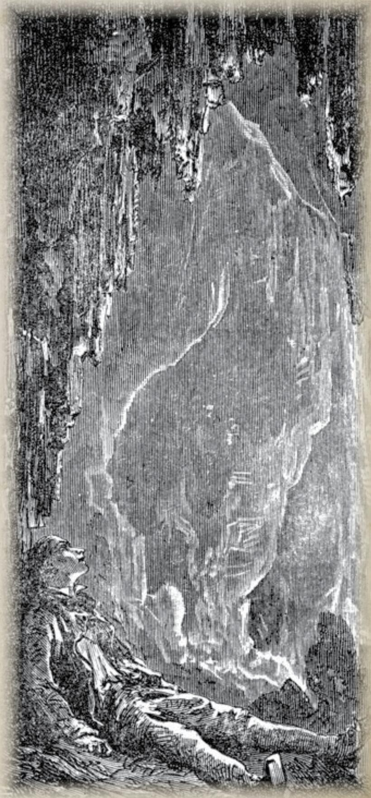

### Table 2: encounters in the caves

<table><tr><td>1D100</td><td>Description</td></tr><tr><td>1-5</td><td>What Luck: The Investigators discover a quick and easy route to wherever they are trying to get to. It feels like a great little caper scampering up and down between all these rocks.</td></tr><tr><td>6-10</td><td>Footprints: The investigators spot fresh footprints, clear as day. On a successful Track roll, it&#x27;s clear they were made by someone wearing feminine shoes, likely of a similar build to Ginny or Anna.</td></tr><tr><td>11-20</td><td>A Cracked Clue: Investigators uncover a discarded piece of metal on the ground. Clearing it of dust, they realize it has a similar sheen to the pictures of the Jewel. But it&#x27;s the wrong shape. On a successful Appraise roll, they determine it is gold alloy, likely valuable.</td></tr><tr><td>21-30</td><td>A Foreboding Beach: The investigators get turned around and find themselves on a foreboding beach front. They&#x27;ve taken a wrong turn and the weather outside is getting worse. They can see a storm brewing directly over the half-submerged island, just offshore from Innsmouth. They&#x27;ll need to roll again.</td></tr><tr><td>31-40</td><td>A Hole in the Wall: There is a hole in the wall and some dim light on the other side. Just big enough for someone to peep through with their eyes. Any investigators looking through is confronted with an unforgettable image of eyes and tentacles and teeth, it is confused and horrifying, prompting a Sanity roll (1/1D4 loss)</td></tr><tr><td>41-50</td><td>A Blocked Path: The way forward is blocked by rubble. While investigators with a SIZ under 60 can crawl through, larger investigators must succeed on a DEX roll or take 1D4 damage from a sharp rock.</td></tr><tr><td>51-60</td><td>A Crumbled Cavern: There is a gap in the cave floor, a fishy smell rises up from it. While the gap is too small to fit down, an investigator could get stuck in it. Investigators need to pass a Jump or Climb roll, or risk falling in. Helping each other gives bonus die. Investigators getting stuck take 1D3 damage.</td></tr><tr><td>61-70</td><td>A Rancid Odor: Investigators gag as the tunnel is filled with the most vile stench. A smell of eggs and mold and death closes their windpipes. Investigators must succeed on a CON roll or take 1D3 points of damage as they cough up their insides.</td></tr><tr><td>71-80</td><td>Appalling Sounds: The horrendous sound of some unnatural creature noisily eating can be heard coming through the walls. It sounds as if it is ripping flesh from bone. This prompts a Sanity roll (0/1D2 loss)</td></tr><tr><td>81-90</td><td>Sudden Slap: As if from nowhere, something long and slithery whips out from between two large rocks and slaps at whatever light source the investigators are using. Everything suddenly goes dark, prompting a Sanity roll (0/1D3 loss). The investigator holding the light has a penalty die on the roll.</td></tr><tr><td>91-95</td><td>Watching Eyes: The investigator at the back of the group could swear they saw glowing eyes watching them from the shadows. They make a Sanity roll (0/1D4 loss) as they try to convince the others they are being followed.</td></tr><tr><td>96-100</td><td>Close encounters: Stepping out onto a ledge, below the investigators the cave fills with water. Some creature is swimming down there lazily in the water. The investigators must quietly cross the ledge or risk disturbing the Deep One in the water. One investigator must pass a Stealth roll for the group or they must find another route and roll again. On failing the Stealth roll, a Deep One emerges from the water and attempts to eat the investigators.</td></tr></table>

### THE BREWSTER RESIDENCE

Investigators can arrive at the Brewster Residence by emerging from the cave system. If they do, the exit is inside a mundane gardening shed in the front garden. Alternatively, they may find the address after speaking to Zadok Allen (The Fire Station, [link](#nri-h-1b70234c4ece0af6255492e8)).

In front of them stands a slightly dilapidated, though clearly still occupied, three-story house. Around the outside, the garden is overgrown and untended. On a successful Track roll investigators pick up a lightly worn track leading from the garden shed to a back window that doesn't seem to shut properly. This window leads into Ginny's old room.

Knocking on the front door, a young man answers. He has that fishy, Innsmouth look that so many of the residents have, though they are not so striking or advanced that he would look out of place on a university campus. This is Sammy Brewster. He has fading bruises around one eye.

Sammy is polite, earnest and completely honest with the investigators. Inviting them inside, he apologizes but says his father is unavailable. He then makes a rather poor attempt at preparing and serving tea in the front room. The inside of the house is surprisingly clean, though more than one corner and nook lies abandoned to the rot and dust. The house was designed to be occupied by a large family, as well as two full-time staff members, who would live in the rather spacious basement. However, these days it is only Sammy and his father Jeremiah.

Jeremiah Brewster spends his days at The Esoteric Order of Dagon ([link](#nri-h-04a91268c2b7afffd26817db)), where he is an odd mix of a religious leader and mafia boss, keeping the residents of the town firmly under control so as not to upset the Deep Ones. Jeremiah is aware of Mother Hydra's order to sacrifice his daughter and has spent considerable time and energy trying to convince her to come home, where he could at least have made the death quick and painless. However, when the time comes, he leads the chant that reverberates through town as the people of Innsmouth give praise to the fragment of the god emperor Cthulhu that graces them with its presence.

However, Sammy is unaware of all of this. To him, his sister is back in town and he's hoping to catch up with her. He was only eleven when she left, and his father never saw fit to share that Ginny stole from the family. He headed up to the train, but was intercepted by the Crew, who ran him off. He's tried leaving her multiple notes, but she doesn't seem to have gotten them. His priority is simply seeing her again.

Investigators interviewing Sammy find a friendly, honest, and earnest young man. His father's position has shielded him from the uglier aspects of the town's history, and he seems at peace with, and genuinely looking forward to, his future below the sea. Why wouldn't he be? His life in town has always been wonderful and his recent interactions with regular humans have been rather unpleasant, further cementing his own loyalties.

- Asking Sammy about Ginny, he confirms that she's his older sister and that 'Dad' wants her to come home. He says she hasn't been back home in ten years, after she left to study Theatre. Dad's always complaining about it, but Sammy knows that his sister was always the romantic type and assumes she'll come back home 'when she's ready'.
- Asked about the Atlantean Jewel, Sammy confirms that he hasn't seen it. Though if it's described to him, he says it sounds a lot like the thing that 'Dad' wears during ceremonies. He doesn't know much about the local religion, but goes along for the 'big' moments.

Sammy doesn't have a lot more to contribute. As long as the investigators have been kind and reasonable to him, Sammy will help in any way he can.

If the investigators choose to snoop around the Brewster Residence either before or after talking to Sammy, they find a dilapidated house, with only a few rooms in use. Most of the rest of the house is covered in dust. Investigators that get too nosy risk waking a Shoggoth living in the basement ([link](#nri-h-f1f10a91537c50581b8ff2a6)), and are forced to run for their lives.

If the investigators look around the ground floor, they step into a pink frilly room with expensive-looking red furniture and a comfortable looking bed in one corner. The wardrobe lies open and clothes cover the small sofa and bed as if someone has recently rummaged through all the clothes. This is Ginny's old room. Hidden underneath the bed, investigators discover the Atlantean Jewel.

Held up close, the Jewel is intense to look at. A weird, non-congruent pattern of intertwining golden lines forming up the shape of a tall tiara. A lightly-colored gem sits at the very-top. It does not look like something a human would make, though it vaguely reminds investigators of the sea.

If the investigators find the Jewel while Sammy is present, he gets very worried, telling the investigators that item ‘probably belongs to Dad’. He gets very excited before attempting to snatch it and run off with it. The investigator holding it must succeed on a Hard DEX roll in order to stop him. Sammy then runs off into the caves, prompting a chase scene that can lead to The Epic Finale ([link](#nri-h-9e45e6c31b8f513fdfc0cbcb)).

Otherwise, the investigators may re-enter the caves, and experience the Stumbling onto Set scene ([link](#nri-h-b741e3b3e62d814b592d4419)), or if they have already experienced that scene, then the storm reaches its apex and they get turned around, exiting in the center of town to experience The Epic Finale ([link](#nri-h-9e45e6c31b8f513fdfc0cbcb)).

**Keeper note:** in most cases, the investigators will recover the Atlantean Jewel knowing that it is Ginny that stole it; however, it might be that they recover it but still don't know if it was Sammy or Ginny that stole the Jewel. In this case, the investigation may continue with the Stumbling onto Set scene. However, once the culprit is identified, The Epic Finale scene should begin.

### STUMBLING ONTO SET

Bright lights pain the eyes of the investigators as they round the corner into a scene of chaos.

In front of them, Bazzledon is shouting orders, McGuire is turning the camera arm, recording film. Behind a set of wooden sticks that might pass for jail-cell bars in bad light, Ginny is being dramatic, while a set of frog-like creatures poke and prod at her with primitive looking spears. The scene is disorienting for the investigators, whose eyes need a moment to adjust to the bright lights.

Bazzledon is desperately trying to get Ginny to look towards the camera and act frightened. Ginny instead wants to turn away and sashay her hips back and forth suggestively for the camera. Various compromises are tried before there is a sudden popping sound from the camera and film starts flying into the air, while McGuire grabs at it.

The tension in the room deflates. Bazzledon collapses into a director's chair, Ginny stamps off to a quiet corner and the Crew deftly remove their frog suits and sit down to play some dice. This is not the first time the camera has broken and everyone knows they are in for a long wait while McGuire works to fix it.

The investigators now have some time where they can interview the different NPCs, ask them questions and attempt to get useful information from them. If the investigators are still trying to figure out who stole the Jewel and why, they can question the various suspects, trying to establish where they were when the Jewel was stolen.

- Bazzledon claims the Jewel was normally in his office, but he left it with McGuire for 'safekeeping' while he went to the grocery store. In reality, he was down in Innsmouth speaking to members at the Esoteric Order of Dagon.
- Ginny claims the Jewel was always stored in Bazzledon's office and she hasn't seen it. In reality, she stole it from McGuire's lab by sneaking through the wall.
- McGuire doesn't remember Bazzledon coming to see him that day, but honestly, couldn't say for certain. He also didn't hear anything unusual that night. This is because he doesn't pay attention.

In reality, Bazzledon had in fact left the Jewel with McGuire. Ginny then stole it from the lab and took it to her old room in The Brewster Residence ([link](#nri-h-f6184124151c4142421b1af0)) because she didn't want to wear it.

Investigators may have other questions, and the Keeper should reference the Dramatis Personae for a more complete breakdown of each NPC, and how they might answer different questions. It is important to note that both Bazzledon and Ginny lie frequently and easily.

If they have recovered the Jewel, the investigators can brandish it aloft and receive huge amounts of praise from Bazzledon who promises them a ‘great’ reward for the successful recovery, attempting to take the Jewel from them. If the investigators hold on to it, this provokes a stand off with the Crew. Investigators may flee into the tunnels, or hand it over. If the investigators return the Jewel here, then Bazzledon is wearing it during The Epic Finale.

If the investigators accuse Ginny of the theft, she makes a large scene, screaming at them, provoking a stand-off with the Crew, who eventually lead the investigators off, either voluntarily, or aggressively. If the investigators instead accuse Sammy of the theft, everyone agrees it must have been the ‘Innsmouth boy’ and thanks the investigators for recovering it.

Eventually, McGuire gets the film going again and the NPCs are no longer free to talk to the investigators. While they can continue to watch filming, nothing of interest happens.

**Keeper note:** if the investigators have only recently left the Production Train, it may feel too early for them to Stumble onto Set. Instead, have the investigators emerge Into Innsmouth first and come back to this scene.

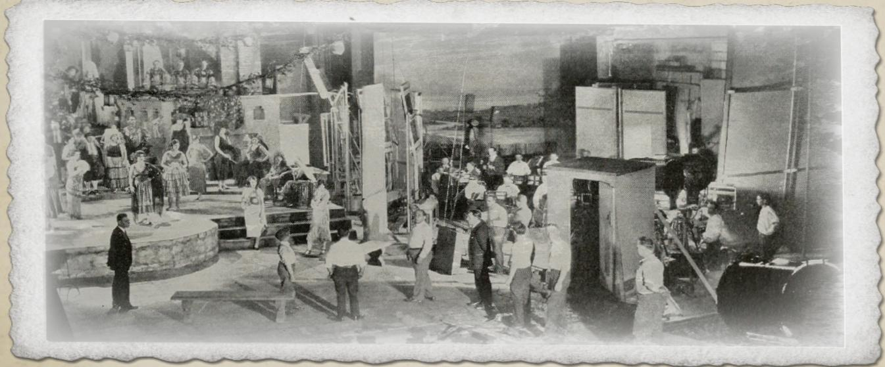

## INTO INNSMOUTH

Inevitably, at some point, investigators will start asking questions around Innsmouth. They may simply begin asking after Sammy, or they may wish to see if they can definitively connect Ginny to Innsmouth. Investigators may instead begin looking to see if they can uncover any cults or otherwise malevolent forces in the town who may be interested in stealing the Jewel.

Innsmouth is an unfriendly town. Locals avoid going out into the street if they see the investigators passing, and many of the roads they walk through feel completely abandoned. Investigators can't help but feel like they are being watched as they move through town and may occasionally spot queer glowing eyes following them from darkened windows.

Whatever their approach, the Keeper can suggest The General Store (adjacent) opposite The Gilman House Hotel ([link](#nri-h-591edd5bcf58d378b27f28cc)) as a first port of call.

Pete

### The General Store

The General Store is a well-known chain and laid out precisely the same as the equivalent shop in Arkham. Though this shop is not quite as well stocked. The store brings back into focus how thoroughly odd Innsmouth feels, giving the investigators a taste of mundanity throughout all the chaos.

A single employee, a young man from Arkham named Pete, sits behind the counter. He is cheery and friendly to the investigators. He clearly doesn't get much business and is glad to see some new faces.

Pete is happy to gossip about Innsmouth and how weird it is. However, he doesn't actually know much about the town, commuting to work from nearby Newburyport. Pete sees Innsmouth as simply a backwater town, dying because it can't, or won't, adapt to modern times. While the fishing is good, the little Innsmouth boats can't compete with the modern trawlers in the bigger ports. He says there was also some kind of disease or epidemic a generation ago, and he thinks that's why so many people here look 'kind of weird'. But you know, he's paid hourly, and it's an easy job and no one bothers him or tries to convert him to the local religion.

- Pete doesn't know anyone called Sammy or Ginny. He confesses he barely knows anyone in town.
- If the investigators are looking to get hold of some alcohol, Pete smiles and politely directs them to a nearby hovel, where some passable whisky can be bought from an old lady with a fishy countenance. She is covered in blankets.
- Asked about Innsmouth more generally, Pete says that he thinks the locals worship some kind of fish-god. It's a bit like Christianity, headquartered at the old Masonic Lodge. He thinks the idea is that the locals worship something that actually benefits them, like a god who sends them more fish. He's not one to judge.
- If the investigators want to know more about Innsmouth, Pete reckons their best bet is to talk to old Zadok Allen. Zadok is a drunken old man, but is one of the few residents of Innsmouth who seems social and interested in talking. He pops in most mornings and talks Pete's ear off for half an hour before normally wandering off looking to earn enough to buy a bottle of whiskey. On most days, Zadok can be found at The Fire Station ([link](#nri-h-1b70234c4ece0af6255492e8)), where he either sunbathes or shelters from the weather.

### The Fire Station

Sitting on 100 Paine Street, not too far from the railway, the fire station isn't immediately accessible to the investigators as they encounter a dangerous looking bridge made of rotting wood that doesn't seem safe to cross. While it feels fine if the investigators cross it one at a time, anyone with a SIZ greater than 70 must pass a Luck roll or the rotten wood snaps, dropping the investigator into the Manuxet river, taking 1D6 damage and washing up three blocks down. The bridge certainly couldn't hold the weight of a car, or the one operational fire engine, putting large portions of town at risk if the fire department was ever required (not that the damp, rotten wood of Innsmouth would necessarily burn all that well.)

Investigators looking for Zadok Allen find him here, resting himself against the stone outer wall of the fire station. It looks as if no one is manning the station today and he is all alone.

Zadok is grumpy, difficult, and uninterested in talking to a group of strangers at first. They need to loosen his lips with a bottle of whisky. However, if the investigators do tempt him with a tipple, he leads them away from the station, to a nice sheltered house on the edge of town looking out towards the cliff face.

Zadok Allen is the infamous drunk from The Shadow over Innsmouth, and knows the full story of Obed Marsh, his deal with the Deep Ones and the three oaths the people of Innsmouth were forced to swear. He shares a fragmented, confused story of what happened with the investigators, similar to what a Call of Cthulhu Keeper may share if they were trying to recite the story of The Shadow over Innsmouth from memory.

- When sharing the story of Innsmouth with the investigators, Zadok focuses on the fact that the Deep Ones punish those they feel have broken the oaths. And rumors abound that ‘something big’ is going to happen to an oath breaker tonight.
- If asked about Sammy or Ginny, he replies “Jeremiah’s kids? Sammy & Ginny Brewster, right? Good kids. Good family.” He mentions a townhouse just off Lafayette street, The Brewster Residence.
- If the investigators describe the Atlantean Jewel to him, he shushes them and ells them not to talk about the holy symbols of the Esoteric Order of Dagon in public. 'They' could be listening.

Eventually, Zadok grows too jumpy, staring out at the sea, and when the Keeper feels the time is right, Zadok screams, “They’ve heard us,” and bolts away from the investigators. If they follow him, they eventually find him hiding inside a ruined house not far from the Fire Station, crying and completely unresponsive.

Zadok Allen

Jeremiah Brewster

### The Esoteric Order of Dagon

Speaking to Sammy or Zadok may lead the investigators to believe that the Jewel is connected to the Esoteric Order of Dagon. This is wrong; however if investigators get hooked into this pattern, the Keeper can encourage it, having them visit the Esoteric Order of Dagon.

Sitting prominently on Federal Street in the center of town, this neo-classical building is hard to miss. Four Grecian columns frame the main doorway, though the whitewash has faded to a dull gray. Above the door, a large stone carving of the words ‘Esoteric Order of Dagon’ stands prominently across the building. This building is a converted Masonic temple and is by far the grandest building in Innsmouth.

Four heavy-looking Hybrids lounge around the entranceway and they will stop the investigators if they try and approach the door directly. The Hybrids have a strong ‘Innsmouth Look’ about them and are quick to use a slap or gut punch to move on any investigators that seem overly inquisitive about temple matters.

Investigators circling the building realize that there are no windows or other doorways other than the front entrance. However, with a successful Natural World roll, they notice that behind the temple, the way the rocks fall indicate there might be a way in through the Caves. Investigators deciding to keep watch on the building for a while must pass a Stealth roll to not get moved on by the watchful Hybrids. If they do manage to watch the building, they notice the same person leaving the building twice in a row about an hour apart. There must be another way inside.

If investigators are unable to enter the building and wish to, the Keeper may consider a Know roll to lead the investigators into the Cave System, looking for another way inside.

### Entering through the Caves

The underground entrance to the Esoteric Order of Dagon through the Cave System is not guarded. It is mostly used as a way for Deep Ones to quickly enter and leave the temple without having to walk out in the open, and the Deep Ones see no need to guard their pathways.

As the investigators step out into the basement level, the small stone room is empty, apart from a number of storage boxes. The rotten smell of fish and seaweed is almost enough to make someone gag. Investigators hear a croaking kind of song coming through the doorway. On a successful Listen roll they hear the words: "Cthulhu fhtagn!" repeated over and over.

Investigators peeking out from the doorway see a large room of worship, similar to many churches they have seen. At the front of the room stand three statues. The largest in the center is of Cthulhu, a maddening head of tentacles, piercing eyes and unfathomably large wings that seem to spread out to engulf the entire building. Two smaller statues of Dagon and Mother Hydra flank the main statue (fish-like quadrupedal creatures with terrifying teeth. One looks built like a fighter, the other has wide-hips, a motherly figure).

A fish-like man (Jeremiah Brewster) seems to be praying and singing the song they hear. On his head sits a tiara of gold alloy that looks identical to the Jewel.

Patient investigators may sit and watch. After five minutes, Jeremiah finishes his chanting and walks towards the room where the investigators are. They could easily ambush him at this moment, or while he is singing. However, Jeremiah is a powerful Sorcerer and any loud actions draw the attention of dozens of Hybrids.

If the investigators are overwhelmed in the fight, they need not die. They can be knocked out and wake up tied up for the Epic Finale ([link](#nri-h-9e45e6c31b8f513fdfc0cbcb)) atop the cliff face, for the Playing the Hero ([link](#nri-h-db7abf043f1d139a51dd4c3f)) outcome.

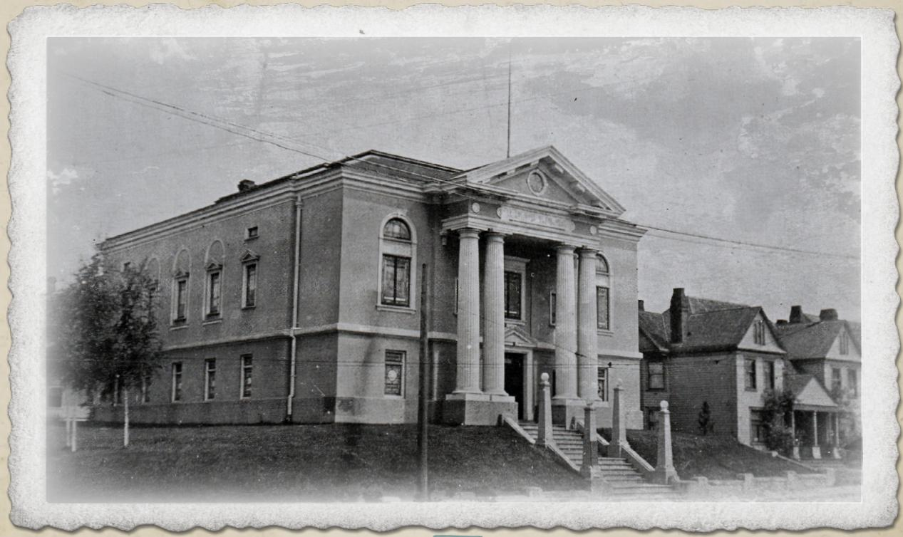

## THE EPIC FINALE

Once the investigation nears completion, and the investigators have a clear understanding that Ginny Dubois is the culprit, then the Epic Finale begins. This could happen anywhere around Innsmouth, though it is best for the moment to happen whilst the investigators are in town.

**Keeper note:** have the investigators failed to identify Ginny as the culprit and failed to pick up on all your wonderful clues? Or have they instead pissed off the locals and been captured? Don't worry, just start the Epic Finale anyway.

The promised storm finally washes over Innsmouth and rain begins pouring down over the half-rotten buildings. What little sun remains is covered by thick black clouds and the world noticeably darkens around the investigators. Looking up to the cliffs above Innsmouth, the investigators see a camera, pointing at a woman dressed all in white. Ginny Dubois looks as if she has been tied to a large stone on the very edge of the cliff, her hands bound above her so that her white body makes a striking X-shape against the darkened stone.

In sleepy Innsmouth, the residents pour out onto the streets. Where just a few moments ago, they were abandoned, now they are thronged with people, all staring up towards the cliff face. Regular humans stand shoulder-to-shoulder with twisted hybrids and fully transformed Deep Ones. Meanwhile, in the shallow bay, the waves are roiling and investigators see hundreds of yellow eyes peering out from just under the water. Every single person's gaze is fixed upon that white X above the cliffs. This all prompts a Sanity roll (1/1D8). Investigators going insane here may choose to roll on the regular bout of insanity table or instead choose to be caught up in the moment and follow along with the crowd as they stare and chant.

A slow chant begins. It can first be heard from those nearest to the Esoteric Order of Dagon. Before slowly rolling out across all of Innsmouth.

"Ph'nglui mglw'nafh Cthulhu R'lyeh wgah'nagl fhtagn Iä! Iä! Cthulhu fhtagn"

If the investigators continue to watch, the roiling clouds become thicker and thicker out over the shallow reef just outside Innsmouth Harbour. And somehow, in a trick of the light, the clouds are suddenly a mass of tentacles with a set of piercing eyes at its center. A Star-Spawn of Cthulhu hangs over the bay. Every single resident in Innsmouth drops to their knees in silent prayer to this shard of a god.

The Star-Spawn's visage is hidden behind the clouds, and the investigators may have already decided to run, so they likely do not fully comprehend the thing in the clouds However, if they persist on peering past the clouds (and are not already insane) then viewing the Star-Spawn directly prompts a Sanity roll (1D6/1D20).

At this point, investigators may go off in many different directions. Some possible resolutions to the story are below, but if the investigators choose a different path then events continue to unfold around them no matter what.

### The Last Train out of Innsmouth

Investigators choosing to take flight, either through the crowds, or the caves below have the gaze of the Star Spawn fall on them, and it attempts to apprehend them, sending the citizenry and its pseudopodia to capture them

If they flee through the crowds, hands grab at them from all directions and the press of people quickly pins them down, suffocating them. They are tied up and offered up to the Star Spawn as further sacrifices. Move to Playing the Hero ([link](#nri-h-db7abf043f1d139a51dd4c3f)).

If the investigators take to the caves, they are instead pursued by mindless, tentacled creatures that crawl rapidly through the caves. The investigators spend three rounds being pursued. If they fail to pass a DEX roll, then 1D3 tentacles attack them (Brawl 50%, 1D3 damage). Investigators can also argue for different rolls as they rush through the dark, dangerous caves.

Erupting out onto the edge of town, the investigators see Anna Díaz and three surviving members of the Crew busily packing up their belongings and loading it up on the train. The wind is now blowing a gale, and they all determinedly avoid looking south-east towards the Star Spawn. Díaz screams into the wind as they approach, asking if any of them know how to drive a train.

The firebox of the train has been kept alight, and until recently a member of the crew was cooking eggs on the hot metal. Investigators passing an Operate Heavy Machinery or Mechanical Repair roll know that they need to repressurize the boiler by turning the cylinder cocks, and gently opening the regulator. This requires that the investigators pass three STR rolls and three DEX rolls within three rounds. At the end of the third round, a mob of Innsmouth residents descend on the train car, quickly overwhelming everyone.

If the investigators do get the train up and running, it lets out a piercing whistle, building momentum slowly as it begins running down the ancient track. The last train out of Innsmouth rolls away, taking the surviving investigators and crew with them.

Alternatively the train could be sabotaged to try and stop the advancing horrors, or driven directly into the approaching mob (see box, [link](#nri-c-227220bed3222454225d739d)).
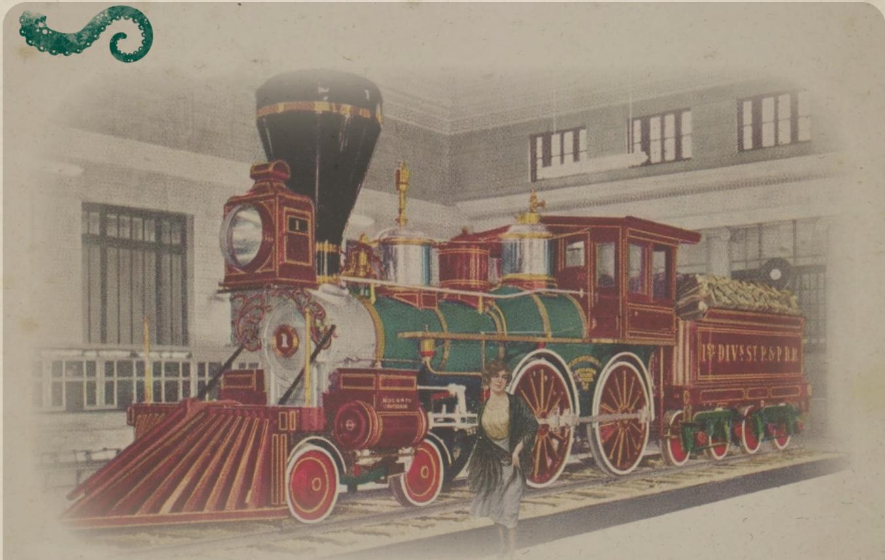

### MVR Class B1 'Olmstead', steam locomotive

MOV: 11

Build: 10

Armour for people: 1

Gauge: standard (4 ft 8 1/2 in)

Boiler pressure: 110 psi

Top Speed: 70 mph (110 km/h)

Driving the train requires a successful Drive Train or Operate Heavy Machinery roll. If the build is reduced to zero, the train is out of action. Each full 10 hit points of damage decreases a train's build by 1 point (round down); damage below 10 hit points is ignored.

If the train's build is reduced to half (round down) of its starting value or lower, it is impaired; one penalty die is applied to all Drive Train (or appropriate skill) rolls.

If a train takes damage equal to its full build value in one incident, the vehicle is completely wrecked in an impressive manner. It may explode, burn, roll or suffer some combination thereof. Anyone on the footplate of the train, roll Luck. Success leads to enough of their remains being found to identify them. Anyone within 50m (165 ft) of the engine takes 6D10 damage. Anyone outside of that area and not behind cover makes a Dodge roll. Failure results in being hit with high velocity debris (2D4 damage). Alternatively, such an explosion could be caused by dangerously increasing the pressure in the boiler, with a successful Drive Train, Operate Heavy Machinery, or Hard Science (Physics) roll.

If a train's build is otherwise reduced to zero by cumulative damage (i.e. in increments of less than the vehicle's starting build value), it becomes undriveable, grinding to a halt. Depending on the situation (and perhaps a Luck roll), this may lead to an accident resulting in 1D10 damage for the driver and each passenger.
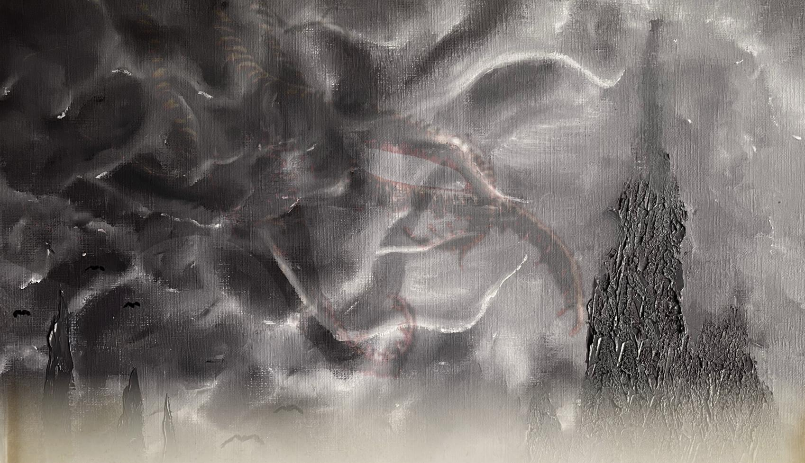

### Playing the Hero

Investigators making their way determinedly up to the cliffs to the sacrifice experience no violent retribution from the Star-Spawn. In fact, the road clears ahead of them, as they rush up the winding path towards the climatic moment. The same events unfold if they are captured and brought up against their will.

As they approach, they see Christopher McGuire slowly turning the handle of the camera. His eyes are glazed and he is completely unresponsive. Ginny has been torn from the rock where she was tied, leaving behind a pentagram, clearly drawn in blood smeared across it. She is now in the clutches of the tentacles above, screaming for help. A number of Crew members lie in pieces around the site, their bodies seemingly torn to shreds by tentacles whilst attempting to save her.

Bazzledon is on his knees, screaming along to the chant from the town below. When the investigators arrive, his eyes snap open and he turns to them, rushing over to whichever investigator seems to most closely fit with the stereotype of the hero who saves the day. Failing that, he moves towards the investigator with the highest APP and casts the spell Mental Suggestion ([link](#nri-s-f6b536b49f6dbbac4907bda0)).

"You've always wanted to be on the silver screen haven't you. I know you have, kid. This is your big moment, your time to shine. You're gonna be a movie star. Take this,..." He hands the investigator a packet of Tum-Eez antacid "... run up that tentacle, and drop it in the things mouth. It'll overwhelm it, sending it back to its watery grave."

The investigator needs to pass a POW roll to resist the urge to do exactly what Bazzledon suggests. Though their fellow investigators may also attempt to stop them, by grappling with them. If the investigator fails the roll, they run towards the Star-Spawn, attempting to climb up one of the tentacles towards the creature's terrifying mouth.

Allow the investigator a Hard DEX or Throw roll to determine if they manage to drop the Tum-Eez into the creature's mouth before they are torn to shreds and eaten by the Star-Spawn. If they fail, then Bazzledon turns to the next investigator and repeats the lines verbatim:

"You've always wanted to be on the silver screen haven't you. I know you have, kid..."

If the investigators succeed, they are, unfortunately, still torn to shreds by the monster. It turns out that antacids have no effect on the Star-Spawn. However, in achieving the final shot, the movie is completed, and Bazzledon turns around, cuts McGuire's throat, and lopes off into the wilderness with the film under his arm.

Investigators who overcome Bazzledon's charms see him for what he truly is, a madman, sending innocents to die. As they turn to flee, there is a sudden calm in the storm and the chanting ceases. With a cry of despair, Ginny Brewster is torn to shreds in front of the silent denizens of Innsmouth. Her body is dropped carelessly down into the ocean, not even given the honor of being food for the god shard. This prompts a Sanity roll (1/1D6).

Investigators may flee over the open ground away from Innsmouth, or come down to the train to find everyone dead, torn to shreds as they made a valiant attempt to escape from the monster on the train. By one way or another, the surviving investigators return to Arkham.

## EPILOGUE

### Did the investigators escape with the Atlantean Jewel?

If they did, Miskatonic University is incredibly pleased with the Society. They agree to the next 12 months funding up front. Further, the Society is offered a much nicer room for future meetings. One with a fireplace and far comfier seats usually reserved for faculty.

If they did not, it is the beginning of the end for the Society. Another important mission fumbled, the University begins reconsidering its long-standing support. Perhaps it is time they brought some experts in, rather than trusting a group of amateurs.

A few weeks after the end of the investigation, an internal review docks Dr. Henry Armitage one week's wages for ‘failing to properly check the credentials of an applicant’ and the matter is put to rest.

### Was the final scene of the movie filmed?

P.A Bazzledon is frantically sifting through the remains of his office, pulling out the hidden safe (if it's still there) and removing the contents. He stuffs them in his pocket, snaps up his briefcase and is out of there.

Outside, a group of tough looking thugs have driven up from New York. It wasn't hard to follow Bazzledon's trail to Innmouth; they know he'll have the money, they just need to rough him up a bit. As Bazzledon sneaks out and ducks into the warrenous caves of Innmouth, the question remains: Is there a rough cut of the movie under his arm, or does it fall to the cutting room floor?

If it is released, the investigators eventually hear rumors of a hit new film taking the underworld by storm. The graphics are so realistic, you'd swear the dame was actually torn apart. And it's in technicolor! The marvels of the modern age...

### Rewards

Surviving investigators should be permitted a development phase once the scenario is complete.

- For a walkthrough of the investigator development phase, see Rewards of Experience: The Investigator Development Phase, page 94, Call of Cthulhu: Keeper Rulebook.
- For healing wounds, see Regular Damage Recovery and Major Wound Recovery, page 121, Call of Cthulhu: Keeper Rulebook.
- For regaining Sanity points by spending time with a backstory element, see Self Help, page 167, Call of Cthulhu: Keeper Rulebook.

In addition to the Sanity losses discussed elsewhere in this scenario, apply the following Sanity gains or losses:

- For recovering the Atlantean Jewel: +1D6 Sanity points.
- For saving Díaz and the surviving crew: +1D6 Sanity points.
- For trying, and failing, to save Ginny -1D6 Sanity points.
- If the film is released: -1D4 Sanity points.

## CHARACTERS AND MONSTERS

## ARKHAM RESIDENTS

### Diane Loring, age 50, reference librarian

<table><tr><td>STR 50</td><td>CON 70</td><td>SIZ 50</td><td>DEX 55</td><td>INT 80</td></tr><tr><td>APP 65</td><td>POW 50</td><td>EDU 70</td><td>SAN 50</td><td>HP 12</td></tr><tr><td>DB: 0</td><td>Build: 0</td><td>Move: 7</td><td>MP: 10</td><td></td></tr></table>

#### Combat

<table><tr><td>Brawl</td><td>25% (12/5), damage 1D3</td></tr><tr><td>Dodge</td><td>27% (13/5)</td></tr></table>

#### Skills

Art/Craft (Dewey Decimal System) 90%, Library Use 95%, History 65%, Occult 25%, Psychology 60%, Spot Hidden 90%, Wear Cardigans 80%.

Languages: English 70%, French 60%, Latin 60%.

### Dr. Henry Armitage, age 65, head librarian

<table><tr><td>STR 55</td><td>CON 40</td><td>SIZ 60</td><td>DEX 50</td><td>INT 90</td></tr><tr><td>APP 65</td><td>POW 80</td><td>EDU 99</td><td>SAN 55</td><td>HP 10</td></tr><tr><td>DB: 0</td><td>Build: 0</td><td>Move: 6</td><td>MP: 16</td><td></td></tr></table>

#### Combat

<table><tr><td>Brawl</td><td>25% (12/5), damage 1D3</td></tr><tr><td>Dodge</td><td>25% (12/5)</td></tr></table>

#### Skills

Art/Craft (Oratory) 55%, Cthulhu Mythos 18%, Library Use 95%, History 65%, Occult 25%, Psychology 48%, Science (Cryptography) 75%, Science (Medieval Metaphysics) 60%.

Languages: English 99%, French 80%, German 70%, Greek 68%, Latin 75%.

### Karen Jeffries, age 45, newspaper editor

<table><tr><td>STR 55</td><td>CON 60</td><td>SIZ 65</td><td>DEX 55</td><td>INT 70</td></tr><tr><td>APP 70</td><td>POW 65</td><td>EDU 70</td><td>SAN 60</td><td>HP 13</td></tr><tr><td>DB: 0</td><td>Build: 0</td><td>Move: 7</td><td>MP: 13</td><td></td></tr></table>

#### Combat

<table><tr><td>Brawl</td><td>45% (22/9), damage 1D3+1D4</td></tr><tr><td>Dodge</td><td>27% (13/5)</td></tr></table>

#### Skills

Credit Rating 65%, Fast Talk 75%, Library Use 45%, Intimidate 80%, Photography 15%, Psychology 55%, Spot Hidden 65%.

Languages: English 75%.

### Franc Turner, age 45, playhouse janitor

<table><tr><td>STR 80</td><td>CON 60</td><td>SIZ 70</td><td>DEX 55</td><td>INT 60</td></tr><tr><td>APP 60</td><td>POW 50</td><td>EDU 40</td><td>SAN 80</td><td>HP 13</td></tr><tr><td>DB: 1D4</td><td>Build: 1</td><td>Move: 7</td><td>MP: 10</td><td></td></tr></table>

#### Combat

<table><tr><td>Brawl</td><td>45% (22/9), damage 1D3+1D4</td></tr><tr><td>Dodge</td><td>27% (13/5)</td></tr></table>

#### Skills

Art/Craft (Cleaning) 55%, Listen 40%, Occult 5%, Psychology 40%. Fast Talk 45%.

Languages: English 45%.

## FILM CREW

### Genevieve 'Ginny' Dubois, age 25, sultry starlet of the film

<table><tr><td>STR 75</td><td>CON 60</td><td>SIZ 45</td><td>DEX 60</td><td>INT 55</td></tr><tr><td>APP 50</td><td>POW 90</td><td>EDU 45</td><td>SAN 80</td><td>HP 9</td></tr><tr><td>DB: 0</td><td>Build: 0</td><td>Move: 7</td><td>MP: 18</td><td></td></tr></table>

#### Combat

<table><tr><td>Claws-like nails</td><td>45% (22/9), damage 1D6</td></tr><tr><td>Dodge</td><td>30% (15/6)</td></tr></table>

#### Skills

Art/Craft (Acting) 30%, Charm 60%, Cthulhu Mythos 20%, Occult 40%, Psychology 30%. Fast Talk 45%, Disguise 40%

Languages: English 45%.

#### Spells

Breath of the Deep

Cost: 8 magic points. The caster must succeed on an opposed POW roll against the target. The target's lungs fill with seawater on a success, dealing 1D8 damage per round unless they succeed on an Extreme CON roll.

### Anna Díaz, age 26, competent producer

<table><tr><td>STR 55</td><td>CON 65</td><td>SIZ 55</td><td>DEX 45</td><td>INT 80</td></tr><tr><td>APP 40</td><td>POW 45</td><td>EDU 75</td><td>SAN 45</td><td>HP 12</td></tr><tr><td>DB: 0</td><td>Build: 0</td><td>Move: 8</td><td>MP: 9</td><td></td></tr></table>

#### Combat

<table><tr><td>Brawl</td><td>25% (12/5), damage 1D3</td></tr><tr><td>Dodge</td><td>30% (15/6)</td></tr></table>

#### Skills

Art/Craft (Acting) 70%, Charm 45%, Disguise 40%.

Languages: English 75%.

### P.A. Bazzledon, age 40, con-man turned director

<table><tr><td>STR 50</td><td>CON 70</td><td>SIZ 65</td><td>DEX 60</td><td>INT 80</td></tr><tr><td>APP 80</td><td>POW 60</td><td>EDU 60</td><td>SAN 40</td><td>HP 13</td></tr><tr><td>DB: 0</td><td>Build: 0</td><td>Move: 7</td><td>MP: 12</td><td></td></tr></table>

#### Combat

<table><tr><td>Brawl</td><td>25% (12/5), damage 1D3</td></tr><tr><td>Dodge</td><td>30% (15/6)</td></tr></table>

#### Skills

Appraise 50%, Charm 70%, Credit Rating 65%, Disguise 60%, Fast Talk 80%, Listen 45%, Psychology 60%.

Languages: English 60%.

#### Spells

Mental Suggestion

Cost: 5 magic points. The caster makes a suggestion to the target. The target must pass a POW roll or they follow the instruction.

### Christopher McGuire, age 37, engineer and camera man

<table><tr><td>STR 40</td><td>CON 45</td><td>SIZ 60</td><td>DEX 75</td><td>INT 85</td></tr><tr><td>APP 40</td><td>POW 40</td><td>EDU 75</td><td>SAN 40</td><td>HP 10</td></tr><tr><td>DB: 0</td><td>Build: 0</td><td>Move: 8</td><td>MP: 8</td><td></td></tr></table>

#### Combat

<table><tr><td>Brawl</td><td>25% (12/5), damage 1D3</td></tr><tr><td>Dodge</td><td>40% (20/8)</td></tr></table>

#### Skills

Engineering 80%, Persuasion 10%, Psychology 5%, Science (Physics) 70%, Science (Chemistry) 70%.

Languages: English 75%.

### Average Crew Member, burly men and women

<table><tr><td>STR 70</td><td>CON 60</td><td>SIZ 70</td><td>DEX 50</td><td>INT 50</td></tr><tr><td>APP 50</td><td>POW 50</td><td>EDU 30</td><td>SAN 50</td><td>HP 13</td></tr><tr><td>DB: 1D4</td><td>Build: 1</td><td>Move: 8</td><td>MP: 8</td><td></td></tr></table>

#### Combat

<table><tr><td>Brawl</td><td>50% (25/10), damage 1D3+1D4</td></tr><tr><td>Dodge</td><td>45% (22/9)</td></tr></table>

#### Skills

Carry Things 75%, Dice 30%, Look Vaguely Threatening 40%.

Languages: Various 30%.

## INNSMOUTH RESIDENTS

### Sammy Brewster, age 21, loving brother

<table><tr><td>STR 65</td><td>CON 65</td><td>SIZ 45</td><td>DEX 70</td><td>INT 65</td></tr><tr><td>APP 45</td><td>POW 50</td><td>EDU 70</td><td>SAN 0</td><td>HP 10</td></tr><tr><td>DB: 0</td><td>Build: 0</td><td>Move: 8</td><td>MP: 10</td><td></td></tr></table>

#### Combat

<table><tr><td>Brawl</td><td>45% (22/9), damage 1D3</td></tr><tr><td>Dodge</td><td>30% (15/6)</td></tr></table>

#### Skills

Astronomy 30%, Occult 30%, Persuade 40%, Slight of Hand 50%, Stealth 50%.

Languages: English 70%, R'lyehian 30%.

### Jeremiah Brewster, age 47, priest

<table><tr><td>STR 80</td><td>CON 90</td><td>SIZ 80</td><td>DEX 60</td><td>INT 75</td></tr><tr><td>APP 20</td><td>POW 100</td><td>EDU 50</td><td>SAN 0</td><td>HP 17</td></tr><tr><td>DB: 1D4</td><td>Build: 1</td><td>Move: 8</td><td>MP: 20</td><td></td></tr></table>

#### Combat

<table><tr><td>Claws</td><td>75% (22/9), damage 1D6+1D4</td></tr><tr><td>Dodge</td><td>45% (22/9)</td></tr></table>

Armor: 1 point skin and scales.

#### Skills

Astronomy 30%, Cthulhu Mythos 60%, Disguise 40%, Occult 60%, Persuade 60% Psychology 50%.

Languages: English 75%, R'lyehian 75%.

#### Spells

Breath of the Deep, Contact Deep Ones, Contact Cthulhu, Summon Star Spawn, Power Drain, Shriveling.

#### Sanity

As an almost full Deep One, seeing Jeremiah counts as seeing a Deep One, which is a San loss of (0/1D6).

### Zadok Allen, age 66, town drunk

<table><tr><td>STR 40</td><td>CON 30</td><td>SIZ 60</td><td>DEX 40</td><td>INT 50</td></tr><tr><td>APP 45</td><td>POW 60</td><td>EDU 30</td><td>SAN 60</td><td>HP 9</td></tr><tr><td>DB: 0</td><td>Build: 0</td><td>Move: 7</td><td>MP: 12</td><td></td></tr></table>

#### Combat

<table><tr><td>Brawl</td><td>20% (10/4), damage 1D3</td></tr><tr><td>Dodge</td><td>40% (20/8)</td></tr></table>

#### Skills

Drink 75%, Tell Mad Tales 85%.

Languages: English 30%.

### Average Human Resident, Innsmouth locals

<table><tr><td>STR 55</td><td>CON 50</td><td>SIZ 55</td><td>DEX 50</td><td>INT 50</td></tr><tr><td>APP 50</td><td>POW 50</td><td>EDU 60</td><td>SAN 50</td><td>HP 10</td></tr><tr><td>DB: 0</td><td>Build: 0</td><td>Move: 8</td><td>MP: 10</td><td></td></tr></table>

#### Combat

<table><tr><td>Brawl</td><td>25% (12/5), damage 1D3</td></tr><tr><td>Dodge</td><td>25% (12/5)</td></tr></table>

### Average Hybrid Resident, Innsmouth locals

<table><tr><td>STR 65</td><td>CON 65</td><td>SIZ 50</td><td>DEX 65</td><td>INT 65</td></tr><tr><td>APP 20</td><td>POW 50</td><td>EDU 60</td><td>SAN —</td><td>HP 11</td></tr><tr><td>DB: 0</td><td>Build: 0</td><td>Move: 8</td><td>MP: 10</td><td></td></tr></table>

#### Combat

<table><tr><td>Brawl</td><td>45% (22/9), damage 1D3+1D4</td></tr><tr><td>Dodge</td><td>32% (17/6)</td></tr></table>

## MONSTERS

### Shoggoth

<table><tr><td>STR 315</td><td>CON 210</td><td>SIZ 420</td><td>DEX 15</td><td>INT 35</td></tr><tr><td>APP —</td><td>POW 50</td><td>EDU —</td><td>SAN —</td><td>HP 63</td></tr><tr><td>DB: 8D6</td><td>Build: 9</td><td>Move: 10</td><td>MP: 10</td><td></td></tr></table>

#### Combat
Attacks per round: 2

<table><tr><td>Brawl</td><td>70% (35/14), damage 8D6</td></tr><tr><td>Engulf</td><td>A person that has been engulfed by a Shoggoth must succeed on an opposed STR roll or be torn apart at the end of the Shoggoth&#x27;s next turn. Those inside a Shoggoth can still damage it and if they manage to damage it for half of its remaining hit points in a single round, they are spat out again. A Shoggoth can Engulf as many investigators as it likes so long as their combined SIZ is less than its SIZ.</td></tr><tr><td>Dodge</td><td>8% (4/1)</td></tr></table>

Armor: none, but fire and electricity only do half damage, regular weapons only do 1 damage per hit, and it regains 2 hit points per round.

#### Sanity

1D6/1D20 loss for seeing a Shoggoth.

Author note: In short, investigators should run away from a Shoggoth if they see one.

### Star Spawn of Cthulhu

<table><tr><td>STR 350</td><td>CON 260</td><td>SIZ 525</td><td>DEX 50</td><td>INT 105</td></tr><tr><td>APP —</td><td>POW 105</td><td>EDU —</td><td>SAN —</td><td>HP 78</td></tr><tr><td>DB: 10D6</td><td>Build: 11</td><td>Move: 15</td><td>MP: 21</td><td></td></tr></table>

#### Combat
Attacks per round: 4

<table><tr><td>Brawl</td><td>80% (40/16), damage 10D6 A Star Spawn may attack or grapple with its tentacles. When it grapples an opponent they are pulled up into the air. An opponent, doing more than 10 damage to the Star Spawn (piercing its armor), will be released by the tentacle, though they are unlikely to survive the fall.</td></tr><tr><td>Dodge</td><td>26% (13/5)</td></tr></table>

Armor: 10-point hide and blubber, regenerates 3 hit points per round.

#### Sanity

1D6/1D20 loss for seeing a Star Spawn of Cthulhu.

Author note: I want to be very clear that throwing Tum-Eez into the mouth of a Star Spawn has no effect at all on the creature.

### Deep One

<table><tr><td>STR 70</td><td>CON 60</td><td>SIZ 80</td><td>DEX 50</td><td>INT 70</td></tr><tr><td>APP —</td><td>POW 50</td><td>EDU —</td><td>SAN —</td><td>HP 15</td></tr><tr><td>DB: 1D4</td><td>Build: 1</td><td>Move: 8</td><td>MP: 20</td><td></td></tr></table>

#### Combat
Attacks per round: 1

<table><tr><td>Brawl</td><td>45% (12/9), damage 1D3+1D4</td></tr><tr><td>Spear</td><td>45% (12/9), damage 1D8+1D4</td></tr><tr><td>Dodge</td><td>27% (13/5)</td></tr></table>

Armor: 1 point skin and scales.

#### Sanity

0/1D6 loss for seeing a Deep One.

## PRE-GENERATED INVESTIGATORS

### HUGO 'SHRIMPY' HARGREAVES

<table><tr><td colspan="2">Age: 27</td><td colspan="3">Occupation: Student / Gentleman</td></tr><tr><td>STR 45</td><td>CON 55</td><td>SIZ 45</td><td>DEX 45</td><td>INT 65</td></tr><tr><td>APP 70</td><td>POW 60</td><td>EDU 70</td><td>SAN 60</td><td>HP 10</td></tr><tr><td>DB: 0</td><td>Build: 0</td><td>Move: 8</td><td>MP: 12</td><td>Luck: (3D6)x5</td></tr></table>

#### Skills

<table><tr><td>Accounting</td><td>36% (18/7)</td></tr><tr><td>Art/Craft (Public Speaking)</td><td>45% (22/9)</td></tr><tr><td>Charm</td><td>60% (30/12)</td></tr><tr><td>Credit Rating</td><td>80% (40/16)</td></tr><tr><td>Fast Talk</td><td>21% (10/4)</td></tr><tr><td>History</td><td>30% (15/6)</td></tr><tr><td>Language (English)</td><td>70% (35/14)</td></tr><tr><td>Language (Latin)</td><td>45% (22/9)</td></tr><tr><td>Listen</td><td>45% (22/9)</td></tr><tr><td>Ride</td><td>25% (12/5)</td></tr><tr><td>Science (Botany)</td><td>15% (7/3)</td></tr><tr><td>Sleight of Hand</td><td>55% (27/11)</td></tr></table>

#### Combat

<table><tr><td>Brawl</td><td>40% (20/8), damage 1D3</td></tr><tr><td>Hunting Rifle*</td><td>35% (17/7), damage 1D10</td></tr><tr><td>Dodge</td><td>22% (11/4)</td></tr></table>

*kept securely in a gun-safe at his student accommodation

#### Backstory

Hugo never liked his first name, so when his school chums nicknamed him Shrimpy due to his diminutive height, he ran with it. Shrimpy's mother, desperate to get him a proper education, decided to send him to the Americas far away from these cursed friends. But he kept the nickname anyway.

Shrimpy has effectively bought his way into the Society for the Exploration of the Unexplained by providing all the refreshments and soothing over issues with double bookings of the room. He's hoping this 'good' work will buy him some friends.

- Personal Description: a good-looking man of diminutive height, Shrimpy is well-dressed and well-kept.
- Traits: tends to assume folk will fawn over him and gets a bit confused when they don't.
- Ideology & Beliefs: not entirely sure who he is at this stage, as he's only recently gained enough freedom to explore. And so he's exploring his own identity.
- Injuries & Scars: Shrimpy's leg was badly broken as a boy in a rugby match. He's never fully recovered and has an occasional limp when it rains.
- Significant People: Mummy, Daddy, and Nanny.
- Meaningful Locations: he rather likes the United States as it's not Blighty. Which is all he really needs.
- Treasured Possessions: his grandfather's pocket watch.

For a further scenario featuring Shrimpy, see The Dragon of Wantley by SR Sellens.

### PATTY GILLIAN

<table><tr><td>Age: 24</td><td colspan="4">Occupation: Student / Criminal</td></tr><tr><td>STR 50</td><td>CON 55</td><td>SIZ 65</td><td>DEX 75</td><td>INT 70</td></tr><tr><td>APP 20</td><td>POW 40</td><td>EDU 67</td><td>SAN 40</td><td>HP 12</td></tr><tr><td>DB: 0</td><td>Build: 0</td><td>Move: 8</td><td>MP: 8</td><td>Luck: (3D6)x5</td></tr></table>

#### Skills

<table><tr><td>Accounting</td><td>15% (7/3)</td></tr><tr><td>Appraise</td><td>20% (10/4)</td></tr><tr><td>Charm</td><td>25% (12/5)</td></tr><tr><td>Climb</td><td>30% (15/6)</td></tr><tr><td>Credit Rating</td><td>10% (5/2)</td></tr><tr><td>Fast Talk</td><td>44% (22/8)</td></tr><tr><td>Intimidate</td><td>35% (17/7)</td></tr><tr><td>Jump</td><td>25% (12/5)</td></tr><tr><td>Language (English)</td><td>65% (32/13)</td></tr><tr><td>Listen</td><td>60% (30/12)</td></tr><tr><td>Locksmith</td><td>45% (22/9)</td></tr><tr><td>Mechanical Repair</td><td>35% (17/7)</td></tr><tr><td>Psychology</td><td>30% (15/6)</td></tr><tr><td>Sleight of Hand</td><td>65% (32/13)</td></tr><tr><td>Spot Hidden</td><td>70% (35/14)</td></tr><tr><td>Stealth</td><td>65% (32/13)</td></tr></table>

#### Combat

<table><tr><td>Brawl</td><td>30% (15/6), damage 1D3</td></tr><tr><td>Dodge</td><td>37% (18/7)</td></tr></table>

#### Backstory

Patty should not technically be a student of the University. Not that any of her fellow students realize this. She's been attending lectures, after all, and staying in some of the student halls. She is a thief and a con woman who has just slipped into the world of MU through the cracks and found that no one questioned her right to be there. At this rate, she will graduate with a degree in criminology next year.

Patty thought The Society for the Exploration of the Unexplained might be a good way to grab some expensive loot as they looked for really odd and unusual occurrences. But mostly so far, it's been boring meetings with unusually good wine.

- Personal Description: brown hair, brown eyes and a forgettable face. Patty is hard to notice unless you really focus.
- Traits: direct and forceful. Patty Gillian can challenge a man to hand over his wallet and make him think it was his idea.
- Ideology & Beliefs: the world has been incredibly unfair to me, so I don't mind taking things when I get half a chance.
- Significant People: Patty has never really had the luxury of friends.
- Phobias & Manias: capiophobia—the fear of getting arrested. Hearing a police siren terrifies her and she struggles not to react.
- Meaningful Locations: 'her' dorm room is the first permanent home she's ever had.

For a further scenario featuring Patty, see Secret Santa by TA Newman.

### IAN TORRES

Age: 23 Occupation: Football Player / Student

<table><tr><td>STR 70</td><td>CON 50</td><td>SIZ 80</td><td>DEX 60</td><td>INT 50</td></tr><tr><td>APP 75</td><td>POW 40</td><td>EDU 55</td><td>SAN 55</td><td>HP 13</td></tr><tr><td>DB: 1D4</td><td>Build: 1</td><td>Move: 7</td><td>MP: 11</td><td>Luck: (3D6)x5</td></tr></table>

#### Skills

<table><tr><td>Anthropology</td><td>27% (13/5)</td></tr><tr><td>Charm</td><td>65% (32/13)</td></tr><tr><td>Credit Rating</td><td>10% (5/2)</td></tr><tr><td>Jump</td><td>45% (22/9)</td></tr><tr><td>Language (English)</td><td>50% (25/10)</td></tr><tr><td>Language (Spanish)</td><td>55% (27/11)</td></tr><tr><td>Law</td><td>26% (13/5)</td></tr><tr><td>Library Use</td><td>42% (21/8)</td></tr><tr><td>Locksmith</td><td>60% (30/12)</td></tr><tr><td>Medicine</td><td>38% (19/7)</td></tr><tr><td>Throw</td><td>60% (30/12)</td></tr></table>

#### Combat

<table><tr><td>Brawl</td><td>55% (12/5), damage 1D3 +1D4</td></tr><tr><td>Dodge</td><td>45% (22/9)</td></tr></table>

#### Backstory

Ian came to Miskatonic University on a Football scholarship, plucked out of his sleepy hometown of Cabo Rojo by recruiters looking to grow the game. Ian has an easy manner about him. Sadly, a broken leg knocked him out for the season. Ian is diligent and attends a mish-mash of classes when he can, but feels a bit listless without the focus of Football driving him forward.

He's come along to the society looking for somewhere to direct his boundless energy.

- Personal Description: tall, dark and handsome. Ian towers over his contemporaries. When not wearing his football kit, he can normally be found in a white t-shirt and blue jeans—the American Dream made solid.
- Traits: Ian doesn't know much, but he knows how to work hard. And that's what he does. He hits the gym most mornings, with a heavy focus on his rehab, diligently attends lectures and takes extensive notes, and then tries to spend his evenings practicing skills. He's got a bit of a knack for opening locks, which he sees as fun little puzzles.
- Ideology & Beliefs: Ian believes in God cause his mama told him to. He honestly doesn't think it through much more than that.
- Significant People: Mamma and Grandpa and his uncles and aunts who live along the street back home.
- Meaningful Locations: the football field in his home town.
- Treasured Possessions: his first pigskin (football) given to him by his grandparents.

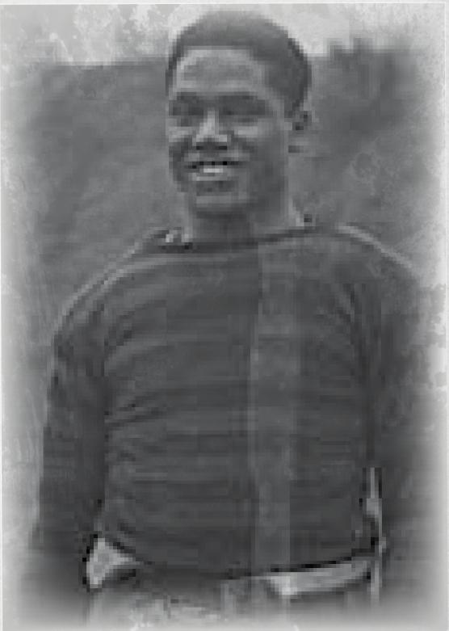

### TIFFANY QUISPE

<table><tr><td>Age: 22</td><td colspan="4">Occupation: Archaeology Student</td></tr><tr><td>STR 45</td><td>CON 40</td><td>SIZ 65</td><td>DEX 75</td><td>INT 70</td></tr><tr><td>APP 60</td><td>POW 40</td><td>EDU 67</td><td>SAN 40</td><td>HP 12</td></tr><tr><td>DB: 0</td><td>Build: 0</td><td>Move: 8</td><td>MP: 8</td><td>Luck: (3D6)x5</td></tr></table>

#### Skills

<table><tr><td>Accounting</td><td>15% (7/3)</td></tr><tr><td>Appraise</td><td>20% (10/4)</td></tr><tr><td>Charm</td><td>25% (12/5)</td></tr><tr><td>Climb</td><td>30% (15/6)</td></tr><tr><td>Credit Rating</td><td>10% (5/2)</td></tr><tr><td>Fast Talk</td><td>44% (22/8)</td></tr><tr><td>Intimidate</td><td>35% (17/7)</td></tr><tr><td>Jump</td><td>25% (12/5)</td></tr><tr><td>Language (English)</td><td>65% (32/13)</td></tr><tr><td>Listen</td><td>60% (30/12)</td></tr><tr><td>Locksmith</td><td>45% (22/9)</td></tr><tr><td>Mechanical Repair</td><td>35% (17/7)</td></tr><tr><td>Psychology</td><td>30% (15/6)</td></tr><tr><td>Sleight of Hand</td><td>65% (32/13)</td></tr><tr><td>Spot Hidden</td><td>70% (35/14)</td></tr><tr><td>Stealth</td><td>65% (32/13)</td></tr></table>

#### Combat

<table><tr><td>Brawl</td><td>25% (12/5), damage 1D3</td></tr><tr><td>Dodge</td><td>45% (22/9)</td></tr></table>

#### Backstory

Tiff feels like she has to fight just to make the world take her seriously. Everyone is always describing her as ‘cute’ or ‘pleasant’ when what she’d really like them to be saying is that she’s ‘accomplished’ and ‘hard working’. She’s tried reinventing herself, changing her hairstyle, working on her public speaking, but none of it seems to add up to much.

She joined the society looking to make a contribution. Do something positive, so people treat her like she's important. She just hopes that they pick her for a mission before too long.

- Personal Description: cute and smiley. With a wide nose and copper-brown skin of her Quechua heritage, Tiff dresses smart and professional, but the clothing never seems to sit quite right on her.
- Traits: Tiff has never 100% gotten the hang of ‘people’ and strikes others mostly as a classic badly socialized academic. But she thinks of herself as someone far more consequential.
- Ideology & Beliefs: Tiff wants to be the main character in her own story, dreaming of exotic digs in amazing locations.
- Significant People: a little estranged from her family, Tiff lives with her partner Susan. Tiff idolizes the idea of marriage, even though she's aware that people like her aren't allowed to.
- Meaningful Locations: Tiff lives off-campus with her partner in an attic conversion that just feels so very cozy.
- Treasured Possessions: a colorful alpaca wool poncho that was her fathers.

### MARGARET 'MAGGIE' MYERS

<table><tr><td>Age: 25</td><td colspan="4">Occupation: Criminology Student</td></tr><tr><td>STR 45</td><td>CON 60</td><td>SIZ 45</td><td>DEX 60</td><td>INT 65</td></tr><tr><td>APP 50</td><td>POW 55</td><td>EDU 70</td><td>SAN 55</td><td>HP 8</td></tr><tr><td>DB: 0</td><td>Build: 0</td><td>Move: 8</td><td>MP: 11</td><td>Luck: (3D6)x5</td></tr></table>

#### Skills

<table><tr><td>Appraise</td><td>50% (25/10)</td></tr><tr><td>Archaeology</td><td>61% (30/12)</td></tr><tr><td>Credit Rating</td><td>25% (12/5)</td></tr><tr><td>Language (English)</td><td>60% (30/12)</td></tr><tr><td>Language (Spanish)</td><td>70% (35/14)</td></tr><tr><td>Language (Quechuah)</td><td>70% (35/14)</td></tr><tr><td>Library Use</td><td>45% (22/9)</td></tr><tr><td>Listen</td><td>50% (25/10)</td></tr><tr><td>Mechanical Repair</td><td>45% (22/9)</td></tr><tr><td>Navigate</td><td>55% (27/11)</td></tr><tr><td>Psychology</td><td>30% (15/6)</td></tr><tr><td>Occult</td><td>45% (22/9)</td></tr><tr><td>Spot Hidden</td><td>60% (307/12)</td></tr><tr><td>Stealth</td><td>40% (20/8)</td></tr></table>

#### Combat

<table><tr><td>Brawl</td><td>45% (22/9), damage 1D3</td></tr><tr><td>Dodge</td><td>35% (17/7)</td></tr></table>

#### Backstory

Maggie is the youngest daughter of Patricia and George Myers. Her father is a Boston lawyer and philanthropist who set up his own practice to help the working class. As the youngest of three sisters, Maggie would regularly get into scraps and learned early on how to defend herself. Her rivalry with her siblings propelled her to succeed in school, where she made top grades.

Maggie graduated from Boston University after studying Criminology and Law; however, she decided her real talents and interest lay in the sciences. She joined Miskatonic University last December as a Graduate student, studying Pathology and Criminology. The Society for the Exploration of the Unexplained has been a fun diversion.

- Personal Description: elegantly dressed and attractive, Margaret moves gracefully and draws attention. You'd never know she can be quite handy in a fight.
- Traits: Margaret would make a great politician. She knows how to win people over but can be pretty ruthless when she needs to be.
- Ideology & Beliefs: Margaret will always stick up for the underdog and believes that justice only comes to those who fight for it.
- Significant People: her older sisters Harriet and Esme.
- Meaningful Locations: her family home in Boston.
- Treasured Possessions: a locket containing a photo of her parents.

For a further scenario featuring Maggie, see Flesh Wounds by Pete Burgess.

## HANDOUTS

### OFFICE OF THE VICE CHANCELLOR

MISKATONIC UNIVERSITY
Arkham, Mass.

Dear Students.

It will not be a surprise to the Society for the Exploration of the Unexplained that the Board has taken an interest in their work and that the curiosity and adventurous spirit of the Society aligns well with the value of Miskatonic University. It is due to these factors that the Board has always been proud to sponsor the Society's work. We must now, however, ask something from the Society.

A priceless artifact, the Atlantean Jewel, was loaned to a local production company by the name of Bazzledon Productions. An internal investigation is underway to determine how exactly the film company was able to get hold of the item. However, that need not concern you all. The Producer of the production company has sadly reported the jewelry missing from their set earlier this week. We are charging the Society with the investigation and recovery of this artifact. In addition, the Society is requested to gather any evidence regarding the possible culprit to be handed over to the local constabulary.

We have been highly impressed with the work of the Society to date. We pray that you will not fail us in this important endeavor. Those from the Society who are selected may contact Diane Loring in the Orne Library for further information.
Yours,

Professor Neil Arthur Tepp
Vice Chancellor
Miskatonic University

**Handout 1-a**: letter (internal)

### OFFICE OF THE VICE CHANCELLOR

MISKATONIC UNIVERSITY
Arkham, Mass.

Dear Investigators.

The Board thanks you for your quick response to our letter. We are saddened to admit that we are in need of some immediate outside help and hope that we have not interrupted anything important with our hasty summons.

A few days ago, a priceless artifact, the Atlantean Jewel, was loaned to a local production company by the name of Bazzledon Productions. An internal investigation is underway to determine how exactly the film company was able to get hold of the item. However, that need not concern you all. The Producer of the production company has sadly reported the jewelry missing from their set earlier this week. We are charging you with the investigation and recovery of this artifact. In addition, you are further requested to gather any evidence regarding the possible culprit to be handed over to the local constabulary.

Each of you come recommended, with stellar reputations for your ability to operate quickly, and discreetly. We pray that you will not fail us in this important endeavor. You may contact Diane Loring in the Orne Library at your earliest convenience for further information.

Yours,

**Handout 1-b**: letter (external)

### Handout 2: note

Hey G,
Wanted to drop in and see you, but your crew weren't thrilled to have me about. If you want to catch up, the old tunnel route is blocked, so you have to take a detour. It's LLFRFL.

Sammy

**Keeper note:** LLFRFL are directions (Left, Left, Forward, Right, Forward, Left) to be taken through the Caves. If the investigators enter through the tunnel by the rail station, these instructions take them to an opening by the Brewster Residence ([link](#nri-h-f6184124151c4142421b1af0)).
