# УЖАС ИННСМУТА
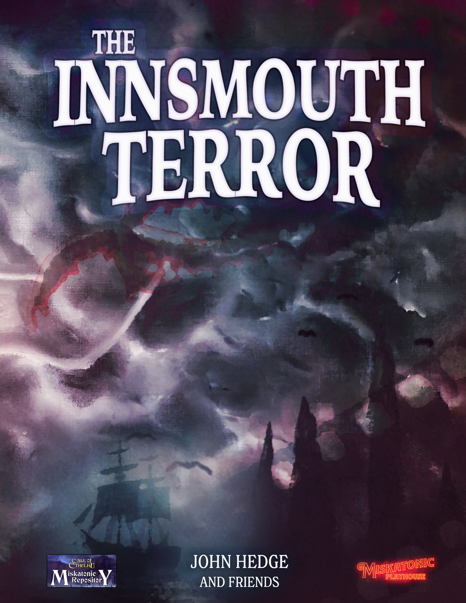

Свет, камера, мотор! На дворе 1923 год, и эпоха немого кино в самом разгаре. «Ужас Иннсмута» станет полнометражным трёхактным фильмом о гламурной даме, похищенной щупальцевидным чудовищем. В техноколоре!

«Ужас Иннсмута» — классический сценарий 1920-х годов для 7-й редакции «Зова Ктулху», идеально подходящий тем, кто ищет готовое приключение в окрестностях Аркхэма. Он рассчитан на трёх–пятерых игроков и проходится за одну-две сессии (4–8 часов).

## В буклете содержатся:

- Сценарий для игроков любого уровня опыта;
- Советы по проведению на конвентах;
- Полноцветные раздаточные материалы;
- Пять готовых сыщиков;
- Дополнительная версия, удобная для печати.

Этот сценарий можно провести самостоятельно или как продолжение «Испуг на сцене» того же автора.

# СОДЕРЖАНИЕ

## [ВВЕДЕНИЕ](#nri-h-1e7c84a4e9f5927381bc3dd4)

[Подготовка к игре](#nri-h-47551367143746af596d3df2)

[Ужас Иннсмута](#nri-h-e1e4abee7d665d664b579640)

[Привлечение сыщиков](#nri-h-5a1d3f11fa74d5bae7cbc1e7)

## [ДЕЙСТВУЮЩИЕ ЛИЦА](#nri-h-b1afc3d2767828f22a3d7b87)

[Genevieve 'Ginny' Dubois](#nri-h-88dac050ed1ec36f91e4b6fe)

[P.A. Bazzledon](#nri-h-4ad8df2678e05f458f288662)

[Anna Díaz](#nri-h-cd6a958ad9223013558284e5)

[Christopher McGuire](#nri-h-96bc6a07453b7b19ecf06440)

[Sammy Brewster](#nri-h-e0857213264e131c714fa054)

[Съёмочная группа](#nri-h-eb898a1c80749cbdbb6a2241)

[Второстепенные НИП](#nri-h-bf21a56d117d74edde8c045e)

## [НАЧАЛО: АРКХЭМ](#nri-h-29da96049102775b4dcc2b3a)

[Библиотека Орна](#nri-h-0712e7e461fd02534398a35f)

[«Аркхэм Адвертайзер»](#nri-h-f81478a90f8941232106712e)

[Мискатоникский театр](#nri-h-27b1ad17b7316f09136b83bc)

## [ИННСМУТ](#nri-h-640be35ee56417677f8750f5)

[Прибытие](#nri-h-e6c805ba31dc84425c90fbc6)

[Отель «Гилман-хаус»](#nri-h-591edd5bcf58d378b27f28cc)

[Съёмочный вагон](#nri-h-a6cc5383a39e0ec74e8769a8)

## [РАССЛЕДОВАНИЕ](#nri-h-579f6cee9279aa85f459d268)

[Кабинет продюсера](#nri-h-988fb78c5b2cac516d5570bf)

[Вокруг поезда](#nri-h-62a8c5d75b10782b4e475a55)

[Кабинет Bazzledon](#nri-h-1e72d19ab832ccee9c380a67)

[Трейлер Ginny](#nri-h-9af9701e3f85a91ab3b92009)

[Лаборатория McGuire](#nri-h-7eae4a85cb793259eb9ed053)

[На съёмочной площадке](#nri-h-4a3bb4ef4c7d762c63fef3b4)

[Железнодорожный вход](#nri-h-6e9d2e67b27162302be156fe)

[Система пещер](#nri-h-0377b0cfaf5eda9da814e2d8)

[Переход через пещеры](#nri-h-d5b878609b4bc64831d97150)

[Дом Brewster](#nri-h-f6184124151c4142421b1af0)

[Случайное появление на площадке](#nri-h-b741e3b3e62d814b592d4419)

## [В ИННСМУТ](#nri-h-1e82f0c963d8a023793fa18e)

[Универсальный магазин](#nri-h-d012304a399a1e520aefdba5)

[Пожарная станция](#nri-h-1b70234c4ece0af6255492e8)

[Эзотерический орден Дагона](#nri-h-04a91268c2b7afffd26817db)

[Вход через пещеры](#nri-h-03dd1ed10876ac8ee6d9eb7e)

## [ЭПИЧЕСКИЙ ФИНАЛ](#nri-h-9e45e6c31b8f513fdfc0cbcb)

[Последний поезд из Иннсмута](#nri-h-7b4e91617daf61336c70a8cf)

[Игра в героя](#nri-h-db7abf043f1d139a51dd4c3f)

## [ЭПИЛОГ](#nri-h-784561a8c2d6538c46980f3f)

[Награды](#nri-h-ee0dadea1c956d399c954d44)

## [ПЕРСОНАЖИ И ЧУДОВИЩА](#nri-h-216abf1f13f006ed96ddabfd)

## [ГОТОВЫЕ СЫЩИКИ](#nri-h-cef5699cd74c24cd894040ee)

## [РАЗДАТОЧНЫЕ МАТЕРИАЛЫ](#nri-h-9eb21ebd1012f4d0e1572e0a)

# УЖАС ИННСМУТА

«Мы поплывём к мрачному рифу в море и нырнём сквозь чёрные бездны к многоколонному циклопическому Y'ha-nthlei, и в логове Глубоководных будем вечно жить среди чудес и славы».

—Г. Ф. Лавкрафта, «Тень над Иннсмутом»

## ВВЕДЕНИЕ

Свет, камера, мотор! На дворе 1923 год, и эпоха немого кино в самом разгаре. «Ужас Иннсмута» станет полнометражным трёхактным фильмом о гламурной даме, похищенной щупальцевидным чудовищем. В техноколоре!

Но когда кинокомпании одалживают ценную тиару, а затем она бесцеремонно её теряет, сыщиков отправляют на поиски. Они встречают лишённую всякого воодушевления съёмочную группу, которую преследуют задержки, нервную старлетку, отчаянно желающую закончить съёмки, и новомодную камеру, постоянно выходящую из строя. По мере того как съёмочная группа не находит в скрипучем городе Иннсмуте ни веселья, ни развлечений, растут скука и раздражение. Вокруг — лишь море невозмутимых, пропахших солью, презрительных лиц, желающих, чтобы эти городские убрались и оставили их в покое.

Сумеют ли сыщики раскрыть правду, прежде чем ставки повысятся, а «Ужас Иннсмута» превратится во что-то более страшное, чем то, что запечатлевает объектив камеры?

### ПОДГОТОВКА К ИГРЕ

«Ужас Иннсмута» во многом опирается на рассказ Г. Ф. Лавкрафта «Тень над Иннсмутом» (1936) и использует некоторые элементы расширенного мира из «Побег из Иннсмута» (1992) издательства Chaosium. Однако знакомство с этими книгами не требуется ни для игры, ни для проведения этого расследования.

Этот сценарий задуман как продолжение сценария «Испуг на сцене», который сам является продолжением «Грани тьмы». Однако он вполне самостоятелен; его можно считать происходящим в одной вселенной и с некоторыми общими НИП, а не прямым продолжением.

Мало времени? Расследование можно начать в Иннсмуте (раздел «Расследование», [ссылка](#nri-h-579f6cee9279aa85f459d268)). Нужно лишь вкратце объяснить, как сыщики оказались в этой точке.

### ИНФОРМАЦИЯ ДЛЯ ХРАНИТЕЛЯ

Город Иннсмут — странное место. Общество Новой Англии изо всех сил старалось игнорировать и забыть эту обветшалую приморскую деревню. Когда-то это был процветающий порт, но теперь гавань занесена илом, и лишь местные рыбацкие лодки приходят и уходят с приливом. Вскоре после открытия железнодорожное сообщение забросили: операторы назвали линию «наименее прибыльной» из всех обслуживаемых. Никто не хотел ехать в Иннсмут. И, казалось, никто никогда не уезжал.

В 1830-х годах капитан Obed Marsh из Иннсмута заключил сделку с существами, живущими под Дьявольским рифом — опасным мелководьем у побережья. Существа снабжали его безделушками из золотого сплава в обмен на стеклянные и резиновые украшения. Marsh переплавлял безделушки и продавал чистое золото, обогащая город и делая семью Marsh богатой и влиятельной. Выгодополучатели золотой торговли основали церковь, названную Эзотерическим орденом Дагона, культ, поклоняющийся Дагону, богу моря. Орден постепенно захватил Иннсмут, изгоняя или обращая всех жителей. Но загнанные в угол власти дали отпор, заключив Obed Marsh и его учеников в тюрьму. Тогда существа, известные как Глубоководные, пришли защищать своих поклонников, убили местных представителей закона и закрепили за Obed Marsh негласное лидерство в Иннсмуте. За эту поддержку пришлось платить, и члены ордена были вынуждены принести три клятвы:

Первая клятва: *«Iä! Дагон! Я, (имя говорящего), торжественно клянусь не вмешиваться в дела Глубоководных и не доносить об их деятельности. Iä! Дагон!»*

Вторая клятва: *«Iä! Дагон! Я, (имя говорящего), торжественно клянусь, что по требованию окажу Глубоководным посильную помощь в любой необходимой форме. Iä! Дагон!»*

Третья клятва: *«Iä! Дагон! Я, (имя говорящего), торжественно клянусь взять это существо [Глубоководного] в жёны/мужья, привести его в свой дом и вместе с ним стремиться зачать и вырастить детей, чтобы народ и вера продолжали процветать. Iä! Дагон! Iä! Гидра!»*

Так, благодаря третьей клятве, появились Гибриды — потомки союза Глубоководного и человека. При рождении Гибриды выглядят полностью людьми, но по мере взросления приобретают черты Глубоководных: увеличенные глаза, перепончатые пальцы и другие признаки наследия. Это обычно называют «иннсмутским обликом». Со временем большинство Гибридов учится дышать под водой, уходит в море и присоединяется к своему народу в глубинах.

**Ginny Dubois** (урождённая Ginny Brewster, [ссылка](#nri-h-88dac050ed1ec36f91e4b6fe)) — одна из таких детей. Будучи, как многие дети, своенравной и неразумной, Ginny сбежала изучать театр. Тем самым она установила новый стандарт возмутительно плохой игры. Ginny — типичная старлетка: она покупала роли на украденные семейные деньги, но в конце концов даже этого не хватило, чтобы режиссёры подпустили её к платящей публике.

На дворе 1923 год, и Ginny снова повезло. Она сыграет главную роль в новом экспериментальном фильме «Ужас Иннсмута» — и он сделает её звездой! Правда, ради съёмок ей придётся вернуться домой, но она уже внесла в сценарий изменения, чтобы посмеяться над своей отсталой деревушкой и её отсталыми обычаями.

Когда на площадке появился артефакт Глубоководных, Ginny попросили надеть его как часть костюма. Испытывая отвращение к этой мысли, Ginny украла его и спрятала в своей старой спальне в Иннсмуте.

Ginny не знает, что режиссёр фильма, **P.A. Bazzledon** ([ссылка](#nri-h-4ad8df2678e05f458f288662)), сам состоит в сговоре с Матерью Гидрой. Он нанял Ginny не ради её внешности, денег или таланта. Она нужна ему как жертва звёздному отродью божественного императора Ктулху перед всеми жителями Иннсмута — невольная участница ужасающего ритуала и наглядное предупреждение о судьбе тех, кто нарушает свои клятвы.

**Таблица 1: хронология событий**

<table><tr><td>1922</td><td>Мать Гидра является во сне P.A. Bazzledon и гонит его в Аркхэм.</td></tr><tr><td>3 недели назад</td><td>P.A Bazzledon прибывает в Аркхэм.</td></tr><tr><td>2 недели назад</td><td>P.A Bazzledon убеждает Henry Armitage отдать ему Атлантийскую драгоценность.</td></tr><tr><td>10 дней назад</td><td>Съёмочная группа отправляется поездом в Иннсмут.</td></tr><tr><td>9 дней назад</td><td>Начинаются съёмки, но камеру преследуют неисправности.</td></tr><tr><td>3 дня назад</td><td>Ginny Dubois крадёт драгоценность из лаборатории McGuire.</td></tr><tr><td>Сейчас</td><td>Сыщиков отправляют в Иннсмут вернуть драгоценность.</td></tr><tr><td>Вечер второго дня</td><td>Начинаются съёмки эпического финала.</td></tr></table>
### УЖАС ИННСМУТА

Технологии стремительно меняются! Кинематограф — новейшее великое увлечение, и все спешат разработать цветную плёнку. Хотя раскрашивание после съёмки существует давно, мечтой всегда была запись цвета в реальном времени. В 1923 году техноколор — это призменная система разделения луча, где одновременно записываются две чёрно-белые плёнки: одна за красным фильтром, другая за зелёным. Процесс сложен, плёнки легко сбиваются с совмещения и в лучшем случае капризны. Съёмки постоянно останавливаются, пока инженер чинит и настраивает единственную способную на это камеру.

Рабочее название фильма — «Ужас Иннсмута». По сюжету юная девушка (её играет Ginny Dubois) бежит от жестокой семьи. Драматично перебегая поле, она оказывается схвачена злобными лягушкоподобными существами. Лягушкоподобные люди запирают её в пещере и издеваются над ней, а затем пытаются скормить гигантскому щупальцевому чудовищу. К счастью, в последний момент находчивый юноша в котелке спасает девушку, бросив монстру в глотку пакетик Tum-Eez — средства от изжоги.

Многие детали фильма, например внешний вид лягушкоподобных людей, Ginny изменила так, чтобы особенно оскорбить жителей Иннсмута. Те заметили, что дешёвые костюмы лягушколюдей подозрительно напоминают Глубоководных.

В ходе сценария съёмки последовательно проходят через фильм:

- Когда прибывают сыщики, съёмки идут на живописном поле у железнодорожных путей, сразу за Иннсмутом.
- Во время расследования съёмки перемещаются в пещеры Иннсмута, где снимают сцену в тюрьме.
- В финале съёмки проходят на утёсе прямо над Иннсмутом, где на глазах у всех жителей призывают звёздное отродье.

**Примечание Хранителю:** «Ужас Иннсмута» не станет «говорящим фильмом». Это немое кино. Стремление добавить в кино цвет и звук возникло примерно одновременно, но совместить их? Безумие.

### ПРИВЛЕЧЕНИЕ СЫЩИКОВ

Сыщики получают письмо от вице-канцлера Мискатоникского университета: библиотека Орна, главная библиотека университета, одолжила компании Bazzledon Productions один из ценных артефактов для экспериментального фильма. Однако в приморском городе Иннсмуте производственная компания потеряла артефакт и подозревает кражу. Сыщикам поручено вернуть украшение и собрать любые улики против виновника, чтобы передать их местной полиции ([**Раздаточный материал 1-a**](#nri-h-94205138fca7aa22510e0aca): письмо).

«Ужас Иннсмута» предполагает, что сыщики состоят в Обществе исследования необъяснимого (SEU) и являются студентами или сотрудниками Мискатоникского университета. Однако они могут быть профессионалами или другой группой, нанятой университетом; Хранителю достаточно использовать [**Раздаточный материал 1-b**](#nri-h-f8e3b2764c3b8f24c4c83bfa) (письмо).

**Примечание Хранителю:** Общество исследования необъяснимого (SEU) — неформальное объединение студентов и профессоров Мискатоникского университета. Оно описано в стартовом наборе «Зова Ктулху». Каждый раз, обнаружив интересное направление для исследования, SEU выбирает участников, наиболее способных разгадать тайну. SEU собирается раз в месяц в отдельной читальной комнате библиотеки Орна.

## ДЕЙСТВУЮЩИЕ ЛИЦА

### Genevieve 'Ginny' Dubois, 25 лет, старлетка

При плохом освещении широкие глаза и растянутая улыбка Ginny могут показаться невинной красотой. Но под светом прожекторов и перед работающими камерами лишь толстый грим и выразительные ракурсы скрывают её медленное превращение в гибрида. Она решительно намерена «добиться успеха» прежде, чем превращение завершится, и пойдёт ради этого на всё. В 1897 году она родилась в Иннсмуте у любящей матери и пугающего отца-Глубоководного. Предполагалось, что однажды Ginny присоединится к братьям и сёстрам внизу. Но у Ginny были другие планы. Сбежав с семейным золотом изучать театр, она купила себе участие в постановках Мискатоникского театра, спонсируя их в обмен на главную роль. Однако все спектакли провалились. Теперь она добилась главной роли в «Ужасе Иннсмута».

У Ginny молочно-белая кожа, и она носит слишком много грима. Обесцвеченные светлые волосы уложены в локоны; ярко-красное платье совпадает цветом с помадой, а сама она слегка пахнет лавандой. При ближайшем рассмотрении заметны чуть широко посаженные глаза, слегка потрескавшаяся кожа и немного увеличенные зубы.

Genevieve 'Ginny' Dubois

### P.A. Bazzledon, 40 лет, режиссёр и мошенник

Phineas Arthur Bazzledon — начинающий режиссёр из самого Нью-Йорка. Или, по крайней мере, так он утверждает. В сшитом на заказ костюме, блестящем цилиндре и амарантовом жилете он выделяется в толпе. Это белый мужчина с безупречно ухоженными усами над сильной квадратной челюстью, обычно ассоциирующейся с властью и лидерством. Лёгкая седина лишь добавляет ему непринуждённой изысканности. Несколько недель назад он прибыл в Аркхэм и начал разбрасываться деньгами среди местных актёров. Вскоре вся театральная сцена закружилась вокруг него в смертельной спирали преданности. Объявив о планах снять цветной немой фильм, он получил возможность выбирать местные таланты.

Bazzledon не тот, за кого себя выдаёт. В молодости мошенник вступил в культ, поклонявшийся Дагону, рассчитывая быстро разбогатеть. Но обнаружил, что клятвы Дагону не так легко нарушить. По ночам его мучают сны о Матери Гидре, предводительнице Глубоководных. Она велела ему вернуть Ginny Brewster в Иннсмут и принести её в жертву над городом. Кредитная линия, за счёт которой он финансирует съёмки, полностью фиктивна, и вскоре один из многочисленных ростовщиков, чьими услугами он пользовался, начнёт на него охоту. Но к тому времени он планирует уже двигаться к следующему городу, следующей жертве и следующему мошенничеству.

P.A. Bazzledon

### Anna Díaz, 26 лет, продюсер

Технически блестящая, весёлая, начитанная и трудолюбивая актриса Anna давно отказалась от надежды добиться успеха. Главные роли достаются элегантным эффектным элегантным блондинкам, а не крепким деревенским девушкам с тёмно-коричневой кожей и шрамами от акне.

Однако почти энциклопедическое знание Anna об аркхемской сцене и способность уладить почти что угодно сделали её идеальным продюсером «Ужаса Иннсмута». Правда, раньше Anna никогда не продюсировала фильм, но поставила множество спектаклей — неужели это так уж отличается?

Именно Anna нашла старый вагон, в котором живёт группа. Она приобрела его за бесценок, и он гораздо удобнее палаток, где группа обычно спит на площадке. Теперь, когда съёмки тянутся день за днём, вагон стал настоящим спасением: приличных отелей в Иннсмуте нет.

Работать с «кинематографическим гением» вроде Bazzledon трудно для Anna. Его требования часто неожиданны и не похожи ни на что, что она могла представить. Но Anna рада учиться у человека с таким опытом. В основном она осваивает всё прямо на работе, разбираясь сама — даже если учиться приходится совсем не тому, чего она ожидала.

Anna добилась своего, хватаясь за каждую возможность, поэтому она сделает эту постановку успешной, даже если придётся тащить её к финишу пинками и воплями.

Anna Díaz

### Christopher McGuire, 37 лет, инженер

Высокий нескладный белый мужчина с рыжими кудрями под кепкой, Christoper McGuire — неловкий человек, оживающий лишь за работой с техникой. Чрезвычайно высокий и постоянно склонённый над камерой, он владеет маленькой мастерской рядом с территорией Мискатоникского университета. Иногда он читает гостевые лекции инженерному факультету, хотя в последнее время реже: учёные не вполне понимают, чем он занят.

Именно McGuire предложил Bazzledon снимать в техноколоре вскоре после его приезда в Аркхэм. Bazzledon ухватился за эту идею как за идеальную основу долгой аферы.

К сожалению, технология ещё не готова для полнометражного фильма — её даже рано выносить из лаборатории. Камера постоянно ломается, из-за чего съёмки останавливаются на много часов. McGuire делает всё возможное, чтобы процесс продолжался.

McGuire отчаянно хочет, чтобы фильм получился, и вложил в это дело все свои сбережения. Фильм необходимо закончить, и он будет держать камеру включённой до самого конца.

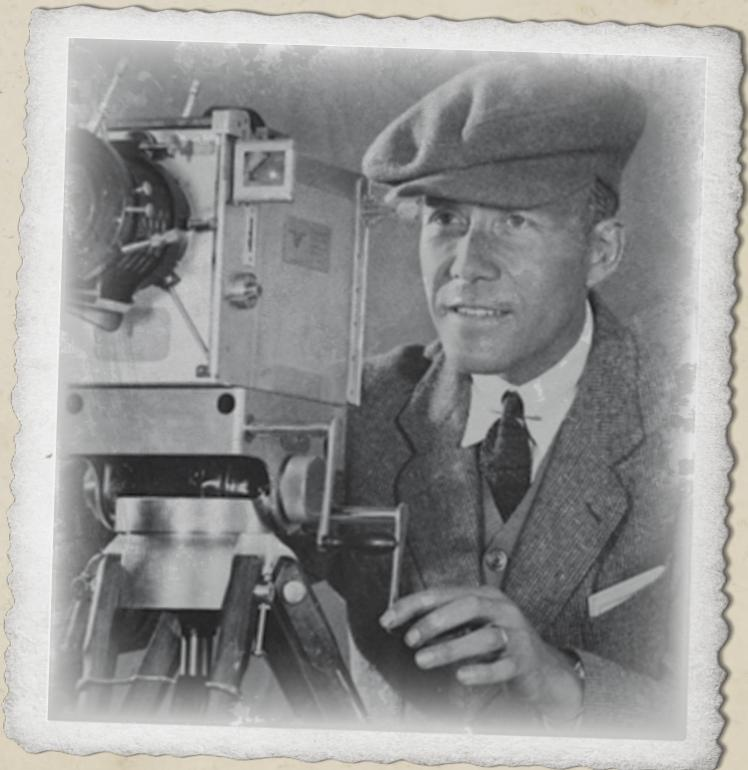

Christopher McGuire

### Sammy Brewster, 21 год, дилетант и брат

Приятный молодой белый мужчина из богатой семьи, Sammy лишь начинает приобретать знаменитый иннсмутский облик: слишком большие глаза и слегка рыбьи черты делают его скорее мальчишкой, чем красавцем; приглаженные светлые волосы выглядят немного… влажными.

Sammy ошивается в съёмочном лагере, пытаясь поговорить с сестрой Ginny. Пару дней назад его поймала съёмочная группа и поставила ему фингал, который теперь красуется под правым глазом. Ginny не предприняла попытки связаться с ним. Ей просто неинтересно.

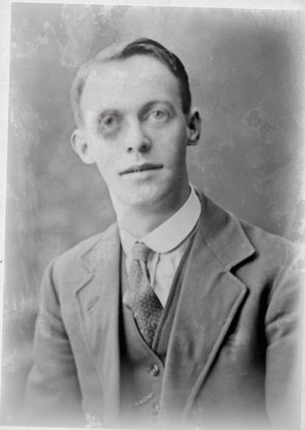

Sammy Brewster

### СЪЁМОЧНАЯ ГРУППА

Непокорная толпа грузных мужчин и женщин, занимающихся переноской, организацией и иногда исполняющих второстепенные роли вроде «Страшного рыболюда номер 2». Обычно их можно найти у съёмочного поезда или за разными делами на площадке. Бесконечно взаимозаменяемые и неопределённые числом, члены группы любят напиваться и вечерами сидеть у костра. Между группой и жителями Иннсмута тлеет напряжение, и между ними уже вспыхивала не одна драка.

## ВТОРОСТЕПЕННЫЕ НИП

### Diane Loring

Прилежная руководительница исследовательского отдела библиотеки Орна. Она помогает сыщикам искать сведения в архивах и направляет их в «Аркхэм Адвертайзер». Это серьёзная темнокожая женщина под пятьдесят, с естественно седеющими волосами. Diane Loring вежлива с сыщиками, но дружелюбной её не назовёшь. Студенты знают о её суровой репутации. Она всегда готова помочь с серьёзными вопросами, но не терпит шума и осложнений в библиотеке.

### Henry Armitage

Знаменитый главный библиотекарь библиотеки Орна может быть уже знаком сыщикам. Он может помочь им вместо Diane Loring.

### Karen Jeffries

Немного раздражительная, самоуверенная и властная руководительница «Аркхэм Адвертайзер», Karen убеждена, что люди никогда не проявляют к ней достаточно уважения, и совершенно не расположена тратить время на сыщиков, считающих своё расследование важнее новостей. Но если польстить ей или показаться полезными, она из кожи вон вылезет, чтобы помочь.

### Franc Turner

Уборщик недавно закрывшегося Мискатоникского театра. Franc — темнокожий мужчина со слегка поседевшими волосами, в синих комбинезонах и с впечатляющими усами. Он высок и широкоплеч, так что едва помещается в рубашке.

### Jeremiah Brewster

Второй по рангу жрец Эзотерического ордена Дагона. Он крепко держит жителей города под контролем, чтобы не тревожить Глубоководных. Его превращение в Глубоководного почти завершено.

### Pete

Владелец универсальный магазин Иннсмута. Он жизнерадостен и дружелюбен с сыщиками. Дела у него явно идут неважно, поэтому он рад новым лицам.

### Zadok Allen

Знаменитый пьяница из «Тени над Иннсмутом». Он знает всю историю Obed Marsh, его сделки с Глубоководными и трёх клятв, которые жители Иннсмута были вынуждены принести.

## НАЧАЛО: АРКХЕМ

### БИБЛИОТЕКА ОРНА (МИСКАТОНИКСКИЙ УНИВЕРСИТЕТ)

Наша история начинается в тихих стенах библиотеки Орна при Мискатоникском университете. Обычно Общество исследования необъяснимого (SEU) собирается в отдельной читальной комнате лишь раз в месяц, но внеплановую встречу спешно созвали по запросу самого вице-канцлера Мискатоникского университета! Вице-канцлер просит помочь вернуть Атлантийскую драгоценность — необычную тиару из золотого сплава ([**Раздаточный материал 1-a**](#nri-h-94205138fca7aa22510e0aca): письмо). Она единственная в своём роде и представляет археологическую ценность. В записке совета мало сказано, кроме совета обратиться к Diane Loring за дополнительными сведениями.

Как выяснилось, главный библиотекарь Henry Armitage просто открыл стеклянный шкаф и передал артефакт P.A. Bazzledon после предъявления подписанной записки вице-канцлера, разрешавшей забрать предмет. Разумеется, записка была поддельной. Внутреннее расследование установит, что Armitage обманом заставили выдать артефакт, и удержит с него недельную зарплату. Сыщики могут попытаться узнать, кто отвечал за передачу драгоценности Bazzledon, но сотрудники университета окажутся крайне неразговорчивы: Armitage любят, а его подчинённые яростно его защищают.

Вероятнее всего, первым делом сыщики обратятся к Diane Loring, прилежной руководительнице исследовательского отдела, работающей за главным столом.

Loring объясняет, что Атлантийская драгоценность — сокровище, которое надёжно хранилось за толстым стеклом в библиотеке Орна. Его точная история и происхождение вызывают жаркие споры в археологических кругах. Большинство учёных считает, что тиару выковала древняя ныне исчезнувшая цивилизация, отсюда и довольно невдохновляющее название артефакта. Его «ошибочно» одолжили кинокомпании для экспериментального фильма. Съёмки, похоже, идут в Иннсмуте, небольшом городе к северо-востоку от Ипсуич. К городу не ведут крупные дороги, а единственную железнодорожную линию через Роули закрыли несколько лет назад. Loring считает, что автобус в Иннсмут отправляется с Дайер-стрит в 21:00.

- На вопросы о том, как артефакт покинул библиотеку, Loring отвечает пренебрежительным взглядом. Она объясняет, что, по её мнению, важному сотруднику библиотеки предъявили поддельные документы, и он добросовестно передал артефакт.
- Если спросить, как университет узнал о краже, Loring отвечает, что продюсер Anna Díaz сообщила ему об исчезновении драгоценности.

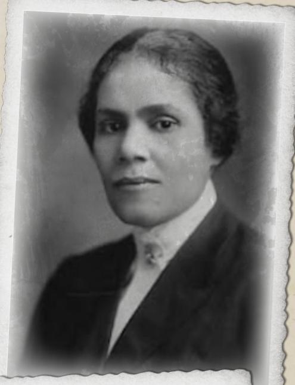

Diane Loring

Dr. Henry Armitage

**Примечание Хранителю:** сыщики часто придумывают сложные теории и задают вопросы, не предусмотренные сценарием. Если они зададут вопрос без очевидного ответа, импровизируйте — желательно так, чтобы вернуть их к важной для сценария информации.

- При успешной проверке Археологии сыщики узнают от Loring немного больше. Это тиара из необычного золотого сплава, который современная наука не способна воспроизвести. Рыбаки иногда поднимают подобные сокровища со дна моря и затем продают их. Эта тиара смутно связана с Иннсмутом, поэтому, вероятно, её и забрали.
- Loring ничего не знает о фильме и его съёмочной группе и советует обратиться в местную газету «Аркхэм Адвертайзер» (рядом), чтобы узнать больше. Она также напоминает, что при необходимости сыщики могут пользоваться ресурсами библиотеки Орна.

Исследуя библиотеку Орна, сыщики могут выбрать разные направления. Для общих сведений об Иннсмуте и артефакте они могут пройти обычную проверку Работы в библиотеке. Разные направления также позволяют сделать общие выводы о краже:

При успешной проверке Оккультизма сыщики знают, что подобные артефакты высоко ценятся культами и тайными организациями, почитающими реликвии исчезнувших культур.

При успешной проверке Антропологии сыщики понимают: вероятнее всего культурное сокровище украдут те, кому оно изначально принадлежало. Такие люди придерживаются довольно необычной мысли, будто сокровище каким-то образом принадлежит им.

При успешной проверке Юриспруденции сыщики решают, что лучше всего проследить за деньгами. Кто такие Bazzledon Productions? Получат ли они выгоду от продажи предмета?

За более свежими сведениями придётся поговорить с людьми или посетить «Аркхэм Адвертайзер» (рядом).

**Примечание Хранителю:** описание драгоценности будет знакомо любому игроку, читавшему «Тень над Иннсмутом», поэтому Хранитель может довольно открыто дать понять, что тиара явно связана с Иннсмутом. Драгоценность изготовили Глубоководные и передали жителям Иннсмута в рамках давней сделки. Тиары, подобные Атлантийской драгоценности, часто носят жрецы Ордена Дагона либо переплавляют их ради золота.

### «АРКХЭМ АДВЕРТАЙЗЕР»

Хотя библиотека Орна идеально подходит для изучения прошлого, для свежих новостей и городских сплетен ничто не сравнится с бойкой «Аркхэм Адвертайзер». Её владелица Karen Jeffries, пожалуй, самая самовлюблённая сплетница города. Если сыщики приходят днём, в редакции кипит работа: Jeffries и сотрудники сидят вокруг одного большого стола, возбуждённо говорят по телефонам, курят одну сигарету за другой, передают записки и время от времени печатают на машинках. Здесь шумно и оживлённо. Попытавшиеся прервать Jeffries до того, как она будет готова говорить, получат нагоняй и указание ждать в стороне на крайне неудобных зелёных стульях. Но если терпеливо ждать, Jeffries обратит на них внимание спустя, кажется, целую вечность.

**Примечание Хранителю:** если сыщики уже встречались с Karen, она может отреагировать на них иначе. Лучше всего предложить крупную сумму на поддержку работы «Аркхэм Адвертайзер». В противном случае стоит помнить, что Karen довольно поверхностна и благосклонна к людям с высоким Кредитным рейтингом или ВНЕ.

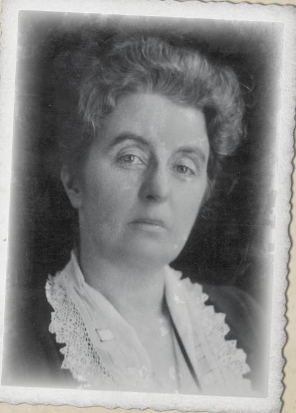

Karen Jeffries
Karen не станет помогать сыщикам просто так: её нужно убедить успешной проверкой Обаяния или Убеждения. Исключение — если они принесут ей эксклюзивную историю о том, как библиотека Орна потеряла бесценный артефакт. Это сразу вызывает её интерес, и она готова рассказать всё, что знает об участниках дела, если сыщики дадут анонимную цитату, способную опорочить великий Мискатоникский университет.

Когда Karen всё же начинает говорить, её буквально переполняют сплетни об «Ужасе Иннсмута».

- Режиссёр P.A Bazzledon появился в Аркхэме около трёх недель назад. Он приехал из Нью-Йорка, где его имя связывают с несколькими успешными внебродвейскими постановками. Похоже, это восходящая звезда.
- Bazzledon буквально сорит деньгами. Jeffries очень хотела бы узнать, откуда его состояние: она написала несколько статей о таинственных источниках дохода этого театрального дилетанта, и слухов ходит множество — от семейных денег и пиратства до золотой жилы на Западе. Однако сам он остаётся загадкой.
- Проект якобы будут снимать в «Техниколоре», который, по словам создателей, даёт настоящий цвет! Недавно Jeffries опубликовала материал об изобретателе Christopher McGuire. Это чудак, время от времени работающий с университетом.
- Главную роль исполняет Ginny Dubois, недавно сыгравшая в нескольких спектаклях Мискатоникского театра (рядом), прежде чем тот сгорел при загадочных обстоятельствах. Её актёрские способности «ограниченны», но Jeffries к ней благоволит. При успешной проверке Психологии сыщики понимают, что Ginny пожертвовала деньги «Адвертайзер» в обмен на хорошие отзывы. Впрочем, при провале это тоже довольно очевидно.
- Продюсер купила старый спальный железнодорожный вагон и перегнала его на заброшенную ветку между Иннсмутом и Роули. В нём живёт вся съёмочная группа, поскольку в Иннсмуте, по слухам, нет гостиниц приемлемого качества.

При упоминании Иннсмута Jeffries морщится. По её словам, за сто лет там не произошло ничего важного. Единственная местная газета, «Иннсмут Курьер», закрылась ещё в 1840-х. Она считает разговор об этом городе почти ниже своего достоинства. Впрочем, понизив голос до шёпота, Jeffries добавляет: ходят слухи, что звезда Ginny Dubois на самом деле родом из Иннсмута, хотя сама утверждает, что из Ньюберипорта.

### МИСКАТОНИКСКИЙ ТЕАТР

Сыщики могли связать Ginny Dubois с театром и отправиться туда на поиски улик. К сожалению, Мискатоникский театр сгорел. Пока сыщики стоят среди руин некогда гордого здания, виден только пожилой темнокожий мужчина, убирающий обломки. Это Franc Turner, смотритель театра.

Franc помнит Ginny Dubois как звезду спектакля. Он называет её «проблемой» и рад, что избавился от неё. Ginny преследовала одну цель — попасть в Голливуд и стать звездой. Ей было безразлично, кто и почему встанет на пути. При успешной проверке Общения с Franc он признаётся, что слышал: все её деньги от семьи, и родственники прислали юриста, чтобы вернуть их.

**Заметка Хранителя:** если Мискатоникский театр не сгорел в вашей игре «Испуг на сцене», вскоре он всё равно сгорит из-за другой случайности. Не бойтесь: его быстро восстановят!

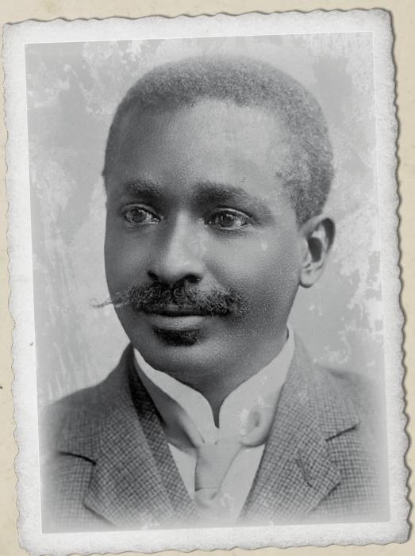

Ryan Turner

## ИННСМУТ

### ПРИБЫТИЕ

Сыщики могут сесть на автобус до Иннсмута в 9 часов вечера на Дайер-стрит. Билет стоит 40 центов, поездка длится чуть больше 45 минут. Автобус дряхлый и медленный, но высаживает их на площади Нью-Таун. Имеющие автомобиль могут поехать с комфортом, однако дорога узкая, ухабистая и плохо содержится. Водитель должен пройти проверку Вождения автомобиля, иначе слишком разгонится и сломает заднюю ось по пути. Тогда всё равно придётся пересесть на автобус.

**Заметка Хранителя:** лучше, если у сыщиков не будет автомобиля: это ограничит их возможность быстро покинуть происходящее в городе.

Когда сыщики прибывают в город, уже поздно. Автобус въезжает, и их чувства захлёстывает характерный рыбный запах. В центре он неприятен и вездесущ, а по мере приближения к гавани усиливается. Запах смешивается с постоянно гуляющим морским бризом. Фонари не горят; ночь освещают лишь оранжевые фары автобуса. По всему городу слышен грохот многочисленных водопадов, заглушающий странные звуки из тёмных разрушенных домов.

Заранее забронировать номера по телефону нельзя: в Иннсмуте нет телефонной линии. Водитель тихо каркает, что в отеле «Гилман-хаус» ([ссылка](#nri-h-591edd5bcf58d378b27f28cc)) всегда есть места, и указывает на здание возле площади. Из окна первого этажа льётся свет, входные двери открыты. Если немного прищуриться, оно почти кажется гостеприимным.

Сыщики могут остановиться в отеле «Гилман-хаус» или заметить огонь на окраине города. Это производственный вагон ([ссылка](#nri-h-a6cc5383a39e0ec74e8769a8)), где Anna Díaz найдёт для них кровати.

### ОТЕЛЬ «ГИЛМАН-ХАУС»

«Гилман-хаус» — знаменитый отель из рассказа Г. Ф. Лавкрафта «Тень над Иннсмутом». Одни группы направятся прямо туда в ожидании ужаса, другие постараются его избежать.

Так или иначе, этот когда-то фешенебельный отель построен в 1830-х и теперь заметно состарился. Скрипучие половицы и пыльные ковры встречают сыщиков; мерцающие газовые лампы освещают стойку. Приятный добродушный регистратор записывает их имена и выдаёт «самые свежие» номера на верхнем этаже. Улыбаясь, он объясняет, что верхние этажи обычно отдают «приезжим»: там тише, а «запах» «не такой сильный». К нему нужно привыкнуть.

В отеле нет даже подобия консьерж-службы, а преклонный возраст регистратора подсказывает: багаж придётся самим тащить в темноте по скрипучей лестнице наверх. Если попросить, регистратор выдаёт запасной фонарь. Он сообщает, что в каждой комнате есть фонарь и «ночной горшок» под кроватью. (Настоящие туалеты находятся в дальнем конце коридора.)

Поднимаясь по лестнице, все сыщики должны пройти проверку Слуха. Успех позволяет услышать странные хрипы, карканье, вздохи и один приглушённый крик с нижних этажей. Услышавший проходит проверку Рассудка (потеря 0/1).

В комнатах их ждёт простое, хотя слегка устаревшее убранство. У окна стоит ведро свежей воды, есть небольшой письменный стол и одна кровать. Комнаты сыщиков разбросаны по зданию, не рядом друг с другом. Щеколды хлипкие и почти бесполезные.

При успешной проверке Внимательности сыщики замечают, что в каждой комнате есть дверь в соседнюю. Две или более комнаты можно объединить в небольшой номер. Более подозрительный сыщик поймёт, что кто-то легко войдёт, даже если дверь заперта.

В этот момент многие сыщики могут решить бежать из отеля «Гилман-хаус». Ничто не мешает им извиниться и уйти. Если они остаются на ночь, сыщик с наименьшей Удачей около 3 часов просыпается от попытки открыть дверь. Если дверь не заперта, он вместо этого слышит, как она тихо закрывается, будто кто-то наблюдал за его сном.

### СЪЁМОЧНЫЙ ВАГОН

На северо-западной окраине Иннсмута мерцает огонь. Это единственный свет, видимый в сонном ночном городе: большинство окон закрыто плотными шторами, удерживающими свет и звук. Следующие за огнём сыщики быстро находят заброшенные пути и идут по ним к производственному вагону.

Сыщики могут прибыть к производственному вагону поздним вечером или ранним утром после тревожной бессонной ночи в отеле «Гилман-хаус».

Если они приходят вечером, то видят членов группы у огня: те рассказывают истории, пьют и смеются. Одна крепко сложенная женщина встаёт их приветствовать. Это продюсер Anna Díaz. Она представляется, но быстро отправляет их отдыхать в спальный вагон, обещая ответить на вопросы утром. Их размещают в маленькой, но удивительно удобной комнате с кроватями для всей группы. Они засыпают под едва слышные смех и веселье.

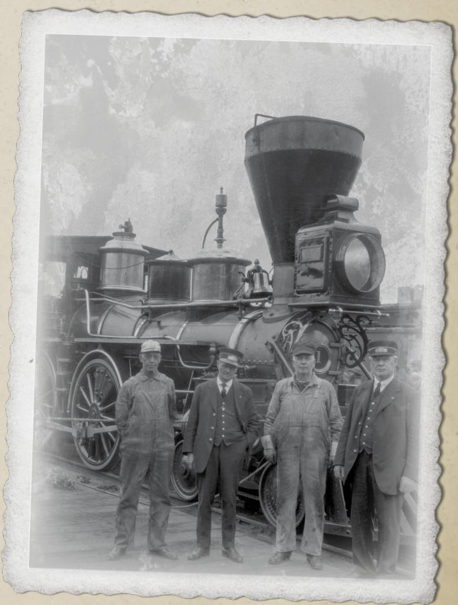

## РАССЛЕДОВАНИЕ

### КАБИНЕТ ПРОДЮСЕРА

Раннее утро; солнце пытается пробиться сквозь туман, но пройдут часы, прежде чем оно рассеет туман, накрывший долину Мануксета. Анна Díaz сидит за загромождённым столом, устроенным в переоборудованном спальном купе Производственного поезда. Комнату наполняет запах свежего кофе, окно открыто, а вдали слышно пение птиц. Сыщики тесно устраиваются в оставшемся пространстве. Места, чтобы сесть всем, не хватает, и есть только ещё один стул.

Díaz благодарит сыщиков за визит и снова извиняется за утрату Атлантийской драгоценности. Она понимает, что это сокровище огромной ценности, и отмечает, как невероятно благодарна съёмочная группа Университету, согласившемуся вообще поделиться им.

Как только она поняла, что драгоценность пропала, она уведомила Университет и устроила тщательный обыск. Теперь ей неловко признаться, что первым делом она заподозрила съёмочную группу. Это не слишком свидетельствует о её классовом сознании. Она велела членам группы обыскать личные вещи друг друга и разбила их на пары для осмотра всего поезда. Драгоценность ведь не маленькая. Поэтому она почти уверена, что в вагоне её нет.

Díaz не знает, откуда именно забрали драгоценность, и, похоже, никто не знает, где она хранилась. Bazzledon считал, что она была в лаборатории McGuire. McGuire думал, что её держали в сейфе в кабинете Bazzledon.

Díaz не хочет предвосхищать выводы сыщиков и предлагает рассмотреть все варианты. При этом есть всего три места, которые ей не удалось обыскать:

- кабинет P.A. Bazzledon: «Но зачем ему красть драгоценность? Он в ярости из-за её пропажи, да и именно он так старался раздобыть её для съёмок».
- трейлер Ginny Dubois: «Она буквально родилась с деньгами. Не могу придумать ни одной причины, по которой она занялась бы мелким воровством».
- лаборатория Christopher McGuire: «Он категорически запрещает кому-либо входить туда. И не без причины. Там хранится вся хрупкая техника».

Единственная другая зацепка — молодой человек из Иннсмута, который крутится возле площадки. Большинство местных держится подальше от съёмок, но этого уже не раз замечали среди вагонов. Несколько членов группы прогнали его пару ночей назад. Díaz подозревает, что это их лучшая зацепка.

Разумеется, сыщики также могут поговорить со всеми членами группы. Сегодня утром они переснимают несколько сцен в поле возле железнодорожных путей, так что все будут в одном месте.

Díaz открыто помогает сыщикам, внимательна к деталям и совершенно с ними честна. Она сделает всё разумное, что в её силах, чтобы помочь расследованию. При успешной проверке Общения сыщики могут даже убедить её «случайно» оставить на столе запасные ключи от разных вагонов, когда она выйдет. В противном случае они могут попытаться выхватить их проверкой Ловкости рук или прокрасться обратно в кабинет и забрать их при успешной проверке Скрытности.

### ВОКРУГ ПОЕЗДА

Рядом со спальным вагоном, прицепленным к древнему паровозу, вагон-ресторан наскоро переоборудовали в несколько больших помещений. Вход со стороны паровоза ведёт в кабинет Bazzledon (ниже), из центра можно попасть в трейлер Ginny ([ссылка](#nri-h-9af9701e3f85a91ab3b92009)), а на дальнем конце устроен небольшой пандус в лабораторию McGuire ([ссылка](#nri-h-7eae4a85cb793259eb9ed053)). Все три двери заперты: нужны ключи или успешная проверка Взлома. Получив доступ в одно помещение, сыщики обнаруживают, что стены тонкие, как картон, и их можно отогнуть, переходя между трейлерами.

### Кабинет Bazzledon

В кабинете небрежно задёрнуты шторы, и резкие лучи света прорезают тусклую пыльную дымку. Обычно Bazzledon не бывает здесь: он постоянно на площадке, отдаёт распоряжения, строит планы и работает над финальной сценой — кульминацией своих замыслов.

В одном углу спутанная груда простыней обозначает кровать. Рядом красуются большой сундук с одеждой и огромное зеркало. Возле него лежит холодное железо. Перед зеркалом аккуратно выстроено полдюжины флаконов с гримом, гелями и мазями. Его стол сделан из старого вагонного столика и покрыт бумагами. В другой части комнаты стоят два удобных на вид кресла, а между ними — маленький столик с несколькими дорогими бутылками спиртного.

В этой комнате сыщики могут вести расследование разными способами и узнавать разные сведения:

Бумаги на столе ошеломляют своим количеством, и при беглом просмотре плотных листов с цифрами и словами ничего ценного обнаружить не удаётся.

- При успешной проверке Бухгалтерского дела сыщики понимают, что цифры Bazzledon не сходятся. Он не пытался составить бюджет или прогноз расходов на фильм. Какова бы ни была причина создания картины, дело не в деньгах.
- Успешная проверка Внимания позволяет обнаружить смятый и выброшенный в урну лист. Это письмо от некоего Fat Tony, в котором тот вежливо объясняет Bazzledon, что знает о его переезде в Аркхэм, и если деньги Tony не вернутся к нему до конца месяца, ему придётся предпринять «прискорбные шаги», чтобы защитить свои вложения.
- Изучая сценарии, сыщики могут проверкой Язык (английский) или Работы в библиотеке просмотреть разные черновики, брошенные в стопке. Становится ясно, что в ранних версиях похищение должны были совершить люди-культисты, а не лягушколюди. Лягушачьи элементы, похоже, добавила Ginny Dubois.
- Читая переписку, любой узнаёт о торгах между компаниями, желавшими спонсировать фильм. Крупная компания по производству сиропа от кашля предложила \$6000 после выхода картины, а новая компания по производству антацидов Tum-Eez — \$4000 вперёд. Похоже, Bazzledon выбрал меньшую сумму и забрал деньги.

- Пытаясь понять Bazzledon, сыщики могут проверить Психология или Психоанализ, осматривая его комнату. При успехе они замечают запущенность и беспорядок в его личных делах и сравнивают их с тщательностью, с которой он следит за внешностью и гримом. Этот человек заботится о том, как его воспринимают, и ухаживает за гримом так же внимательно, как мастер — за инструментами.
- Сыщики, заинтересовавшиеся гримом, могут пройти проверку Маскировки и понять, что это инструменты человека, регулярно меняющего внешность, а не просто шоумена, который любит хорошо выглядеть.

В конце концов сыщики замечают запертый напольный сейф под скрипучей половицей. Чтобы вскрыть его, нужна успешная проверка Взлома. Можно также открутить его при успешной проверке Ремонта механизмов. Внутри сыщики находят \$4000 наличными и старый пистолет дерринджер. Но тиары нет.

Тщательный обыск кабинета Bazzledon не даёт сыщикам доказательств, что именно он забрал тиару. Также они не находят ничего, связывающего его с Мать Гидра: он получает указания во сне и никогда их не записывает.

### Трейлер Ginny

В трейлере Ginny светло, окна открыты и впускают морской бриз, смешанный с рыбным запахом, который, кажется, преследует всё в Иннс-муте. К знакомым запахам примешиваются резкие всплески духов. Сначала сыщики могут подумать, что здесь всё перевернули вверх дном. Одежда покрывает каждую поверхность, а единственное свободное место на полу — возле большого зеркала, окружённого лампами накаливания. Даже там в беспорядке навалены выброшенные щётки для туши и засохшие губки для грима. Место кровати можно лишь угадывать: фактически это куча одежды в дальнем конце комнаты, почти гнездо.

Под беспорядком видны обломки розовых кружевных подушек и кроваво-красных покрывал, небрежно разложенных на современной дорогой мебели. Пробираясь среди вещей, сыщики предпочитают встать у окон и осмотреть комнату: смесь запахов невыносимо неприятна.

Сыщики, пытающиеся распахнуть окна шире, или успешно прошедшие проверку Внимания находят на раме записку ([**раздаточный материал 2**](#nri-h-1701b4c74a5e58fac76c83d3): записка).

Если сыщики не находят записку на подоконнике, во время обыска они обнаруживают [**раздаточный материал 2**](#nri-h-1701b4c74a5e58fac76c83d3), брошенный в урну в углу.

Кроме одежды, в гримёрной есть лишь несколько фотографий Ginny с мелкими местными знаменитостями и газетная статья в рамке из «Аркхэм Адвертайзер» о «трагическом» пожаре в Мискатоникском театре, оборвавшем прославленную (три звезды) постановку «Женщина в бронзе» с «восходящей звездой» Ginny Dubois.

Сыщики могут осмотреть стену между комнатами Ginny и McGuire. При успешной проверке Чтения следов они замечают лёгкие следы и сгибы на картоне: стену уже отгибали. Трудно понять, с какой стороны появились следы.

Больше в комнате нет ничего ценного или интересного, и сыщики могут быстро уйти.

Если сыщики не станут обыскивать трейлер или не смогут войти, проходя мимо, они замечают [**раздаточный материал 2**](#nri-h-1701b4c74a5e58fac76c83d3), хлопающий на оконной раме.

### Лаборатория McGuire

Деревянные лабораторные столы занимают всю длину комнаты, а на противоположной стене торчат штыри, на которых висят тяжёлые рулоны плёнки. Плёнка разбросана повсюду, словно паутина пьяного паука, окна скрыты плотными шторами. Рабочее место McGuire освещают две резкие лампы накаливания без абажуров. На верстаке лежит частично разобранная камера. Сыщик, успешно прошедший Естественные науки (инженерное дело) или Электроника, восхищается качеством её изготовления. Это по-настоящему передовая технология: призма разделяет свет надвое, а фильтры позволяют одновременно записывать две одинаковые сцены.

Хотя в лаборатории беспорядок, спрятаться здесь негде, и ни один ящик не заперт. Сыщики находят множество небезопасных химикатов, но не обнаруживают тайных сокровищ.

На столе McGuire они находят небольшой план системы пещер. Он начерчен линейкой и множеством прямых углов и скорее похож на схематическую карту. Однако, похоже, карта ведёт… куда-то.

Это может показаться подозрительным, но на деле это просто указания, как добраться до пещеры, где позже сегодня снимут сцену в тюрьме. Несколько дней назад McGuire и Bazzledon исследовали пещеры и выбрали отличное место. Следуя карте, сыщики неожиданно выходят на съёмочную площадку ([ссылка](#nri-h-b741e3b3e62d814b592d4419)).

**Заметка Хранителя:** ни один из этих химикатов не горит хорошо, а самый опасный — всего лишь слабая кислота. Однако они токсичны, чувствительны к свету и дороги. А плёнка? На основе нитрата и невероятно огнеопасна.

### На съёмочной площадке

Во время первоначального расследования все участники съёмок работают на большом открытом поле возле заброшенных железнодорожных путей. Сегодня погода впечатляющая: грозовые тучи обещают позднее грозу, но пока дует лишь лёгкий ветерок.

Вероятно, это первая возможность сыщиков осмотреть впечатляющий пейзаж Иннсмута. Долина внизу похожа на сплошное болото, а зубчатые вершины и утёсы над дальней окраиной города создают ощущение замкнутости и изоляции. Трудно представить, что этот затерянный участок побережья находится всего в 45 минутах езды на автобусе от Аркхэма. Поистине, современные технологии — чудо.

P.A. Bazzledon и Christopher McGuire тихо спорят о технических деталях возле камеры. Тем временем Ginny Dubois отдыхает в складном кресле под огромной норковой шубой, в тёмных очках и с мундштуком для сигареты. Двое крупных членов группы сидят рядом на земле и играют в кости «Двадцать шесть». Они наполовину облачены в костюмы «лягушачьих созданий»: ноги загримированы чешуйчатыми и неправильными. Рядом с ними лежит пластиковая форма, похожая на оболочку для туловища, рук и головы, превращающая человека в пластмассовое лягушкоподобное существо. На первый взгляд это пугающая спутанная масса пластика, брошенная на земле. Только когда члены группы встают и начинают готовиться к сцене, сыщики понимают, что это часть костюма.

**Заметка Хранителя:** современному человеку пластиковые костюмы могут напомнить устаревшие фильмы категории B или повторы «Доктора Кто», но для публики 1920-х сложные костюмы в новинку и непривычны, поэтому сыщики вправе искренне немного обеспокоиться.

Сыщики могут некоторое время наблюдать за съёмками, но ничего интересного не происходит. Ginny плохая актриса и ужасно переигрывает. Снимаемая сцена немногим больше, чем её медленный бег по полю, пока два неуклюжих лягушачьих существа преследуют её. Прошедшие проверку Внимания сыщики замечают отблеск света от груды камней у путей по дороге в город.

Похоже, во время съёмок на площадке ни у кого нет на них времени. Сыщики могут осмотреть камни у путей и отправиться ко входу на железную дорогу ([ссылка](#nri-h-6e9d2e67b27162302be156fe)). Либо они могут направиться в Иннсмут ([ссылка](#nri-h-1e82f0c963d8a023793fa18e)) и начать расспросы там.

В остальном площадка представляет собой пустое поле. Скрипучее чугунное здание старой железнодорожной станции находится примерно в пятистах ярдах. Если сыщики направятся к станции, они замечают зловещую щель между камнями у путей.

Сначала Bazzledon встречает сыщиков очень кратко и горячо благодарит за согласие помочь «разобраться с этой маленькой проблемой». Он обходителен, но извиняется и говорит, что сейчас важнее фильм; McGuire так же отмахивается от сыщиков без интереса.

До начала съёмок сыщики могут подойти к Ginny. Она принимает их за поклонников и, конечно, заявляет, что даст автограф. Суетясь, она требует ручку и бумагу, сама всё организует и выводит замысловатую подпись с сердечком над i. Сыщики, прервавшие этот ритуал или объяснившие, что они не поклонники, получают штрафной кубик на все будущие проверки Общения с Ginny.

- На вопрос о драгоценности Ginny отвечает, что понятия не имеет, где она оказалась. Может, просто затерялась в поезде. Эта девушка Díaz всё-таки немного пустоголова.
- Если спросить о [**раздаточном материале 2**](#nri-h-1701b4c74a5e58fac76c83d3), Ginny его не узнаёт, но тревожится, что это послание одного из её поклонников. Некоторые из них бывают слишком настойчивы. Не то что милые сыщики — они кажутся очаровательными.
- О других актёрах Ginny восторженно хвалит Bazzledon («Какой великий ум!»), немного холоднее отзывается о McGuire («Почему он не может заставить эту проклятую машину работать?»), но самую язвительную критику оставляет Díaz («Она какая-то заносчивая, понимаете? Будто не знает своего места»).
- Об Иннсмуте в целом Ginny говорит с восхищением, называя его милым городком и добавляя, что здесь впервые, но ей гораздо больше по душе суета Аркхэма.

Ответы Ginny явно театральны; прошедший Психология сыщик понимает, что о драгоценности, записке или Иннсмуте она знает гораздо больше, чем говорит. Но времени прижать её к деталям нет.

После нескольких вопросов к Ginny раздаётся жужжание: McGuire починил камеру. Ginny немедленно ускользает от расспросов и выходит перед камерой. Двое членов группы начинают облачаться и внезапно превращаются в ужасных лягушачьих существ, а Bazzledon кричит: «Свет, камера, мотор!»

**Заметка Хранителя:** встречались ли сыщики с Ginny раньше, проходя «Испуг на сцене»? Не беспокойтесь. Она совершенно их не помнит и обращается с ними точно так же.

### Вход на железную дорогу

Зловеще острые камни навалены друг на друга, образуя природную арку. За ней небольшая травянистая площадка с едва заметной тропой ведёт к узкой щели, спускающейся в естественные туннели. Если на съёмочной площадке сыщики заметили отблеск ([ссылка](#nri-h-4a3bb4ef4c7d762c63fef3b4)), они сразу видят разбитый бинокль на камне. Иначе нужна проверка Внимания.

Если сыщики нашли [**раздаточный материал 2**](#nri-h-1701b4c74a5e58fac76c83d3), отсюда они могут следовать указаниям через систему пещер (ниже). Те приведут к резиденции Brewster ([ссылка](#nri-h-f6184124151c4142421b1af0)). Если указаний нет, но они всё равно входят в пещеры, то выходят через заброшенный дом в центре Иннсмута.

### СИСТЕМА ПЕЩЕР

Под городом Иннсмутом и окружающими его утёсами пролегает лабиринт туннелей, которым поколения контрабандистов и глубинных обитателей пользовались, чтобы оставаться незамеченными. Передвигаться по пещерам трудно. Указателей нет — лишь крупные зубчатые камни, местами расчищенные в грубые тропы. Вырубленные упоры и редкие лестницы подсказывают путь, но частые обвалы означают, что не всякая тропа безопасна или вообще куда-то ведёт.

Сыщики, знающие направление, могут пройти проверку Ориентирования, чтобы попытаться добраться туда через пещеры. При успехе они прибывают куда хотели. При провале оказываются совсем не там (обычно в заброшенном доме Иннсмута).

В течение сценария сыщики могут много раз возвращаться в систему пещер. Пещеры ведут к резиденции Brewster ([ссылка](#nri-h-f6184124151c4142421b1af0)), неожиданной встрече со съёмками ([ссылка](#nri-h-b741e3b3e62d814b592d4419)), Иннсмуту ([ссылка](#nri-h-1e82f0c963d8a023793fa18e)) и Эзотерическому ордену Дагона ([ссылка](#nri-h-04a91268c2b7afffd26817db)).

Хранители должны помнить, каким источником света пользуются сыщики (вероятно, у них есть фонарь), кто его держит и в каком порядке они идут по пещерам.

### Перемещение по пещерам

Каждый раз, когда сыщики перемещаются по пещерам, пусть бросают 1d100 и используют таблицу 2 ([ссылка](#nri-t-tbl-p022-001)) для определения встречи. За один проход по пещерам бросайте не менее двух раз. Если выпал тот же результат, используйте следующую строку таблицы.

Обычно сыщики попадают в систему пещер, найдя вход возле железнодорожных путей.

Однако входов в пещеры много, и Хранителю стоит помнить: найденный вход — отличный способ продвинуть действие, если расследование пошло необычным путём. В таком случае сыщики могут выйти на сцену неожиданной встречи со съёмками ([ссылка](#nri-h-b741e3b3e62d814b592d4419)).

### Таблица 2: встречи в пещерах

<table><tr><td>1D100</td><td>Описание</td></tr><tr><td>1-5</td><td>Вот это удача: сыщики находят быстрый и лёгкий путь туда, куда направляются. Кажется, будто они весело скачут между камнями.</td></tr><tr><td>6-10</td><td>Следы: сыщики замечают свежие следы. При успешной проверке Чтения следов ясно, что их оставил кто-то в женской обуви, вероятно, телосложения Ginny или Anna.</td></tr><tr><td>11-20</td><td>Осколок разгадки: сыщики находят на земле кусок металла. Очистив его от пыли, они видят блеск, похожий на изображения драгоценности, но форма не та. При успешной проверке Оценки они определяют золотой сплав, вероятно ценный.</td></tr><tr><td>21-30</td><td>Зловещий берег: сыщики сбиваются с пути и выходят к мрачному берегу. Погода ухудшается; над наполовину затопленным островом у берега Иннсмута собирается буря. Нужно бросить снова.</td></tr><tr><td>31-40</td><td>Дыра в стене: в стене есть отверстие, за которым тускло светится. Оно достаточно велико, чтобы заглянуть одним глазом. Взглянувший видит незабываемое смешение глаз, щупалец и зубов — спутанное и ужасающее; требуется проверка Рассудка (1/1D4).</td></tr><tr><td>41-50</td><td>Заваленный путь: проход вперёд завален. Сыщики с ТЕЛ меньше 60 могут проползти, более крупные должны пройти проверку ЛВК или получить 1D4 урона от острого камня.</td></tr><tr><td>51-60</td><td>Обрушенная пещера: в полу зияет щель, из неё пахнет рыбой. Она слишком мала, чтобы пролезть, но сыщик может застрять. Нужно пройти проверку Прыжков или Лазания, иначе можно упасть. Помощь друг другу даёт бонусный кубик. Застрявший получает 1D3 урона.</td></tr><tr><td>61-70</td><td>Гнилостный запах: туннель наполняет ужасная вонь — яйца, плесень и смерть перехватывают дыхание. Нужно пройти проверку ВЫН или получить 1D3 урона от кашля.</td></tr><tr><td>71-80</td><td>Отвратительные звуки: сквозь стены слышно, как нечто неестественное громко ест, словно рвёт плоть с костей. Требуется проверка Рассудка (0/1D2).</td></tr><tr><td>81-90</td><td>Внезапный удар: из ниоткуда между камнями выстреливает длинное скользкое нечто и бьёт по источнику света. Всё погружается во тьму; требуется проверка Рассудка (0/1D3). Держащий свет получает штрафной кубик.</td></tr><tr><td>91-95</td><td>Следящие глаза: сыщик в конце группы клянётся, что видел светящиеся глаза в тени. Он проходит проверку Рассудка (0/1D4), пытаясь убедить остальных, что за ними следят.</td></tr><tr><td>96-100</td><td>Близкая встреча: выйдя на уступ, сыщики видят, что пещеру внизу заполняет вода. Там лениво плывёт какое-то существо. Нужно тихо перейти уступ, не потревожив Глубоководного. Один сыщик проходит проверку Скрытности за группу, иначе ищите другой путь и бросайте снова. При провале из воды выходит Глубоководный и пытается съесть сыщиков.</td></tr></table>

### РЕЗИДЕНЦИЯ BREWSTER

Сыщики могут попасть в резиденцию Brewster, выйдя из системы пещер. Выход находится в обычном садовом сарае во дворе. Либо адрес можно узнать после разговора с Zadok Allen (пожарная станция, [ссылка](#nri-h-1b70234c4ece0af6255492e8)).

Перед ними стоит слегка обветшавший, но явно обитаемый трёхэтажный дом. Сад зарос и запущен. При успешной проверке Чтения следов сыщики замечают слабую тропу от сарая к заднему окну, которое плохо закрывается. Окно ведёт в старую комнату Ginny.

На стук в дверь отвечает молодой человек. У него тот самый рыбоподобный иннсмутский вид, что у многих жителей, хотя черты не настолько заметны, чтобы он выглядел чужим в университетском кампусе. Это Sammy Brewster. Вокруг одного глаза у него сходят синяки.

Sammy вежлив, искренен и совершенно честен с сыщиками. Пригласив их внутрь, он извиняется и говорит, что отец недоступен. Затем довольно неумело пытается приготовить и подать чай в гостиной. Внутри на удивление чисто, хотя некоторые углы и ниши отданы гнили и пыли. Дом строился для большой семьи и двух постоянных слуг, живших в просторном подвале. Теперь здесь остались только Sammy и его отец Jeremiah.

Jeremiah Brewster проводит дни в Эзотерическом ордене Дагона ([ссылка](#nri-h-04a91268c2b7afffd26817db)), где совмещает роли религиозного лидера и мафиозного босса, крепко удерживая жителей под контролем, чтобы не тревожить Глубоководных. Jeremiah знает о приказе Матери Гидры принести дочь в жертву и долго убеждал её вернуться домой, где мог бы хотя бы сделать смерть быстрой и безболезненной. Но когда приходит время, он возглавляет песнопение, гремящее по городу, пока жители Иннсмута славят осколок бога-императора Ктулху.

Sammy ничего этого не знает. Для него сестра вернулась в город, и он надеется с ней повидаться. Когда она уехала, ему было всего одиннадцать, а отец не счёл нужным рассказать, что Ginny украла у семьи. Он пошёл к поезду, но группа перехватила его и прогнала. Sammy оставлял ей записки, но, похоже, она их не получила. Его главная цель — просто снова её увидеть.

Беседуя с Sammy, сыщики видят дружелюбного, честного и искреннего юношу. Положение отца оградило его от мрачных сторон истории города; он спокоен и искренне ждёт будущего под водой. Почему бы и нет? Его жизнь в городе всегда была прекрасной, а недавние встречи с обычными людьми оказались неприятными и лишь укрепили его верность.

- Если спросить Sammy о Ginny, он подтверждает, что она его старшая сестра и что «папа» хочет, чтобы она вернулась домой. Он говорит, что она не была дома уже десять лет — с тех пор как уехала учиться театральному искусству. Папа постоянно жалуется на это, но Sammy знает, что его сестра всегда была романтичной натурой, и полагает, что она вернётся, «когда будет готова».
- Если спросить об Атлантийской драгоценности, Sammy подтверждает, что не видел её. Однако по описанию он замечает, что она очень похожа на вещь, которую «папа» надевает во время церемоний. О местной религии он знает немного, но участвует в самых «важных» событиях.

Больше Sammy почти ничего добавить не может. Если сыщики добры и разумны, он поможет им чем сможет.

Если сыщики решат пошарить по резиденции Brewster до или после разговора с Sammy, они увидят обветшавший дом, где используется лишь несколько комнат. Остальное покрыто пылью. Слишком любопытные рискуют разбудить шоггота в подвале ([ссылка](#nri-h-f1f10a91537c50581b8ff2a6)) и вынуждены спасаться бегством.

Осматривая первый этаж, сыщики попадают в розовую комнату с оборками, дорогой красной мебелью и удобной кроватью в углу. Шкаф открыт, одежда покрывает маленький диван и кровать, будто кто-то недавно всё перерыл. Это старая комната Ginny. Под кроватью сыщики находят Атлантийскую драгоценность.

Вблизи драгоценность поражает взгляд. Странный, несочетающийся узор переплетённых золотых линий складывается в высокую тиару. На вершине сидит светлый камень. Это не похоже на человеческую работу, хотя смутно напоминает сыщикам море.

Если сыщики находят драгоценность в присутствии Sammy, он тревожится и говорит, что она «наверное, принадлежит папе». Затем он пытается выхватить её и убежать. Держащий её сыщик должен пройти трудную проверку ЛВК, чтобы остановить его. Sammy убегает в пещеры, начиная погоню, которая может привести к Эпическому финалу ([ссылка](#nri-h-9e45e6c31b8f513fdfc0cbcb)).

Иначе сыщики могут снова войти в пещеры и пережить сцену неожиданной встречи со съёмками ([ссылка](#nri-h-b741e3b3e62d814b592d4419)); если они уже были там, буря достигает пика, они сбиваются с пути и выходят в центре города к Эпическому финалу ([ссылка](#nri-h-9e45e6c31b8f513fdfc0cbcb)).

**Примечание Хранителю:** в большинстве случаев сыщики найдут Атлантийскую драгоценность, уже зная, что её украла Ginny. Однако они могут вернуть драгоценность, всё ещё не понимая, кто был вором — Sammy или Ginny. В таком случае расследование может продолжиться сценой «Случайно на съёмочной площадке». Но как только виновник установлен, должна начаться сцена «Эпический финал».

### НЕОЖИДАННАЯ ВСТРЕЧА СО СЪЁМКАМИ

Яркий свет режет глаза сыщикам, когда за поворотом они попадают в царящую вокруг сцену хаоса.

Перед ними Bazzledon выкрикивает распоряжения, а McGuire вращает рычаг камеры, записывая плёнку. За деревянными прутьями, которые при плохом освещении можно принять за решётку камеры, Ginny драматично играет, пока лягушкоподобные существа тыкают в неё примитивными копьями. Сцена дезориентирует сыщиков: глазам нужно привыкнуть к яркому свету.

Bazzledon отчаянно пытается заставить Ginny смотреть в камеру и изображать страх. Ginny, напротив, хочет отвернуться и соблазнительно покачивать бёдрами перед камерой. После нескольких компромиссов камера внезапно хлопает, плёнка взлетает в воздух, а McGuire пытается её поймать.

Напряжение в комнате спадает. Bazzledon опускается в режиссёрское кресло, Ginny сердито уходит в тихий угол, а группа ловко снимает лягушачьи костюмы и садится играть в кости. Камера ломается не впервые, и все знают, что предстоит долго ждать, пока McGuire её починит.

Теперь у сыщиков есть время опросить разных НИП, задать вопросы и попытаться получить полезные сведения. Если они всё ещё выясняют, кто и зачем украл драгоценность, они могут допросить подозреваемых и установить, где каждый находился в момент кражи.

- Bazzledon утверждает, что обычно драгоценность лежала в его кабинете, но, уходя в магазин, он оставил её McGuire «на хранение». На самом деле он был в Иннсмуте и разговаривал с членами Эзотерического ордена Дагона.
- Ginny утверждает, что драгоценность всегда хранилась в кабинете Bazzledon и она её не видела. На самом деле она украла её из лаборатории McGuire, пробравшись через стену.
- McGuire не помнит, приходил ли Bazzledon в тот день, и не может сказать наверняка. Он также не слышал ничего необычного ночью: просто не обращает внимания.

На самом деле Bazzledon оставил драгоценность у McGuire. Ginny украла её из лаборатории и отнесла в свою старую комнату в резиденции Brewster ([ссылка](#nri-h-f6184124151c4142421b1af0)), потому что не хотела носить её.

У сыщиков могут быть другие вопросы; Хранителю следует обратиться к разделу «Действующие лица» за подробностями о каждом НИП и возможными ответами. Важно помнить: Bazzledon и Ginny часто и легко лгут.

Если сыщики нашли драгоценность, они могут поднять её и получить от Bazzledon бурю похвал и обещание «великой» награды; он попытается забрать её. Если сыщики удержат драгоценность, это вызовет противостояние с группой. Они могут бежать в туннели или отдать её. Если вернуть драгоценность здесь, Bazzledon наденет её во время Эпического финала.

Если сыщики обвинят Ginny в краже, она устроит сцену и закричит на них, спровоцировав противостояние с группой, которая в конце концов уведёт сыщиков — добровольно или силой. Если обвинить Sammy, все согласятся, что виноват «иннсмутский мальчик», и поблагодарят сыщиков за возвращение драгоценности.

В конце концов McGuire снова запускает плёнку, и НИП больше не могут разговаривать с сыщиками. Наблюдать за съёмками можно, но ничего интересного не происходит.

**Примечание Хранителю:** если сыщики лишь недавно покинули жилой вагон съёмочной группы, сцена «Случайно на съёмочной площадке» может показаться преждевременной. В таком случае сначала выведите сыщиков в Иннсмут, а к этой сцене вернитесь позже.

## В ИННСМУТ

Рано или поздно сыщики начинают задавать вопросы об Иннсмуте. Они могут расспрашивать о Sammy или пытаться окончательно связать Ginny с городом. Либо они ищут культы и другие зловещие силы, заинтересованные в краже драгоценности.

Иннсмут — неприветливый город. Увидев сыщиков, местные избегают выходить на улицу, а многие дороги кажутся совершенно заброшенными. Передвигаясь по городу, сыщики не могут избавиться от ощущения, что за ними следят; иногда из тёмных окон на них смотрят странные светящиеся глаза.

Каков бы ни был их подход, Хранитель может предложить начать с универсального магазина напротив отеля «Гилман-хаус» ([ссылка](#nri-h-591edd5bcf58d378b27f28cc)).

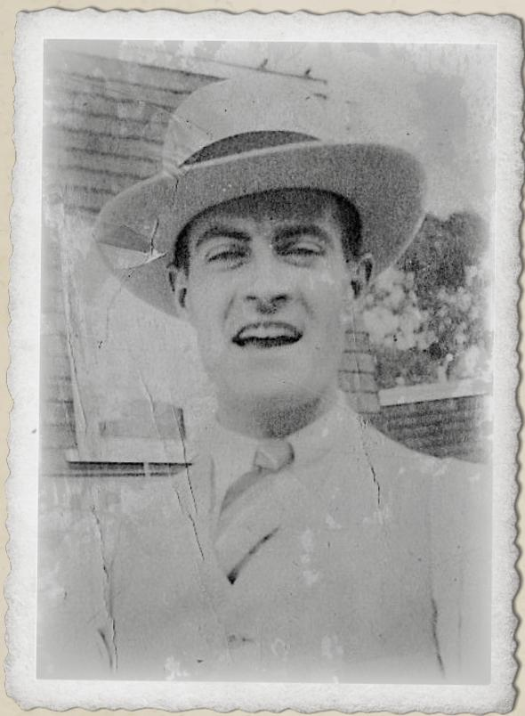

Pete

### Универсальный магазин

Универсальный магазин принадлежит известной сети и устроен точно так же, как аналогичный магазин в Аркхэме, хотя ассортимент здесь беднее. Магазин подчёркивает странность Иннсмута и даёт сыщикам глоток обыденности посреди хаоса.

За прилавком сидит единственный служащий — молодой человек из Аркхэма по имени Pete. Он весел и дружелюбен с сыщиками. Покупателей явно мало, поэтому новым лицам он рад.

Pete охотно сплетничает об Иннсмуте и его странностях. Однако он почти ничего не знает о городе и ездит на работу из соседнего Ньюберипорта. Для Pete Иннсмут — захолустный городок, который умирает, потому что не может или не хочет приспособиться к современности. Рыба здесь водится, но маленькие лодки не соперничают с современными траулерами крупных портов. Он слышал о болезни или эпидемии поколение назад и думает, что поэтому многие здесь выглядят «немного странно». Но ему платят почасово, работа лёгкая, и никто его не беспокоит и не пытается обратить в местную веру.

- Pete не знает никого по имени Sammy или Ginny. Он признаётся, что почти никого не знает в городе.
- Если сыщикам нужно спиртное, Pete с улыбкой направляет их в соседнюю лачугу, где у старухи с рыбьим лицом можно купить сносный виски. Она закутана в одеяла.
- Об Иннсмуте в целом Pete говорит, что местные поклоняются какому-то рыбьему богу. Это похоже на христианство, а штаб находится в старой масонской ложе. По его мнению, люди поклоняются тому, кто приносит им пользу, например богу, посылающему больше рыбы. Он никого не осуждает.
- Если сыщики хотят узнать больше, Pete советует поговорить со стариком Zadok Allen. Это пьяница, но один из немногих общительных жителей, которым интересно разговаривать. Почти каждое утро он заходит и полчаса прожужжит Pete уши, а затем уходит заработать на бутылку виски. Обычно Zadok можно найти на пожарной станции ([ссылка](#nri-h-1b70234c4ece0af6255492e8)), где он либо греется на солнце, либо прячется от непогоды.

### Пожарная станция

Пожарная станция находится на Пейн-стрит, 100, недалеко от железной дороги. Добраться до неё сразу нельзя: сыщики сталкиваются с опасным мостом из гнилого дерева, который выглядит ненадёжным. По одному переходить можно, но любой с ТЕЛ выше 70 должен пройти проверку Удачи, иначе доски ломаются, сыщик падает в реку Мануксет, получает 1D6 урона и оказывается в трёх кварталах ниже по течению. Мост не выдержал бы ни автомобиль, ни единственную работающую пожарную машину, подвергая город большой опасности, если понадобится пожарная служба (хотя влажная гнилая древесина Иннсмута всё равно горела бы плохо).

Сыщики находят Zadok Allen здесь, прислонившимся к каменной наружной стене станции. Похоже, сегодня никто не дежурит, и он совсем один.

Сначала Zadok ворчлив, неприветлив и не хочет разговаривать с незнакомцами. Чтобы развязать ему язык, нужна бутылка виски. Если сыщики угощают его, он уводит их со станции в уютный укрытый дом на окраине, откуда видны утёсы.

Zadok Allen — знаменитый пьяница из «Тени над Иннсмутом». Он знает всю историю Obed Marsh, его сделки с Глубоководными и трёх клятв, которые жители Иннсмута были вынуждены принести. Он рассказывает сыщикам обрывочную, путаную историю, словно Хранитель «Зова Ктулху» пересказывает «Тень над Иннсмутом» по памяти.

- Рассказывая об Иннсмуте, Zadok подчёркивает: Глубоководные карают тех, кто, по их мнению, нарушил клятвы. По городу ходят слухи, что сегодня с нарушителем клятвы случится «что-то большое».
- На вопрос о Sammy или Ginny он отвечает: «Дети Jeremiah? Sammy и Ginny Brewster, верно? Хорошие дети. Хорошая семья». Он упоминает таунхаус у Лафайет-стрит — резиденцию Brewster.
- Если сыщики описывают Атлантийскую драгоценность, он заставляет их замолчать и говорит не обсуждать святые символы Эзотерического ордена Дагона на людях. «Они» могут слушать.

В конце концов Zadok становится слишком нервным, глядя на море. Когда Хранитель сочтёт момент подходящим, Zadok кричит: «Они нас услышали!» — и убегает. Если сыщики следуют за ним, то находят его в разрушенном доме недалеко от пожарной станции: он плачет и не реагирует.

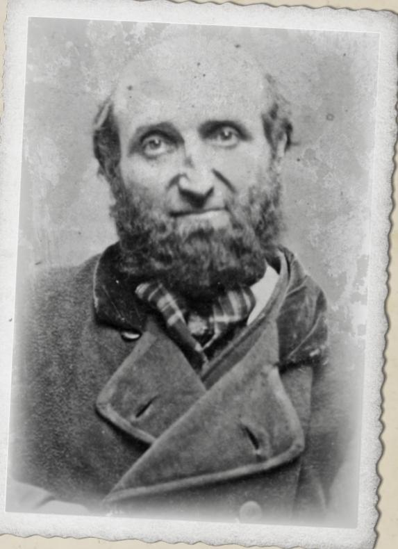

Zadok Allen

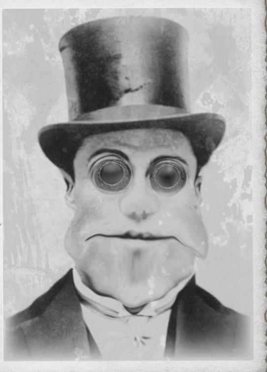

Jeremiah Brewster

### Эзотерический орден Дагона

Разговор с Sammy или Zadok может заставить сыщиков поверить, что драгоценность связана с Эзотерическим орденом Дагона. Это неверно, но если сыщики зацепились за эту версию, Хранитель может поддержать её и направить их в орден.

Это неоклассическое здание заметно стоит на Федерал-стрит в центре города. Главный вход обрамляют четыре греческие колонны, а побелка выцвела до тускло-серого цвета. Над дверью на фасаде красуется крупная каменная надпись «Эзотерический орден Дагона». Здание переделано из масонского храма и, безусловно, является самым величественным в Иннсмуте.

У входа бездельничают четыре массивных Гибрида. Если сыщики попытаются подойти прямо к двери, они их остановят. У Гибридов ярко выраженный «иннсмутский вид», и они быстро отвешивают пощёчину или удар в живот тем, кто слишком настойчиво расспрашивает о храме.

Обойдя здание, сыщики понимают, что окон и других дверей, кроме парадного входа, нет. При успешной проверке Естествознания они замечают: за храмом расположение камней указывает на возможный вход через пещеры. Решившие наблюдать за зданием должны пройти проверку Скрытности, чтобы бдительные Гибриды их не прогнали. Если наблюдение удастся, они заметят одного и того же человека, дважды подряд выходящего из здания с интервалом около часа. Значит, существует другой вход.

Если сыщики хотят попасть внутрь, но не могут, Хранитель может предложить проверку Знания, чтобы направить их в систему пещер на поиски другого входа.

### Вход через пещеры

Подземный вход в Эзотерический орден Дагона через систему пещер не охраняется. В основном им пользуются Глубоководные, чтобы быстро входить в храм и выходить из него, не показываясь снаружи; они не считают нужным охранять свои пути.

Когда сыщики выходят на подвальный уровень, маленькая каменная комната оказывается пустой, кроме нескольких ящиков. Протухший запах рыбы и водорослей почти заставляет их давиться. Из-за двери доносится кваканье, похожее на песню. При успешной проверке Слуха они слышат слова: «Ктулху fhtagn!», повторяемые снова и снова.

Выглянув из двери, сыщики видят большой зал для богослужений, похожий на знакомые им церкви. Впереди стоят три статуи. Самая крупная, в центре, изображает Ктулху — безумную голову со щупальцами, пронзительными глазами и непостижимо огромными крыльями, словно охватывающими всё здание. По бокам стоят меньшие статуи Дагона и Матери Гидры (рыбоподобные четвероногие существа с ужасными зубами: один сложен как боец, у другого широкие бёдра и материнская фигура).

Рыбоподобный мужчина (Jeremiah Brewster) молится и поёт услышанную песню. На его голове сидит тиара из золотого сплава, совершенно такая же, как драгоценность.

Терпеливые сыщики могут сесть и наблюдать. Через пять минут Jeremiah заканчивает пение и направляется к комнате, где находятся сыщики. В этот момент или пока он поёт его легко застать врасплох. Однако Jeremiah — могущественный колдун, и любой шум привлечёт внимание десятков Гибридов.

Если сыщики проигрывают бой, им необязательно умирать. Их могут оглушить; они очнутся связанными для Эпического финала ([ссылка](#nri-h-9e45e6c31b8f513fdfc0cbcb)) на вершине утёса — исход «Игра в героя» ([ссылка](#nri-h-db7abf043f1d139a51dd4c3f)).

## ЭПИЧЕСКИЙ ФИНАЛ

Когда расследование подходит к концу и сыщики понимают, что виновна Ginny Dubois, начинается Эпический финал. Это может произойти где угодно в окрестностях Иннсмута, но лучше всего, если сыщики в этот момент находятся в городе.

**Заметка Хранителю:** сыщики не смогли установить, что виновница — Ginny, и не заметили всех ваших замечательных подсказок? Или они разозлили местных и попались? Не волнуйтесь — всё равно начинайте Эпический финал.

Обещанный шторм наконец обрушивается на Иннсмут, и дождь хлещет по полуразвалившимся зданиям. Оставшееся солнце скрывают густые чёрные облака, и вокруг сыщиков заметно темнеет. Взглянув на скалы над Иннсмутом, сыщики видят камеру, направленную на женщину, одетую во всё белое. Ginny Dubois словно привязана к большому камню у самого края утёса; её руки связаны над головой, так что белое тело образует заметную X-образную фигуру на потемневшем камне.

В сонном Иннсмуте жители высыпают на улицы. Ещё несколько мгновений назад улицы были пусты, а теперь толпа заполнила их, и все смотрят на склон утёса. Обычные люди стоят плечом к плечу с искалеченными гибридами и полностью преобразившимися Глубоководными. Тем временем на мелководье бухты бушуют волны, и сыщики видят сотни жёлтых глаз, выглядывающих из-под воды. Взгляд каждого человека прикован к белой X над скалами. Это требует проверки Рассудка (1/1D8). Сошедшие здесь с ума сыщики могут бросить по обычной таблице приступа безумия или поддаться моменту и присоединиться к толпе, глядя и распевая вместе с ней.

Начинается медленное песнопение. Сначала его слышат те, кто стоит ближе всего к Эзотерическому ордену Дагона, а затем оно постепенно распространяется по всему Иннсмуту.

"Ph'nglui mglw'nafh Ктулху R'lyeh wgah'nagl fhtagn Iä! Iä! Ктулху fhtagn"

Если сыщики продолжают наблюдать, клубящиеся облака над мелким рифом у гавани Иннсмута становятся всё гуще. И вдруг, словно благодаря игре света, облака превращаются в массу щупалец с пронзительными глазами в центре. Над бухтой зависает Звёздное отродье Ктулху. Каждый житель Иннсмута опускается на колени в безмолвной молитве этому осколку божества.

Лик Звёздного отродья скрыт облаками, а сыщики, возможно, уже решили бежать, поэтому вряд ли до конца понимают, что скрывается в облаках. Однако если они продолжают вглядываться сквозь облака (и ещё не сошли с ума), прямой взгляд на Звёздное отродье требует проверки Рассудка (1D6/1D20).

На этом этапе сыщики могут выбрать множество разных направлений. Ниже приведены некоторые возможные развязки, но если сыщики выберут другой путь, события всё равно продолжат разворачиваться вокруг них.

### Последний поезд из Иннсмута

На сыщиков, решивших бежать через толпу или нижние пещеры, обращается взгляд Звёздного отродья. Оно пытается схватить их, посылая жителей и свои псевдоподии на их захват.

Если они бегут через толпу, со всех сторон к ним тянутся руки, и напор людей быстро прижимает их, лишая воздуха. Их связывают и приносят Звёздному отродью в качестве новых жертв. Перейдите к разделу «Игра в героя» ([ссылка](#nri-h-db7abf043f1d139a51dd4c3f)).

Если сыщики направляются в пещеры, их преследуют безмозглые щупальцевые существа, быстро ползущие по туннелям. Преследование длится три раунда. Если сыщики проваливают проверку ЛВК, их атакуют 1D3 щупалец (Драка 50%, урон 1D3). По мере спешки через тёмные опасные пещеры сыщики могут обосновать и другие проверки.

Выбравшись на окраину города, сыщики видят Anna Díaz и троих уцелевших членов съёмочной группы: те торопливо собирают вещи и грузят их в поезд. Ветер уже достиг штормовой силы, и все они упорно не смотрят на юго-восток, где находится звёздное отродье. Когда сыщики приближаются, Díaz перекрикивает ветер и спрашивает, умеет ли кто-нибудь из них управлять поездом.

Топка поезда поддерживается горящей, и ещё недавно член экипажа готовил яйца на раскалённом металле. Сыщики, успешно прошедшие проверку Управления тяжёлой техникой или Механики, понимают, что нужно восстановить давление в котле, повернув краны цилиндров и осторожно открыв регулятор. Для этого сыщики должны пройти три проверки СИЛ и три проверки ЛВК за три раунда. В конце третьего раунда толпа жителей Иннсмута обрушивается на вагон и быстро одолевает всех.

Если сыщикам удаётся запустить поезд, он издаёт пронзительный свисток и медленно набирает ход по древнему пути. Последний поезд из Иннсмута увозит выживших сыщиков и членов экипажа.

Вместо этого поезд можно повредить, пытаясь остановить наступающих чудовищ, или направить прямо в приближающуюся толпу (см. врезку, [ссылка](#nri-c-227220bed3222454225d739d)).

### Паровоз MVR класса B1 «Olmstead»

СКО: 11

Комплекция: 10

Броня для людей: 1

Колеи: стандартная (4 фута 8 1/2 дюйма)

Давление в котле: 110 psi

Максимальная скорость: 70 миль/ч (110 км/ч)

Для управления поездом требуется успешная проверка Вождения поезда или Управления тяжёлой техникой. Если комплекция снижена до нуля, поезд выходит из строя. Каждые полные 10 пунктов урона уменьшают комплекцию поезда на 1 (округляя вниз); урон менее 10 пунктов игнорируется.

Если комплекция поезда снижена до половины исходного значения (округляя вниз) или ниже, он повреждён; ко всем проверкам Вождения поезда (или подходящего навыка) добавляется один штрафной кубик.

Если поезд получает за один инцидент урон, равный его полной комплекции, вагон впечатляющим образом полностью разбивается. Он может взорваться, загореться, перевернуться или сочетать всё это. Все, кто находится на площадке машиниста, проходят проверку Удачи. При успехе находят достаточно останков, чтобы опознать их. Все в пределах 50 м (165 футов) от двигателя получают 6D10 урона. Находящиеся за пределами этой зоны и не укрытые проходят проверку Уклонения. Провал означает попадание высокоскоростными обломками (2D4 урона). Такой взрыв также можно вызвать опасным повышением давления в котле при успешной проверке Вождения поезда, Управления тяжёлой техникой или Точных наук (физика).

Если комплекция поезда иным образом снижена до нуля накопленным уроном (то есть порциями меньше исходной комплекции), поезд становится неуправляемым и останавливается. В зависимости от обстоятельств (и, возможно, проверки Удачи) это может привести к аварии, наносящей 1D10 урона водителю и каждому пассажиру.

### Игра в героя

Сыщики, решительно поднимающиеся к месту жертвоприношения на утёсах, не встречают сопротивления со стороны звёздного отродья. Напротив, дорога перед ними расчищается, пока они спешат по извилистой тропе к кульминации. Те же события разворачиваются, если сыщиков схватили и привели сюда против их воли.

Приблизившись, они видят, как Christopher McGuire медленно вращает рукоятку камеры. Его взгляд мутен, он совершенно не реагирует. Ginny сорвана со скалы, к которой была привязана; на камне осталась пентаграмма, явно выведенная размазанной кровью. Теперь она в щупальцах над головой и кричит о помощи. Вокруг лежат расчленённые тела нескольких членов экипажа: похоже, щупальца разорвали их на части, когда они пытались её спасти.

Bazzledon стоит на коленях и выкрикивает слова в такт песнопению, доносящемуся из города. При появлении сыщиков его глаза распахиваются. Он бросается к тому из них, кто больше всего похож на стереотипного героя-спасителя. Если такого нет, он выбирает сыщика с наибольшей ВНЕ и накладывает заклинание «Мысленное внушение» ([ссылка](#nri-s-f6b536b49f6dbbac4907bda0)).

«Ты ведь всегда мечтал попасть на большой экран, правда? Я знаю, малыш. Это твой звёздный час, пора блистать. Ты станешь кинозвездой. Возьми это…» Он вручает сыщику упаковку антацида Tum-Eez. «…взберись по тому щупальцу и брось таблетки твари в пасть. Ей станет плохо, и она вернётся в свою водяную могилу».

Чтобы побороть желание в точности исполнить предложение Bazzledon, сыщик должен пройти проверку МОЩ. Остальные сыщики также могут попытаться остановить его, вступив с ним в борьбу. При провале проверки сыщик бросается к звёздному отродью и пытается взобраться по одному из щупалец к чудовищной пасти.

Предложите сыщику трудную проверку ЛВК или Метания, чтобы определить, успеет ли он бросить Tum-Eez в пасть существа, прежде чем звёздное отродье разорвёт и сожрёт его. При провале Bazzledon поворачивается к следующему сыщику и дословно повторяет:

«Ты ведь всегда мечтал попасть на большой экран, правда? Я знаю, малыш…»

Даже при успехе чудовище, к сожалению, всё равно разрывает сыщика на части: оказывается, антациды никак не действуют на звёздное отродье. Однако последний кадр снят, фильм завершён, и Bazzledon перерезает горло McGuire, после чего скрывается в глуши с плёнкой под мышкой.

Сыщики, преодолевшие чары Bazzledon, видят его истинную сущность — безумца, посылающего невинных на смерть. Когда они поворачивают, чтобы бежать, шторм внезапно стихает, и песнопение прекращается. С криком отчаяния Ginny Brewster разрывают на части на глазах у молчаливых жителей Иннсмута. Её тело небрежно сбрасывают в океан, даже не удостаивая чести стать пищей осколка божества. Это требует проверки Рассудка (1/1D6).

Сыщики могут бежать от Иннсмута по открытой местности или спуститься к поезду и обнаружить всех мёртвыми, разорванными на части в доблестной попытке спастись от чудовища в поезде. Так или иначе выжившие сыщики возвращаются в Аркхэм.

## ЭПИЛОГ

### Удалось ли сыщикам сбежать с Атлантийской драгоценностью?

Если да, Мискатоникский университет чрезвычайно доволен Обществом. Университет заранее утверждает финансирование на следующие 12 месяцев. Кроме того, Обществу предлагают гораздо более уютную комнату для будущих собраний — с камином и удобными креслами, обычно предназначенными для преподавателей.

Если нет, для Общества это начало конца. После очередного провала важной миссии Университет начинает пересматривать свою многолетнюю поддержку. Возможно, пора привлечь специалистов, а не доверять группе любителей.

Через несколько недель после окончания расследования внутренняя проверка удерживает с Dr. Henry Armitage недельную зарплату за «неспособность должным образом проверить документы кандидата», и вопрос закрывают.

### Сняли ли финальную сцену фильма?

P.A Bazzledon лихорадочно перебирает остатки своего кабинета, достаёт тайный сейф (если тот ещё на месте) и забирает содержимое. Он запихивает всё в карман, хватает портфель и убегает.

Снаружи из Нью-Йорка подъезжает группа суровых головорезов. Проследить путь Bazzledon до Иннсмута было нетрудно: они знают, что деньги у него, и хотят лишь немного его проучить. Пока Bazzledon крадётся прочь и скрывается в лабиринте пещер Иннсмута, остаётся вопрос: несёт ли он под мышкой черновой монтаж фильма или плёнка отправится на пол монтажной?

Если фильм выходит, сыщики со временем слышат слухи о новом хите, покорившем преступный мир. Эффекты настолько реалистичны, что можно поклясться: девушку действительно разорвали на части. И всё это в техноколоре! Чудеса современной эпохи...

### Награды

После завершения сценария выжившим сыщикам следует предоставить фазу развития.

- Подробное описание этапа развития сыщика см. в разделе «Награды за опыт: этап развития сыщика», страница 94, «Зов Ктулху: Книга Хранителя».
- Правила лечения ран см. в разделах «Восстановление после обычного урона» и «Восстановление после серьёзной раны», страница 121, «Зов Ктулху: Книга Хранителя».
- Правила восстановления пунктов рассудка за время, проведённое с элементом предыстории, см. в разделе «Самопомощь», страница 167, «Зов Ктулху: Книга Хранителя».

Помимо потерь Рассудка, описанных в других местах сценария, примените следующие изменения Рассудка:

- За возвращение Атлантийской драгоценности: +1D6 пунктов Рассудка.
- За спасение Díaz и выжившего экипажа: +1D6 пунктов Рассудка.
- За попытку спасти Ginny и провал: -1D6 пунктов Рассудка.
- Если фильм выпущен: -1D4 пунктов Рассудка.

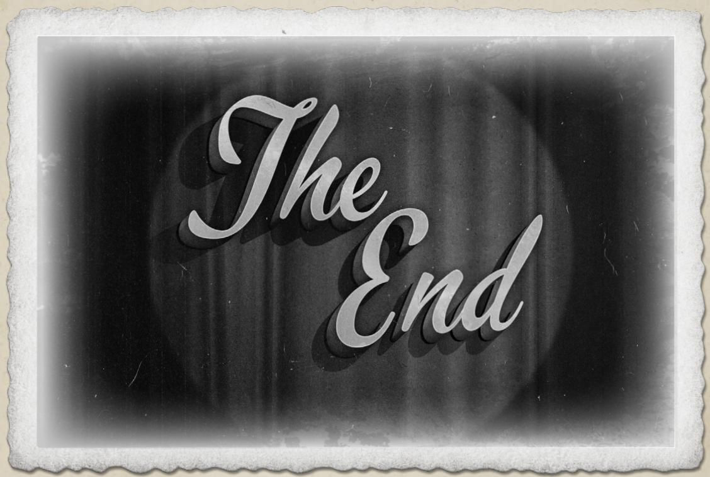

## ПЕРСОНАЖИ И ЧУДОВИЩА

## ЖИТЕЛИ АРКХЭМА

### Diane Loring, 50 лет, библиотекарь справочного отдела

<table><tr><td>СИЛ 50</td><td>ВЫН 70</td><td>ТЕЛ 50</td><td>ЛВК 55</td><td>ИНТ 80</td></tr><tr><td>ВНЕ 65</td><td>МОЩ 50</td><td>ОБР 70</td><td>РАС 50</td><td>ПЗ 12</td></tr><tr><td>БУ: 0</td><td>Комплекция: 0</td><td>СКО: 7</td><td>ПМ: 10</td><td></td></tr></table>

#### Бой

<table><tr><td>Драка</td><td>25% (12/5), урон 1D3</td></tr><tr><td>Уклонение</td><td>27% (13/5)</td></tr></table>

#### Навыки

Искусство/Ремесло (Десятичная классификация Дьюи) 90%, Работа в библиотеке 95%, История 65%, Оккультизм 25%, Психология 60%, Внимание 90%, Ношение кардиганов 80%.

Языки: английский 70%, французский 60%, латынь 60%.

### Dr. Henry Armitage, 65 лет, главный библиотекарь

<table><tr><td>СИЛ 55</td><td>ВЫН 40</td><td>ТЕЛ 60</td><td>ЛВК 50</td><td>ИНТ 90</td></tr><tr><td>ВНЕ 65</td><td>МОЩ 80</td><td>ОБР 99</td><td>РАС 55</td><td>ПЗ 10</td></tr><tr><td>БУ: 0</td><td>Комплекция: 0</td><td>СКО: 6</td><td>ПМ: 16</td><td></td></tr></table>

#### Бой

<table><tr><td>Драка</td><td>25% (12/5), урон 1D3</td></tr><tr><td>Уклонение</td><td>25% (12/5)</td></tr></table>

#### Навыки

Искусство/Ремесло (Ораторское искусство) 55%, Мифы Ктулху 18%, Работа в библиотеке 95%, История 65%, Оккультизм 25%, Психология 48%, Наука (Криптография) 75%, Наука (Средневековая метафизика) 60%.

Языки: английский 99%, французский 80%, немецкий 70%, греческий 68%, латынь 75%.

### Karen Jeffries, 45 лет, редактор газеты

<table><tr><td>СИЛ 55</td><td>ВЫН 60</td><td>ТЕЛ 65</td><td>ЛВК 55</td><td>ИНТ 70</td></tr><tr><td>ВНЕ 70</td><td>МОЩ 65</td><td>ОБР 70</td><td>РАС 60</td><td>ПЗ 13</td></tr><tr><td>БУ: 0</td><td>Комплекция: 0</td><td>СКО: 7</td><td>ПМ: 13</td><td></td></tr></table>

#### Бой

<table><tr><td>Драка</td><td>45% (22/9), урон 1D3+1D4</td></tr><tr><td>Уклонение</td><td>27% (13/5)</td></tr></table>

#### Навыки

Средства 65%, Красноречие 75%, Работа в библиотеке 45%, Запугивание 80%, Фотография 15%, Психология 55%, Внимание 65%.

Языки: английский 75%.

### Franc Turner, 45 лет, рабочий сцены

<table><tr><td>СИЛ 80</td><td>ВЫН 60</td><td>ТЕЛ 70</td><td>ЛВК 55</td><td>ИНТ 60</td></tr><tr><td>ВНЕ 60</td><td>МОЩ 50</td><td>ОБР 40</td><td>РАС 80</td><td>ПЗ 13</td></tr><tr><td>БУ: 1D4</td><td>Комплекция: 1</td><td>СКО: 7</td><td>ПМ: 10</td><td></td></tr></table>

#### Бой

<table><tr><td>Драка</td><td>45% (22/9), урон 1D3+1D4</td></tr><tr><td>Уклонение</td><td>27% (13/5)</td></tr></table>

#### Навыки

Искусство/Ремесло (Уборка) 55%, Слух 40%, Оккультизм 5%, Психология 40%, Красноречие 45%.

Языки: английский 45%.

## СЪЁМОЧНАЯ ГРУППА

### Genevieve 'Ginny' Dubois, 25 лет, соблазнительная кинозвезда

<table><tr><td>СИЛ 75</td><td>ВЫН 60</td><td>ТЕЛ 45</td><td>ЛВК 60</td><td>ИНТ 55</td></tr><tr><td>ВНЕ 50</td><td>МОЩ 90</td><td>ОБР 45</td><td>РАС 80</td><td>ПЗ 9</td></tr><tr><td>БУ: 0</td><td>Комплекция: 0</td><td>СКО: 7</td><td>ПМ: 18</td><td></td></tr></table>

#### Бой

<table><tr><td>Когтеподобные ногти</td><td>45% (22/9), урон 1D6</td></tr><tr><td>Уклонение</td><td>30% (15/6)</td></tr></table>

#### Навыки

Искусство/Ремесло (Актёрское мастерство) 30%, Обаяние 60%, Мифы Ктулху 20%, Оккультизм 40%, Психология 30%, Красноречие 45%, Маскировка 40%.

Языки: английский 45%.

#### Заклинания

Дыхание глубин

Стоимость: 8 пунктов магии. Заклинатель должен выиграть встречную проверку МОЩ против цели. При успехе лёгкие цели наполняются морской водой, и она получает 1D8 урона за раунд, пока не пройдёт чрезвычайную проверку ВЫН.

### Anna Díaz, 26 лет, способный продюсер

<table><tr><td>СИЛ 55</td><td>ВЫН 65</td><td>ТЕЛ 55</td><td>ЛВК 45</td><td>ИНТ 80</td></tr><tr><td>ВНЕ 40</td><td>МОЩ 45</td><td>ОБР 75</td><td>РАС 45</td><td>ПЗ 12</td></tr><tr><td>БУ: 0</td><td>Комплекция: 0</td><td>СКО: 8</td><td>ПМ: 9</td><td></td></tr></table>

#### Бой

<table><tr><td>Драка</td><td>25% (12/5), урон 1D3</td></tr><tr><td>Уклонение</td><td>30% (15/6)</td></tr></table>

#### Навыки

Искусство/Ремесло (Актёрское мастерство) 70%, Обаяние 45%, Маскировка 40%.

Языки: английский 75%.

### P.A. Bazzledon, 40 лет, мошенник, ставший режиссёром

<table><tr><td>СИЛ 50</td><td>ВЫН 70</td><td>ТЕЛ 65</td><td>ЛВК 60</td><td>ИНТ 80</td></tr><tr><td>ВНЕ 80</td><td>МОЩ 60</td><td>ОБР 60</td><td>РАС 40</td><td>ПЗ 13</td></tr><tr><td>БУ: 0</td><td>Комплекция: 0</td><td>СКО: 7</td><td>ПМ: 12</td><td></td></tr></table>

#### Бой

<table><tr><td>Драка</td><td>25% (12/5), урон 1D3</td></tr><tr><td>Уклонение</td><td>30% (15/6)</td></tr></table>

#### Навыки

Оценка 50%, Обаяние 70%, Средства 65%, Маскировка 60%, Красноречие 80%, Слух 45%, Психология 60%.

Языки: английский 60%.

#### Заклинания

Мысленное внушение

Стоимость: 5 пунктов магии. Заклинатель внушает цели определённую мысль. Цель должна пройти проверку МОЩ, иначе выполнит указание.

### Christopher McGuire, 37 лет, инженер и кинооператор

<table><tr><td>СИЛ 40</td><td>ВЫН 45</td><td>ТЕЛ 60</td><td>ЛВК 75</td><td>ИНТ 85</td></tr><tr><td>ВНЕ 40</td><td>МОЩ 40</td><td>ОБР 75</td><td>РАС 40</td><td>ПЗ 10</td></tr><tr><td>БУ: 0</td><td>Комплекция: 0</td><td>СКО: 8</td><td>ПМ: 8</td><td></td></tr></table>

#### Бой

<table><tr><td>Драка</td><td>25% (12/5), урон 1D3</td></tr><tr><td>Уклонение</td><td>40% (20/8)</td></tr></table>

#### Навыки

Инженерное дело 80%, Убеждение 10%, Психология 5%, Наука (Физика) 70%, Наука (Химия) 70%.

Языки: английский 75%.

### Обычный член съёмочной группы, крепкий мужчина или женщина

<table><tr><td>СИЛ 70</td><td>ВЫН 60</td><td>ТЕЛ 70</td><td>ЛВК 50</td><td>ИНТ 50</td></tr><tr><td>ВНЕ 50</td><td>МОЩ 50</td><td>ОБР 30</td><td>РАС 50</td><td>ПЗ 13</td></tr><tr><td>БУ: 1D4</td><td>Комплекция: 1</td><td>СКО: 8</td><td>ПМ: 8</td><td></td></tr></table>

#### Бой

<table><tr><td>Драка</td><td>50% (25/10), урон 1D3+1D4</td></tr><tr><td>Уклонение</td><td>45% (22/9)</td></tr></table>

#### Навыки

Переноска вещей 75%, Игра в кости 30%, Угрожающий вид 40%.

Языки: разные 30%.

## ЖИТЕЛИ ИННСМУТА

### Sammy Brewster, 21 год, любящий брат

<table><tr><td>СИЛ 65</td><td>ВЫН 65</td><td>ТЕЛ 45</td><td>ЛВК 70</td><td>ИНТ 65</td></tr><tr><td>ВНЕ 45</td><td>МОЩ 50</td><td>ОБР 70</td><td>РАС 0</td><td>ПЗ 10</td></tr><tr><td>БУ: 0</td><td>Комплекция: 0</td><td>СКО: 8</td><td>ПМ: 10</td><td></td></tr></table>

#### Бой

<table><tr><td>Драка</td><td>45% (22/9), урон 1D3</td></tr><tr><td>Уклонение</td><td>30% (15/6)</td></tr></table>

#### Навыки

Астрономия 30%, Оккультизм 30%, Убеждение 40%, Ловкость рук 50%, Скрытность 50%.

Языки: английский 70%, р'льехский 30%.

### Jeremiah Brewster, 47 лет, священник

<table><tr><td>СИЛ 80</td><td>ВЫН 90</td><td>ТЕЛ 80</td><td>ЛВК 60</td><td>ИНТ 75</td></tr><tr><td>ВНЕ 20</td><td>МОЩ 100</td><td>ОБР 50</td><td>РАС 0</td><td>ПЗ 17</td></tr><tr><td>БУ: 1D4</td><td>Комплекция: 1</td><td>СКО: 8</td><td>ПМ: 20</td><td></td></tr></table>

#### Бой

<table><tr><td>Когти</td><td>75% (22/9), урон 1D6+1D4</td></tr><tr><td>Уклонение</td><td>45% (22/9)</td></tr></table>

Броня: 1 пункт за кожу и чешую.

#### Навыки

Астрономия 30%, Мифы Ктулху 60%, Маскировка 40%, Оккультизм 60%, Убеждение 60%, Психология 50%.

Языки: английский 75%, р'льехский 75%.

#### Заклинания

Дыхание глубин, Контакт с Глубоководными, Контакт с Ктулху, Призыв звёздного отродья, Поглощение силы, Иссушение.

#### Рассудок

Jeremiah почти полностью превратился в Глубоководного, поэтому его вид считается встречей с Глубоководным и вызывает потерю Рассудка (0/1D6).

### Zadok Allen, 66 лет, городской пьяница

<table><tr><td>СИЛ 40</td><td>ВЫН 30</td><td>ТЕЛ 60</td><td>ЛВК 40</td><td>ИНТ 50</td></tr><tr><td>ВНЕ 45</td><td>МОЩ 60</td><td>ОБР 30</td><td>РАС 60</td><td>ПЗ 9</td></tr><tr><td>БУ: 0</td><td>Комплекция: 0</td><td>СКО: 7</td><td>ПМ: 12</td><td></td></tr></table>

#### Бой

<table><tr><td>Драка</td><td>20% (10/4), урон 1D3</td></tr><tr><td>Уклонение</td><td>40% (20/8)</td></tr></table>

#### Навыки

Выпивка 75%, Безумные истории 85%.

Языки: английский 30%.

### Обычный житель Иннсмута, человек

<table><tr><td>СИЛ 55</td><td>ВЫН 50</td><td>ТЕЛ 55</td><td>ЛВК 50</td><td>ИНТ 50</td></tr><tr><td>ВНЕ 50</td><td>МОЩ 50</td><td>ОБР 60</td><td>РАС 50</td><td>ПЗ 10</td></tr><tr><td>БУ: 0</td><td>Комплекция: 0</td><td>СКО: 8</td><td>ПМ: 10</td><td></td></tr></table>

#### Бой

<table><tr><td>Драка</td><td>25% (12/5), урон 1D3</td></tr><tr><td>Уклонение</td><td>25% (12/5)</td></tr></table>

### Обычный житель Иннсмута, гибрид

<table><tr><td>СИЛ 65</td><td>ВЫН 65</td><td>ТЕЛ 50</td><td>ЛВК 65</td><td>ИНТ 65</td></tr><tr><td>ВНЕ 20</td><td>МОЩ 50</td><td>ОБР 60</td><td>РАС —</td><td>ПЗ 11</td></tr><tr><td>БУ: 0</td><td>Комплекция: 0</td><td>СКО: 8</td><td>ПМ: 10</td><td></td></tr></table>

#### Бой

<table><tr><td>Драка</td><td>45% (22/9), урон 1D3+1D4</td></tr><tr><td>Уклонение</td><td>32% (17/6)</td></tr></table>

## ЧУДОВИЩА

### Шоггот

<table><tr><td>СИЛ 315</td><td>ВЫН 210</td><td>ТЕЛ 420</td><td>ЛВК 15</td><td>ИНТ 35</td></tr><tr><td>ВНЕ —</td><td>МОЩ 50</td><td>ОБР —</td><td>РАС —</td><td>ПЗ 63</td></tr><tr><td>БУ: 8D6</td><td>Комплекция: 9</td><td>СКО: 10</td><td>ПМ: 10</td><td></td></tr></table>

#### Бой
Атак за раунд: 2

<table><tr><td>Драка</td><td>70% (35/14), урон 8D6</td></tr><tr><td>Поглощение</td><td>Поглощённый шогготом человек должен выиграть встречную проверку СИЛ, иначе в конце следующего хода шоггота его разорвёт на части. Находясь внутри шоггота, жертвы всё ещё могут наносить ему урон. Если за один раунд они нанесут урон, равный половине оставшихся ПЗ чудовища, шоггот выплюнет их. Шоггот может поглотить сколько угодно сыщиков, пока сумма их ТЕЛ меньше его ТЕЛ.</td></tr><tr><td>Уклонение</td><td>8% (4/1)</td></tr></table>

Броня: отсутствует, но огонь и электричество наносят лишь половину урона, обычное оружие — только 1 пункт урона за попадание; кроме того, шоггот восстанавливает 2 ПЗ за раунд.

#### Рассудок

Потеря 1D6/1D20 Рассудка при виде шоггота.

Примечание автора: короче говоря, увидев шоггота, сыщики должны бежать.

### Звёздное отродье Ктулху

<table><tr><td>СИЛ 350</td><td>ВЫН 260</td><td>ТЕЛ 525</td><td>ЛВК 50</td><td>ИНТ 105</td></tr><tr><td>ВНЕ —</td><td>МОЩ 105</td><td>ОБР —</td><td>РАС —</td><td>ПЗ 78</td></tr><tr><td>БУ: 10D6</td><td>Комплекция: 11</td><td>СКО: 15</td><td>ПМ: 21</td><td></td></tr></table>

#### Бой
Атак за раунд: 4

<table><tr><td>Драка</td><td>80% (40/16), урон 10D6 Звёздное отродье может атаковать или хватать щупальцами. Схватив противника, оно поднимает его в воздух. Если противник нанесёт звёздному отродью более 10 пунктов урона, пробив его броню, щупальце отпустит жертву, хотя та вряд ли переживёт падение.</td></tr><tr><td>Уклонение</td><td>26% (13/5)</td></tr></table>

Броня: 10 пунктов за шкуру и жировой слой; восстанавливает 3 ПЗ за раунд.

#### Рассудок

Потеря 1D6/1D20 Рассудка при виде звёздного отродья Ктулху.

Примечание автора: хочу предельно ясно сказать, что брошенный в пасть звёздного отродья Tum-Eez совершенно на него не действует.

### Глубоководный

<table><tr><td>СИЛ 70</td><td>ВЫН 60</td><td>ТЕЛ 80</td><td>ЛВК 50</td><td>ИНТ 70</td></tr><tr><td>ВНЕ —</td><td>МОЩ 50</td><td>ОБР —</td><td>РАС —</td><td>ПЗ 15</td></tr><tr><td>БУ: 1D4</td><td>Комплекция: 1</td><td>СКО: 8</td><td>ПМ: 20</td><td></td></tr></table>

#### Бой
Атак за раунд: 1

<table><tr><td>Драка</td><td>45% (12/9), урон 1D3+1D4</td></tr><tr><td>Копьё</td><td>45% (12/9), урон 1D8+1D4</td></tr><tr><td>Уклонение</td><td>27% (13/5)</td></tr></table>

Броня: 1 пункт за кожу и чешую.

#### Рассудок

Потеря 0/1D6 Рассудка при виде Глубоководного.

## ПРЕДГЕНЕРИРОВАННЫЕ СЫЩИКИ

### HUGO «SHRIMPY» HARGREAVES

<table><tr><td colspan="2">Возраст: 27</td><td colspan="3">Занятие: студент / джентльмен</td></tr><tr><td>STR 45</td><td>CON 55</td><td>SIZ 45</td><td>DEX 45</td><td>INT 65</td></tr><tr><td>APP 70</td><td>POW 60</td><td>EDU 70</td><td>SAN 60</td><td>HP 10</td></tr><tr><td>DB: 0</td><td>Комплекция: 0</td><td>Перемещение: 8</td><td>MP: 12</td><td>Удача: (3D6)x5</td></tr></table>

#### Навыки

<table><tr><td>Бухгалтерское дело</td><td>36% (18/7)</td></tr><tr><td>Искусство/Ремесло (Публичные выступления)</td><td>45% (22/9)</td></tr><tr><td>Обаяние</td><td>60% (30/12)</td></tr><tr><td>Средства</td><td>80% (40/16)</td></tr><tr><td>Красноречие</td><td>21% (10/4)</td></tr><tr><td>История</td><td>30% (15/6)</td></tr><tr><td>Язык (английский)</td><td>70% (35/14)</td></tr><tr><td>Язык (латынь)</td><td>45% (22/9)</td></tr><tr><td>Слух</td><td>45% (22/9)</td></tr><tr><td>Верховая езда</td><td>25% (12/5)</td></tr><tr><td>Наука (ботаника)</td><td>15% (7/3)</td></tr><tr><td>Ловкость рук</td><td>55% (27/11)</td></tr></table>

#### Бой

<table><tr><td>Драка</td><td>40% (20/8), урон 1D3</td></tr><tr><td>Охотничья винтовка*</td><td>35% (17/7), урон 1D10</td></tr><tr><td>Уклонение</td><td>22% (11/4)</td></tr></table>

*надёжно хранится в оружейном сейфе в его студенческом общежитии

#### Предыстория

Hugo никогда не нравилось его имя, поэтому, когда школьные друзья прозвали его Shrimpy за невысокий рост, он решил оставить это прозвище. Мать Shrimpy, отчаянно желавшая дать ему хорошее образование, решила отправить его в Америку, подальше от этих проклятых друзей. Но прозвище он всё равно сохранил.

Shrimpy фактически купил себе место в Обществе исследования необъяснимого, обеспечивая всех угощениями и улаживая проблемы с двойным бронированием комнаты. Он надеется, что эта «хорошая» работа поможет ему приобрести друзей.

- Описание: невысокий, привлекательный мужчина, Shrimpy хорошо одет и ухожен.
- Черты: склонен считать, что люди будут им восхищаться, и немного теряется, когда этого не происходит.
- Идеология и убеждения: на этом этапе он не вполне понимает, кто он, поскольку лишь недавно получил достаточно свободы для поисков. Поэтому он исследует собственную личность.
- Раны и шрамы: в детстве Shrimpy сильно повредил ногу на матче по регби. Он так и не восстановился полностью и иногда хромает в дождь.
- Значимые люди: мама, папа и няня.
- Значимые места: ему скорее нравятся Соединённые Штаты, потому что это не Blighty. Для него этого вполне достаточно.
- Ценные вещи: карманные часы его деда.

Другой сценарий с участием Shrimpy — «Дракон из Уонтли» авторства SR Sellens.

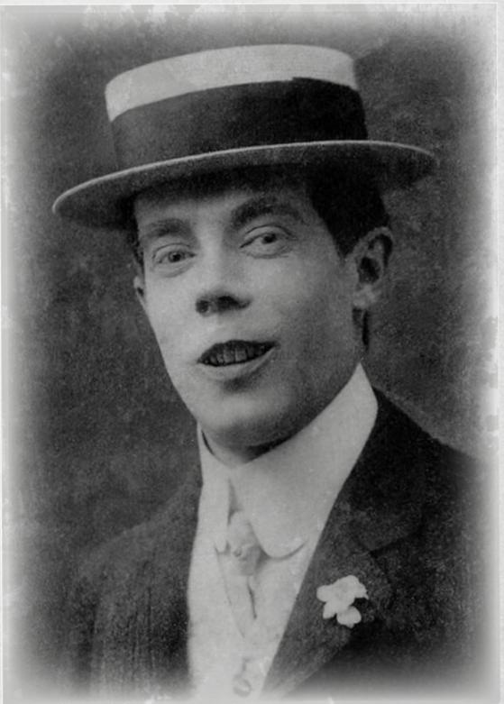

### PATTY GILLIAN

<table><tr><td>Возраст: 24</td><td colspan="4">Занятие: студентка / преступница</td></tr><tr><td>STR 50</td><td>CON 55</td><td>SIZ 65</td><td>DEX 75</td><td>INT 70</td></tr><tr><td>APP 20</td><td>POW 40</td><td>EDU 67</td><td>SAN 40</td><td>HP 12</td></tr><tr><td>DB: 0</td><td>Комплекция: 0</td><td>Перемещение: 8</td><td>MP: 8</td><td>Удача: (3D6)x5</td></tr></table>

#### Навыки

<table><tr><td>Бухгалтерское дело</td><td>15% (7/3)</td></tr><tr><td>Оценка</td><td>20% (10/4)</td></tr><tr><td>Обаяние</td><td>25% (12/5)</td></tr><tr><td>Лазание</td><td>30% (15/6)</td></tr><tr><td>Средства</td><td>10% (5/2)</td></tr><tr><td>Красноречие</td><td>44% (22/8)</td></tr><tr><td>Запугивание</td><td>35% (17/7)</td></tr><tr><td>Прыжки</td><td>25% (12/5)</td></tr><tr><td>Язык (английский)</td><td>65% (32/13)</td></tr><tr><td>Слух</td><td>60% (30/12)</td></tr><tr><td>Взлом</td><td>45% (22/9)</td></tr><tr><td>Механика</td><td>35% (17/7)</td></tr><tr><td>Психология</td><td>30% (15/6)</td></tr><tr><td>Ловкость рук</td><td>65% (32/13)</td></tr><tr><td>Внимание</td><td>70% (35/14)</td></tr><tr><td>Скрытность</td><td>65% (32/13)</td></tr></table>

#### Бой

<table><tr><td>Драка</td><td>30% (15/6), урон 1D3</td></tr><tr><td>Уклонение</td><td>37% (18/7)</td></tr></table>

#### Предыстория

Patty формально не должна быть студенткой Университета. Впрочем, никто из её однокурсников этого не понимает. Она посещает лекции и живёт в одном из студенческих общежитий. Она воровка и мошенница, которая проскользнула в мир MU сквозь щели и обнаружила, что никто не ставит под сомнение её право находиться здесь. При таких темпах в следующем году она получит диплом по криминологии.

Patty решила, что Общество исследования необъяснимого может стать хорошим способом заполучить дорогую добычу: они ведь ищут по-настоящему странные и необычные происшествия. Но пока это в основном скучные собрания с необычно хорошим вином.

- Описание: каштановые волосы, карие глаза и ничем не примечательное лицо. Patty трудно заметить, если не сосредоточиться на ней.
- Черты: прямая и напористая. Patty Gillian может потребовать у мужчины отдать кошелёк так, что он решит, будто сам этого захотел.
- Идеология и убеждения: мир был невероятно несправедлив ко мне, поэтому я не против брать вещи, когда представляется хоть малейшая возможность.
- Значимые люди: Patty никогда не позволяла себе роскошь иметь друзей.
- Фобии и мании: капиофобия — страх быть арестованной. Звук полицейской сирены приводит её в ужас, и она с трудом сдерживает реакцию.
- Значимые места: «её» комната в общежитии — первый постоянный дом в её жизни.

Другой сценарий с участием Patty — «Тайный Санта» авторства TA Newman.

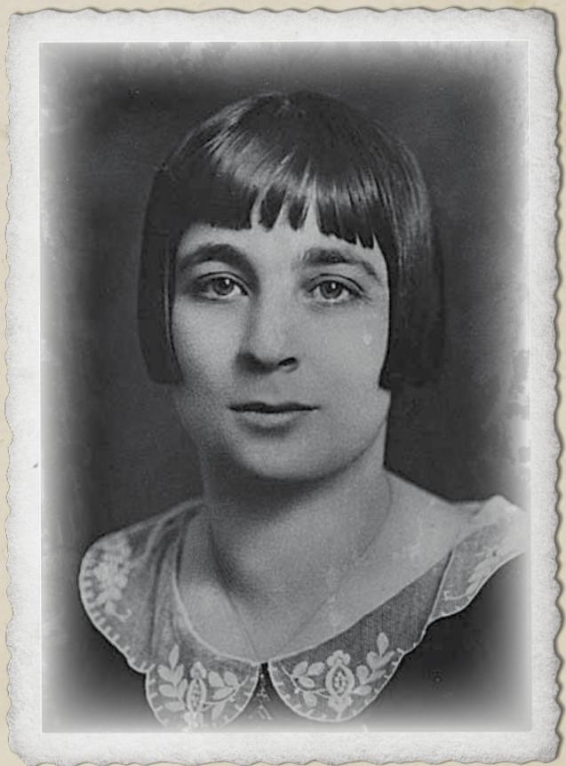

### IAN TORRES

Возраст: 23 Занятие: футболист / студент

<table><tr><td>STR 70</td><td>CON 50</td><td>SIZ 80</td><td>DEX 60</td><td>INT 50</td></tr><tr><td>APP 75</td><td>POW 40</td><td>EDU 55</td><td>SAN 55</td><td>HP 13</td></tr><tr><td>БУ: 1D4</td><td>Комплекция: 1</td><td>Перемещение: 7</td><td>ПМ: 11</td><td>Удача: (3D6)x5</td></tr></table>

#### Навыки

<table><tr><td>Антропология</td><td>27% (13/5)</td></tr><tr><td>Обаяние</td><td>65% (32/13)</td></tr><tr><td>Средства</td><td>10% (5/2)</td></tr><tr><td>Прыжки</td><td>45% (22/9)</td></tr><tr><td>Язык (английский)</td><td>50% (25/10)</td></tr><tr><td>Язык (испанский)</td><td>55% (27/11)</td></tr><tr><td>Юриспруденция</td><td>26% (13/5)</td></tr><tr><td>Работа в библиотеке</td><td>42% (21/8)</td></tr><tr><td>Взлом</td><td>60% (30/12)</td></tr><tr><td>Медицина</td><td>38% (19/7)</td></tr><tr><td>Метание</td><td>60% (30/12)</td></tr></table>

#### Бой

<table><tr><td>Драка</td><td>55% (12/5), урон 1D3 +1D4</td></tr><tr><td>Уклонение</td><td>45% (22/9)</td></tr></table>

#### Предыстория

Ian приехал в Мискатоникский университет по футбольной стипендии: рекрутеры забрали его из сонного родного города Кабо-Рохо, желая развивать этот спорт. Ian отличается лёгким характером. К сожалению, из-за сломанной ноги он пропустил сезон. Ian усерден и по возможности посещает самые разные занятия, но без футбола, который направляет его вперёд, чувствует себя немного вялым.

Он пришёл в общество в поисках места, куда можно направить свою безграничную энергию.

- Описание: высокий, смуглый и красивый. Ian возвышается над сверстниками. Без футбольной формы его обычно можно увидеть в белой футболке и синих джинсах — воплощённой американской мечте.
- Черты: Ian знает не так много, зато умеет усердно работать. Именно этим он и занимается: почти каждое утро ходит в спортзал, уделяя внимание восстановлению, прилежно посещает лекции, делает подробные записи и вечерами тренирует навыки. Он неплохо открывает замки и видит в них маленькие забавные головоломки.
- Идеология и убеждения: Ian верит в Бога, потому что так сказала мама. Честно говоря, дальше он об этом не размышляет.
- Значимые люди: мама, дедушка, дяди и тёти, живущие на той же улице в его родном городе.
- Значимые места: футбольное поле в его родном городе.
- Ценные вещи: его первый кожаный футбольный мяч, подаренный бабушкой и дедушкой.

### TIFFANY QUISPE

<table><tr><td>Возраст: 22</td><td colspan="4">Занятие: студентка-археолог</td></tr><tr><td>STR 45</td><td>CON 40</td><td>SIZ 65</td><td>DEX 75</td><td>INT 70</td></tr><tr><td>APP 60</td><td>POW 40</td><td>EDU 67</td><td>SAN 40</td><td>HP 12</td></tr><tr><td>БУ: 0</td><td>Комплекция: 0</td><td>Перемещение: 8</td><td>ПМ: 8</td><td>Удача: (3D6)x5</td></tr></table>

#### Навыки

<table><tr><td>Бухгалтерское дело</td><td>15% (7/3)</td></tr><tr><td>Оценка</td><td>20% (10/4)</td></tr><tr><td>Обаяние</td><td>25% (12/5)</td></tr><tr><td>Лазание</td><td>30% (15/6)</td></tr><tr><td>Средства</td><td>10% (5/2)</td></tr><tr><td>Красноречие</td><td>44% (22/8)</td></tr><tr><td>Запугивание</td><td>35% (17/7)</td></tr><tr><td>Прыжки</td><td>25% (12/5)</td></tr><tr><td>Язык (английский)</td><td>65% (32/13)</td></tr><tr><td>Слух</td><td>60% (30/12)</td></tr><tr><td>Взлом</td><td>45% (22/9)</td></tr><tr><td>Механика</td><td>35% (17/7)</td></tr><tr><td>Психология</td><td>30% (15/6)</td></tr><tr><td>Ловкость рук</td><td>65% (32/13)</td></tr><tr><td>Внимание</td><td>70% (35/14)</td></tr><tr><td>Скрытность</td><td>65% (32/13)</td></tr></table>

#### Бой

<table><tr><td>Драка</td><td>25% (12/5), урон 1D3</td></tr><tr><td>Уклонение</td><td>45% (22/9)</td></tr></table>

#### Предыстория

Tiff кажется, что ей приходится бороться, чтобы мир воспринимал её всерьёз. Все постоянно называют её «милой» или «приятной», хотя она хотела бы, чтобы говорили, что она «умелая» и «трудолюбивая». Она пыталась начать всё заново, меняла причёску, работала над публичными выступлениями, но всё это, похоже, почти ничего не изменило.

Она вступила в общество, желая внести свой вклад. Сделать что-нибудь полезное, чтобы люди считали её важной. Она лишь надеется, что вскоре её выберут для задания.

- Описание: милая и улыбчивая. У Tiff широкий нос и медно-коричневая кожа, унаследованная от народа кечуа; она одевается элегантно и профессионально, но одежда никогда не сидит на ней как следует.
- Черты: Tiff так и не научилась на 100% понимать «людей» и кажется окружающим типичным нелюдимым учёным. Но сама она считает себя гораздо более значимой.
- Идеология и убеждения: Tiff хочет быть главным персонажем собственной истории и мечтает об экзотических раскопках в удивительных местах.
- Значимые люди: Tiff немного отдалилась от семьи и живёт со своей партнёршей Susan. Tiff боготворит идею брака, хотя знает, что таким людям, как она, он недоступен.
- Значимые места: Tiff живёт за пределами кампуса с партнёршей, в переоборудованной мансарде, где очень уютно.
- Ценные вещи: разноцветное пончо из шерсти альпаки, которое принадлежало её отцу.

### MARGARET 'MAGGIE' MYERS

<table><tr><td>Возраст: 25</td><td colspan="4">Занятие: студентка-криминолог</td></tr><tr><td>STR 45</td><td>CON 60</td><td>SIZ 45</td><td>DEX 60</td><td>INT 65</td></tr><tr><td>APP 50</td><td>POW 55</td><td>EDU 70</td><td>SAN 55</td><td>HP 8</td></tr><tr><td>БУ: 0</td><td>Комплекция: 0</td><td>Перемещение: 8</td><td>ПМ: 11</td><td>Удача: (3D6)x5</td></tr></table>

#### Навыки

<table><tr><td>Оценка</td><td>50% (25/10)</td></tr><tr><td>Археология</td><td>61% (30/12)</td></tr><tr><td>Средства</td><td>25% (12/5)</td></tr><tr><td>Язык (английский)</td><td>60% (30/12)</td></tr><tr><td>Язык (испанский)</td><td>70% (35/14)</td></tr><tr><td>Язык (кечуа)</td><td>70% (35/14)</td></tr><tr><td>Работа в библиотеке</td><td>45% (22/9)</td></tr><tr><td>Слух</td><td>50% (25/10)</td></tr><tr><td>Механика</td><td>45% (22/9)</td></tr><tr><td>Ориентирование</td><td>55% (27/11)</td></tr><tr><td>Психология</td><td>30% (15/6)</td></tr><tr><td>Оккультизм</td><td>45% (22/9)</td></tr><tr><td>Внимание</td><td>60% (30/12)</td></tr><tr><td>Скрытность</td><td>40% (20/8)</td></tr></table>

#### Бой

<table><tr><td>Драка</td><td>45% (22/9), урон 1D3</td></tr><tr><td>Уклонение</td><td>35% (17/7)</td></tr></table>

#### Предыстория

Maggie — младшая дочь Patricia и George Myers. Её отец — бостонский юрист и филантроп, открывший собственную практику, чтобы помогать рабочему классу. Будучи младшей из трёх сестёр, Maggie регулярно ввязывалась в драки и рано научилась защищать себя. Соперничество с сёстрами подстёгивало её добиваться успехов в школе, где она получала высшие оценки.

Maggie окончила Бостонский университет, изучая криминологию и право, однако решила, что её настоящие способности и интересы лежат в естественных науках. В декабре прошлого года она поступила в Мискатоникский университет в магистратуру, где изучает патологию и криминологию. Общество исследования необъяснимого стало для неё приятным развлечением.

- Описание: элегантно одетая и привлекательная, Margaret грациозно движется и притягивает внимание. Никогда не скажешь, что она отлично умеет драться.
- Черты: Margaret стала бы прекрасным политиком. Она умеет располагать к себе людей, но при необходимости бывает безжалостной.
- Идеология и убеждения: Margaret всегда заступается за слабых и считает, что справедливость достаётся тем, кто за неё борется.
- Значимые люди: её старшие сёстры Harriet и Esme.
- Значимые места: её семейный дом в Бостоне.
- Ценные вещи: медальон с фотографией её родителей.

Другой сценарий с участием Maggie — «Телесные раны» авторства Pete Burgess.

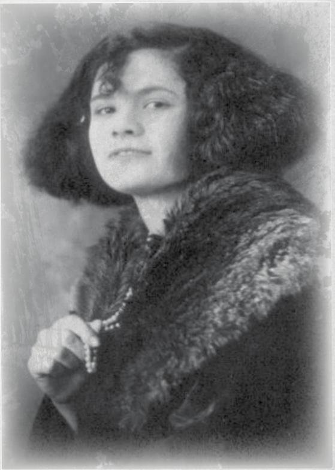

## РАЗДАТОЧНЫЕ МАТЕРИАЛЫ

### КАНЦЕЛЯРИЯ ВИЦЕ-КАНЦЛЕРА

МИСКАТОНИКСКИЙ УНИВЕРСИТЕТ
Аркхэм, Массачусетс

Дорогие студенты.

Для Общества исследования необъяснимого не станет сюрпризом, что Совет заинтересовался его работой, а любознательность и дух приключений Общества хорошо соответствуют ценностям Мискатоникского университета. Именно поэтому Совет всегда гордился тем, что поддерживает работу Общества. Однако теперь мы должны кое о чём попросить Общество.

Бесценный артефакт — Атлантийская драгоценность — был передан местной кинокомпании Bazzledon Productions. Внутреннее расследование должно выяснить, как именно киностудия получила этот предмет. Однако вам не стоит об этом беспокоиться. Продюсер компании с сожалением сообщил, что в начале этой недели драгоценность исчезла со съёмочной площадки. Мы поручаем Обществу расследовать случившееся и вернуть артефакт. Кроме того, Общество должно собрать любые сведения о возможном виновнике, чтобы передать их местной полиции.

Мы чрезвычайно впечатлены работой Общества на данный момент. Надеемся, что вы не подведёте нас в этом важном деле. Выбранные представители Общества могут обратиться к Diane Loring в библиотеке Орна за дополнительной информацией.
С уважением,

Профессор Neil Arthur Tepp
Вице-канцлер
Мискатоникский университет

**Раздаточный материал 1-a**: письмо (внутреннее)

### КАНЦЕЛЯРИЯ ВИЦЕ-КАНЦЛЕРА

МИСКАТОНИКСКИЙ УНИВЕРСИТЕТ
Аркхэм, Массачусетс

Дорогие сыщики.

Совет благодарит вас за быстрый ответ на наше письмо. Нам неприятно признавать, что нам срочно требуется помощь со стороны, и мы надеемся, что не прервали ничего важного нашим поспешным вызовом.

Несколько дней назад бесценный артефакт — Атлантийская драгоценность — был передан местной кинокомпании Bazzledon Productions. Внутреннее расследование должно выяснить, как именно киностудия получила этот предмет. Однако вам не стоит об этом беспокоиться. Продюсер компании с сожалением сообщил, что в начале этой недели драгоценность исчезла со съёмочной площадки. Мы поручаем вам расследовать случившееся и вернуть артефакт. Кроме того, просим вас собрать любые сведения о возможном виновнике, чтобы передать их местной полиции.

Каждый из вас рекомендован нам и обладает превосходной репутацией благодаря умению действовать быстро и незаметно. Надеемся, что вы не подведёте нас в этом важном деле. При первой возможности обратитесь к Diane Loring в библиотеке Орна за дополнительной информацией.

С уважением,

**Раздаточный материал 1-b**: письмо (внешнее)

### Раздаточный материал 2: записка

Привет, G,

Хотел заглянуть и повидаться с тобой, но твоя компания была не в восторге от моего присутствия. Если хочешь встретиться, старый путь через туннель перекрыт, так что придётся сделать крюк. Это LLFRFL.

Sammy

**Заметка Хранителя:** LLFRFL — указания (налево, налево, прямо, направо, прямо, налево), по которым нужно идти через пещеры. Если сыщики войдут через туннель у железнодорожной станции, эти указания приведут их к выходу возле резиденции Brewster ([ссылка](#nri-h-f6184124151c4142421b1af0)).
