{.artview-decision .artview-width-100 .artview-align-center .art-cover}

# Вирус

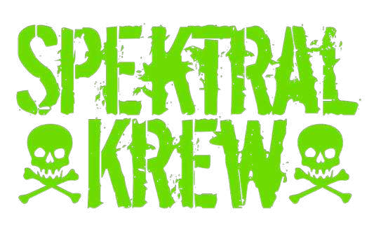{.artview-decision .artview-width-80 .artview-align-center}

Так, ребята, вот в чём дело. Готовьте паспорта, потому что мы едем в Италию, детка! В Старый Свет! По словам Майи, нам остался всего один прямой эфир до отметки в миллион подписчиков. Понимаете, что это значит? Спонсоры посерьёзнее, приглашения на ток-шоу... может, даже контракт с телевидением! Больше бабла на столе! Мы так близко, что я, мать вашу, уже ЧУВСТВУЮ его вкус.

Короче, Майя пишет мне и рассказывает про остров недалеко от западного побережья Италии. На Google Maps там ни черта нет, но на карте, которую она получила от одного из своих людей в сети, отмечены здания, деревья и что-то вроде разбомбленной часовни. На этом острове жил монашеский орден... Орден Агнца Живого Иисуса или какая-то такая хрень... в общем, остров был населён ещё с бронзового века. Когда в давние времена чума врезала Европе по морде, этот орден принимал больных. Если уж где-то и должны водиться привидения, то именно здесь, верно? На фоне этого места Повелья выглядит как чёртов детский фильм!

Итак, план такой. Вылетаем на следующей неделе. Я уже отправил туда оборудование СРОЧНОЙ доставкой. Когда прибудем в местный городок, человек, которого нашла Майя, доставит нас на остров. Там мы всё установим и проведём прямую трансляцию прямо под тупыми носами макаронников из итальянского флота. Они даже не узнают, что мы там были.

Так, Хён — знаю, знаю... ты сейчас заговоришь о сигнале и всей этой технической фигне. Я всё понимаю, старик. Если доберёмся туда и не сможем выйти в эфир, нам конец. Не волнуйся, брат, я всё предусмотрел. Оказывается, там сохранился старый заброшенный пост радиоперехвата времён Второй мировой. Майя заплатила местному, чтобы он туда вломился, подключил все нужные кабели и прочую хрень, так что мы сможем передать сигнал! Качество должно быть A1, чистейшее, детка!

Ну что — вопросы есть?

## Предупреждение

«Вирус» предназначен для взрослой аудитории. Хранителю и игрокам следует знать, что этот сценарий содержит ситуации, сцены и образы, которые кому-то могут показаться тяжёлыми, особенно если человек пережил похожую травму в реальной жизни.

И всё же ничто не заменит доброго старого общения между всеми участниками игры. До начала сценария Хранителю следует поговорить с игроками и предельно ясно объяснить характер и содержание этого материала. Предложите игрокам задавать вопросы, высказывать опасения и проголосовать, подходит ли сценарий вашей группе. Ради сохранения личной тайны, возможно, стоит даже провести тайное голосование.

Если все согласны играть, Хранителю рекомендуется предоставить игрокам способ остановить сцену, которая покажется им слишком тяжёлой. Для этого можно использовать какой-нибудь жетон или стоп-слово; каким бы ни был способ, игрок не обязан ничего объяснять. Хранителю следует просто завершить сцену и объявить перерыв, чтобы группа могла разобраться в ситуации. Возможные решения: изменить развитие сцены, переиграть её иначе или просто «затемнить экран», добавив повествовательное описание от Хранителя.

Хранителю не следует наказывать игрока за такое решение. Поэтому после возобновления игры персонаж не должен получать значительный урон или терять Рассудок.

В крайнем случае, если кто-то не может продолжать сценарий, сессию следует немедленно завершить. После этого группа сможет обсудить возможные варианты. Возможно, Хранителю удастся переработать сценарий, но не исключено, что игроку придётся выйти из игры до конца истории или же сценарий потребуется полностью отложить.

Помните: конечная цель ролевых игр — удовольствие. Если что-либо в этом сценарии способно его испортить, Хранитель вправе изменить или удалить этот элемент по своему усмотрению.

## Содержание

- [Вступительное обращение](#viral-opening-message)
- [Предупреждение](#viral-warning)
- [Введение](#viral-introduction)
- [Команда «Спектрал»](#viral-spektral-krew)
- [Создание новых сыщиков](#viral-creating-new-investigators)
- [Снаряжение команды «Спектрал»](#viral-spektral-krew-gear)
- [Хронология](#viral-timeline)
- [История](#viral-history)
- [Одна ночь в Перле](#viral-one-night-in-perla)
- [Isola di Malamente](#viral-isola-di-malamente)
- [Эпилог](#viral-epilogue)
- [Приложение](#viral-appendix)
- [Раздаточные материалы](#viral-player-handouts)
- [Карты Хранителя](#viral-keeper-maps)
- [Персонажи](#viral-pregenerated-investigators)

## Введение

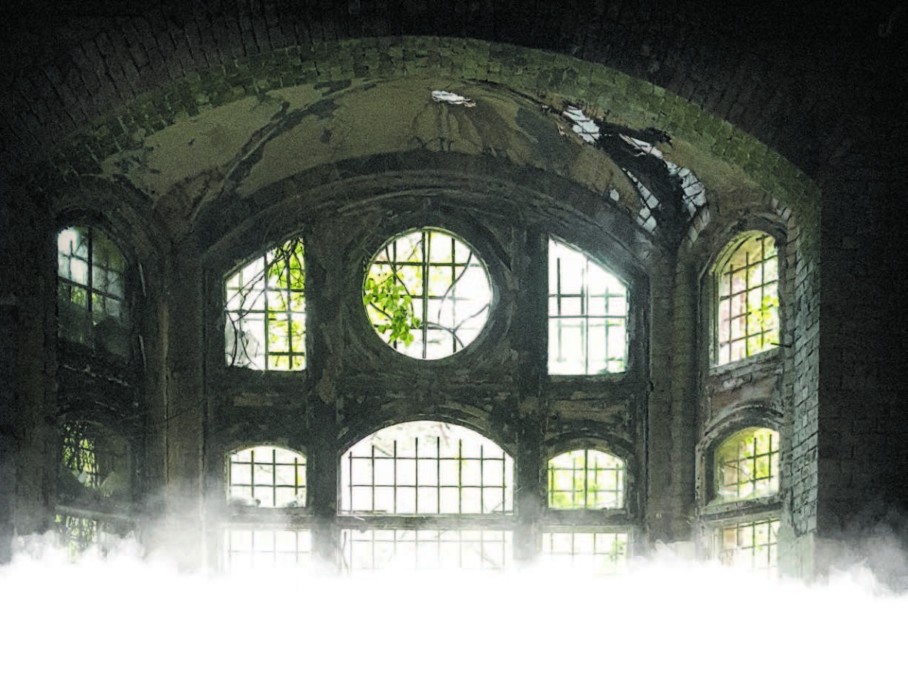{.artview-decision .artview-width-80 .artview-align-center}

### Краткое содержание

«Мы — команда «Спектрал», и мы бываем там и делаем то, на что вы никогда не решитесь». — Марко Праудфут

Создатели популярного YouTube-канала об охоте за привидениями под названием команда «Спектрал» планируют незаконно посетить Isola di Malamente — остров у берегов Сицилии — и провести прямую трансляцию своих поисков настоящих свидетельств сверхъестественного, чтобы стать интернет-сенсацией. Всё идёт хорошо, пока они не обнаруживают, что транспорт с острова исчез, а видеть начинают нечто большее, чем пылинки в кадре и бессвязные размытые фотографии. Вскоре они узнают, что на острове может находиться кто-то или что-то... ещё, а история этого места гораздо мрачнее, чем они могли вообразить.

### Обзор

В этом сценарии группа профессиональных охотников за привидениями отправляется на таинственный остров, чтобы провести ночь в поисках свидетельств сверхъестественного. Некоторым из них и правда интересно найти доказательства существования призраков, но настоящая цель команды — «завируситься» на YouTube, вывести канал на новый уровень и, возможно, даже сорвать большой куш, получив собственное телешоу.

Сыщики не знают, что культ Великого Древнего Хасталика действует на острове с бронзового века и за минувшие тысячелетия принёс бесчисленные жертвы. После правительственного рейда на остров в пятидесятых годах двадцатого века остался лишь один из «Чумных монахов»; итальянское правительство старательно скрывало от общественности все подробности этой операции.

Единственная цель Чумного монаха — физически воплотить Хасталика в нашем мире и распространить по планете его преображающую порчу. Конечный замысел Хасталика непостижим для смертных, но он определённо намерен посредством Порчи превратить в себя всю земную жизнь и поглотить все живые существа. Ради этого крайне важно добиться, чтобы сыщики стали свидетелями последней жертвы последнего Чумного монаха у Ямы костей, а в идеале — сами были поглощены телом Хасталика.

После этого Хасталик постарается добраться до воды. Стоит ему коснуться воды, как он лопнет подобно воздушному шару, рассеяв Порчу, которая заразит ближайшую морскую жизнь, а со временем и весь мир. К счастью для мира, итальянское правительство следит за островом — и, конечно, за прямой трансляцией команды «Спектрал». Как только становится ясно, что Хасталик вот-вот вырвется на свободу, итальянские военные вводят свой аналог «Инсмутского протокола» и поднимают по тревоге эскадрилью самолётов, чтобы зажигательными бомбами уничтожить остров и раз и навсегда положить конец мерзкой порче.

Прохождение «Вируса» занимает примерно от четырёх до восьми часов — в зависимости от того, как Хранитель решит вести сценарий. Некоторые элементы можно включать или опускать по желанию, чтобы ускорить или замедлить игру.

## Команда «Спектрал»

Мы бываем там и делаем то, на что вы никогда не решитесь.

### Марко «Праудфут» Мальони (ведущий сыщик)

{.artview-decision .artview-width-80 .artview-align-center}

Марко Праудфут (настоящее имя — Марко Энтони Мальони) родился в Палермо, Италия, в семье богатой итальянки и американца, служившего сержантом в армии США. В Марко лишь около одной шестнадцатой крови чероки, но он зовёт себя Праудфутом, потому что считает это крутым и думает, будто имя придаёт ему вид человека, «духовно связанного со своими корнями и всей такой хренью». К несчастью, Марко не любит читать и потому так и не понял, что это имя в шутку предложил поклонник Толкина.

Когда Марко исполнилось десять лет, семья переехала в Соединённые Штаты. Сразу после колледжа он основал «Команду „Спектрал“» — популярный YouTube-канал с видеороликами об исследовании странных заброшенных мест и паранормальных явлений. Мать поощряла его «странные увлечения», поэтому оплатила большую часть оборудования для начала работы и до сих пор остаётся его главным покровителем.

Изначально команда «Спектрал» была каналом с розыгрышами, но после того, как ролик с самостоятельно двигавшейся кофейной чашкой стал вирусным (главным образом из-за бурной реакции Марко), он решил всерьёз заняться охотой за «настоящими» привидениями. Марко купил обычный набор снаряжения охотника за призраками и начал публиковать видео. Популярность канала взлетела почти за одну ночь.

Марко безоговорочно верит в демонов, демоническую одержимость и экзорцизм и утверждает, что ВСЁ необъяснимое имеет демоническую природу.

Он придумал девиз канала: «Привет, я Марко, а мы — команда «Спектрал». Мы бываем там и делаем то, на что вы НИКОГДА не решитесь». Марко очень им гордится: девиз ставит его в центр любого действия и выставляет команду бесстрашными сорвиголовами.

Помимо сверхъестественного, Марко одержим собственной внешностью и тренировками в спортзале. Он самовлюблён и с виду чрезвычайно уверен в себе, но при встрече с настоящим паранормальным явлением наверняка наложил бы в штаны.

> ВНЕШНОСТЬ
> 
> Марко (28) — мускулистый мужчина ростом 193 см с зачёсанными назад чёрными волосами. Он всегда носит тёмные очки (представьте итало-американского качка) и модно одевается, неизменно надевая свою фирменную чёрную кожаную куртку.

> СНАРЯЖЕНИЕ
> 
> Сумка команды «Спектрал»™, светящиеся палочки (20), ручная камера ночного видения, измеритель ЭМП, смартфон с тепловизионной камерой, EVP SCD1

### Коррина Тренч (сыщик)

{.artview-decision .artview-width-80 .artview-align-center}

Коррина твёрдо верит в ауры, кристаллы, призраков и тому подобное. Значительную часть жизни она провела в странном культе нью-эйдж в лесах Северной Калифорнии, хотя говорить об этом не любит. Покинув общину, Коррина получила образование биолога, однако затем забросила науку и с головой погрузилась в оккультизм, фольклор и теории заговора. Теперь она считает себя профессиональным медиумом. К сожалению — по крайней мере для неё — духовной связи в ней не больше, чем в чайнике. Коррина изображает невероятную сексуальную раскрепощённость и притворяется пансексуалкой, хотя на самом деле она вполне гетеросексуальна.

Люди склонны судить о ней по совершеннейшей чепухе, которую она несёт и упорно выдаёт за факты. К несчастью, её уверенности и поистине выдающегося актёрского таланта (она умеет плакать по команде; одна из любимых фраз поклонников команды «Спектрал» — «Плачь, Коррина, плачь!», но Коррина так её ненавидит, что футболку с этой надписью пришлось снять с продажи) обычно хватает, чтобы убедить рядового простака в её подлинном даре. Перед расследованием Коррина как следует изучает историю места, но делает вид, что ничего не знает. Кроме того, она выдумывает всё на ходу, опасаясь, что Марко сочтёт её мошенницей и уволит (и он действительно так поступит). Порой она сомневается в себе, но зашла уже слишком далеко и намерена идти до горького конца. Чтобы уклоняться от предложений зрителей прямого эфира, особенно способных разоблачить обман, Коррина часто заявляет, что у неё на что-нибудь аллергия.

Готовясь к этому расследованию, Коррина изучила остров, чтобы быть готовой к встрече с любыми духами. Разумеется, эти знания также помогают ей сочинять на ходу. В [раздаточном материале #12](#viral-handout-12) приведён список фактов и преданий об Isola di Malamente, известных Коррине.

> ВНЕШНОСТЬ
> 
> Коррина (27) — ничем не примечательная белая девушка ростом 170 см. У неё длинные, слегка растрёпанные каштановые волосы с фиолетовой прядью и маленький бриллиантовый пирсинг в носу. Она носит длинную парку, полосатые легинсы и чёрные ботинки Doc Martens. Коррина постоянно шмыгает носом и вытирает его платком.

> СНАРЯЖЕНИЕ
> 
> Сумка команды «Спектрал»™, светящиеся палочки (20), спиритический радиоприёмник, особая доска духов, или «ведьмина доска»

### Энох Джеремайя Икинс (сыщик)

{.artview-decision .artview-width-80 .artview-align-center}

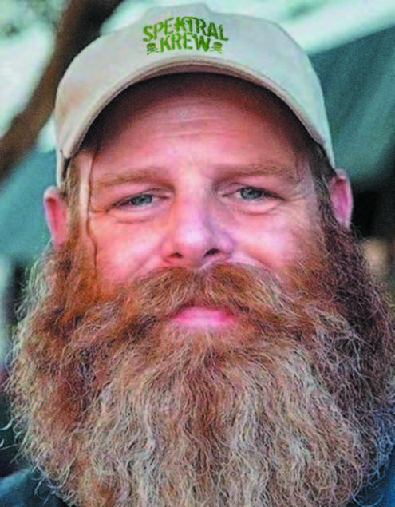{.artview-decision .artview-width-80 .artview-align-center}

Энох — бывший юноша-амиш из меннонитской общины Венгера в Огайо, который отправился на румспрингу и так и не вернулся. В общине решили, что он «aangeraakt door duivels» (тронут дьяволами), и потому не стали его искать (впрочем, они всё равно не стали бы).

Это настоящий медведь в человеческом обличье. Марко нанял его телохранителем и сыщиком на случай, если команде будет угрожать опасность со стороны людей, а не сверхъестественных сил: при доброй душе Энох выглядит весьма устрашающе. У него широкая улыбка и заразительный смех. На самом деле он гораздо умнее, чем кажется, и как способный сыщик замечает то, что упускают остальные. Сам того до конца не понимая, Энох обладает [Зрением](#viral-appendix-new-rules-the-sight) (см. Приложение), хотя многое из увиденного списывает на чрезмерное употребление алкоголя и наркотиков.

Он не рассказывал о Зрении никому из команды и не расскажет. Это его крест.

> ВНЕШНОСТЬ
> 
> Энох (26) — настоящий человек-гора ростом 198 см. Он всегда носит простую белую рубашку на пуговицах, синие джинсы, сандалии с открытыми пальцами (даже в снег) и фирменную бейсболку команды «Спектрал». У него густая борода и добрые голубые глаза. По одной стороне лица тянется довольно страшный шрам — след несчастного случая с сельскохозяйственным орудием в юности. Энох безупречно учтив, и все в команде искренне его любят.

> СНАРЯЖЕНИЕ
> 
> Сумка команды «Спектрал»™, светящиеся палочки (20), ретрансляторы Wi-Fi (2), стационарные камеры ночного видения (6)

### Питер Уортон (сыщик)

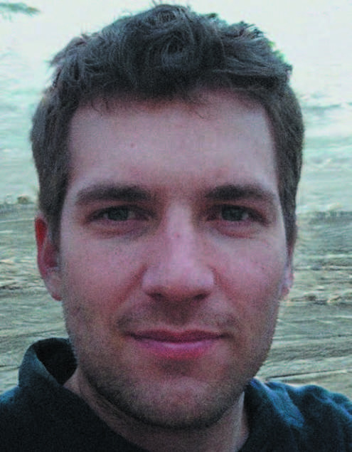{.artview-decision .artview-width-80 .artview-align-center}

Питер — профессиональный преступник и бывший героиновый наркоман. Оператором команды «Спектрал» он стал случайно: пришёл продать Марко украденные ноутбук и цифровую камеру. За годы он покупал и продавал столько такой техники, что, когда Марко попросил показать её в работе, Питер без труда разобрался. Марко тут же предложил ему место, и Питер согласился, потому что прежде никто не предлагал ему работу. Чтобы деньги продолжали поступать и команде, и ему самому, Питер тайно подготавливает ложные свидетельства и в нужные моменты приводит их в действие: с помощью лески двигает предметы за кадром, незаметно прячет мелкие вещи и оставляет их в другом месте, а потом «находит» с потрясённым выражением лица; с фальшивой учётной записи отправляет в эфир платные сообщения, обращающие внимание на его «активность», и так далее. Игрока Питера следует поощрять изобретательно подделывать свидетельства и следить, чтобы его не поймали.

Питер немногословен и, хотя ценит свою работу, по привычке всегда присматривает, что бы украсть следующим (он почти клептоман). Его трудно вывести из равновесия. Ему нравится Энох, в котором он видит родственную душу.

> ВНЕШНОСТЬ
> 
> Питер (39) — лихо выглядящий худой мужчина ростом 175 см со слегка растрёпанными волосами. Его лицо покрывает щетина, глаза постоянно бегают, а с губы всегда свисает самокрутка. Он носит ботинки Doc Martens и зелёную непромокаемую куртку Burberry, под которой, кажется, всегда одна и та же клетчатая рубашка лесоруба и рваные синие джинсы.

> СНАРЯЖЕНИЕ
> 
> Сумка команды «Спектрал»™, светящиеся палочки (20), ручная камера ночного видения, измеритель ЭМП, регистратор ЭГФ, смартфон с тепловизионной камерой, смартфон, одноразовый телефон, предметы для саботажа, диктофон (с записями стонов и криков).

### Ку Хён (сыщик)

{.artview-decision .artview-width-80 .artview-align-center}

Хён (произносится как ХЁН) — южнокорейский студент по обмену, учившийся в США. Он предпочитает, чтобы его называли по фамилии — Хён. Он продюсер и главный «технарь» команды «Спектрал», обычно расставляет камеры и руководит съёмкой. Хён окончил факультет киноведения, производства и разработки фильмов и отлично владеет видеомонтажом и звукорежиссурой, хотя бо́льшую часть этой работы оставляет Майе.

На канале он работает звукорежиссёром Марко и часто появляется в кадре: Хён предельно честен и всегда рассуждает логично и прямо, порой производя впечатление спорщика. Он ещё не видел и не переживал ничего, что мог бы на 100% назвать паранормальным, и почти воинственно возражает другим — особенно когда Коррина разыгрывает свой обычный спектакль. Хён знает, что родители не одобрят такую карьеру, хотя в США он хорошо зарабатывает видеомонтажом, звукорежиссурой и работой на канале команды «Спектрал». Они постоянно угрожают прислать кого-нибудь в США, чтобы вернуть его домой. Он постоянно смотрит на телефон и отклоняет их звонки.

> ВНЕШНОСТЬ
> 
> Хён (22) — мужчина среднего телосложения ростом 188 см. Он одевается по-западному: носит куртку-бомбер, джинсы и модные очки в чёрной оправе; волосы у него чёрные. Во время расследования при нём всегда рюкзак и пояс с инструментами. Кроме того, Хён носит изготовленную на заказ техническую систему из трёх iPad, которые передают ему информацию. Планшеты можно опустить для чтения, развернуть экраном к остальным или сложить у груди, чтобы они не мешали двигаться.

> СНАРЯЖЕНИЕ
> 
> Сумка команды «Спектрал»™, светящиеся палочки (20), система из iPad, набор электронных инструментов, наголовные камеры (5), различные батареи и электронные детали

### Майя Адедувон (НИП)

{.artview-decision .artview-width-80 .artview-align-center}

Майя — англо-нигерийский редактор и продюсер Марко. В юности она попала в автомобильную аварию и с тех пор передвигается в инвалидном кресле. У Майи острый ум, она невероятно сообразительна и, когда нужно, бывает весьма дерзкой. Она привыкла называть всех «деткой» (например: «Марко, детка, что ты хочешь от меня услышать?»). Об Isola di Malamente она узнала от знакомого из сети.

С технической стороны Майя из безопасного лондонского дома следит за видеопотоками команды «Спектрал», руководит съёмкой и монтирует материал, пока остальные охотятся за привидениями. У неё есть часы заранее снятых видеоматериалов, которые можно вставить в эфир, когда команда делает перерыв или меняет место, фактически перекрыв прямую трансляцию. По одному из планшетов технической системы Хёна она может напрямую связаться с ним в чате, а в крайнем случае звонит самому Марко. Марко часто называет Майю «глазами в небе».

> Тайны Майи
> 
> В свободное время Майя также торгует криптовалютой, занимается майнингом и взламывает системы, проверяя, насколько глубоко сможет забраться в кроличью нору. Она видит Коррину насквозь и в глубине души знает, что та мошенница. К Эноху Майя испытывает особую нежность, понимая, насколько он измучен и добр.
> 
> Монтируя ролики команды «Спектрал», она замечала, как Питер ускользает и подделывает свидетельства, когда думает, что за ним никто не наблюдает. Майя вырезает такие кадры и хранит их на случай, если ей что-нибудь от него понадобится. Впрочем, она понимает его причины: вместе с Марко они нашли золотую жилу, которая хорошо оплачивается. Майя узнала об Isola di Malamente и провела глубокое исследование. На всех крупных картографических сайтах остров оставался пустым и лишённым деталей, зато на форуме взломщиков военных спутников он был показан застроенным множеством зданий. Что они пытаются скрыть?
> 
> При всей верности команде Майя не упустит возможности быстро подзаработать, рассказав другим охотникам за привидениями о местах, куда направляются её товарищи. Марко это страшно раздражает: он часто гадает, почему соперники вроде «Фантомного отряда» и «Братьев-призраков» успевают исследовать некоторые места раньше них, но ни разу не подозревал Майю.

> ВНЕШНОСТЬ
> 
> До аварии рост Майи составлял 173 см. У неё длинные волосы, нечто среднее между афро и дредами, проколотый нос, совершенно безупречные белые зубы и очень улыбчивое лицо. Она всегда носит футболку, поскольку редко выходит из дома, где у неё установлено несколько экранов и рабочих станций. Майе нравится работать с «Командой „Спектрал“», и она помогает им в расследованиях, наблюдая за трансляциями с многочисленных камер.

### Эмили «Эм» Лавинь (НИП)

{.artview-decision .artview-width-80 .artview-align-center}

{.artview-decision .artview-width-80 .artview-align-center}

Чтобы добавить происходящему угрозы или, наоборот, немного разрядить обстановку, мы включили НИП — Эмили «Эм» Лавинь. Её можно использовать двумя способами: как «суперфанатку» или как единственную выжившую участницу соперничающей команды охотников за привидениями.

**Вариант с суперфанаткой**. Эм — одержимая каналом фанатка-преследовательница. Она повсюду следует за командой, потому что совершенно помешана на Коррине; представьте кого-то вроде Мел из телесериала Flight of the Conchords. Эм искренне верит, что каким-то необъяснимым образом духовно связана с Корриной. Коррина прекрасно знает Эм, но держится отчуждённо и притворяется, что забывает её имя. На самом деле Эм влечёт к Коррине не только духовная связь, но она ещё не разобралась в собственной сексуальности и остаётся скрытой лесбиянкой. Коррина, напротив, изображает полную сексуальную свободу и притворяется пансексуалкой, хотя в действительности вполне гетеросексуальна и не отвечает на неловкие ухаживания Эм. Марко и команда терпят Эм, потому что она покупает много товаров и без конца рекламирует их во всех социальных сетях. Она создала более 200 подставных учётных записей, чтобы подписываться на канал и помогать алгоритму.

О расследовании команды на острове Эм узнала около недели назад из анонимной наводки. На самом деле её дала Майя, решавшая, на ком сможет больше заработать. Эм немедленно вылетела в Италию, несколько дней провела в Перле, а накануне заплатила местным подросткам, чтобы те переправили её на остров и оставили запасную вёсельную лодку для возвращения на материк, если наводка окажется ложной. (Именно эта лодка стоит в бухте.) Эм решила немного осмотреться днём, полагая, что при солнечном свете призраки не появятся. К несчастью, она сунула нос слишком далеко, и во время исследования Хасталик полностью развратил её изнутри. По правилам её [уровень Порчи равен 10](#viral-appendix-new-rules-the-taint) (подробнее см. с.62), хотя внешне она кажется совершенно нормальной. Она будет незаметно направлять сыщиков, стараясь выпустить Великую Порчу в мир.

> ВНЕШНОСТЬ (ВАРИАНТ С СУПЕРФАНАТКОЙ)
> 
> Эм — девушка ростом 157 см с клубнично-светлыми волосами, подстриженными под каре, и открытой улыбкой. Она постоянно носит товары команды «Спектрал», в том числе собственноручно изготовленную футболку с лицом Коррины (на особенно неудачной фотографии). В её рюкзаке всегда словно бы находятся фотографии команды «Спектрал» для автографов и большая коллекция маркеров Sharpie, так что Эм ко всему готова. Одевается она примерно как Коррина.

**Вариант с другой охотницей за привидениями**. Эм состоит в конкурирующем канале охотников за привидениями под названием «Фантомный отряд». Она их медиум-спиритуалист и, в отличие от Коррины, искренне верит в свои силы (по сравнению с кем-то вроде Эноха она лишь совсем чуть-чуть обладает экстрасенсорным даром), поскольку действительно получает общие впечатления от разных мест. Примерно неделей ранее Майя навела «Отряд» на остров, и они щедро ей заплатили. Затем команда отправилась на остров, чтобы снять своё 48-часовое пребывание, но во время расследования все они заболели от Порчи Хасталика и умерли... кроме Эм. Порча полностью развратила её, превратив в несчастную служительницу Великой Порчи, о чём сама Эм даже не подозревает. Она отнесла тела бывших товарищей к яме с костями и бросила внутрь, напитав форму Хасталика и приблизив её воплощение.

Её отношения с Корриной напряжённы и прямо противоположны отношениям версии Эм-суперфанатки. Коррина неоднократно встречалась с ней и испытывает к ней непонятное очарование и влечение. Эм забывает имя Коррины и время от времени называет её Карлой.

Когда группа находит Эм, та лихорадочно ищет по острову товарищей и радуется знакомым лицам: батарейки её фонаря садятся, а сама она ужасно напугана. На вопросы она отвечает, что они прибыли накануне снимать фильм, добравшись сюда с местным мужчиной на ветхой лодке, и решили спать в одной из заброшенных и сравнительно чистых больничных палат. Проснувшись, она оказалась одна. Остальные словно исчезли. Она не знает, что именно Майя рассказала её группе. Разумеется, это ложь, хотя Эм об этом не подозревает: Хасталик заразил её разум и управляет воспоминаниями и словами. С точки зрения Эм всё это правда. Для неё также правда, что она не знает ни местонахождения оборудования «Фантомного отряда», ни судьбы коллег. В действительности Эм выбросила всю их электронику в море, привязав к ней булыжники, а мёртвые тела, конечно же, скормила яме.

> ВНЕШНОСТЬ (ВАРИАНТ С ДРУГОЙ ОХОТНИЦЕЙ ЗА ПРИВИДЕНИЯМИ)
> 
> Выглядит она почти так же, только носит футболку «Фантомного отряда» и рюкзак, набитый всевозможной спиритуалистической чепухой вроде кристаллов, лозоходных прутьев и тому подобного.

> Заметки Хранителя
> 
> Хранитель может решить, что Эм не заметила одну из стационарных камер. Если сыщикам удастся просмотреть запись, они увидят расследование «Фантомного отряда», а в самом конце — Эмили, которая тащит по коридору тела товарищей; её руки покрыты кровью.

## Создание новых сыщиков

Хотя сценарий рассчитан на прилагаемых готовых сыщиков, ничто не мешает игрокам создать собственных. При этом нужно помнить лишь о нескольких важных моментах. Во-первых, сыщики должны делать какое-либо сетевое шоу об охоте за привидениями, стремясь получить больше просмотров, подписок, покровителей и так далее. Иными словами, они должны хотеть «завируситься».

Вторая важная черта сыщика-ведущего — сильная мотивация завершить трансляцию любой ценой. Марко движут деньги и слава, но другого ведущего может подталкивать соперничество с другим YouTube-каналом, одержимость поиском истины о сверхъестественном или даже желание разоблачить сверхъестественное как полную чушь.

Третья черта не столь обязательна, но очень полезно, если хотя бы один сыщик обладает [Зрением](#viral-appendix-new-rules-the-sight) (см. с.60). Оно позволяет узнать больше об истинной природе происходящего и усиливает общее настроение истории. Обладающий [Зрением](#viral-appendix-new-rules-the-sight) сыщик может быть экстрасенсом группы, но это необязательно. Особенно интересно будет, если настоящий дар видений внезапно проявится у того, кто прежде лишь притворялся экстрасенсом.

**Другие варианты сыщиков**. Возможны и другие варианты, хотя Хранителю придётся кое-что переработать. Объём работы зависит от того, насколько сильно сыщики отклонятся от основной предпосылки сценария. Важно обеспечить правдоподобную мотивацию для исследования острова и дать им электронные устройства, посредством которых Хасталик сможет ими управлять. Хранитель может использовать следующие идеи или придумать собственные.

**Исследователи Мифов** — Экспедиция Мискатоникского университета отправлена на Isola di Malamente с разрешения итальянского правительства. Её участникам выдают камеры и средства связи для исследования зарегистрированных на острове паранормальных явлений. Вместо комментариев зрителей YouTube сыщики могут получать отклики от коллег из Мискатоникского университета или других консультирующих их специалистов. В таком случае Хасталик по-прежнему сможет манипулировать ими через электронику, выдавая себя за таинственного эксперта или благодетеля, оплатившего экспедицию.

Съёмочная группа документалистов — Национальное географическое общество профинансировало документальный фильм об Isola di Malamente, и его создателям каким-то образом удалось получить разрешение на съёмку на острове. Группе начинают звонить от имени National Geographic (на самом деле это Хасталик), но вскоре кинематографисты понимают, что звонящий знает о них слишком много.

Туристы — Местный экскурсовод (Нунцио Вендра) привозит группу туристов на Isola di Malamente и бросает их там. Они тут же безуспешно пытаются вызвать помощь по мобильным телефонам. С наступлением темноты по рации, которую Нунцио подложил кому-то из них или в чей-то багаж, поступает его вызов. Он заявляет, что на острове спрятан сундук с золотыми слитками времён Второй мировой войны, и предлагает поделить золото, если туристы согласятся его найти. Если откажутся, они никогда не покинут остров. Нунцио направляет сыщиков к причалу, где оставил каждому беспроводную наголовную камеру и передатчик, чтобы ему было удобнее ими руководить. В какой-то момент исследования острова их рации начинают принимать голос другого собеседника (на самом деле Хасталика). Тот утверждает, что Нунцио собирается их убить, но обещает вывезти сыщиков с острова до рассвета, если они будут слушаться его.

Назойливые подростки — Группа местных подростков решает пройти обряд посвящения, исследовав остров, а дальше... ну, вы знаете, что произойдёт.

## Снаряжение команды «Спектрал»

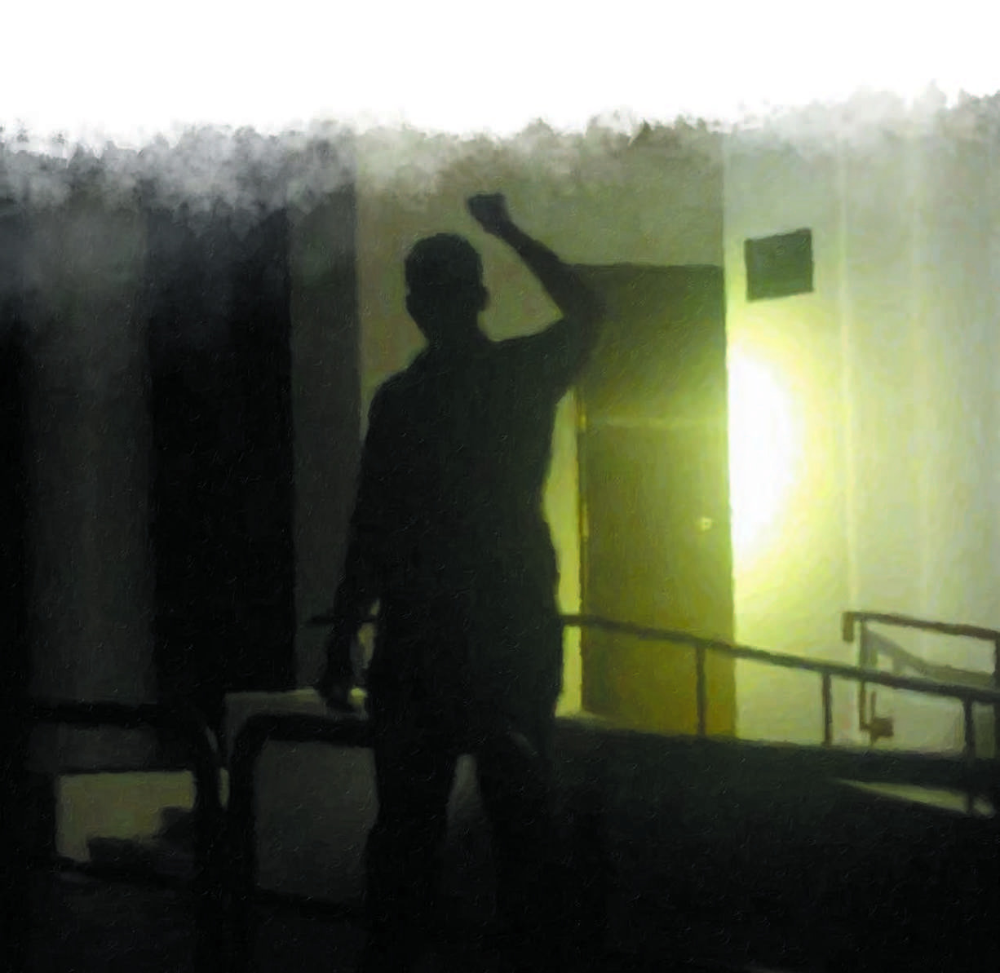{.artview-decision .artview-width-80 .artview-align-center}

### Переносимое

Члены команды носят эти предметы снаряжения в соответствии со своей ролью (см. описания сыщиков).

> **Сумка для снаряжения**
> У каждого члена команды есть чёрная холщовая сумка (разумеется, с логотипом команды «Спектрал») для переноски снаряжения. Иногда ведущий может отдать свою сумку кому-то другому, пока находится в кадре. В сумку помещаются ручные камеры ночного видения, измерители ЭМП, смартфоны и тепловизионные камеры, а также прочие личные вещи.

> **Ручные камеры ночного видения (2)**
> Полнспектральные видеокамеры 4K с Wi-Fi, инфракрасным ночным видением Ultra HD для исследования паранормальных явлений, частотой 60 кадров в секунду, разрешением 24 Мп и цифровым увеличением 30×. Обычно их носят и используют Питер и Энох. [Четыре часа работы от аккумулятора]

> **Измеритель ЭМП**
> Трёхосевой анализатор и детектор мощности ВЧ-радиосигналов HF-B3G. [12 часов работы от аккумулятора]

> Заметки Хранителя
> 
> На острове почти нет источников ЭМП, но фоновый шум время от времени будет давать редкие всплески. Призраки не создают электромагнитных полей, однако Хасталик может использовать прибор против сыщиков, вызывая отклик в том направлении, куда хочет их заманить. Обычно измеритель находится у Марко.

> **Спиритический радиоприёмник**
> Особый радиоприёмник с режимом сканирования частот, который, как надеется команда, позволит общаться с духами. По размеру он примерно с рацию и снабжён наушником, чтобы лучше слышать голоса с того света. [Восемь часов работы от аккумулятора]

> Заметки Хранителя
> 
> Спиритический радиоприёмник может поймать переговоры итальянских военных или чтение Чумным монахом различных тревожных литаний на латыни (по усмотрению Хранителя).

> **Регистратор ЭГФ SCD1**
> SCD1 — экспериментальное устройство, которое Марко заказал одному специалисту; это «Прибор бесшумной записи». Процессор и программа определяют, когда никто не говорит, и подают световой сигнал, если в тишине возникает звук. Запись можно сразу воспроизвести. Этот прототип обошёлся дорого, поэтому Марко держит его при себе.

> **Тепловизионная камера для смартфона**
> FLIR ONE Pro — профессиональная тепловизионная камера для смартфонов на iOS — с технологиями улучшения изображения VividIR и MSX. Хён кустарно переделал её так, чтобы она использовала видеопоток с камеры Питера. [Заряда FLIR хватает всего на 45 минут]

### Стационарное

Эти предметы устанавливаются заранее и, за исключением дрона, остаются на одном месте.

> **Базовая станция**
> Специально собранный промышленный ноутбук с узлом Wi-Fi и спутниковым каналом для прямой трансляции. Блок аккумуляторов глубокого разряда обеспечивает до 12 часов непрерывного вещания.

> Заметки Хранителя
> 
> По усмотрению Хранителя от аккумулятора базовой станции можно заряжать другие устройства, но на это, разумеется, уходит время, которого у сыщиков может не быть.

> **Ретрансляторы/передатчики сотового Wi-Fi (2)**
> Каждый обеспечивает Wi-Fi в радиусе 300 метров и снабжён аккумулятором, поддерживающим непрерывный сигнал 8-10 часов.

> Заметки Хранителя
> 
> Лучше всего установить их в трёх ключевых точках: на маяке, на дальнем конце моста и в больничной башне. Так будет покрыта наибольшая площадь места расследования. Учтите: поскольку спутниковый сигнал идёт через базовую станцию на маяке, для работы больничной сети передатчик у моста должен оставаться включённым.

> **Аккумуляторы ИБП (3)**
> В основном они питают передатчики Wi-Fi, но через различные разъёмы от них можно заряжать и другое оборудование. При отключении энергии каждый обеспечивает около шести часов работы. Они нужны лишь на случай отказа резервного аккумулятора узла. Чрезвычайно тяжёлые, поскольку фактически представляют собой большие аккумуляторы глубокого разряда.

> **Камеры ночного видения (6)**
> Наружная поворотная IP-камера Foscam HT2 1080p с Wi-Fi 2.4 g/5 gHz, оптическим увеличением 4×, двухсторонним звуком с микрофоном и динамиком, ночным видением на 50 метров, CMOS-матрицей и защитой IP66. [Шесть часов работы от аккумулятора]

> **Дрон**
> Этот необязательный дрон — дорогая профессиональная модель с поддерживающей ночное видение камерой 4K, которой можно управлять через приложение на iPad Хёна. Видео записывается локально или передаётся прямо в эфир. [В комплект входят три аккумулятора, каждый обеспечивает 20 минут полёта.]

## Хронология

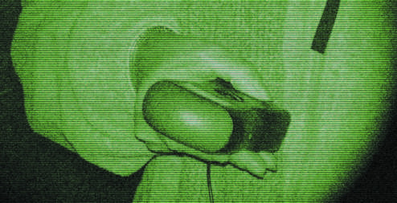{.artview-decision .artview-width-80 .artview-align-center}

Суббота, двадцать четвёртое августа 2019 года

Прогноз обещает ясное небо, однако будет жарко и влажно: температура около $24^{\circ}$ C, влажность 80%. До появления луны вскоре после полуночи будет очень темно.

7:40 AM: команда «Спектрал» прибывает в Италию и намеревается провести день на материке, готовясь к ночной трансляции. Они встречаются со своим связным Нунцио, который доставит их на остров.

6:30 PM: Команда грузит снаряжение в ветхую лодку Нунцио, на которой отправится из гавани Перлы к Isola di Malamente. По плану Нунцио должен забрать их на следующий день незадолго до рассвета в месте высадки.

7:00 PM: Они прибывают на Isola di Malamente и выгружают снаряжение. Рядом с островом проходит экскурсионный катер, но, похоже, не замечает их.

7:25 PM: Команда осматривает маяк и устанавливает базовую станцию в радиорубке. Спутниковый канал подключён и проверен, а первый передатчик Wi-Fi установлен почти на вершине маяка.

7:55 PM: Закат.

8:00 PM: Они осматривают место у моста и устанавливают второй передатчик Wi-Fi на дальнем берегу.

Трансляция начинается.

11:45 PM: Майя связывается с сыщиками и советует им добраться до склепа и начать подготовку к грандиозному финалу.

12:00 AM: Сыщики используют «ведьмину доску» Коррины в склепе под часовней. Ровно в полночь, под звон колоколов, доносящийся через море из Перлы, они проводят сеанс. Доска медленно складывает имя Х А С Т А Л Ю К, и Великий Древний пробуждается: земля содрогается, а древний алтарь раскалывается посередине. Обломки падают на ведущую к поверхности лестницу, перекрывая выход и запирая сыщиков внизу. Часть стены у алтаря обрушивается, открывая вход в катакомбы. Хён получает уведомление о том, что канал преодолел отметку в миллион подписчиков, а трансляция отмечена как «вирусная».

Время неизвестно: Незадолго до рассвета сыщики добираются до Ямы костей, куда бросается последний Чумной монах, рождая Хасталика. Тридцать секунд спустя в засекреченном месте отдают приказ направить несколько тяжеловооружённых военных самолётов, чтобы сровнять Isola di Malamente с землёй смесью фугасных, зажигательных и напалмовых бомб. Они прибывают через 15 минут.

6:28 AM: Рассвет

## История

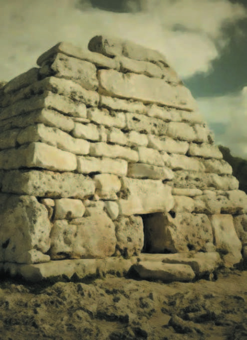{.artview-decision .artview-width-80 .artview-align-center}

Когда-то в каменном веке Хасталик в виде микроскопического организма прибывает на Землю из бесконечной космической пустоты и падает на место, ныне известное как Isola di Malamente. Он медленно начинает заражать и осквернять остров. Могущественное влияние Великого Древнего в бронзовом веке привлекает туда первых людей-поселенцев. Они начинают поклоняться незримому потустороннему ужасу как богу.

По мере того как поселенцы бронзового века приносят Хасталику жертвы, он увеличивается и примерно ко времени зарождения Древней Греции около 700 BC наконец проявляется в виде бурлящей ямы костей. Он всё ещё слишком слаб, чтобы распространиться за пределы острова, и потому велит поклонникам возвести вокруг него храм. Тогда ему поклонялись как Фтисису — олицетворению гниения и распада.

По мере того как культ приспосабливался к очередным пантеонам — Эрре, Нергалу, Вейовису, Морбусу, — над первым храмом возводились бесчисленные новые святилища. Наконец, в начале четырнадцатого века, незадолго до вспышки Чёрной смерти, был построен монастырь Святого Роха.

Монастырь прославился тем, что принимал больных, немощных и умирающих, ухаживая за ними в последние годы жизни. Среди них были жертвы чумы, прокажённые и страдавшие горячкой мозга (безумием). Тела сжигали в большой яме. В конце девятнадцатого века монастырь превратили в санаторий.

В 1917 году у нескольких солдат диагностировали грипп. Их лечили в санатории Святого Роха, а затем отправили на фронт. В следующем году пандемия гриппа 1918 года опустошила весь мир.

В 1928 году учреждение оснастили новым медицинским оборудованием и переименовали в больницу Святого Роха.

Во время WWII остров почти не затронули боевые действия, хотя часть первоначального монастыря случайно повредил американский бомбардировщик из-за отказа системы сброса бомб. Ходили слухи о тайном задании, но никаких подтверждений так и не появилось.

В 1954 году после сообщений об исчезновении пациентов и жестоком обращении с ними итальянские власти провели расследование и обнаружили, что в больнице ставили чудовищные эксперименты. В ямах для сожжения и братских могилах нашли останки сотен пациентов. Больницу закрыли, а десятки сотрудников, включая нескольких администраторов, приговорили к пожизненному заключению. Странным образом каждый из них в течение года умер от загадочной истощающей болезни. Её причину так и не установили.

Из-за изоляции острова и возможной заразности останков тела так и не эксгумировали; они остаются на острове по сей день. Нет никаких признаков того, что там проводили очистку: остров просто поместили под бессрочный карантин.

> Заметки Хранителя
> 
> Общественность ничего не знает ни о культе Хасталика, ни о яростной перестрелке, разразившейся, когда в 1954 году итальянские военные штурмовали остров. Получив первые сведения о жестоком обращении с пациентами, итальянское правительство немедленно отправило социальных работников на расследование под полицейской охраной. Поначалу администратор больницы охотно сотрудничал, но после обнаружения свежих останков в яме для сожжения следователи приказали закрыть учреждение. Затем культисты заманили социальных работников и сопровождавших их полицейских в часовню и перебили. Один полицейский всё же успел связаться с ожидавшим у причала гидросамолётом. Сообразительный пилот взлетел и передал сообщение властям по радио.
> 
> Тем временем тела следователей быстро сожгли. Понимая, что конец близок, культисты убили сотрудников больницы, не состоявших в культе, и умертвили всех пациентов. Их останки перенесли в тайные катакомбы под часовней.
> 
> Пока это происходило, власти изучили тревожный доклад пилота и решили, что остров придётся брать силами военных. Учитывая характер ситуации, они привлекли DSS (Divisione Sicurezza Speciale) — секретное подразделение итальянского правительства, занимающееся деликатными вопросами национальной безопасности. Через несколько часов к Isola di Malamente уже летела эскадрилья вертолётов с тяжеловооружённой ударной группой.
> 
> Высадившись в двух точках острова (у маяка и больницы), две группы методично пробивались к больнице. Самое ожесточённое сопротивление культисты оказали в общежитии персонала, где сражались до последнего человека. Ударная группа не знала, что тем самым культисты выигрывали время для двух собратьев, которым предстояло завершить свои задачи.
> 
> Два последних Чумных монаха бежали в тайное святилище, чтобы провести тёмный ритуал с одним из больничных младенцев, припасённым для этой цели. С помощью Iuramentum Corruptionis один подготовил другого к роли последней жертвы. Они дождались ухода захватчиков и отправились к Яме костей, где последнюю жертву подвесили за шею над ямой до назначенного часа. Другой вернулся с книгой в скрытое святилище и застрелился в висок, завершив ритуал.
> 
> С тех пор последний Чумной монах сторожит остров как тёмное присутствие, при любой возможности скармливая Яме костей новую осквернённую плоть в подготовке к великому дню рождения Хасталика.

В 1958 году была опубликована книга Il Culto della Peste dell'Isola Malamente («Чумной культ острова Маламенте»). Её автор, доктор Джованни Пеллегрино, утверждал, что участвовал в расследовании, приведшем к закрытию больницы, и якобы изложил подлинную историю событий 1954 года. Однако прежде, чем книга попала на прилавки, итальянское правительство конфисковало все экземпляры, а писателя арестовали по соображениям национальной безопасности. Неделю спустя он умер в тюрьме от неизвестной истощающей болезни.

> Заметки Хранителя
> 
> Несколько экземпляров книги избежали уничтожения и даже могут послужить причиной прибытия сыщиков на остров. В основном книга описывает события, произошедшие там в 1954 году, но сама по себе не предполагает ничего сверхъестественного.
> 
> Доктор Пеллегрино вошёл в больницу после окончания боя и ярко, в тревожных подробностях описал кровавую бойню. Особенно жутки сообщения об убитых пациентах, на телах которых были вырезаны непонятные символы. Он утверждает, что обнаружил признаки ритуальных жертвоприношений, каннибализма и невыразимых экспериментов над женщинами и младенцами.
> 
> По его словам, «последний бой» в общежитии персонала был не менее жесток, чем всё виденное им на войне, и обе стороны понесли тяжёлые потери. Погибли целых тринадцать итальянских солдат, а пулемётный огонь изрешетил двадцать трёх монахов.
> 
> После осады доктору Пеллегрино поручили опознать погибших. Он отмечает, что тела троих монахов в больнице не нашли, и предположительно те погибли при попытке бежать с острова.
> 
> Фотографий в книге нет, но есть несколько рисунков с изображением обнаруженных им символов.
> 
> Хранитель сам решает, смогут ли сыщики почерпнуть из книги что-нибудь полезное для расследования.

В 1961 году посещение острова запретили всем, кроме лиц с официальным разрешением правительства.

На протяжении семидесятых и восьмидесятых годов люди сообщали о фигурах и огнях на острове, хотя, согласно официальным сведениям, почти 60 лет там никто не бывал.

## Одна ночь в Перле

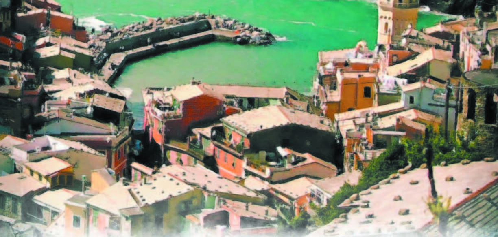{.artview-decision .artview-width-80 .artview-align-center}

«Одна ночь в Перле» — новый пролог, расширяющий первоначальный сценарий и дающий сыщикам возможность исследовать расположенную неподалёку рыбацкую деревню Перла. Там они смогут больше узнать об истории и преданиях Isola di Malamente и увидеть древний праздник Lepurazione di Morbus («Очищение от Морбуса»).

Очищение от Морбуса. Обряд длится три дня и начинается в первую ночь с Il Rogo della Malattia («Сожжение болезни»). Жители сжигают чучело демона Морбуса, чтобы изгнать его из деревни. Они верят, что Морбус отвечает ударом, поэтому во вторую ночь, именуемую Notte della Peste («Ночь чумы»), запираются в домах и размещают талисманы у всех возможных входов, чтобы поймать любую пытающуюся проникнуть болезнь. Третья и последняя ночь называется La Purificazione («Очищение»): все талисманы сжигают на площади, после чего празднование продолжается до глубокой ночи.

Жители Перлы относятся к празднику чрезвычайно серьёзно, поэтому попытка вмешаться сначала встретит решительное сопротивление, а при необходимости — насилие. Разумеется, если кучка глупых американцев желает погибнуть, это их дело, но тому, кто попытается помешать празднику, особенно в Ночь чумы, не поздоровится.

Если сыщики поищут сведения о Перле в интернете, проверка Удачи позволит найти видеоролик американского туриста, попытавшегося в Ночь чумы не пустить одного из жителей домой. После стычки турист оказался в больнице, а по официальным документам дело было урегулировано.

Сам ролик производит тревожное впечатление. Житель — крепкий с виду рыбак — шёл по переулку, когда американец (молодой мужчина лет двадцати) преградил дорогу и начал тыкать ему в лицо видеокамерой. Рыбак попытался обойти его, но молодой человек продолжал смеяться, спрашивал, куда тот так торопится, и повторял, что всего лишь хочет задать несколько вопросов.

События быстро обострились. Внезапно камера оказалась на земле, продолжая снимать, как рыбак снова и снова бьёт туриста. Запись обрывается после того, как рыбак уходит прочь, а турист подползает к камере и выключает её. Согласно ролику, происшествие случилось в 2002 году.

> Заметки Хранителя
> 
> Если сыщики попробуют найти рыбака, им не повезёт. Около трёх лет назад он умер от рака. Никто из жителей не помнит происшествия, и никаких записей о нём нет.

### Добро пожаловать в Перлу

Двадцать третье августа 2019 года — десять утра

Когда вы открываете сдвижную дверь фургона, вас встречают тёплый ветер и смешанные запахи хлеба, рыбы, лимонов и морского воздуха. На мощёных улицах кипит повседневная жизнь, а выйдя на тротуар, вы словно оказываетесь на открытке. Перла построена на склонах узкой бухты с видом на Средиземное море, и отсюда открывается великолепный вид на всю деревню. На западе, у самого горизонта, едва различима конечная цель вашего путешествия: Isola di Malamente.

Радуясь возможности размять ноги, вы выгружаете снаряжение, привлекая внимание нескольких детей, играющих неподалёку в мяч. После нескольких часов тряски в старом фургоне по неровным извилистым дорогам сицилийской глубинки вам хочется лишь принять душ и, пожалуй, вздремнуть.

Белое здание перед вами выглядит старым, но ухоженным. Овальная деревянная вывеска над головой скрипит и покачивается на приятном морском ветру, а затейливые золотые буквы мерцают в солнечном свете. На ней написано Tramoto dell'Hotel («Отель „Закат“»). Водитель ставит последнюю сумку, касается козырька фуражки и с грохотом уезжает.

Деревня возбуждённо гудит. Когда фургон уезжает, старики останавливаются и смотрят на вас, а несколько женщин посылают детей постарше помочь разгрузить снаряжение. Те указывают на отель и спрашивают: «Qui?»

> Заметки Хранителя
> 
> Знающий итальянский поймёт, что это значит «Сюда?». Получив подтверждение, юные помощники начнут носить снаряжение в вестибюль отеля. В целом они очень честны и будут благодарны за чаевые, хотя сами их не попросят.

Отель стоит прямо на городской площади — мощёном круге диаметром 24 метра, по внешнему краю которого проходит тротуар. В центре, где обычно находилась бы статуя или фонтан, возвышается круглый каменный помост диаметром 9 метров. На нём сложена большая куча дерева наподобие костра, окружённая низкой сетчатой оградой. Камень под дровами почернел и покрылся выбоинами — очевидно, от множества прежних костров. Кроме отеля, площадь окружают разнообразные лавки: пекарня, мясная, рыбная, овощная, кафе и так далее.

Несколько стариков вместе с подростками добавляют дров в костёр, а женщины на лестницах развешивают между фонарными столбами красно-белые флажки. Смеющиеся дети бегают друг за другом и играют по всей площади, усиливая общее праздничное возбуждение. Несколько пожилых женщин ухаживают за сотнями подсолнухов, тянущихся к небу из больших цветочных ящиков по всей площади.

От площади расходятся несколько улиц, пересекающихся с другими узкими дорогами и переулками, которые петляют по всей Перле. Во многих переулках есть ступени, а дороги зигзагами поднимаются и спускаются по крутому склону, на котором построена деревня. Большинство зданий старые, грязно-белые, жёлтые, небесно-голубые или лососевые; облупившаяся краска открывает кирпичную кладку и доски. Бесчисленные лестницы взбираются по промежуткам между домами, соединяя скрытые площади и террасы так, что даже М. К. Эшер почесал бы затылок.

> Заметки Хранителя
> 
> На вопрос о приготовлениях сыщикам ответят, что сегодня ночью состоится Il Rogo della Malattia («Сожжение болезни»). Этому празднику много веков; во время него сжигают чучело Морбуса — демона, связанного с недугами и болезнями. Так его влияние изгоняют из деревни ещё на год. Следующая ночь называется Notte della Peste («Ночь чумы»). Считается, что Морбус наносит деревне ответный удар, поэтому жители запираются в домах и размещают там талисманы, чтобы поймать любую проникшую болезнь. В последнюю ночь трёхдневного праздника, именуемую La Purificazione («Очищение»), талисманы сжигают, после чего весь город празднует победу.

Отель «Закат». Внутренние помещения отеля явно видали лучшие времена. Обои отслаиваются, а расставленные по вестибюлю пластиковые цветы потускнели и запылились. Здесь стоят несколько потёртых кожаных диванов и журнальный столик, заваленный старыми журналами с бесчисленными пятнами кофе. Из старинных на вид динамиков, неумело спрятанных за мебелью, доносится скрипучая классическая музыка. За стойкой регистрации сидит пожилой господин, лениво листающий интернет и время от времени наклоняющийся, чтобы разглядеть клавиатуру сквозь толстенные стёкла очков.

Поначалу он не замечает команду, но вздрагивает, когда та привлекает его внимание. Мужчина отвечает по-итальянски: «Buongiorno, mi chiamo Paolo, benvenuti all’Hotel Sunset. Avete una prenotazione?» Это означает: «Доброе утро, меня зовут Паоло, добро пожаловать в отель „Закат“. Вы бронировали номер?» Через мгновение Паоло внимательнее рассматривает сыщиков и спрашивает: «Ah, Americani?» Но прежде, чем они успевают ответить, повторяет приветствие на довольно хорошем английском.

Он проверяет бронь и, уточнив, кто заказал номера (их забронировала и оплатила Майя), выдаёт ключи. У Марко и Коррины отдельные номера, а Хён, Питер и Энох делят большой семейный. Разумеется, Майя забронировала Марко лучший номер с прекрасным видом на море.

Паоло предлагает запереть снаряжение в защищённой комнате. Если команда согласится, вещи будут в безопасности до нужного часа; если откажется, придётся таскать их на два пролёта вверх и вниз по узкой лестнице.

Он сообщает, что завтрак каждое утро подают с восьми до десяти, и указывает направо за спину, где видна небольшая кухня со стульями и круглыми столами под синими клетчатыми скатертями. Паоло говорит, что в номерах есть чай и кофе, и вручает каждому комплект поролоновых берушей.

{.artview-decision .artview-width-80 .artview-align-center}

Паоло улыбается и говорит: «Сегодня вечером у нас местный праздник. Он... довольно шумный и продолжается допоздна. Разумеется, вы можете присоединиться к нам».

Паоло может ответить на большинство вопросов о Перле, однако при упоминании Isola di Malamente пожмёт плечами и скажет, что никто не приближается к острову с тех пор, как правительство давно объявило его запретной зоной. Он добавит, что причина, вероятно, в старых морских минах времён сороковых годов, окружающих остров, хотя и сам не понимает, почему их просто не убрали. Сложная проверка Психологии покажет, что он не вполне искренен. Если на него надавить, Паоло изобразит растерянного старика и сменит тему.

Сами номера вполне пригодны, хотя и староваты. Постели чистые, на комодах стоят вазы со свежими цветами. В каждом номере есть простая ванная с небольшой ванной на ножках. Окно Коррины выходит на крышу соседнего дома, а окно семейного номера — в узкий переулок. Из номера Марко, напротив, открывается вид на живописное Средиземное море и хорошо различимый у горизонта Isola di Malamente.

### Перла

Эта сицилийская рыбацкая деревня вполне типична для региона и полна сельского очарования. Название она получила благодаря множеству устриц — и прекрасных жемчужин внутри них, — которых регулярно добывают в водах близ Перлы. Сыщики прибывают в конце лета, когда деревню украшают всевозможные яркие цветы в подвесных корзинах, кашпо и ящиках на окнах. Все здания выкрашены в белый, хотя время и местный климат успели сильно их потрепать.

Деревня достаточно велика для разнообразных лавок и предприятий, включая пекарню, мясную, рыбную, продуктовую и хозяйственную лавки и кафе; большинство расположено на главной площади или рядом с ней. Мощёные дороги петляют по Перле, зигзагами взбираясь по склону и спускаясь к причалам, где пришвартованы десятки рыбацких и экскурсионных лодок и других небольших судов.

Над всеми прочими городскими постройками возвышается Cappella di Sant'Anna (часовня Святой Анны) — церковь двенадцатого века, посвящённая матери Марии, покровительнице рожениц.

Лавки. В разнообразных лавках вокруг площади продаются обычные сицилийские товары. Кафе явно популярно среди пожилых мужчин Перлы: многие целыми днями беседуют, пьют эспрессо, курят и играют в карты. Они достаточно дружелюбны, но при вопросах об острове становятся серьёзными и молчаливыми, поспешно извиняются и уходят домой.

Дома. Как и многие старые города и деревни этого региона, Перла естественным образом росла вверх по склону по мере прибытия новых жителей. Поэтому дома в основном соединены: у некоторых общие стены, другие построены поверх более старых жилищ. Хотя все они сложены из одинаковых материалов и в целом похожи, двух совершенно одинаковых планировок здесь не найти.

Причалы. В глубоких лазурных водах бухты сравнительно безопасно плавать, однако людей часто отпугивает множество снующих туда-сюда лодок. Местные рыбаки — простой народ, зарабатывающий на жизнь своим ремеслом; они не станут болтать, занятые укладкой рыбы в лёд. На вопрос об острове перекрестятся, пробормочут короткое благословение по-итальянски и откажутся говорить.

Проверка Внимания позволит сыщикам заметить на стене у причала плакат о пропавшем местном жителе Анджело Руссо. Все плакаты сильно потрёпаны непогодой, а часть с датой исчезновения, похоже, когда-то оторвали.

Нунцио Вендра. Потрёпанная рыбацкая лодка Нунцио пришвартована у одного из дальних причалов. Его часто можно найти там с ментоловой сигаретой за беседой с рыбаками рядом с вывеской: TOUR DELLA BAIA: \$20/€25 ALL'ORAAY, а ниже — TOURS: \$20 PER HOUR.

Нунцио узнает команду по фотографиям, которые прислала Майя. Когда они подойдут, он улыбнётся, многозначительно подмигнёт и спросит, не хотят ли они завтра прокатиться. Если они согласятся, он велит быть готовыми за несколько часов до заката. После короткой дружеской беседы Нунцио извинится, затушит сигарету, заберётся в лодку и покинет причал.

Местные подростки. В обычные дни на причалах кипит жизнь, привлекая бунтарски настроенных подростков, которые слоняются здесь, наблюдают, пьют и курят. Большинство подростков Перлы немного говорит по-английски благодаря американским фильмам и телевидению, но обычно пользуются итальянским, если только не пытаются приударить за Корриной.

> Заметки Хранителя
> 
> Они не желают говорить об Isola di Malamente, но под давлением (при обычном успехе Запугивания, сложном успехе Обаяния или исключительном успехе Убеждения) либо за взятку в \$100 или больше признаются, что иногда тайком ходят в Бухту Нищего на вечеринки. Если используется версия Эм-суперфанатки, они также сознаются, что отвезли американку на остров переночевать, и добавят, что она ещё не вернулась на оставленной ей вёсельной лодке. Дальнейшее давление или взятка заставят их описать женщину. Тогда Хранитель может предложить сыщикам проверку Идей, чтобы понять, узнают ли они Эм.

Связь. Сотовая связь в Перле достаточно хороша и обеспечивает скорость 3G, однако общедоступного Wifi, похоже, нигде нет. Зато здесь сохранилось несколько общественных телефонных будок, которые, к удивлению, всё ещё работают. Разумеется, команда при желании может просто воспользоваться мобильными телефонами или аппаратом в отеле.

Местные радиостанции в основном передают классическую музыку или итальянские хиты сороковых и пятидесятых годов. Большинство жителей смотрит один из трёх эфирных телеканалов; по одному из них каждый вечер в восемь часов идут повторы американских передач, главным образом семидесятых, восьмидесятых и девяностых годов. Хотя в отеле нет кабельного телевидения и Wifi, сигнал 3G достаточно хорош, чтобы сыщики при желании выходили в интернет и смотрели потоковое видео.

### Исследование Перлы

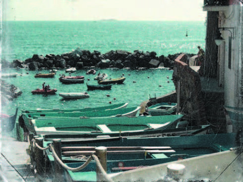{.artview-decision .artview-width-80 .artview-align-center}

Находясь в Перле, сыщики могут многое узнать, беседуя с жителями или замечая детали вокруг. Хранитель может случайным броском определить, какие сведения они получат, либо выбрать наиболее уместные. Разумеется, он всегда волен придумать новые сведения для своей версии сценария, особенно если вместо команды «Спектрал» используются альтернативные сыщики.

Учтите, что большинство этих сведений ложно либо смешано с полуправдой. Услышав слух, сыщики должны пройти проверку Интеллекта, чтобы распознать в нём чепуху.

#### Слухи

| Бросок | Слух |
| --- | --- |
| 1 | Настоящая причина рейда на остров в пятидесятых годах — действовавший там сатанинский культ, который приносил в жертву детей. [Рациональное объяснение: Настоящих сатанинских культов обнаружено очень мало, и ни один из них не убивал детей. Похоже на очередную старую сатанинскую панику восьмидесятых.] |
| 2 | Рыбаки сообщают, что в это время года по ночам видят на острове призрачные огни. Говорят, это духи умерших детей ищут родителей, которые заберут их домой. [Рациональное объяснение: Моряки рассказывают подобные истории с тех пор, как люди впервые вышли в море. Огни легко объяснить подростками, выпивающими на острове, или огнями других лодок, видимыми сквозь деревья.] |
| 3 | Больница была лишь прикрытием, а правительство разрабатывало там биологическое оружие. Её закрыли, когда вирус вырвался наружу и убил всех на острове. [Рациональное объяснение: Это возможно, но крайне маловероятно, что Италия или Соединённые Штаты настолько открыто нарушили бы Женевскую конвенцию. Ещё менее вероятно, что к настоящему времени правда не раскрылась бы.] |
| 4 | Остров населён гигантскими крысами-мутантами. [Рациональное объяснение: Это возможно, но остров невелик, поэтому популяции крупных млекопитающих — мутантов или обычных — едва ли удалось бы там процветать.] |
| 5 | Если ребёнок особенно тяжело болен, родители иногда плывут на остров, чтобы оставить подношение на Плачущем мосту. [Рациональное объяснение: Звучит достаточно правдоподобно, и многие жители, скорее всего, подтвердят сыщикам этот слух. Он правдив.] |
| 6 | Подростки порой угоняют лодку, чтобы прокатиться на остров и устроить вечеринку в месте под названием Бухта Нищего. Говорят, она находится на дальней стороне небольшого острова. [Рациональное объяснение: Звучит правдоподобно и может объяснить некоторые другие слухи. Подростки у причалов охотно это подтвердят. Этот слух явно правдив.] |
| 7 | Было замечено, что чайки избегают острова. Они буквально облетают его, вместо того чтобы лететь над ним. [Рациональное объяснение: Очень странное поведение, хотя сильные магнитные поля иногда нарушают ориентацию птиц. Если кто-либо из сыщиков наблюдает за островом больше часа, исключительный успех проверки Удачи позволит увидеть это явление. Слух правдив, но проверить его трудно.] |
| 8 | Рыбаки вытаскивали из вод вокруг Isola di Malamente странных рыб-мутантов: двухголовых, с пугающими отростками и даже одну якобы с человеческим лицом. Разумеется, всех отпустили, поэтому никаких доказательств нет. [Рациональное объяснение: В редких рыбах-мутантах нет ничего невозможного, но эти рассказы больше напоминают байки старых моряков, которые любят всё приукрашивать. На самом деле слух правдив. Если расспрашивать достаточно долго, успешная проверка Удачи позволит найти человека с чучелом такой рыбы-мутанта. У этого экземпляра дюжина глаз и несколько ракообразных отростков с каждой стороны.] |
| 9 | Несколько лет назад море вокруг острова стало красным, словно кровь, и несколько городских детей умерли. [Рациональное объяснение: Возможно, случилось цветение водорослей, которое объясняет красное море и больных детей. Хранитель сам решает, так ли это было или же причиной стала неудачная предыдущая попытка освободить Хасталика.] |
| 10 | Когда-то на острове стоял храм греческого бога Фтисиса, поверх которого позднее строили римляне, а затем католические монахи. [Рациональное объяснение: Это согласуется с историей региона и с немногочисленными сведениями сыщиков об острове. Слух правдив.] |

#### Знаки и предзнаменования

| Бросок | Результат |
| --- | --- |
| 1 | Если сыщики зайдут в продуктовую лавку, сложная проверка Внимания позволит заметить, что сложенные здесь ящики лимонов привезены с материковой Италии. Это странно, ведь лимонные деревья растут по всей Перле. На вопрос лавочник ответит на ломаном английском: «Здешние лимоны... не очень хорошие», а затем отправится обслуживать другого покупателя. Он намеренно будет долго разговаривать с новым клиентом, пока сыщикам не надоест ждать и они не уйдут. |
| 2 | Если сыщики посетят падре Анджело, тот окажется достаточно приветливым, но говорит только по-итальянски. На вопрос о часовне Святой Анны он ответит, что Ватикан разрешил её строительство из-за превышающего средний уровень числа врождённых пороков в Перле. С середины 1950-х о новых случаях не сообщалось. Научные исследования не объяснили ни причины явления, ни причины его прекращения. |
| 3 | На следующий день после Сожжения любой сыщик, потративший время на наблюдение за островом в бинокль, может совершить проверку Внимания. Сложный успех позволит увидеть тонкую струйку дыма, поднимающуюся где-то на острове. |
| 4 | Если сыщики расспросят жителей о плакате с пропавшим человеком у причалов, то узнают, что Анджело Руссо был местным жителем, много лет назад уехавшим в Рим ради мечты стать профессиональным футболистом. К несчастью, он связался не с теми людьми, пристрастился к героину и после смерти матери вернулся в Перлу. За прошедшие годы Анджело совершил в Перле несколько краж, поэтому о его исчезновении особенно не скорбели. Никто точно не помнит, когда он пропал; лишь то, что это произошло несколько лет назад. |
| 5 | Наблюдая за подростками Перлы, сыщики заметят старшего юношу по имени Лука, который покупает пиво и крепкое спиртное для несовершеннолетних. Если персонажи подкупят Луку, он признается, что дети платят ему за алкоголь и часто гребут к Бухте Нищего на Isola di Malamente, чтобы выпить и заняться сексом. И нет, ему всё равно. |
| 6 | Персонажи обнаружат маленькую лавку, втиснутую между двумя зданиями; потрёпанная дверь и единственное узкое окно занимают почти весь фасад. Над ними висит вывеска Misteri del Passato («Тайны прошлого»). Внутри находится проход немногим шире дверного проёма и тянущийся вдоль него стеклянный прилавок. В витрине лежат старые монеты, украшения и каменные предметы, многие из которых выглядят очень древними. При их появлении старик за прилавком улыбнётся, укажет на товары и скажет: «Сегодня распродажа. Покупаете один — второй бесплатно». Через мгновение станет ясно, что он слеп, но прекрасно ориентируется в лавке и знает, где что находится. Проверка Истории покажет, что большинство предметов подлинные, хотя не особенно ценные, а цены справедливые. Сложный успех позволит заметить необычную монету римской эпохи: она немного крупнее остальных, а на её поверхности изображена фигура в капюшоне. Ощупав монету, лавочник скажет: «Ах да, эта монета посвящена римскому богу Морбусу. Один из менее известных богов, хотя некоторое время он был очень популярен на Сицилии». Хранитель сам решает, имеет ли она значение для сценария. |
| 7 | Мимо персонажей с хохотом и притворными криками страха пробегает около дюжины детей, которые, очевидно, играют в мрачную разновидность салочек. Замыкающий ребёнок, который явно водит, носит чёрную маску чумного доктора из папье-маше и размахивает над головой длинными палками, похожими на костлявые руки. На глазах персонажей ему удаётся коснуться палками другого ребёнка. Тот немедленно хватается за грудь и падает на землю в приступе театрального кашля и удушья. Когда остальные скрываются за углом, «жертва» встаёт и со смехом убегает в другую сторону. |
| 8 | Пожилая женщина наблюдает из окна второго этажа, пока персонажи проходят мимо. Иссохшим пальцем она чертит в воздухе странный знак, беззвучно шевеля губами. Если к ней обратиться, она с презрением захлопнет окно и задёрнет занавеску. На стук в дверь никто не ответит. |
| 9 | Хотя большинство жителей были дружелюбны, персонажи начинают замечать косые или задержавшиеся взгляды. Если присмотреться, проверка Внимания покажет, что за ними следят несколько человек. Сложная проверка Психологии откроет, что наблюдатели боятся персонажей. При столкновении те по-итальянски будут всё отрицать. Никакая взятка не изменит их рассказ, а попытка запугивания может настроить жителей против персонажей и даже привлечь власти. |
| 10 | Персонажи замечают, как сотрудник местной полиции Перлы беседует с небольшой группой мужчин; те согласно кивают и расходятся в разные стороны. На вопрос о происходящем полицейский улыбнётся и скажет на безупречном английском: «Не о чем беспокоиться. Боюсь, синьор Марино снова ушёл из дома. Бедный старик страдает слабоумием и иногда теряется». Он покажет фотографию невысокого пожилого мужчины в широкополой шляпе. «При виде незнакомца он, вероятно, испугается, поэтому, если заметите его, позовите меня на площади. Я буду там почти весь день». Если персонажи найдут старика благодаря успешной проверке Удачи, тот будет выглядеть испуганным и снова и снова что-то бормотать по-итальянски. Сложная проверка Слуха позволит разобрать: «Lui sta arrivando. Dio ci protegga». Это означает: «Он идёт. Господи, защити нас». |

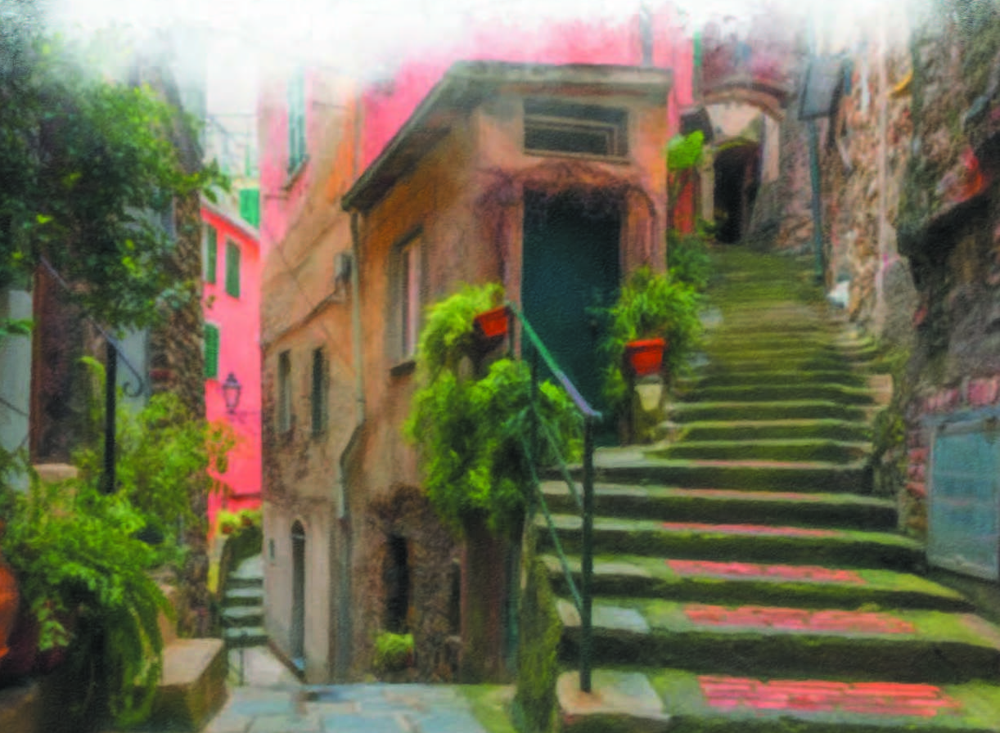{.artview-decision .artview-width-80 .artview-align-center}

### Сожжение болезни

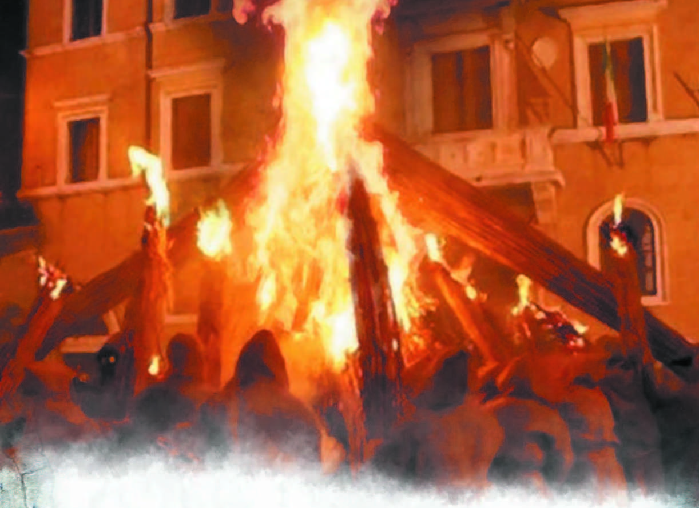{.artview-decision .artview-width-80 .artview-align-center}

Около восьми вечера персонажи начинают замечать, как жители собираются на площади. С торжественными лицами они молча держат незажжённые свечи. Издалека доносится медленный бой барабана. От входа в Cappella della Beata Sant'Anna движется процессия во главе с маммой Санти, идущей в безмолвной молитве. За ней в полном облачении идёт местный священник падре Анджело, громко читая библейские стихи и размахивая дымящимся кадилом. Следом несколько десятков молодых мужчин несут длинный шест с грубой деревянной клеткой странной формы наверху. Внутри виднеется отрубленная козлиная голова. Затем идут молодые женщины со связками тонких прутьев и мотками грубой верёвки. Прикреплённые к шесту листки бумаги трепещут на ветру.

Процессия медленно спускается с холма. Дети и подростки играют на разнообразных ударных инструментах, создавая ритмичную какофонию, которая разносится эхом над бухтой. Когда процессия достигает ворот площади, собравшиеся мужчины и женщины начинают грозить козлиной голове кулаками и проклинать её по-итальянски, а другие подходят и прикрепляют к шесту новые записки. Процессия обходит площадь, чтобы каждый житель деревни мог добавить свою записку и/или проклясть козлиную голову.

> Заметки Хранителя
> 
> Если персонажи подойдут достаточно близко, чтобы прочитать записки, то увидят молитвы Святой Анне с просьбами о здоровье и счастье для разных родственников, у которых есть или ожидаются дети.

Наконец процессия приближается к костру. Шест опускают в приготовленную яму, где он встаёт вертикально клеткой вверх. Ритмичный грохот нарастает до крещендо, пока мамма Санти обходит собравшихся, зажигая свечи людей в первых рядах, которые передают огонь стоящим позади.

Когда все свечи зажжены, один житель выходит вперёд, и толпа полностью умолкает. Слышны лишь ветер и слабый плеск волн. Мужчина зажигает своей свечой растопку и кладёт её на стену, окружающую костёр. Молча, один за другим, все жители повторяют его действия, благоговейно склоняя головы, пока костёр разгорается и растёт. Когда жар становится слишком сильным, последние участники осторожно бросают свечи в пламя. Как только огонь достигает козлиной головы, толпа начинает ликовать. Люди благодарят Бога и просят архангелов защитить деревню от бед.

> Заметки Хранителя
> 
> Хотя это явно местная традиция, персонажи могут без проблем принять участие. Мамма Санти заметит их поступок и станет относиться к ним благосклоннее. При общении с ней персонажи получат бонусную кость для любых социальных проверок.

Когда костёр разгорается в полную силу, из теней выходят деревенские старики в длинных коричневых балахонах с капюшонами, подпоясанных верёвкой. Каждый носит чёрную маску из папье-маше с круглыми глазами и длинным загнутым клювом, как у ворона. Дети с игривыми криками разбегаются от преследующих их монахов. Поймав ребёнка, монах вручает ему сладость и отпускает.

К ночи костёр полыхает вовсю, а жители веселятся. Дети продолжают играть, пока взрослые сидят, пьют красное вино и беседуют.

> Заметки Хранителя
> 
> Если персонажи останутся, их окружит атмосфера мира и гостеприимства. Их угостят вкусными блюдами из местной рыбы и красным вином и в целом примут как гостей. Если они захотят с кем-нибудь поговорить, жители направят их к мамме Санти, которая служит голосом деревни.
> 
> Слегка захмелевшая мамма охотно поговорит с чужеземцами. Если персонажи спросят её об Isola di Malamente, она не захочет отвечать, но после успешного убеждения скажет, что знает об их намерении отправиться на остров. Она предупредит: там обитает великое зло, погребённое в земле подобно раковой опухоли и пожирающее душу Перлы. Мамма добавит, что этот обряд проводят ежегодно, укрепляя веру и защищаясь от зла. Если расспрашивать дальше, она расскажет о брате Алонзо Сальваторе — солдате, погибшем на острове, тело которого правительство запретило забирать. Ей не сообщили причину смерти, только место. Если давить слишком сильно, она заметно расстроится и замолчит.

### На следующий день

Вы просыпаетесь от звуков работы на улице перед отелем. Из окон видно, как группы молодых мужчин лопатами грузят остатки вчерашнего костра в грузовик, а рядом, склонив голову в безмолвной молитве, стоит падре Анджело. По всей площади люди крепят тяжёлые ставни к скобам снаружи окон и дверей, словно готовятся к буре, хотя в небе нет ни облачка.

По сравнению со вчерашним днём люди выглядят торжественными и тихими, но при обращении достаточно дружелюбны. В окнах всех заведений и на меловых досках у тротуара висят объявления о закрытии ровно в шесть вечера.

> Заметки Хранителя
> 
> Прогноз погоды на день и ночь обещает ясное небо и тепло, без признаков дождя, тем более бури, для которой потребовались бы штормовые ставни. На вопрос о раннем закрытии заведений горожане ответят, что сегодня к закату все должны находиться дома ради соблюдения Notte della Peste (подробнее см. «Очищение от Морбуса»).

Когда персонажи спустятся в вестибюль, Паоло сообщит, что кто-то оставил для них записку. Он передаст запечатанный конверт с маленькой карточкой, где написано:

Причалы: 6:00pm

Отправление: 6:30pm

Прибытие: 7:00pm

Заберу вас: 5:30am

-- Нунцио

К записке приложена грубая карта причалов с кругом, предположительно обозначающим лодку Нунцио.

### НИП Перлы

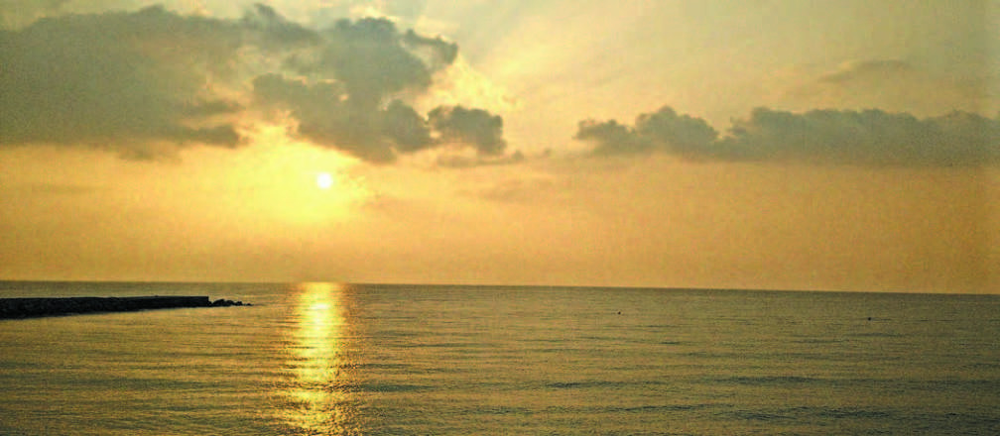{.artview-decision .artview-width-80 .artview-align-center}

#### Сантина Мария Сальваторе

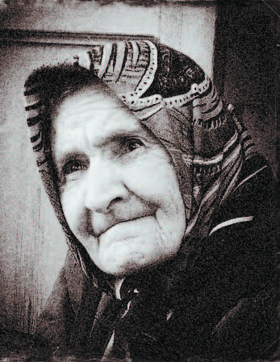{.artview-decision .artview-width-80 .artview-align-center}

Сантина — 93-летняя старейшина деревни. Её лицо изборождено глубокими морщинами, зубов нет, а при ходьбе она опирается на резную палку. Всю жизнь Сантина прожила в Перле и уже 20 лет вдова после смерти мужа Паулу. В молодости она потеряла сыновей-близнецов из-за воспаления лёгких и жалеет, что больше не завела детей, хотя теперь вся деревня считает её своей матерью.

Она прожила достаточно долго, чтобы помнить рейд на Isola di Malamente в 1954 году; её брат был одним из погибших там солдат. Несмотря на возраст, Сантина остра на язык, остроумна и ничего не упускает. Все в Перле любят её, а люди моложе 75 лет ласково называют «маммой Санти».

Сантина помнит, как праздник Il Rogo della Malattia отмечали ещё в её детстве, и с тех пор в Перле мало что изменилось. Она продаёт собственноручно сделанные безделушки и амулеты, которые, по её словам, защищают от дурного глаза (Сантина невероятно суеверна), и носит весь товар на шее или приколотым к потёртому пальто. Берёт она недорого и искренне верит в их силу, хотя работают ли они — решает Хранитель. На вопрос об острове она заявит, что обитающее там зло стало причиной смерти её детей, и больше говорить откажется. Если персонажи станут давить слишком сильно, жители вмешаются и защитят её.

#### Падре Анджело

{.artview-decision .artview-width-80 .artview-align-center}

Падре Анджело — деревенский священник. Ему 51 год, он лысеет, а по бокам головы ещё растут слегка рыжеватые волосы. Анджело родился в Перле и живёт за часовней Святой Анны. Заботу о духовном благополучии жителей он считает своим призванием. Священник немного заикается, но при цитировании Писания заикание исчезает. Он всегда дружелюбен, хотя наблюдательные люди заметят в нём лёгкую тревогу. На вопрос об Isola di Malamente Анджело догадается, что персонажи собираются туда, и посоветует держаться подальше. Он верит, что там обитает сатанинское зло, и постоянно присматривает за подростками Перлы, умоляя их не приближаться к острову; они немедленно игнорируют эти просьбы.

{.artview-decision .artview-width-100 .artview-align-center .art-full-page}

## Isola di Malamente

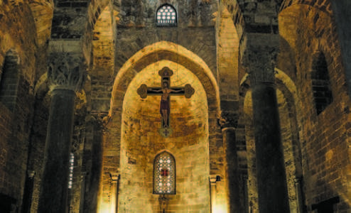{.artview-decision .artview-width-80 .artview-align-center}

### Тайны Хранителя

«Я вернусь перед самым рассветом, так что будьте на пляже и готовы уходить. Мы ведь не хотим, чтобы нас заметили, верно?» — Нунцио Вендра

### Проведение расследования

«Вирус» — сценарий, события которого разворачиваются за одну ночь в одном месте, на Isola di Malamente. Сыщики создают популярное интернет-шоу об охоте за привидениями, ведущий которого и его команда «Спектрал» путешествуют по местам, считающимся населёнными призраками, исследуя их. Следующее место расследования — Isola di Malamente, небольшой остров у берегов Сицилии, где когда-то находилась больница, а до неё — санаторий. Для команды «Спектрал» это великолепная возможность: удачная прямая трансляция может принести им международную славу и даже место в программе крупной кабельной сети.

Это место идеально по нескольким причинам. Во-первых, все прочие крупные шоу об охоте за привидениями до сих пор обходили его вниманием, а значит, команда сможет в некотором смысле открыть новые земли. Во-вторых, история острова настолько мрачна и сенсационна, что при любых событиях им, вероятно, обеспечено рекордное число зрителей — если предварительные показатели верны. Третья причина — выбранное время. Они намерены вести прямую трансляцию с острова во время необычного местного обряда Notte della Peste («Ночь чумы»), который начинается на закате двадцать четвёртого августа и заканчивается на рассвете двадцать пятого августа.

Ночь чумы. Каждый год в этот день, начиная с заката, жители соседних сицилийских городов запираются в домах, заколачивают все входы и развешивают у каждого разнообразные талисманы. Согласно преданию, они должны ловить болезни, которые попытаются проникнуть внутрь ночью. Утром люди собираются на городской площади и сжигают талисманы в большом очищающем костре.

Происхождение этого странного ритуала остаётся тайной. Местные отказываются говорить о нём, хотя явно относятся к обряду очень серьёзно. Несколько лет назад иностранный репортёр настойчиво пытался разговорить мужчину, спешившего домой до сумерек. Когда репортёр не оставил его в покое, мужчина ударил его ножом. Видео стычки несколько недель ходило по сети, пока итальянские власти не удалили его в ожидании официального расследования. Видевшие запись говорили, что местный житель пришёл в слепую панику от одной мысли о том, что после темноты останется снаружи.

Мало кто знает, что соблюдение этой ночи восходит к далёким векам, когда монахи Isola di Malamente открыто поклонялись Морбусу. В такие ночи все, кто жил в пределах видимости острова, тяжело заболевали, а бесчисленные старики и маленькие дети умирали до утра. Эта ночь играет решающую роль в восхождении Хасталика, поэтому решение команды «Спектрал» провести тогда прямую трансляцию в конечном счёте и приводит к последующим событиям.

Ближайшее к Isola di Malamente поселение — небольшая рыбацкая деревня Перла. Именно там Нунцио забрал команду «Спектрал», чтобы доставить её на остров. Сыщики, вероятно, заметили, что по прибытии деревня казалась довольно тихой, и, возможно, даже сняли несколько кадров (VT) безлюдных улиц с закадровым голосом Марко.

Прямая трансляция. Единственная причина пребывания сыщиков на острове — прямая трансляция их приключений в интернет. Поэтому у них много электронного оборудования, которое нужно установить и обслуживать. Часть уже размещена, но сыщикам осталось завершить несколько подключений на маяке и поставить ретрансляторы сигнала в ключевых точках острова.

Когда трансляция начнётся, Хранителю следует постоянно напоминать сыщикам, что за ними всё время наблюдают. Проще всего делать это через комментарии зрителей, которые непрерывно поступают в ходе эфира. Так Хранитель может обратить внимание игроков и сыщиков на разные вещи, заставить их двигаться или заманить в определённое место. Это также отличная возможность для Чумного монаха манипулировать сыщиками (см. «Чумной монах» ниже).

Майя будет удалённо руководить расследованием, направляя команду «Спектрал» в разные точки, чтобы трансляция оставалась интересной и захватывающей. У неё есть основной план, но она отступит от него, если сама или кто-то из команды заметит нечто любопытное.

В какой-то момент трансляции Хранитель может позволить Хасталику захватить эфир и в прямой трансляции притвориться Майей. Хранителю следует заранее показать манеры Майи, в том числе её привычку называть сыщиков «детками», чтобы после подмены игроки и их сыщики могли заметить перемену. В противном случае Хранитель может предложить сыщикам сложную проверку Психологии, чтобы понять: что-то не так.

Управление сыщиками. В распоряжении Хранителя есть несколько действенных средств, позволяющих двигать сюжет, направлять поступки сыщиков и/или менять темп игры. Это расписание трансляции, Майя, комментаторы эфира и, разумеется, Хасталик.

Важно не злоупотреблять ни одним из них. Иначе игроки рискуют лишиться свободы действий, а сценарий превратится в дешёвый аттракцион с привидениями, где сыщиков переводят из одного заранее выбранного места в другое. В идеале эти средства должны быть связаны с внутриигровыми событиями или мотивами.

Расписание трансляции — При подготовке экспедиции на Isola di Malamente Марко, Майя и Хён составили расписание. Все согласились, что важна гибкость, однако стараются придерживаться порядка мест, которые намерены посетить. Главная причина в том, что Майя заранее подготовила для каждого места несколько тематических видеороликов (VT). При необходимости порядок можно изменить, но это вызовет задержки трансляции, снизит качество шоу и помешает росту числа отметок «нравится», зрителей и новых подписчиков. Поэтому Майя убеждает Марко и остальных по возможности соблюдать порядок. План расследования выглядит так:

> 1. Вступительный монолог на мосту — Марко начинает трансляцию с подготовленного рассказа о месте и его истории, особенно подчёркивая, что здесь буквально никто не бывал десятилетиями.
> 2. Роща — Майя слышала слухи, что островные монахи выращивали лимоны на продажу местным жителям. Здесь команда сможет неплохо разогреться. Майя даже предлагает при возможности собрать несколько лимонов. Их можно подарить самому щедрому покровителю или приготовить лимонад из плодов населённой призраками рощи, а затем предложить зрителям выбрать, кто его выпьет.
> 3. Яма для сожжения — К северу от Лимонной рощи находится поляна, где монахи якобы сжигали умерших. Ради более динамичной картинки Майя предлагает снимать, обходя яму кругом. Разумеется, она понимает, что скользящие по деревьям лучи фонарей сделают тени гораздо страшнее, и это тоже полезно.
> 4. Братская могила — Войдя на больничную поляну, Майя предлагает сначала обойти здание снаружи, уделив особое внимание месту, где при закрытии учреждения власти обнаружили братские могилы. Она просит продолжать обход по периметру, возможно, сняв старый причал, пока команда не достигнет главного входа с северной стороны.
> 5. Больница — Главное событие, поэтому Майя просит Марко сделать вход особенно эффектным. Она велит разделиться и обследовать разные части больницы, переключаясь между видеопотоками в зависимости от того, какой интереснее в данный момент. Если события становятся скучноватыми, Майя возбуждённо сообщает о тени, замеченной удалённой камерой, и направляет команду на проверку. Она никогда не забывает, что они создают шоу, и её работа — поддерживать интерес.
> 6. Часовня — Команда направляется исследовать руины часовни. Майя предлагает пока не спускаться в склеп, а лишь подразнить зрителей кадром ведущей вниз тёмной лестницы.
> 7. Склеп — Ближе к полуночи Майя объявляет перерыв и велит команде отправиться в склеп под часовней, чтобы приготовиться к финалу с ведьминой доской. У них есть около 15 минут на установку камер ночного видения, освещения, свечей и, разумеется, самой доски. Незадолго до полуночи Майя возвращает эфир и предлагает Марко повести остальных в склеп для проведения спиритического ритуала.
> 8. Завершение — После сцены с ведьминой доской в склепе Майя намерена объявить ещё один короткий перерыв, чтобы команда успела установить оборудование снаружи на фоне больницы. Она надеется также снять луну. После возвращения в эфир Марко должен подвести итоги вечера и произнести обычную заключительную речь. Они рассчитывают закончить около 1 AM, дождаться возвращения Нунцио на маяке и к рассвету прибыть на материк.

Майя — Как режиссёр трансляции, Майя должна следить за всеми видеопотоками, поступающими на её станцию. Поэтому она может просить команду отправиться в определённые места или сосредоточиться на деталях, которые добавят интересного материала в эфир. Например, проверить нечто замеченное ею в одном из видеопотоков или держаться подальше от того, из-за чего канал могут лишить монетизации.

Трансляция идёт с десятисекундной задержкой, позволяющей Майе отключить эфир и включить один из нескольких заготовленных универсальных видеороликов (VT), если происходящее кажется ей «чересчур» для YouTube. Разумеется, она сохраняет все записи, чтобы показать их позднее или, возможно, предложить как эксклюзивный материал покровителям команды «Спектрал».

Комментаторы — В течение всего эфира команда видит комментарии к прямой трансляции, которые непрерывно поступают по мере её движения по острову. Хранителю следует использовать комментаторов, чтобы направлять сыщиков к ключевым местам и побуждать их делать то, что нравится зрителям YouTube, хотя это часто противоречит интересам команды. Например, комментаторы могут предложить внимательнее рассмотреть нечто, поднять и изучить предмет, воспользоваться устройством или даже съесть какую-нибудь гадость в лимонной роще.

Эффективность этого средства можно усилить «суперчатами», в которых комментатор жертвует команде деньги. Суммы должны оставаться разумными, но пожертвование в суперчате на \$20 или даже \$50 вполне обычно.

Учтите, что комментаторы также могут стать для сыщиков источником сведений. Среди такого множества зрителей наверняка найдутся специалисты, чьи знания пригодятся. Например, когда команда обнаружит обгоревшую тварь в яме для сожжения, зритель с дипломом биолога может объяснить сыщикам, что именно они видят (по усмотрению Хранителя).

Хасталик — Один из комментаторов (UltimaUnum) на самом деле является Хасталиком. Посредством трансляции он манипулирует сыщиками, особенно если те не желают идти в нужные ему места. Он располагает неограниченными средствами и предлагает всё более щедрые суперчаты, заставляя команду, и прежде всего Марко, исполнять его волю. В частности, он побуждает их совершать поступки, повышающие уровень Порчи, и, разумеется, направляет к Яме костей.

Например, если сыщики не решаются войти в склеп, Хасталик (UltimaUnum) предлагает \$50,000 за то, чтобы они вошли. При отказе спускаться в катакомбы он предложит ещё больше. Сыщики вполне могут заподозрить неладное, но Майя легко подтвердит подлинность денег, как только они окажутся на счёте команды «Спектрал».

Эстетика охоты за привидениями. Каждый, кто видел шоу об охоте за привидениями, знает: оно следует определённой формуле, создающей уникальный стиль. В этом разделе рассказано, как Хранителю передать игрокам нужное ощущение и не позволить исследованию острова и больницы превратиться в скучную тягомотину.

Те, кто не смотрит подобные материалы, могут воспринимать охоту за привидениями с недоумением или открытой насмешкой. Из-за этого участники могут не понимать важных особенностей сценария о людях, для которых это увлечение, а для некоторых — образ жизни. Обычно они относятся к нему крайне серьёзно, нередко стремясь найти ответы после необъяснимых событий в собственной жизни. Чтобы должным образом «подготовить сцену» такой игры, нужно понимать несколько идей; ниже приведены подсказки и советы.

Окружение — Оно играет огромную роль в популярности охоты за привидениями. Искать духов можно почти где угодно, но обветшавшее, разрушающееся место обычно считают наиболее подходящим для нужной атмосферы. Часто охота проходит в заброшенных зданиях, где каждый звук усиливается, его изучают снова и снова, а само место порой обманывает чувства. То, что днём выглядит обычным и безобидным, ночью в свете фонаря или через прибор ночного видения может казаться иным и зловещим.

Стоит также упомянуть, что расследования часто ведут в местах, связанных со страданием: больницах, тюрьмах и местах знаменитых убийств или массовой гибели.

Свидетельства — В большинстве расследований объём записанных свидетельств ничтожен по сравнению с часами, потраченными на поиски. Речь идёт о многих часах ради минут или даже секунд чего-нибудь хотя бы предположительно паранормального, а порой не находят вообще ничего. Количество настоящего материала, который трудно опровергнуть, микроскопично по сравнению с временем его поисков.

Свидетельствами могут служить ЭГФ (электронный голосовой феномен), ГФ (настоящий голосовой феномен — голоса, которые слышны прямо на месте, а не только на электронной записи), «люди-тени», движение предметов, царапины и иные воздействия на сыщиков, холодные участки, различимые тепловизионными камерами, и святой Грааль всей охоты за привидениями — полностью проявившийся призрак, записанный на видео.

Одна из ошибок восприятия, которым подвержены многие сыщики, часто вполне невинно, — парейдолия: склонность видеть закономерности в случайности. Из-за неё людям мерещатся лица и черты человеческого тела там, где их нет, а в неразборчивом шуме слышатся едва различимые голоса. С этим связан «ящик призраков» — электронное устройство, запрограммированное набором слов и фраз. Время от времени оно передаёт одну из них через встроенный динамик, а сыщики связывают услышанное с текущим расследованием, часто самым сомнительным образом. Во время некоторых расследований адреналин зашкаливает, чувства обостряются и пробуждается древний инстинкт охотника и добычи. Люди буквально выпрыгивают из кожи из-за самых безобидных явлений; для некоторых сыщиков важнее не свидетельства, а американские горки эмоций.

Общение с предполагаемыми духами также широко распространено среди охотников за привидениями. Обычно духов перед камерой просят коснуться человека или издать звук. Любая реакция лишь укрепляет веру в то, что место населено призраками.

«Экстрасенсы» — Идея экстрасенсов и медиумов вызывает серьёзные разногласия среди охотников за привидениями. Одни считают их одарёнными людьми с чувствами, недоступными обычному человеку. Они верят, что медиумы-экстрасенсы могут получать послания духов, ощущать места сильных эмоциональных всплесков и узнавать историю места, просто находясь там и касаясь предметов. Кроме того, они якобы способны обнаруживать присутствие злых духов и «демонов».

Для других и сами экстрасенсы, и верящие в них люди — посмешище сообщества охотников: бездарные актёры, наживающиеся на горе и доверчивости окружающих с помощью метода, который в сущности невозможно доказать научно. Несомненно, некоторые именно таковы, а иные искренне верят в свои силы. И кто знает — быть может, кто-то из них действительно обладает потусторонними способностями?

Как настроиться на охоту за привидениями. Ниже приведена небольшая подборка рекомендованных материалов, которая поможет понять, чем и как занимаются эти люди, а также познакомит с типичными приёмами охоты за привидениями:

Ghost Adventures: The Documentary (2004) — Этот независимый документальный фильм стал отправной точкой успеха телесериала Ghost Adventures. Трое парней с записывающим оборудованием запираются на ночь в разных местах, чтобы найти свидетельства призраков. Если удастся найти копию, посмотрите её: фильм часто считают одним из лучших доступных примеров охоты за привидениями, а команда по сей день настаивает, что всё снятое было на 100% подлинным. Обязательно досмотрите до самого конца.

Ghost Adventures: S03E03 Poveglia Island (2009) — Источник вдохновения для «Вируса»: команда Ghost Adventures отправляется в Венецию на ночное расследование на чумном острове Повелья. Троих участников высаживают там и оставляют самим себе. Из-за количества собранных свидетельств этот эпизод стал первым выпуском шоу, показанным в расширенном формате.

Ghost Adventures: S03E06 Linda Vista Hospital (2009) — Команда Ghost Adventures отправляется в заброшенную больницу Линда-Виста в Восточном Лос-Анджелесе. Свидетельства начинают проявляться ещё до завершения подготовки: странные шумы, гул, крики, удары и стоны словно исходят из самих стен. Это очень жуткое место, куда команда спустя годы вернулась для нового расследования.

Ghost Lab: S02E13 Deadwood (2011) — Ghost Lab рассказывает о группе сыщиков, которые хотя бы пытаются подходить к явлениям «научно» (ну, до некоторой степени...). Установив оборудование в залитом кровью городе Дедвуд, они записывают множество любопытных свидетельств.

Dead Famous: S03E10 (2006) — Шоу, в котором медиум-экстрасенс Крис Флеминг вместе с ведущей Гейл Портер пытается найти дух знаменитой певицы Дженис Джоплин. Собранные ими свидетельства как минимум любопытны.

Most Haunted (2001-2006) — Шоу, получившее дурную славу скорее из-за драматизма огромной команды исследователей, чем благодаря её находкам. Когда происходило нечто паранормальное, участники часто направляли камеры на собственные лица, чтобы зрители насладились выраженным на них ужасом. В команду входил знаменитый английский «медиум-спиритуалист», ныне покойный Дерек Акора, а последовавшее веселье нужно увидеть, чтобы поверить. Особенно примечателен эпизод в тюрьме Бодмин, где Дерек якобы оказался одержим духом южноафриканца по имени Крид Кафер. Позднее выяснилось, что это имя — анаграмма слов «Дерек — мошенник», которую придумал и подбросил местный парапсихолог и скептик доктор Киаран О’Кифф, чтобы испытать «экстрасенсорные силы» Дерека.

### Количество игровых встреч

Сценарий можно приспособить для одной, двух или трёх игровых встреч — в зависимости от того, что Хранитель решит включить или исключить. Каждый вариант ниже содержит советы и перечень изменений сюжета и/или мест. Учтите, что они рассчитаны на сыщиков из команды «Спектрал» и могут хуже подходить для предложенных выше альтернативных персонажей.

Одна игровая встреча. Подходящий для конвента вариант требует самых значительных сокращений и изменения расписания расследования. Чтобы завершить сценарий за одну четырёхчасовую встречу, сыщики получают меньше времени на исследование острова и проведение полуночного ритуала с ведьминой доской в склепе.

Нунцио высаживает команду в 7:00 PM и намеревается забрать её в 1:00 AM. Маршрут включает Плачущий мост, Лимонную рощу, Яму для сожжения, больничный морг и общежитие персонала. Всё это следует завершить к 11:30 PM, чтобы команда успела подготовить склеп под часовней. Майя назначила сеанс с ведьминой доской на полночь и рассчитывает, что он продлится около 20 минут, после чего Марко произнесёт краткую заключительную речь. Затем они заберут снаряжение с маяка и встретятся с Нунцио в месте высадки. Хранителю рекомендуется поставить таймер на четыре часа и каждые 30 минут совершать бросок проявления, чтобы поддерживать интерес и движение событий. Без четверти полночь Майя связывается с группой и советует идти в часовню для последней попытки контакта с мёртвыми, которая должна принести каналу миллион подписчиков.

Две сессии. Расписание событий сценария остаётся прежним, но число локаций ограничивается. Всё как для одной сессии, только локаций вдвое больше. Рекомендуются Плачущий мост, Лимонная роща, Кремационная яма, больничный морг, общежитие персонала, дом администрации и братские могилы. Сюда также можно включить исследование как крипты, так и Храма Морбуса, а финал немного растянуть.

Полный сценарий (три сессии или больше). Команда «Спектрал» прибывает в Перлу и, возможно, пытается поговорить с местными, которые отказываются с ней общаться. Исключение составляют несколько местных подростков: за небольшую плату они сообщают, что на главный остров лучше не соваться, потому что тот проклят (и сами они по большей части с этим согласны). Сыщикам следует отправиться к острову днём накануне и разбить лагерь на малом острове (если они хотят оставаться в относительной безопасности) или, если им хватит смелости, — на главном острове, со всеми ужасами, которые тот может таить. Эм стоит использовать в той или иной роли, чтобы оживлять происходящее, а всю больницу можно исследовать на протяжении двух дней — и днём, и ночью. Кроме того, если выбран этот вариант, пусть они возьмут дрон с камерой, чтобы снять панорамные виды острова и отправить их Майе. На них можно обрушить любые мыслимые ужасы.

### Замыслы и интриги

Чумной монах. Он — последний пережиток древнего культа, который поклонялся Хасталику на протяжении тысячелетий. Назвать его живым в каком-либо смысле этого слова было бы натяжкой, но и мёртвым он тоже не является. По воле своего покровителя он будет существовать до тех пор, пока этой самой ночью не выполнит последнее поручение.

Конечная цель монаха — породить Хасталика в нашем мире. Для этого ему необходимо сбросить достаточно плоти в Яму костей, расположенную в катакомбах под Осквернённой лимонной рощей. Когда монах принесёт себя в жертву, из ямы восстанет чудовищное воплощение Хасталика. Оно начнёт пожирать всякую плоть, пока не доберётся до берега острова и не изольёт свою скверну в океан, тем самым заразив весь мир. Последний вариант также приведёт к осквернению Земли, но процесс будет идти медленнее.

Физическое тело Чумного монаха уже много лет висит над Ямой костей, однако он способен проецировать свои образы в любом месте большого острова. Его цель — привести сыщиков туда, где их Порча (отражённая [значением Порчи](#viral-appendix-new-rules-the-taint), см. с.62) усилится, чтобы, когда они наконец окажутся у Ямы костей, они сами добровольно бросились в неё.

Помимо собственных призрачных образов, монах может воплощать звуки, запахи и картины, извлечённые из подсознания сыщиков. Поэтому он способен заставить их услышать голос другого члена команды «Спектрал» из пустой комнаты или увидеть либо услышать умершего близкого человека.

Сначала Хранителю следует использовать эту способность умеренно, позволяя сыщикам поначалу списывать происходящее на недоразумение или галлюцинацию.

Чем охотнее сыщики открываются сверхъестественному, тем уязвимее они становятся. Особенно восприимчивы к этим воздействиям обладатели Зрения. Другими проводниками служат различные формы гадания, в особенности спиритическая доска.

Эти воздействия распространяются даже на технику, позволяя монаху создавать реалистичные видения на видеокамерах, смартфонах и аудиорекордерах. Например, несколько сыщиков могут следить за одной из удалённых камер и увидеть, как на другого члена команды «Спектрал» нападает чудовищная тварь, но, прибежав на место, обнаружат, что тот просто стоит и недоумевает, почему они так перепуганы.

Хранителю стоит сделать эти переживания как можно более изобретательными и тревожными, при любой возможности обращая против сыщиков их собственную технику. К концу ночи они не должны доверять ничему из того, что видят или слышат через свои телефоны.

Хасталик. Хотя цели Великого Древнего непостижимы, ближайшая цель Хасталика — осквернить и поглотить всю жизнь на Земле. Для этого необходимо, чтобы выжившие сыщики стали свидетелями жертвоприношения последнего Чумного монаха в Ночь чумы.

Пока Хасталик не обрёл телесную форму, его возможности ограничены воздействием на сыщиков через их электронные устройства и последнего слугу — Чумного монаха. Разумеется, способность Хасталика манипулировать ими весьма сильна: он заразил Интернет и в буквальном смысле может пожертвовать команде «Спектрал» почти любую сумму, чтобы побудить их делать то, чего он хочет. Он даже может притвориться их подругой Майей, хотя прибегнет к этому лишь в крайнем случае, поскольку они хорошо знают её характер и манеры. В конце концов, он может писать сообщения от лица Майи, но не способен в действительности стать ею.

Нунцио Вендра. Связной Майи на Сицилии — Нунцио Вендра, неофициальный туроператор, известный тем, что возит людей в места, которые обычно закрыты для посещения. Разумеется, всё это он делает нелегально, а большинство клиентов находит в даркнете — там же его обнаружила Майя.

Чумной монах обратил на него внимание, когда тот впервые ступил на остров пять лет назад. Увидев возможность заманить в яму ещё больше плоти, монах стал исподволь внушать Нунцио через сны и видения, чтобы тот предлагал беспечным, но любопытным туристам возможность посетить Isola di Malamente. Разумеется, всех их привозили туда с условием, что они никому не расскажут о поездке, а значит, их неизбежное исчезновение так и оставалось загадкой.

За эти годы Нунцио привёз на Isola di Malamente немало людей, подчиняясь странному влечению, которое никогда не подвергал сомнению. По мере приближения этого особенного дня влечение становилось почти невыносимым, и, увидев ролики команды «Спектрал», он понял, что это прекрасная возможность. Именно он разбросал те крохи сведений, благодаря которым Майя узнала об Isola di Malamente и в конце концов нашла его объявление в даркнете.

Правительство Италии. Divisione Sicurezza Speciale (Отдел особой безопасности), или DSS, — секретное подразделение итальянского правительства, занимающееся деликатными вопросами национальной безопасности. О различных сверхъестественных угрозах ему известно с начала двадцатого века, а после событий 1954 года Isola di Malamente перешёл под его юрисдикцию. DSS пристально следит за этим местом, но старается не вести слишком заметное наблюдение, чтобы не привлекать нежелательного внимания. DSS известно о местных суевериях, однако по очевидным причинам подразделение не пытается их искоренить. По той же причине оно не препятствует подросткам, которые часто ездят на Isola di Malamente выпить: попытки прогнать их могли бы вызвать подозрения.

DSS узнало о намерении команды «Спектрал» провести прямую трансляцию своей охоты за привидениями с острова. После обсуждения подразделение решило сразу не вмешиваться, но подготовить группу реагирования и разработать протоколы на случай наихудшего развития событий. DSS полностью контролирует спутниковый канал и воды вокруг Isola di Malamente; неподалёку находятся несколько его кораблей, поэтому при необходимости бойцы смогут быстро высадиться на остров. Кроме того, наготове находится эскадрилья ударных самолётов Tornado, вооружённых фугасными, зажигательными и напалмовыми бомбами на случай, если остров потребуется «выжечь».

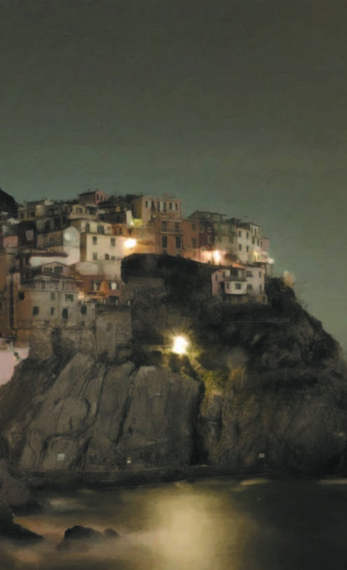{.artview-decision .artview-width-80 .artview-align-center}

{.artview-decision .artview-width-80 .artview-align-center}

### Пролог

Перед началом пролога Хранителю следует раздать игрокам [раздаточные материалы #1-7](#viral-player-handouts), а если возможно — выдать их заранее, с интервалом в несколько дней. Первые два — это, по сути, восторженные письма от Марко, где он описывает план прямой трансляции с «населённого призраками» острова Isola di Malamente, а следующие три — письма Майи с изложением основных приготовлений к поездке. Дав игрокам время прочитать их (или выслушать, как кто-то зачитает их вслух), начинайте пролог.

День выдался долгим. Пока вы проходили все процедуры в аэропорту, ждали своего гида Нунцио, а затем восемь часов ехали до живописной маленькой рыбацкой деревушки Перла, вы успели устать так, что готовы были на день-другой рухнуть в мягкую постель. Но стоило увидеть остров на горизонте, как все мысли о сне мгновенно испарились.

Городок Перла кажется безлюдным. Местные жители отмечают малоизвестный праздник La Notte della Malattia, что переводится как «Ночь болезни». По обычаю к закату все должны укрыться в домах и защитить двери и окна талисманами, чтобы болезнь не проникла внутрь. Ваши исследования показывают, что традиция восходит к Чёрной смерти, уничтожившей половину Европы в Тёмные века, хотя её происхождение может быть ещё более древним. Правда это или нет, но для сегодняшней прямой трансляции получается отличный фон — и это одна из причин, по которой вы выбрали именно эту дату.

Нунцио помогает вам всем подняться на борт своего экскурсионного катера и, быстро убедившись, что никто не наблюдает, берёт курс на Isola di Malamente. Оглянувшись, вы видите своих коллег: все нервничают и возбуждены. Каждый проверяет снаряжение, делает заметки в телефоне или просто смотрит, как отвергнутый остров вырисовывается на фоне заката, словно охваченный огнём.

> Заметки Хранителя
> 
> Хранителю следует передать игроку, который играет Еноха, [раздаточный материал #11](#viral-handout-11) с описанием его видения при приближении к острову.

Нунцио заверяет вас, что здесь никого не будет, особенно сегодня. Когда остров заполняет ваше поле зрения, Нунцио сбрасывает обороты. Обычно он провозит туристов мимо острова, но сегодня направляется прямо к нему. По привычке он говорит:

"Вокруг Isola di Malamente полно мин, оставшихся со времён Второй мировой войны, когда остров использовался как пост радиоперехвата: сначала германскими войсками, а затем британской разведкой. Предположительно, после войны мины обезвредили, но как минимум два судна, подошедших слишком близко, были повреждены прежде не обнаруженными боеприпасами. С появлением GPS местоположение мин нанесли на карту, а опасные зоны чётко обозначили.

«Конечно, упорно ходят слухи, что итальянский флот оставил мины на месте, чтобы отпугнуть посетителей после рейда 1954 года, когда больницу закрыли из-за обвинений в пренебрежении нуждами пациентов и жестоком обращении с ними. Некоторые даже предполагают, что на острове проводились секретные военные эксперименты по превращению болезней в оружие, однако итальянское правительство это категорически отрицает».

Пока Нунцио медленно ведёт катер по какому-то невидимому маршруту, вы время от времени замечаете тень прямо под водой, а в какой-то момент всего в нескольких метрах от вас показывается мина, то скрывающаяся, то вновь выступающая над поверхностью. Напряжение спадает, когда Нунцио с едва заметным облегчением объявляет: "Прошли".

Он огибает остров и заводит катер в узкий пролив между главным островом и его меньшим соседом. Подняв глаза, вы видите соединяющий острова мост, который местные называют Плачущим. С него свисает бессчётное множество нитей, шнуров и верёвок, пугающе похожих на паутину, а в спутанной массе то тут, то там привязаны сотни маленьких безделушек.

Прежде чем вам удаётся что-либо разглядеть, Нунцио вытаскивает катер на песчаный берег у южной оконечности малого острова. Он спрыгивает в воду и за носовой трос подтягивает судно дальше на песок. Затем помогает выгрузить снаряжение, и вы быстро перепроверяете, всё ли на месте.

Нунцио говорит: "Всё оборудование на маяке подключено, как и просил ваш английский друг, а в радиорубке вы найдёте три катушки оптоволоконного кабеля. К маяку можно подняться по этой лестнице". Он указывает на расшатанную, обветренную деревянную лестницу, которая беспорядочно петляет вверх по каменистому склону. Заметив выражение ваших лиц, он усмехается и быстро добавляет: "Она совершенно безопасна. Я сам проверял".

Закончив с этим, Нунцио сталкивает катер обратно в воду и говорит: «Я вернусь перед самым рассветом, так что будьте на пляже и готовьтесь к отплытию. Мы ведь не хотим, чтобы нас увидели, верно?» Он отталкивает судно, запрыгивает внутрь, запускает тарахтящий подвесной мотор и через несколько минут исчезает из виду.

> Заметки Хранителя
> 
> Лестница на самом деле безопасна, хотя скрипит и стонет под каждым шагом. Хранитель может отыграть этот эпизод, чтобы начать нагнетать напряжение с самого начала, или просто опустить описание пути до маяка.

## Локации Isola di Malamente

### Общее описание: главный остров

Остров зарос и находится в состоянии крайнего запустения. Дороги и тропы грубо вымощены булыжником; кое-где на них виднеются неопознаваемые следы волочения или разбрызганные тёмные пятна. Из щелей между камнями пробиваются странно мутировавшие сорняки, а из каждой трещины будто бы растут сгустки чёрной плесени.

Поскольку здесь никто ничего не обслуживает, а всё открыто стихиям, строения осыпаются, дерево гниёт, весь металл проржавел, изъеден или потускнел. Все окна разбиты, и полы поблизости усыпаны осколками стекла. Края бетонных и кирпичных конструкций растрескались и крошатся, хотя уцелевшие участки всё ещё выглядят достаточно прочными. Поверхности покрыты неопознаваемым фиолетовым грибком с тонкими белыми прожилками.

Сыщики быстро обнаружат, что повсюду встречаются старые воронки от бомб, пулевые отверстия и латунные гильзы. Судя по всему, когда-то здесь шли тяжёлые бои, возможно ещё во время войны.

> Заметки Хранителя
> 
> Проверка Внимания позволяет сыщикам заметить, что многие разбросанные вокруг гильзы потускнели меньше остальных. Если изучить более чистые гильзы, проверка навыка Стрельба (пистолет) покажет, что большинство имеет калибр 9 мм и, вероятно, не относится ко временам Второй мировой войны. Экстремальный успех указывает, что их, скорее всего, выпустили из самозарядного пистолета (например, Beretta Model 38) и какого-то пистолета-пулемёта (например, Villar Perosa).
> 
> Когда сыщики находятся возле больницы, сложная проверка Внимания показывает, что как минимум несколько воронок рядом с ней появились уже после войны. Проверка Интеллекта позволяет сыщику вспомнить, что здесь проводился рейд в пятидесятые годы, однако о применении взрывчатки в новостях никогда не сообщалось.
> 
> Хранителю рекомендуется изучить фотографии и видеозаписи городских исследований, чтобы проникнуться эстетикой острова. Главное отличие Isola di Malamente от других заброшенных мест заключается в том, что, за исключением Бухты нищих на малом острове, здесь совершенно нет граффити. На это следует особо указать сыщикам, привыкшим к подобным местам. Сначала у них может возникнуть ощущение, что с островом что-то «не так», и лишь затем они осознают: похоже, это место избегали даже местные подростки с материка.

### Маяк/радиостанция

Описание снаружи. На скалистом южном берегу второго острова Isola di Malamente, на осыпающейся бетонной плите, стоит трёхэтажный маяк ([раздаточный материал #14](#viral-handout-14)). Его светлый камень обветрен, но кажется таким же прочным, как и много веков назад, когда маяк только построили. Примыкающее кирпичное здание всё ещё стоит, хотя его крыша слегка просела от времени. Удивительно, но большая часть остекления фонарной площадки уцелела, и внутри виднеется силуэт старой радиоантенны времён Второй мировой войны.

На массивной металлической двери висит жёлто-чёрная табличка с надписью: INGRESSO VIETATO, а ниже — белая табличка поменьше: No sconfinamento per ordine della Marina Italiana. Под этим предписанием изображён символ итальянского флота. Единственный вход в маяк заперт большим современным навесным замком.

> Заметки Хранителя
> 
> Надписи переводятся так: НЕ ВХОДИТЬ и Проход запрещён по приказу итальянского флота. Замок легко перекусить дешёвыми болторезами или срезать угловой шлифовальной машиной; замок вместе с пробоем также можно выломать большим ломом. Осмотрев маяк снаружи, сыщики увидят пучки толстых кабелей, поднимающихся по его наружной стене. Они достаточно надёжны, чтобы по ним можно было взобраться на фонарную площадку, пройдя сложную проверку Лазания.

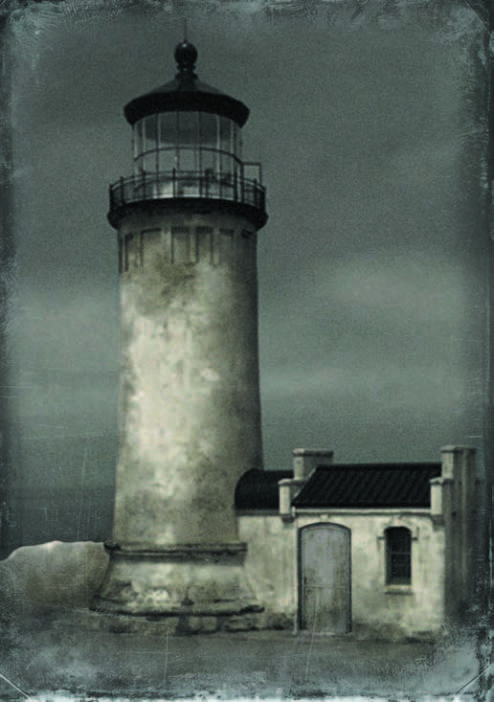{.artview-decision .artview-width-80 .artview-align-center}

Описание внутри. Переступить порог — всё равно что шагнуть в прошлое. Вдоль дальней стены установлена радиоаппаратура сороковых годов, а на крюке висит гарнитура. Стальной офисный стул с кожаным сиденьем заржавел, но всё ещё исправен; под столом стоит проволочная корзина, наполовину заполненная скомканными листами бумаги. Если бы не толстый слой пыли и слабый запах плесени, можно было бы подумать, что это место закрыли только вчера.

Основание маяка: открытый дверной проём справа ведёт в основание самого маяка, где открытая винтовая лестница уходит сквозь перекрытие на верхний этаж.

Лестница: ступени скрипят под каждым шагом, но выглядят достаточно прочными. Поднявшись сквозь перекрытие, вы попадаете в пустую круглую комнату, покрытую многолетней пылью и несколькими обломками дерева. На противоположной стороне видна вторая, более узкая винтовая лестница, ведущая на фонарную площадку.

Фонарная площадка: здесь так же пыльно, как внизу, однако радиоантенна находится в хорошем состоянии. На площадке проложены два комплекта кабелей: один относится ко временам Второй мировой войны, другой значительно старше. Старый комплект, когда-то питавший первоначальную лампу маяка, явно перерезали много лет назад; другой, состоящий из полудюжины кабелей, идёт от стального короба на корпусе антенны через отверстие в полу в радиорубку на первом этаже.

> Заметки Хранителя
> 
> Технический специалист сыщиков предоставил особый переходник, который можно просто подключить к распределительной коробке сбоку антенны. Кабеля достаточно, чтобы спустить его в радиорубку, и ещё немного останется. Именно здесь сыщики хотят разместить главный маршрутизатор сотовой связи, обеспечивающий устойчивый сигнал Wi-Fi на 300 метров. Ещё два устройства предстоит установить на дальней стороне Плачущего моста и на чердаке больницы.

### Бухта нищих (Baia dei Mendicanti)

Описание. На западной стороне малого острова скрывается бухта с тёмным песчаным пляжем. Её окружают отвесные утёсы из белого камня, преодолеть которые можно лишь по единственной узкой лестнице, вырубленной в известняке. Вдоль грубых ступеней тянутся проржавевшие железные перила, хотя кое-где время и непогода полностью их уничтожили.

Глядя с тропы вниз на пляж, вы различаете остатки нескольких костров и граффити, покрывающие нижнюю часть утёса высотой в 3 метра по всему периметру. Повсюду валяются пивные бутылки, шприцы, использованные презервативы, обёртки от еды и пустые баллончики с краской. Тёмный предмет у воды похож на перевёрнутую гребную лодку. Следов недавнего пребывания людей нет.

> Заметки Хранителя
> 
> Спустившись на пляж, сыщики обнаружат, что гребная лодка покрыта толстым слоем странного фиолетового грибка, почти чёрного цвета. Возможно, это отобьёт у них желание прикасаться к лодке, однако грибок без особого труда можно соскрести примерно за тридцать минут. Под лодкой лежат вёсла и нераспечатанная бутылка амаро Fernet-Branca, завёрнутые в обильно промасленный кожаный чехол.
> 
> Когда Хасталик восстанет из земли, грибки потянутся к нему, и сыщики смогут воспользоваться очистившейся лодкой, чтобы бежать с острова. К сожалению, присутствие Хасталика также заставит воду отступить от берега, поэтому беглецам придётся тащить лодку к уходящей воде. Для этого требуется суммарная СИЛ 100 и как минимум одна успешная проверка СИЛ. Конечно, если Хранитель предпочитает более кинематографичный финал, эту проверку СИЛ можно отменить, чтобы сыщики увидели бомбардировку острова зажигательными боеприпасами уже с воды.

Гребная лодка в плачевном состоянии, но должна выдержать один переход до Перлы на материке со всеми пятью членами команды «Спектрал» на борту (особенно учитывая размеры Еноха). Каждый, кто попытается грести, должен совершить проверку СИЛ по следующей таблице:

| Проверка СИЛ | Результат |
| --- | --- |
| Провал | Потеряйте весло в воде. |
| Неудача | 1,5 км/ч |
| Успех | 3 км/ч |
| Сложный успех | 5 км/ч |
| Экстремальный успех | 6,5 км/ч |

Перла находится примерно примерно в 13 километрах к востоку, поэтому добраться туда на вёслах можно всего за два часа (если сыщиков не подберёт итальянский флот). Хранителю следует каждый час просить одного или нескольких гребцов совершать проверку СИЛ, чтобы определить, насколько далеко они продвинулись.

### Плачущий мост

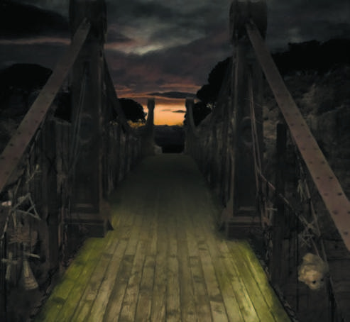{.artview-decision .artview-width-80 .artview-align-center}

Описание. Мост явно знавал лучшие дни. Это простая конструкция из литого железа, когда-то выкрашенная в зелёный цвет, но теперь почти целиком бурая от ржавчины. Под постоянным воздействием солнца, моря и ветра краска на металлических перилах облупилась и выцвела, а деревянные доски настила сильно обветрились, хотя выглядят более или менее целыми ([раздаточный материал #28](#viral-handout-28)).

С перил и конструкций моста свисают куклы. Сотни кукол. Некоторые из них — современные, пластиковые, а у других, сохранившихся с давних времён, лица сделаны из фарфора и ткани, и их глаза безучастно смотрят в темноту. Несколько кукол целы, но у большинства нет конечностей и одежды; от иных остались лишь пустые головы без глаз, со спутанными волосами, похожими на солому. Среди кукол встречаются и более абстрактные поделки из палок, нитей, жил и костей. Их формы включают отдалённо человекоподобные фигурки из прутьев, кресты, звёзды разных видов и символы, не поддающиеся опознанию.

У входа на мост из плавника и местных веток сооружено импровизированное святилище, сплетённое в грубую конструкцию наподобие плетёной корзины. Внутри находятся выцветшие со временем заламинированные фотографии младенцев и малышей. Среди других подношений — детские игрушки, рукописные записки на итальянском, католические образы, увядшие мёртвые цветы в банках и остатки бесчисленных свечных огарков.

> Заметки Хранителя
> 
> Местное суеверие гласит, что монахи с острова защищают детей, рождённых в этих краях, поэтому на протяжении веков люди приезжали с материка и оставляли подношения. Никто никогда не подвергал эту традицию сомнению, хотя в последние годы она почти сошла на нет, уступив место подросткам, которые приходят выпить в расположенную неподалёку Бухту нищих.
> 
> Записки содержат обычные католические молитвы или просьбы к монахам молиться за детей, пострадавших в несчастных случаях либо заболевших. В других просто просят присмотреть за новорождёнными или обеспечить благополучную беременность. Среди подношений встречаются куклы, игрушки, фотографии, цветы и тому подобное, некоторые из которых относятся ещё к началу двадцатого века.
> 
> Нижняя сторона моста подобным же образом украшена жуткими куклами и фигурками из прутьев; многие из них висят на спутанных ветхих верёвках в 1,5–3 метрах над водой. Даже издалека это зрелище невероятно тревожит, и, чтобы подойти ближе, может потребоваться проверка Рассудка (без потери РАС).
> 
> Переходить мост безопасно, хотя он скрипит и стонет, особенно под Енохом — крупным мужчиной, который несёт большую часть снаряжения. Мост не обрушится, но Хранителю не следует сообщать об этом игрокам.
> 
> На противоположной стороне моста сыщики могут разглядеть на земле нечто вроде мозаики, частично скрытой под землёй, листьями и помётом чаек. Расчистив мусор, они обнаружат странный символ, вырезанный в камне. Линии заполнены обломками плитки и цветного стекла, поверх которых нанесён толстый слой шеллака.
> 
> В действительности это Старший Знак, который в далёком прошлом начертали и наделили силой неизвестные. Кроме того, он зачарован так, чтобы быть неуязвимым для немагического оружия, чем и объясняется его безупречное состояние. На протяжении веков местные жители дополняли его украшениями, однако заключённая в нём сила по-прежнему столь же велика. Знак не позволяет Хасталику, Чумному монаху и любому существу с уровнем Порчи 10 покинуть главный остров. Это может сыграть важную роль в финале сценария, если сыщики побегут этим путём, хотя они могут и не понять, почему преследователи не идут за ними через мост.
> 
> Проверка Мифов Ктулху или сложная проверка Оккультизма позволяет сыщику опознать Старший Знак. Хотя его полное предназначение останется неизвестным, сыщик поймёт, что это, вероятно, какой-то защитный символ.

> Возможное видение от Зрения
> 
> Вы слышите тихий детский смех, а затем голос маленькой девочки, которая на ломаном английском будничным тоном произносит: «Человек-тень не может перейти мост, как бы сильно он ни старался».

### Лимонная роща

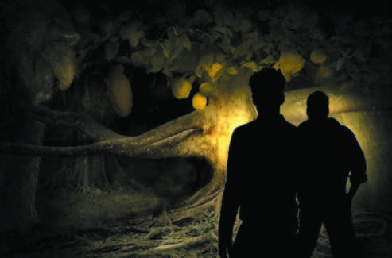{.artview-decision .artview-width-80 .artview-align-center}

Описание. Утоптанная тропа ведёт в обширную рощу возделываемых лимонных деревьев, больше похожую на пещеру: верхние ветви смыкаются над головой плотным пологом. Вас сразу встречают смутный гул насекомых, сладкий запах цитрусов и цепляющаяся за горло и носовые пазухи вонь разложения ([раздаточный материал #32](#viral-handout-32)).

За годы запустения роща одичала, но большинство деревьев всё ещё гнётся под тяжестью плодов, похожих на лимоны, хотя некоторые выросли до тревожно огромных размеров и приобрели странные уродства. Одни стали величиной с человеческую голову, из других извиваются необычные отростки, напоминающие щупальца. Иные мутации покрыли лимоны почти прозрачными опухолевидными наростами. Листья на деревьях выглядят неестественно выцветшими и деформированными, а местами кора сходит полосами, обнажая древесину, отчего стволы напоминают открытые раны. Землю устилают гниющие, мертвенно-белые листья, которые мокро чавкают под ногами. Каждый шаг поднимает лёгкое облачко серого тумана, воняющего тухлыми фруктами.

> Заметки Хранителя
> 
> Роща оказалась под влиянием Ямы костей под ней: корни деревьев питаются мерзкой скверной снизу. Из-за этого деревья мутировали и приносят противоестественные плоды. Если сыщики сорвут с дерева мутировавший лимон, снаружи тот обычно выглядит и пахнет как обычный. Но если его разрезать, бросьте D10 и сверьтесь со следующей таблицей:

Результаты для Лимонной рощи

| Бросок | Результат |
| --- | --- |
| 1 | Лимон сдувается, словно воздушный шар, из которого медленно выпускают воздух. Вырвавшийся пар совершенно отвратителен и заставляет всех в пределах 1,5 метра совершить проверку ТЕЛ, чтобы избежать рвоты. Кожура лимона тонка как бумага и тут же начинает высыхать, рассыпаясь в руке сыщика и оставляя бледное пятно, которое исчезнет лишь через несколько дней. Каждый, кто провалил проверку ТЕЛ, получает 1 уровень Порчи. |
| 2 | Внутри лимон целиком заполнен мухами, которые роем вылетают на сыщика, забиваясь в глаза, рот, нос и уши. Он должен совершить проверку Рассудка (1/1D3), а если его постигнет приступ безумия, с криком выбежит из рощи, отчаянно пытаясь стряхнуть мух с тела. Когда сыщик успокоится, удаление всех мух займёт пять минут, а с посторонней помощью — всего одну минуту. |
| 3 | Внутри лимона находится багровая мясистая плоть, похожая на мышцу, которая при разрезе истекает, судя по всему, настоящей кровью. Несмотря на вид, она пахнет как обычный лимон, а если кто-то осмелится положить кусочек в рот, вкус тоже окажется лимонным. Попробовавший её получает 1 уровень Порчи. |
| 4 | Сразу под кожурой лимона находится оболочка, похожая на амниотический мешок, внутри которой лежит скелет мёртвой крысы. Кажется, её плоть и шерсть постепенно перевариваются. Увидевший это должен совершить проверку Рассудка (1/1D4). Если проткнуть мешок, на сделавшего это брызнет молекулярная кислота. Успешная проверка Уклонения позволит избежать её, иначе персонаж получит 1D4 пунктов урона и 2 уровня Порчи. Кислота навсегда оставит рубцы на коже и, в зависимости от места попадания, может снизить Внешность сыщика (на усмотрение Хранителя). |
| 5 | Стоит проткнуть мякоть лимона, как тот с громким хлопком лопается, выпуская гнездо извивающихся прозрачных щупалец, которые хватают сыщика за руку. Амёбоподобный сгусток в центре вытаскивает себя за щупальца наружу, на ладонь сыщика. Щупальца чрезвычайно липкие, но их можно снять с небольшим усилием, словно полоску клейкой ленты. Пережитое вызывает проверку Рассудка (1/1D4). Отделившись от кожи, сгусток тут же расплывается в студенистую слизь, которая испаряется за считаные секунды. Коснувшись кожи сыщика, сгусток также прилипает к ней; если не удалить его в течение пяти минут, он частично впитается в кожу жертвы и станет похож на огромный волдырь. Жертва получает 1 уровень Порчи, а любые последующие эффекты Хранитель может определить по своему усмотрению. |
| 6 | Если проткнуть лимон, разрез раскроется, словно маленький рот, и выпустит воздух со звуком, похожим на тонкий крик. Вскрывший плод должен совершить проверку Рассудка (1/1D4). В случае неудачи он поверит, что это действительно был рот, хотя при осмотре лимон окажется сухой, высохшей оболочкой. Вышедший из него воздух пахнет тухлыми фруктами и медью. |
| 7 | Лимон лопается как воздушный шар, забрызгивая всех в пределах 1,5 метра вязкой чёрной жидкостью с кислой вонью желчи. Чёрная слизь горячая, но не обжигает. Её можно стереть, однако она навсегда окрашивает всё, чего касается, включая человеческую кожу, на которой до конца жизни жертвы останется слабый буроватый след. Хранитель может потребовать от сыщиков проверку Удачи с бонусной костью, чтобы жидкость не попала им на лицо. Каждый, кого она коснулась, получает 1 уровень Порчи. |
| 8 | Выглядит, пахнет и имеет вкус обычного лимона. На усмотрение Хранителя он также может обладать выраженными психоактивными свойствами, временно дарующими сыщику [Зрение](#viral-appendix-new-rules-the-sight) (см. с.60). Это может пригодиться, если используется один из альтернативных вариантов сыщиков, где прежде ни у кого из них не было экстрасенсорных способностей. |
| 9 | Стоит проткнуть кожуру, как лимон разрывается, выпуская рой крошечных жёлтых жуков, которые быстро покрывают руки жертвы. Каждый размером примерно с тлю, и они очень быстро ползут вверх по руке и забираются под одежду. Их можно стряхнуть, но для этого сыщику придётся снять рубашку, на что уйдёт один раунд. Если не избавиться от них в первом или втором раунде, сыщик почувствует, как они пытаются проникнуть в поры кожи. Если не удалить их к третьему раунду, сыщик увидит, как хотя бы один жук исчезает под кожей. Эти паразиты могут заражать лишь лимоны и подобные плоды, поэтому погибают, едва попав в кровь... но несчастный сыщик, разумеется, этого не знает. Если хотя бы один жук проникнет под кожу, жертва получает 1 уровень Порчи. |
| 10 | Хранителю следует придумать собственный тревожный результат, который может быть как вредным, так и безвредным. В любом случае контакт или употребление внутрь должны дать жертве как минимум 1 уровень Порчи. |

Примечание: если не указано иное, каждый из перечисленных результатов требует проверки Рассудка (0/1).

Помимо этих мерзких плодов, роща кишит всевозможными насекомыми. Любой, кто взберётся на дерево, окажется покрыт тревожащими, но совершенно безвредными насекомыми всех видов, что потребует проверки Рассудка (0/1). Если это вызовет приступ безумия, сыщику необходимо совершить проверку ЛВК, чтобы не упасть с дерева. Мягкая земля поглотит большую часть удара, поэтому сыщик не получит травм, если только результат проверки ЛВК не окажется критической неудачей: в таком случае он получает 1D2 пунктов урона.

Земля в роще также кишит насекомыми, куколками мотыльков, личинками мух и тому подобным. Любой, кто упадёт на землю или начнёт копаться в листве, потревожит всевозможных пугающих, но совершенно безвредных ползучих тварей. Это также вызывает проверку Рассудка (0/1).

Обыскивая землю, сыщики найдут среди подлеска остатки сгнивших плетёных корзин. По всей видимости, в давние времена в них складывали свежесобранные лимоны, но теперь они расплющены, разрушены и бесполезны.

Через тридцать минут пребывания в роще сыщикам следует совершить проверки Удачи. Каждый преуспевший наткнётся на тяжёлую железную решётку в земле, частично скрытую листьями. Решётка слишком тяжела, чтобы её было легко снять, а даже если это удастся, шахта под ней слишком узка для спуска. Если посветить вниз, можно увидеть какое-то помещение. Если сыщики ещё не нашли вход в катакомбы, позднее это позволит им совершить проверку Интеллекта, чтобы определить, где тот может находиться.

> Возможное видение от Зрения
> 
> Ваш взгляд затуманивается, и роща словно преображается: зарослей становится меньше, а ухоженных деревьев — больше. Между лимонными деревьями движутся тёмные человекоподобные фигуры. Похоже, они достают что-то из стоящих рядом деревянных тачек и укладывают этот материал у корней. В центре рощи хорошо видна большая стальная решётка, и монахи вываливают в неё всё, что осталось. В ушах звучит стук костей, падающих на камни и куда-то в глубину, а затем перед глазами снова предстаёт ночная тьма.

### Больница Святого Роха (Ospedale di San Rocco)

Описание снаружи. Больница Святого Роха, окружённая ржавой сетчатой оградой, стоит среди бесплодной пустоши сразу за Лимонной рощей. Справа видны руины старой монастырской часовни, а прямо впереди — сама больница. Три этажа кирпича, раствора и камня уходят в гнетущую темноту; на фоне звёзд едва проступает центральная крыша из чёрного сланца. Большинство окон разбито, но строение выглядит достаточно прочным, без явных признаков обрушения.

Что-то в увиденном тревожит вас, и лишь через мгновение вы понимаете причину. Ни единого граффити или следа вандализма. Вообще ни одного. Вы вели съёмки в бесчисленных местах, которые считались населёнными призраками, и какими бы жуткими или уединёнными они ни были, нигде не обходилось без вездесущих меток граффити, разбитых бутылок или выбитых окон. Весь ущерб здесь нанесли лишь безразличные стихии — ветер и дождь.

Бухта на малом острове ясно показывает, что подростки с материка часто устраивают здесь пропитанные алкоголем пляжные вечеринки, однако, похоже, они ни разу не перешли мост, чтобы портить здания. Ни разу.

> Заметки Хранителя
> 
> В этот момент сыщикам следует совершить проверку ВОЛ. Успех означает, что им кажется, будто за ними наблюдают, а сложный успех позволяет заметить похожую на одинокую фигуру тень в одном из окон второго этажа. Пока сыщик всматривается, фигура словно отворачивается и скрывается во тьме ([раздаточный материал #30](#viral-handout-30)), что вызывает проверку Рассудка (0/1D3). Все, кто посмотрит туда после этого, увидят лишь тёмную занавеску, слегка колышущуюся на ветру ([раздаточный материал #31](#viral-handout-31)). Занавеска — достаточно правдоподобное объяснение фигуры для того, кто хочет убедить себя, что ничего не произошло.

Описание внутри. Тяжёлый воздух насыщен зловонием плесени и разложения. С потолка свисают куски штукатурки, обнажая под ними вздувшуюся обрешётку. Из трещин между чёрно-белыми плитками проросли грибковые наросты. Когда вы идёте вперёд, осколки стекла и мусор хрустят под ногами, а за осыпающимися стенами с писком шныряют грызуны. Пятна плесени, похожие на крапчатые синяки, покрывают все поверхности, словно здание переваривают изнутри.

Покоробленные двери в основном целы, уцелела даже часть стёкол. Жутким образом всё больничное оборудование кажется нетронутым, словно персонал однажды просто ушёл и больше не вернулся. Коридоры загромождены каталками, инвалидными креслами и сервировочными тележками, заставленными подносами для еды. Со стен и потолков ненадёжно свисают облупившиеся и выцветшие таблички, которые, вероятно, когда-то обозначали важные места и направления. Большинство уже невозможно прочесть, хотя изредка удаётся различить слово на итальянском.

> Заметки Хранителя
> 
> Хранителю следует подчёркивать нетронутость этого места. По возможности описывайте помещения так, словно их просто бросили прямо во время работы. Сыщики могут найти кружки, перьевые ручки, планшеты для бумаг и даже куртки на вешалках. Общее впечатление — больницу покинули внезапно, а с тех пор местные жители полностью её избегали.
> 
> Учтите, что из-за битого стекла и мусора двигаться бесшумно очень сложно. Сыщики получают штрафную кость ко всем проверкам Скрытности.

Другие описания. Ниже приведены общие детали, о которых стоит помнить, пока сыщики исследуют больницу. Хранитель может свободно развивать их и импровизировать по своему усмотрению, чтобы усилить атмосферу.

Полы — в местах, где действительно лечили пациентов, пол выложен чёрно-белой плиткой в шахматном порядке, хотя большая её часть потрескалась и разбилась. В кабинетах, небольничных помещениях и коридорах лежит деревянный паркет, но некогда прекрасная древесина теперь вздулась, истлела и сгнила.

> Заметки Хранителя
> 
> В крайнем случае осколок плитки можно использовать как импровизированное оружие. В бою для попадания применяется Ближний бой (Драка), а осколок наносит 1D2 урона. При провале атакующий ранит собственную руку, если не принял меры предосторожности, например не обернул осколок тканью.

Грибковые наросты — неопознаваемые грибки встречаются повсюду, поэтому Хранитель может размещать их где сочтёт нужным. Они имеют противоестественный пурпурный или фиолетовый цвет и покрыты необычными полосами и пятнами.

> Заметки Хранителя
> 
> Грибок вреден лишь при прикосновении или употреблении внутрь. Это приносит 1 уровень Порчи.

Вредители — в стенах полно крыс, поэтому сыщики наверняка услышат писк и царапанье. Повсюду видны экскременты, ощущается аммиачная вонь мочи, а всё деревянное носит следы зубов. В шкафах и кладовых находятся крысиные гнёзда, кишащие безволосыми бледными крысятами, часто с ужасными мутациями: множеством конечностей, хвостов и голов.

> Заметки Хранителя
> 
> Крысиные экскременты могут передавать особенно неприятную инфекцию — хантавирус. Аудитория команды «Спектрал» почти сразу предупредит их об этом, но если они всё же станут делать какую-нибудь глупость, то почти наверняка заразятся.

Ущерб от непогоды — перепады температуры и вода серьёзно повредили всё вокруг. Краска облупилась, деревянные двери сгнили, а потолки зловеще провисли. Двери можно разбить одним пинком, а скопления застоявшейся воды способны внезапно прорваться и окатить команду «Спектрал» мерзкой заражённой жижей.

> Заметки Хранителя
> 
> Если скопление воды в потолке или стене прорвётся, сыщики могут совершить проверку Уклонения, чтобы избежать худшего. При неудаче их окатит самая отвратительная, кишащая червями вода, какую только можно вообразить. Это приносит 1 уровень Порчи и требует проверки ТЕЛ, чтобы удержаться от рвоты.

Разные предметы — Хранителю рекомендуется добавлять всевозможные повреждённые больничные приборы и принадлежности, от стеклянных шприцев до подкладных суден. Что бы ни нашли сыщики, находка должна быть жуткой, отвратительной и крайне тревожной.

Ограничение исследования. Если Хранитель ради экономии времени хочет ограничить доступные сыщикам места, он легко может сделать комнату, часть здания или крыло больницы непроходимыми. Причиной может быть обрушившийся потолок или пол, опасно накренившаяся стена, непроходимые завалы или целое крыло, рухнувшее под воздействием непогоды и времени.

Если Хранитель хочет усилить угрозу, обрушение может произойти в присутствии сыщиков или стать следствием их действий, например попытки вышибить дверь ногой. Не рекомендуется наносить сыщикам тяжёлые увечья, но небольшие ушибы, порезы и царапины вполне допустимы. Помните, что из-за островной скверны даже лёгкая царапина, скорее всего, воспалится.

Необязательные находки. Помимо предметов, упомянутых в описаниях, и обычных вещей, которые можно встретить в больнице пятидесятых годов, сыщики на усмотрение Хранителя могут обнаружить ещё несколько объектов.

> Аудиозапись — сыщики находят кожаную сумку с компактным магнитофоном EMI Midget (ок. 1950 г. Серийный номер 1253). В боковом кармане лежит громоздкая батарея тех времён, но её заряд давно иссяк. К счастью, у Хёна (или выбранного вами технического специалиста) есть набор переходников для техники сороковых и пятидесятых годов, и примерно за 15 минут он сможет подключить к магнитофону одну из современных батарей команды «Спектрал».
> 
> Большая часть плёнки повреждена, но им удаётся найти пригодный для воспроизведения фрагмент. Включив запись, сыщики сначала слышат голос одного итальянца, который явно запыхался. Он говорит быстро, но сдерживает эмоции благодаря профессиональной выучке. Вскоре к нему присоединяются другие голоса. Ниже приведено то, что слышат сыщики. Последняя реплика звучит на латыни.
> 
> Аудиозапись (говорят по-итальянски)
> 
> Голос 1: ...Sil sergente Bianchi è giù. Sono riuscito a trascinarlo dentro... non so cosa c'è sulla pelle. Si sta muovendo...
> 
> Голос 2: Lui è morto. non so cosa...
> 
> На заднем плане слышен взрыв, за которым следует продолжительная стрельба.
> 
> Голос 2: ...bisogno di raggiungere la barca... basta lasciare il... registratore. Verrà cancellato comunque.
> 
> Голос 1: Il colonnello Rossi ha insistito.
> 
> Голос 2: Fanculo Rossi e il cazzo DSS!
> 
> Голос 3: (Говорит, тяжело дыша.) Voi due, abbiamo appena preso l'ultimo di loro. Il Colonnello dice di fare i bagagli. Ci stiamo ritirando. Ha detto che la sua gente lo farà...
> 
> Голос 1: Che diavolo è QUELLO?
> 
> Голос 3: Non mi crederesti se te lo dicessi. Prendi i tuoi culi...
> 
> nessun tempo... fuori prima che scenda la notte.
> 
> Голос 2: Afferra i suoi piedi. Non lo sto lasciando qui. No, ho detto di lasciar perdere quella fottuta cosa!
> 
> Раздаётся тяжёлый удар.
> 
> Голос 1: (Голос становится тише, словно говорящий отходит от микрофона.)
> 
> Oh Dio, no...
> 
> Около минуты слышна лишь редкая стрельба вдали. Затем раздаются медленные шаги.
> 
> Голос 4: (Глубоким шёпотом говорит по-латыни у самого микрофона.) Tu numquam hic relinquo, Marco. Prodidit te et cetera. Mane non revertentur.
> 
> Аудиозапись (перевод с английского)
> 
> Голос 1: ...Сержант Бьянки ранен. Мне удалось затащить его внутрь... не знаю, что у него на коже. Оно движется...
> 
> Голос 2: Он мёртв. Я не знаю, что...
> 
> На заднем плане слышен взрыв, за которым следует продолжительная стрельба.
> 
> Голос 2: ...нужно добраться до лодки... просто оставь... магнитофон. Его всё равно сотрут.
> 
> Голос 1: Полковник Росси настоял.
> 
> Голос 2: В пизду Росси и его сраный DSS!
> 
> Голос 3: (Говорит, тяжело дыша.) Вы двое, мы только что прикончили последнего. Полковник велел собираться. Мы отступаем. Он сказал, что его люди...
> 
> Голос 1: Что ЭТО, ЧЁРТ ВОЗЬМИ?
> 
> Голос 3: Ты бы не поверил, если бы я рассказал. Просто тащите свои задницы... времени нет... выбраться до темноты.
> 
> Голос 2: Хватай его за ноги. Я его здесь не брошу. Нет, я сказал, брось эту грёбаную штуку!
> 
> Раздаётся тяжёлый удар.
> 
> Голос 1: (Голос становится тише, словно говорящий отходит от микрофона.)
> 
> О боже, нет...
> 
> Около минуты слышна лишь редкая стрельба вдали. Затем раздаются медленные шаги.
> 
> Голос 4: (Глубоким шёпотом говорит у самого микрофона.) Ты никогда отсюда не уйдёшь, \*Марко\*. Она предала тебя и остальных. Утро больше никогда не наступит.

> Возможное видение от Зрения
> 
> Ваш слух переполняют крики и стрельба. Вы слышите паническое дыхание. Перед глазами вспышками возникают солдаты, лихорадочно закладывающие взрывчатку в ниши в стенах. Низкое песнопение сковывает вас ужасом. Затем наступает тишина.

> Заметки Хранителя
> 
> Имя в последней реплике можно заменить именем одного из слушающих сыщиков, а если они что-нибудь скажут, голос даже может им ответить. Чтобы сделать находку ещё страшнее, Хранитель может заставить магнитофон воспроизводить голоса участников команды «Спектрал», записанные ранее этим вечером.

VHS-магнитофон — сыщики находят рюкзак с VHS-камерой середины восьмидесятых и книгой под названием Il Culto della Peste dell'Isola Malamente (см. [Историю](#viral-history), с.16). Хён может приспособить одну из своих батарей для её питания, и тогда запись удастся посмотреть через видоискатель.

Видеозапись повреждена, но, перематывая помехи, сыщики находят кадры с двумя подростками, которых снимает третий. Судя по тому, как двое в кадре прижимаются друг к другу, это пара. Они одновременно взволнованы и напуганы. К сожалению, звука нет.

Они видят, как подростки идут по больнице, а парочка время от времени оборачивается, чтобы сказать что-то в камеру. Вероятно, Команде «Спектрал» такое поведение хорошо знакомо по ранним охотникам за привидениями или исследователям заброшенных мест. Последние секунды записи ужасают: завернув за угол, подростки видят монаха в длинном одеянии с капюшоном. Его лицо скрывает старомодный противогаз, а вокруг роятся мухи. Парочка пробегает мимо камеры, и оператор падает на пол. Через видоискатель сыщик наблюдает, как монах протягивает к снимающему покрытую струпьями и волдырями руку.

Внезапно из окуляра камеры хлынут мухи, а сбоку выскочит VHS-кассета, выпуская рой бледных жуков, которые облепят руку сыщика. Это требует проверки Рассудка (1D3/1D6), а каждый, кто смотрел запись, получает 2 уровня Порчи.

#### Помещения больницы

В больнице Святого Роха слишком много помещений, чтобы подробно описывать каждое, да и перечисление комнаты за комнатой, поражённой тленом и гнилью, быстро стало бы однообразным. Следующие описания оставлены краткими, но снабжены идеями для развития по мере того, как команда «Спектрал» продолжает расследование. Помимо конкретных явлений, перечисленных в описаниях, Хранителю следует использовать [таблицу больничных встреч в приложении](#viral-appendix-encounters-hospital) (см. с.59).

##### Больница, подвал

В подвале главным образом находятся больничный морг, старые архивы и выброшенный мусор.

Морг — стены этой прямоугольной каменной комнаты заняты квадратными металлическими дверцами 1 метра шириной, пронумерованными от одного до шестидесяти: по тридцать на каждой стене, в три ряда по десять. За каждой дверцей находится вырубленная в цельной скале острова каменная полка примерно 0,9 метра шириной и 2,1 метра глубиной. Когда-то на них лежали тела недавно умерших, но теперь там нет ничего, кроме пыли. При осмотре можно заметить, что у дверец нет механизма, позволяющего открыть их изнутри.

> Заметки Хранителя
> 
> Пользователь UltimaUnum предложит суперчат на \$500, если Марко заберётся в одну из ниш морга, закроет дверцу и останется внутри на пять минут. Если он согласится, Хранитель может наслать на него всевозможные галлюцинации. Например, Марко услышит треск камня, за которым посыплются жуки и черви, начавшие ползать по его телу, что вызовет проверку Рассудка (1/1D4). Среди других вариантов — слуховая галлюцинация, будто кто-то царапается из соседней ниши, голос Чумного монаха или крысиный рой. Разумеется, когда Марко вытащат, никаких следов увиденного не окажется. Кроме того, металлическая дверца настолько толстая, что крики и призывы о помощи изнутри почти не слышны. Механизма, позволяющего открыть дверцу изнутри, нет.

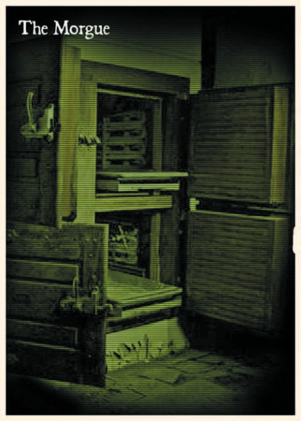{.artview-decision .artview-width-80 .artview-align-center}

Старые архивы — эта комната битком набита бесчисленными деревянными картотечными шкафами, ставшими крысиными гнёздами. Внутри гниющей мебели слышны беготня, писк и царапанье. Открыв шкаф, сыщики увидят, что многие документы изъяты, а всё оставшееся превращено в материал для гнёзд. Затем им следует совершить групповую проверку Удачи. При неудаче из картотек хлынет крысиный рой и нападёт на сыщиков. Крысы чудовищно мутировали: их бледные тела лишены шерсти, а незрячие глаза налиты молочной белизной. Физического урона они не причинят, но Хранителю следует создать впечатление, что это возможно, описывая, как крысы карабкаются по ногам, кусают ступни и тому подобное. Несколько особей могут даже прыгнуть со шкафов сыщикам на головы и плечи.

Особенно жестокие Хранители могут заставить сыщика при бегстве из кишащего крысами подвала потерять 1 пункт здоровья и совершить проверку Рассудка (1/1D3).

Склад — большая часть хранящихся здесь вещей представляет собой сломанную мебель, старое больничное оборудование и несколько немаркированных стальных бочек на 190 литров, заваренных наглухо. Если их пошевелить, внутри что-то плещется. Сыщики вряд ли станут вскрывать бочки, но если им удастся найти способ, Хранитель может сам решить, что находится внутри. Это может быть что угодно — от ржавой воды до чего-то невыразимого.

##### Больница, первый этаж

Главный вход распахнут настежь, двери едва держатся на петлях. Деревянные полы здесь сильно пострадали от времени и усеяны кусками штукатурки и битого стекла. За административными кабинетами и приёмными деревянный настил сменяется классической чёрно-белой плиткой, популярной во времена строительства больницы. Многие плитки треснули и раскололись, так что исследовать здание бесшумно почти невозможно.

**1A. Кабинет администратора** — некогда роскошный кабинет теперь стал почти исключительно крысиным поселением. Пол приходит в движение, когда грызуны разбегаются от вас, а из стен доносится топот их лап. На столе администратора в изысканной подставке стоит серебряная перьевая ручка, а деревянный лоток для входящих бумаг заполнен документами, когда-то, вероятно, очень важными. Теперь от них осталась лишь заплесневелая масса. Рядом с большим эркером висит портрет серьёзного мужчины в кресле с высокой спинкой. Это лысеющий человек средних лет с выражением удовлетворения на лице. Портрет сохранился на удивление хорошо, хотя по краям уже подбирается плесень.

> Заметки Хранителя
> 
> На портрете изображён последний администратор больницы. Присмотревшись, сыщики смогут прочесть на небольшой табличке внизу: доктор Энцо Бьянко. В ящиках стола лежат документы, рассыпавшиеся до полной неузнаваемости. В верхнем центральном ящике находятся серебряный нож для писем (урон 1D2) и бинокль, который развалится в руках любого, кто его поднимет.

**1B. Приёмное отделение** — в этой длинной прямоугольной палате у северной стены стоят шесть коек, а вдоль южной выстроены столы. В дальнем углу также находятся две больничные люльки, одна из которых накрыта заплесневелой белой тканью. Груды документов, когда-то лежавшие на столах, сгнили до полной неразборчивости и теперь разбросаны повсюду. В изножье каждой кровати висит планшет для бумаг, а на маленьких тумбочках между койками всё ещё попадаются стаканы и подкладные судна.

> Заметки Хранителя
> 
> Здесь находятся пишущие машинки, диагностическое оборудование и стеклянный шкаф с безнадёжно устаревшими медицинскими принадлежностями. В койках и вокруг них наверняка гнездятся крысы. Чтобы усилить жуть, сыщики могут заметить движение под простынёй на одной из детских кроваток, а откинув её — обнаружить, что крыса-альбинос кормит своих уродливых детёнышей.
> 
> В смежных комнатах находятся картотечные шкафы и канцелярские принадлежности. Через коридор на востоке расположены кладовая с чистящими средствами (в основном дезинфицирующими составами на основе аммиака) и большая бельевая, соединённая с прачечным отделением.
> 
> В приёмной администрации стоят стол, ещё больше сгнивших бумаг и картина с пасторальным пейзажем итальянской сельской местности. В пепельнице лежит украшенная трубка, будто её положили туда и забыли.

**1C. Прачечное отделение** — несмотря на десятилетия запустения, в комнате всё ещё слабо пахнет отбеливателем, хотя гниль и плесень безраздельно господствуют. В стиральной установлены несколько огромных электрических машин из нержавеющей стали. В грудах старых простыней и больничных халатов кишат крысы, а из-за машин доносится новое царапанье.

В сушильной стоят несколько газовых сушильных машин; их огромные круглые дверцы распахнуты, а изнутри снова слышно крысиное царапанье. Пять колёсных контейнеров доверху заполнены изорванными простынями, от которых несёт аммиаком и плесенью.

В гладильной находятся четыре промышленных гладильных стола с откидными крышками, которые когда-то гладили и отпаривали бесчисленные простыни. К задней части машин подходят трубы, резиновые шланги и электрические провода, теперь протёршиеся и сгнившие.

Склад прачечной — большая кладовая, в которой стоят восемь 190-литровых бочек с чистящими средствами, отбеливателем и крахмалом. Запах здесь невыносим (и, вероятно, опасен для здоровья), поскольку некоторые бочки протекли и их содержимое смешалось на полу. Через несколько секунд у вас начинают слезиться глаза и становится трудно дышать.

> Заметки Хранителя
> 
> Каждый, кто проведёт на складе прачечной больше тридцати секунд, должен совершить проверку ТЕЛ, иначе у него закружится голова. Критическая неудача означает, что персонаж потеряет сознание и кому-то придётся вытащить его наружу. При долгом воздействии ядовитый воздух здесь может убить, но в остальных случаях лишь раздражает глаза, носовые пазухи, горло и лёгкие.
> 
> В смежных комнатах находятся дополнительные припасы, резиновые перчатки, фартуки, запасные колёсные тележки и тому подобное.

**1D. Котельная** — попасть в неё можно только из Западного коридора или снаружи здания. Огромный стальной котёл занимает большую часть комнаты; его украшенная дверца викторианского стиля приоткрыта. Изнутри доносится царапанье.

Дверь на западе ведёт в угольную. Там пахнет серой и пылью. У южной стены громоздятся горы угля, в которые всё ещё воткнута пара лопат. Здесь есть наружная металлическая дверь, через которую, вероятно, загружали уголь, но ржавчина и коррозия, похоже, намертво её запечатали.

Маленькая узкая дверь ведёт в техническую комнату с верстаками, инструментами и даже старым сварочным аппаратом, почерневшим от сажи. Большинство инструментов сильно проржавело.

Дальше простирается лабиринт других мастерских для ремонта автомобилей, электрики, сантехники, столярных работ и ухода за территорией. Все инструменты так же проржавели и покрылись кавернами, поэтому без серьёзного восстановления почти бесполезны. Запахи масла, смазки, бензина и удобрений смешиваются с вездесущей вонью плесени.

> Заметки Хранителя
> 
> Если сыщики ищут конкретные инструменты, существовавшие в пятидесятые годы, то, скорее всего, найдут их где-нибудь в этих комнатах. Хранитель может потребовать проверку Удачи, чтобы определить, пригоден ли предмет сразу или нуждается в очистке. Разумеется, если им нужна лишь дубинка, чтобы ударить кого-нибудь, подойдёт любой гаечный ключ, каким бы ржавым он ни был, и нанесёт 1D4 урона.

**1E. Операционная** — после Второй мировой войны больница Святого Роха переоборудовала многие операционные, оставив только эту для редких случаев, когда требовалась операция. Стальной операционный стол на удивление чист, если не считать толстого слоя пыли, однако взгляд притягивают широкие кожаные ремни, которыми, вероятно, фиксировали пациентов.

Окружающие полки, столешницы и шкафы заполнены разлагающимися припасами, которые теперь скорее произведут эффект, противоположный изначально задуманному.

> Заметки Хранителя
> 
> Среди бесполезного хлама сложная проверка Внимания позволяет обнаружить коробки лекарств, которые всё ещё действуют. Среди них морфин, кодеин и лауданум. Сложная проверка Образования позволит сыщикам заметить бросающееся в глаза отсутствие вакцин, противовирусных и антибактериальных препаратов.

**1F. Смотровая** — в комнате находятся смотровой стол, рабочая поверхность и навесной шкаф. Стол накрыт сгнившей простынёй, покрытой многочисленными пятнами.

> Заметки Хранителя
> 
> Если кто-нибудь откроет шкаф, оттуда выпрыгнет огромная крыса, рассыпав по полу различные принадлежности для осмотра. Внезапный испуг вызывает проверку Рассудка (0/1).

**1G. Кухня** — эта производственная кухня относится к числу крупнейших увиденных помещений. Десятки разделочных столов заставлены кастрюлями, сковородами и различной утварью. По бокам большой кирпичной печи у восточной стены стоят две более современные (для пятидесятых годов) плиты. У северной стены находится подъёмник в кухню наверху, но без электричества он стоит открытым и заставленным посудой.

Смежные помещения включают холодильные и морозильные камеры, кладовые, а также склады посуды и столовых приборов. В холодильнике и морозильнике творится ужас. Их забили толстые колонии плесени и какие-то бледные мухи, роящиеся внутри. По вздутому, похожему на опухоль грибку ползают черви и белые жуки.

> Заметки Хранителя
> 
> При обыске кухни и успешной проверке Внимания сыщики найдут стальное ведро с костями. Подходящая проверка навыка (на усмотрение Хранителя) показывает, что среди коровьих и свиных костей, похоже, есть человеческие. Осознание этого вызывает проверку Рассудка (1/1D4).
> 
> Чтобы войти в холодильник, требуется проверка ТЕЛ. Внутри сложная проверка Внимания позволяет найти 19-литровую банку с несколькими зародышами, многие из которых обмотаны пуповинами, что, разумеется, вызывает проверку Рассудка (1/1D6).

**1H. Главная столовая и зал отдыха** — в этом огромном зале стоит дюжина длинных столов, вдоль которых расставлены деревянные стулья. В отличие от многих других комнат, эта сильно пострадала от непогоды. Потолок обрушился, сбросив стулья и столы из помещения сверху в беспорядочную груду щепок и штукатурки посреди зала. Высокие окна выходят на юг, и даже сквозь грязное стекло вдали различимо море. В юго-восточном и северо-восточном углах находятся лестницы на второй этаж. Если взглянуть вверх сквозь пролом в потолке, через дыру в крыше видны звёзды.

> Заметки Хранителя
> 
> Обе лестницы ведут в Верхнюю столовую и зал отдыха, однако из-за ослабленного пола подниматься этим путём опасно. Хранитель может потребовать от сыщиков проверку Внимания, чтобы те заметили короткую вспышку света на воде, хотя это мог быть всего лишь отблеск одного из их фонарей.

##### Больница, первый этаж, западное крыло

**1I. Западный коридор** — длинный коридор впереди растворяется во тьме. Окна по сторонам пропускали бы естественный свет днём, но сейчас лишь напоминают, насколько темно снаружи. Коридор соединяет Приёмное и Инфекционное отделения.

> Заметки Хранителя
> 
> Здесь сыщики могут заметить что-то движущееся снаружи, куда они не смогут быстро добраться. Свет и отражения также способны заставить их что-нибудь увидеть, поэтому Хранитель может потребовать проверки Рассудка (без потери пунктов), чтобы определить, напугают ли они сами себя.

**1J. Изолятор** — отделение состоит из семи отдельных палат вдоль северной стены и четырнадцати коек вдоль южной. На дверях палат есть засовы и маленькие окошки, поэтому они больше похожи на тюремные камеры, чем на больничные помещения. В северо-западном углу находится подъёмник для пациентов, в дверях которого боком застряла пустая каталка.

Дверь посередине северной стены ведёт в ванную для пациентов с раковинами, туалетами и стальной ванной, переполненной чёрной плесенью. Вода, разумеется, не работает, да и пользоваться чем-либо здесь вряд ли захочется: все поверхности покрыты обвалившейся штукатуркой, плесенью и неопознаваемой грязью.

Ряд высоких окон вдоль южной стены выходит на южную часть острова и Средиземное море за ней.

> Заметки Хранителя
> 
> Зеркала отлично подходят для внезапных пугающих сцен и явлений призраков. Возможно, сыщик заметит, как кто-то движется у него за спиной, но, обернувшись, ничего не увидит. Комментаторы напишут что-нибудь вроде "Кто это был?!" или "Эй, там был кто-то в балахоне?!"

**1K. Послеоперационное отделение** — вдоль северной и южной стен стоят койки для пациентов. У восточной стены находится несколько отдельных палат, а короткий коридор ведёт в небольшую смотровую.

**1L. Инфекционное отделение** — в этом небольшом отделении шесть изолированных палат с задвижными засовами. В северо-западном углу находится ещё один подъёмник для пациентов, а дверь в восточной стене ведёт в маленькую смотровую. Ещё одна дверь с окном открыта в Западный коридор.

**1M. Отделение неизлечимых больных** — здесь когда-то размещались пациенты, стоявшие на пороге смерти. В помещении двадцать коек (по десять вдоль восточной и западной стен) и шесть отдельных палат. Дверь в южной стене ведёт в застеклённую комнату отдыха, а дверь на западе — в ванную для пациентов с раковинами, туалетами и проржавевшей металлической ванной.

##### Больница, первый этаж, восточное крыло

**1N. Восточный коридор** — [см. Западный коридор](#viral-isola-hospital-room-1i-west-corridor). Этот коридор соединяет Приёмное отделение с Общежитием персонала.

**1O. Отделение острых состояний** — зеркальное отражение Изолятора.

**1P. Отделение новых пациентов** — по всей видимости, здесь размещали недавно поступивших. Вдоль северной и южной стен стоит в общей сложности десять коек. У западной стены находятся четыре отдельные палаты, а короткий коридор ведёт в смотровую. Дверь у северо-восточного угла открывается в Кабинеты.

1Q. Кабинеты — здесь находятся кабинет старшего дежурного врача и смежные помещения. Отсюда также ведёт лестница на второй этаж, когда-то закрывавшаяся дверью, но замок, похоже, сломали много лет назад. В дальней части кабинетов расположено Общежитие.

1R. Общежитие персонала — здесь восемь отдельных комнат и общая зона с несколькими столами и стульями. Высокие окна выходят на территорию и море за ней. В отличие от других частей больницы, эти помещения сильно пострадали от стрельбы и, возможно, даже взрывчатки. Пол усеян гильзами, а участки стен обуглены и почернели, словно подверглись воздействию сильного жара.

> Заметки Хранителя
> 
> Сложная проверка Интеллекта позволяет сыщикам найти под сломанной мебелью несколько использованных гранат со слезоточивым газом. Слой грязи и пыли на гильзах и пустых гранатах указывает, что им уже много десятилетий.

Рядом с Общежитием персонала находится комната отдыха с дверью в ванную для сотрудников в восточной стене. Две двери на севере ведут в столовую персонала, а через проём в северо-восточном углу можно попасть в отдельную кухню. Другие двери в северной стене открываются в кладовые, холодильник, морозильник и прочие складские помещения. В северо-западном углу расположена комната с крючками для одежды и скамьями, похожая на раздевалку. Дверной проём ведёт в каменный коридор.

Коридор ведёт в личную молитвенную часовню из древнего тёмного камня, которая, должно быть, когда-то была частью первоначального монастыря. Ряды скамей обращены к северному концу зала, где в нескольких метрах от стены стоит кафедра. Над кафедрой на стене висит большое кованое распятие.

> Заметки Хранителя
> 
> Проверка Внимания позволяет сыщику заметить странные круглые потёртости вокруг распятия на стене. Если игрок не догадается сам, проверка Интеллекта поможет понять, что крест вращается. Когда его повернут на 180° вверх ногами, раздастся щелчок и в задней стене откроется потайная дверь.

##### Больница, первый этаж, тайные комнаты

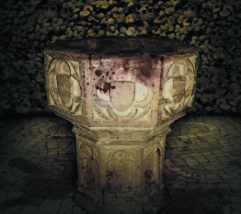{.artview-decision .artview-width-80 .artview-align-center}

1S. Святилище костей — едва переступив порог потайной двери, вы видите некое святилище, но оно посвящено богу, о котором вы никогда не слышали. Стены и потолок почти квадратной комнаты покрыты человеческими черепами, а посередине стоит каменная чаша высотой по пояс, покрытая коркой давно засохшей крови.

Сразу справа от двери лежат мумифицированные останки, по сгнившей коричневой рясе на высохшей плоти похожие на монаха. Под левой рукой он сжимает книгу в кожаном переплёте (см. [Iuramentum Corruptionis](#viral-appendix-new-mythos-tome-iuramentum-corruptionis) на с.67), а рядом с правой лежит револьвер Bodeo 1889 года (10.5mm). В его виске виднеется аккуратное отверстие. Даже человеку без познаний в криминалистике ясно, что рана нанесена им самим.

В барабане осталось пять невыстреленных патронов, но сам револьвер сильно загрязнён. Чтобы его почистить, требуется проверка Стрельбы (пистолет). Если стрелять без чистки, перед каждым выстрелом необходима успешная проверка Удачи, иначе произойдёт осечка.

Размером книга примерно с большую Библию, но вместо креста или подобного изображения на её обложке находится необычный серебряный символ: переплетение скрученных узлов, изогнутых в форме какой-то мухи.

> Заметки Хранителя
> 
> Даже краткий осмотр символа требует проверки Рассудка (0/1). Заглянув внутрь, любой поймёт, что книга написана на латыни и обильно иллюстрирована откровенными, тревожными изображениями того, что проделывают с человеческими телами, в том числе телами детей и младенцев. Если листать книгу 15 минут, сыщик потеряет 1D4 пунктов Рассудка и получит 1 уровень Порчи. Если читатель владеет Иностранным языком (латынь) на 30% или выше и пытается читать, он понимает больше, теряет 2D4 Рассудка и получает 2 уровня Порчи. Если команда «Спектрал» попытается показать книгу в эфире, Майя прервёт трансляцию, чтобы избежать демонетизации.
> 
> Обыск святилища с проверкой Внимания позволяет обнаружить отпечаток детской ладони, размазанный в крови на алтаре.

1T. Камера пыток — войти сюда всё равно что шагнуть в кошмар. Длинное прямоугольное помещение тянется во тьму справа от вас. От дверей видны квадратные колонны, расширяющиеся кверху и соединяющиеся со сводчатым потолком. Возможно, когда-то изогнутый потолок украшали фрески, но теперь под толстым слоем сажи и плесени различимы лишь смутно тревожные очертания.

В каменном полу прорезаны глубокие желоба, идущие от колонн к узкой канаве вдоль внешних стен. Хотя архитектура явно средневековая, по стенам проложены кабели, которые, по всей видимости, когда-то подавали электричество на старинные промышленные светильники, установленные примерно через каждые 3 метра. На нескольких ближайших креплениях висят керосиновые фонари.

Ужаснее всего железные кандалы, свисающие с толстых колец, вделанных в колонны. Они сильно проржавели, а камень под ними исчерчен ржавыми потёками. На одном из браслетов висит кусочек старой ткани.

> Заметки Хранителя
> 
> Исследуя помещение, сыщики найдут дверь слева (на севере), а в дальнем правом (южном) конце увидят останки узника, всё ещё висящие на запястьях. От него сохранились лишь кости, высохшие жилы и сгнившая больничная одежда, превратившаяся в рваную марлю. Это требует проверки Рассудка (1/1D4). Даже без проверки навыка ясно, что останки относятся самое позднее к пятидесятым годам, но проверка Образования показывает, что для своего возраста труп удивительно цел. Обычно тела распадаются по мере гниения, однако эта плоть каким-то образом мумифицировалась, несмотря на чрезмерную влажность.

1U. Операционная — в этой длинной узкой комнате в ряд стоят семь операционных столов. Рядом с каждым находится столик для инструментов и стальная мусорная корзина, а сверху — группа светильников. Сланцевая крыша в нескольких местах обрушилась, оставив под проломами груды битого камня. Две двери в западной стене, похоже, ведут в соседнее помещение.

1V. Брошенные вещи — как и во многих других местах острова, в этой небольшой передней пахнет разложением и плесенью. Дальняя половина комнаты завалена одеждой, обувью, шляпами и другими личными вещами. Когда луч света скользит по груде, вы замечаете блеск карманных часов, очков и даже потрёпанной куклы, чьи глаза-пуговицы смотрят прямо на вас.

> Заметки Хранителя
> 
> Здесь монахи сваливали одежду и личные вещи своих жертв. Если кто-нибудь потратит время на обыск груды, сложная проверка Внимания позволит по стилю одежды определить, что среди брошенных вещей есть предметы викторианской эпохи. Если копать достаточно глубоко, можно обнаружить под грудой яму, которая уходит ещё ниже и содержит предметы Средневековья. Разумеется, тщательные раскопки потребуют многих часов, если не дней, поэтому сыщики вряд ли узнают об этом.

#### Дом администратора

Администратор был в больнице исключительно номинальной фигурой. Он общался с посторонними и служил приветливым лицом учреждения, но на деле оставался лишь марионеткой. Во время службы он жил в Доме администратора и поддерживал видимость благополучия для всех значимых гостей. Обычно посетители даже не входили в саму больницу: им было достаточно смотреть на неё издалека, потягивая бренди в гостиной администратора и совершенно не подозревая, что скрывается за фасадом медицинской формы и красноречием хозяина.

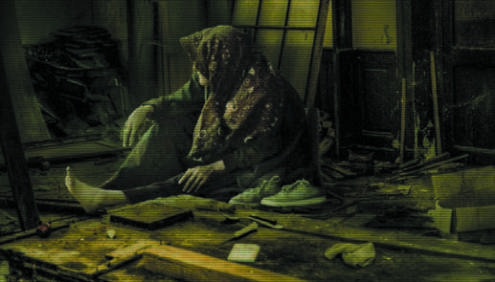{.artview-decision .artview-width-80 .artview-align-center}

> Заметки Хранителя
> 
> На соседнем столе стоит открытая металлическая коробка с принадлежностями для употребления наркотиков: несколькими шприцами, резиновыми трубками и пластиковым пакетом с небольшим количеством героина. Будучи выздоравливающим героиновым наркоманом, Питер сразу его узнает, и Хранитель может потребовать проверку ВОЛ, чтобы он устоял перед желанием спрятать наркотик для дальнейшего использования, особенно если уже столкнулся с чем-то, что заставило его потерять Рассудок.
> 
> Если Хранитель хочет усилить жуть, на чердаке под грудой тряпья может оказаться одинокий героиновый наркоман, который якобы «спит». Приближаясь к дому, сыщики могут услышать что-то наверху или заметить фигуру в чердачном окне.
> 
> Отправившись проверить, они должны пройти проверку Внимания, чтобы заметить руку, торчащую из похожей на кучу тряпья груды в углу. Если они целенаправленно обыскивают эту груду, бросок не требуется. Сыщики сразу увидят, как пальцы шевелятся, и решат, что человек ещё жив.
> 
> Его звали Анджело Руссо (хотя теперь он этого не помнит), и десять лет назад он приехал сюда с группой друзей, чтобы провести ночь за выпивкой в Бухте нищих. Когда Анджело потерял сознание, друзья решили, что будет забавно оставить его там и вернуться через несколько часов.
> 
> Решив, что друзья действительно его бросили, Анджело отправился исследовать остальной остров в надежде найти способ подать сигнал о помощи — и больше о нём никто не слышал. Все его друзья договорились солгать и заявить, что понятия не имеют, что с ним случилось.
> 
> Остров быстро осквернил Анджело, и, найдя запас героина в заброшенной больнице, тот отчаянно попытался прекратить боль. Он продержался неделю, прежде чем умер от передозировки, но, конечно, его мучения на этом не закончились. Порча не позволила ему умереть и обрекла оставаться здесь, пока Хасталик не освободится и Анджело не сможет слиться с ним.
> 
> Теперь он лишь просит о милосердной смерти, в которой ему отказано. Сыщики увидят почти мёртвого наркомана с приржавевшей к руке иглой. Он умоляюще протягивает к ним руку и произносит: "Vi prego uccidetemi. Questo è un inferno. Nel nome di Dio, abbiate pietà. Vi prego." Это переводится так: "Пожалуйста, убейте меня. Я здесь уже так давно. Это ад. Ради всего святого, смилуйтесь. Прошу вас". Если сыщики откажутся помочь, он вернётся на свой диван, в свой личный ад, и будет безудержно рыдать, хотя слёзы у него давно иссякли. Знакомство с участью Анджело вызывает проверку Рассудка (1/1D4).

Первый этаж — Дом администратора стоит среди небольшой рощицы заросших деревьев. Это скромное здание с гостиной, столовой и кухней на первом этаже. Оно обставлено мебелью и бытовыми приборами викторианской эпохи, которые сильно пострадали от стихий. В доме воняет плесенью и крысиной мочой, а дыра в крыше привела к серьёзному ущербу от воды в юго-восточном углу. Лестница на второй этаж находится в задней части главного вестибюля.

Второй этаж — здесь находятся главная спальня, ванная, кабинет и гостевая спальня. В обеих спальнях стоят кровати с балдахинами, комоды и богато украшенные гардеробы; кабинет отделан изящными деревянными панелями и обставлен большим кленовым столом, несколькими стульями и полками с плесневеющими медицинскими книгами пятидесятых годов. Гостевая спальня превратилась в руины из обвалившейся штукатурки и разбухшей древесины. Огромная дыра в крыше открыта ночному небу, а пол сильно ослаблен водой.

Если кто-нибудь попытается войти в комнату, пол громко застонет и обрушится, сбросив сгнившую мебель в кухню внизу. Если внизу кто-то находится, за мгновение до падения потолка он услышит стон и успеет отойти. Если он этого не сделает, Хранителю следует нанести ему 1D4 пунктов урона от падающих обломков, но ничего серьёзного.

Чердак — попасть туда можно по узкой лестнице в юго-западной части второго этажа. Она ведёт к двери в большое открытое пространство с простым необработанным деревянным полом и обнажёнными стропилами. Из-за упавшей ветви юго-восточный угол чердака открыт небу, и отсюда сыщикам открывается великолепный вид на лимонную рощу и маяк.

##### Больница, второй этаж

Второй этаж очень похож на первый, хотя здесь непогода нанесла больший ущерб. Главным образом это связано с тем, что чердак затапливало и вода повсюду обрушила большие участки оштукатуренного потолка, оставив груды мусора и плесени. Пол всё ещё достаточно прочен, кроме Верхней столовой, где он почти полностью рухнул.

**2A. Кабинет старшей медсестры** — над Кабинетом администратора расположен кабинет старшей медсестры. Он обставлен проще: здесь меньший стол и несколько картотечных шкафов, где когда-то хранились текущие истории болезней.

**2B. Психиатрическое отделение** — здесь содержали больных, страдавших душевными заболеваниями, обычно жертв контузии с обеих мировых войн (сегодня это называют посттравматическим стрессовым расстройством, или ПТСР). На кроватях видны массивные кожаные фиксаторы, хотя все они истлели и сгнили. В помещении воняет аммиаком и плесенью, а дыра в потолке открывается в тёмный чердак.

**2C. Кухня** — на кухне второго этажа стоят несколько промышленных шкафов для подогрева, сервировочные тележки и груды столовских подносов. По всей видимости, пищу готовили внизу и поднимали сюда кухонным подъёмником. Здесь есть контейнеры со стальными столовыми приборами, тарелками и мисками, а также шкаф с плесневеющими салфетками. Груды стеклянных стаканов разбиты на полу рядом с обрушившимся деревянным столом.

**2D. Верхняя столовая и зал отдыха** — когда-то в этом зале стояли дюжина длинных столов и стулья, но пол почти полностью обрушился, сбросив их в зал внизу. Высокие окна выходят на юг, и даже сквозь грязное стекло вдали различимо море. В юго-восточном и северо-восточном углах находятся лестницы на первый этаж, хотя добираться до них выглядит крайне опасно. Крыша сильно повреждена, и большая часть помещения открыта тёмному небу.

##### Больница, второй этаж, западное крыло

Верхний этаж этого крыла очень похож на первый, хотя здесь ущерб от непогоды кажется сильнее из-за участков потолка, обрушившихся после затопления чердака.

**2E. Изолятор** — [см. 1J](#viral-isola-hospital-room-1j-isolation-ward).

**2F. Послеоперационное отделение** — [см. 1K](#viral-isola-hospital-room-1k-recovery-ward).

**2G. Инфекционное отделение** — [см. 1L](#viral-isola-hospital-room-1l-infectious-ward)

**2H. Отделение неизлечимых больных** — [см. 1M](#viral-isola-hospital-room-1m-terminal-ward).

##### Больница, второй этаж, восточное крыло

Подобно Западному крылу и центральной части второго этажа, Восточное крыло сильно пострадало от непогоды и воды, из-за чего потолки во многих местах обрушились.

**2I. Отделение острых состояний** — [см. 1O](#viral-isola-hospital-room-1o-acute-ward).

**2J. Отделение новых пациентов** — [см. 1P](#viral-isola-hospital-room-1p-recent-ward).

##### Больница, третий этаж

Чердак больницы почти пуст, если не считать стоек с хранившимся бельём посреди помещения. Ткань давно сгнила и превратилась в рваные кучи, а бесчисленные дыры в крыше позволяли воде десятилетиями раз за разом затапливать пол. Южная половина центральной крыши почти полностью рухнула, открывая вид на далёкое Средиземное море. Если бы не обломки и запах, пейзаж захватывал бы дух. Большая часть пола явно находится на грани обрушения.

> Заметки Хранителя
> 
> Если кто-нибудь осмелится выйти на пол чердака, он должен совершить проверку Удачи. При неудаче пол под ним проломится, сбросив персонажа на этаж ниже и нанеся 2D4 пунктов урона. Хранитель может позволить ему совершить проверку ЛВК, чтобы избежать падения.

#### Братские могилы

Описание. Участок земли размером примерно с футбольное поле к югу от больницы размечен сеткой из нескольких десятков потрёпанных красных флажков. На каждом изображён жёлтый знак биологической опасности, а внизу нанесена последовательность цифр, вероятно обозначающих координаты на какой-то карте из папки, забытой в глубине правительственного шкафа. Вы знаете, что это должны быть братские могилы, обнаруженные ещё в пятидесятые годы, и, судя по всем сведениям, тела до сих пор остаются там.

> Заметки Хранителя
> 
> При ближайшем рассмотрении видно, что несколько ям выкапывали и засыпали обратно, вероятно при обнаружении могил. Если кто-нибудь начнёт копать в этих местах, примерно через 30 сантиметров он наткнётся на тело. Момент должен быть тревожным: скорее всего, сыщик либо заденет мёртвую кожу рукой, либо рассечёт труп лопатой. Кожа жертвы чрезвычайно мягкая, отслаивается при малейшем прикосновении и на мгновение прилипает к инструменту или, что ещё хуже, к руке сыщика. Это вызывает проверку Рассудка (1D3/1D6).
> 
> Если и когда восстанет Хасталик, погребённые здесь мертвецы тоже поднимутся. Может показаться, что они идут к сыщикам, однако их истинная цель — слиться с Хасталиком, раствориться в его массе и сделать его ещё больше. Увиденное вызывает жестокую проверку Рассудка (1D4/2D4).
> 
> Эти мертвецы чрезвычайно хрупки и, если сыщик нападёт, распадутся от единственного удара, словно слишком долго варившаяся под давлением курица. Уничтоживший одного из них сыщик должен совершить проверку Удачи, чтобы его не забрызгало гнилой заражённой плотью (см. [Заражённую плоть в описании Реликвов](#viral-appendix-new-mythos-horrors-reliquae-infection) на с.67).

> Возможное видение от Зрения
> 
> В ушах звучат приглушённые крики. Вы смотрите на место захоронения и видите большую яму, в которую две тени человеческого роста бросают тело женщины. Она связана, плачет и умоляет пощадить её. Тело летит в яму; оттуда доносятся громкий хруст, стон боли, затем тишина. Тени подходят к краю и начинают читать что-то на латыни, рассыпая вниз белое порошкообразное вещество.

#### Кремационная яма

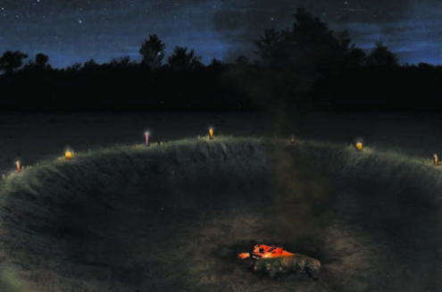{.artview-decision .artview-width-80 .artview-align-center}

Описание. В центре большой поляны находится Кремационная яма. Это вырытая в земле воронка диаметром 12 метров, окружённая метровым валом земли. Сама яма достигает примерно 3 метров глубины, хотя её настоящее дно невозможно определить, поскольку низ заполнен пеплом и обугленными костями. В центре лежит похожий на почерневший и дымящийся труп крупного животного, например собаки или свиньи, которое сожгли недавно.

Край ямы отмечен огарками нескольких сотен свечей, которые сплавились с воском свечей прошлых десятилетий в общую массу, образовав бледное кольцо вокруг этой нечестивой голгофы ([раздаточный материал #33](#viral-handout-33)).

> Заметки Хранителя
> 
> Издалека обгоревшие останки похожи на какую-то свинью. Если кто-нибудь владеет Естествознанием, Наукой (биология) или подобным навыком (на усмотрение Хранителя), сложный успех позволит опознать в существе гигантского грызуна, похожего на сурка или, возможно, опоссума, но намного крупнее. В любом случае таких животных на острове быть не должно.

> Возможное видение от Зрения
> 
> В ушах стоит визг, похожий на крик крысы от боли. В центре ямы привязана огромная крыса... или, может быть, свинья... которую прямо сейчас сжигают заживо. Рядом стоит неразличимая тёмная фигура с горящим факелом в руке.

#### Причал Isola di Malamente

Описание. Единственный островной причал состоит из мощёного мола длиной 75 метров, в конце которого перпендикулярно расположен деревянно-бетонный пирс длиной 45 метров. Мол более или менее цел, но пирс разрушен: несколько больших участков обвалились в море. В воде у проломов частично затоплены около дюжины проржавевших стальных бочек, скреплённых какой-то массой чёрного грибка.

> Заметки Хранителя
> 
> Пирс достаточно устойчив, чтобы один человек без риска дошёл до дальнего конца. Однако если на нём окажется больше пяти человек, каждый должен совершить проверку Удачи. Если неудач не больше трёх, пирс лишь заскрипит, но при четырёх и более он обрушится и сбросит всех в воду.
> 
> Когда-то бочки содержали биологические отходы больницы, которые собирались сбросить в море, но штормовой нагон заставил пирс рухнуть под их весом. Чёрная масса — мутировавшая форма водорослей, чудовищная на вид, но более или менее безвредная. Осматривающий бочки сыщик может совершить проверку Внимания. Успех означает, что он узнаёт знак биологической опасности, всё ещё видимый на одной из бочек. Сложный успех позволяет заметить в водорослях почерневшие обломки человеческих костей.

> Возможные видения от Зрения
> 
> Ваш взгляд меняется: теперь вы смотрите сквозь прутья клетки. Вы понимаете, что закованы, и не помните, когда последний раз ели или пили. Ночь, в ушах шумят насекомые и море. Подняв глаза, вы видите, что прикованы внутри ящика, а затем вас швыряет к крыше, когда ящик с грохотом падает на деревянный пол. Рядом кого-то ругают и говорят, что монахи предпочитают получать жертвы неповреждёнными. Узел страха заставляет вас истошно закричать, и всё погружается во тьму.

#### Смотровой мыс

Описание. Дорога на северо-восток заканчивается широкой круглой разворотной площадкой. На выцветшем, наполовину поваленном знаке написано Punta Bellavista (Смотровой мыс), а стрелка указывает на заросшую, но ясно различимую тропу между низкими искривлёнными деревьями. Гравийная дорожка ведёт примерно на север по разбитой неровной земле. Примерно через 45 метров деревья становятся ещё более чахлыми и редкими, и вы видите скалистый клочок суши, отмечающий самую северную точку Isola di Malamente. Отсюда вдали едва различимы огни сицилийского берега.

Грубо прорубленная тропа ведёт к самому краю Смотрового мыса. В конце полуразвалившаяся деревянная платформа ненадёжно держится за большой плоский валун, выступающий над водой на 6 метров.

> Заметки Хранителя
> 
> Даже в лучшие времена пройти по камням трудно, а ночью, пусть и с фонарём, путь становится по-настоящему опасным. Каждый, кто пытается преодолеть 60 метров до мыса, должен совершать проверку ЛВК через каждые 15 метров. Успех означает, что он без происшествий достигает цели. Неудача означает растяжение лодыжки, снижающее скорость сыщика на 1 на пару дней. Сложная неудача означает падение на землю и 1 пункт урона, а экстремальная — перелом ноги. Если персонаж особенно осторожен, дорога занимает вдвое больше времени, но он получает бонусную кость к проверкам ЛВК. Если же он торопится, то добирается вдвое быстрее, но совершает проверки со штрафной костью. При отсутствии источника света также добавляется штрафная кость.
> 
> Наградой за достижение конца пути станет вид небольшой тёмной лодки, стоящей на якоре в нескольких десятках метров от берега. Это Vedetta — патрульный катер класса Esploratore с экипажем из 16 человек, вооружённый тремя пулемётами. Успешная проверка Внимания позволяет заметить движущиеся по катеру фигуры. Сложный успех означает, что сыщик услышит итальянскую речь экипажа, а экстремальный — поймёт, что это служащие итальянского флота.
> 
> Экипаж Vedetta знает о сыщике или сыщиках и предпримет одно из двух действий: спасёт их либо откроет огонь на поражение, чтобы не позволить инфекции покинуть остров. Выбор может сделать Хранитель либо определить проверка Удачи сыщиков. Сцену можно разыграть по-разному в зависимости от момента сценария. Если это происходит в начале, экипаж их игнорирует и хранит молчание; если же сыщиков преследует невыразимый ужас, моряки постараются любой ценой не дать им покинуть остров.

#### Часовня и крипта

Описание, кладбище. Надгробия на кладбище при часовне стары и обветрены. Даже неискушённому наблюдателю они кажутся многовековыми. По сути, новых среди них вообще нет.

> Заметки Хранителя
> 
> Из-за выветривания большинство надгробий невозможно прочесть, а сохранившиеся надписи сделаны на итальянском. Примерно пятнадцать минут поисков и сложная проверка Внимания показывают, что новейшие камни относятся к концу девятнадцатого века.

Описание, часовня. От старой часовни осталась лишь пустая оболочка, хотя она достаточно устойчива. Всё, что могло обрушиться, рухнуло много лет назад. Старая каменная апсида на удивление цела, над ней сохранился более или менее прочный купол. Тёмная куча наверху ступеней когда-то, вероятно, была деревянным алтарём, но за века разложилась почти полностью и превратилась в заросший холм необычных лоз с пёстрыми листьями пыльно-оливкового и настолько тёмного пурпурного цвета, что он кажется чёрным.

По обе стороны от холма ступени изгибаются навстречу друг другу. Правая лестница частично завалена обломками, но левая свободна, если не считать лоз, свисающих поперёк тёмного проёма словно занавес.

> Заметки Хранителя
> 
> Фреска на куполе давно рассыпалась в прах, поэтому от первоначального рисунка почти ничего нельзя различить, кроме выраженного средиземноморского стиля. Ближе к краям сыщики могут разглядеть отдельные руки или части лиц. Экстремальная проверка Внимания позволяет заметить изображение монаха, который держит над головой какую-то чашу в качестве подношения. Увидевшие это сыщики должны совершить проверку ВОЛ. При успехе им покажется, что голова монаха на фреске слегка поворачивается к ним, вызывая проверку Рассудка (1/1D4). Разумеется, это легко списать на игру света.

Описание, крипта. Раздвинув занавес листвы и спустившись по ступеням, вы оказываетесь в крипте часовни. Её размеры — примерно 18 метров в длину и 12 метров в ширину; широкие колонны поддерживают низкий сводчатый потолок. Вдоль стен расположены десятки погребальных ниш, каждая запечатана тяжёлой каменной плитой. В восточном конце находятся три алькова, причём центральный уходит вглубь почти на 3 метра. В северном стоит статуя монаха со склонённой головой, лицо которого полностью скрыто тенью. В глубине центрального алькова находится каменный постамент с железным ящиком. Размер ящика — около 45 сантиметров в ширину, 75 сантиметров в длину и 25 сантиметров в толщину. Он заперт средневековым навесным замком, который, судя по толстому слою ржавчины и коррозии, не открывали веками.

Когда-то в южном алькове стояла статуя, но от неё сохранились лишь обутые в сандалии ступни на грязном возвышении. Задняя стена покрыта любопытными письменами, не похожими ни на итальянский, ни на греческий. Они скорее напоминают иврит, но очевидно, что это тоже не он.

В самом центре крипты лежит древняя каменная плита, обработанная в форме низкого прямоугольного стола или алтаря. Судя по пропорциям (1,2 метра шириной, 2,1 метра длиной и 0,9 метра высотой), на неё могли укладывать тела при подготовке к погребению или для какого-то древнего погребального обряда ([раздаточный материал #34](#viral-handout-34)).

> Заметки Хранителя
> 
> Именно на алтаре крипты Майя рекомендовала воспользоваться спиритической доской. Проверка Внимания показывает, что когда-то рядом с углами находились железные кольца, намекающие на более зловещее применение. Теперь от них остались лишь ржавые обрубки.
> 
> Спиритическая доска. Спиритическая доска связывается напрямую с Чумным монахом. Сыщики, разумеется, будут задавать вопросы, и Хранителю сначала следует подыгрывать, словно это обычный спиритический сеанс. Постепенно события должны становиться всё тревожнее, пока планшетку буквально не вырвет у них из рук и она не начнёт сама складывать слова. Последним словом будет ХАСТАЛИК, и сразу после его завершения землю сотрясёт мощная судорога, расколов алтарь и обрушив лестницу в часовню. Сыщикам следует совершить проверки ЛВК, чтобы не упасть и не получить 1D3 пунктов урона. Кроме того, они должны совершить проверки Удачи. При неудаче их заденут падающие обломки, нанеся 1D6 пунктов урона.

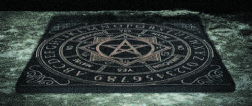{.artview-decision .artview-width-80 .artview-align-center}

Сыщики быстро обнаружат, что толчки открыли проход в задней части южного алькова, и теперь это единственный путь из крипты. Туннель всего около 75 сантиметров шириной и сразу ступенями уходит вниз. Проход слегка петляет из стороны в сторону, поэтому невозможно определить, насколько далеко он тянется. Если проверить движение воздуха пламенем, станет ясно, что сквозняк определённо дует в этот проход.

> Возможные видения от Зрения
> 
> Перед глазами вспыхивают образы прошлого. Жертва за жертвой. Металл скребёт по камню. Царапанье. Пальцы стёрты до костей. Кровь течёт из самих стен. Воздух полон криков и мольбы. И надо всем — песнопение. Низкое гортанное песнопение, словно призывающее нечто из потаённого места...

#### Вход в катакомбы

Описание. Выйдя из узкого прохода, вы оказываетесь в каких-то катакомбах, которые, по виду, относятся к третьему веку нашей эры или ещё более раннему времени. В стенах вырублены десятки полок. На каждой лежат человеческие останки — главным образом кости и прах. Судя по всему, единственный выход — проход шириной 60 сантиметров в дальней стене. Высота потолка здесь всего около 1,8 метра.

На соседней каменной полке вы замечаете древнюю книгу. Большая её часть превратилась в пыль и осыпающиеся бурые хлопья, но один фрагмент, похоже, сохранился ([раздаточный материал #35](#viral-handout-35)).

> Заметки Хранителя
> 
> Описывая катакомбы, Хранителю следует подчёркивать их клаустрофобию: рассказывать, как плечи сыщиков трутся о стены, а головы время от времени задевают потолок. Если на них надето что-то громоздкое, например рюкзак, они то и дело застревают, и приходится останавливаться, чтобы освободиться. Время от времени сыщики должны совершать проверку Удачи, чтобы определить, не сбили ли они случайно кости с полок. Когда это случится впервые, внезапный испуг заставит всех совершить проверку Рассудка (0/1).
> 
> Некоторые проходы немного шире, давая сыщикам краткую передышку, но когда они попадут в следующий узкий туннель, клаустрофобия ощутится ещё сильнее. Если кого-либо здесь постигнет приступ безумия, у него, вероятно, разовьётся настоящая клаустрофобия, способная вызвать панику или на мгновение сковать бездействием.

> Прямая трансляция
> 
> К этому моменту итальянское правительство уже прервало прямую трансляцию, но сыщики об этом не знают. Единственное, что они могут заметить (если посмотрят), — число зрителей упало до двух. Один из них — наблюдатель DSS, другой — UltimaUnum, который предлагает им \$10,000 за продолжение.
> 
> Майя знает, что сигнал прерван, однако ей очень трудно связаться с ними. Хранитель может время от времени позволять её голосу прорваться в виде искажённого сообщения, пока она отчаянно пытается обойти оператора DSS. Это следует использовать как можно более кинематографично, выдавая сыщикам сведения по капле. Если они движутся слишком медленно, Майя может прорваться с чем-то вроде: «...итальянские солдаты идут... уходите!» Ближе к концу она перехватит план DSS разбомбить остров и предупредит их.
> 
> Всё это время DSS поддерживает связь с британскими властями, поэтому Хранитель может устроить рейд в доме Майи прямо посреди разговора, когда она предупреждает сыщиков. Тогда они услышат, как вышибают дверь, и даже выстрелы.

#### Катакомбы

Описание. Туннели напоминают лабиринт, прорубленный в цельной скале острова. Вы проходите мимо бесчисленных локул — ниш, заваленных костями и черепами. Невозможно не замечать редкие отблески безделушек и мелких ценностей, вероятно оставленных как последние дары покоящимся здесь мертвецам. Время от времени туннель немного расширяется, но за следующим поворотом снова сужается. Редкие боковые проходы уходят влево или вправо... а может быть, теперь именно вы идёте по боковому проходу. Понять невероятно трудно ([раздаточный материал #36](#viral-handout-36)).

> Заметки Хранителя
> 
> Если сыщики попытаются украсть какие-либо погребальные дары, для успеха им придётся пройти проверку Рассудка. При неудаче непреодолимое желание оставить вещи в покое не позволит их взять. При успехе вор успеет лишь мельком осмотреть блестящую безделушку, прежде чем из тёмной глубины полки вытянется кишащая червями рука и попытается его схватить. Это, разумеется, вызывает проверку Рассудка (1D3/1D6), а вора хватают за одежду. Он может вырваться с помощью успешной проверки СИЛ или сбросить схваченную одежду (на усмотрение Хранителя).
> 
> Посветив в нишу, сыщики увидят покрытый гнилью труп, завёрнутый в рваную ткань (см. [Чумного зомби](#viral-appendix-new-mythos-horrors-reliquae-infection)). С рыхлой плоти на костях свисают бледные черви и грибок. Вздутые молочно-белые глаза злобно смотрят на вора. В глубине теней позади виднеются новые пары глаз.
> 
> В этот момент [Реликвы](#viral-appendix-new-mythos-horrors-reliquae) (см. приложение, с.66) начинают выбираться с полок к сыщикам. Хранитель сам решает, сколько существ бросится в погоню.
> 
> По катакомбам разбросаны помещения разного назначения. Многие представляют собой простые узлы, где сходятся несколько туннелей, другие служили для подготовки тел. В некоторых стоят закрытые саркофаги, вероятно предназначавшиеся для людей более высокого положения. Их крышки почти невозможно открыть без инструментов, а даже с ними потребуется не меньше часа ([раздаточный материал #37](#viral-handout-37)).

> Возможное видение от Зрения
> 
> В ушах звучит ветер, гуляющий по этим туннелям. Вы начинаете слышать низкий голос, который словно говорит на всех языках сразу — и ни на одном: «Соединись с нами».

#### Храм Морбуса

Описание, храм. В отличие от других залов катакомб, которые вы встречали, отсюда гладкие каменные ступени поднимаются в гораздо более просторное помещение. Судя по архитектуре, это какой-то храм римской эпохи. Высокий свод поддерживают широкие колонны с истёртыми рельефами, изображающими кошмарные сцены: скелетообразные тела сбрасывают в ямы, гигантские черви заглатывают людей целиком, а над ними группы мужчин в одеяниях исступлённо поклоняются высокой узкой форме, которую глаз не способен определить.

Зал простирается влево и вправо на 24 метра, а дальняя стена находится примерно в 15 метрах впереди. Прямо перед вами виден арочный проём, а в комнате за ним — столб пыльного лунного света!

> Возможное видение от Зрения
> 
> Ваши руки и ноги скованы, и вас внезапно толкают на пол в зале, освещённом факелами, от которых исходит запах затхлого разложения. Воздух наполнен гулом мух. Оглянувшись, вы видите римского легионера с обнажённым гладиусом, направленным на вас. Он говорит с кем-то, кого вы не можете разглядеть в мерцающих тенях. Хотя речь звучит на латыни, вы прекрасно понимаете каждое слово.
> 
> "Я прибыл в составе делегации из Рима. Город охватила оспа, и мы опасаемся, что каким-то непостижимым образом прогневали Морбуса. Рим предлагает дань в виде жертвы, чтобы вы молились о нашем спасении".

Описание, Родильная яма. Зал впереди кажется древнее римского храма. Это высеченный грот с сужающимися колоннами, которые поднимаются к арочному потолку. Посреди пола зияет отверстие шириной 3 метра, похожее на колодец. Изнутри доносится густое хлюпанье.

В центре потолка находится круглое отверстие, закрытое железной решёткой. Вы замечаете что-то привязанное к решётке, и, проследив взглядом вниз, видите фигуру в одеянии, подвешенную над ямой за шею; голова в маске низко склонена. Чумной монах. Лица не видно, но руки выглядят высохшими, словно он находится здесь уже очень давно.

> Заметки Хранителя
> 
> Едва сыщики увидят монаха, как его голова с чередой щёлкающих хрустов поднимется и повернётся к ним. Это вызывает проверку Рассудка (1/1D8). Каждый с достаточно высокой [Порчей](#viral-appendix-new-rules-the-taint) должен совершить проверку ВОЛ, иначе почувствует непреодолимое желание заглянуть в яму, если его никто не остановит. Подошедший на расстояние 1,5 метра увидит жуткую жижу из гнилой плоти и жидкостей, медленно кружащуюся внутри. Может потребоваться ещё одна проверка ВОЛ, чтобы не броситься в яму (см. [Порчу](#viral-appendix-new-rules-the-taint) на с.62).

### Хасталик пробуждается

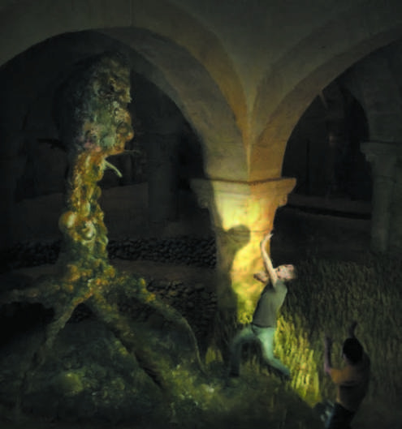{.artview-decision .artview-width-80 .artview-align-center}

Тело, словно изорванная тряпичная кукла, падает в яму. Раздаётся хруст, будто кости ударились о грязь, затем наступает краткая тишина. Внезапно пол дрожит и выгибается, а бульканье из ямы усиливается. Мгновение спустя от ямы по полу разбегаются трещины, и земля разрывается. Из влажного пола под ногами тянутся хватающие руки из плоти.

Трупы вырываются из осквернённой земли и, спотыкаясь, ползком или волочась, направляются к яме. На них одежда разных эпох: мундиры нацистских, итальянских, британских и американских солдат, сгнившие коричневые клобуки монахов, истлевшие сутаны священников, ржавые цепи рабов и даже доспехи римских легионеров. Все повторяют одно слово...

"Хасталик... Хасталик... Хасталик..."

Затем до вас доходит запах. Вас выворачивает, когда тела одно за другим бросаются в яму с густыми чавкающими всплесками. Позади раздаются треск, хруст и шарканье: иссохшие трупы минувших эпох выходят из катакомб. Вы в ловушке.

Земля содрогается во второй раз, и позади ямы разверзается трещина, взбирающаяся по стене до потолка. Стена обрушивается внутрь, создавая неровный наклонный проход наверх. Сквозь разлом падает больное лимонное дерево и с громким треском ударяется о землю. Оно ложится поперёк склона, застряв между полом и потолком. Тут же налетает порыв ветра, приносящий приторно-сладкий запах гнилых фруктов и лёгкий аромат солёного моря. Вверху обрушившегося склона видны лимонная роща и ночное небо.

Хасталик восстаёт. Пока вы пытаетесь осмыслить происходящее, раздаётся третий грохот, и вы с ужасом видите, как из ямы вытягивается огромная почерневшая нога, похожая на конечность насекомого. Она покрыта злобными шипами, помогающими зацепиться, когда из-за осыпающегося края появляются ещё пять ног.

Мерзкое чудовище, которое мгновение спустя выбирается наружу, напоминает огромный вирусный бактериофаг, почти достигающий сводчатого потолка. Похоже, оно состоит из заражённой плоти, складывающейся в ужасающее воплощение Хасталика. Полупрозрачная мембранная кожа трупно-серого цвета вздувается кричащими лицами, которые движутся и корчатся внутри. «Голова» — смутно похожая на икосаэдр масса цвета синяка, покрытая пульсирующими чернильными кистами. Существо издаёт переливчатый стрёкот, от которого сверху осыпается ещё больше пыли и земли.

Тела павших на миг застывают, словно в благоговейном изумлении перед увиденным, а затем бросаются к своему кощунственному богу и растворяются в его массе. Наружная мембрана рвётся и бурлит, пока существо растёт, ударяясь огромным телом о каменный потолок. Свод трескается, и в зал падает всё больше камней. К счастью, тварь из ямы пока вас не заметила, упиваясь величием собственного отвратительного рождения ([раздаточный материал #38](#viral-handout-38)).

> Заметки Хранителя
> 
> Когда пол проломится, сыщикам следует совершить проверку ЛВК, чтобы устоять на ногах. Когда до них дойдёт запах, потребуется проверка ТЕЛ, иначе тошнота парализует их на один раунд.
> 
> Как только появится Хасталик, каждый в комнате должен совершить проверку Рассудка (1D8/4D10) и получить 2 уровня Порчи. Провалившие проверку Рассудка не смогут двигаться один раунд, пока Хасталик формируется у них на глазах.
> 
> Если у сыщика меньше 10 уровней Порчи, он сможет сбежать от Хасталика — если захочет. Есть три очевидных способа без труда уйти до того, как биомасса Хасталика увеличится настолько, что он сможет атаковать сыщиков. На это требуется пять раундов.

Побег! У сыщиков есть три очевидных пути из разрушающегося храма. Каждый связан со своими опасностями и вероятностью успеха; разумеется, если Хранитель захочет, он может отменить любые проверки и просто позволить сыщикам бежать. Если игроки придумают не упомянутые здесь варианты, Хранителю рекомендуется вознаградить такую находчивость перед лицом подавляющего ужаса.

Назад. Обратный путь опасен из-за неудержимого потока живых мертвецов, желающих принести себя в дар Хасталику. К счастью, череда толчков, возвестивших о его появлении, расколола потолок часовни и открыла путь наружу. От родильного зала до входа пять раундов пути, полного опасностей. Чтобы вырваться, каждый сыщик в каждом раунде роста Хасталика должен совершать проверку Удачи, уворачиваясь и протискиваясь обратно через катакомбы. При неудаче давящие трупы, торчащие кости, падающие обломки и прочие опасности наносят 5 пунктов урона; успешная проверка Уклонения снижает урон до 3. Если проверка Уклонения провалена, сыщик получает один пункт Порчи. Если в катакомбах уровень Порчи сыщика в любой момент возрастает до десяти, он останавливается, разворачивается и следует за Реликвами обратно к Хасталику, чтобы принести себя в жертву новорождённому Богу. До свободного входа можно добраться за пять раундов.

Разлом в стене. Второй толчок, сотрясший остров и обрушивший рощу сверху, также расколол заднюю стену. Открылся старый туннель контрабандистов, который монахи когда-то запечатали, решив сохранить рождение Хасталика в тайне от внешнего мира. Туннель уходит во тьму, и ничто не указывает, где он заканчивается, однако если сыщик пойдёт по извилистому проходу, тот выведет его к месту возле Плачущего моста и воды под ним. Если сыщик потратит мгновение на осмотр прохода, успешная проверка Внимания со штрафной костью позволит среди вони разложения уловить свежий запах моря. Если бежать по туннелю изо всех сил, до конца можно добраться за пять раундов. Разумеется, там непроглядно темно и есть узкие места, где крупные члены группы могут ненадолго застрять.

> Заметки Хранителя
> 
> Разыграйте это для выразительности, но позвольте игрокам обойтись без броска — пусть почувствуют, что им повезло.

Больное лимонное дерево. Как уже сказано, одно из лимонных деревьев упало сверху и легло примерно под углом $45^{\circ}$, позволяя взобраться по нему в Лимонную рощу и выбраться наружу. В этот момент воплощение Хасталика, хотя и быстро растёт, почти не обращает на сыщиков внимания. Это даёт им возможность спастись.

Чтобы выбраться, потребуется три раунда. В каждом раунде совершается проверка СИЛ с бонусной костью благодаря обилию ветвей и опор для рук. Три успешные попытки приводят к вершине и свободе. Результат, который обычно считался бы критическим успехом, позволяет подняться вдвое дальше. Неудача означает отсутствие движения. Результат, который обычно считался бы провалом, означает потерю хватки и скольжение на одну ступень вниз. Одновременно по дереву могут взбираться два человека. Если кто-то добрался до вершины и решил помогать вместо того, чтобы спасаться, он может страховать товарищей, подбадривать их или даже отломить ветку соседнего дерева и использовать её как направляющую либо опору. Это даёт ещё одну бонусную кость одному взбирающемуся. Аналогично, если кто-то внизу страхует его, подбадривает или подталкивает вверх, тот получает ещё одну бонусную кость. Всех, кто останется внизу после пяти раундов, атакуют ложноножки с нижней стороны Хасталика, который останется здесь, чтобы пожрать любого, кто не успел сбежать.

> Почему не использовать навык Лазание?
> 
> Причин несколько. Во-первых, большинство сыщиков просто «не занимается» лазанием, а вложенные в навык Лазание пункты заранее намекают, что однажды его придётся применять, чего мы хотим избежать. С игровой точки зрения даже неуклюжий человек способен подняться по лестнице и не погибнуть, а дети часто лазают по деревьям без всякого обучения. Мы считаем, что Лазание в контексте Call of Cthulhu предназначено для испытаний вроде подъёма по отвесной скале, верёвке или стене здания. При этом мы хотим дать сыщикам хотя бы боевой шанс избежать участи быть сожранными Хасталиком: нет ничего более раздражающего, чем снова и снова проваливать броски, ожидая неизбежного. Если вы всё же хотите использовать Лазание, дайте игрокам постоянную бонусную кость благодаря доступным опорам на дереве.

Хасталик вырвался на свободу. Пока сыщики бегут от ужасного воплощения Хасталика, тот продолжает поглощать Реликвы, а также всю осквернённую флору и фауну острова, становясь всё больше, пока не возвышается надо всем. Поглотив биомассу острова, он приобрёл колоссальные размеры и достигает высоты нескольких этажей, а его гротескную голову теперь окружает нечестивый нимб гудящих мух — кощунственная пародия на христианство.

Теперь сыщики могут видеть его буквально из любой точки острова, и куда бы они ни побежали, он следует за ними; если группа разделится, он преследует тех, у кого самая низкая суммарная Удача.

Помимо скверны, стекающейся к Хасталику, сыщики видят, как от него отступает нетронутая природа. Птицы на малом острове взмывают в небо, косяки рыб будоражат воду, уплывая прочь, и даже само море отступает от острова, оставляя вокруг полосу грязи и песка.

Если сыщики бегут по Плачущему мосту (при условии, что Старший Знак всё ещё цел), Хасталик не сможет последовать за ними. Каким-то образом ощущая присутствие живых существ, он бросается вперёд и ударяется о невидимую стену, которая на мгновение вспыхивает сферой сверкающего белого света, полностью охватывающей остров сверху и снизу. Существо ненадолго остановится, словно попав в ловушку... пока не почувствует ретранслятор Wi-Fi. Если сыщики оглянутся, то увидят, как нимб мух отделяется от Хасталика, складывается в рой и окутывает ретранслятор. Мгновение спустя мухи начинают вылетать из всех подключённых к Wi-Fi электронных устройств при сыщиках. В маловероятном случае, если у них нет такой техники, мухи роями окружают маяк, вырываясь через базовую станцию.

Хранителю следует подобрать темп этого процесса так, чтобы сыщики успели уничтожить оборудование или в ужасе увидели, как Хасталик разрушает маяк, отрезая им путь к спасению.

Пока всё это происходит, пара вертолётов над морем освещает кошмарную фигуру Хасталика лучами прожекторов. Мгновение спустя сыщики слышат рёв приближающихся военных самолётов, готовящихся нанести удар по острову. Время снова выбирает Хранитель, но в идеале это должно произойти в самый кинематографичный момент.

Важно помнить, что Хасталик пытается добраться до воды, чтобы распространиться по всему миру. Итальянские военные этого не допустят, поэтому если во время падения бомб сыщики окажутся где-то рядом с Хасталиком, они вряд ли выживут. Но мир хотя бы будет спасён. Особенно щедрый Хранитель может позволить каждому сыщику совершить проверку Удачи, чтобы найти место, где удастся избежать верной смерти. Возможно, со времён Второй мировой войны остался бомбоубежище или небольшая пещера, способная защитить от огненного шторма, который вот-вот выжжет остров.

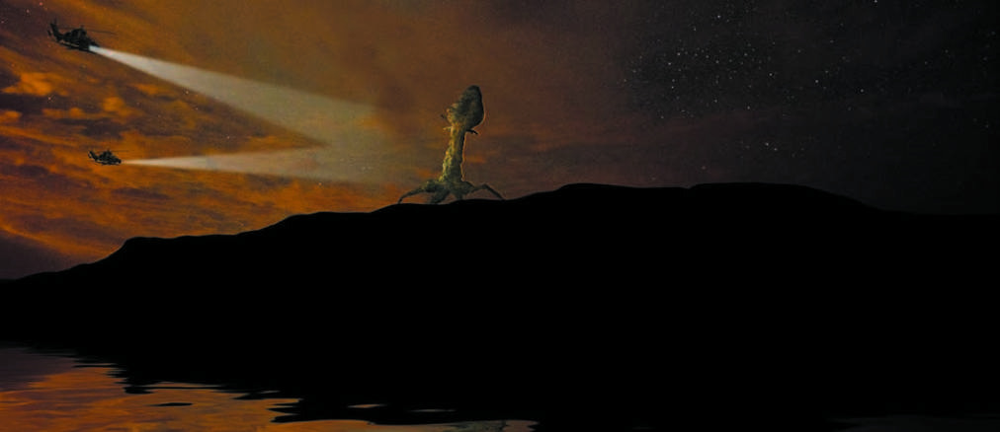{.artview-decision .artview-width-80 .artview-align-center}

Опустошение Isola di Malamente. Итальянские военные полностью уничтожат остров серией воздушных бомбардировок. Их расписание вновь можно менять ради кинематографичности, но если сыщики достигли хоть какого-то безопасного места — южной оконечности малого острова, Смотрового мыса на севере большого острова или перевёрнутой гребной лодки в Бухте нищих, — они станут свидетелями разрушения.

Когда падают первые бомбы, огненные шары освещают весь остров. На фоне пламени вырисовывается извивающаяся фигура Хасталика, который яростно горит и вопит в небо. Грохот тяжёлых пушек самолётов отрывает от твари огромные куски, пока та тщетно пытается сбить машины с неба ложноножками ([раздаточный материал #39](#viral-handout-39)).

Если сыщики достаточно далеко, они увидят взрывы прежде, чем почувствуют ударную волну и сопровождающий её жар, в сравнении с которым душная ночь покажется почти прохладной. Бомбардировка продолжается несколько минут, пока все следы Хасталика и каждое строение на Isola di Malamente не превращаются в щебень и пепел. Менее чем за десять минут остров полностью выжигают, оставив лишь отдельные пожары и столбы маслянистого чёрного дыма.

Если Енох находится в лодке, он узнает исполнение своего прежнего видения (если игрок не догадается раньше).

## Эпилог

Если Хранитель хочет подвести итоги, итальянская DSS может подобрать сыщиков, допросить их и, по сути, угрозами заставить молчать о произошедшем (см. [Расширенную концовку](#viral-epilogue-expanded-ending) на с.56). Сыщикам не следует недооценивать способность DSS опорочить их и/или усложнить им жизнь, если они не будут держать язык за зубами.

Если один из выживших позвонит Майе, та окажется сильно потрясена визитом оперативника MI6, который устроил почти такой же допрос и предупредил её молчать. Перед тем как повесить трубку, Майя издаёт звук отвращения и говорит: "Откуда, чёрт возьми, взялись все эти проклятые мухи?" После этого связь обрывается.

### Награды

Если сыщикам удаётся выжить, они тут же начинают избавляться от скверны. Они теряют по 1 уровню Порчи в день, пока она не исчезнет, хотя её тень навсегда останется на их душе.

Если Хасталик уничтожен, сыщики получают 1D10 пунктов Рассудка за осознание того, что мир спасён... пока что. Они дополнительно получают 1D3 за каждого участника Команды (кроме них самих), сумевшего выбраться с острова. Если они спасают с острова кого-либо (например, Эмили Лавинь), то получают 1D4 Рассудка. Наконец, если Хранитель выбирает зловещий эпилог, в котором Майя упоминает мух, они теряют 1D6 Рассудка.

Среди дополнительных наград могут быть звонок с The Discovery Channel с предложением вести новое шоу об охоте на призраков и криптидах, звонок из крупного СМИ, предлагающего им огромные деньги за «правдивую историю», или визит представителей таинственного правительственного агентства, вербующего на службу людей, переживших подобные ужасы. Является ли последнее наградой — покажет лишь время.

### Кинематографическая концовка

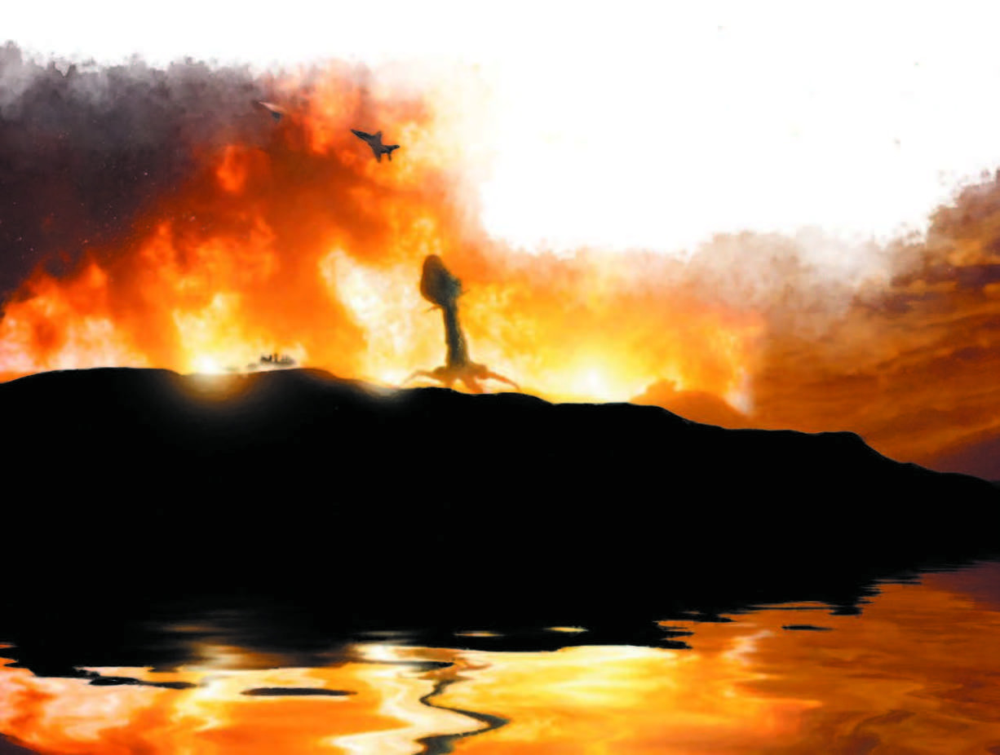{.artview-decision .artview-width-80 .artview-align-center}

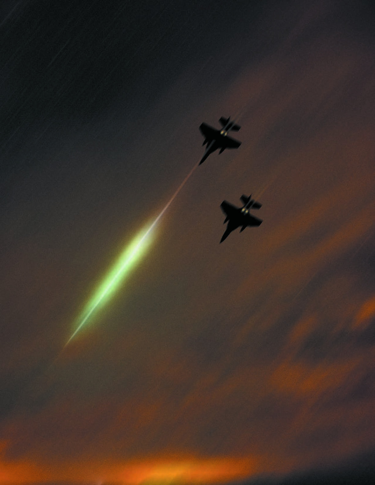{.artview-decision .artview-width-80 .artview-align-center}

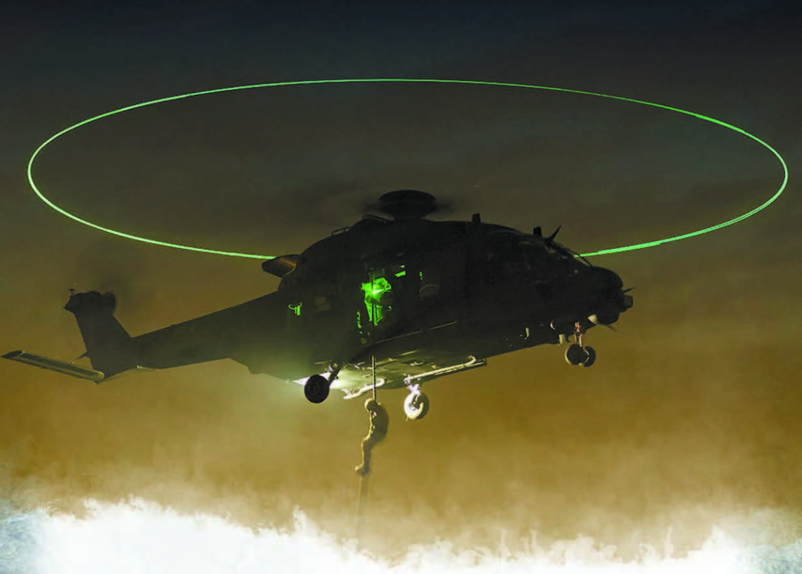{.artview-decision .artview-width-80 .artview-align-center}

Этот вариант предназначен для случая, когда Хранитель хочет сделать кульминацию сценария более драматичной. Он естественным образом переходит в [Расширенную концовку](#viral-epilogue-expanded-ending) (см. с.56), которая, в свою очередь, может привести к продолжительной кампании. Когда сыщики окажутся на поверхности острова и будут спасаться бегством от Хасталика, прочитайте следующее:

Пока вы бежите от титанической фигуры, поднимающейся из осквернённой земли, над головой раздаётся глубокое ритмичное «тук-тук-тук». Лучи прожекторов скользят по острову, безжалостно освещая возвышающуюся за вами мерзость.

Четыре вертолёта заходят по кругу, направляя свет на существо, а оно вытягивает хлыстообразные псевдоподии и бьёт ими по машинам. Внезапно один вертолёт врезается в другой, и обе машины, потеряв управление, устремляются вниз.

Один из них по спирали уходит к берегу и врезается в илистую землю, недавно обнажившуюся из-за отступившей воды. Следует ослепительная вспышка, а мгновение спустя — оглушительный взрыв, от которого земля дрожит у вас под ногами.

> Заметки Хранителя
> 
> Сыщики могут совершить проверку Интеллекта, чтобы понять: вертолёт рухнул на одну или несколько обнажившихся морских мин.

Вы едва успеваете отреагировать, когда второй вертолёт ударяется о землю и, кувыркаясь, несётся к вам. Обломки лопастей разлетаются по ближайшим зарослям словно гигантские метательные ножи, взрыхляют землю и высекают искры в ночном воздухе.

Горящие обломки останавливаются всего в нескольких метрах от вас, задев прежде скрытый символ, высеченный на большом круглом камне, и раскалывают его с громовым треском. Вы видите, как от разбитой печати развеивается нечто похожее на серебристый пар, и на миг всё стихает — слышны лишь два оставшихся вертолёта, кружащих над головой.

> Заметки Хранителя
> 
> Если они не заметили предыдущий символ у Плачущего моста, Хранитель может просто импровизировать, опираясь на [описание](#viral-isola-location-03-the-weeping-bridge) на странице 35.

Мерзость останавливается, слегка покачивая головой, словно что-то почуяла. Дверь вертолёта с оглушительным грохотом распахивается, и из тёмного салона вырываются рои мух. Залитый кровью итальянский солдат выбирается наружу и падает на землю. Тяжело раненный мужчина отчаянно кричит вам на ломаном английском.

"Оно не должно дойти до воды! Если дойдёт... всё умрёт! Всё... всё умрёт!"

Солдат протягивает нечто вроде перевязи с ручными гранатами и трясёт ею перед вами.

"Выдернуть чека и бросить! Десять... secondi... э-э, секунд — и БАБАХ! Не пускать к воде! Прошу!"

Внезапная трель мерзости оглушает вас, а она с топотом бросается прямо на вас!

Солдат в ужасе смотрит на Пожирателя, и этот ужас быстро сменяется покорностью судьбе. Не желая жить в мире, осквернённом Хасталиком, он достаёт пистолет и лишает себя жизни. Почти сразу из его радиогарнитуры вырываются мухи, труп рывком поднимается на ноги и, шаркая, направляется к Пожирателю.

В идеале сыщики захотят предотвратить конец света и с помощью гранат замедлить мерзость, которая теперь мчится к ним.

Всего имеется двенадцать зажигательных гранат, специально разработанных DSS для создания огромного огненного шара, который несколько секунд горит при температуре около $1,500^{\circ}$ F.

> **Зажигательные гранаты DSS (12)**
> Навык: Метание, Урон:\* 4D10/3 метра, Дальность: СИЛ/5 метров, Применений за раунд: ½, Неисправность: 99
> \*Наносят 4D10 урона находящимся в пределах 3 метров, 2D10 — в пределах 6 метров и 1D10 — в пределах 9 метров. Продолжают наносить 2D10 урона огнём в течение 3 раундов.

Пожиратель отступает перед огнём, поэтому даже если сыщикам удастся бросить гранату в пределах 10 метров от него, существо остановится на один раунд.

> Заметки Хранителя
> 
> Пожиратель сразу понимает, что взрыв морских мин разрушил один из Старших Знаков, удерживающих его на острове. DSS разместила вокруг острова несколько таких печатей, поэтому Хранителю следует расположить повреждённую печать неподалёку от сыщиков.

Два оставшихся вертолёта немного замедляют [Пожирателя](#viral-appendix-new-mythos-horrors-hastalyk), что должно дать сыщикам возможность подойти достаточно близко и забросать его гранатами. Учтите: приблизившись на 10 метров, они рискуют подвергнуться атаке псевдоподии и, возможно, быть поглощёнными [Пожирателем](#viral-appendix-new-mythos-horrors-hastalyk) (см. с.65).

Если Пожирателю не мешать, он наверняка доберётся до берега до того, как остров подвергнется бомбардировке зажигательными боеприпасами. Хранитель должен решить, сколько раундов потребуется Пожирателю, чтобы достичь воды; каково бы ни было это число, самолёты прибудут через 10 раундов, если только сыщики не вмешаются и не задержат Пожирателя.

Хотя гранаты наносят Хасталику урон, их недостаточно, чтобы полностью его остановить. Каждая из них может задержать его продвижение на один-четыре раунда в зависимости от результата броска. Хранителям рекомендуется давать бонусный кубик при броске любому сыщику с Ловкостью 60 или выше. В качестве альтернативы Хранитель может попросить их просто совершить проверку Ловкости, ведь они бросают в огромную цель оружие с большой зоной поражения.

| Результат броска | Дальность | Результат |
| --- | --- | --- |
| Провал | Нет | См. ниже |
| Неудача | 11+ метров | Без задержки |
| Обычный успех | 10 метров | Задержка на 1 раунд |
| Сложный успех | 6 метров | Задержка на 2 раунда |
| Экстремальный успех | 3 метра | Задержка на 3 раунда |
| Критический успех | Прямое попадание | Задержка на 4 раунда |

При провале броска сыщик роняет гранату. Хранитель может дать ему возможность найти её и отбросить достаточно далеко, чтобы избежать урона, либо позволить просто убежать. В первом случае потребуется Сложная проверка Ловкости, иначе сыщик получит 4D10 пунктов урона. Во втором требуется проверка Силы, результат которой определяет урон (если он будет). Неудача означает 4D10 урона, а Обычный успех — 2d10 урона. Сложный успех уменьшает урон до 1D10, а Экстремальный позволяет избежать всего урона.

Обратите внимание: эффекты этих атак складываются, поэтому, если двум сыщикам удастся бросить гранаты в пределах 6 метров, Пожиратель будет задержан в общей сложности на 4 раунда.

Разумеется, сыщики могут придумать и другие способы отвлечь или задержать чудовище, поэтому Хранителю придётся решить, насколько эффективна их тактика. При этом умные решения всегда стоит поощрять: если сыщик придумает особенно хорошую идею, игра станет гораздо интереснее, если дать этой идее достойный шанс на успех.

Побег с острова. Если сыщики остаются на острове к прибытию самолётов, у них есть возможность совершить проверку Удачи, чтобы пережить атаку. Успех означает, что им удаётся найти укрытие, защищающее от пламени, жара и ударной волны. При неудаче сыщик получает 4D10 пунктов урона.

Если им каким-то образом удаётся покинуть остров, они не получают урона и с воды наблюдают, как остров поглощает огненная буря. Освещённые заревом выжившие чувствуют жар пожаров и резкий запах горящей нефти и осквернённой плоти.

### Расширенная концовка

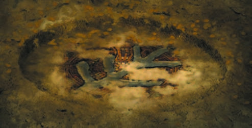{.artview-decision .artview-width-80 .artview-align-center}

{.artview-decision .artview-width-80 .artview-align-center}

Оглянувшись, сыщики видят, как ореол мух отделяется от Хасталика и превращается в рой, окутывающий ретранслятор. Проникнув в него, сущность Хасталика стремительно заражает интернет, чтобы скрыть своё присутствие. Двигаясь со скоростью мысли, Порча прочёсывает Сеть в поисках способа затаиться. Решение находится во взломанной секретной базе данных DSS, где хранятся сведения об экспериментальном стирании памяти. Хасталик совершенствует процесс, чтобы тот действительно работал, и передаёт сигнал всем, кто смотрит и слушает трансляцию команды «Спектрал», одновременно удаляя из интернета все доступные записи потока. В том числе исчезает канал команды «Спектрал» и любые упоминания о ней в Сети.

Зрители трансляции увидят череду мерцающих образов и услышат всплески помех. Они впадут в состояние, подобное трансу, пока вирус удаляет с их устройств любые следы трансляции и команды «Спектрал». Завершив дело, он выключает устройство и внушает зрителю продолжить заниматься повседневными делами. Всплески помех действуют так же, как визуальные образы, чтобы воздействовать и на тех, кто лишь слушает трансляцию.

К несчастью, сущность Хасталика активирует тревогу, которая сообщает DSS место взлома. Находящейся неподалёку итальянской атомной подводной лодке приказывают немедленно забрать, захватить и задержать всех, кого обнаружат на острове или поблизости от него, и доставить их на исследовательскую станцию «Омега» — секретную базу DSS в Средиземном море.

#### Новый эпилог

Если в конце в лодке остаются выжившие и Хранитель хочет продолжить сценарий, прочитайте им следующее:

Когда вода отступает от Isola di Malamente, маленькую вёсельную лодку, в которой вы находитесь, уносит прочь от острова — во кромешную тьму Средиземного моря. Мрак освещают лишь тлеющие руины Isola di Malamente: по всему острову горят небольшие пожары, извергая в ночной воздух густой чёрный дым. Вы слышите, как удаляется рёв истребителей, а рокот вертолётов постепенно стихает вдали.

Как бы вы ни гребли против отступающих волн, лодку уносит всё дальше от суши. В этот момент дайте игрокам обсудить случившееся и, возможно, оплакать погибших товарищей. В подходящий момент происходит следующее:

Без предупреждения вода перед лодкой вскипает и взрывается фонтаном, когда из глубины всплывает огромный стально-серый корпус подводной лодки, окатывая вас морской водой. На её рубке видны знаки итальянского флота. С металлическим лязгом открывается люк, а следом раздаются голоса, выкрикивающие приказы по-итальянски.

Дюжина или больше силуэтов выбираются на рубку и нижнюю палубу подлодки. Слышится щелчок, и лодку внезапно заливает слепящий белый свет прожекторов с паруса субмарины. По вашим телам пляшут зелёные точки лазерных прицелов нескольких штурмовых винтовок, а один из моряков бросает к лодке длинный канат и жестом приказывает закрепить его на утке.

Сыщиков трижды предупреждают (на английском с сильным акцентом), чтобы они закрепили канат и оставались в лодке, иначе по ним откроют огонь. Если после третьего предупреждения они этого не сделают, их безжалостно расстреливают, хотя для них это ещё не конец. Из-за заполняющей воздух скверны Хасталика они не способны умереть. А пока всё просто погружается во тьму.

Если они подчиняются, лодку подтягивают к лестнице на борту субмарины, и под дулами оружия их заставляют подняться на борт. Затем их запирают в крошечной каюте, а судно погружается, оставляя вёсельную лодку единственным свидетельством того, что здесь кто-то был.

Если кому-то хватит глупости напасть на вооружённых итальянских солдат, враги будут превосходить их огневой мощью, числом и умением. Солдаты постараются избить их до потери сознания (см. «Оглушающие удары» на с.125 Книги Хранителя), но могут и пристрелить пленников, если те доставят слишком много хлопот.

Если кто-то решает рискнуть и плыть к берегу, он должен совершить три Экстремальные проверки Плавания, а также три проверки Телосложения. Если ему удаётся, что ж... тем лучше для него. Он чудом избегает плена у итальянских ВМС, но теперь выбывает из сценария — не говоря уже о том, что он застрял в захолустной сицилийской деревне лишь с наличными в кармане, без телефона и сухой одежды.

Если погибнут лишь некоторые персонажи (либо они уже мертвы), беспокоиться не о чем. Их история продолжится в грядущем сиквеле: «Карантин».

## Приложение

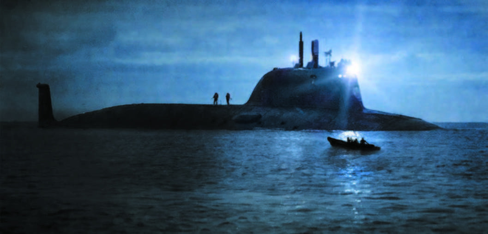{.artview-decision .artview-width-80 .artview-align-center}

### Столкновения

Эти столкновения служат Хранителю рекомендациями и не охватывают все возможные явления. Их можно определять случайным броском (D12) или выбирать в зависимости от сыщика либо ситуации. В начале расследования Хранителю стоит использовать более умеренные столкновения, постепенно повышая накал с наступлением ночи. Для каждого столкновения предложена потеря Рассудка, но даже её следует корректировать с учётом интенсивности события и конкретной ситуации. Ранние столкновения вряд ли повлекут проверку Рассудка, тогда как поздние почти наверняка так или иначе повлияют на Рассудок сыщиков.

Поначалу всё будет казаться обычным исследованием дома с привидениями — сыщики проходили через такое сотни раз. Если понемногу усиливать жуть, они могут не заметить момента, когда происходящее станет по-настоящему сверхъестественным. Описывая любое из этих столкновений, Хранителю стоит оставлять место для рационального объяснения. Например, увидев огонёк среди деревьев, сыщики могут отправиться на проверку и заметить, что отсюда видны некоторые огни на материке. Такое правдоподобное объяснение успокоит их достаточно, чтобы они продолжили расследование.

Помните: цель состоит в том, чтобы заманить сыщиков в полночь в склеп для сеанса с ведьминской доской. Если столкновение по-настоящему потрясло сыщика, возможно, кто-то из зрителей предложит \$500, чтобы тот продолжил. Удивительно, как немного звонкой монеты помогает оправдать риск.

#### Столкновения на открытом воздухе

| Бросок | Встреченное явление |
| --- | --- |
| 1 | Рой мух — мухи есть по всему острову, но эти встречи отличаются. Сыщиков окружает облако крошечных чёрных мух, которые лезут в глаза, нос и рот. На позднем этапе расследования мухи могут хлынуть из открытой сумки или кармана. [Потеря Рассудка (0/1)] |
| 2 | Холодное пятно — в начале расследования здесь может быть лишь чуть прохладнее, но по мере того, как события становятся всё более «реальными», сыщики могут увидеть собственное дыхание, а гладкие поверхности вроде металла и стекла покроются инеем. [Потеря Рассудка (0/1)] |
| 3 | Мутировавшее животное — это может быть крыса, летучая мышь, собака, кошка или нечто неопознаваемое (на усмотрение Хранителя). В зависимости от этапа расследования существо может оказаться просто альбиносом либо безволосым созданием с лишними конечностями. [Потеря Рассудка (0/1D3)] |
| 4 | Бесформенный пар — некое подобие тумана, которое, кажется, движется целенаправленно. Он может отдалённо напоминать человеческую фигуру, а может и не напоминать. [Потеря Рассудка (0/1)] |
| 5 | Сферы — чаще всего эти явления замечает только камера, но позднее вечером их можно увидеть невооружённым глазом. Если происходящее становится совсем странным, сферы могут даже роиться вокруг сыщиков. [Потеря Рассудка (0/1)] |
| 6 | Голоса — аудиоустройства начинают улавливать звуки, похожие на далёкие голоса. Сыщики могут определить общее направление, но, добравшись до места, ничего не находят. Позже голоса могут стать отчётливее и... обращаться лично к ним. В темноте они могут услышать голоса знакомых или жуткие песнопения. [Потеря Рассудка (0/1)] |
| 7 | Огни вдали — среди деревьев или в окне верхнего этажа виден свет, но он не может принадлежать никому из Команды: все её участники на виду. Позже сыщики могут увидеть фигуру со старинной масляной лампой или фонарём. [Потеря Рассудка (0/1)] |
| 8 | Призрачный запах — сыщик или сыщики могут почувствовать запах гнили, гари или просто запах, неуместный в данной ситуации. Например, им может почудиться аромат свежего хлеба или сильный запах роз. [Здесь нет потери Рассудка, поскольку люди склонны ощущать подобные фантомные запахи, часто связанные с яркими воспоминаниями. Если запах носит глубоко личный характер, возможна небольшая потеря Рассудка (0/1)] |
| 9 | Физический контакт — сыщик может всего лишь почувствовать, как нечто коснулось его шеи, а может подвергнуться физическому нападению: ощутить боль и обнаружить на теле соответствующий красный след. [Потеря Рассудка (0/1)] |
| 10 | Мёртвые птицы — пол комнаты усеян трупами всевозможных местных птиц. Из глаз и клювов всех тушек сочится чёрная слизь, похожая на найденную в наполовину затопленной вёсельной лодке и на ветхом причале. [Потеря Рассудка (0/1)] |
| 11 | Внезапная тошнота — сыщика охватывает тошнота, и его неудержимо рвёт в течение 1D10 раундов. Если результат превышает 5 раундов, его вырвет чем-то ужасным. [Потеря Рассудка (0/1)] |
| 12 | Чумной монах — в тени стоит фигура и наблюдает за ними. Она похожа на монаха в тёмно-коричневой рясе, но уже через мгновение там никого нет. Проверка Внимания позволяет заметить, что ряса залита кровью, а лицо скрывает нечто среднее между средневековой чумной маской и противогазом времён Первой мировой войны. В блестящих стеклянных линзах отражается свет камер. [Потеря Рассудка (0/1) при неудачной проверке Внимания и (1/1D4) при успешной.] |

#### Столкновения в больнице

| Бросок | Встреченное явление |
| --- | --- |
| 1 | Мухи! — целая комната забита раздутыми чёрными мухами, а по полу кишат опарыши. |
| 2 | Жертвоприношение — мёртвое животное свисает с трубы или светильника. Его выпотрошили и подвесили на собственных внутренностях. Липкие неопознаваемые потроха под ним указывают, что это произошло не больше суток назад. |
| 3 | Призрачный пациент — в дверном проёме видна фигура в грязной больничной сорочке. Когда сыщики подходят, она отворачивается и скрывается во тьме. При осмотре места никаких следов не обнаруживается. По желанию Хранитель может позволить им найти в пыли отпечаток босой человеческой ноги при успешной Сложной проверке Внимания |
| 4 | Призрачные звуки — сыщики слышат шаги, удары или приглушённые голоса. Если они воспроизведут запись какого-либо голоса, Хранителю следует сделать её содержание жутким — например, пусть голос назовёт по имени одного из сыщиков (или его близкого). |
| 5 | Обрушение! — участок пола или потолка рушится, возможно, из-за перемещений сыщиков по зданию. Это может произойти сразу после того, как они минуют опасное место, заставив их вздрогнуть, либо потенциально нанести травму. При обрушении потолка сыщики должны успешно пройти проверку Удачи или получить 1D3 пункта урона от падающих обломков. Если пол проваливается под ними, требуется проверка ЛВК. Успех означает, что они лишь падают ничком, а неудача — что они проваливаются на нижний этаж и получают 2D4 пункта урона. Тяжёлая рана почти наверняка означает перелом ноги. |
| 6 | Внезапная разрядка — все электронные устройства неожиданно лишаются питания и перезагружаются или выключаются. Во тьме прошедшие проверку Внимания видят движущиеся фигуры: те идут рядом, но не к ним. На всех словно бы надеты длинные белые больничные сорочки. Когда питание восстанавливается, там уже никого нет. |
| 7 | Лужа крови — один из участников Команды (определите случайным образом) наступает в липкую лужу крови. Она выглядит довольно свежей, а прочь тянется цепочка кровавых капель. Если пойти по следу, он приведёт к глухой наружной стене. Это вызывает проверку Рассудка (0/1). |
| 8 | Тараканы — когда луч фонаря скользит по коридору или комнате, рой крупных коричневых тараканов разбегается во все стороны и исчезает в трещинах стен, под дверями и так далее. Зрелище тревожное, но не приводит к потере Рассудка. Если результат выпадает снова, тараканы не разбегаются, а поворачиваются к сыщикам, но больше ничего не делают, даже если к ним приблизиться. Если кто-то попытается их разогнать, они устремятся по коридору безобидным, но отвратительным роем. Если в коридоре находится кто-то из Команды, тараканы запутываются в волосах, снаряжении, забираются за воротники и так далее. Все присутствующие получают 1 уровень Порчи. |
| 9 | Шприцы — сыщики находят старый шприц с чёрной жидкостью. Если им хватит глупости ввести её себе, они мгновенно достигают максимальной Порчи (10 уровней) и обречены слиться с Хасталиком в награду за вопиющую тупость. Кроме того, они слышат шёпот (похожий на то, что испытывает Енох, но не совпадающий со Зрением) и теряют 1D3 Рассудка. Если жидкость вводит себе Енох, второй эффект не возникает, поскольку из-за Зрения он уже испытывает нечто похожее. |
| 10 | ФЭГ — в тихий момент индикатор пассивного детектора шумов начинает мигать, показывая, что уловил звук, хотя никто не шумел. Прослушав запись сразу, сыщики услышат либо далёкие крики, либо почти демонический вой ПРЯМО в микрофон, либо мужской голос, произносящий что-то неразборчивое, либо хлопок двери — или любой другой звук, который покажется самым жутким и подходящим к настроению. Это вызывает проверку Рассудка (0/1). |
| 11 | Чёрный дым — одна из камер ночного видения Команды замечает клочок тонкого чёрного дыма, который выходит из потолка одной комнаты и исчезает в помещении этажом ниже. Он не оставляет ни запаха, ни следа. Если воспроизвести запись, дым можно увидеть снова. |
| 12 | Человек-тень — все, кто следит за происходящим, должны совершить проверку Внимания. При успехе они видят, как через дверной проём стремительно проносится человекообразная тень. Осмотрев место, они находят лишь сплошную стену, что вызывает проверку Рассудка (0/1). |

#### Столкновения в катакомбах

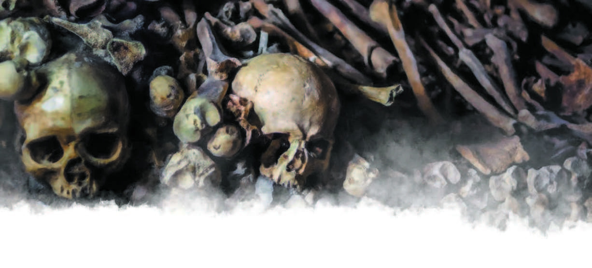{.artview-decision .artview-width-80 .artview-align-center}

| Бросок | Встреченное явление |
| --- | --- |
| 1 | Нападение реликвы — сыщики слышат, как во тьме что-то шевелится, и с ужасом видят, что из одной ниши выползает труп. При движении его иссохшая плоть трескается и хрустит, а внутри нечто плещется, словно пакет с размокшей овсянкой. Мерзость тянется к сыщикам, обращаясь к ним по-итальянски, на латыни, испанском или греческом (по выбору Хранителя). Если кто-то знает этот язык, то понимает, что проклятая душа молит позволить ей умереть. Это вызывает проверку Рассудка (1D3/1D8). |
| 2 | Рой крыс — из нескольких отверстий в стене вырывается рой раздутых безволосых крыс со слепыми молочно-белыми глазами. Они пытаются вскарабкаться по ногам сыщиков, кусаясь и пища. Это вызывает проверку Рассудка (1/1D6). |
| 3 | Рой опарышей — один из трупов в верхней нише скрипит и лопается, окатывая сыщиков вязкой жидкостью, кишащей опарышами. Они забираются в волосы, на лица и под одежду. Это вызывает проверку Рассудка (1/1D6). |
| 4 | Рой реликв — вокруг сыщиков начинают двигаться трупы. Они выбираются из ниш и, шаркая, идут к ним, умоляя на разных языках положить конец их мучениям. Это вызывает проверку Рассудка (1D4/2D4). |
| 5 | Тревожное явление — впереди во тьме появляется близкий человек, выглядящий совершенно перепуганным. Он убегает прежде, чем сыщик успевает что-либо сказать. |
| 6 | Мерзкий дождь — капля падает на щёку сыщика. Подняв взгляд, он видит, что низкий потолок пронизан тысячами крошечных отверстий, похожих на следы термитов в древесине. Внезапно с потолка катакомб начинает литься кишащая червями кровь, пахнущая медью и гниением. Пол становится скользким, и все должны совершить проверку ТЕЛ, чтобы приступ мучительной тошноты не вывел их из строя на 1D6 раундов. Это вызывает проверку Рассудка (1/1D6). |

### Новые правила

#### Зрение

"Я вижу мёртвых. Когда? Всё время... Если только я не пьян."

Те, кто ничего не понимает, называют это даром, но для несчастных душ, обременённых им, это скорее проклятие. Такая чувствительность означает, что человека постоянно осаждают явления, обычно недоступные людскому восприятию. Некоторые зовут её Зрением, но это не совсем верно: она действует через все органы чувств, часто через несколько одновременно.

Наделённый Зрением человек может видеть события прошлого или настоящего, ощущать призраков и иных невидимых сущностей, примерно определять местонахождение пропавшего предмета или человека, чувствовать, произошло ли в определённом месте трагическое событие, и так далее. Перед ним могут возникать бесформенные сгустки энергии, смутно человекоподобный туман или даже призраки в полный рост, кажущиеся столь же реальными, как живые люди. Он может слышать обращённые прямо к нему голоса, топот бегущих по коридору ног или далёкий крик. Он может замечать странные неуместные запахи, чувствовать, как нечто тянет его за одежду, или просто испытывать дурное предчувствие, связанное с каким-то местом.

Призраки в полный рост часто оказываются лишь отголосками мёртвых, раз за разом повторяющими одни и те же действия, словно царапина на пластинке реальности. Иногда эти явления осознают собственное существование и могут даже взаимодействовать с сыщиком, наделённым Зрением. Подобные яркие столкновения редки и часто травматичны для обладателя Зрения: мертвецы умоляют о помощи или требуют отмщения за свою безвременную гибель.

Все проявления Зрения Хранителю следует раскрывать через повествование, делая их максимально кинематографичными. Сыщик может заметить на заднем плане ещё одного человека, залитого кровью, или увидеть его отражение в зеркале. Такие явления должны быть драматичными и внезапными. Если всё сделать правильно, эти пугающие неожиданности могут оказаться очень действенными, однако Хранителю стоит сдержанно назначать потерю Рассудка, оставляя проверки лишь для самых жутких видений. Главное — соблюдать равновесие между преимуществами и недостатками, чтобы не карать обладателя Зрения слишком сурово.

Использование Зрения. Зрение — обоюдоострое оружие: оно может дать сыщику ценную информацию, но одновременно подвергает его видениям и ужасам, подтачивающим Рассудок. Обременённый Зрением человек может получать видения без предупреждения, особенно если в данном месте или с предметом произошло нечто чудовищное, например зверское убийство. Хранителю следует пользоваться этим умеренно, чтобы не наказывать сыщика со Зрением несправедливо. Тот может увидеть первую вспышку и отреагировать, но затем Хранителю стоит дать сыщику возможность хотя бы попытаться закрыть разум, если он того пожелает. Мы рекомендуем два основных способа использования Зрения: простой и механический.

Простой — Хранитель сообщает игроку, когда его сыщик чувствует какие-либо «сверхъестественные колебания». Игрок сам решает, открыться ли сыщику этим ощущениям. Если обладатель Зрения, открывшись, теряет РАС, вместо этого можно потратить ММ. Когда они закончатся, РАС можно тратить как обычно либо, в крайних обстоятельствах, смягчить потерю, потратив МЩ.

Механический — человек, давно обладающий Зрением, может научиться управлять увиденным и, возможно, смягчать отрицательные последствия при помощи магических пунктов (ММ). Если Хранитель желает превратить Зрение в полноценную механику, у него есть несколько вариантов применения. Для этого требуется успешная проверка МЩ со сложностью, зависящей от интенсивности видения (на усмотрение Хранителя).

Ниже приведено несколько примеров, однако игрок и Хранитель могут придумывать другие в зависимости от ситуации и личных предпочтений.

> Открыть Зрение
> 
> Это означает открыть разум любым впечатлениям, которые могут присутствовать в округе. Это самый опасный вариант, поскольку сыщик остаётся беззащитным перед тёмными сущностями и травмирующими видениями. Он даёт больше всего информации, но и грозит наибольшей потерей Рассудка. [Стоимость: 1 ММ]

> Закрыть Зрение
> 
> Это означает отгородиться от всех внешних психических сил, обычно в ответ на нападение или особенно травмирующее видение. Базовая стоимость составляет 2 ММ, но может возрасти из-за более интенсивного видения или могущественной сущности. Если другая сущность желает прорваться сквозь защиту сыщика, то по усмотрению Хранителя может совершить встречную проверку МЩ. [Стоимость: особая]

> Ощутить присутствие
> 
> Наделённый Зрением сыщик пытается почувствовать, нет ли поблизости какой-либо сверхъестественной сущности. Если сущность обладает самосознанием и готова к общению, сыщик может попытаться вступить с ней в контакт. Разумеется, некоторые сущности способны вызвать проверку Рассудка (на усмотрение Хранителя). Это более пассивное действие, поэтому оно не подвергает сыщика большой опасности, но и даёт столь же неопределённую информацию. [Стоимость: 3 ММ]

> Отголоски прошлого
> 
> Прикоснувшись к предмету или месту, сыщик со Зрением может получить впечатления или видения о прошлом. Например, предмет может подсказать, кому он принадлежал, а место убийства — дать ключ к случившемуся; однако травмирующие события, вероятно, потребуют проверки Рассудка с потерей, зависящей от их интенсивности (на усмотрение Хранителя). Обычно эта способность ограничивается ощущениями, но иногда сыщик может увидеть прошлое. Чаще всего оно предстаёт глазами того, кто испытывал самые сильные эмоции. В случае убийства сыщик с той же вероятностью может увидеть всё с точки зрения убийцы, почувствовать его ярость или экстаз, и пережитое способно глубоко потрясти его. [Стоимость: 4 ММ]

> Предвидение
> 
> Слегка приоткрыв Зрение, сыщик может получить сведения о ближайшем будущем, связанном с ним самим. Например, если кто-то поджидает его в тёмном переулке, он может ощутить страх при мысли о том, чтобы туда пойти. [Стоимость: 5 ММ]

> Успокоить разум
> 
> Если сыщик сталкивается с видением или сущностью, вызывающими потерю Рассудка, он может совершить проверку МЩ, чтобы уменьшить потерю вдвое (с округлением вниз). Потеря четырёх или менее пунктов Рассудка требует Обычного успеха, а потеря пяти или более — Сложного успеха. Если после деления пополам сыщик теряет меньше пяти, приступ безумия не наступает, если только он уже не достиг соответствующего порога. Стоимость в ММ равна числу сохранённых пунктов Рассудка. [Стоимость: особая]

Алкоголь и тяжёлые наркотики способны до некоторой степени заглушить Зрение, но такое самолечение связано с собственными рисками. В состоянии опьянения обладатель Зрения получает бонусный кубик к проверке МЩ, чтобы закрыть разум от нежелательных видений. Разумеется, он также страдает от отрицательных последствий этих веществ, включая штрафные кубики, ослабленную внимательность, зависимость и даже серьёзные проблемы со здоровьем при продолжительном употреблении.

> Заметки Хранителя
> 
> Важно помнить: Зрение показывает лишь то, что может случиться, а не то, что случится. Видения отражают наиболее вероятное будущее при текущих обстоятельствах, но если попытаться изменить ход событий, изменится и будущее.

#### Порча

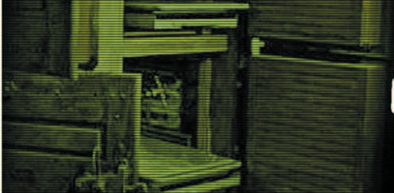{.artview-decision .artview-width-80 .artview-align-center}

Присутствие Хасталика оказывает мутагенное воздействие на всё живое, и эта скверна охватывает всю южную половину главного острова. Эффект неестественен, а потому не обнаруживается никакими известными человеческой науке способами. Поначалу изменения едва заметны, но чем дольше форма жизни остаётся в сфере влияния Хасталика, тем тяжелее становятся мутации.

По мере развития мутаций жертву всё сильнее влечёт к Хасталику, и в конце концов она испытывает непреодолимое желание слиться с ним. Охваченное этим влечением существо сделает всё необходимое, чтобы добраться до него и быть поглощённым его отвратительной массой.

Уровень Порчи. В определённые моменты сценария сыщики получают уровни Порчи. Они отражают то, как Хасталик оскверняет сыщиков, готовя их к поглощению. На листах готовых персонажей это отмечается счётчиком под названием «Воздействие», чтобы ограничить метаигру. Если кто-либо достигает 10 уровней Порчи, Хранителю следует сказать игроку вычеркнуть число и просто вести себя как обычно. Что это значит, он поймёт в финале.

Получение Порчи. Стоит сыщикам ступить на главный остров, как они сразу получают 1 уровень Порчи. После этого есть несколько способов получить ещё один уровень Порчи: пережить приступ безумия, съесть лимон из рощи, увидеть Чумного монаха, воспользоваться ведьминской доской или прочитать о Хасталике (включая фрагмент книги). Разумеется, Хранитель может придумать другие варианты или увеличить количество получаемой Порчи.

Хасталик восстаёт. Каждый, кто присутствует при восстании Хасталика, должен совершить проверку МЩ, чтобы противостоять желанию слиться с ним. При неудаче жертва словно в трансе идёт к яме, чтобы броситься внутрь, либо пытается обнять Хасталика. Проверка изменяется в зависимости от количества Порчи у жертвы ([см. «Уровни Порчи»](#viral-appendix-new-rules-the-taint-levels) ниже).

##### УРОВНИ ПОРЧИ

| Уровень | Модификаторы | Эффект |
| --- | --- | --- |
| 1 | 2 бонусных кубика | Жертва осознаёт, что с островом что-то «не так», но не может понять, что именно. |
| 2 | 2 бонусных кубика | Жертва начинает сильнее потеть, но это можно списать на жару и влажность. Примерно каждые полчаса Хранитель может требовать проверку Телосложения. При неудаче жертва чувствует лёгкое головокружение от обезвоживания. |
| 3 | 1 бонусный кубик | Жертву начинает знобить. Поскольку сыщики охотятся на призраков, Хранитель может описать это как обнаружение «холодного пятна». |
| 4 | 1 бонусный кубик | С ростом уровня Порчи воздействию подвергаются органические вещества рядом с жертвой. Молоко сворачивается, когда она берёт его в руки. Фрукты и овощи начинают гнить в её руках и примерно через час становятся несъедобными. Обработанные продукты, например мясо в бутербродах, приобретают неприятный запах, сереют и становятся немного склизкими — жертва может есть и пить эти разлагающиеся продукты без вреда для себя, а на вкус они остаются обычными. |
| 5 | Нет | Жертва страдает от приступов тошноты. И вновь Хранитель может объяснить их близостью злобных духов. |
| 6 | Нет | На руках и ногах жертвы появляется зудящая сыпь. Наверное, просто ядовитый плющ, верно? |
| 7 | 1 штрафной кубик | Сыпь распространяется, покрывается коркой и грубеет. Есть и хорошая сторона: она больше не чешется. |
| 8 | 1 штрафной кубик | Жертва явно заболевает. На ногтях разрастается грибок. Волосы выпадают клочьями. Раны воспаляются и покрываются болезненными нарывами. Животные начинают чувствовать скверну: кошки шипят на жертву, а собаки рычат. От неё исходит запах разложения, которого она сама не ощущает. |
| 9 | 2 штрафных кубика | Кожа жертвы покрывается огромными кистами, из которых сочится гной. Теперь она получает штрафной кубик ко всем действиям. |
| 10 | Н/П | Внезапно жертва чувствует себя лучше. Тошнота и потливость проходят, а кисты начинают закрываться. К несчастью, теперь ею движет непреодолимое стремление любой ценой слиться с Хасталиком. Никакая проверка МЩ не позволит сопротивляться. Стремление проявляется, когда жертва видит восстание аватара Хасталика. По желанию Хранитель может разрешать сыщику каждый раунд совершать Сложную проверку МЩ, чтобы сопротивляться этому желанию. Кроме того, Старший Знак у моста теперь не позволяет ему покинуть главный остров. |

#### Безумие и приступы безумия

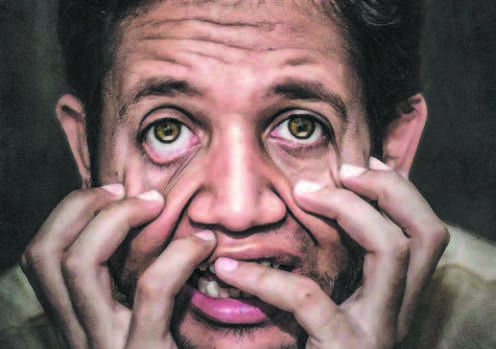{.artview-decision .artview-width-80 .artview-align-center}

Из-за осквернённой природы этого места правила Рассудка слегка изменены. Когда сыщик переживает приступ безумия, он автоматически получает 1 уровень Порчи, а Хранитель просит игрока бросить D10 по следующей таблице. Учтите, что всё это видит только сыщик, страдающий от приступа безумия, а когда эпизод заканчивается (через 1D10 раундов), от пережитого не остаётся никаких следов.

| Бросок D10 | Результат |
| --- | --- |
| 1 | Ужас тела — сыщик переживает нечто чудовищное, происходящее с его телом. Кожа может сгнить и отвалиться, ногти и волосы — выпасть, а под кожей могут зашевелиться паразиты. Будет ещё лучше, если Хранитель сможет связать кошмар с личностью сыщика. |
| 2 | Жуки — из рукавов, карманов и других частей одежды сыщика начинают сыпаться жуки. Они кишат по коже, заставляя сыщика выронить всё, что он держит, и пытаться стряхнуть насекомых. |
| 3 | Мухи — из электронного устройства в руках сыщика вырывается рой мух. Мелкие чёрные мухи кружат вокруг головы, лезут в глаза, нос и рот. |
| 4 | Чумной монах — где-то в поле зрения сыщик замечает Чумного монаха, который смотрит прямо на него. Если приступ безумия вызван встречей с Чумным монахом, тот позволяет снять с себя маску и увидеть скрытый под ней ужас. Сыщик получает ещё 2 уровня Порчи. |
| 5 | Кровь — спутники сыщика начинают кровоточить из глаз, носа, рта и ушей. Через мгновение кровь уже льётся из пор, но сами они, кажется, ничего не замечают. Если поблизости нет спутников, кровоточит что-то другое: стены, потолок — или просто начинается кровавый дождь. |
| 6 | Видение — независимо от того, обладает ли сыщик Зрением, его внезапно охватывает видение, связанное с Хасталиком или его культом. Хранителю следует придумать нечто подходящее к ситуации. Например, сыщик может увидеть, как Чумного монаха вешают над Ямой костей, или мельком увидеть рейд 1954 года. |
| 7 | Паранойя — сыщик видит свидетельства того, что за всеми странными происшествиями стоят его спутники. Ему может показаться, что один из них тихо посмеивается за его спиной или виновато прячет руку в карман. В идеале увиденное должно быть связано с причиной приступа безумия. (Очевидным кандидатом здесь является Питер, тайком раскладывающий по острову разные предметы.) |
| 8 | Удушье — сыщик внезапно не может дышать: кажется, что лёгкие застыли и отказываются работать. Если приступ длится больше 6 раундов, сыщик теряет сознание и начинает дышать нормально. Он приходит в себя через 1D4 раунда. |
| 9 | Насилие — сыщик впадает в ярость и пытается уничтожить источник своего приступа безумия. Он может даже бросить в него какое-нибудь хрупкое и дорогое оборудование. Хранителю следует подстроить результат под сцену. |
| 10 | Яма костей — сыщик видит Яму костей так, словно стоит над ней и смотрит внутрь, хотя понятия не имеет, где она находится. Осквернённая жижа начинает вращаться, и сыщик слышит у себя в голове голос: «Стань единым со мной!» Язык ему неизвестен, но смысл почему-то понятен. Сыщик немедленно получает ещё 3 уровня Порчи. |

{.artview-decision .artview-width-80 .artview-align-center}

> Подходящие фобии
> 
> Если во время приступа безумия у сыщика развивается фобия, подойдут следующие варианты:
> 
> Энтомофобия — боязнь насекомых
> 
> Фруктофобия — боязнь фруктов
> 
> Музофобия — боязнь крыс и мышей
> 
> Мизофобия — боязнь микробов, грязи или заражения
> 
> Нозокомефобия — боязнь больниц
> 
> Никтофобия — боязнь темноты

#### Паранормальные явления

Здесь приведены примеры паранормальных явлений, с которыми команда «Спектрал» может столкнуться при исследовании острова и больницы. Список не претендует на полноту: Хранитель может свободно делать броски по нему или черпать вдохновение для собственных явлений. Задача — поддерживать интерес героев паранормальными событиями, но оставлять их достаточно неоднозначными, чтобы те, кто не желает верить в подобное, могли объяснить их естественными причинами.

| Бросок D10 | Результат |
| --- | --- |
| 1 | Отголоски прошлого — в наушниках Команда слышит звуки, похожие на выстрелы и крики. Они доносятся издалека; удаётся разобрать, что люди говорят по-итальянски, но отдельных слов не понять. Звук словно не имеет определённого источника, а стоит вынуть наушники — он внезапно смолкает. |
| 2 | Тени — во время исследования одна из камер внезапно замечает тень позади участника Команды. Тень кладёт руку ему на плечо, и тот сразу чувствует острую боль. Тень исчезает, а при осмотре на коже обнаруживается красный след (как от ожога) в форме отпечатка человеческой ладони. Требуется проверка Рассудка (0/1). |
| 3 | Холодное пятно — температура значительно падает. Находящиеся рядом видят собственное дыхание, а металлические и стеклянные поверхности покрываются инеем. Пятно может оставаться на месте 30+ минут либо перемещаться, существуя всего 1D10 минут. |
| 4 | Голоса — один из участников Команды слышит, как значимый для него человек зовёт на помощь. Больше никто в Команде голоса не слышит. Отправившись на поиски, герой может ничего не найти или обнаружить неоднозначный знак, связанный с этим человеком. Например, лёгкий аромат духов матери или обёртку от конфет, которые любил его брат. Учтите: Хранитель может воспользоваться этим, чтобы направить сыщиков в интересное место. |
| 5 | Сферы — участники Команды невооружённым глазом видят маленькие светящиеся сферы. Они скапливаются в одном месте, но рассеиваются при приближении сыщиков. Возможно, там найдётся нечто интересное, либо при просмотре видеозаписи окажется, что сфер на ней нет. |
| 6 | ФЭГ — диктофон ФЭГ (феномена электронного голоса) записывает, как кто-то говорит в комнате. Поначалу слова неразборчивы, но внезапно складываются в низкий, ясный голос, говорящий на латыни. Он произносит: "Omnes unum sumus", что означает: "Мы все станем едины". |
| 7 | Всплеск ЭМ — один из измерителей ЭМ (электромагнитного поля) Команды начинает медленно пищать. Темп ускоряется, пока внезапный скачок не выводит прибор из строя с громким хлопком. Из мёртвого прибора валит дым, а вокруг роятся мелкие жужжащие мухи. |
| 8 | Преследователь — вдали одна из камер замечает фигуру в одеянии, похожую на монаха. Однако невооружённым глазом ничего не видно. При следующем взгляде через камеру фигура оказывается ближе и идёт к ним, хотя без камеры её по-прежнему не видно. Если позволить ей приблизиться, всё вокруг леденеет ([см. «Холодное пятно»](#viral-appendix-encounters-outdoor-cold-spot)). В любом случае требуется проверка Рассудка (1/1D3). |
| 9 | Шаги — где-то во тьме Команда слышит шаги и, возможно, звук волочащегося предмета. При проверке они находят на земле след, по размеру похожий на оставленный человеческим телом. Примерно через 3 метра след просто обрывается без каких-либо других признаков. Как вариант, Хранитель может позволить им найти останки солдата, которого куда-то тащили и спрятали. Жетоны указывают, что он служил в итальянской армии и погиб в 1954 году. Разумеется, Майя прервёт трансляцию, если они увидят тело, а все должны совершить проверку Рассудка (0/1). |
| 10 | Крысы! — во время исследования Команду внезапно окружает рой крыс. На улице они вырываются из норы, а в здании — из стены. В любом случае крысы бегут по ступням и карабкаются по ногам участников Команды. Это вызывает проверку Рассудка (0/1). По желанию Хранитель может потребовать от сыщиков проверку Удачи, иначе многочисленные укусы больных крыс нанесут 1 пункт здоровья урона. |

### Новые ужасы Мифов

{.artview-decision .artview-width-80 .artview-align-center}

#### Хасталик (ХАС-та-лик)

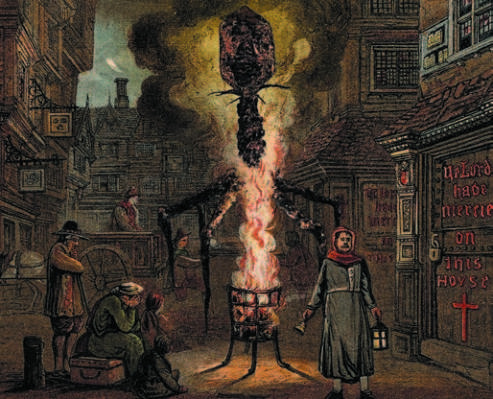{.artview-decision .artview-width-80 .artview-align-center}

Зараза, Император Мух, Великая Скверна, Воплощённая Болезнь

"Кажущееся бесформенным, одним прикосновением оно оскверняет целые миры. Составленное из множества взаимосвязанных частей, оно странствует в пустоте в поисках жизни, которую можно изменить и поглотить. Никто не устоит перед ним."

Хасталик — один из самых коварных и могущественных Великих Древних, воплощение и усилитель болезней и инфекций. Когда вспыхивает великая эпидемия или даже локальная вспышка заболевания, за ней может стоять Хасталик. Он не является самой болезнью, но усиливает местную заразу, превращая вспышку в эпидемию.

Облик. Этот аватар Хасталика собирает плоть живых и мёртвых, чтобы воплотиться в ужасающем образе. Поначалу он представляет собой огромную колонию заражённой биомассы, но после слияния с Чумным монахом Зараза выбирается из ямы. Возникающая исполинская мерзость заметно напоминает вирус-бактериофаг, хотя значительную часть её поверхности покрывают пульсирующие кисты. Её «голова» — своего рода капсид, позволяющий эффективно видеть и слышать во всех направлениях. Существо издаёт леденящий душу высокий вой или стрекот, источник которого, по-видимому, скрыт во внутреннем органе. Временами под его полупрозрачной перепончатой кожей беззвучно кричат лица прежних жертв.

Под головой находится мясистый стебель, который слегка покачивается и заканчивается бесформенным основанием с шестью длинными насекомоподобными ногами. На них существо с пугающей скоростью и ловкостью бегает и карабкается в любом направлении. На нижней стороне тела расположено несколько студенистых псевдоподий, которые выстреливают, словно язык лягушки, чтобы схватить жертву. Сопротивляющееся существо подтягивают под чудовище, где трубка, похожая на язык, обливает жертву тёмной кислотной жидкостью, мгновенно превращая её в серую жижу, которую затем с чавканьем всасывает непристойный язык. После этого Пожиратель заметно увеличивается.

##### Пожиратель — аспект Хасталика

| Параметр | Значение |
| --- | --- |
| СИЛ | 150 |
| ТЕЛ | 150 |
| РАЗМ | 200\* |
| МЩ | 250 |
| ЛВК | 100 |
| ЗД | 35 |
| Бонус к урону | 3D6 |
| КПМЛ | 4\* |
| Магические пункты | 50 |
| СКО | 7 |

\* Начальные характеристики

###### Атаки

**Атак за раунд.** 3

**Захват.** Пожиратель может протянуть псевдоподии, схватить жертву в пределах 9 метров и подтягивать её со скоростью 3 метра за раунд. Достигнув Пожирателя, жертва поглощается его массой. Пока она соприкасается со щупальцем, гниющая плоть продолжает получать урон (1D6 урона за раунд). Жертва может вырваться при успешной Сложной проверке СИЛ или ЛВК либо освободиться, нанеся удерживающему её щупальцу 10 пунктов урона (огнём или режущим оружием).

Кроме того, каждый раунд, пока Хасталик удерживает жертву, её Порча возрастает на один. Достигнув 10 уровней Порчи, жертва добровольно сдаётся и становится частью Великого Древнего.

**Захват (манёвр).** 70% (35/14), урон 1D6 + 1D6 за раунд (см. выше).

**Уклонение.** 50% (25/10)

**Броня.** отсутствует; навредить ему можно только огнём. Он восстанавливает 5 ЗД/раунд после режущего урона, но не может восстанавливать урон от огня.

**Заклинания.** Предсказание, Пробуждение зверя, Связывание души, Помутнение памяти, Повелевание животным, Повелевание растениями, Управление стихиями, Приглушение света, Порабощение жертвы, Ярость, Исцеление (вариант), Человеческий куст, Красный Знак, Возвращение возлюбленного, Призывание/подчинение Тёмного молодняка

**Потеря Рассудка.** 1D8/4D10

###### Особые способности

**Пожирание.** этот аватар Хасталика способен поглотить любое органическое вещество, коснувшееся его, и тем самым увеличить свою массу. Для этого он хватает намеченную добычу длинными псевдоподиями и подтягивает к себе, затем вытягивает длинный мясистый хоботок, покрывающий материал кислотным пищеварительным ферментом и превращающий его в серую вязкую жидкость. Жидкость жадно всасывается через хоботок. Когда таким образом поглощается любая плоть (живая или мёртвая), половина её массы прибавляется к Пожирателю. Иными словами, если РАЗМ Пожирателя равен 150 и он поглощает человека с РАЗМ 55, новый РАЗМ Пожирателя составляет 177 (150+27). Его пункты здоровья соответственно возрастают.

**Рой мух.** когда Пожиратель впервые получает физический удар в бою, его тело разрывается и выпускает облако мух. Они забиваются во все отверстия тела ударившего, давая тому штрафной кубик на последующие атаки. Мухи усиливают какофонию звуков, издаваемую Пожирателем.

#### Чумной монах

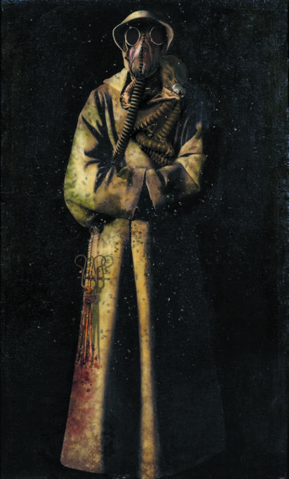{.artview-decision .artview-width-80 .artview-align-center}

Слуга Хасталика

После рейда 54-го года Чумной монах остался последним из своего ордена. Проведя заключительный ритуал, он повесился над Ямой костей, оставшись между жизнью и смертью. Хасталик даровал ему способность мысленно дотянуться до любого места на главном острове. Монах сразу принялся искать новых блох, чтобы скармливать их яме, а когда придёт время — полностью провести Хасталика в этот мир и позволить ему поглотить всё сущее.

У монаха нет физических способностей, но он может проецировать свой аватар, вселяться в реликвы или смотреть глазами зверей. С недавних пор он способен проникать в радиопередачи, телефоны и интернет, хотя эти возможности были ограничены... по крайней мере до появления команды «Спектрал» на острове. Создав спутниковый канал связи, они позволили монаху получить доступ к устройствам и телефонам сыщиков и даже к компьютеру Майи в Великобритании.

Поскольку главная цель монаха — заманить Команду к Яме костей, все его действия направлены именно на это.

#### Реликвы

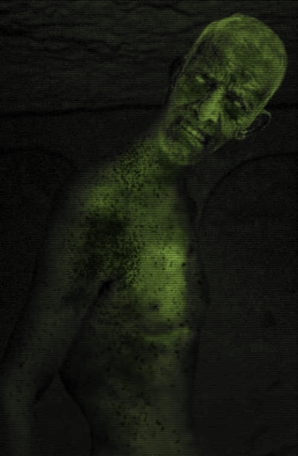{.artview-decision .artview-width-80 .artview-align-center}

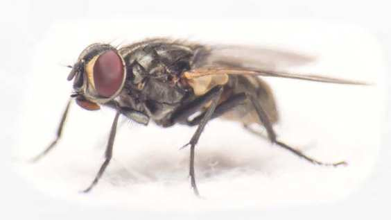{.artview-decision .artview-width-80 .artview-align-center}

Эти несчастные души ни живы, ни мертвы. Они заточены в мучительном существовании и ждут появления Хасталика, чтобы достичь с ним единого апофеоза. По сути, это люди, умершие с восемью или более уровнями Порчи. Чаще всего их приносили в жертву монахи, но некоторые погибли от болезни, которая привела их на Isola di Malamente.

##### Проклятые чумные зомби

| Параметр | Значение |
| --- | --- |
| СИЛ | 50 |
| ТЕЛ | 25 |
| РАЗМ | 55 |
| ЛВК | 55 |
| ИНТ | 50 |
| ВНЕШ | 10 |
| МЩ | — |
| ЗД | 8 |
| Бонус к урону | 0 |
| КПМЛ | 0 |
| СКО | 5 |

###### Атаки

**Атак за раунд.** 1

Реликва пытается схватить любого живого человека и заразить его ([см. «Заражение»](#viral-appendix-new-mythos-horrors-reliquae-infection)).

**Ближний бой.** Ближний бой (Драка) 50% (25/10), урон 1D3

**Уклонение.** 27%

**Броня.** отсутствует; реликвы движутся благодаря червям внутри, поэтому любое физическое оружие наносит лишь минимальный урон. Учтите: повреждение рук мешает им хватать, а повреждение ног замедляет или даже останавливает их.

**Потеря Рассудка.** 1D3/1D8 при виде одной реликвы и 1D4/2D4, если реликву вырвет на сыщика.

###### Особые способности

**Заражённая плоть.** реликвы переносят множество болезней — от бубонной чумы до оспы. Схватив сыщика, они извергают на него заражённую желчь. Жертва должна совершить проверку ТЕЛ. При успехе она избегает заражения серьёзной болезнью. При неудаче её охватывает мучительная тошнота и она заражается чем-то более серьёзным, а Экстремальная неудача означает более смертоносную инфекцию. Хранителю следует определить болезнь жертвы по таблице ниже. Учтите: любой приступ безумия или продолжительное безумие, вероятно, приведёт к боязни микробов.

| Бросок | Инфекция, серьёзная |
|---:|---|
| 1 | Бубонная чума |
| 2 | Жёлтая лихорадка |
| 3 | Сифилис |
| 4 | Сибирская язва |
| 5 | Грипп (новый вариант) |
| 6 | Туберкулёз |
| 7 | Гепатит |
| 8 | Корь |

| Бросок | Инфекция, смертоносная |
|---:|---|
| 1 | Эбола |
| 2 | Геморрагическая лихорадка |
| 3 | Оспа |
| 4 | Лихорадка денге |
| 5 | Бешенство |
| 6 | Проказа |
| 7 | Полиомиелит |
| 8 | Нечто новое (вероятно, оно станет следующей пандемией, если сыщик покинет остров живым). |

### Новый том Мифов

{.artview-decision .artview-width-80 .artview-align-center}

#### Iuramentum Corruptionis

Размером книга примерно с большую Библию, но вместо креста или сходного изображения на обложке находится необычный серебряный символ: череда переплетённых узлов, изогнутых в форме синей мясной мухи. Текст написан на латыни и снабжён множеством натуралистичных, тревожных иллюминированных изображений ритуальных процедур над человеческими телами, включая детей и младенцев.

Эту книгу написал один из безымянных Чумных монахов в конце XIV века, после постройки монастыря. Она содержит знания о Хасталике, собранные культом за бесчисленные тысячелетия. В ней описаны самые тёмные ритуалы, связанные с осквернением жизни, особенно человеческого тела. Одни изображения способны разрушить рассудок, но текст ещё хуже. Помимо мучительных для разума знаний, книга физически воздействует на читателя, вызывая мутации его ДНК.

Даже изучение символа на обложке требует проверки Рассудка (0/1). Просмотр книги в течение пятнадцати минут заставляет человека потерять 1D4 пункта Рассудка и получить 1 уровень Порчи. Если навык Латыни читателя составляет 30% или больше и тот пытается читать, то понимает больше, теряет 2D4 Рассудка и получает 2 уровня Порчи.

Потеря Рассудка: 2D10

Мифы Ктулху: +3/+10 процентилей

Рейтинг Мифов: 24

Изучение: 84 недели

Получаемые навыки: +05% Медицина, +05% Наука: Биология

Предлагаемые заклинания: Призвать Хасталика, Ослепление, Связаться с Хасталиком, Управление реликвой\*, Смертельное заклятие, Зелёное разложение, Расплавление плоти, Иссушение, Призвать Ползущего, Высушить конечность, Мучение

\* Новое заклинание

### Новое заклинание

#### Управление реликвой

Стоимость: 2 магических пункта, 1D4 Рассудка и получение 2 уровней Порчи Время сотворения: 1 раунд

Эта последовательность древних слов позволяет заклинателю подчинить реликву, которую он видит в пределах 30 метров. Кроме того, он устанавливает некоторое подобие контакта с остатками разума прежнего владельца тела и при успешной Сложной проверке МЩ может извлечь из них информацию.

Контроль длится до шести часов, после чего заклинание требуется сотворить вновь. Под властью заклинателя реликва исполняет любые его желания, кроме действий, явно противоречащих воле Хасталика, её истинного господина (на усмотрение Хранителя).

Такой контроль требует огромной сосредоточенности, поэтому, пока заклинатель навязывает реликвы свою волю, он не может сотворять другие заклинания, читать или выполнять любые действия, требующие высокой умственной концентрации (на усмотрение Хранителя). Если заклинатель испытывает боль или получает урон, заклинание прерывается, а реликва освобождается. После этого она садится и замирает.

> Несколько советов от Бада по проведению «Вирусного»
> 
> Я много раз проводил этот сценарий во время плейтестов и подумал, что будущим Хранителям пригодятся советы, которые помогут раскрыть его с лучшей стороны.
> 
> Чат прямой трансляции
> 
> Чат трансляции и денежные пожертвования фактически указывают Марко, что Команде делать дальше, — а Марко почти всегда идёт за деньгами. Используйте это, чтобы вовлечь сыщиков во всю мерзость Isola di Malamente. Не начинайте с крупных сумм, иначе повышать ставки будет некуда. Поначалу сохраняйте относительную правдоподобность и переходите к большим деньгам лишь по мере приближения к финалу. Не забывайте: Хасталик фактически заразил интернет, способен брать деньги из почти неограниченного числа источников и предоставлять их зрителям.
> 
> Майя
> 
> С помощью Майи удерживайте события в нужном русле и не позволяйте сыщикам творить нечто вопиющее. Помните: она в любой момент может прервать трансляцию и включить VT и сделает это, если в эфире произойдёт нечто, способное лишить канал монетизации (например, появятся трупы, кровь и прочие мерзости). Однако пользуйтесь ею умеренно — главный здесь Марко.
> 
> Енох и Зрение
> 
> Не забывайте давать игроку Еноха подсказки, когда тот может направить сверхъестественные силы. При удалённой игре в VTT используйте личные сообщения, а за столом — привычный вам способ. За все мои проведения «Вирусного» лишь одна группа догадалась, что он экстрасенс, а примерно половина решила, что Коррина — шарлатанка. Пусть продолжают гадать.
> 
> Саботаж Питера
> 
> Точно так же побуждайте Питера при каждой возможности подбрасывать ложные свидетельства сверхъестественного — передавайте ему сообщения тем же способом, что и Еноху. Помните: Питер хочет, чтобы деньги продолжали течь рекой, и готов на всё, лишь бы его не разоблачили.
> 
> Скептицизм Хёна
> 
> Во время прежних расследований Хён не видел ничего, что назвал бы необъяснимым, однако встреча с ужасами острова должна это изменить. В многочисленных плейтестах противостояние Хёна и Коррины было особенно ярким, когда Хён разоблачал её игру и все найденные свидетельства. Разумеется, восставшего из ямы Хасталика опровергнуть несколько сложнее, но до тех пор, пока происходящее ещё поддаётся объяснению, Марко должен активно поощрять скептицизм Хёна.
> 
> Марко
> 
> Во время плейтестов абсолютно каждый игрок изображал его самодовольным придурком-спортсменом. Я представляю его смесью Кристофера Молтисанти из «Клана Сопрано» и Зака Баганса из «Приключений с призраками» (хотя с годами он стал спокойнее). Я обнаружил, что благодаря этим оттенкам людям действительно нравится им играть.
> 
> Время
> 
> Помните: если вы проводите «Вирусное» как сценарий на одну или две игровые встречи, как и задумано, то время становится решающим фактором. К счастью, за часами Команды следит Майя. Если герои слишком долго топчутся на месте или исследуют довольно неинтересные места, она постарается вернуть их к делу.
> 
> Запустение
> 
> Подчёркивайте ветхость острова, его заброшенность и то, как природа отвоевала его обратно. Это поможет создать атмосферу и обрисовать сцену. По возможности включите тихий шум ветра и моря, чтобы подчеркнуть полное отсутствие здесь всего живого.
> 
> Хасталик
> 
> Великий Древний распространил своё влияние на интернет и будет принимать облик кого или чего угодно, чтобы заманить сыщиков к Яме костей под островом. Он даже подражает голосам и без труда взламывает обычно «невзламываемые» устройства (да, даже техника Apple не сравнится с потусторонним разумом Великого Древнего). Используйте это вирусное свойство, когда оно служит вашим целям.
> 
> И не забудьте первым делом провести проверку Рассудка при виде восстающего Хасталика: она может повлиять на уровни Порчи.
> 
> Надеюсь, эти советы помогут.
> 
> Бад отключается.

## Раздаточные материалы для игроков

- [Материал 1: Isola di Malamente — исходная карта Google](#viral-handout-01)
- [Материал 2a: Зрение: памятка игрока](#viral-handout-02a)
- [Материал 2b: Зрение: памятка игрока](#viral-handout-02b)
- [Материал 3a: Как стать охотником за призраками: правильный настрой](#viral-handout-03a)
- [Материал 3b: Как стать охотником за призраками: рекомендуемое видео](#viral-handout-03b)
- [Материал 4: Письма Марко, первая часть](#viral-handout-04)
- [Материал 5: Письма Марко, вторая часть](#viral-handout-05)
- [Материал 6: Письма Майи (1 из 2), первая часть](#viral-handout-06)
- [Материал 7: Письма Майи (1 из 2), вторая часть](#viral-handout-07)
- [Материал 8: Письма Майи (2 из 2)](#viral-handout-08)
- [Материал 9: Распечатка карты острова с заметками](#viral-handout-09)
- [Материал 10: Больница святого Роха — фотокопия от Майи (карта игроков)](#viral-handout-10)
- [Материал 11: Видение Еноха](#viral-handout-11)
- [Материал 12: Исследование Коррины](#viral-handout-12)
- [Материал 13: Вступительный текст Марко](#viral-handout-13)
- [Материал 14: Маяк Isola di Malamente](#viral-handout-14)
- [Материал 15: Начало трансляции/Плачущий мост](#viral-handout-15)
- [Материал 16: Лимонная роща](#viral-handout-16)
- [Материал 17: Яма для кремации](#viral-handout-17)
- [Материал 18: Братские могилы](#viral-handout-18)
- [Материал 19: Перед больницей](#viral-handout-19)
- [Материал 20: Дом управляющего](#viral-handout-20)
- [Материал 21: Внутри больницы #1](#viral-handout-21)
- [Материал 22: Внутри больницы #2](#viral-handout-22)
- [Материал 23: Внутри больницы #3: Тайные комнаты](#viral-handout-23)
- [Материал 24: Часовня](#viral-handout-24)
- [Материал 25: Склеп: ритуал с ведьминской доской](#viral-handout-25)
- [Материал 26: Склеп: после обрушения](#viral-handout-26)
- [Материал 27: Катакомбы и далее](#viral-handout-27)
- [Материал 28: Плачущий мост](#viral-handout-28)
- [Материал 29: Старший Знак](#viral-handout-29)
- [Материал 30: Нечто в окне (Чумной монах)](#viral-handout-30)
- [Материал 31: Нечто в окне (всего лишь занавески)](#viral-handout-31)
- [Материал 32: Лимонная роща](#viral-handout-32)
- [Материал 33: Яма для кремации](#viral-handout-33)
- [Материал 34: Ведьминская доска](#viral-handout-34)
- [Материал 35: Фрагмент книги](#viral-handout-35)
- [Материал 36: Катакомбы](#viral-handout-36)
- [Материал 37: Забытый рыцарь](#viral-handout-37)
- [Материал 38: Хасталик восстаёт](#viral-handout-38)
- [Материал 39: Хасталик уничтожен](#viral-handout-39)

### *Раздаточный материал #1*

Isola di Malamente — исходная карта Google

{.artview-decision .artview-width-80 .artview-align-center .art-handout-page}

### *Раздаточный материал #2a*

Зрение: памятка игрока

"Я вижу мёртвых. Когда? Всё время... Если только я не пьян."

Те, кто ничего не понимает, называют это даром, но для несчастных душ, обременённых им, это скорее проклятие. Такая чувствительность означает, что человека постоянно осаждают явления, обычно недоступные людскому восприятию. Некоторые зовут её Зрением, но это не совсем верно: она действует через все органы чувств, часто через несколько одновременно.

Наделённый Зрением человек может видеть события прошлого или настоящего, ощущать призраков и иных невидимых сущностей, примерно определять местонахождение пропавшего предмета или человека, чувствовать, произошло ли в определённом месте трагическое событие, и так далее. Перед ним могут возникать бесформенные сгустки энергии, смутно человекоподобный туман или даже призраки в полный рост, кажущиеся столь же реальными, как живые люди. Он может слышать обращённые прямо к нему голоса, топот бегущих по коридору ног или далёкий крик. Он может замечать странные неуместные запахи, чувствовать, как нечто тянет его за одежду, или просто испытывать дурное предчувствие, связанное с каким-то местом.

Призраки в полный рост часто оказываются лишь отголосками мёртвых, раз за разом повторяющими одни и те же действия, словно царапина на пластинке реальности. Иногда эти явления осознают собственное существование и могут даже взаимодействовать с сыщиком, наделённым Зрением. Подобные яркие столкновения редки и часто травматичны для обладателя Зрения: мертвецы умоляют о помощи или требуют отмщения за свою безвременную гибель.

Все проявления Зрения Хранителю следует раскрывать через повествование, делая их максимально кинематографичными. Сыщик может заметить на заднем плане ещё одного человека, залитого кровью, или увидеть его отражение в зеркале. Такие явления должны быть драматичными и внезапными. Если всё сделать правильно, эти пугающие неожиданности могут оказаться очень действенными, однако Хранителю стоит сдержанно назначать потерю Рассудка, оставляя проверки лишь для самых жутких видений. Главное — соблюдать равновесие между преимуществами и недостатками, чтобы не карать обладателя Зрения слишком сурово.

Использование Зрения. Зрение — обоюдоострое оружие: оно может дать сыщику ценную информацию, но одновременно подвергает его видениям и ужасам, подтачивающим Рассудок. Обременённый Зрением человек может получать видения без предупреждения, особенно если в данном месте или с предметом произошло нечто чудовищное, например зверское убийство. Хранителю следует пользоваться этим умеренно, чтобы не наказывать сыщика со Зрением несправедливо. Тот может увидеть первую вспышку и отреагировать, но затем Хранителю стоит дать сыщику возможность хотя бы попытаться закрыть разум, если он того пожелает. Мы рекомендуем два основных способа использования Зрения: простой и механический.

Простой — Хранитель сообщает игроку, когда его сыщик чувствует какие-либо «сверхъестественные колебания». Игрок сам решает, открыться ли сыщику этим ощущениям. Если обладатель Зрения, открывшись, теряет РАС, вместо этого можно потратить ММ. Когда они закончатся, РАС можно тратить как обычно либо, в крайних обстоятельствах, смягчить потерю, потратив МЩ.

Механический — человек, давно обладающий Зрением, может научиться управлять увиденным и, возможно, смягчать отрицательные последствия при помощи магических пунктов (ММ). Если Хранитель желает превратить Зрение в полноценную механику, у него есть несколько вариантов применения. Для этого требуется успешная проверка МЩ со сложностью, зависящей от интенсивности видения (на усмотрение Хранителя).

Ниже приведено несколько примеров, однако игрок и Хранитель могут придумывать другие в зависимости от ситуации и личных предпочтений.

### *Раздаточный материал #2b*

Зрение: памятка игрока

Открыть Зрение

Это означает открыть разум любым впечатлениям, которые могут присутствовать в округе. Это самый опасный вариант, поскольку сыщик остаётся беззащитным перед тёмными сущностями и травмирующими видениями. Он даёт больше всего информации, но и грозит наибольшей потерей Рассудка. [Стоимость: 1 ММ]

Закрыть Зрение

Это означает отгородиться от всех внешних психических сил, обычно в ответ на нападение или особенно травмирующее видение. Базовая стоимость составляет 2 ММ, но может возрасти из-за более интенсивного видения или могущественной сущности. Если другая сущность желает прорваться сквозь защиту сыщика, то по усмотрению Хранителя может совершить встречную проверку МЩ. [Стоимость: особая]

Ощутить присутствие

Наделённый Зрением сыщик пытается почувствовать, нет ли поблизости какой-либо сверхъестественной сущности. Если сущность обладает самосознанием и готова к общению, сыщик может попытаться вступить с ней в контакт. Разумеется, некоторые сущности способны вызвать проверку Рассудка (на усмотрение Хранителя). Это более пассивное действие, поэтому оно не подвергает сыщика большой опасности, но и даёт столь же неопределённую информацию. [Стоимость: 3 ММ]

Отголоски прошлого

Прикоснувшись к предмету или месту, сыщик со Зрением может получить впечатления или видения о прошлом. Например, предмет может подсказать, кому он принадлежал, а место убийства — дать ключ к случившемуся; однако травмирующие события, вероятно, потребуют проверки Рассудка с потерей, зависящей от их интенсивности (на усмотрение Хранителя). Обычно эта способность ограничивается ощущениями, но иногда сыщик может увидеть прошлое. Чаще всего оно предстаёт глазами того, кто испытывал самые сильные эмоции. В случае убийства сыщик с той же вероятностью может увидеть всё с точки зрения убийцы, почувствовать его ярость или экстаз, и пережитое способно глубоко потрясти его. [Стоимость: 4 ММ]

Предвидение

Слегка приоткрыв Зрение, сыщик может получить сведения о ближайшем будущем, связанном с ним самим. Например, если кто-то поджидает его в тёмном переулке, он может ощутить страх при мысли о том, чтобы туда пойти. [Стоимость: 5 ММ]

Успокоить разум

Если сыщик сталкивается с видением или сущностью, вызывающими потерю Рассудка, он может совершить проверку МЩ, чтобы уменьшить потерю вдвое (с округлением вниз). Потеря четырёх или менее пунктов Рассудка требует Обычного успеха, а потеря пяти или более — Сложного успеха. Если после деления пополам сыщик теряет меньше пяти, приступ безумия не наступает, если только он уже не достиг соответствующего порога. Стоимость в ММ равна числу сохранённых пунктов Рассудка. [Стоимость: особая]

Алкоголь и тяжёлые наркотики способны до некоторой степени заглушить Зрение, но такое самолечение связано с собственными рисками. В состоянии опьянения обладатель Зрения получает бонусный кубик к проверке МЩ, чтобы закрыть разум от нежелательных видений. Разумеется, он также страдает от отрицательных последствий этих веществ, включая штрафные кубики, ослабленную внимательность, зависимость и даже серьёзные проблемы со здоровьем при продолжительном употреблении.

### *Раздаточный материал #3a*

Как стать охотником за призраками: правильный настрой

Если вы когда-нибудь смотрели шоу об охоте на призраков, то почти наверняка видели один и тот же набор явлений, которые представляют как доказательства существования духов. Среди них светящиеся сферы, перепады температуры, загадочные звуки, электромагнитные поля, голоса, извлечённые из помех, фотографии и, разумеется, личные ощущения. Охотники за призраками из команды «Спектрал» не отличаются от других исследователей сверхъестественного и носят с собой всё то же снаряжение. Ниже перечислены типичные явления и то, как их толкует средний охотник за призраками:

Сферы. Сферы появляются только на видео или фотографиях. Некоторые охотники за призраками утверждают, что эти круглые явления — духи мёртвых, но многие настроены скептичнее. Большинство профессиональных исследователей паранормального считает их всего лишь пылинками или другими частицами, которые легче фиксируют современные компактные и сверхкомпактные цифровые камеры.

Изменения температуры. Так называемые холодные пятна веками связывали с призраками, и современные охотники до сих пор считают их признаком возможного присутствия духов. Обычно они проявляются как сильный холод, который можно измерить прибором или ощутить одному человеку. Типичное холодное пятно отличается от окружающего воздуха лишь на несколько градусов, и скептики называют самым вероятным объяснением сквозняки в старых зданиях.

Другие температурные явления могут проявляться на камерах FLIR, предназначенных для считывания тепловых сигнатур. Охотники за призраками часто используют их для поиска холодных пятен и других визуальных аномалий. Многие из них выглядят как области холода или тепла, движущиеся по комнате либо задерживающиеся в углу.

Шумы. Типичные звуки в доме с привидениями — стук, шаги, стоны и даже далёкие голоса. Иногда охотник слышит громкий удар, а после проверки обнаруживает, что некий предмет загадочно упал. Разумеется, многие такие явления можно объяснить обычными звуками, повсеместными в старых домах, известных странными скрипами и стонами. Далёкий голос может оказаться игрой ветра или звуком, прошедшим через соседнюю вентиляционную шахту.

ЭМ-поля. Электромагнитные поля очень популярны среди охотников за призраками, которые часто ищут сверхъестественные явления при помощи детекторов ЭМП (их можно купить менее чем за \$30 в магазинах вроде Amazon). Скачки ЭМП нередко считают свидетельством присутствия призрака или паранормальной активности. Разумеется, во многих старых домах проводка плохая и нестабильная, и скептики указывают на неё как на очевидный источник таких показаний ЭМП.

ФЭГ. Звукозаписывающие устройства — популярные инструменты в арсенале охотника за призраками. Ими ищут феномены электронного голоса (ФЭГ) — звуки на электронных записях, которые истолковываются как голоса духов. Они могут быть записаны случайно (при фиксации других явлений) или намеренно с помощью цифрового диктофона либо «коробки духов» — электронного устройства, специально предназначенного для записи ФЭГ.

Часто в момент записи ФЭГ невозможно услышать или понять, поэтому запись пропускают через несколько фильтров, чтобы выделить голос из фонового шума. Затем охотники за призраками толкуют услышанное, пытаясь понять его смысл. Скептики сразу указывают, что это слуховая парейдолия — человеческая склонность видеть и слышать знакомые образы в окружающем мире. В зрительном восприятии она проявляется как лица или формы, а в звуковом — как голос или иной знакомый звук.

Фотографии. Один из самых классических способов запечатлеть призрака — старая добрая фотография. В прежние времена сделать снимок было куда сложнее: требовалось много оборудования и времени на подготовку. Сегодня камера высокого разрешения есть в кармане почти у каждого. Любопытно, что число призраков на снимках прямо пропорционально качеству камеры. К прочим факторам относятся освещение, скорость затвора и, разумеется, доступ фотографа к программам обработки изображений.

Многие так называемые фотографии призраков можно объяснить отражениями или парейдолией, но иногда попадается снимок, который разоблачить сложнее. Для большинства охотников за призраками это святой Грааль. Если им удастся сделать тот самый идеальный снимок для обложки National Geographic, все размытые фотографии окон верхних этажей с задёрнутыми занавесками окажутся не напрасны.

Экстрасенсы. Один из самых субъективных способов охоты на призраков — помощь медиума или экстрасенса. В последние годы многих самопровозглашённых экстрасенсов разоблачили как мошенников: им сообщали ложные сведения о месте, а затем ловили на утверждении, что вымышленный дух присутствует и говорит с ними. Но не всех экстрасенсов так легко отвергнуть.

Доля успехов некоторых самых востребованных профессиональных экстрасенсов немного выше средней, отчего их заявления выглядят правдоподобнее большинства. Экстрасенсы и медиумы обычно утверждают, что ощущают духов, разговаривают с мёртвыми и даже получают видения. Главное в убедительном образе экстрасенса — говорить расплывчато. Чем конкретнее подробности, тем легче их опровергнуть. С другой стороны, возможно, послание духа просто исказилось при прохождении сквозь завесу. Кто знает?

### *Раздаточный материал #3b*

Как стать охотником за призраками: рекомендуемое видео

Вот небольшая подборка рекомендуемых передач, которая поможет понять, как эти люди занимаются своим делом, и познакомит с некоторыми штампами типичной охоты на призраков:

«Приключения с призраками: Документальный фильм» (2004) — именно этот независимый документальный фильм стал толчком к успеху телесериала «Приключения с призраками». Трое парней с записывающей аппаратурой на ночь запираются в разных местах, чтобы найти свидетельства присутствия духов. Если удастся найти копию, фильм часто называют одним из лучших доступных примеров охоты на призраков, а команда по сей день настаивает, что всё снятое на 100% подлинно. Обязательно досмотрите до самого конца.

«Приключения с призраками: S03E03 Остров Повелья» (2009) — источник вдохновения для «Вирусного»: команда «Приключений с призраками» отправляется в Венецию, чтобы провести ночное расследование на чумном острове Повелья. Троих участников высаживают там и предоставляют самим себе. Из-за множества собранных свидетельств этот выпуск первым вышел в расширенном формате.

«Приключения с призраками: S03E06 Больница Линда-Виста» (2009) — команда отправляется в заброшенную больницу Линда-Виста в восточной части Лос-Анджелеса. Странные звуки, гудение, крики, удары и стоны словно исходят из самих стен ещё до окончания подготовки оборудования. Это очень жуткое место, куда команда действительно вернулась несколько лет спустя для нового расследования.

«Лаборатория призраков: S02E13 Дэдвуд» (2011) — передача о группе исследователей, которые хотя бы пытались подходить к происходящему «научно» (ну, до некоторой степени...). Установив аппаратуру в залитом кровью городе Дэдвуд, они записали множество интересных свидетельств.

«Знаменитые призраки: S03E10» (2006) — в этой передаче медиум Крис Флеминг путешествует с ведущей Гейл Портер, пытаясь найти дух знаменитой певицы Дженис Джоплин. Собранные ими свидетельства по меньшей мере любопытны.

«Самые известные призраки» (2001-2006) — передача, куда более печально известная драмой в исполнении откровенно огромной команды исследователей, чем найденными свидетельствами. При паранормальных событиях участники часто направляли камеры себе в лицо, чтобы порадовать зрителей выражением собственного ужаса. В команду входил знаменитый английский «духовный медиум», ныне покойный Дерек Акора, и последовавшее веселье нужно увидеть, чтобы поверить. Особенно примечателен выпуск о тюрьме Бодмин, где Дерек утверждал, что в него вселился дух южноафриканца по имени Крид Кафер. Позже выяснилось, что имя было анаграммой фразы «Дерек — мошенник»: его выдумал и подбросил местный парапсихолог и скептик доктор Киаран О’Кифф, чтобы проверить «экстрасенсорные способности» Дерека.

### *Раздаточный материал #4*

Письма Марко, первая часть

От: the\_marco\_proudfoot@spektralkrew.com

Кому: Mayaa@hushmail.com

Копия: crystal\_flower@spektralkrew.com; enoch@spektralkrew.com; peter\_j\_wharton5517786@spektralkrew.com; ku\_hyeon@spektralkrew.com

Тема: БОЛЬШИЕ НОВОСТИ!!!

Так, народ, дело такое. Готовьте паспорта, потому что мы, мать вашу, едем в Италию! На историческую родину! По словам Майи, нам осталась всего одна прямая трансляция до миллиона подписчиков. Знаете, что это значит? Спонсоры покруче, приглашения на ток-шоу... может, даже контракт с телевидением! Больше зелени на столе! Мы уже так близко, что я, мать его, чувствую ВКУС победы.

Короче, Майя пишет мне про этот остров недалеко от западного побережья Италии. На Google Картах там ваще ничего, а на карте, которую она достала через кого-то в Сети, видны здания, деревья и вроде как разбомбленная часовня. На острове жил какой-то монашеский орден... Орден Агнца Живого Иисуса или типа того... в общем, остров обитаем ещё с бронзового века. Во время чумы этот орден принимал больных, когда Европа огребала по полной. Ну если где-то и водятся призраки, то именно там, да? По сравнению с этим местом Повелья — грёбаный детский мультик!

### *Раздаточный материал #5*

Письма Марко, вторая часть

Итак, план такой. Вылетаем на следующей неделе. Я уже отправил снаряжение туда СРОЧНОЙ доставкой. Когда приедем в местный городишко, Майя устроит нам перевозку на остров. Там мы всё установим и проведём прямую трансляцию прямо под тупыми носами итальяшек из ВМС. Они даже не поймут, что мы там были.

Так, Хён — знаю, знаю... ты сейчас заговоришь о сигнале и всей этой технической фигне. Я понимаю, чувак. Если доберёмся туда и не сможем вести трансляцию, нам хана. Не переживай, братан, я всё устроил. Оказывается, там есть старый заброшенный пост прослушивания времён Второй мировой. Майя заплатила местному, чтобы тот туда вломился, подсоединил нужные кабели и прочую хрень — так что мы сможем выдать сигнал! Кристально чистый, класса A1, детка!

Ну так что — вопросы есть?

### *Раздаточный материал #6*

Письма Майи (1 из 2), первая часть

От: Mayaa@hushmail.com

Кому: the\_marco\_proudfoot@spektralkrew.com

Копия: crystal\_flower@spektralkrew.com; enoch@spektralkrew.com; peter\_j\_wharton5517786@spektralkrew.com; ku\_hyeon@spektralkrew.com

Тема: Isola di Malamente

Привет, Марко, детка!

Итак, всё устроено, вот где мы сейчас.

Мой человек в местной деревне заплатил небольшому туроператору (Нунцио Вендре), чтобы тот доставил вас на остров (счёт отправлен тебе отдельным письмом). Говорят, в этих краях он известен тем, что возит людей туда, куда им нельзя, — прямо то, что нам нужно, да?!

Говорят, остров окружён подводными минами: некоторые остались со Второй мировой (из-за поста прослушивания), но мой человек считает, что часть недавно установили итальянские ВМС. Что они пытаются скрыть? Я заинтригована.

Эта ночь в здешних краях особенная: её называют Notta della Peste — грёбаная Ночь Чумы! Это старинное суеверие, из-за которого местные запираются в домах до следующего

### *Раздаточный материал #7*

Письма Майи (1 из 2), вторая часть

утра и вешают на двери и окна безделушки, отпугивающие злых духов. Для нас, тех, кто «призраков не боится», главное в том, что ночью местные полиция и спасатели расслабляются, ведь все обычно сидят по домам. Идеально.

Я отправила Хёну пошаговые инструкции, как подключить пост прослушивания и с помощью антенны усилить трансляцию. Он у нас до безумия умный, так что разберётся за несколько минут. Мне удалось отправить туда человека с материка, и он всё подключил: вам буквально нужно только воткнуть эту фигню. Правда, чтобы войти, ему пришлось сломать замок, но он заменил его почти таким же. Ищите рядом камень с нарисованным белым кругом — ключ под ним.

Я приложила добытую на WorldMap+ карту острова и сделала пометки о дорогах и зданиях. На Google Картах это место было запикселено, но один из моих знакомых в «сообществе» сумел найти неотредактированную копию, которую кто-то проглядел.

Как всегда, я буду следить за всем отсюда, из Британии. Всё интересное передам Хёну.

За миллион подписчиков, детка!

С любовью и поцелуями,

XX Майя XX

### *Раздаточный материал #8*

Письма Майи (2 из 2)

P.S. Я также приложила обычный текст «для чтения в камеру» в начале трансляции — отправила Хёну напоминание загрузить его в телесуфлёр. И да, да, на этот раз я не забыла прорекламировать мерч на Zazzle!

P.P.S. Забыла сказать: Isola di Malamente примерно переводится как «остров душевнобольных». Честно говоря, детка, я рада, что буду смотреть эту трансляцию из дома.

Вложение [5,3 МБ]

### *Раздаточный материал #9*

Распечатка карты острова с заметками

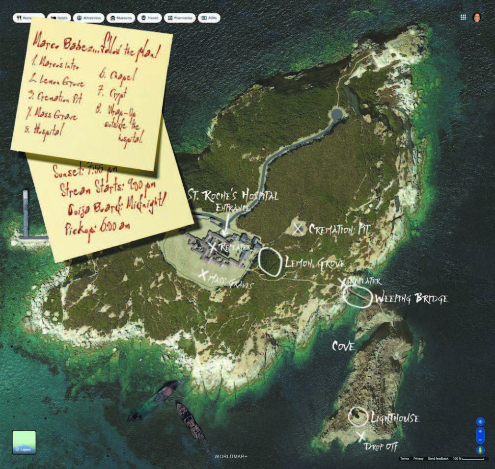{.artview-decision .artview-width-80 .artview-align-center .art-handout-page}

### *Раздаточный материал #10*

Больница святого Роха — фотокопия от Майи (карта игроков)

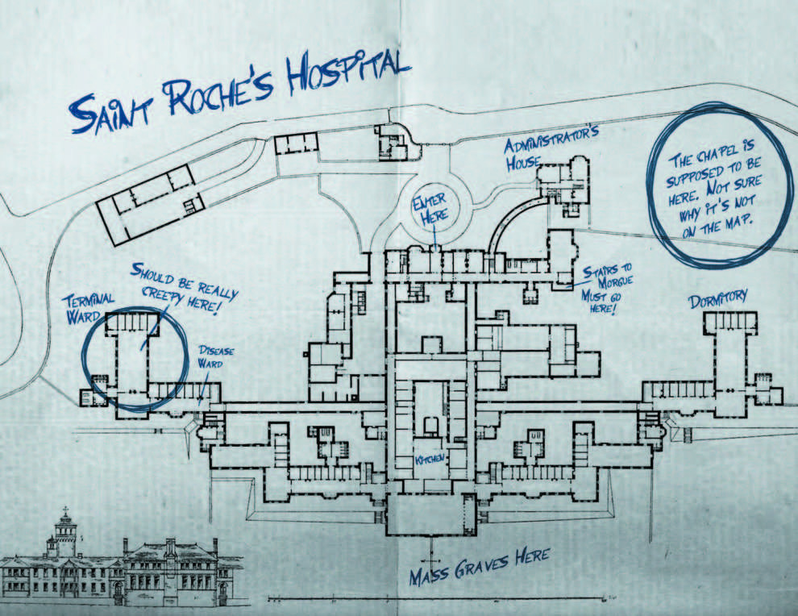{.artview-decision .artview-width-80 .artview-align-center .art-handout-page}

(Карта игроков)

### *Раздаточный материал #11*

Видение Еноха

Вы лежите и смотрите в бархатно-чёрное небо, где звёзды, словно светящиеся булавочные проколы, пронзают завесу мрака. Со всех сторон высоко вздымается жаркое пламя. В небе кружат птицы из красного потрескивающего огня (возможно, ястребы), оставляя за собой полосы зелёного пламени, которые, словно татуировки, покрывают небо шрамами. Птицы издают пронзительные вопли и порой выплёвывают в ночь белые огненные шары.

### *Раздаточный материал #12*

Исследование Коррины

Коррина поискала сведения об Isola di Malamente, чтобы во время прямой трансляции её «видения» казались точнее. Узнать удалось немного, но она обнаружила следующее:

- Легенды гласят, что монахи сжигали прокажённых и душевнобольных в яме для кремации, причём некоторые жертвы ещё были живы.
- Доктор Энцо Бьянко был последним управляющим больницы и покончил с собой в кабинете во время рейда в пятидесятые годы. По сообщениям, его нашли с простреленным затылком и револьвером на столе.
- Один из свидетелей рейда рассказывал, что несколько монахов подожгли себя в старом склепе под часовней.
- Считается, что на Плачущем мосту появляется призрак девочки по имени Катена Ла Роза. По рассказам, в 1960 году она приехала на остров с бабушкой, чтобы оставить куклу духам, способным исцелить её больного брата. Но когда она наклонилась над перилами, чтобы привязать куклу, то потеряла равновесие, упала в воду и погибла. Её тело так и не нашли. По ночам она ждёт на мосту, когда бабушка придёт за ней.
- Некоторые местные жители рассказывают, что в это время года по ночам видят свет в окне верхнего этажа больницы. Самая популярная история гласит, что это медсестра, убитая во время рейда, и она до сих пор бродит по палатам, пытаясь помочь пациентам.

### *Раздаточный материал #13*

Вступительный текст Марко

[Вступительный текст]

Меня зовут Марко Праудфут, а мы — команда «Спектрал»! Мы бываем там и делаем то, на что вы никогда не решитесь. Сегодня вечером мы ведём прямую трансляцию с Сицилии. С заброшенного острова Маламенте!

Нам удалось пробраться в это запретное место, и сегодня мы попытаемся преодолеть отметку в миллион подписчиков!

Сегодня тёплый и душный вечер у побережья. Мы нашли путь на этот затерянный остров, чтобы исследовать призраков и демонов, которые, по слухам, обитают в этом проклятом месте, заключённые в адскую тюрьму. Как и во время других наших прямых трансляций, весь вечер мы будем передавать приветы и принимать ваши заявки. А в ведьмин час мы с Енохом и Корриной проведём спиритический сеанс на алтаре, который, по достоверным сведениям, сохранился здесь под часовней. Воспользуемся особой ведьминской доской Коррины. Если вы, Командиры, останетесь с нами, надеемся вызвать скованных здесь духов.

Не забудьте поставить лайк, подписаться и нажать на значок уведомлений, чтобы не пропустить новые качественные материалы команды «Спектрал». А ещё обязательно загляните в наш официальный магазин первоклассных товаров на Zazzle.

А теперь немного об истории этого места — смотрим VT.

Эй, Марко, детка, когда будешь выступать, обязательно выделяй жирно отмеченные места. Ты справишься! Это будет ЛУЧШАЯ трансляция на свете!

### *Раздаточный материал #14*

Маяк Isola di Malamente

Чёрно-белая фотография маяка с куполом и небольшим зданием на переднем плане (видимого текста или символов нет)

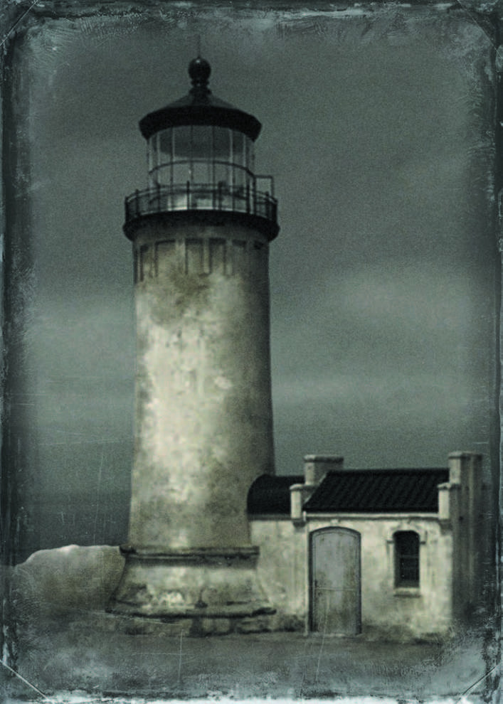{.artview-decision .artview-width-80 .artview-align-center}

### iPad’ы Хёна

Начало трансляции

Хён получает три потока на три отдельных iPad Mini. Они закреплены на нагрудной системе, обеспечивающей удобный доступ к каждому, а если мешают, их можно прижать к груди. Первый (слева) предназначен для чата с Майей, чтобы она по мере необходимости давала указания и информацию. Этот iPad также показывает подключения всех устройств, спутниковый канал, мощность сигнала Wi-Fi и так далее.

Второй (средний) iPad служит для наблюдения за любым потоком с устройств. Хён может в любой момент вывести изображение с любой камеры. С этого же iPad он управляет дроном.

На третьем (правом) iPad прокручиваются комментарии к прямой трансляции. Хён может замедлять или приостанавливать их, удалять троллей и одним движением пальца сохранять важные комментарии в отдельный список. Этот поток критически важен: Хён следит за общим настроением зрителей и показателями, передаёт вопросы и объявляет суперачаты. Майя пообещала зрителям, что с помощью денежных пожертвований в суперачатах они смогут направлять Команду в разные места и предлагать ей разные действия. Разумеется, последнее слово остаётся за Марко, который запретит всё слишком опасное... ведь так?

Работая с iPad’ами, Хён привык отключать трансляцию с наголовной камеры.

> Заметки Хранителя
> 
> Эти раздаточные материалы ограничены, поскольку действия сыщиков крайне непредсказуемы. Хранителю рекомендуется по мере необходимости создавать дополнительные материалы с сообщениями чата, учитывая ситуацию. Ещё лучше использовать какой-нибудь электронный канал — например, текстовые сообщения на телефоне или личные сообщения — и через него передавать информацию игроку Хёна. Это усилит погружение и снизит вероятность того, что игрок просто повторит вслух описанное Хранителем.

### *Раздаточный материал #15*

Начало трансляции/Плачущий мост

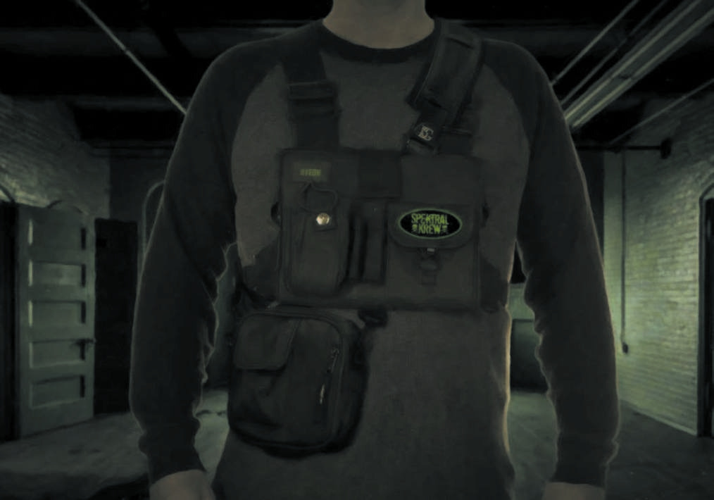{.artview-decision .artview-width-80 .artview-align-center .art-handout-page}

iPad Один

- Майя просит ещё раз проверить все потоки, поэтому вы по очереди просите каждого участника Команды убедиться, что его оборудование включено. Через минуту вы видите, что всё работает.
- Вы видите список подключённых к маршрутизатору устройств, у всех хороший сигнал.
- Как только Марко заканчивает у моста, Майя предлагает следующим отправиться к Лимонной роще, поскольку она по пути.

Хён должен передать это Марко.

iPad Два

- По умолчанию на экране Хёна открыт поток Питера, поскольку именно с него берётся основное видео для трансляции. Питер должен держать в кадре Марко и следовать его указаниям, куда направлять камеру, если только не заметит нечто слишком захватывающее, чтобы это пропустить. Хён может переключаться на любой поток, поэтому просто следите, какой из них открыт в данный момент.

iPad Три

- С началом трансляции первыми приходят самые преданные фанаты с обычными комментариями: Привет, Марко! Первый! Это будет круто! команда «Спектрал» рулит!!!! И так далее. Если спросят, смело придумывайте новые в том же духе.
- Зрители 244; Подписчики 890,421; Покровители 363
- Уже приходит несколько суперачатов, в том числе:
- SethFromTexas: \$20
- LoosyGoosy: \$5
- GhostFan44: \$10
- UltimaUnum: \$20
- EvilDude69: \$2
- GrimmMomm: \$10
- ScottBronco931: \$15
- Keith&Jenelle: \$20
- TheFrickmeister: \$35
- Paul-B-Dee: \$50
- TaylorIsBored: \$20
- Doc\_Gryph: \$8
- Остальные комментарии очень положительные: все в восторге от прямой трансляции команды «Спектрал».

### *Раздаточный материал #16*

Лимонная роща

iPad Один

- Майя переключается между потоками, показывая разные виды рощи.
- Все устройства работают нормально.
- Майя напоминает установить последний ретранслятор у больницы, прежде чем двигаться дальше. У неё готово десять минут VT, которые она включит, как только вы закончите в Лимонной роще.
- Многие просят показать Яму для кремации. Попросите Марко отправиться туда дальше.

iPad Два

- На выбор Хёна

iPad Три

- Зрители 583; Подписчики 890,588; Покровители 366
- Зрителей заворожили странные плоды на деревьях. Почти сразу кто-то предлагает Марко откусить лимон. Остальные подхватывают и требуют, чтобы Марко съел лимон. Приходят новые суперачаты. Большинство хочет, чтобы Маркус откусил лимон.
- MadAlice561: \$10 ...Откуси!
- GhostFan44: \$5 ...СЪЕШЬ ЕГО!!!
- MikeMangyMoose12: \$10 ...Не будь ссыкуном!
- UltimaUnum: \$50 ...Дам ещё сотню, если Марко откусит лимон.
- BloodyCarrotKing: \$20 ...съешь эту мерррррзость!!!
- Pentagram666: \$10 ...НЯМНЯМНЯМ

### *Раздаточный материал #17*

Яма для кремации

iPad Один

- Майя сосредотачивается на потоке Питера. Для более динамичной картинки она предлагает снимать яму, обходя её по кругу.
- Все устройства работают нормально.
- Заметив обгоревшие останки, Майя спрашивает: "Что это в яме? Я готова перейти на VT, если нас могут лишить монетизации. Сообщите как можно скорее!" Когда становится понятно, что это не человек, Майя решает продолжить трансляцию.

iPad Два

- На выбор Хёна

iPad Три

- Зрители 719; Подписчики 890,652; Покровители 372
- Зрители спрашивают об обгоревшем существе в яме. Один шутник предлагает Марко съесть кусочек, но Майя быстро удаляет его комментарий и блокирует на трансляции. Среди других комментариев:
- "Это собака?"
- "Вот теперь всё по-настоящему!"
- «БОЖЕ МОЙ!!!»
- «ЭТО ЧЁ, ГРЁБАНЫЙ САТАНИСТ?!!!»
- "Да ладно вам! Это ТАКАЯ подделка!"
- Суперачаты продолжают приходить:
- BrutusBong: \$30
- Harvey3189: \$10 ...Подойди ближе!
- MaryMary71: \$15 ...Это по-настоящему?
- KimKuntral: \$20 ...Что это за хрень?!

### *Раздаточный материал #18*

Братские могилы

iPad Один

- Майя сосредотачивается на потоке Питера.
- Все устройства работают нормально.
- Майя говорит: "Попроси Питера снять метки крупным планом. Я готова перейти на VT, если увидим настоящее тело. Постарайся предупредить меня заранее."

iPad Два

- На выбор Хёна

iPad Три

- Зрители 945; Подписчики 890,866; Покровители 380
- Многие зрители предлагают воспользоваться «коробкой духов» и попытаться записать ФЭГ. Среди комментариев:
- "Это невероятно!"
- "Там всё ещё похоронены тела?!"
- «БОЖЕ МОЙ!!!»
- "Что это возле ограды?!"
- "Это таааак печально."
- Суперачаты продолжают приходить:
- MonicaOfMonaco5: \$20
- EvilPiper: \$20 ...Подойди ближе!
- TheRavenKing: \$25 ...Марко должен лечь в одну из ям!
- IronWheelchairDemon: \$10 ...Привет, Марко!
- UltimaUnum: \$40 ...Копайте.

### *Раздаточный материал #19*

Перед больницей

iPad Один

- Майя говорит, что ретранслятор даёт хороший сигнал. Пусть Марко проведёт презентацию перед больницей.
- Все устройства работают нормально.
- Майя говорит: "Не торопись, детка. У нас вся ночь впереди. Когда войдёте, сможете разделиться, а я сообщу, если понадобится остановиться."

iPad Два

- На выбор Хёна

iPad Три

- Зрители 1,023; Подписчики 891,023; Покровители 411
- Зрители всё сильнее возбуждены. Среди комментариев:
- "О, это место ТОЧНО населено призраками!"
- "Мне показалось, что в окне второго этажа кто-то есть!!!"
- "Сейчас начнётся безумие!"
- "Марко, ты грёбаный БОСС!"
- "Меня бы туда ни за что не затащили!"
- Суперачаты продолжают приходить:
- GreedyMouse: $30
- BlindFiddler: $10 ...Здесь мы запишем отличные ФЭГ!
- SethFromTexas: $20 ...Вы ОБЯЗАНЫ проверить морг!!!
- NotAFanOfBill: $30 ...Это место просто НЕ МОЖЕТ не быть населённым грёбаными призраками!

### *Раздаточный материал #20*

Дом управляющего

iPad Один

- Майя предлагает обойти дом кругом под закадровый текст Марко. Например: "Кто управлял этим местом и каковы были их истинные намерения?" Или что-то подобное...
- Майя говорит, что время от времени слышит помехи в аудиопотоке. При случае проверьте соединения. Возможно, виновата влажность.
- Майя говорит: "Наверное, нет смысла обходить весь дом. Можно снять несколько кадров внутри у входа, но если там интересно, уделите этому десять минут. Посмотрим, „чувствует“ ли что-то Коррина."

iPad Два

- На выбор Хёна

iPad Три

- Зрители 5,023; Подписчики 902,313; Покровители 524
- Зрители заинтригованы викторианским домом. Среди комментариев:
- "Ого, классический дом с привидениями!"
- "Спорим, в подвале лежат тела"
- "Похож на дом моей мамы"
- "Марко нервничает!"
- "Похоже, управляющие жили неплохо."
- Суперачаты продолжают приходить:
- Bang_O_Rang: $20
- EternalHobo: $30 ...Эй, ребята, возьмите какой-нибудь сувенир!
- UncleBensGhost: $15
- BaronessKessler: $10

### *Раздаточный материал #21*

Внутри больницы #1

iPad Один

- Двигайтесь быстрее, детка. Приближается время ведьминской доски, этот срок нельзя пропустить. Большинство зрителей здесь именно ради неё!
- Ещё раз проверь поток. Я слышу на фоне какую-то радиопереговоры.

iPad Два

- На выбор Хёна

iPad Три

- Зрители 7,875; Подписчики 902,624; Покровители 531
- Зрители в полном восторге от этого места. Среди комментариев:
- "Я так долго этого ждал!!"
- "Они ТАК сильно потеют."
- "Я чувствую зло через экран!"
- "На Коррину точно нападут."
- "Я постоянно вижу, как во тьме что-то движется. Или мне кажется?"
- Суперачаты продолжают приходить:
- BloodSportJr: $40 ...Ребята, вы обязаны пойти в морг!
- UltimaUnum: $300 ...Идите в морг. Ещё $200, если Марко залезет в одну из камер для тел.
- MrBill: $10 ...Да! Покажите морг!!!
- Ann6721: $15 ...Вы ничего не боитесь!

### *Раздаточный материал #22*

Внутри больницы #2

iPad Один

- Зритель UltimaUnum сегодня выложил серьёзные деньги! Я трижды проверила — деньги настоящие. Мы должны беречь себя, но давайте постараемся, чтобы этот парень или девушка остались довольны и продолжали жертвовать. Другие зрители из-за него тоже увеличивают пожертвования.

iPad Два

- На выбор Хёна

iPad Три

- Зрители 8,112; Подписчики 937,888; Покровители 704
- Зрители не могут оторваться. Среди комментариев:
- "Чёрт, мне пора спать, но я не могу перестать смотреть!"
- "Кто-нибудь ещё слышит это жужжание? Похоже на мух!"
- "Это пятно крови?"
- "Эти ребята точно занимались какой-то злой хренью."
- "Мне так холодно. Выпустите нас."
- Суперачаты продолжают приходить:
- BarnyTheMoose: $30 ...О, чувак, это лучшее шоу на свете!
- SteamingSkull327: $15 ...Отличная работа, ребята!
- UltimaUnum: $500 ...Идите в общежитие персонала. Если ответ существует, он там.
- Aaron811: $50 ...Ещё бы!
- OompaLoompaJoe: $45 ...Да кто, чёрт возьми, были эти люди?

### *Раздаточный материал #23*

Внутри больницы #3: Тайные комнаты

iPad Один

- Грёбаный тайный проход?! Вы издеваетесь?! Пусть Марко войдёт первым. Скажи ему, что я готова прервать трансляцию и включить VR, если там окажется нечто, из-за чего нас заблокируют. Осторожнее, детка!

iPad Два

- На выбор Хёна

iPad Три

- Зрители 10,934; Подписчики 966,121; Покровители 828
- Зрители не могут оторваться. Среди комментариев:
- "ЧЗХ?!!!"
- "Это пулевые отверстия?"
- "Это по-настоящему?"
- "Я не могу перестать смотреть."
- "Что об этом думает Коррина?"
- Суперачаты продолжают приходить:
- EbonyMoth: $40 ...Это потрясающе!
- BallGagGranny: $30 ...Что это за ХРЕНЬ?!
- Aaron811: $50 ...Ещё бы!
- OompaLoompaJoe: $45 ...Да кто, чёрт возьми, были эти люди?
- UltimaUnum: $250 ...Найдите книгу.

### *Раздаточный материал #24*

Часовня

iPad Один

- Мы почти на месте, детка. Снимите часовню и, возможно, добавьте закадровый комментарий Марко.
- А пока Енох и Питер могут установить стационарные камеры в склепе? Уже почти время!

iPad Два

- На выбор Хёна

iPad Три

- Зрители 14,219; Подписчики 998,665; Покровители 1,091
- Зрители не могут оторваться. Среди комментариев:
- "Это место просто улёт!"
- "Откуда, чёрт возьми, это жужжание?"
- "Уже почти время! Не могу дождаться!"
- "Здесь определённо приносили человеческие жертвы."
- "Ребята, вам надо уходить. У меня дурное предчувствие."
- Суперачаты продолжают приходить:
- BlindFiddler: $50 ...Ребята, вы ЗВЕРИ!!
- InternetExplorer4Ever: $5 ...Первый!
- RainMan2: $35 ...Что там на потолке?
- HPHatecraft: $20 ...Да начинайте уже этот сеанс! Через час мне вставать на работу!
- UltimaUnum: $650 ...склеп ждёт.
- Netscape4Ever: $6 ...Первый! Чёрт!
- Общая сумма суперачатов достигла $13,681.

### *Раздаточный материал #25*

Склеп: ритуал с ведьминской доской

iPad Один

- Мы только что получили пожертвование PayPal от UltimaUnum на $5,000! Подтверждено! Это потрясающе, детка!
- Мы только что достигли 1 миллиона подписчиков!!! Мы официально стали ВИРУСНЫМИ!!

iPad Два

- На выбор Хёна

iPad Три

- Зрители 16,652; Подписчики 1,002,121; Покровители 1,200
- Комментарии летят слишком быстро, чтобы их читать, зрители сходят с ума.
- Суперачаты тоже приходят один за другим, но Хён сосредоточен на передаче потоков Майе.
- Общая сумма суперачатов достигла $20,100.

### *Раздаточный материал #26*

Склеп: после обрушения

Трансляция прерывается, остаются только два пользователя — DSS и UltimaUnum. Любые сообщения получают один ответ: ОШИБКА 401. Пользователь DSS молчит, но UltimaUnum начинает писать по-латыни, побуждая сыщиков двигаться дальше. В этот момент UltimaUnum обещает огромную сумму в суперачате (достаточно большую, чтобы Марко не смог отказаться) и призывает их продолжать путь.

### *Раздаточный материал #27*

Катакомбы и далее

Когда сыщики входят в катакомбы, поток полностью прерывается из-за толщи камня между ними и приёмниками Wi-Fi. Майя не может связаться с ними ни по телефону, ни через интернет. При появлении Хасталика вирусные помехи от его огромного потустороннего присутствия искажают и разрушают работу всех устройств с доступом в интернет: те начинают бесконечно перезагружаться, сбоить и в конце концов становятся бесполезными — даже устройства Apple. Аналоговое оборудование (например, рации) продолжает работать.

### *Раздаточный материал #28*

Плачущий мост

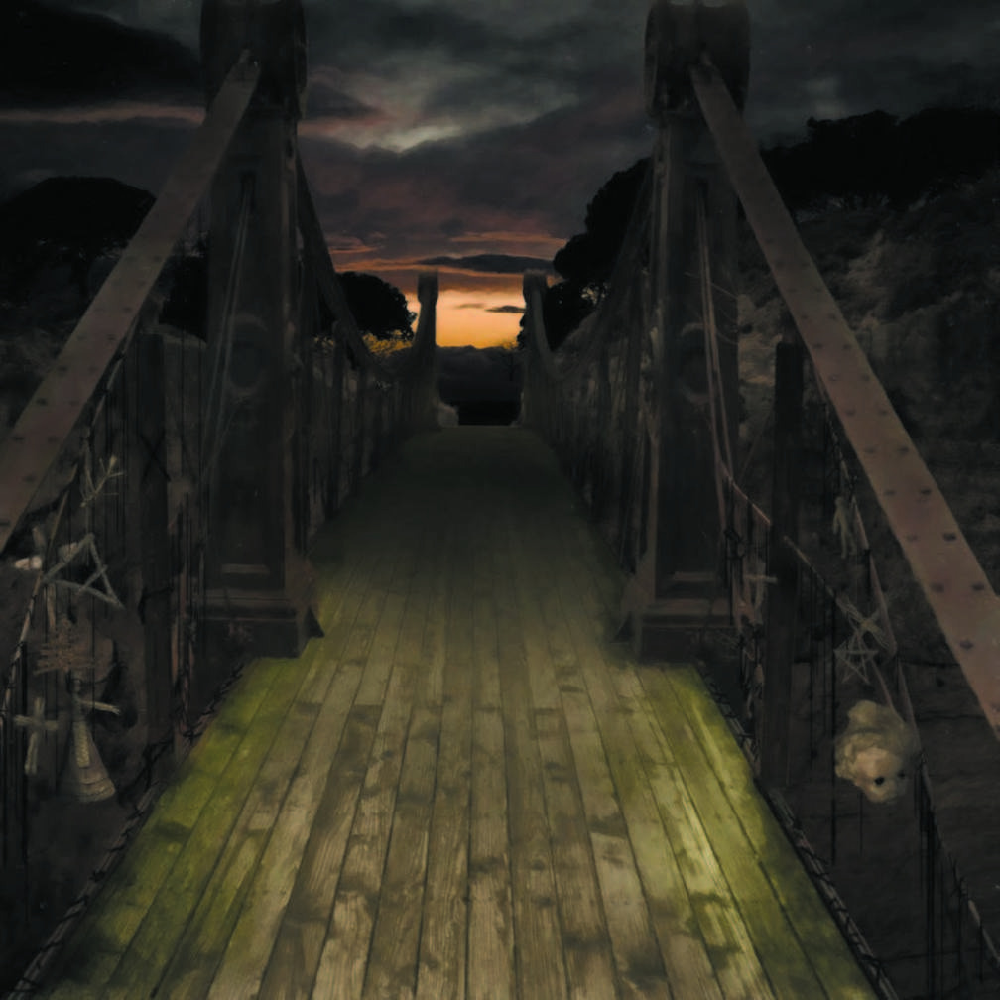{.artview-decision .artview-width-80 .artview-align-center .art-handout-page}

### *Раздаточный материал #29*

Старший Знак

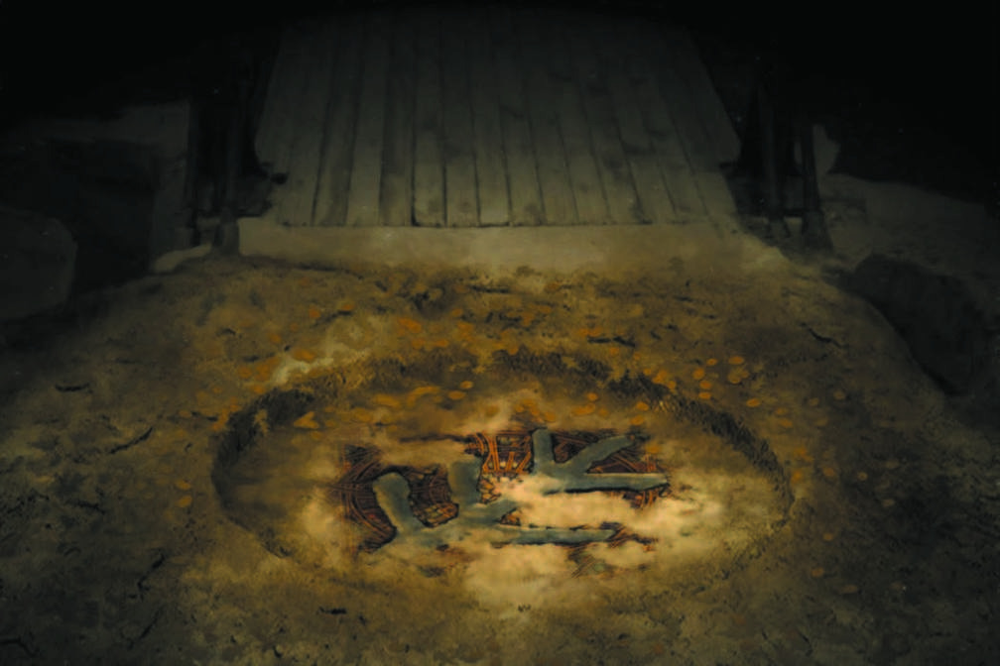{.artview-decision .artview-width-80 .artview-align-center .art-handout-page}

### *Раздаточный материал #30*

Нечто в окне (Чумной монах)

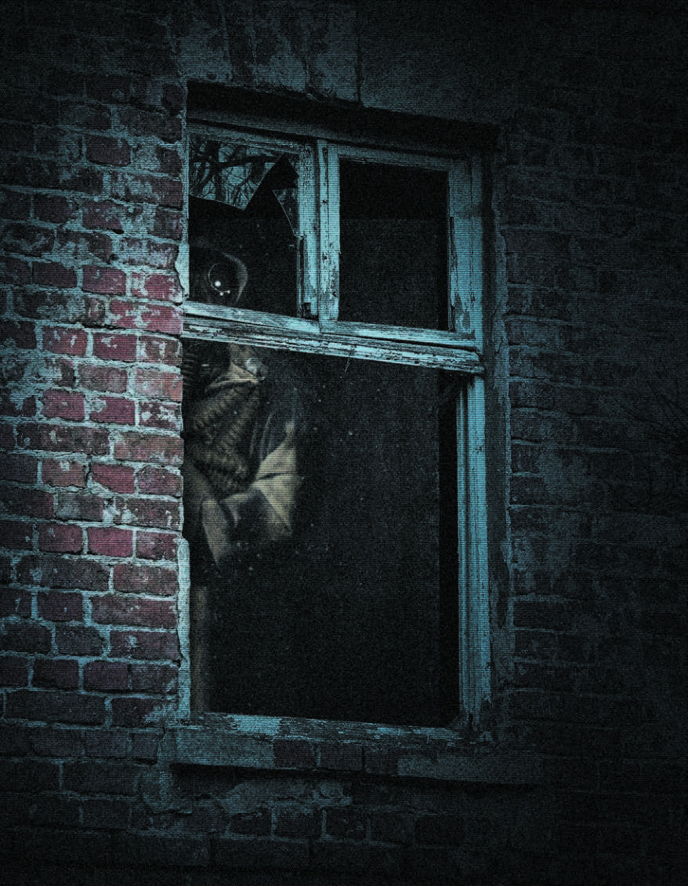{.artview-decision .artview-width-80 .artview-align-center .art-handout-page}

### *Раздаточный материал #31*

Нечто в окне (всего лишь занавески)

*(Всего лишь занавески)*

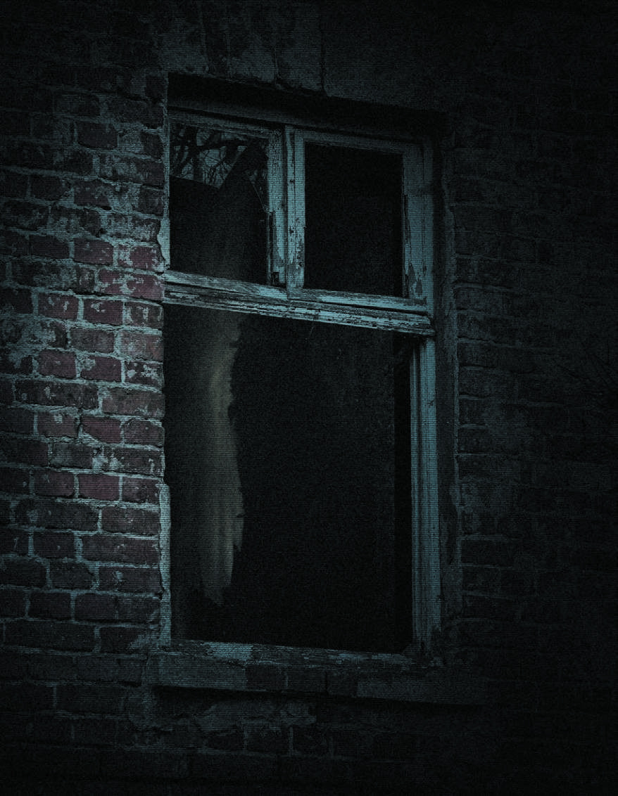{.artview-decision .artview-width-80 .artview-align-center .art-handout-page}

### *Раздаточный материал #32*

Лимонная роща

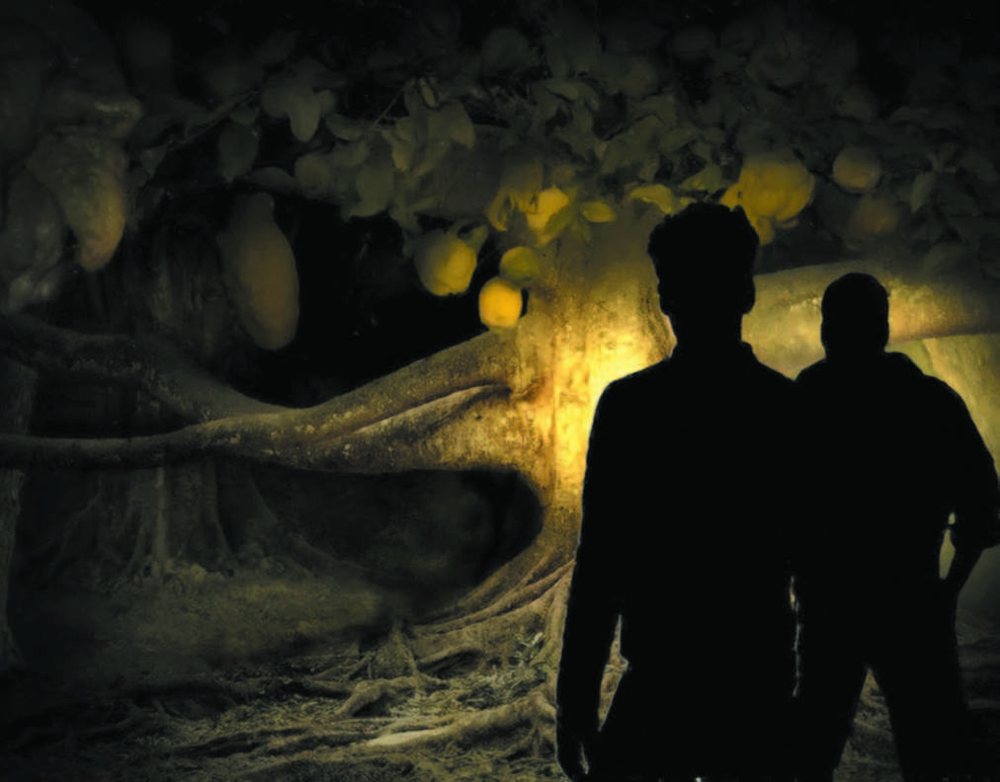{.artview-decision .artview-width-80 .artview-align-center .art-handout-page}

### *Раздаточный материал #33*

Яма для кремации

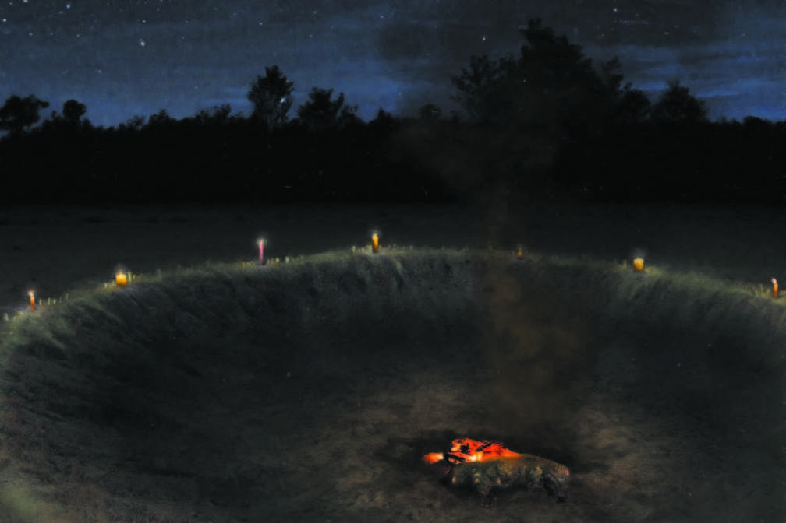{.artview-decision .artview-width-80 .artview-align-center .art-handout-page}

### *Раздаточный материал #34*

Ведьминская доска

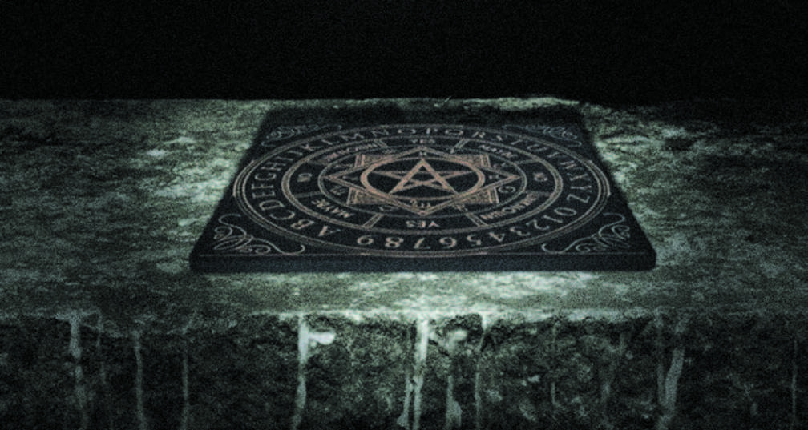{.artview-decision .artview-width-80 .artview-align-center .art-handout-page}

### *Раздаточный материал #35*

Фрагмент книги

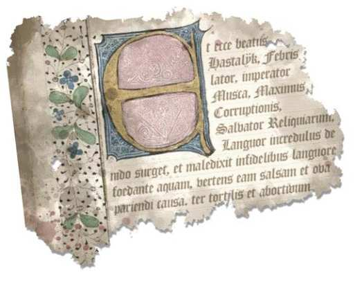{.artview-decision .artview-width-80 .artview-align-center .art-handout-page}

**Текст фрагмента книги (латынь):** Et ecce beatus Hastalÿk, febris lator, imperator Musca, magna corruptio, Salvator Reliquiarum, morbus hortato e nido surgit, et maledicit infideles cum morbus aquae pollens, ea salsa faciente terque tortis et infertilis ovis avibus gignit.

**Перевод фрагмента книги (русский):** И вот благословенный Хасталик, Несущий Лихорадку, Император Мух, Великая Скверна, Спаситель Останков, Воплощённая Болезнь восстал из гнезда и проклял неверующих болезнью, осквернившей воду, сделавшей её солёной и заставившей домашних птиц нести трижды скрученные мертворождённые яйца.

### *Раздаточный материал #36*

Катакомбы

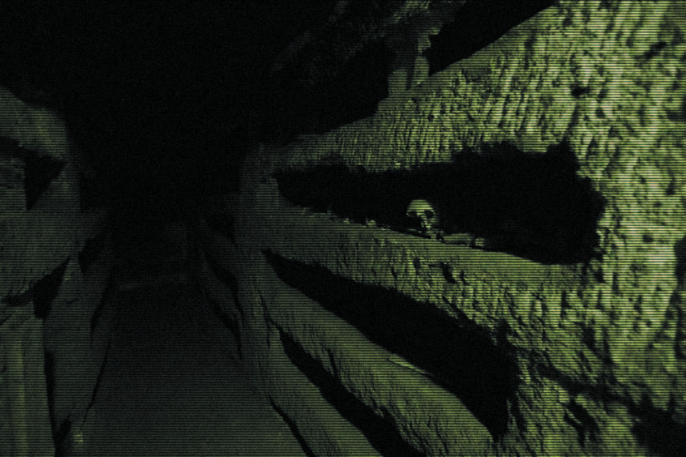{.artview-decision .artview-width-80 .artview-align-center .art-handout-page}

### *Раздаточный материал #37*

Забытый рыцарь

{.artview-decision .artview-width-80 .artview-align-center .art-handout-page}

### *Раздаточный материал #38*

Хасталик восстаёт

{.artview-decision .artview-width-80 .artview-align-center .art-handout-page}

### *Раздаточный материал #39*

Хасталик уничтожен

{.artview-decision .artview-width-80 .artview-align-center .art-handout-page}

## Карты Хранителя

{.artview-decision .artview-width-80 .artview-align-center .art-handout-page}

- [Расположение острова](#viral-keeper-map-isola-location)
- [Обзор острова](#viral-keeper-map-isola-overview)
- [Первый этаж и подвал](#viral-keeper-map-ground-floor-basement)
- [Второй и третий этажи](#viral-keeper-map-second-third-floors)
- [Дом управляющего, восточное крыло и чердак](#viral-keeper-map-administrators-house-east-wing-attic)
- [Тайное подземелье](#viral-keeper-map-secret-underground)

Учтите, что это лишь приблизительное расположение Isola di Malamente. Его точное местоположение было засекречено правительством Италии четырнадцатого сентября 2019 года. Фактическое расположение острова остаётся неизвестным.

### Isola di Malamente

1. Baia del Mendicante [Бухта Нищего]

2. Заброшенный маяк и бывший пост прослушивания времён Второй мировой войны

3. Il Ponte Piangente [Плачущий мост]

4. Abbondante Frutteto [Лимонная роща]

5. Ospedale Sant'Esposito [Больница святого Эспозито]

6. Братские могилы

7. Яма для кремации

8. Причал Isola di Malamente

9. Punta Bellavista [Обзорная площадка]

{.artview-decision .artview-width-80 .artview-align-center .art-handout-page}

### Первый этаж и подвал

Условные обозначения

{.artview-decision .artview-width-80 .artview-align-center .art-handout-page}

{.artview-decision .artview-width-80 .artview-align-center .art-handout-page}

> Страницы карты: 106, 107
> Обозначения: A. Кабинет управляющего
> B. Приёмное отделение
> C. Прачечная
> D. Котельная
> E. Операционная
> F. Смотровая
> G. Кухня
> H. Столовая и зал отдыха
> I. Западный коридор
> J. Изолятор
> K. Палата выздоравливающих
> L. Инфекционное отделение
> M. Палата смертельно больных
> N. Восточный коридор
> O. Палата острых состояний
> P. Палата недавно поступивших
> Q. Комплекс кабинетов
> R. Общежитие персонала
> S. Святилище костей
> T. Камера пыток
> U. Операционная
> V. Отбросы
> Условные обозначения: важные области; опасные области; тайные комнаты; руины часовни; склеп.
> Масштаб: 0–30 метров.

### Второй и третий этажи

{.artview-decision .artview-width-80 .artview-align-center .art-handout-page}

A. Кабинет старшей медсестры

B. Психиатрическое отделение

C. Кухня

D. Верхняя столовая и зал отдыха

E. Изолятор

F. Палата выздоравливающих

G. Инфекционное отделение

H. Палата смертельно больных

I. Палата острых состояний

J. Палата недавно поступивших

Условные обозначения: опасные области. Масштаб: 0–30 метров.

### Дом управляющего, восточное крыло и чердак больницы

{.artview-decision .artview-width-80 .artview-align-center .art-handout-page}

### Тайное подземелье

{.artview-decision .artview-width-80 .artview-align-center .art-handout-page}

## Готовые сыщики

- [Марко: лицевая сторона](#viral-pregen-marco-front)
- [Марко: предыстория](#viral-pregen-marco-background)
- [Коррина: лицевая сторона](#viral-pregen-corrina-front)
- [Коррина: предыстория](#viral-pregen-corrina-background)
- [Енох: лицевая сторона](#viral-pregen-enoch-front)
- [Енох: предыстория](#viral-pregen-enoch-background)
- [Питер: лицевая сторона](#viral-pregen-peter-front)
- [Питер: предыстория](#viral-pregen-peter-background)
- [Ку Хён: лицевая сторона](#viral-pregen-ku-hyeon-front)
- [Ку Хён: предыстория](#viral-pregen-ku-hyeon-background)
- [Пустой лист: лицевая сторона](#viral-pregen-blank-front)
- [Пустой лист: предыстория](#viral-pregen-blank-background)

### Марко Праудфут — лист сыщика

{.artview-decision .artview-width-100 .artview-align-center .art-pregen-fullpage}

### Марко Праудфут — предыстория и снаряжение

{.artview-decision .artview-width-100 .artview-align-center .art-pregen-fullpage}

**Предыстория**

**Описание.** Марко мускулист, волосы зачёсаны назад. Он очень модно одевается и обычно носит крутые тёмные очки. Чёрная кожаная куртка Gucci на нём всегда, в любую погоду... если, конечно, не появляется возможность показать свои «пушки».

**Идеология/убеждения.** Марко безоговорочно верит в демонов и часто утверждает, что ВСЁ имеет демоническую природу. По его словам, среди его предков были коренные американцы (со стороны отца в нём 1 шестнадцатая доля крови чероки), поэтому он взял фамилию «Праудфут», чтобы звучать загадочнее.

**Значимые люди.** Команда «Спектрал», особенно Коррина. Он безоговорочно верит всему, что она говорит. Он также любит маму, папу и своих «корешей» из Куинса.

**Значимые места.** Его дом в Куинсе.

**Ценные вещи.** Его кожаная куртка Gucci. Он буквально пожертвует друзьями ради её спасения.

**Черты.** Марко — нарцисс. Увидев зеркало, он обязательно любуется собой. Он из богатой семьи, которая оплачивает любую его прихоть, поэтому склонен решать проблемы деньгами.

**Травмы и шрамы.**

**Фобии и мании.** Нарциссизм. Внешне Марко крайне уверен в себе, но при виде настоящего паранормального явления, вероятно, наложит в штаны.

**Тайные книги, заклинания и артефакты.**

**Встречи со странными существами.**

**Снаряжение и имущество**

- Сумка команды «Спектрал»™
- Наголовная камера (обычный режим и ночное видение)
- Измеритель ЭМП
- Смартфон с камерой FLIR
- ФЭГ SCD1
- Светящиеся палочки (20)

**Деньги и имущество**

- Уровень расходов: $5,000
- Наличные: $36,000
- Имущество: Марко — наследник семейного состояния, поэтому, хотя его личные Средства скромнее, при необходимости он через мать получает доступ к куда большим ресурсам. Кроме того, он управляет командой «Спектрал», которая потенциально стоит очень дорого.

**Краткая памятка правил**

- Форсирование бросков: повторный бросок нужно обосновать; боевые проверки и проверки Рассудка форсировать нельзя.
- Первая помощь восстанавливает 1 ЗД; Медицина восстанавливает +1d3 ЗД.
- Тяжёлая рана = потеря ≥ ½ максимума ЗД от одной атаки.
- 0 ЗД без Тяжёлой раны = без сознания.
- 0 ЗД с Тяжёлой раной = при смерти.
- При смерти: Первая помощь временно стабилизирует; затем требуется Медицина.
- Естественное исцеление (без Тяжёлой раны): восстановление 1 ЗД в день.
- Естественное исцеление (Тяжёлая рана): еженедельная проверка исцеления.

**Обязанности Марко**

Марко — главный голос и лицо команды «Спектрал». Он ведёт все вступления и завершения, даёт основные комментарии и направляет расследование, а также принимает важные решения по всем аспектам шоу. Он активно поощряет споры в прямом эфире, прекрасно зная, как они нравятся аудитории.

### Коррина Тренч — лист сыщика

{.artview-decision .artview-width-100 .artview-align-center .art-pregen-fullpage}

### Коррина Тренч — предыстория и снаряжение

{.artview-decision .artview-width-100 .artview-align-center .art-pregen-fullpage}

**Предыстория**

**Описание.** Рост Коррины 170 см, у неё длинные, слегка растрёпанные каштановые волосы с фиолетовой прядью и маленький бриллиантовый пирсинг в носу. Она носит длинную парку, полосатые легинсы и ботинки Dr. Martens.

**Идеология/убеждения.** Коррина верит в ауры, кристаллы, призраков и тому подобное. Она считает себя медиумом, играющим по правилам телевизионных экстрасенсов. Увы, духовной связи в ней не больше, чем в чайнике.

**Значимые люди.** Марко. Благодаря его непоколебимой вере в неё Коррина хорошо живёт и будет защищать это любой ценой.

**Значимые места.** Синий дом. Это «коммуна хиппи», где она выросла и с большинством обитателей которой до сих пор тесно связана, включая патриарха коммуны Феликса Блу.

**Ценные вещи.** Отец Блу учил её отказываться от привязанностей, поэтому по идее у неё не должно быть по-настоящему ценных вещей. И всё же ведьминская доска очень для неё важна.

**Черты.** Коррина умеет изображать экстрасенса, хотя умные люди сразу видят обман.

**Травмы и шрамы.**

**Фобии и мании.** Это не полноценная фобия, но Коррина отчаянно боится, что Марко разоблачит её и вышвырнет из команды (что действительно случится).

**Тайные книги, заклинания и артефакты.**

**Встречи со странными существами.**

**Снаряжение и имущество**

- Сумка команды «Спектрал»™
- Наголовная камера (обычный режим и ночное видение)
- «Коробка духов»
- Ведьминская доска
- Светящиеся палочки (20)

**Деньги и имущество**

- Уровень расходов: $200
- Наличные: $1,280
- Имущество: дома у Коррины есть автомобиль, но почти ничего более ценного.

**Краткая памятка правил**

- Форсирование бросков: повторный бросок нужно обосновать; боевые проверки и проверки Рассудка форсировать нельзя.
- Первая помощь восстанавливает 1 ЗД; Медицина восстанавливает +1d3 ЗД.
- Тяжёлая рана = потеря ≥ ½ максимума ЗД от одной атаки.
- 0 ЗД без Тяжёлой раны = без сознания.
- 0 ЗД с Тяжёлой раной = при смерти.
- При смерти: Первая помощь временно стабилизирует; затем требуется Медицина.
- Естественное исцеление (без Тяжёлой раны): восстановление 1 ЗД в день.
- Естественное исцеление (Тяжёлая рана): еженедельная проверка исцеления.

**Обязанности Коррины**

Каждому хорошему шоу об охоте на призраков нужен экстрасенс — и это Коррина. По времени в кадре она уступает только Марко, а он всегда зовёт её, чтобы добавить жути и драмы. Она работает с «коробкой духов», часто проводит спиритические сеансы и ищет воду с лозой и, разумеется, общается с мёртвыми при помощи ведьминской доски. Последнюю она купила на Etsy.

### Енох Джеремайя Икинс — лист сыщика

{.artview-decision .artview-width-100 .artview-align-center .art-pregen-fullpage}

### Енох Джеремайя Икинс — предыстория и снаряжение

{.artview-decision .artview-width-100 .artview-align-center .art-pregen-fullpage}

**Предыстория**

**Описание.** Енох — настоящий великан ростом 198 см. Он носит белую рубашку на пуговицах, джинсы, сандалии с открытыми носами и бейсболку команды «Спектрал». У него густая борода, добрые голубые глаза и заметный шрам на лице.

**Идеология/убеждения.** Он обладает «Зрением», поэтому не всегда верит тому, что видит и слышит. Он искренне хочет верить в Бога, но не может. Это мягкая, измученная душа.

**Значимые люди.** Мать, отец и сестра, хотя он почти не рассказывает о них окружающим.

**Значимые места.** Община амишей, где он вырос.

**Ценные вещи.** Распятие из двух сапожных гвоздей, которое сделал для него отец.

**Черты.** Енох склонен видеть и слышать всё. Он знает, что Коррина — мошенница, но считает, что не ему об этом говорить. По его мнению, в конце концов она сама себя разоблачит.

**Травмы и шрамы.** На левой стороне лица Еноха остался заметный шрам от несчастного случая на ферме в детстве.

**Фобии и мании.** Енох зависим от алкоголя и марихуаны, поскольку только они, кажется, способны сдерживать «Зрение».

**Тайные книги, заклинания и артефакты.**

**Встречи со странными существами.** Енох видит мёртвых, если только не пьян и не под кайфом.

**Снаряжение и имущество**

- Сумка команды «Спектрал»™
- Наголовная камера (обычный режим и ночное видение)
- Ретрансляторы Wi-Fi (2)
- Стационарные камеры ночного видения (6)
- Светящиеся палочки (20)

**Деньги и имущество**

- Уровень расходов: $200
- Наличные: $920
- Имущество: дома у Еноха есть фургон, а сам он снимает небольшую квартиру над магазином деликатесов.

**Краткая памятка правил**

- Форсирование бросков: повторный бросок нужно обосновать; боевые проверки и проверки Рассудка форсировать нельзя.
- Первая помощь восстанавливает 1 ЗД; Медицина восстанавливает +1d3 ЗД.
- Тяжёлая рана = потеря ≥ ½ максимума ЗД от одной атаки.
- 0 ЗД без Тяжёлой раны = без сознания.
- 0 ЗД с Тяжёлой раной = при смерти.
- При смерти: Первая помощь временно стабилизирует; затем требуется Медицина.
- Естественное исцеление (без Тяжёлой раны): восстановление 1 ЗД в день.
- Естественное исцеление (Тяжёлая рана): еженедельная проверка исцеления.

**Обязанности Еноха**

Официально Енох — своего рода техник команды «Спектрал»: он переносит тяжёлое оборудование, устанавливает аппаратуру и следит за безопасностью всех участников. Кроме того, Енох работает вторым оператором и обычно снимает Коррину. Неофициально он личный телохранитель Марко. И, разумеется, Енох обладает странными силами, которые держит в тайне.

### Питер Уортон — лист сыщика

{.artview-decision .artview-width-100 .artview-align-center .art-pregen-fullpage}

### Питер Уортон — предыстория и снаряжение

{.artview-decision .artview-width-100 .artview-align-center .art-pregen-fullpage}

**Предыстория**

**Описание.** Рост Питера 175 см, он лихо выглядит, худощав, волосы слегка растрёпаны, а на лице вечерняя щетина. Поверх клетчатой рубашки лесоруба он носит зелёную непромокаемую куртку Burberry, а также рваные синие джинсы и ботинки Dr. Martens.

**Идеология/убеждения.** Профессиональный преступник и бывший героиновый наркоман, Питер твёрдо намерен вернуть свою жизнь в правильное русло. Он сделает всё ради успеха команды «Спектрал», даже если придётся подделать свидетельства, чтобы получить захватывающий материал.

**Значимые люди.** Марко Праудфут. Питеру искренне нравятся Марко и его привычка не судить людей с порога, и он уважает его за это.

**Значимые места.** Нет.

**Ценные вещи.** Питер любит свою зелёную куртку Burberry (подарок Марко) и коричневые кожаные ботинки, которые носит постоянно.

**Черты.** Обычно молчалив, если только не хвалит Марко. Глаза Питера постоянно бегают по сторонам, а в углу рта почти всегда торчит сигарета.

**Травмы и шрамы.**

**Фобии и мании.** У него есть клептоманские наклонности, которые пока удаётся держать под контролем.

**Тайные книги, заклинания и артефакты.**

**Встречи со странными существами.**

**Снаряжение и имущество**

- Сумка команды «Спектрал»™
- Наголовная камера (обычный режим и ночное видение)
- Измеритель ЭМП
- Диктофон ФЭГ
- Смартфон
- Одноразовый смартфон
- Различные лески и предметы диверсанта, которые легко незаметно подбросить
- Диктофон с записью стонов
- Светящиеся палочки (20)

**Деньги и имущество**

- Уровень расходов: $40
- Наличные: $180
- Имущество: $550. Питер живёт одним днём и едва сводит концы с концами. По сути, он живёт в автомобиле, но никому из команды не признался.

**Краткая памятка правил**

- Форсирование бросков: повторный бросок нужно обосновать; боевые проверки и проверки Рассудка форсировать нельзя.
- Первая помощь восстанавливает 1 ЗД; Медицина восстанавливает +1d3 ЗД.
- Тяжёлая рана = потеря ≥ ½ максимума ЗД от одной атаки.
- 0 ЗД без Тяжёлой раны = без сознания.
- 0 ЗД с Тяжёлой раной = при смерти.
- При смерти: Первая помощь временно стабилизирует; затем требуется Медицина.
- Естественное исцеление (без Тяжёлой раны): восстановление 1 ЗД в день.
- Естественное исцеление (Тяжёлая рана): еженедельная проверка исцеления.

**Обязанности Питера**

Для съёмки происходящего используется множество камер, но главной управляет Питер, который старается, чтобы Марко всегда выглядел для зрителей потрясающе. Кроме того, он снимает показания ЭМ и подыгрывает Марко в разговоре, чтобы тому не приходилось говорить самому с собой. Питер редко появляется в кадре, но иногда попадает на дополнительные камеры и некоторые записи FLIR.

### Ку Хён — лист сыщика

{.artview-decision .artview-width-100 .artview-align-center .art-pregen-fullpage}

### Ку Хён — предыстория и снаряжение

{.artview-decision .artview-width-100 .artview-align-center .art-pregen-fullpage}

**Предыстория**

**Описание.** Рост Хёна 188 см, у него среднее телосложение и чёрные волосы. Он носит кожаную куртку-бомбер, джинсы и модные очки в чёрной оправе.

**Идеология/убеждения.** Хён честен до назойливости. Ему нравится разоблачать свидетельства существования призраков.

**Значимые люди.** Мать и отец. Хён любит родителей, но они не одобряют его жизненный выбор и постоянно грозятся отправить кого-нибудь в Нью-Йорк, чтобы вернуть сына домой.

**Значимые места.** Его дом в Сеуле.

**Ценные вещи.** Собранный на заказ ноутбук. Хён вложил много времени, денег и сил в создание особого ноутбука, позволяющего транслировать и координировать все видео- и аудиопотоки команды «Спектрал».

**Черты.** Хён — закоренелый скептик.

**Травмы и шрамы.**

**Фобии и мании.**

**Тайные книги, заклинания и артефакты.**

**Встречи со странными существами.**

**Снаряжение и имущество**

- Сумка команды «Спектрал»™
- Наголовная камера (обычный режим и ночное видение)
- iPhone
- Система трансляции (три iPad’а на нагрудной системе)
- Светящиеся палочки (20)

**Деньги и имущество**

- Уровень расходов: $300
- Наличные: $1,920
- Имущество: $48,000 (в основном это сбережения, но значительная часть вложена в видео- и аудиооборудование).

**Краткая памятка правил**

- Форсирование бросков: повторный бросок нужно обосновать; боевые проверки и проверки Рассудка форсировать нельзя.
- Первая помощь восстанавливает 1 ЗД; Медицина восстанавливает +1d3 ЗД.
- Тяжёлая рана = потеря ≥ ½ максимума ЗД от одной атаки.
- 0 ЗД без Тяжёлой раны = без сознания.
- 0 ЗД с Тяжёлой раной = при смерти.
- При смерти: Первая помощь временно стабилизирует; затем требуется Медицина.
- Естественное исцеление (без Тяжёлой раны): восстановление 1 ЗД в день.
- Естественное исцеление (Тяжёлая рана): еженедельная проверка исцеления.

**Обязанности Хёна**

Хён отвечает за всю технику, следит, чтобы оборудование было заряжено и нормально работало. Во время прямых трансляций он читает и модерирует комментарии фанатов, передавая лучшие из них. Он помогает режиссировать шоу, предлагает кадры и тому подобное.

Хён передаёт Майе все видео- и аудиопотоки, а Майя связывается с командой через Хёна.

Кроме того, Хён постоянно записывает ФЭГ во время съёмки и может в любой момент воспроизвести поток.

### Пустой шаблон сыщика команды «Спектрал»

{.artview-decision .artview-width-100 .artview-align-center .art-pregen-fullpage}

### Пустой шаблон сыщика команды «Спектрал» — предыстория

{.artview-decision .artview-width-100 .artview-align-center .art-pregen-fullpage}

**Предыстория**

**Описание.**

**Черты.**

**Идеология/убеждения.**

**Травмы и шрамы.**

**Значимые люди.**

**Фобии и мании.**

**Значимые места.**

**Тайные книги, заклинания и артефакты.**

**Ценные вещи.**

**Встречи со странными существами.**

**Снаряжение и имущество**

**Деньги и имущество**

- Уровень расходов:
- Наличные:
- Имущество:

**Краткая памятка правил**

- Форсирование бросков: повторный бросок нужно обосновать; боевые проверки и проверки Рассудка форсировать нельзя.
- Первая помощь восстанавливает 1 ЗД; Медицина восстанавливает +1d3 ЗД.
- Тяжёлая рана = потеря ≥ ½ максимума ЗД от одной атаки.
- 0 ЗД без Тяжёлой раны = без сознания.
- 0 ЗД с Тяжёлой раной = при смерти.
- При смерти: Первая помощь временно стабилизирует; затем требуется Медицина.
- Естественное исцеление (без Тяжёлой раны): восстановление 1 ЗД в день.
- Естественное исцеление (Тяжёлая рана): еженедельная проверка исцеления.

**Другие сыщики**
