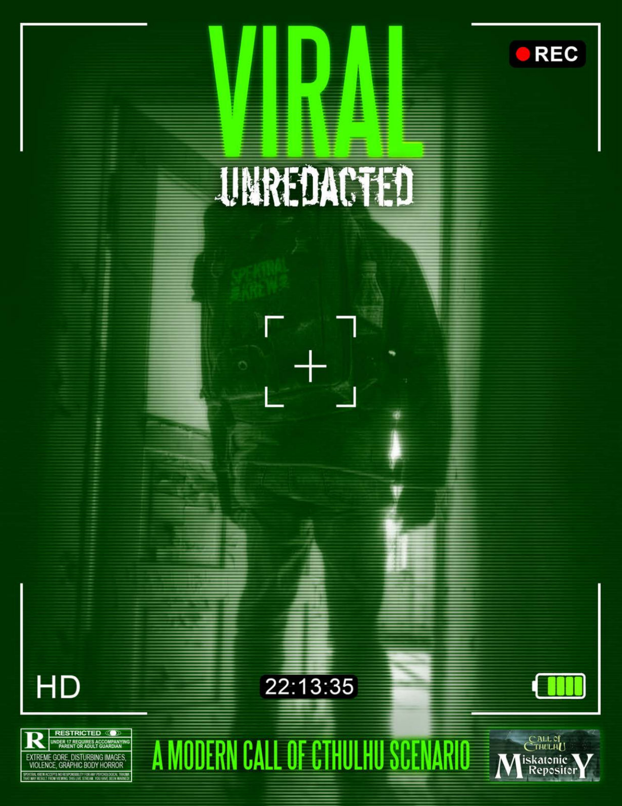{.art-cover}

# VIRAL

## Credits

Writing

Alex Guillotte, Buds RPG Review

Illustrations, Design & Layout

Alex Guillotte

Editing

Matthew Pook

Additional Editing

Keith Mageau

Language Consultant

Luca Alexander Volpino

Play Testers

Adrian Jones, Andy Simcock, Brendan Sharples, Christian Frost, Daniel Keegan, Demonsamurai, DMH, Dragongirl74, Dr Ian “Griff” Griffiths, Fabio Vollono, Halsten Rust, Ian Christiansen, James Cross, James Crosfield, Jim McCarthy, Keith Mageau, Lee Williams, Ludovic Chabant, Mark Willoughby, Matthew Pook, Mehvish Ali (WishMoon), Michael Fryda, Michalis Mandilaras, Molgars, Paul Baldowski, Paul Fricker, Renarion, Richard Marpole, Scott “OrcusDorkus” Joest, Seth Skorkowsky, Stef1885, Symatt, Tristan Narbrough

Special Thanks to Seth Skorkowsky.

In creating this unredacted version of Viral, we've taken some of your cool ideas, filed off the serial numbers, and made them our own.

© Copyright 2022 • Alex Guillotte, Buds RPG Review

Call of Cthulhu is a Trademark of Chaosium Inc. and is used with their permission via the OBS Community Content program.

For more information please visit Chaosium's website:

www.Chaosium.com

The Miskatonic Repository Logo is used under license.

{.art-body-right}

OK guys, here's the thing. Get your passports ready because we are going to Italy baby! The Old Country! So, according to Maya, we are just one live stream away from hitting the one million sub mark. You know what that means? Better sponsorship, getting on talk shows... maybe even a TV deal! More green on the table! It's so close I can fucking TASTE it.

So Maya hits me up and tells me about this island, see, just off the west coast of Italy. If you look on Google Maps, it's got nuthin' on it, but on this map she grabbed from one of her people online it's got buildings and trees and what looks like a bombedout chapel. This island had this order of monks living on it... the Order of the Lamb of the Living Jesus or some shit... anyway this island has been populated since the Bronze Age. This order, they took in the sick when the plague punched Europe in the face back in the day. I mean if anywhere is going to be haunted it's this place right? This place makes Poveglia look like a frickin' kids movie!

So here's the plan. We fly out next week. I've got the gear being shipped over there PRIORITY. When we arrive in the local town, Maya has arranged for someone to get us to the island. From there we will set up and do a live broadcast right under the dumb noses of the Eye-talian Navy. They'll never even know we were there.

Now Hyeon - I know, I know... you're going to mention signals and all that tech stuff. I get it my man. We're screwed if we get there and can't broadcast. Don't worry brother - I've got us covered. See, it turns out there is an old abandoned listening post from the second World War there. Maya has paid for someone local to break in there and hook it up with all the right cables and shit so we can spit out a signal! Should be A1 crystal clear baby!

OK - so any questions?

## WARNING

Viral is intended for mature audiences. The Keeper and players should be aware that this scenario contains situations, scenes, and imagery that some might find intense, particularly if they have experienced any real life trauma.

That being said, there is no substitute for good old-fashioned communication between everyone involved in the game. Before beginning this scenario, the Keeper should sit down and talk with their players, making the nature and content of this material very clear. Encourage the players to ask questions, voice concerns, and vote on whether or not the scenario is right for the group. It may even be a good idea to have a secret vote for the sake of personal privacy.

If everyone agrees to play, it is suggested that the Keeper give players some way to end a scene that they find too intense. This can be done using a token or safe word of some kind, but however it's done, there should be no explanation required. The Keeper should simply end the scene and have the group take a break so that they can resolve the situation. Possible resolutions could include taking the scene in a different direction, replaying things differently, or simply 'fading to black' with a narrative description added by the Keeper.

The Keeper should avoid punishing the player when this happens. So there should be no significant damage or Sanity loss when the game resumes.

In an extreme case where someone cannot continue the scenario, the session should end immediately. At that point, the group can discuss options. The Keeper may be able to rework the scenario, but it's also possible that the player will have to bow out of the game for the remainder of the story, or the scenario may have to be set aside altogether.

Remember that roleplaying games are ultimately about having fun. If anything in this scenario would detract from that fun, it should be changed or eliminated as the Keeper sees fit.

## Contents

- [Credits](#viral-credits)
- [Opening Message](#viral-opening-message)
- [Warning](#viral-warning)
- [Introduction](#viral-introduction)
- [The Spektral Krew](#viral-spektral-krew)
- [Creating New Investigators](#viral-creating-new-investigators)
- [Spektral Krew Gear](#viral-spektral-krew-gear)
- [Timeline](#viral-timeline)
- [History](#viral-history)
- [One Night in Perla](#viral-one-night-in-perla)
- [Isola di Malamente](#viral-isola-di-malamente)
- [Epilogue](#viral-epilogue)
- [Appendix](#viral-appendix)
- [Handouts](#viral-player-handouts)
- [Keeper Maps](#viral-keeper-maps)
- [Characters](#viral-pregenerated-investigators)

## Introduction

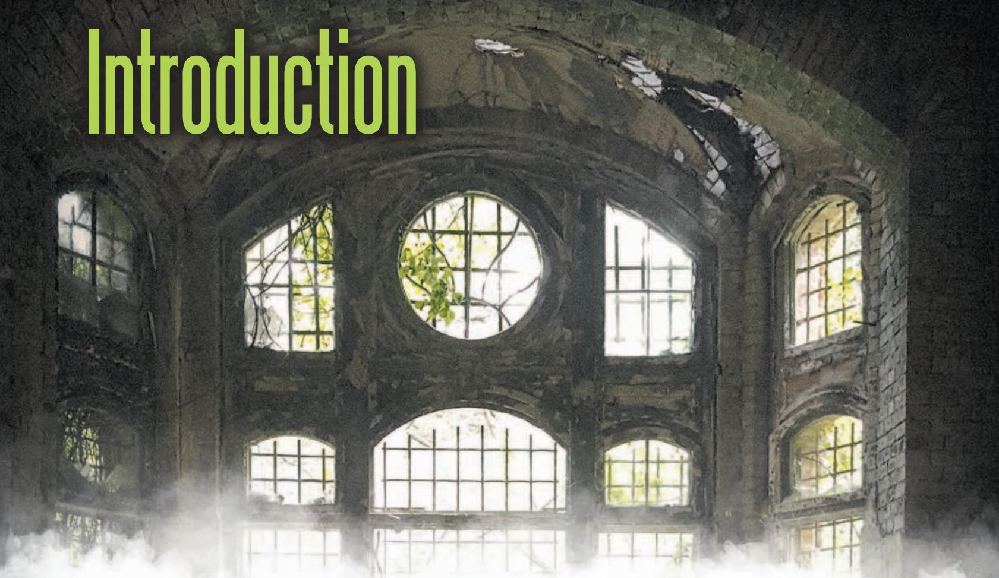{.art-body-right}

### Summary

"We are the Spektral Krew, and we go places and do things you would never do." – Marco Proudfoot

Producers of a popular ghost hunting YouTube channel called Spektral Krew are planning to illegally visit Isola di Malamente, an island off the coast of Sicily to broadcast live as they attempt to uncover evidence of a genuine haunting and thus become Internet sensations. All goes well until they find that their ride off the island has disappeared and they begin to see more than dust orbs and incoherently blurred photos. They soon learn that there may be someone or something... else on the island, and that the history of the place may be darker than they could have ever imagined.

### Overview

This scenario involves a group of professional ghost hunters traveling to a mysterious island to spend the night searching for evidence of the supernatural. While some of them are certainly interested in finding actual evidence for ghosts, their real objective is to ‘go viral’ on YouTube in order to bring their channel to the next level and perhaps even hit the big time with their own television show.

Unbeknownst to the Investigators, a cult of the Great Old One Hastalÿk has been active on the island since the Bronze Age, offering countless sacrifices over the millennia. Only one of the ‘Plague Monks’ remains following a government raid on the island in the 1950s, the details of which have been diligently hidden from the public by the Italian government.

The Plague Monk's only objective is to manifest Hastalÿk physically into the world, and spread its mutating corruption across the planet. Hastalÿk's ultimate plan is incomprehensible to mortals, but it certainly involves turning all life on Earth into itself through the spread of its Taint and absorbing all living things. To that end, it is vital to get the Investigators to witness the final sacrifice of the last Plague Monk at the Charnel Pit, and ideally become absorbed into the body of Hastalÿk themselves.

After that, Hastalÿk will try to reach the water. Once it is able to touch the water, it bursts like a balloon to scatter its Taint to corrupt the nearby sea life, and eventually the world. Fortunately for the world, the Italian government has been watching the island, and indeed the live stream from the Spektral Krew. As soon as it becomes apparent that Hastalÿk is about to be released, the Italian military triggers its equivalent of the ‘Innsmouth Protocol’ and scrambles a squadron of jets to fire bomb the island, and end the vile corruption once and for all.

Viral can be run in about four to eight hours depending on how the Keeper chooses to approach the scenario. Certain features are designed to be included or omitted as desired to speed up or slow down the game.

## SPEKTRAL KREW

We go places and do things that you would never do.

### Marco ‘Proudfoot’ Maglioni (Lead Investigator)

{.art-body-right}

Marco Proudfoot (real name Marco Anthony Maglioni) was born in Palermo, Italy to a wealthy Italian mother and an American father who was a Sergeant in the US Army. Marco is only about a sixteenth Cherokee, but he uses the name Proudfoot because he thinks it's cool and makes him sound more "spiritually connected to his roots and shit." Unfortunately, Marco is not big on reading so he has never realized that the name suggestion was a prank by a Tolkien fan.

His family moved to the United States when Marco was ten years of age. Just after college Marco founded the Spektral Krew, a popular YouTube channel that features videos exploring strange, abandoned places, and investigating the paranormal. His mother encouraged his ‘odd hobbies’ and so paid for most of his equipment to get him started, and she continues to be his number one patron.

Spektral Krew actually started off as a prank channel, but after a video of a coffee cup moving on its own went viral (largely due to his massive overreaction) Marco decided to lean into ‘real’ ghost hunting. He bought all of the typical ghost hunting gear and began posting videos. The channel’s popularity exploded almost overnight.

Marco is an absolute believer in demons, demonic possession, and exorcism to the point where he claims that EVERYTHING unexplained is demonic.

He came up with the channel's tagline: "Hi, I'm Marco and we are the Spektral Krew. We go places and do things that you would NEVER do." which he is very proud of as it puts him at the forefront of any action and makes the Krew look like fearless daredevils.

In addition to the supernatural, Marco is obsessed with his physical appearance and going to the gym. He's a narcissist and extremely confident on the outside, but would probably shit a brick if he saw a genuine paranormal event.

> APPEARANCE
> 
> Marco (28) is 6'4" and muscular, with swept back black hair. He's always wearing shades (think Italian-American jock type) and always dresses fashionably in his trademark black leather jacket.

> GEAR CARRIED
> 
> Spektral Krew™ Satchel, Glowsticks (20), Handheld Night Vision Camera, EMF Meter, Smartphone with FLIR Camera, EVP SCD1

### Corrina Trench (Investigator)

{.art-body-right}

Corrina is a firm believer in auras, crystals, ghosts, and the like. She spent much of her life involved in a weird new age cult in the forests of northern California, though she doesn't like to talk about it. After leaving the commune, Corrina studied for a degree in Biology, but has since abandoned that and has fallen into a rabbit-hole of occult, folklore, and conspiracy theories. As a result she considers herself a professional Medium. Sadly – at least for her – she's as spiritually connected as a teapot. Corrina puts on an act of being incredibly sexually free and pretends to be pan-sexual – she is actually very straight.

People tend to judge her on the utter nonsense she comes up with, which she absolutely insists is factual. Unfortunately her confidence and quite fantastic acting ability (she can cry on command – one of Spektral Krew's fans' catchphrases is, "Cry Corrina, cry!", but she hates this so much, the t-shirt for it had to be discontinued from the range of Spektral Krew merchandise) are usually enough to convince the average mark that she's the real deal. Before an investigation Corrina makes sure to bone-up on the history of a place, but pretends she knows nothing. She also makes up stuff on the spot because she fears that if Marco thinks she's a fraud, he would fire her (which is true). She occasionally doubts herself, but she has come too far to turn back and intends to see it through to the bitter end. Corrina often claims she is allergic to something in order to avoid suggestions from Spektral Krew's live audience, especially ones that would potentially expose her as a fraud.

In preparation for this investigation, Corrina has done some research on the island so that she's ready for whatever spirits she might encounter. Of course this also makes it easier for her to make things up on the fly. [Handout #12](#viral-handout-12) provides a list of facts and folklore that Corrina has learned about Isola di Malamente.

> APPEARANCE
> 
> Corrina (27) is a 5'7", plain looking white girl. She has long, slightly unkempt brown hair with a streak of purple through it, and a small diamond piercing in her nose. She wears a long parka and stripy leggings with black Doc Martens boots. She is always sniffing and wiping her nose with a handkerchief.

> GEAR CARRIED
> 
> Spektral Krew™ Satchel, Glowsticks (20), Spirit Box, Custom Spirit Board or 'Witch Board'

### Enoch Jeremiah Eakins (Investigator)

{.art-body-right}

{.art-body-right}

Enoch is a former Wenger Menonite Amish lad from Ohio who went on the Rumspringa and never returned. His community thought he was “aangeraakt door duivels” (touched by the devils), so never went looking for him (not that they do anyway).

He is an absolute bear of a man who was hired by Marco as a bodyguard and investigator, just in case they ever get into danger with people as opposed to the supernatural, as despite being quite a kind soul, he is physically very intimidating. Enoch has a broad smile and an infectious laugh. He's actually a lot smarter than he looks and a competent investigator who picks up on things the others don't. Enoch doesn't fully understand it, but he actually has [The Sight](#viral-appendix-new-rules-the-sight) (see Appendix), though he puts a lot of what he sees down to just indulging in too much drink and drugs.

He has not told any of the Krew that he has The Sight, nor will he do so. It is his cross to bear.

> APPEARANCE
> 
> Enoch (26) is a 6'6" mountain of a man. Always wears a plain white button up shirt and blue jeans along with open-toed sandals (even in the snow) and a Spektral Krew branded baseball cap. He has a full beard and kind blue eyes. Has a fairly awful scar down one side of his face due to a farming implement accident when he was younger. Courteous to a tee and genuinely well liked by all of the Krew.

> GEAR CARRIED
> 
> Spektral Krew™ Satchel, Glowsticks (20), Wi-Fi Repeaters (2), Static Night Vision Cameras (6)

### Peter Wharton (Investigator)

{.art-body-right}

Peter is a career criminal and former heroin addict who fell into his current job as cameraman for Spektral Krew when he went to sell a stolen laptop and digital camera to Marco. He had bought and sold so many of these over the years that when asked by Marco to demonstrate how it worked, he easily understood what to do, and Marco offered him a job on the spot which he accepted as nobody had ever done that for him before. In order to keep the cash flowing, for Spektral Krew and thus himself, he secretly sets up fake evidence and triggers it at opportune moments during the investigations – using things like fishing line to move things off camera, palming small objects and leaving them in other places, then spotting them with shock on his face, leaving superchat messages on the stream pointing out his ‘activity’ using a false account, and the like. Peter’s player should be encouraged to be inventive with his fake evidence, as well as making sure he doesn’t get caught.

Peter is a man of few words and although appreciative of his job, he is always looking for the next thing to steal as it is a habit for him (he is a borderline kleptomaniac). Not easily phased. Likes Enoch as he sees him as a bit of a kindred spirit.

> APPEARANCE
> 
> Peter (39) is 5'9" and rakishly thin with slightly unkempt hair. Has a stubble covered face, with darting eyes and a hand-rolled cigarette always hanging off his lip. Wears a pair of Doc Martens boots and green burberry waterproof jacket under which he always seems to have the same lumberjack shirt and torn blue jeans on.

> GEAR CARRIED
> 
> Spektral Krew™ Satchel, Glowsticks (20), Handheld Night Vision Camera, EMF Meter, EVP Recorder, Smartphone with FLIR Camera, Smartphone, Burner Phone, Saboteur Items, Voice Recorder (with moans and screams recorded to it).

### Ku Hyeon (Investigator)

{.art-body-right}

Hyeon (pronounced like HYUN) is a South Korean exchange student who studied in the US. He prefers to go by his family name Hyeon. He is the Producer and go-to ‘tech guy’ for Spektral Krew and generally sets up and directs the shots. He has completed his degree in film studies, production, and development and is a dab hand at video editing and sound engineering – though the bulk of this is left to Maya.

He is Marco's sound engineer for the channel and often appears on screen as he is honest to a tee and always speaks his mind from a logical standpoint, almost to the point of coming across as argumentative. He has yet to see or experience anything that he would 100% call paranormal and is almost belligerently disagreeable, especially when Corrina does her usual shtick. He knows his parents would not approve of this career path, though he is making good money in the US from his video editing/sound engineering and the Spektral Krew channel. They constantly threaten to send someone over to the US to bring him back. He is always looking at his phone and rejecting calls from them.

> APPEARANCE
> 
> Hyeon (22) is 6'2" with an average build. His fashion is westernized and includes a bomber jacket, jeans, a pair of fashionable black framed spectacle, and black hair. He always has his backpack and utility belt on when on an investigation. He also wears his own custom tech rig which consists of three iPads that feed him information. They can be folded down to read, flipped around for everyone to see or closed up against his chest for ease of movement.

> GEAR CARRIED
> 
> Spektral Krew™ Satchel, Glowsticks (20), iPad Rig, Electronic Tool Kit, Headcams (5), Misc. Batteries and Electronic Parts

### Maya Adeduwon (NPC)

{.art-body-right}

Maya is the English/Nigerian editor and producer for Marco. She was in a car accident when she was younger which left her wheelchair-bound. She is as sharp as a tack, incredibly smart, and quite sassy when she needs to be. She has a habit of calling everyone ‘babez’ (for example, “Marco babez, what do you want me to say?”). She found out about Isola di Malamente from an online contact.

From a technical standpoint, Maya watches, directs, and edits the camera feeds from the Spektral Krew when the team is on a ghost hunt from the safety of her home in London. She has hours of Video Tape (VT) footage that she can slot into the stream when they take a break or move location and can essentially cut the feed by doing this. She has a direct chat line to Hyeon via one of his iPads on his tech rig, but if desperate will call Marco directly. Marco often refers to Maya as “the eyes in the sky”.

> Maya's Secrets
> 
> Maya also deals and mines Crypto and does hacking in her spare time, seeing just how far she can go down the rabbit hole. She sees right through Corrina and knows in her heart of hearts that she is a phony. She has a real soft spot for Enoch and sees how troubled and kind he is.
> 
> During her editing of Spektral Krew's videos, she has seen Peter sneaking off and faking evidence when he thinks he is not being watched. She cuts all of this out and has it stored just in case she needs something from him. She understands his reasons though – they are onto a good thing with Marco and it pays well. She found out about Isola di Malamente and did a deep-dive on it, discovering that on all of the major map sites, the island is blank and featureless, but on a forum that hacks military satellites it shows the island as being full of buildings. What are they trying to hide?
> 
> Although loyal to the Krew, she is not above making a quick buck or two by telling other ghost hunting teams about locations they are visiting. This irks Marco no-end, and he often wonders how rival investigative teams like the Phantom Posse and Ghost Bros manage to investigate some places before they do, never once suspecting Maya could be responsible.

> APPEARANCE
> 
> Before the accident, Maya stood 5'8". She has long semi-afro/dreadlocks, a pierced nose, absolutely perfect white teeth, and is extremely smiley. She always has a t-shirt on as she rarely leaves the house and has multiple screens and workstations. She enjoys working with the Spektral Krew and helps them out on investigations by watching the feeds from the many cameras they use.

### Emily ‘Em’ Lavigne (NPC)

{.art-body-right}

{.art-body-right}

To either add a sense of menace or lighten up proceedings a bit, we have included an NPC – Emily ‘Em’ Lavigne. She has been designed to be used in two different ways. As either ‘The Super Fan’ or the surviving member of a rival ghost hunting group.

**Super Fan Option**. Em is a stalker super fan of the channel who follows them everywhere as she is utterly obsessed with Corrina – think someone like Mel from the Flight of the Conchords TV series. Em truly believes that she is spiritually connected to Corrina in some inexplicable way. Corrina is very aware of Em, though acts aloof and pretends to forget her name. Em is ultimately attracted to Corrina beyond spiritual connection, but has not actually come to terms with her own sexuality – she is actually a closeted lesbian. On the other hand, Corrina puts on an act of being incredibly sexually free and pretends to be pan-sexual – she is actually very straight and doesn't reciprocate Em's slightly cringe-worthy advances. Em is tolerated by Marco and the Krew as she buys a lot of merchandise and endlessly promotes them on all forms of social media. She has created over 200 dummy accounts to sub to their channel and help the algorithm.

Em learned about the Krew investigating the island around a week ago from an anonymous tipoff – this was actually by Maya who was hedging her bets on who she could make the most cash from. She flew out to Italy immediately, stayed in Perla for a few days and paid a group of local teens to ferry her out to the island the previous day with a spare rowboat to get back to the mainland in case the anonymous tip-off proved to be false. (The spare rowboat is the one in the cove.) She decided to do a bit of exploring by herself during the daytime figuring the ghosts wouldn't come out while the sun shone. Unfortunately, she poked around a bit too much and in the course of her explorations, was utterly corrupted by Hastalÿk from within. Mechanically, she has a [Taint level of 10](#viral-appendix-new-rules-the-taint) (see p.62 for details), but appears completely normal on the outside. She will subtly lead the Investigators on in an effort to release the Grand Corruption upon the world.

> APPEARANCE (SUPER FAN OPTION)
> 
> Em is 5'2" with a bob of strawberry blonde hair and an easy smile. She wears Spektral Krew merchandise all the time and has a t-shirt of Corrina's face that she made herself (it's a particularly unflattering photograph). She has a backpack that always seems to contain Spektral Krew photos for the cast to sign, as well as a large collection of Sharpies so she is always prepared. She dresses in a similar fashion to Corrina.

**Another Ghost Hunter Option**. Em is from a rival ghost hunting channel called The Phantom Posse. She is their Spiritualist Medium who, unlike Corrina, genuinely believes she has powers (she is very, very lightly psychic when compared to someone like Enoch) as she does get general impressions from places. The Posse were tipped off by Maya around a week earlier about the island and they paid her handsomely for the tip. They subsequently went to the island to film a 48-hour stay there, but during their investigation were sickened by the Taint of Hastalÿk and all died... except Em who became completely corrupted by the Taint and is now a hapless devotee of the Grand Corruption – something she is completely unaware of. She took the bodies of her former compatriots down to the charnel pit and threw them in, feeding Hastalÿk's form, making it draw nearer to being able to manifest.

She has a stand-offish relationship with Corrina that is quite the opposite of the super fan version of Em. Corrina has met her on a number of occasions and finds herself fascinated and attracted to her in a way she can't really understand. Em forgets her name and calls her Carla from time-to-time.

When the group finds her, she is frantically searching the island for her compatriots, and relieved to see familiar faces as the batteries on her torch are beginning to dim and she is getting incredibly scared. If questioned she says that they arrived the previous day to film – brought there by a local man in a rickety boat – and had decided to sleep in one of the abandoned and less filthy hospital rooms, and when she woke up she was alone. It was as if they had vanished. She has no idea that it was Maya who told her group. Of course, this is a lie though Em doesn't know this – Hastalÿk has infected her mind and controls what she remembers and says. It is the truth from her point of view. It is also true from her point of view that she doesn't know where the Phantom Posse's equipment is nor where her colleagues are. In actuality, she dumped all of their electronic equipment in the sea weighed down by cobblestones and of course, fed their dead bodies to the pit.

> APPEARANCE (ANOTHER GHOST HUNTER OPTION)
> 
> Her appearance is pretty much the same except that she wears a Phantom Posse t-shirt and has a backpack with all manner of spiritualist nonsense inside like crystals, divining rods, and the like.

> Keeper's Notes
> 
> The Keeper may decide that Em missed finding one of the static mounted cameras. If the investigators get a chance to look at the footage, they'll see the Phantom Posse going about their investigation, but at the very end, they'll see Emily dragging her teammates bodies down a hallway, her hands covered in blood.

## Creating New Investigators

While this scenario is designed to be run with the pre-generated Investigators provided, there is no reason that the players cannot make their own. There are only a few important points to keep in mind when doing so. The first is that the Investigators should be making some sort of online ghost hunting show with the goal of getting more views, subscriptions, patrons, and so on. In other words, they should want to ‘go viral’.

The second important Investigator feature is that the host should be strongly motivated to finish the stream at all costs. While Marco's motivation is money and fame, there's no reason why another host might be motivated by a rivalry with another YouTube channel, an obsession with learning the truth about the supernatural, or even driven to debunk the supernatural as utter nonsense.

The third isn't as critical, but it can be very helpful for at least one of them to have [The Sight](#viral-appendix-new-rules-the-sight) (see p.60). This allows them to learn more about the true nature of what's going on, while adding to the overall mood of the story. The Investigator with [The Sight](#viral-appendix-new-rules-the-sight) could be the psychic from the group or not. It could even be interesting to have someone who has been faking psychic powers to suddenly experience real visions.

**Other Investigator Options**. Other options are possible, though it would require some reworking by the Keeper. The amount of reworking depends on how far the Investigators stray from the scenario's core premise. The important features to include are plausible motivations for exploring the island, and electronic devices that can be used by Hastalÿk to control the Investigators. The Keeper can use the ideas below, or come up with their own.

**Mythos Investigators** – A Miskatonic University expedition has been sent to Isola di Malamente with permission from the Italian government. They are given cameras and communications equipment to investigate the paranormal events reported on the island, and so rather than YouTube commenters, the Investigators could be getting feedback from their peers back at Miskatonic University or some other experts with whom they're consulting. In this case, Hastalÿk could still manipulate them through their electronic gear, posing as a mysterious expert or benefactor who funded the expedition.

Documentary Film Crew – The National Geographic Society has funded a documentary about Isola di Malamente, and they somehow manage to get permission to film on the island. The film crew begins receiving phone calls from someone claiming to be from National Geographic (actually Hastalÿk), but they soon realize that it's someone who knows far too much about them.

Tourists – A local tour guide (Nuncio Vendra) brings a group of tourists to Isola di Malamente and abandons them there. They immediately begin trying to call for help on their cell phones to no avail. As the darkness sets in, they receive a call from Nuncio on a walkie-talkie that he planted on one of them or in their bags. He tells them that there is a chest of gold bars on the island that dates back to World War II, and if they agree to find it, he'll split it with them. If they don't, they'll never leave the island. Nuncio directs the Investigators to the dock where he has left wireless head cams for each of them and a transmitter so that he can more easily direct them. At some point during their exploration of the island, their radios begin to pick up someone else (actually Hastalÿk) who claims that Nuncio is going to kill them, but if the Investigators listen to him, he'll get them off the island by dawn.

Pesky Teenagers – A group of local teens decide to take the rite of passage to explore the island and, well, you know what happens next.

## Spektral Krew Gear

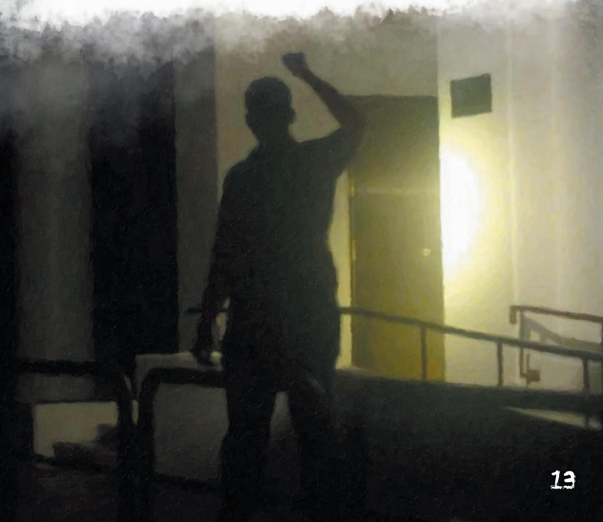{.art-body-right}

### Carried

These bits of equipment are carried by the Krew based on their job (see Investigator descriptions).

> **Equipment Satchel**
> Each team member has a black canvas satchel (with the Spektral Krew logo of course) for carrying their gear. In some cases, the host may hand off his satchel to someone else while they're on camera. It's big enough to hold the Handheld Night Vision Cameras, EMF Meters, Smart Phones, and FLIR Cameras, plus any other personal gear.

> **Handheld Night Vision Cameras (2)**
> 4K Wi-Fi Full Spectrum Camcorders, Ultra HD Infrared Night Vision Paranormal Investigation Video Camera with 60 fps 24 MP 30× Digital Zoom. Peter and Enoch usually carry and operate these. [Four Hours of Battery Life]

> **EMF Meter**
> HF-B3G Triple Axis HF RF Power Meter Analyzer and Detector. [12 Hours of Battery Life]

> Keeper's Notes
> 
> There are not many EMFs on the island, but the Krew will see the odd tick here and there from background noise. While ghosts don't generate electromagnetic fields, Hastalÿk can use this against the Investigators by causing it to respond in the direction it wants them to go. Marco is usually in possession of this.

> **Spirit Box**
> This is a custom radio with a frequency scan mode that the Krew hopes will allow them to communicate with spirits. It's about the size of a walkie-talkie and includes a headphone to better hear voices from the beyond. [Eight Hours of Battery Life]

> Keeper's Notes
> 
> It's possible that the Spirit Box could pick up radio chatter from the Italian military or the Plague Monk chanting various disturbing litanies in Latin (Keeper's discretion).

> **EVP Recorder SCD1**
> The SCD1 is an experimental piece of equipment that Marco has had someone build – it is the Silent Capture Device. The processor and software can detect when nobody is talking and will flash when it picks up a sound during silence. This can be played back in real time. This was an expensive piece of prototype technology, so Marco keeps hold of this.

> **FLIR Camera for Smartphone**
> FLIR ONE Pro – iOS – Professional Grade Thermal Camera for Smartphones – with VividIR and MSX Image Enhancement Technology. This has been jury rigged by Hyeon so that it uses the video feed from Peter's camera. [Battery Life of the FLIR is only 45 Minutes]

### Static

These bits of equipment are set up early on and, with the exception of the drone, remain at a single location.

> **Base Station**
> This is a custom industrial laptop with a Wi-Fi hub and satellite uplink set up for live streaming. A deep cycle battery unit supplies enough power for up to 12 hours of continuous broadcasting.

> Keeper's Notes
> 
> At the Keeper's discretion, other devices may be charged off the base station's battery, but this obviously takes time that the Investigators may not have.

> **Cellular Wi-Fi Repeaters/Transmitters (2)**
> Each provides Wi-Fi within a 300 Meter radius, and has a battery unit that provides 8-10 hours of uninterrupted signal.

> Keeper's Notes
> 
> These are best set up in three key locations, the lighthouse, the far side of the bridge, and the hospital tower. This provides the greatest area of coverage for the investigation site. Note that since the satellite signal is being routed through the Base Station at the lighthouse, the hospital signal requires the bridge transmitter to be active.

> **UPS Batteries (3)**
> Primarily used to power the Wi-Fi Transmitters, they have various connections via which other equipment can be recharged. They can provide around six hours of power each in the event of power failure. Really only there in the instance of the battery backup for the hub failing. Extremely heavy as they are essentially large deep-cycle batteries.

> **Night Vision Cameras (6)**
> Foscam HT2 1080p Outdoor 2.4 g/5 gHz Wi-Fi PTZ IP Camera, 4× Optical Zoom Pan Tilt Security Surveillance Speed Dome, Two-Way Audio with Mic & Speaker, 165 ft. Night Vision, CMOS Image Sensor, IP66. [Six Hours of Battery Life]

> **Drone**
> This optional drone is an expensive professional model that is equipped with a night vision capable 4K video camera that can be controlled via Hyeon's iPad app. The video can be recorded locally or fed directly to the live stream. [It includes three batteries with 20 minutes of flight time each.]

## Timeline

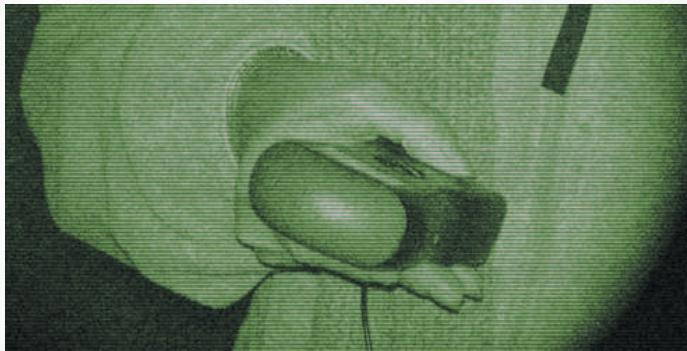{.art-body-right}

Saturday, August 24th 2019

The weather calls for clear skies, though it's going to be hot and humid, with temperatures around $75^{\circ}$ F ( $24^{\circ}$ C) and 80% humidity. It will be extremely dark until the moon comes up just after midnight.

7:40 AM: Spektral Krew arrives in Italy and intends to spend the day on the mainland preparing for that night's livestream. They meet with their contact Nuncio who is going to transport them to the island.

6:30 PM: The Krew load their gear onto Nuncio's rickety boat that will take them from the harbor in Perla out to Isola di Malamente. The plan is to pick them up just before sunrise at the drop-off point the following day.

7:00 PM: They arrive at Isola di Malamente and unload their gear. A tour boat passes near the island, but doesn't appear to see them.

7:25 PM: The lighthouse is explored and the base station is set up in the radio room. The satellite uplink is established and tested and the first Wi-Fi transmitter is set up near the top of the lighthouse.

7:55 PM: Sunset.

8:00 PM: They scout the bridge location and set up the second Wi-Fi transmitter on the far side.

The broadcast begins.

11:45 PM: Maya contacts the Investigators to advise them to get to the Crypt and start setting up for the grand finale.

12:00 AM: The Investigators use Corrina's 'Witch Board' in the Crypt beneath the Chapel. The séance is performed at the stroke of midnight to the tolling bells that echo across the sea from Perla. The name H A S T A L Y K is slowly spelled out and the Great Old One stirs, causing the earth to shake and the ancient altar to crack down the center. Rubble falls onto the stairs leading to the surface, blocking the exit and trapping the Investigators below. Part of the wall near the altar falls away, revealing the entrance to the catacombs. Hyeon is notified that they have passed one million channel subscribers and their stream is flagged as having gone 'viral'.

Time Unknown: Sometime before dawn, the Investigators reach the Charnel Pit and the last Plague Monk casts himself in, birthing Hastalÿk. Thirty seconds later in an undisclosed location, orders are given to have several heavily armed military jets dispatched to level Isola di Malamente with a mixture of high explosive, incendiary, and napalm bombs. They arrive 15 minutes later.

6:28 AM: Sunrise

## History

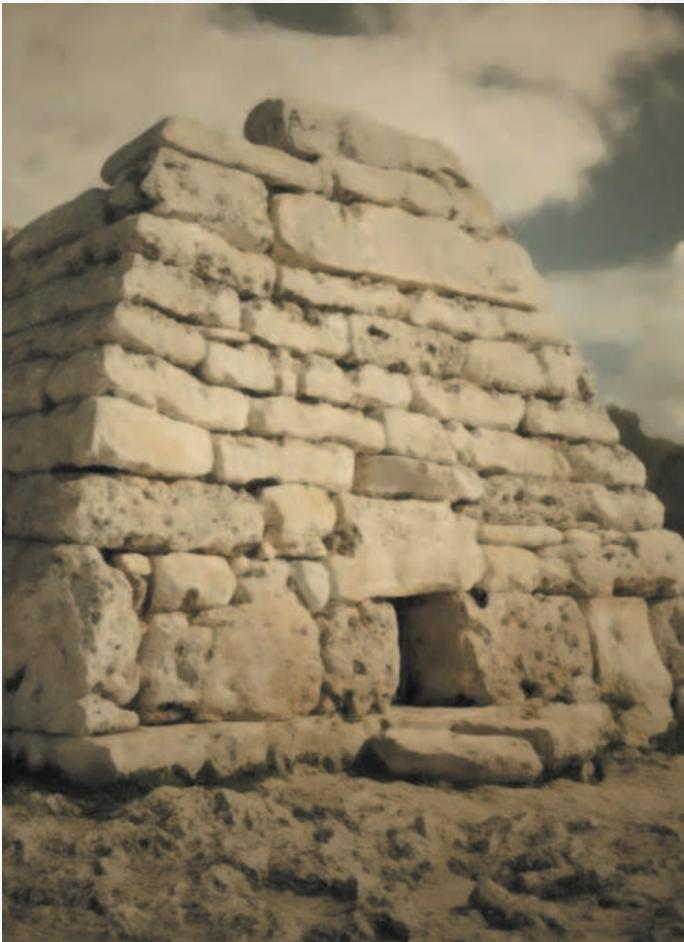{.art-body-right}

Sometime during the Stone Age, Hastalÿk makes landfall on Earth from the endless void of space upon what is now known as Isola di Malamente as a microscopic organism and slowly begins infecting and defiling the island. The powerful influence of the Great Old One draws early human settlers there during the Bronze Age. They begin worshiping this otherworldly, but invisible horror as a god.

As the Bronze Age settlers make sacrifices to Hastalÿk, it begins to grow in size and eventually manifest as a swirling charnel pit around the time of what we know as the beginnings of Ancient Greece around 700 BC. It is still too weak to spread beyond the island, so instructs its worshipers to build a temple around it – this is when it was worshiped as Phthisis – a personification of rot and decay.

Countless temples were built atop the original temple as the cult adapted to the current pantheons including Erra, Nergal, Vejovis, Morbus, and eventually the monastery of Saint Roche was built in the early 14th century just prior to the outbreak of the Black Death.

The monastery became known for taking in the ill, infirm, and dying to look after them in their final years. These included plague victims, lepers, and those suffering from brain fevers (insanity). The bodies were burned in a large cremation pit. The monastery was converted into a sanitarium in the late 1800s.

In 1917, a number of soldiers were diagnosed with the flu and were treated at Saint Roche's Sanitarium before being sent to the front. The next year, the 1918 Influenza pandemic devastated the globe.

In 1928, the facility was upgraded with new medical equipment and renamed Saint Roche's Hospital.

During WWII the island remained largely untouched by the fighting, though a section of the original monastery was inadvertently damaged by an American bomber when its bomb release system failed. Rumors were circulated about a secret mission, though nothing ever came to light.

In 1954, following reports of missing and abused patients, an investigation by Italian authorities revealed that horrific experiments were being performed at the hospital. The remains of hundreds of patients were discovered in cremation pits and mass graves. The hospital was shut down and dozens of hospital staff, including several administrators, were sentenced to life in prison. Strangely, every one of them died within a year from a mysterious disease that caused them to waste away. The cause of the illness was never discovered.

Due to the island's isolation and the possible infectious nature of the remains, the bodies were never exhumed and remain on the island to this day. There's no indication that there was any sort of cleanup, simply that the island was placed under quarantine indefinitely.

> Keeper's Notes
> 
> The public is unaware of the cult of Hastalÿk, or the intense firefight that took place when Italian military forces stormed the island in 1954. When the Italian government first received information regarding the abuse of patients, it immediately sent members of the social services to investigate with a police escort. At first, the hospital administrator seemed cooperative, but when the investigators discovered fresh remains in the cremation pit, they ordered the hospital shut down. Subsequently, the social services investigators and their police escort were lured into the chapel where they were slaughtered by the cultists, though one of the police officers did manage to contact their seaplane which was waiting at the dock. The quick-thinking pilot took off and managed to radio the authorities.
> 
> Meanwhile, the bodies of the investigators were quickly burned, and realizing that the end was nigh, the cult murdered the non-cult members of the hospital staff and euthanized all of the patients. Their remains were brought into the secret catacombs beneath the chapel.
> 
> While this was happening, the authorities reviewed the pilot's unsettling report and decided that they would have to use the military to take the island. Considering the nature of the situation, they called in the DSS (Divisione Sicurezza Speciale), a secret division within the Italian government that handles sensitive issues of national security. In a matter of hours, a squadron of helicopters was flying to Isola di Malamente with a heavily armed strike team.
> 
> Landing at two points on the island (the lighthouse and the hospital) the two groups systematically worked their way into the hospital. The cultists put up the heaviest resistance in the staff dormitory, fighting to the last member. Unbeknownst to the strike team, the cultists were buying time for two of their brethren to complete their tasks.
> 
> The two last Plague Monks had fled into the secret shrine to perform a dark ritual that involved one of the hospital's infants reserved for that purpose. Using the Iuramentum Corruptionis, one prepared the other to be the final sacrifice. They waited until the interlopers were gone and made their way to the Charnel Pit where the final sacrifice was hung by the neck above the pit until the time was right. The other went back to the hidden shrine with the book where he killed himself with a bullet through the temple, thus completing the ritual.
> 
> The last Plague Monk has since watched over the island as a shadowy presence, feeding more tainted flesh into the Charnel Pit whenever possible in preparation for the great day when Hastalÿk would be born.

In 1958, Il Culto della Peste dell'Isola Malamente (The Plague Cult of Malamente Island) was published. Its author, Dr. Giovanni Pellegrino, claimed to be one of the investigators who shut down the hospital, and it supposedly described the true story behind the events in 1954. Before it could hit the shelves however, all copies of the book were seized by the Italian government and the writer was arrested on national security grounds. He died in prison a week later of an unknown wasting disease.

> Keeper's Notes
> 
> A few copies of the book escaped destruction, and in fact could be what draws investigators to the island. The book basically describes the events that took place on the island in 1954, though doesn't suggest anything supernatural in and of itself.
> 
> Dr. Pellegrino entered the hospital once the fighting had ceased, describing the carnage in vivid and disturbing detail. There are particularly haunting reports of slaughtered patients with incomprehensible symbols carved into their flesh. He claims that there were signs of ritual sacrifice, cannibalism, and unspeakable experiments on women and infants.
> 
> He states that the “last stand” in the staff dormitory was as brutal as any he’d seen in the war, with heavy losses on both sides. As many as thirteen Italian soldiers had been killed, with twenty-three monks cut to pieces by machine gun fire.
> 
> In the aftermath of the siege, Dr. Pellegrino was tasked with identifying the dead. He notes that three of the monks were not found in the hospital, and that they were presumed to have died attempting to flee the island.
> 
> The book has no photos, but there are several drawings that depict some of the symbols he found.
> 
> The Keeper can decide if the investigators can glean anything relevant to their investigation from the book.

In 1961, the island was deemed off limits to anyone except with official government permission.

Throughout the 1970s and 80s, people reported seeing figures and lights on the island, though official reports show no evidence that anyone has been there in almost 60 years.

## One Night in Perla

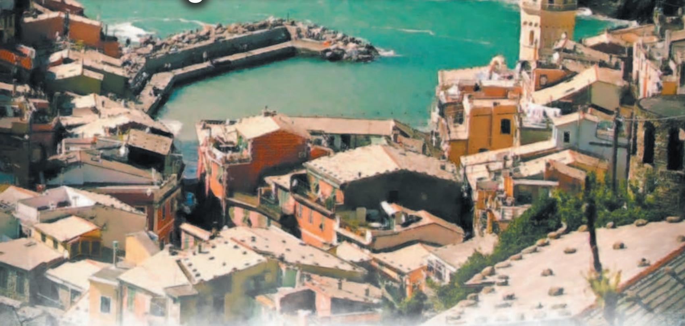{.art-body-right}

One Night in Perla is a new prologue that expands on the original scenario by giving the investigators an opportunity to explore the nearby fishing village of Perla. This offers them an opportunity to learn more about the history and lore of Isola di Malamente, and bear witness to the ancient festival of Lepurazione di Morbus (The Purging of Morbus).

The Purging of Morbus. The ceremony lasts for three days and begins on the first night with Il Rogo della Malattia (The Burning of the Disease). This involves burning an effigy of the demon Morbus which is supposed to banish him from the village. They believe that this causes Morbus to retaliate, so on the second night, known as Notte della Peste (Plague Night), they lock themselves in their homes and place talismans at all of the possible means of entry to trap any illness that might try to get inside. The third and final night is La Purificazione (The Purification), and involves burning all of the talismans in the piazza, followed by a celebration that goes well into the night.

The people of Perla take the festival very seriously, so any attempt to interfere will be met first with strong resistance, and if necessary, violence. Of course if a bunch of foolish Americans want to get themselves killed, that's their business, but if anyone tries to interfere with the festival, especially on Plague Night, it won't go well for them.

If the investigators do an internet search about Perla, a Luck roll allows them to find a video made by an American tourist who tried to stop one of the villagers from reaching their home on Plague Night. The altercation left the tourist in the hospital, and according to official records, the matter was settled.

The video itself is disturbing. The villager in question was a tough looking fisherman who was walking down a side street when the American (a young man in his 20s) blocked the way and started shoving the video camera in the villager's face. The fisherman tried to go around, but the young man kept laughing and asking the fisherman where he was going in such a hurry, repeating that he just wanted to ask some questions.

Things escalated quickly and suddenly the camera was still running on the ground as it recorded the fisherman repeatedly punching the tourist. It ends after the fisherman storms off and the tourist crawls over to the camera to shut it off. According to the video, this incident happened in 2002.

> Keeper's Notes
> 
> If the investigators try to find the fisherman, they'll have no luck. He died from cancer about three years ago. None of the villagers recall the incident, nor is there any record of it.

### Welcome to Perla

August 23rd, 2019 – 10am

As you open the van's sliding door, you're greeted by a warm breeze and the mingled scents of bread, fish, lemons, and sea air. The cobblestone streets are busy with locals going about their daily business, and as you step out onto the sidewalk, it's like stepping into a postcard. Perla is built on the hillside of a narrow cove overlooking the Mediterranean, and from this vantage point you have a spectacular view of the entire village. Looking to the west, you're able to just make out your ultimate destination on the horizon: Isola di Malamente.

Grateful to stretch your legs, you unload your gear from the back, drawing a few looks from some nearby children playing ball. After spending several hours careening over the rough, twisting roads of the Sicilian countryside in a rickety old van, all you want now is a shower and maybe a nap.

The white building in front of you looks old, but well kept. The oval wooden sign overhead creaks and sways in the pleasant sea breeze, the ornate gold letters flickering in the sun. It reads Tramoto dell'Hotel (Hotel Sunset). The cab driver sets down the last of your bags, tips his cap, and rattles away.

The village is abuzz with excitement. As the van pulls away, the old men stop and stare while some of the women send some older children over to help you unload their gear. They point at the hotel asking "Qui?"

> Keeper's Notes
> 
> Anyone who speaks Italian will understand this to mean “In here?” Should the young helpers get confirmation, they’ll start carting the gear into the hotel lobby. They are generally very honest, and will be very grateful if offered tips, but won’t ask for one.

The hotel is located right on the town piazza; an eighty foot circle of cobblestones with a sidewalk along the outside perimeter. In the center, where one might normally find a statue or fountain, is instead a thirty foot circular stone dais or stage. Standing atop the dais is a large pile of wood set up like a bonfire surrounded by a low chain link fence. The stone beneath the wood is blackened and pitted, presumably from many past fires. Besides the hotel, the piazza is encircled by a number of shops including a bakery, butcher, fishmonger, greengrocer, café, and so on.

A handful of old men are working with some of the teenagers to pack the bonfire with more wood, while several women on ladders hang red and white bunting between the lamp posts. Laughing children chase each other and play all around the piazza, adding to the general mood of excitement in the air. A few older women tend the hundreds of sunflowers that reach for the sky from large planters all around the town square.

A number of streets lead away from the piazza to intersect with other narrow roads and alleys that twist and turn throughout Perla. Many of the alleys have steps while the roads zig-zag up and down the steep slope upon which the village is built. Most of the structures are old and off-white, yellow, sky blue, or salmon in color with chipping paint that reveals the brickwork and planks beneath. Countless stairs climb between the gaps in the buildings to connect hidden squares and terraces in a manner that would leave M. C. Escher scratching his head.

> Keeper's Notes
> 
> If asked about the preparations, the investigators will be told that tonight is Il Rogo della Malattia (which translates to The Burning of the Disease). It's a festival that goes back many centuries, and involves the burning of an effigy of Morbus, a demon that is associated with illness and disease. This is intended to purge his influence from the village for another year. The following night is known as Notte della Peste (Plague Night) when Morbus is said to retaliate against the village, and so they lock themselves away, placing talismans in their homes to trap any illness that might enter. The talismans are burned on the final night of the three day festival known as La Purificazione (The Purification), after which the entire town celebrates their victory.

The Hotel Sunset. The interior of the Hotel Sunset has clearly seen better days. The wallpaper is peeling, and the plastic flowers sitting around the lobby are dull and dusty. There are a few worn leather couches and a coffee table littered with old magazines with countless coffee stains. Scratchy classical music plays through antique-looking speakers that have been inexpertly hidden behind the furniture. An older gentleman sits at the reception desk idly browsing the internet, occasionally leaning in to see the keyboard through his bottle thick glasses.

He won't notice the Krew at first, but will jump with a start if they catch his attention. He responds in Italian “Buongiorno, mi chiamo Paolo, benvenuti all’Hotel Sunset. Avete una prenotazione?” Which translates to “Good morning, my name is Paolo, welcome to Hotel Sunset. Do you have a reservation?” After a moment, Paolo takes a better look at the investigators and says “Ah, Americani?” But before they can respond he repeats his greeting in fairly good English.

He checks their reservations, and after confirming who booked the rooms (Maya has booked and paid for them) he will get them their room keys. Marco and Corrina have their own rooms while Hyeon, Peter and Enoch are all sharing a large family room. Of course Maya booked Marco in the nicest room with a beautiful sea view.

Paolo asks if they'd like to lock their gear in a secure room. If they take the offer, the gear will be safe until they need it, but if they say no, they need to lug it up and down two flights of narrow stairs.

He informs them that breakfast is served between 8am-10am each morning and gestures behind him to the right where they can clearly see a kitchenette with chairs and round tables covered in blue gingham tablecloths. He tells them that tea and coffee are available in their room, and hands each of them a set of foam earplugs.

{.art-body-right}

Paolo smiles and says “We have a local festival this evening that is... a bit noisy and goes on well into the night. Of course you are welcome to join in the festivities with us.”

He can answer most questions about Perla, however, if asked about Isola di Malamente he will shrug and say that nobody goes near it since the government declared it off limits a long time ago. Paolo adds that it's probably because the island is surrounded by old sea mines that date back to the 1940s, though he's not sure why they wouldn't just remove them. A Hard Psychology roll will indicate that he's not being entirely truthful. If pushed, he'll act like a befuddled old man and change the subject.

The rooms themselves are adequate if a bit old. The beds are clean and there are vases of fresh flowers on the dressers. Each has a simple bathroom with a small, claw-footed tub. Corrina's room looks out onto the rooftop of a nearby house, while the family room window opens on a narrow alley. Marco's room on the other hand looks out across the picturesque Mediterranean, with Isola di Malamente clearly visible on the horizon.

### Perla

This Sicilian fishing village is fairly typical for the region, and is full of rustic charm. It derives its name from the plentiful oysters — and the beautiful pearls they contain — that are regularly fished in the waters near Perla. When the investigators arrive, it's late summer and the village is bedecked in all manner of colorful flowers in hanging baskets, planters, and window boxes. All of the buildings are painted white, though time and the local climate have weathered them quite a bit.

The village is big enough to support a range of shops and businesses including a baker, butcher, fishmonger, grocery store, café, and hardware store, most of which are located on or near the main piazza. The cobblestone roads weave through Perla, zig-zagging up and down the slope, leading down to the docks where dozens of fishing boats, tour boats, and various smaller craft are moored.

Standing above all of the other structures in town is Cappella di Sant'Anna (Chapel of Saint Anne), a 12th century church dedicated to the mother of Mary, the patron saint of childbirth.

The Shops. Exploring the various shops surrounding the piazza will find typical Sicilian fare. The café is clearly popular with the elderly men of Perla, many of whom spend the day chatting, drinking espressos, smoking, and playing cards. They're friendly enough, though if asked about the island, they will become very solemn and quiet, often making hurried excuses and heading home.

The Homes. Like so many of the old towns and villages in the region, Perla grew organically up the hillside as more people moved here and the population grew. This means that the houses are largely connected, with some built with adjoining walls and others built atop older homes. So while all of the houses are made of the same materials and have the same general appearance, there are no two floor plans that are exactly the same.

The Docks. The deep azure waters of the bay are reasonably safe for swimming, though the number of boats moving to and fro often put people off. The fishermen here are simple folk earning a living and won't stop to chat as they busily pack fish in ice. If asked about the island they'll cross themselves and mutter a small blessing in Italian, refusing to talk about it.

A Spot Hidden check will allow the investigators to notice a poster for a missing local man named Angelo Russo on a wall near the dock. The posters are all heavily weathered and the date of his disappearance looks to have been torn off at some point.

Nuncio Vendra. Nuncio's battered fishing boat is moored to one of the outer docks where he can often be found smoking a menthol cigarette and chatting to the various fishermen near a sign that reads: TOUR DELLA BAIA: \$20/€25 ALL'ORAAY and below that TOURS: \$20 PER HOUR.

Nuncio will recognize the Krew from photos that Maya sent him. If they approach, he smiles and asks them if they fancy a trip out tomorrow, giving a knowing wink. Assuming they agree, he tells them to be ready to leave a few hours before sunset. After a small amount of friendly chit-chat, he makes his excuses, stubs out his cigarette, climbs aboard his boat and leaves the dock.

Local Teens. Most days the docks are a bustle of activity, which attracts the more rebellious teenagers who hang out to watch, drink, and smoke. Most teenagers in Perla speak some English that they've picked up watching American movies and television, though they'll generally stick to Italian, unless they're trying to hit on Corrina.

> Keeper's Notes
> 
> They're not interested in talking about Isola di Malamente, but if pressed (with a Regular Intimidate, Hard Charm, or Extreme Persuade check) or bribed with \$100 or more, they'll admit to sneaking out to Beggar's Cove to party on occasion. If the Superfan version of Em is being used, then they'll also admit to taking an American woman over to the island to stay the night, adding that she hasn't returned with the rowboat they left for her. Additional pressure or bribery will get them to describe the woman. At this point the Keeper can then give the investigators an Idea roll to see if they recognize her as Em or not.

Communication. Cell phone service is decent in Perla, offering 3G speeds, though there doesn't appear to be any public Wifi options available anywhere. There are however a few public phone booths that are surprisingly still in service, though of course the Krew can simply use their own cell phones or the phone at the hotel if they wish.

Local radio stations mainly play classical music or Italian favorites from the 40s and 50s. Most of the locals watch one of the three broadcast television channels, one of which has American reruns (mostly from the 70s, 80s, and 90s) every night at 8pm. While the hotel doesn't have cable or Wifi, the 3G signal is good enough that the investigators can access the internet and their own streaming media if they wish.

### Exploring in Perla

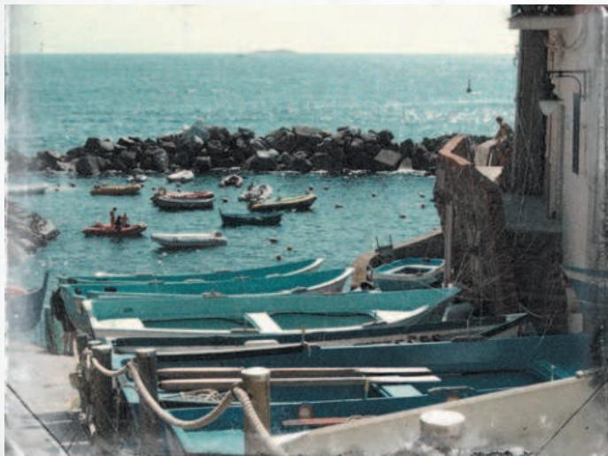{.art-body-right}

While the investigators are in Perla, there are a number of things that they can learn by talking to the locals or noticing details around the village. The Keeper can roll randomly to determine which bits of information they acquire, or they can choose whichever makes the most sense. Of course the Keeper can always improvise new ones to suit their version of the scenario, particularly if they are using alternative investigators rather than the Spektral Krew.

Note that most of these aren't true, or are mingled with half-truths. When hearing a rumor, the Keeper should have the investigators make an Intelligence check to see it for the nonsense it is.

#### Rumors

| Roll | Rumor |
| --- | --- |
| 1 | The real reason the island was raided back in the 1950s was because there was some sort of Satanic cult that was out there sacrificing children. [Rational Explanation: There have been very few actual Satanic cults discovered, and none that actually killed children. This sounds like the same old Satanic panic from the 1980s.] |
| 2 | Fishermen report seeing ghost lights on the island at night this time of year. They say it's the spirits of dead children looking for their parents to take them home. [Rational Explanation: These are the sorts of stories told by sailors since humans first took to the sea. The lights could easily be explained as teenagers drinking on the island or lights from other boats seen through the trees.] |
| 3 | The hospital was just a front, and that the government was engineering biological weapons. It was shut down when a virus got out and killed everyone on the island. [Rational Explanation: While not impossible, it's highly unlikely that Italy or the United States would have violated the Geneva Convention so blatantly. It's even more unlikely that it wouldn't have come to light by now.] |
| 4 | The island is populated by giant mutant rats. [Rational Explanation: While not impossible, it's not a large island, which would make it unlikely for a population of any large mammals (mutant or otherwise) to thrive there.] |
| 5 | Parents will sometimes take a boat out to the island if their child is particularly ill to leave on offering on the Weeping Bridge. [Rational Explanation: This sounds plausible enough, and the investigators are likely to have this rumor confirmed by many of the villagers. This one is true.] |
| 6 | Teenagers will occasionally take a boat for a joy ride out to the island to party at a place called Beggar's Cove. It's supposedly located around the far side on the small island. [Rational Explanation: This sounds plausible, and could explain some of the other rumors. If the investigators speak to any of the teens loitering at the docks, they'll happily confirm this. This one is obviously true.] |
| 7 | Seagulls have been observed avoiding the island. They will literally fly around it rather than over it. [Rational Explanation: This seems like very odd behavior, though strong magnetic fields can sometimes throw off a bird's navigation. If any of the investigators observe the island for more than an hour, they can make an Extreme Luck roll to witness this phenomenon themselves. This one is true, but difficult to verify.] |
| 8 | Fishermen have pulled strange, mutated fish from the waters around Isola di Malamente. These have included ones with two heads, unsettling appendages, and even one that supposedly had a human face. Naturally they were all thrown back so there is no evidence for them. [Rational Explanation: While there's nothing impossible about finding the occasional mutated fish, these sound more like the kind of stories old sailors like to tell and embellish. In fact, this one is true. If they ask around enough about this, a successful Luck roll will find someone with one of these mutant fish that he had taxidermied. This particular one has a dozen eyes and several crustacean-like appendages on each side.] |
| 9 | A number of years ago the sea around the island turned red like blood and a number of children in town died. [Rational Explanation: This could have been some sort of algae bloom which would account for the sea turning red and the sick children. The Keeper can decide if this is the case, or if it was a previous attempt at releasing Hastalÿk that failed.] |
| 10 | The island once had a temple dedicated to the Greek god Phthisis, that was later built over by the Romans, and finally by Catholic Monks. [Rational Explanation: This is consistent with the history of the region and matches what little information the investigators may know about the island. This one is true.] |

#### Signs and Portents

| Roll | Result |
| --- | --- |
| 1 | If the investigators go to the grocers, a Hard Spot Hidden check allows them to notice that the crates of lemons stacked here are imported from mainland Italy, which is strange as there are lemon trees growing all over Perla. If asked about this, the shopkeeper responds (in broken English) that “The lemons around here... not so good" then moves to serve another customer. The shopkeeper deliberately spends a lot of time chatting with the new customer until the investigators get bored and leave. |
| 2 | If Padre Angelo is visited, the investigators find him to be amenable enough, though he is only able to speak Italian. If asked about the chapel to Saint Anne, he says that, due to a higher than average number of birth defects in Perla, the Vatican authorized the building of the chapel. There have been no reports of further defects since the mid 1950's. Scientific studies have drawn no conclusion as to why it was happening or why it stopped. |
| 3 | Any of the investigators who takes the time to view the island with binoculars the day after the Burning can make a Spot Hidden roll. A Hard success allows them to see a thin wisp of smoke rising from somewhere on the island. |
| 4 | If the investigators asks around town about the missing person poster at the docks, they discover that Angelo Russo was a local who went to Rome a number of years ago to pursue his dream of becoming a professional footballer. Unfortunately he got involved with the wrong crowd and became addicted to heroin, and he ended up returning to Perla when his mother died. Over the years, Angelo was responsible for a number of thefts in Perla and his disappearance wasn't overly mourned. No one can remember exactly when he vanished, only that it was a few years ago. |
| 5 | If the investigators are watching the teens in Perla, they notice an older teenager named Luca buying beer and liquor for some of the underage teens. If bribed by the characters, Luca will admit that the kids pay him to buy them alcohol, and that they often row out to Beggar's Cove on Isola di Malamente to drink and have sex. And no, he doesn't really care. |
| 6 | The characters discover a small shop tucked in between two buildings, its weathered door and a single narrow window barely taking up most of the front. A sign above reads Misteri del Passato (Mysteries of the Past). Inside is an aisle that is not much wider than the doorway, and a glass counter that runs its length. Inside the display case are old coins, jewelry, and stone artifacts, many of which look quite old. The old man behind the counter smiles when they enter, and gestures to his wares saying “We're having a sale today. Buy one, get one free." After a moment, it becomes obvious that he's blind, but clearly knows his way around the shop and where everything is located. A History check will reveal that most of his artifacts are authentic, though not extremely valuable, and that his prices seem fair. A Hard success allows them to notice a rather unique coin from the Roman era that is slightly larger and has an image of a hooded figure on its surface. After feeling the coin, the shopkeeper says “Ah yes, this is a coin dedicated to the Roman god Morbus. One of the more obscure gods, though he was very popular in Sicily for a time." The Keeper can decide if it has any significance for the scenario. |
| 7 | A dozen or so children go running past the characters laughing and screaming with pretend fear, apparently playing some morbid game of tag. The one child in the back that's evidently “it” is wearing a black paper mache plague doctor mask and waving long sticks that look like skeletal arms over his head. As the characters look on, he manages to touch one of the other children with his stick arms. The tagged child immediately grabs their chest and collapses to the ground in a fit of dramatic coughs and gasps. As the others disappear around a corner, the “victim” gets up and runs off laughing in another direction. |
| 8 | An elderly woman watches out of a second floor window as the characters walk past. She traces a strange sign in the air with a withered-looking finger, her lips moving with silently murmured words. If they address her, she pulls down the window with a contemptuous slam and draws the curtain. If they knock on the door, there is no answer. |
| 9 | While most of the locals have been friendly, the characters begin to notice the odd side-eye or lingering look. If they begin to pay closer attention, a Spot Hidden check alerts them to the fact that a handful of people appear to be keeping an eye on them. A Hard Psychology check reveals that the watchers appear to be scared of the characters. If confronted, they will deny watching the characters in Italian. No amount of bribery gets them to change their story, and any attempt at intimidation risks turning the locals against them, or even getting the authorities involved. |
| 10 | The characters notice Perla's Polizia Locale talking to a small group of men who all nod in unison and head off in different directions. If asked about what's going on, the officer smiles and says (in perfect English): "Oh it's nothing to worry about. I'm afraid that Signore Marino has wandered off again. The poor old man suffers from dementia, and occasionally gets lost." He shows the characters a photo of a small elderly man with a broad-brimmed hat. “He will likely become fearful if approached by a stranger, so if you see him, come to get me in the piazza. I'll be there most of the day." Should the characters find the man (with a successful Luck roll) the man will look scared, and they'll hear him mumbling something over and over in Italian. A Hard Listen check reveals him to be saying: “Lui sta arrivando. Dio ci protegga." This translates to: “He is coming. Lord protect us." |

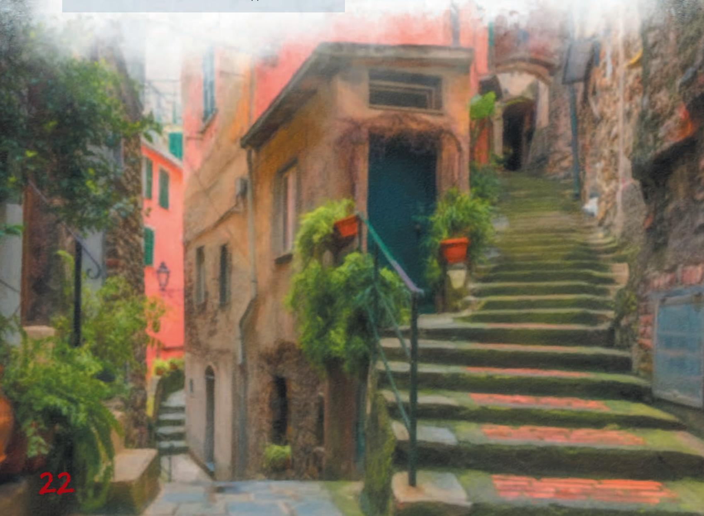{.art-body-right}

### The Burning of the Disease

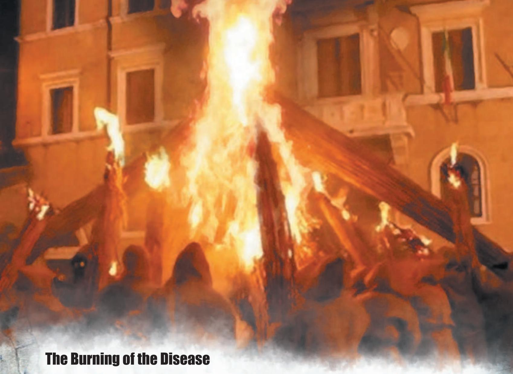{.art-body-right}

The characters will begin to notice the locals gathering in the piazza around 8pm. They wear solemn looks and hold unlit candles in silence. In the distance the slow beating of a drum can be heard. A procession makes its way from the entrance of Cappella della Beata Sant'Anna with Mamma Santi at the front, walking in silent prayer. Behind her, the local priest Padre Angelo walks in full vestments loudly reciting bible verses and waving a billowing censer while several dozen younger men carry a large pole with a crude, oddly shaped wooden cage on top. Inside is what appears to be the severed head of a goat. Next in line are young women carrying bundles of small sticks and coils of coarse rope. Bits of paper tacked to the post flutter in the breeze as they walk.

The procession slowly winds its way down the hill, with children and teenagers playing percussion instruments of all sorts creating a rhythmic cacophony of noise that echoes out across the bay. When the procession reaches the gate that leads to the piazza, the men and women gathered there begin shaking their fists and cursing in Italian at the goats head, while others walk forward and attach more notes to the post. The procession walks around the piazza allowing everyone in the village to add their own notes and/or curse the goat head.

> Keeper's Notes
> 
> If any of the characters get close enough to read any of the notes, they seem to be prayers to Saint Anne, asking for various family members who have or are expecting children to stay healthy and happy.

Finally, the procession approaches the bonfire. The pole is lowered into a prepared hole, allowing it to stand erect with the cage at top. The rhythmic percussion rises to a crescendo as Mamma Santi walks around the amassed people, lighting the candles of those in front who in turn light the candles of those behind them.

Once all the candles are lit, one of the villagers steps forward, causing the crowd to go completely silent so that all anyone can hear is the sound of the breeze and the faint lapping of waves. The man lights the kindling with their candle, and places it on the wall surrounding the bonfire. Silently, each villager does the same in turn, each bowing their head in solemn reverence as the bonfire catches and grows. When it gets too hot, the last villagers gently toss their candle into the blaze. When the flames reach the goat's head, the crowd begins cheering. They call out thanks to God and ask the Archangels to protect the village from harm.

> Keeper's Notes
> 
> While this is clearly a local tradition, the characters can participate without issue. If they do so, Mama Santi will notice this and see them in a more favorable light. This will grant them a Bonus Die on any social checks when interacting with her.

Once the bonfire is fully blazing, the old men of the village emerge from the shadows dressed in long, brown hooded robes tied with rope. Each wears a black paper maché mask with round eyes and long curved beaks, like a raven. The children run around screaming playfully while being pursued by the monks. Whenever they catch a child, they give them some sort of sweet treat and set them free.

By nightfall, the bonfire is fully ablaze, and the locals are making merry. Children continue playing as the adults sit around drinking red wine and chatting.

> Keeper's Notes
> 
> Should the characters decide to hang around, they have a feeling of peace and hospitality. They're given delicious local fish dishes and red wine, and are generally treated as guests. Should they want to chat to anybody, villagers will tell them to speak to Mamma Santi, as she is the voice of the village.
> 
> Though slightly tipsy, she will gladly talk to the foreigners. If the characters ask her about Isola di Malamente, she will be reluctant to talk about it, but if persuaded, she'll tell the characters that she knows they are going to the island and warns them that a great evil resides there, buried in the earth like a cancer, eating away at the soul of Perla. She will add that this ceremony is performed each year to galvanize their faith and protect them from that evil. If pressed further, she'll tell them about her brother Alonzo Salvatore who was a soldier that died on the island, and that the government forbade anyone from retrieving his body. She was never told the cause of his death, only that he died there. If pushed too much, she will get visibly upset and say no more.

### The Next Day

You awake to the sounds of activity on the street outside the hotel. Looking out the windows you can see groups of young men shoveling the remains of the previous night's bonfire into a truck as Padre Angelo stands nearby, his head bowed in silent prayer. All around the square, people are mounting heavy shutters to brackets outside all of the windows and doors as if preparing for a storm, though there isn't a cloud in the sky.

The people seem solemn and quiet compared to yesterday, but when you speak to them, they are friendly enough. The businesses all have signs in windows and on chalkboard frames on the sidewalk announcing that they'll be closing at 6pm sharp.

> Keeper's Notes
> 
> If anyone checks the weather, it's supposed to be clear and warm today and tonight, with no sign or rain, much less a storm that would require storm shutters. If asked about the businesses closing early, the town's folk will tell the characters that everyone must be in before sunset tonight in observance of Notte della Peste (see The Purging of Morbus for details).

When the characters go down to the lobby, Paolo will inform them that someone left them a note. He gives them a sealed envelope with a small card that reads:

Docks: 6:00pm

Depart: 6:30pm

Arrive: 7:00pm

Pick-up: 5:30am

-- Nuncio

It includes a crude map of the docks with a circle that presumably indicates the location of Nuncio's boat.

### Perla NPCs

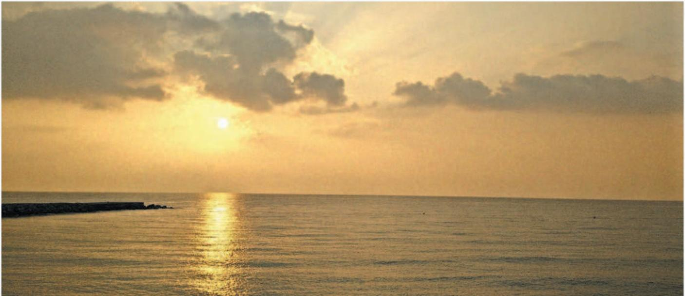{.art-body-right}

#### Santina Maria Salvatore

{.art-body-right}

Santina is the village elder at 93 years of age. She has a deeply lined face, no teeth, and walks with the aid of a carved stick. She has lived in Perla her whole life, and has been a widow since her husband Paulu died 20 years ago. She lost her twin sons in her youth to pneumonia and regrets never having any other children, though she is now the honorary mother to the entire village.

She has been around long enough to remember the raid on Isola di Malanete in 1954, and in fact her brother was one of the soldiers that died there. Despite her age, Santina is sharp, witty and doesn't miss a thing. She is beloved by everybody in Perla and is affectionately known as “Mamma Santi” by anybody younger than 75.

She can remember the festival of Il Rogo della Malattia being celebrated since she was a young girl, and not much has changed in Perla since. She sells handmade trinkets and charms that she claims ward off the evil eye (she is incredibly superstitious), wearing her entire stock around her neck and pinned to her threadbare coat. She doesn't charge much for them and genuinely believes they work (though whether they do or not is up to the Keeper). If asked about the island, she'll claim that the evil there caused the death of her children, refusing to speak any more about it. If the characters try to push her too much, the villagers step in to protect her.

#### Padre Angelo

{.art-body-right}

Padre Angelo is the village priest. He is 51 years old and balding, with slightly red hair at the sides. Born in Perla, he lives at the rear of the Chapel of Saint Anne. He considers the spiritual well-being of the villagers of Perla his calling in life. He has a slight stammer, which vanishes when he is quoting scripture. He's always friendly, though perceptive individuals will notice a subtle air of worry about him. If asked about Isola di Malamente, he will - guessing that the characters are going there - advise them to stay away. He believes a Satanic evil dwells there – he is always looking out for the teenagers of Perla and pleads with them to stay away – something they promptly ignore.

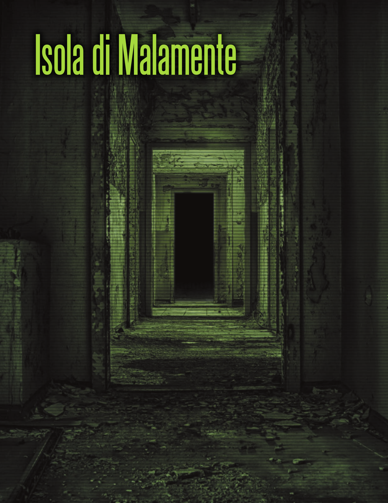{.art-full-page}

## Isola di Malamente

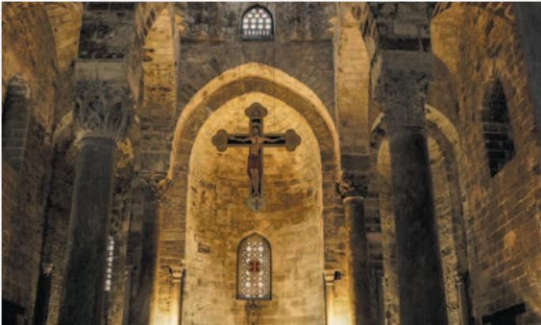{.art-body-right}

### Keeper's Secrets

"I will be back just before dawn, so make sure you're down on the beach and ready to go. We don't want to be seen, right?" – Nuncio Vendra

### Running the Investigation

Viral is a scenario that takes place in a single location (Isola di Malamente) over the course of a single night. The Investigators produce a popular Internet-based ghost hunting show where the host and his ‘Spektral Krew’ travel to investigate and explore supposedly haunted places. The location of their next investigation is Isola di Malamente, a small island off the coast of Sicily that was once home to a hospital and before that, a sanatorium. This is a fantastic opportunity for Spektral Krew and if the live broadcast goes right, could mean they explode onto the international scene, and even land them a spot on a major cable network.

This location is ideal for a few reasons. The first is that it has been hitherto overlooked by all of the other major ghost hunting shows, allowing them to break new ground so to speak. The second reason is that the island's backstory is so lurid and sensational that, no matter what happens, they're likely to see their highest viewer count ever, if the pre-stream numbers are accurate. The third reason is the timing. They intend to live stream from the island during a peculiar local observance called Notte della Peste (Night of the Plague), which begins at sunset on August 24th and ends at sunrise on August 25th.

Night of the Plague. On this day every year, starting at sunset, all of the nearby townsfolk on Sicily lock themselves away in their homes and hang various talismans at every entrance, while also boarding them up. According to folklore, these talismans are intended to trap any diseases that might try to enter during the night, and in the morning the people gather in the town square to burn them in a large, purifying bonfire.

The origins of this odd ritual are a mystery. The locals refuse to talk about it, though they clearly take it very seriously. Several years ago, a foreign reporter insisted on trying to talk to a man who was trying to get home before dusk, but when the reporter refused to leave him alone, the man stabbed the reporter. The video of the encounter made the rounds for a few weeks before it was taken down by the Italian authorities pending an official investigation into the matter. Those who saw the video of the encounter said that the local man appeared to be in a blind panic at the thought of being caught outside after dark.

What is not generally known is the fact that the observance of this night goes back countless centuries to when the monks on Isola di Malamente openly worshiped Morbus. On these nights, anyone living within sight of the island would become violently ill, with countless elderly and small children dying before morning. This night is critical to the rise of Hastalÿk, and so Spektral Krew's decision to live stream on this night is what ultimately leads to the events that follow.

The nearest settlement to Isola di Malamente is a small fishing village called Perla. This is where Nuncio picked up the Spektral Krew to take them to the island. The Investigators probably noticed that the village seemed fairly quiet when they arrived, and may have even shot some video footage (VT) of the deserted-looking village with Marco's voiceover.

The Live Stream. The whole reason the Investigators are on the island is to live stream their experiences to the Internet. For this reason, they have a great deal of electronic gear that needs to be set up and maintained. Some of it has already been put in place, but the Investigators need to make a few final connections in the lighthouse and place a few signal repeaters at key locations on the island.

Once the stream begins, the Keeper should make sure that the Investigators are aware that they are being watched at all times. The easiest way to do this is through viewer comments which continue to stream in throughout the broadcast. This is an excellent way for the Keeper to draw the players and their Investigators' attention to things, keep their Investigators moving, or lure them to a specific location. It's also a great opportunity for The Plague Monk to manipulate the Investigators (see The Plague Monk below).

Maya will be guiding the investigation remotely, directing The Krew to various points to keep the broadcast interesting and exciting. She has a basic outline to follow, but will deviate from it if she or one of the Spektral Krew spots something interesting.

At some point during the broadcast, the Keeper can have Hastalÿk take over the broadcast and pretend to be Maya on the live stream. The Keeper should establish Maya's mannerisms early on (that is, using the term ‘babez’ when she interacts with Investigators) so that when it's no longer her, the players and their Investigators might notice the change. Otherwise the Keeper can give the Investigators a Hard Psychology roll to notice that something is amiss.

Managing the Investigators. The Keeper has a number of powerful tools to drive the story, motivate Investigator actions, and/or change the tempo of the game. These tools include the stream schedule, Maya, the stream commenters, and of course, Hastalÿk.

Note that it's important not to overuse or abuse any one of them. Overuse has the risk of stripping players of their agency and turning the scenario into some cheesy haunted walk, moving the Investigators from one predetermined location to another. Ideally, they should tie into in-game events or motivations.

Stream Schedule – Marco, Maya, and Hyeon hammered out a schedule when planning their expedition to Isola di Malamente, and while they all agreed that flexibility was important, they try very hard to stick to the order of locations they intend to visit. The biggest reason for this is that Maya has a number of pre-made videos (VT) of related content for each location. While it's possible to change up the order if necessary, it could cause stream delays that would affect the quality of the show and hinder its uptick in likes, viewers, and new subscribers. For that reason, Maya pushes Marco and the rest of the Krew to stick to the location order as much as possible. The planned outline of the investigation is as follows:

> 1. Opening Monologue at the Bridge – Marco begins the stream with a scripted introduction to the location and its history, really playing up the fact that literally no one has been here for decades.
> 2. The Grove – Maya has heard rumors that the monks on the island grew lemons to sell to the locals, and it could be a cool place to get the Krew warmed up. She even suggests that they harvest a few lemons if possible. They might be able to give it to the most supportive patron, or maybe even make lemonade from the haunted grove and then get viewers to vote on who gets to drink it.
> 3. The Cremation Pit – North of the Lemon Grove is a clearing where the monks supposedly cremated the dead. Maya suggests walking around the pit while filming for a more dynamic look. Of course she knows that the shadows will be much creepier with the flashlights playing over the trees, and that certainly doesn't hurt.
> 4. The Mass Grave – When they enter the hospital clearing, Maya suggests walking around the outside first, focusing particularly on the place where the authorities discovered mass graves when the place was shut down. She has them continue walking the perimeter, maybe getting a shot of the old dock, until they reach the main entrance on the north side.
> 5. The Hospital – This is the main event, and so Maya has Marco really play up entering the place. She directs them to split up to search various parts of the hospital, switching back and forth between the feeds based on which is more interesting at the moment. If things seem like they're getting a little dull, she gets excited about a shadow picked up by a remote camera and directs the Krew to investigate. Maya never loses sight of the fact that they're making a show, and her job is to keep it exciting.
> 6. The Chapel – The Krew is directed to the chapel to explore the ruins. Maya suggests not going into the crypt just yet, but perhaps teases it by showing the dark stairs that lead to it.
> 7. The Crypt – As they near midnight, Maya goes to a break and directs the Krew to the crypt beneath the chapel to get ready for the Witch Board finale. They have about 15 minutes to set up the night vision cameras, lights, candles, and of course, the board. She cuts back in just before midnight to prompt Marco to lead the rest of the Krew into the crypt to perform the spirit ritual.
> 8. Wrap-Up – Following the witch board scene in the crypt. Maya intends to go to another short break, giving the Krew time to set up outside with the hospital in the background. She's hoping they can get the moon in the shot as well. When she goes live again, Marco is expected to do a wrap-up bit about the evening and their usual outro. Their hope is to conclude around 1 AM, wait in the lighthouse for Nuncio to return, and be back on the mainland by dawn.

Maya – As the director of the stream, Maya needs to make sure that she keeps track of all the video feed coming into her station. For that reason, she may ask the Krew to go to specific places or focus on certain features that add to the content of the stream. This could involve having them check out something she saw on one of the video feeds or staying away from something that might cause them to get demonetized.

The stream has a ten second delay that allows Maya to cut the feed and go to a number of prepared generic VTs if she feels that something is 'too much' for YouTube. Of course, she saves all of the footage so that she can run it later, or perhaps as exclusive content for Spektral Krew patrons.

Commenters – Throughout the stream, the Krew have access to the live stream comments that pour in as they move about the island. The commenters should be used by the Keeper to drive the Investigators to investigate key locations and do the sort of things that YouTube commenters like to see (which are often in conflict with the best interests of the Krew). For example, commenters might suggest taking a closer look at something, picking up an object and examining it, using a piece of equipment, or even eating something nasty in the lemon grove.

This tool can be made more potent through the use of 'Super Chats' where the commenter has donated money to the Krew. The amount should be kept reasonable, but a Super Chat donation of \$20 or even \$50 isn't unusual.

Note that commenters can also be a resource of information for the Investigators. With so many viewers, there are bound to be a few that have skills the Investigators can use. For example, when they come upon the burned thing in the cremation pit, one of the viewers may have a degree in biology and be able to tell the Investigators what they're looking at (Keeper's discretion).

Hastalÿk – One of the commenters (UltimaUnum) is actually Hastalÿk. It uses the stream to manipulate the Investigators, particularly if they seem reluctant to go places it wants them to go. It has access to unlimited funds, and so it offers increasingly generous Super Chats to manipulate the Krew, and particularly Marco, to do its bidding. This includes getting them to do things that increase their Taint and, of course, get them to the charnel pit.

For example, if the Investigators seem hesitant to enter the crypt, Hastalÿk (UltimaUnum) offers \$50,000 for them to enter the crypt. If they refuse to go into the catacombs, it offers even more. They may well be suspicious, but of course, Maya can easily verify that the money is real as soon as it is in the Spektral Krew account.

The Ghost Hunting Aesthetic. Anyone who has seen a ghost hunting show knows that it follows a particular formula that gives it a unique style. This section discusses how the Keeper can create that feel for the players, and keep the exploration of the island and hospital from turning into a boring slog.

For those who don't consume this kind of content, their grasp on the concept of ghost hunting may range from puzzlement to open mockery. This could lead to participants not really understanding the key things to bear in mind when running a scenario about those that consider this their hobby and even for some a way of life. It is, for the most part, taken very seriously by those that partake in it, and is often driven by the need to find answers after experiencing the inexplicable in their life. Certain concepts should be understood in order to ‘set the scene’ for this kind of game, so here are some hints and tips.

The Environment – This plays a huge part in what makes ghost hunting as popular as it is. People can search for spirits almost anywhere, however, a place where the environment has started to decay and break down is often considered the most conducive for getting the right kind of atmosphere. Ghost hunts are often done in places that have been abandoned, where every sound is amplified and is examined and re-examined and the very place they are hunting in can sometimes play tricks on their senses. What looks normal and harmless in the daytime can look different and sinister during the night when looking at it using torchlight or night vision equipment.

It is also worth mentioning that investigations are often conducted in places associated with misery – hospitals, jails, prisons, and locations where famous murders or mass deaths took place.

The Evidence – For most investigations, the amount of evidence recorded is minuscule when compared to the hours put into finding it – we're talking hours and hours of time spent to find minutes and even seconds of anything that could be in the paranormal ballpark – and sometimes none is found at all. The amount of actual material that is difficult to debunk is microscopic in comparison to the time found looking for it.

Evidence can include EVP (Electronic Voice Phenomenon), AVP (Actual Voice Phenomenon – vocalizations that they hear then and there, not just on electronic recording equipment), 'shadow people', movement of objects, investigators being scratched or otherwise interfered with, cold spots recognizable on FLIR cameras, and the holy grail of all ghost hunting – a full-bodied apparition that is recorded to video.

One bias that a lot of investigators are susceptible to – often innocently – is pareidolia, a term used to describe seeing patterns in randomness. This often causes faces and human physical characteristics to be seen where there are none, and garbled noise to be heard as barely audible voices saying things. One thing associated with this is the Ghost Box – an electronic device that is pre-programmed with words and phrases that occasionally transmits one of them to a built-in speaker which the investigators can link what was said to the investigation at hand – often in an incredibly tenuous manner. On some investigations adrenaline is high and senses are heightened, which tends to kick in the evolutionary hunter versus hunted instincts. People often jump out of their skins at the most innocuous occurrences – for some investigators it is less about the evidence and more about the roller coaster ride of emotions.

Interactions with supposed spirits is also a common theme among the ghost hunting community. They usually ask to be touched or for a noise to be made – most often to camera. Any reaction in any way just serves to reinforce the belief that a place is haunted.

The ‘Psychics’ – The idea of psychic or spiritualist mediums is something that is quite divisive in the ghost hunting community. For some, they are seen as being gifted, having senses beyond the ken of the average Joe. These people believe that psychic mediums can receive messages from spirits, feel areas of great emotional outpouring and have a sense of the history of a place simply by being there and touching objects. Also, they believe they can detect the presence of evil spirits and ‘demons’.

To others they, and those that believe in them, are the laughing stock of the ghost hunting community – bad actors out to make a dime from the grief and gullibility of others by doing something that is essentially scientifically unprovable. There is no doubt that some of them are like that, and indeed that some of them truly believe they have these powers, and who knows maybe some of them do possess abilities from beyond?

Getting into the Mindset of Ghost Hunting. Here is a small selection of recommended viewing that should enable you to comprehend how these people do what they do, and understand some of the tropes present in the typical ghost hunting experience:

Ghost Adventures: The Documentary (2004) – This was the catalyst for the success of the Ghost Adventures TV series, having been put together as an independent film in a documentary style. Three guys with recording equipment being locked into various places overnight to find evidence of hauntings. If you can find a copy, it is often considered one of the best examples of ghost hunting available, and the team insists to this day that everything they captured was 100% genuine. Make sure to watch to the very end.

Ghost Adventures: S03E03 Poveglia Island (2009) – The inspiration behind Viral where the Ghost Adventures crew head out to Venice to conduct an overnight investigation on the plague island of Poveglia. The three of them are dropped off there and left to their own devices. It was the first episode of the show that was broadcast in an extended format due to the amount of evidence they captured.

Ghost Adventures: S03E06 Linda Vista Hospital (2009) – The Ghost Adventures team head to the abandoned Linda Vista Hospital in East Los Angeles. The evidence begins manifesting before they have even finished setting up for the investigation with strange noises, humming, screams, banging, and moaning seeming to issue from the very walls. A very creepy place that they actually returned to years later for further investigation.

Ghost Lab: S02E13 Deadwood (2011) – Ghost Lab is about a group of investigators who at least try to look at things in a ‘scientific’ manner (well to a degree...). When they set up their equipment in the bloodstained town of Deadwood, they record all manner of interesting evidence.

Dead Famous: S03E10 (2006) – A show that has psychic medium Chris Fleming journeying with the host Gail Porter to try to find the spirit of the famous singer, Janis Joplin. The evidence they capture is interesting to say the least.

Most Haunted (2001-2006) – A show far more infamous for the drama portrayed by the frankly huge investigative team than the evidence it discovered, often pointing their camera at their own faces when paranormal occurrences happened in order to treat the audience with the terror they displayed. The team included the famous English ‘spiritualist medium’ – the late Derek Acorah – and the hilarity that ensued has to be seen to be believed. Especially check out the Bodmin Gaol episode where Derek claims to become possessed by the spirit of a South African man called Kreed Kafer – this was revealed later to be a name that was an anagram of ‘Derek Faker’, that was made-up and planted by resident parapsychologist and skeptic Dr Ciarán O’Keeffe in order to put Derek’s ‘psychic powers’ to the test.

### Number of Sessions

This scenario can be adapted to run in one, two, or three sessions depending on what the Keeper chooses to include or exclude. Each of the options below provides suggestions and a list of changes to the plot and/or locations for the Keeper. Note that these are intended to work with the Spektral Krew Investigators, and so may not work as well with the alternative Investigator suggestions mentioned above.

One Session. Suitable to be run as a convention game, this option requires the most paring down, as well as a modification to the timetable of the investigation. In order to complete this scenario in a single four-hour session, the Investigators have a more limited amount of time to explore the island and perform their Witch Board ritual in the crypt at midnight.

Nuncio drops the Krew off at 7:00 PM, and the plan is to pick them up at 1:00 AM. The itinerary includes the Weeping Bridge, Lemon Grove, Cremation Pit, Hospital Morgue, and Staff Dormitory. All of these should be wrapped up by 11:30 PM to give the Krew time to set up in the Crypt beneath the Chapel. Maya has scheduled the Witch Board session for midnight with the expectation that it will last for around 20 minutes, followed by a brief outro by Marco. Then they collect their gear from the Lighthouse and rendezvous with Nuncio at the drop off point. It is suggested that the Keeper set a four hour timer, and every 30 minutes roll for a manifestation to keep things interesting and moving along. At a quarter to midnight, Maya contacts the group and advises them to head to the Chapel to do the final attempt at contacting the dead to push them over one million subscribers.

Two Sessions. The timetable of this scenario remains the same, but the number of locations is limited. As per the single session, except it is twice the number of locations. Suggested are the Weeping Bridge, Lemon Grove, Cremation Pit, Hospital Morgue, Staff Dormitory, Administrators House, and Mass Graves. This should possibly include exploration of both the crypt and Temple of Morbus as well as drawing the finale out a bit more.

Full Scenario (Three or More Sessions). This has the Krew arriving in Perla, and possibly interacting with the locals who refuse to speak to them, other than some local teenagers who, for a bit of cash, tell them that the main island is a no-go as it is cursed (something they are for the most part in agreement with). They should head over to the island in the daytime of the day before and camp on the small island (if they want to remain relatively safe) or if they are brave the main island with all of the potential horrors that could bring. Em should be used in some capacity to keep things fresh, and the entirety of the hospital can be explored over two days during the day and night. Also, if this option is used, have them take a drone with a camera mounted to it to capture sweeping shots of the island to send to Maya. Any and all horrors can be unleashed on them.

### Plots and Schemes

The Plague Monk. He is the last vestige of an ancient cult that has worshiped Hastalÿk for thousands of years. Calling him alive in any sense of the word would be a stretch, but neither is he dead. He exists at the will of his patron until his final task is completed this very night.

The monk's ultimate goal is to birth Hastalÿk upon the world, and in order to do this, he needs to feed enough flesh into the charnel pit in the catacombs beneath the Corrupted Lemon Grove. When the monk sacrifices himself, a horrific aspect of Hastalÿk will rise from the pit. It begins devouring all flesh until it can reach the shore of the island to spill its corruption into the ocean, and so infect the world that way. This latter option would still lead to the defilement of the Earth, but at a slower rate.

The Plague Monk's physical form has been hanging above the charnel pit for years now, but he can project manifestations of himself anywhere on the large island. His goal is to lead the Investigators to places where their corruption (represented by [their Taint score](#viral-appendix-new-rules-the-taint), see p.62) will increase, so that when they are finally led to the charnel pit, they willingly hurl themselves in.

In addition to apparitions of himself, the monk can manifest sounds, smells, and images drawn from the subconscious of the Investigators. This means that he can cause them to hear the voice of another Krewmate coming from an empty room, or cause them to see or hear a deceased loved one.

The Keeper should use this ability sparingly at first, allowing the Investigators to initially dismiss it as a misunderstanding or a hallucination.

The more open the Investigators are to the supernatural, the more vulnerable they will be. Those with The Sight are particularly susceptible to these influences. Other vectors include various forms of divination, and particularly the Witch Board.

These influences even extend to technology, allowing the monk to create realistic apparitions on video cameras, smart phones, and audio recorders. For example, several of the Investigators might be monitoring one of the remote cameras and see another Krewmate get attacked by some terrifying abomination, but when they run to investigate, the person is just standing there wondering why they look so freaked out.

The Keeper should really get creative and disturbing with these experiences, using their own technology against them whenever possible. By the end of the night, they shouldn't trust anything they see or hear from their phones.

Hastalÿk. While the goals of a Great Old One are ineffable, Hastalÿk's short term goal is to corrupt and consume all life on Earth. This requires the sacrifice of the last Plague Monk to be witnessed by the surviving Investigators on Plague Night.

Until it has taken corporeal form however, Hastalÿk's powers are limited to manipulating the Investigators through their electronics and his final servant, The Plague Monk. Of course Hastalÿk's ability to manipulate them is quite potent, since it has infected the Internet and can literally donate almost any amount to the Spektral Krew to entice them into doing what it wants. It can even pretend to be their friend Maya, though it will only use this option as a last resort due to their familiarity with her personality and mannerisms. After all, while he can text as Maya, he cannot actually be her.

Nuncio Vendra. Maya's contact in Sicily is Nuncio Vendra, an unofficial tour operator who has a reputation for taking people to places that are generally off limits to the public. Naturally he does all of this under the table, and he gets most of his clients off the Dark Web, which is where Maya found him.

He came to the attention of The Plague Monk when he first set foot on the island five years ago. Seeing an opportunity to lure more flesh into the pit, the monk subtly influenced Nuncio through dreams and visions to offer unwary, but curious tourists the opportunity to visit Isola di Malamente. Naturally they were all brought there on the condition that they tell no one, which meant that their inevitable disappearance would remain a mystery.

Nuncio has brought quite a few people to Isola di Malamente over the years, driven by the strange compulsion that he has never questioned. As this special day approached, the compulsion became almost unbearable, and so when he saw the Spektral Krew's videos, he saw a perfect opportunity. So it was he that dropped the seeds that led Maya to learn about Isola di Malamente, and ultimately to his Dark Web advert.

The Italian Government. The Divisione Sicurezza Speciale (Special Security Division) or DSS is a secret division within the Italian government that handles sensitive issues of national security. It has been aware of various supernatural threats since the early 20th century, and following the events of 1954, Isola di Malamente falls under their jurisdiction. The DSS keeps a close eye on the location, but is careful not to maintain too close a watch, lest it draws unwanted attention. The DSS is aware of the local superstitions, but does not discourage them for obvious reasons. The division does not interfere with the teens who often go to Isola di Malamente to drink for similar reasons, since driving them off might be seen as suspicious.

The DSS became aware of Spektral Krew's intent to live stream its ghost hunting show from the island, and after some discussion, the DSS decided not to interfere immediately, but to ready a response team and have worst case scenario protocols in place should something happen. The DSS has complete control of the satellite feed and the waters around Isola di Malamente and has several ships in the vicinity so it can get boots on the ground quickly if necessary. In addition, it has a squadron of Tornado strike aircraft loaded with high explosive, incendiary, and napalm bombs standing by in the event that the island needs to be 'scoured'.

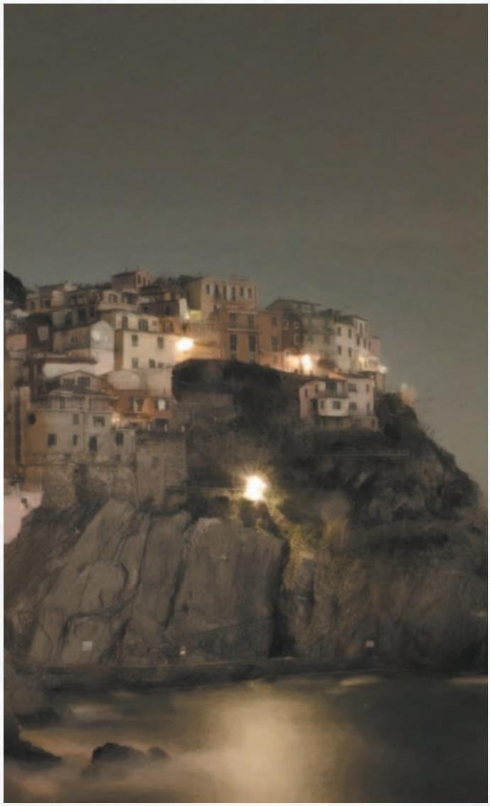{.art-body-right}

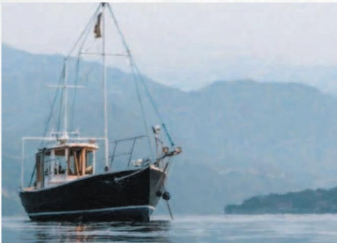{.art-body-right}

### Prologue

Before beginning the Prologue, the Keeper should provide [Handouts #1-7](#viral-player-handouts) to the players, and if possible, provide them in advance and a few days apart. The first two are essentially a hype email from Marco describing the plan to stream live from the ‘haunted’ island of Isola di Malamente, and the second three are from Maya outlining the basic arrangements made for the trip. After the players have had time to read them (or listened to someone read them aloud), begin the Prologue.

It's been a long day. Between all the time getting through the airport, waiting for your guide Nuncio to pick you up, and the eight hour drive to the picturesque little fishing village of Perla, you were ready to just collapse into a soft bed for a day or two. When you saw the island on the horizon though, all thoughts of sleep evaporated in an instant.

The town of Perla looks deserted. The locals are observing an obscure local holiday called La Notte della Malattia translated as ‘The Night of Sickness’ which involves being indoors by sunset and protecting all doors and windows with talismans to prevent disease from entering the home. Your research suggests that the tradition dates back to the Black Death that wiped out half of Europe during the dark ages, though it may go back even farther. Whether it’s true or not, it makes a great backdrop for your live stream tonight, which is one of the reasons you chose this date.

Nuncio gets you all aboard his tour boat, and after a quick check to make sure no one is watching, he sets course for Isola di Malamente. Looking around you see your colleagues, all nervous and excited. Each is checking their gear, writing notes on their phone, or just watching as the shunned island looms against the sunset, looking almost as if it's on fire.

> Keeper's Notes
> 
> The Keeper should hand the person playing Enoch [Handout #11](#viral-handout-11) describing his vision as they approach the island.

Nuncio reassures you that no one will be out here, especially tonight. As the island looms in your field of vision, Nuncio slows the engines. Normally he'd be driving tourists past the island, but today he continues straight. Out of habit, he says:

"There are mines all around the Isola di Malamente that date back to World War II when it was used as a radio listening post, first by German forces and later by British Intelligence. The mines were supposedly disarmed after the war, but at least two ships who strayed too close were crippled by previously undiscovered mines. Since the invention of GPS, the mines have been plotted, and the areas of risk clearly identified.

“Of course rumors persist that the Italian Navy has left the mines to discourage visitors to the island after the raid of 1954 when the hospital was shut down after accusations of patient neglect and abuse. Some even suggest that the island was the site of secret military experiments to weaponize diseases, but the Italian government vehemently denies this.”

As Nuncio slowly navigates his boat along some invisible path, you occasionally spot a shadow just beneath the water, and at one point a mine can be seen on the surface only a few yards from you, occasionally breaking the surface. The tension breaks when Nuncio announces with a hint of relief: "We're through."

He circles the island and pilots the boat into the narrow gap between the main island and its smaller neighbor. Looking up you see the bridge connecting the two islands known locally as The Weeping Bridge. There are countless strings, cords, and ropes dangling from it, looking unsettlingly like spider webs, and among them you see hundreds of small trinkets tied here and there throughout the tangled mess.

Before you have a chance to see any details, Nuncio pulls his boat onto a sandy beach on the southern end of the smaller island. He hops out into the water and uses the bowline to pull it further up onto the sand. He helps you unload your gear and you quickly double check that everything is there.

Nuncio says: "All of the equipment in the lighthouse has been hooked up as your English friend requested, and you'll find three spools of optical cable in the radio room. You can get to the lighthouse at the top of those stairs." He points to a flight of rickety, weather-worn wooden stairs that wind haphazardly up the rocky slope. Seeing the look on your faces he grins and quickly adds, "It's perfectly safe. I checked them myself."

With that settled, Nuncio pushes the boat back into the water and says, “I will be back just before dawn, so make sure you’re down on the beach and ready to go. We don’t want to be seen, right?” He shoves off, hops in the boat, starts up the chugging outboard motor, and in a few minutes he’s gone.

> Keeper's Notes
> 
> The stairs are actually safe, even if they creak and groan under every footstep. The Keeper may choose to play this out to begin building tension early, or simply hand wave the walk to the lighthouse.

## Isola di Malamente: Locations

### General Description: The Main island

The island is overgrown and in an extreme state of decay. The roads and paths are roughly cobblestoned with the occasional unidentifiable drag mark or dark stain splattered across them. There are oddly mutated weeds that poke out from between gaps in the stones and clots of black mold that seem to be growing out of every crack.

Due to the fact that everything is unmaintained and open to the elements, the structures are crumbling, wood is rotting, and all metal is rusted, pitted, or tarnished. Every window is broken, leaving the floors nearby covered with shattered glass. Anything made of concrete and brick is cracked and brittle at the edges, though the areas that remain intact still seem solid enough. Surfaces are covered in an unidentifiable purple fungus with thin white veins.

The Investigators will quickly discover that there are weathered bomb craters, bullet holes, and brass shell casings everywhere. This seems to indicate that there was heavy fighting at some point in the past, possibly dating back to the war.

> Keeper's Notes
> 
> A Spot Hidden check allows the Investigators to discover that many of the shell casings scattered about appear less tarnished. If the cleaner shell casings are examined, a Firearms (Handgun) skill check reveals that they are mostly 9 mm, and are probably not World War II era ammunition. An Extreme success reveals that they were probably fired from a semi-automatic handgun (like the Beretta Model 38) and some sort of submachine gun (like the Villar Perosa).
> 
> When the Investigators are near the hospital, a Hard Spot Hidden check reveals that at least a few of the craters near the hospital were made after the war. An Idea roll allows an Investigator to remember that this place was raided back in the 1950s, though if explosives were used, it was never reported in the news.
> 
> The Keeper is encouraged to research urban exploration images and videos to get a feel for the aesthetic of the island. The most significant difference between Isola di Malamente and other abandoned places is that with the exception of Beggar's Cove on the small island, it is completely devoid of graffiti. This fact should be stressed to the Investigators who are particularly accustomed to such places. It could start off with the feeling that something seems ‘wrong’ about the island before finally revealing the fact that this place seems to have been shunned, even by the local youths from the mainland.

### 1. Lighthouse/Radio Station

Exterior Description. Standing atop the rocky southern shore of Isola di Malamente's secondary island is a three story lighthouse on a crumbling concrete slab ([Handout #14](#viral-handout-14)). The pale stone of the lighthouse is weathered, but looks as solid as it was when it was built centuries ago. An attached brick building is still standing, though its roof is drooping slightly with age. Most of the glass of the lantern deck is surprisingly intact, and you can see the silhouette of the old World War II era radio antenna within.

A stout metal door bears a yellow and black sign that reads: INGRESSO VIETATO, and below that a smaller white sign that reads: No sconfinamento per ordine della Marina Italiana. There is the symbol for the Italian Navy below this instruction. A large, modern padlock secures this only entrance to the lighthouse.

> Keeper's Notes
> 
> The signs translate to: DO NOT ENTER and No trespassing per order of the Italian Navy. The lock is easily cut with a cheap bolt cutter or angle grinder, though the lock and hasp could be also pried loose with a large crowbar. If anyone examines the exterior of the lighthouse, they see bundles of thick cables climbing the exterior wall of the lighthouse. These are secure enough to allow someone to climb up to the lantern deck with a Hard Climb check.

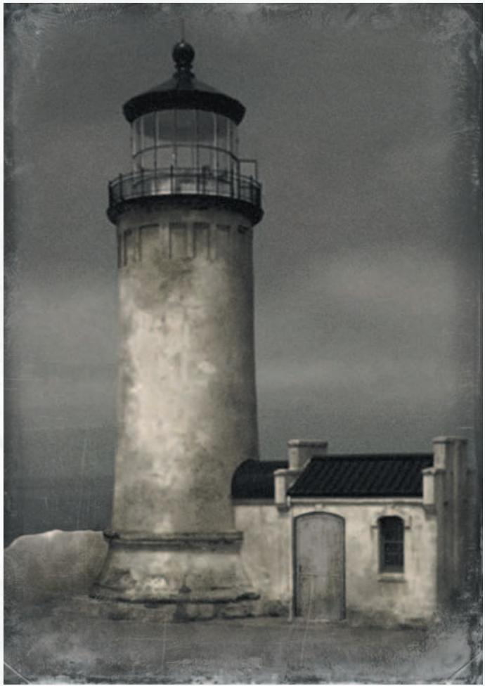{.art-body-right}

Interior Description. Stepping through the doorway is like stepping into the past. The far wall is lined with 1940s radio gear with a headset hanging from a hook on the wall. A steel and leather office chair is rusty but functional, and tucked beneath the desk is a wire basket half filled with crumpled balls of paper. If it weren't for the thick layer of dust and faint odor of mildew, this place might have been closed yesterday.

Lighthouse Base: The open doorway to the right leads to the base of the lighthouse itself where an open spiral staircase reaches up through the floor to the upper level.

Stairs: The stairs creak with each footstep, but they seem solid enough. Climbing up through the floor, you enter an empty circular room covered with decades of dust and a few fragments of broken wood. On the far side you see a second set of narrower spiral stairs leading up to the lantern deck.

Lantern Deck: The lantern deck is covered in dust like below, but the radio antenna is in good shape. There are two sets of cables on the lantern deck, one dating back to World War II, the other much older. The older set that powered the original lighthouse lamp was clearly cut a long time ago, but the other set, consisting of a half dozen cables runs from the steel box attached to the antenna housing down through a hole in the floor to the radio room on the ground floor.

> Keeper's Notes
> 
> The Investigators' tech expert has provided a special adapter that can just plug right into the junction box on the side of the antenna. There is enough cable to run downstairs to the radio room with some to spare. This is the location where the Investigators want to place their main cellular router that provides a strong Wi-Fi signal for 300 Meters. There are two more units to be placed on the far side of the Weeping Bridge and in the attic of the hospital.

### 2. Beggar's Cove (Baia dei Mendicanti)

Description. On the western side of the small island is a hidden cove with a dark, sandy beach. It's lined with steep cliffs of white stone that are insurmountable except for a single set of narrow stairs cut into the limestone. A corroded iron railing follows the rough staircase, though here and there are sections where the railing has succumbed to time and weather.

Looking down on the beach from the pathway, you can make out the remains of several bonfires, as well as graffiti covering the lower ten feet of the cliff all the way around. The island is covered in beer bottles, syringes, used condoms, food wrappers, and empty spray cans. A dark shape near the water appears to be a rowboat that has been turned upside down. There's no sign of any recent activity.

> Keeper's Notes
> 
> If the Investigators descend to the beach they find that the rowboat is covered in a thick layer of strange purple fungus that's almost black. This may dissuade Investigators from touching the boat, but it can be scraped off in about thirty minutes with little effort. There's a set of oars and an unopened bottle of Fernet-Branca Amaro wrapped in a heavily oiled leather pack beneath the boat.
> 
> When Hastalÿk rises from the ground, the fungi will be drawn to him, leaving the boat clear for the Investigators to use to escape the island. Unfortunately the presence of Hastalÿk also causes the water to retreat from the island, meaning that the fleeing Investigators must drag the boat to the retreating water. This requires a combined STR of 100 and at least one successful STR check. Of course, if the Keeper would prefer a more cinematic ending, then this STR check can be waived to allow the Investigators to witness the firebombing of the island from the water.

The rowboat is in rough shape, though it should hold together for a single trip back to Perla on the mainland with all five of the Krew onboard (especially given Enoch's size). Anyone attempting to row the boat should make a STR check against the following chart:

| STR Roll | Result |
| --- | --- |
| Fumble | Lose an oar in the water. |
| Failure | 1 mph |
| Success | 2 mph |
| Hard Success | 3 mph |
| Extreme Success | 4 mph |

Perla is roughly eight miles to the east, so it's possible to row there in as few as two hours (if they're not picked up by the Italian navy). The Keeper should have the person or persons rowing make a STR roll every hour to see how far they get.

### 3. The Weeping Bridge

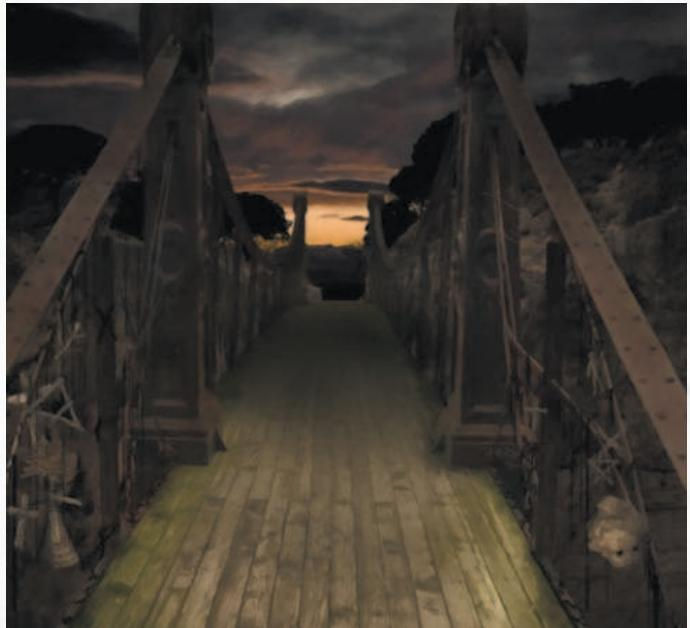{.art-body-right}

Description. The bridge has clearly seen better days. It's made of a simple cast iron design that was painted green at some point, but is now mostly brown with rust. Constant exposure to sun, sea, and wind have caused the paint on the metal railings to chip and fade, and the wooden planks of its surface are heavily weathered, though they seem more or less intact ([Handout #28](#viral-handout-28)).

Hanging from the railings and structure of the bridge are dolls. Hundreds of them. Some are more modern plastic ones, while others from ages past have faces made of porcelain and cloth, their eyes staring passively into the darkness. A few are complete dolls, but most are missing limbs and clothing, while still others are simply hollowed out heads with missing eyes and straggly, straw-like hair. Mixed in with the dolls are other more abstract creations of sticks, string, sinew, and bones. The shapes include some vaguely human-looking stick figures, crosses, stars of various styles, and some symbols that defy identification.

The entrance to the bridge has a makeshift shrine built on and around it using driftwood and local sticks woven into a crude wicker structure. Within are laminated pictures, all depicting babies and toddlers, that have faded over time. Other offerings include children's toys, handwritten notes in Italian, Catholic iconography, shriveled and dead flowers in jars, and the remains of countless candle stubs.

> Keeper's Notes
> 
> A local superstition says that the monks of the island protect the children born in the area, and so for centuries people have journeyed from the mainland to leave offerings. It's a tradition that has never been questioned, though it has fallen out of practice in recent years in favor of teens coming to drink in nearby Beggar's Cove.
> 
> The notes are either the typical Catholic prayers or pleas for the monks to pray for children who have been injured in accidents or fallen sick. Others are simply requests to look after newborns or parents seeking to ensure healthy pregnancies. There are a mix of dolls, toys, photographs, flowers, and the like that stretch back to the early 20th century.
> 
> The underside of the bridge is similarly decorated with ghastly dolls and stick figures, with many of them hanging from a collection of frayed ropes that dangle five to ten feet above the water. This is an incredibly disconcerting sight from a distance, and may require a Sanity check (without any SAN loss) to get closer.
> 
> The bridge is safe to cross, though it creaks and groans, especially with Enoch since he is a big guy and carries most of the equipment. It won't break, but the Keeper shouldn't let the players know this.
> 
> On the far side of the bridge, partially hidden beneath the dirt, leaves, and seagull droppings, the Investigators can see some sort of mosaic on the ground. If the debris is cleared away, the Investigators find a strange symbol carved into the stone. Broken bits of tile and colored glass have been plastered into the lines and sealed with a thick layer of shellac.
> 
> This is actually an Elder Sign that has been inscribed and empowered by unknown parties at some time in the distant past. It has also been enchanted to be invulnerable to non-magical weapons, which explains the pristine condition it is found in. Over the centuries, the locals have embellished it, but the power it contains remains as strong as ever. This prevents Hastalÿk, The Plague Monk, and anybody with a Taint level of 10 from leaving the main island. This could play an important role in the finale of the scenario if the Investigators flee this way, though the Investigators may not understand why they're not being pursued across the bridge.
> 
> A Cthulhu Mythos check or a Hard Occult check allows a Investigator to identify the Elder Sign, and while they don't know its whole purpose, they realize that it's probably some sort of protective sigil.

> Possible Vision from The Sight
> 
> You hear the faint laughter of children and then the voice of a young girl saying in a matter-of-fact manner, “The shadowman can’t cross the bridge, no matter how hard he tries.” in broken English.

### 4. Lemon Grove

Description. A well-worn path leads you into a vast grove of cultivated lemon trees that feels more like a cave with the upper branches forming a dense canopy overhead. You're immediately greeted by the hazy buzz of insects, the sweet smell of citrus, and the stench of decay that catches in the back of your throat and sinuses ([Handout #32](#viral-handout-32)).

The grove is wild and unkempt from years of neglect, yet most of the trees are still heavy with what appear to be lemons, though some of them have grown unsettlingly large with many strange deformities. Some are the size of human heads, while others have strange tendril-like protrusions from them in twisting curls. Other mutations give the lemons tumorous growths that appear almost translucent. The leaves on the trees seem strangely discolored and misshapen, and in places the bark is peeling in strips to expose the wood underneath to the point where they seem more like open wounds. The floor of the grove is covered in decaying corpse-white leaves that squish soggily beneath your feet. Each step releases a small puff of gray mist that stinks of rotten fruit.

> Keeper's Notes
> 
> The grove has come under the influence of the charnel pit that lies beneath it; the roots of the trees feeding from the foul corruption below. This has caused the trees to mutate and bear unnatural fruit. Should the Investigators remove a mutated lemon from a tree, they generally feel and smell like lemons on the outside. If they cut one open however, roll a D10 and refer to the following chart:

Lemon Grove Results

| Roll | Result |
| --- | --- |
| 1 | The lemon deflates like a balloon with the air being slowly released. The vapor released is absolutely disgusting, and causes everyone within five feet to make a CON check to avoid vomiting. The skin of the lemon is wafer thin and immediately begins to desiccate, crumbling in the Investigator's hand, leaving a pale stain that takes days to fade. Anyone who fails their CON check gains 1 level of Taint. |
| 2 | The entire inside of the lemon is full of flies that swarm out at the Investigator, getting in their eyes, mouth, nose, and ears. They must make a Sanity check (1/1D3), and if they suffer a bout of madness they run screaming from the grove as they frantically try to purge the flies from their body. Purging all of the flies takes five minutes once they calm down, or only a minute if they have help. |
| 3 | The inside of the lemon has a crimson, fleshy muscle-like interior that bleeds what appears to be real blood when cut. Despite its appearance, it smells just like a normal lemon, and should someone be brave enough to put any in their mouth, it tastes of lemon as well. Putting any in their mouth also gives them 1 level of Taint. |
| 4 | Just beneath the lemon's outer skin is an amniotic-like membrane that contains the skeleton of a dead rat inside. The flesh and hair appear to be in the process of being digested. Seeing this requires a Sanity check (1/1D4). If they pierce the sac, molecular acid sprays out at the person who punctured it. A successful Dodge roll will allow them to avoid it, otherwise they suffer 1D4 points of damage and 2 levels of Taint. This permanently scars the skin, and might reduce the Investigator's appearance depending on where the acid hits (Keeper's discretion). |
| 5 | The moment the flesh of the lemon is pierced, it bursts with an audible pop releasing a nest of writhing translucent tendrils that grasp the Investigator's hand. An amoebic blob in the center pulls itself out by the tendrils and onto the Investigator's hand. The tendrils are immensely sticky, but can be peeled away with a little effort, like removing a strip of duct tape. This experience triggers a Sanity check (1/1D4). Once detached from the skin, the blob immediately dissolves into gelatinous goo that evaporates in a matter of seconds. If the blob touches the Investigator's skin, it adheres as well, and if not removed within five minutes it partially absorbs into the victim's skin until it looks like a massive blister. This gives them 1 level of Taint, and the Keeper can decide on any later effects at their discretion. |
| 6 | When pierced, the cut area opens like a little mouth, releasing air that sounds like a tiny scream. The person opening must make a Sanity check (1/1D4). If they fail, they believe that it was an actual mouth, though examination of the lemon reveals a dried, desiccated husk. The air that came out smells of rotten fruit and copper. |
| 7 | The lemon pops like a balloon, splashing everyone within five feet with a viscous black fluid that has the sour reek of bile. The black slime is hot, though not scalding. It can be wiped off, but permanently stains anything it touches, including human skin which retains a faint brownish mark for the rest of the victim's life. The Keeper can have the Investigators make a Luck roll with a Bonus Die to avoid getting any on their face. Anyone touched by the fluid gains 1 level of Taint. |
| 8 | It looks, smells, and tastes like a normal lemon. At the Keeper's discretion, the lemon could also have significant psychoactive properties that temporarily give the Investigator [The Sight](#viral-appendix-new-rules-the-sight) (see p.60). This could be useful if running one of the alternative Investigator options where none of them previously had any psychic abilities. |
| 9 | When the outer skin is pierced, the lemon bursts open with a swarm of tiny yellow bugs that quickly cover the victim's hands. Each is about the size of an aphid and they move very quickly up the arm and under any clothing. They can be swept off, but this will require the Investigator to remove their shirt, which takes one round. If not removed in the first or second round, the Investigator feels them attempting to burrow into the pores of their skin. If not removed by the third round, they see at least one of them disappearing beneath their skin. These parasites only infect lemons or similar fruit, and so die as soon as they enter the bloodstream... though of course the poor Investigator doesn't know that. If any do get into the skin, the victim gains 1 level of Taint. |
| 10 | The Keeper should make up their own disturbing result that may or may not be harmful. In either case, contact or ingestion should give the victim at least 1 level of Taint. |

Note: Unless otherwise indicated, each of the above options requires a Sanity check (0/1).

In addition to these abominable fruit, the grove is infested by all manner of insects. Should anybody climb a tree they become covered in disturbing but ultimately harmless insects of all kinds, requiring a Sanity check (0/1). If this causes a bout of madness, the Investigator should make a DEX check to avoid falling out of the tree. The soft ground absorbs most of the impact, so they won't suffer any injuries unless they critically fail their DEX roll, in which case they suffer 1D2 points of damage.

The floor of the grove is also alive with insects, moth pupae, maggots, and the like. Anybody landing on the ground or digging amongst the leaves ends up releasing all manner of disturbing, but ultimately harmless crawling things. This also triggers a Sanity check (0/1).

If the Investigators search the ground, they find the remains of decayed wicker baskets amongst the undergrowth. These were presumably used to carry newly picked lemons in ages past, but they are now flat, ruined, and useless.

After thirty minutes in the grove, the Investigators should make Luck rolls. Anyone who succeeds stumbles across a heavy iron grate in the ground that is partially covered with leaves. The grate is too heavy to remove easily, and even if they could, the shaft below is too narrow to descend. Shining a light down reveals that there is some sort of chamber below. If they haven't found the entrance to the catacombs, this could allow them an Idea roll later to determine where it might be.

> Possible Vision from The Sight
> 
> Your vision becomes hazy and the grove seems to change to be less overgrown and more cultivated. Dark humanoid shapes move amongst the lemon trees, and seem to be removing something from nearby wooden wheelbarrows and packing the bases of the trees with the material within. A large steel grate is clearly visible in the center of the grove, and the monks proceed to tip whatever remains there into it. The sound of bones clattering against the rocks and down below ring in your ears, and then your vision returns to the dark of the night.

### 5. Saint Roche's Hospital (Ospedale di San Rocco)

Exterior Description. Surrounded by a rusting chain link fence, Saint Roche's Hospital sits amidst a barren stretch of ground just beyond the Lemon Grove. To the right you see the ruins of the old monastery chapel, while directly ahead is the hospital itself. Three stories of brick, mortar, and stone stretch off into the oppressive darkness, and you can only just make out the central black slate roof silhouetted against the stars. Most of the windows are broken, though the structure seems solid enough with no signs of obvious collapse evident.

Something about the sight makes you uneasy, and it takes a moment to realize why. There isn't a single mark of graffiti or evidence of vandalism. None. You've recorded at countless purportedly haunted sites, and no matter how terrifying or isolated they've been, not one has been without the ubiquitous graffiti tags, broken bottles, or smashed windows. All of the damage here has been done by the impersonal elements of the wind and the rain.

The cove on the small island makes it clear that teens from the mainland frequent the island for their alcohol-soaked beach parties, and yet they apparently never crossed the bridge to vandalize the buildings. Not once.

> Keeper's Notes
> 
> Investigators should make a POW check at this point. Success means that they feel as if they are being watched, with a Hard success allowing them to spot what looks like a solitary figure standing in one of the second floor windows. As the Investigator stares for a moment, the figure appears to turn away into the darkness ([Handout #30](#viral-handout-30)) triggering a Sanity check (0/1D3). Anyone else who looks afterwards sees nothing but a dark curtain moving gently in the breeze ([Handout #31](#viral-handout-31)). This curtain is a plausible enough explanation for the figure if one wants to convince themselves that it was nothing.

Interior Description. The leaden air is thick with the stench of mildew and decay. Chunks of plaster hang from the ceiling, exposing the swollen laths beneath. The floors are covered with fungal growths that have sprouted from cracks in the black and white tiles. As you step forward the ground crunches underfoot from glass and debris and rodents skitter squeak behind the crumbling walls. Patches of mold like mottled bruises cover every surface as if the building were being digested from within.

The warped doors are mostly intact, and even some of the glass is unbroken. Eerily, all of the hospital's equipment seems to be untouched, as if the staff just walked out one day and never returned. Gurneys, wheelchairs, and service carts stacked with food trays litter the halls. Peeling and faded signs hang precariously from the walls and ceilings, presumably once labeling important locations and directions. Most are now illegible, though you can make out the occasional word in Italian.

> Keeper's Notes
> 
> The Keeper should stress the untouched nature of the place. Whenever possible, areas should be described as if they were simply abandoned while still in use. The Investigators could find mugs, fountain pens, clipboards, and even jackets left on coat racks. The overall impression is one of sudden abandonment, and that it has since been utterly shunned by the locals.
> 
> Note that all of the broken glass and debris makes moving quietly very difficult. Investigators have a Penalty Die to any Stealth checks.

Other Descriptions. The following are general descriptions to keep in mind while the Investigators are exploring the hospital. The Keeper should feel free to elaborate and improvise as they see fit to enhance the mood.

Floors – In places where patients were actually treated, the floors are black and white chessboard tiles, though most are cracked and broken. In office areas, non-hospital rooms, and corridors, the flooring is wooden parquet, though the once beautiful wood is now bubbled, decayed, and rotted.

> Keeper's Notes
> 
> A shard of tile could be used as a makeshift weapon in a pinch. In combat, use Fighting (Brawl) to hit and 1D2 damage for the tile. If the attacker fumbles, the damage is inflicted on the attacker's hand unless they take precautions, such as wrapping the shard in a bit of cloth.

Fungal Growths – There are unidentifiable fungal growths everywhere, so the Keeper can put these wherever they feel necessary. They are unnaturally purple or violet in color with peculiar stripes and spots.

> Keeper's Notes
> 
> The fungi is only harmful if handled or consumed. Doing so inflicts 1 level of Taint.

Vermin – The walls are filled with rats, so the Investigators are likely to hear a lot of squeaking and scratching. There are obvious droppings everywhere, the ammonia stench of urine, and signs of gnawing on anything made of wood. There are rat nests in cupboards and closets that writhe with hairless pale rat offspring, often with terrible mutations including multiple limbs, tails, and heads.

> Keeper's Notes
> 
> Rat droppings can transmit a particularly nasty infection called Hantavirus. The Krew's audience will warn them of this almost instantly, but if they insist on doing something stupid, they are almost certain to become infected.

Weather Damage – Temperature changes and water have caused significant damage to everything. The paint is peeling, wooden doors are rotten, and the ceilings sag ominously. The doors can be splintered with a single kick, and the pockets of trapped water could suddenly burst, showering the Krew with vile, contaminated water.

> Keeper's Notes
> 
> If a water pocket in the ceiling or wall bursts, the Investigators can make a Dodge roll to avoid the worst of it. Failure means getting doused with the most disgusting, worm-infested water imaginable. This gives them 1 level of Taint, and requires a CON check to avoid vomiting.

Miscellaneous Objects – The Keeper is encouraged to include all manner of damaged hospital equipment and supplies, from glass syringes to bedpans. Whatever the Investigators find, it should be creepy, disgusting, and extremely disturbing.

Limiting Exploration. If the Keeper wants to limit where the Investigators can explore in the interests of time, they can easily make a room, section, or wing of the hospital inaccessible. This can be due to a collapsed ceiling or floor, a dangerously leaning wall, impassable debris, or an entire wing collapsed under the weight of weather and time.

If the Keeper wants to heighten the threat, a collapse can happen while the Investigators are present, or as the result of something the Investigators did, such as kicking open a door. The Keeper is discouraged from inflicting any severe injuries on the Investigators, but minor bruises, cuts, and scratches are fine. Keep in mind that due to the corruption on the island, even a minor scratch is likely to become infected.

Optional Discoveries. In addition to the objects mentioned in the descriptions and the typical things one might find in a 1950s era hospital, there are a few things that the Investigators could discover at the Keeper's discretion.

> Audio Recording – The Investigators find a leather satchel that contains an EMI midget tape recorder (c. 1950. Serial no. 1253). There is a bulky 50s era battery in a side pouch, though it has long since lost its charge. Fortunately, Hyeon (or your tech expert of choice) has a number of adapters intended to work with 1940s and 50s era technology, and he can get one of the Krew's modern batteries to power it in about 15 minutes.
> 
> Much of the tape is damaged, but they manage to find a section that is playable. When the tape is played, the Investigators initially hear a single Italian man's voice who sounds out of breath. He is speaking quickly, but with a controlled professionalism keeping the emotion in his voice in check. He is quickly joined by other voices.. The following is what they hear. The final line is in Latin.
> 
> Audio Recording (Speaking Italian)
> 
> Voice 1: ...Sil sergente Bianchi è giù. Sono riuscito a trascinarlo dentro... non so cosa c'è sulla pelle. Si sta muovendo...
> 
> Voice 2: Lui è morto. non so cosa...
> 
> An explosion is heard in the background, followed by a great deal of gunfire.
> 
> Voice 2: ...bisogno di raggiungere la barca... basta lasciare il... registratore. Verrà cancellato comunque.
> 
> Voice 1: Il colonnello Rossi ha insistito.
> 
> Voice 2: Fanculo Rossi e il cazzo DSS!
> 
> Voice 3: (Sounding out of breath.) Voi due, abbiamo appena preso l'ultimo di loro. Il Colonnello dice di fare i bagagli. Ci stiamo ritirando. Ha detto che la sua gente lo farà...
> 
> Voice 1: Che diavolo è QUELLO?
> 
> Voice 3: Non mi crederesti se te lo dicessi. Prendi i tuoi culi...
> 
> nessun tempo... fuori prima che scenda la notte.
> 
> Voice 2: Afferra i suoi piedi. Non lo sto lasciando qui. No, ho detto di lasciar perdere quella fottuta cosa!
> 
> There is a heavy thump.
> 
> Voice 1: (Getting quieter as if moving away from the mic.)
> 
> Oh Dio, no...
> 
> A minute or so passes with only the sound of sporadic gunfire in the distance. Then the sound of slow footsteps.
> 
> Voice 4: (This voice is a deep whisper, speaking Latin close to the mic.) Tu numquam hic relinquo, Marco. Prodidit te et cetera. Mane non revertentur.
> 
> Audio Recording (English Translation)
> 
> Voice 1: ...Sergeant Bianchi is down. I've managed to pull him into... don't know what's on his skin. It's moving...
> 
> Voice 2: He's dead. I don't know what...
> 
> An explosion is heard in the background, followed by a great deal of gunfire.
> 
> Voice 2: ...need to get to the boat... just leave the... recorder. It's going to get wiped anyway.
> 
> Voice 1: Colonel Rossi insisted.
> 
> Voice 2: Fuck Rossi and his fucking DSS!
> 
> Voice 3: (Sounding out of breath.) You two, we just got the last of them. The Colonel says to pack up. We're pulling out. He said his people will...
> 
> Voice 1: What the HELL is THAT?
> 
> Voice 3: You wouldn't believe me if I told you. Just get your asses... no time... out before nightfall.
> 
> Voice 2: Grab his feet. I'm not leaving him here. No, I said drop that fucking thing!
> 
> There is a heavy thump.
> 
> Voice 1: (Getting quieter as if moving away from the mic.)
> 
> Oh God, no...
> 
> A minute or so passes with only the sound of sporadic gunfire in the distance. Then the sound of slow footsteps.
> 
> Voice 4: (This voice is a deep whisper close to the mic.) You are never leaving here, \*Marco\*. She betrayed you and the rest. Morning shall never come again.

> Possible Vision from The Sight
> 
> Your ears are filled with screams and gunfire. You hear panicked breathing. You see flashes of soldiers frantically pushing explosives into nooks in the walls. A deep chanting grips you with terror. Then silence.

> Keeper's Notes
> 
> The name in the last line can be changed to be one of the Investigators listening, and it can even appear to answer them if they say anything. To make this discovery even creepier, the Keeper could have the tape recorder playback the voices of the Spektral Krew from earlier in the evening.

VHS Recorder – The Investigators find a backpack with an mid-80s era VHS recorder and a book called Il Culto della Peste dell'Isola Malamente (see [History](#viral-history) p.16). Hyeon can rig one of his batteries to run it, and they can watch what's on the tape through the eyepiece.

The video has been corrupted, but fast forwarding through the static, they find recordings of two teens, with a third operating the camera. The two on camera look like a couple judging by the way they're clinging to each other. They look both excited and scared. Unfortunately, there's no audio.

They see the teens moving through the hospital, with the couple occasionally turning to talk to the camera. This probably seems very familiar to the Krew as the behavior of early ghost hunters or urban explorers. The final seconds are terrifying as they turn a corner to see a monk dressed in a long, hooded robe. His face is covered by some old fashioned gas mask and he appears to be surrounded by a swarm of flies. The couple run past the camera as the operator falls to the ground. Through the viewfinder the Investigator watches as the monk reaches toward the cameraman with a scabbed and blistered hand.

Suddenly, flies pour out of the camera's eyepiece and the VHS tape ejects from the side, releasing a swarm of pale beetles that swarm all over the Investigator's hand. This requires a Sanity check (1D3/1D6), and anyone who was watching the video gains 2 levels of Taint.

#### Hospital Locations

There are far too many locations within Saint Roche's Hospital to describe thoroughly, and doing so would begin to get a bit repetitive with the Keeper describing room after room that has fallen to decay and rot. The following descriptions are kept simple, with ideas for embellishment as the Spektral Krew continues their investigation. In addition to specific phenomena listed in the descriptions, the Keeper should make use of the [Hospital Encounters table in the Appendix](#viral-appendix-encounters-hospital) (see p.59).

##### Hospital, Cellar

The cellar primarily houses the hospital's morgue, old files, and discarded refuse.

Morgue – The walls of this stone rectangular room are lined with three foot square metal doors numbered one to sixty, with thirty on each wall, in three rows of ten. Behind each door is a roughly three foot wide by seven foot deep stone shelf carved from the living rock of the island. These once held the bodies of the recently deceased, but now house nothing but dust. If they are examined, it can be noted that the doors do not have a mechanism to open them from the inside.

> Keeper's Notes
> 
> User UltimaUnum will offer a Super Chat of \$500 for Marco to climb into one of the morgue shelves, close the door, and remain there for five minutes. If he agrees, the Keeper can have all sorts of hallucinations affect him. For example, he might hear a crack in the stone followed by a rain of bugs and worms that begin crawling all over him triggering a Sanity check (1/1D4). Other options could include auditory hallucinations of someone scratching to get out of the storage shelf next to his, the voice of The Plague Monk, or a swarm of rats. Of course when he's extracted there is no evidence for any of this. Additionally, the thickness of the metal door makes any screaming or cries for help for those inside almost inaudible. The doors have no mechanism to be opened from the inside.

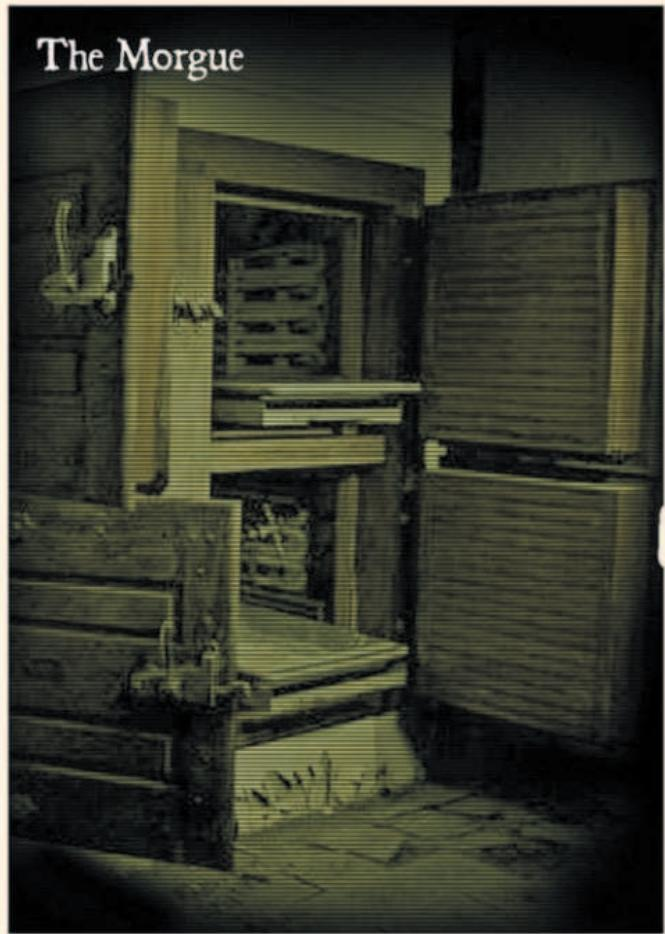{.art-body-right}

Old Files – This room is packed with countless wooden filing cabinets that have become nests for rats. They can be heard scurrying, squeaking, and scratching within the decaying furniture. If the Investigators open a cabinet, they will see that many files have been removed, and whatever is left has been turned into rat nests. They should then make a group Luck roll. Failure means that a rat swarm erupts from the filing cabinets and attacks the Investigators. They are horribly mutated, with pale hairless bodies and blind milky eyes. They won't cause any physical damage, but the Keeper should imply that they could, describing them trying to scramble up their legs, biting their feet, and so on. Maybe even have a few leap onto their heads and shoulders from the cabinets.

Particularly cruel Keepers can have the Investigator suffer 1 Hit Point of damage and a Sanity check (1/1D3) as they flee the infested cellar.

Storage – Most of the storage down here consists of broken furniture, old hospital equipment, and a few unmarked fifty-gallon steel drums that have been welded shut and slosh when moved. The drums are unlikely to be opened by the Investigators, but if they manage to find a way, the Keeper can decide what's inside. It could be anything from rusty water to something unspeakable.

##### Hospital, Ground Floor

The main entrance is wide open, with the doors hanging loose from their hinges. The wooden floors here are heavily weathered and littered with bits of plaster and broken glass. Past the administration offices and reception rooms the hardwood floors give way to the classic black and white tiles that were popular when the hospital was built. Many of the tiles are cracked and broken making any attempt at quiet exploration nearly impossible.

**1A. Administrator's Office** – This once opulent office is now little more than a colony for rats. The floor moves as they scatter away from you, and their skittering can be heard within the walls. A silver fountain pen stands in an elaborate stand on the administrator's desk, and a wooden inbox is filled with what must have once been important paperwork. The contents are now nothing but mildewed pulp. Next to the large bay window is a painting of a solemn-looking man seated in a high-backed chair. He is middle-aged, balding, and has an expression of satisfaction on his face. This portrait is in surprisingly good shape, though there is mold creeping in at the edges.

> Keeper's Notes
> 
> The painting is of the final hospital administrator. If they look closely, the Investigators can read Dr. Enzo Bianco on a small plaque beneath. The desk drawers contain files that have crumbled beyond all recognition. The top center drawer contains a silver letter opener (1D2 damage) and a pair of binoculars that fall apart in the hands of anyone who picks them up.

**1B. Admission Ward** – This long rectangular room has six beds along the north wall and a line of desks on the south. There are also two hospital cribs in the far corner, one of which is covered with a mildewed white cloth. The stacks of paperwork that once stood on the desks are now in an unintelligible state of decay, and are scattered everywhere. A clipboard hangs at the foot of each bed and small nightstands in between the beds still have the occasional glass or bedpan.

> Keeper's Notes
> 
> This area has things like typewriters, examination equipment, and a glass cabinet with extremely outdated medical supplies. There are likely to be rats nesting in and around the beds. To ramp up the creepiness, the Investigators could see movement beneath the sheets on one of the infant beds, and when they pull the sheet back, they find an albino rat mother is feeding her deformed young.
> 
> Adjoining rooms contain filing cabinets and office supplies. Across the hall to the east is a storage closet for cleaning supplies (mostly ammonia-based disinfectant) and a walk-in linen closet that connects with the Laundry Ward.
> 
> The Admissions Office contains a desk, more decayed paperwork, and a painting depicting a pastoral scene of the Italian countryside. An ornate pipe sits in an ashtray as if it was set down and forgotten.

**1C. Laundry Ward** – Despite the decades of abandonment, the room still smells faintly of bleach, though the rot and the mildew still reign supreme. The Washing Room contains several massive stainless steel electric washers. Piles of old sheets and hospital gowns are infested with rats, with more scratching from behind the machines.

The Drying Room has several gas dryers, their massive porthole-like doors hanging open, and more rat scratchings heard within. Five wheeled bins are piled with now shredded sheets that reek of ammonia and mold.

The Ironing Room has four industrial ironing tables with hinged tops that once pressed and steamed the countless bed sheets that passed through here. Pipes, rubber hoses, and electrical wires run into the back of the machines, though they are now frayed and rotten.

The Laundry Storage is a large walk-in closet that contains eight fifty gallon drums of cleaning agents, bleach, and starch. The smell in here is overwhelming (and probably unhealthy) as some of the barrels have leaked to mix on the floor. After a few seconds here, your eyes begin to burn and you find breathing difficult.

> Keeper's Notes
> 
> If anyone spends more than thirty seconds in the Laundry Storage, they should make a CON check or become dizzy. A Critical failure means that they pass out and have to be dragged out by someone else. The toxic air in here can be deadly over time, but otherwise just causes irritation to the eyes, sinuses, throat, and lungs.
> 
> Adjoining rooms contain additional supplies, rubber gloves, aprons, extra wheeled carts, and so on.

**1D. Boiler Room** – The boiler can only be accessed from the West Corridor or the outside of the building. The massive steel boiler itself takes up the bulk of the room, its ornate Victorian door stands ajar. Scratching can be heard within.

Through the door to the west is the Coal Room. It reeks of sulfur and dust. Mountains of coal are piled against the southern wall, a pair of coal shovels still stand planted in the piles. There's an exterior metal door here where the coal was presumably loaded, though rust and corrosion appear to have sealed it shut.

A small narrow doorway leads to a maintenance room with work benches, tools, and even an old welding rig that is black with soot. Most of the tools are heavily corroded.

Beyond is a maze of other rooms dedicated to various forms of maintenance including automotive, electrical, plumbing, carpentry, and grounds-keeping. All of the tools are similarly rusted and pitted, making them all but useless without some significant restoration. The smells of oil, grease, gasoline, and fertilizer mingle with the ubiquitous stench of mildew.

> Keeper's Notes
> 
> If the Investigators look for any specific tools that were available in the 1950s, they're likely to find it somewhere in these rooms. The Keeper can have them make a Luck roll to see if any of it is usable as is, or if it requires cleaning. Of course, if they just want a club to hit something, any wrench (no matter how rusted) will do and be capable of inflicting 1D4 damage.

**1E. Operating Room** – Following World War II, Saint Roche's Hospital re-purposed many of its operating rooms, leaving just this one to handle the rare cases when it was required. The steel operating table is surprisingly clean, apart from a thick layer of dust, though your eyes are drawn to the thick leather straps that were presumably used to restrain patients.

The surrounding shelves, counters, and cabinets are well stocked with decaying supplies that are more likely to have the opposite effect to which they were originally intended.

> Keeper's Notes
> 
> Hiding among the useless detritus, a Hard Spot Hidden check reveals boxes of medications that are still potent. They include Morphine, Codeine, and Laudanum. Investigators can make a Hard Education check to notice that there is a conspicuous absence of vaccines, anti-viral, and antibacterial medications.

**1F. Exam Room** – This room contains an examination table, counter, and a wall-mounted cabinet. The table is covered with a rotten, badly stained sheet.

> Keeper's Notes
> 
> If anyone opens the cabinet, a massive rat leaps out at them, dumping various exam supplies onto the floor. This triggers a Sanity check (0/1) for the jump scare.

**1G. Kitchen** – This industrial kitchen is one of the largest rooms so far. Dozens of preparation counters are covered with pots, pans, and various utensils. The large brick oven that stands against the eastern wall is flanked by a pair of more modern (for the 1950s) cooking ovens. On the north wall is a lift to the upstairs kitchen, though without power, it stands open and stacked with dishes.

Adjoining rooms include walk-in refrigerators, freezers, pantries, and related storage for crockery and eating utensils. The refrigerator and freezer are horrific. They are choked with thick mold colonies and some sort of pale flies that swarm within. The bloated, tumor-like fungus crawls with worms and white beetles.

> Keeper's Notes
> 
> A search of the kitchen (and a successful Spot Hidden check) will find a steel bucket containing bones. A related skill check (Keeper's discretion) reveals among the cow and pig bones, there appear to be some human bones. This realization triggers a Sanity check (1/1D4).
> 
> Entering the refrigerator requires a CON check. Once inside, a Hard Spot Hidden check reveals a five gallon jar that contains several fetuses, many with cords wrapped around them, which obviously means a Sanity check (1/1D6).

**1H. Main Dining and Recreation Hall** – This massive hall has a dozen long tables lined with wooden chairs. Unlike many of the other rooms, this one has suffered significant weather damage. The ceiling has collapsed, dumping chairs and tables from the room above into a chaotic pile of splintered wood and plaster in the middle of the room. Tall windows look to the south where, even through the filthy glass, you can make out the sea in the distance. In the southeast and northeast corners are stairs that lead up to the second floor. Looking up through the hole in the ceiling, you can see the stars through the hole in the roof.

> Keeper's Notes
> 
> The stairs both lead up to the Upper Dining and Recreation Hall, though the weakened floor makes it a dangerous endeavor to go up that way. The Keeper can have the Investigators make a Spot Hidden check to notice a brief light on the water, but it might have just been one of their flashlights.

##### Hospital, Ground Floor, West Wing

**1I. West Corridor** – This long corridor fades off into darkness ahead of you. There are windows along the sides that would allow some natural light if it was daytime, but now they only remind you of how dark it is outside. The hall connects the Admission Ward to the Infectious Ward.

> Keeper's Notes
> 
> This would be a good opportunity for the Investigators to see something moving around outside since it would be difficult for them to get there quickly. Their lights and reflections could also cause them to see things, so the Keeper could have them make Sanity checks (without any point loss) to see if they startle themselves.

**1J. Isolation Ward** – This ward consists of seven private rooms along the northern wall, and fourteen beds along the southern wall. The rooms all have doors with bolts and little windows that make them look more like prison cells than hospital rooms. A patient lift in the northwestern corner has an empty gurney jammed sideways in the door.

A doorway in the middle of the north wall leads to a patient bathroom with sinks, toilets, and a steel bathtub that is overflowing with black mold. Obviously the water doesn't work, and you're not sure you'd want to use any of the facilities with all surfaces covered with broken plaster, mold, and unidentifiable filth.

A row of tall windows along the south wall look out over the southern part of the island and the Mediterranean beyond.

> Keeper's Notes
> 
> Mirrors can be great opportunities for jump scares and apparitions. Perhaps a Investigator sees someone move behind them, but when they turn around, there's nothing. Commenters post things like "Who was that?!" and "Hey, was that someone in a robe?!"

**1K. Recovery Ward** – This ward is lined along the north and south walls with patient beds. Several private rooms line the eastern wall, and down a short corridor is a small examination room.

**1L. Infectious Ward** – This smaller ward has six isolation rooms with slide bolts. In the northwest corner is another patient lift and a door on the eastern wall leads to a small examination room. Another windowed door is open onto the West Corridor.

**1M. Terminal Ward** – This ward once housed those who stood on death's doorstep. There are twenty beds (ten each along the eastern and western walls), and six private rooms. Through a door on the south wall is the glass enclosed day room and through a door to the west is a patient bathroom with sinks, toilets, and rusted metal bathtub.

##### Hospital, Ground Floor, East Wing

**1N. East Corridor** – [See West Corridor](#viral-isola-hospital-room-1i-west-corridor). This corridor connects the Admission Ward to the Staff Dormitory.

**1O. Acute Ward** – This is a mirror image of the Isolation Ward.

**1P. Recent Ward** – This ward was apparently for new admissions. There are ten beds along the north and south walls for a total of ten. Four private rooms stand on the west wall, with a small corridor leading to an examination room. A door near the northeastern corner leads to an Office Suite.

1Q. Office Suite – This is the office of the senior doctor on duty and related rooms. This area also has a staircase to the second floor that once had a door, but the lock looks as if it was broken off a long time ago. On the far side of the office suite is the Dormitory.

1R. Staff Dormitory – The staff dormitory has eight private rooms and a common area with several tables and chairs. Tall windows look out over the grounds and the sea beyond. Unlike other areas in the hospital, these rooms show significant signs of damage from gunfire and maybe even explosives. The floor is littered with shell casings and sections of wall are charred and blackened as if exposed to intense heat.

> Keeper's Notes
> 
> A Hard Idea roll allows the Investigators to find several spent teargas canisters beneath some of the broken furniture. The amount of grime and dust on the shell casings and empty tear gas canisters suggest that they are decades old.

Just off the Staff Dormitory is a day room with a door to a staff bathroom on the eastern wall. Two doors to the north lead to the staff dining room, with a dedicated kitchen through a doorway in the northeast corner. Other doors on the north wall lead to pantries, a refrigerator, a freezer, and other storage rooms. In the northwest corner is a room with clothing hooks and benches, like a changing room. A doorway opens into a stone hallway.

The hall leads to a private prayer chapel that is made of ancient looking dark stone that must have once been part of the original monastery. Rows of benches face the northern end of the hall where a lectern stands a few feet from the wall. A large crucifix of wrought iron hangs above the lectern on the wall.

> Keeper's Notes
> 
> A Spot Hidden check allows an Investigator to notice some odd, circular scuff marks around the crucifix on the wall. If the player doesn't guess, then they can make an Idea roll to realize that the cross rotates. When the cross is rotated 180° so that it is upside down, there is an audible click as a secret door opens in the back wall.

##### Hospital, Ground Floor, Secret Rooms

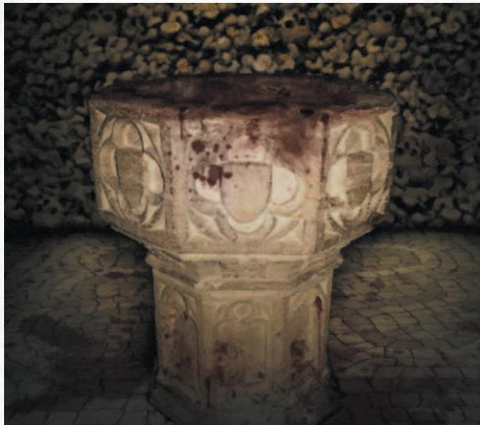{.art-body-right}

1S. Shrine of Bones – As soon as you step through the secret door, you see some sort of shrine, but it honors no god that you've ever heard of. Human skulls cover the walls and ceiling of the roughly square room, and in the middle is a waist high stone basin crusted with long dried blood.

Just to the right of the door are the mummified remains of what appears to have been a monk judging by the rotted brown cassock clinging to the desiccated flesh. Under his left arm is clutched a leather bound book (see [Iuramentum Corruptionis](#viral-appendix-new-mythos-tome-iuramentum-corruptionis) on p.67), and next to his right hand is an 1889 Bodeo (10.5mm) revolver. There is a clean hole in his temple. Even to someone with no forensic background, it looks to have been self-inflicted.

There are still five undischarged shells in the cylinder, though the revolver itself is filthy. A Firearms (Handgun) check is required to clean it. If used without cleaning, each shot requires a successful Luck roll. Otherwise the round misfires.

The book is roughly the size of a large Bible, but instead of a cross or similar iconography on the front, there is a peculiar symbol fashioned out of silver that looks like a series of twisted knots bent into the shape of some sort of fly.

> Keeper's Notes
> 
> Taking a moment to examine the symbol requires a Sanity check (0/1). If anyone looks inside they can tell that the book is written in Latin, and is heavily illustrated with graphic and disturbing images that depict things being done to human bodies, including children and infants. Flipping through the book for 15 minutes causes the Investigator to lose 1D4 Sanity points, and gain 1 level of Taint. If the reader has a Latin skill of 30% or greater and attempts to read it, they understand more and lose 2D4 Sanity and gain 2 levels of Taint. If the Krew attempts to broadcast it, Maya cuts the stream to avoid demonetization.
> 
> Searching the shrine with a Spot Hidden check reveals the hand print of a baby smeared into the blood on the altar.

1T. Torture Room – Walking into the room is like stepping into a nightmare. The room is long and rectangular, stretching off into the darkness to your right. From the doorway you can see square pillars that splay out at the top to join the vaulted roof overhead. The curved ceiling may once have been decorated with frescoes, but all you can make out now are vaguely unsettling shapes beneath a thick layer of soot and mold.

The floor is stone with deep gutters cut into it that run from the pillars to drain into a narrow trench which runs along the length of the outer walls. While the architecture is clearly medieval, cables running along the walls that apparently once delivered electricity to some antiquated industrial-looking lights spaced every ten feet or so. Several kerosene lanterns hang from a few of the nearby fixtures.

Most disturbing of all, are the iron manacles dangling from thick rings embedded in the pillars. They are heavily corroded with a rusty stain running down the stone beneath them. A bit of old fabric hangs from one of the manacle cuffs.

> Keeper's Notes
> 
> As the Investigators explore, they'll find a doorway to the left (north), and at the far right (south) they'll see the remains of a prisoner still dangling by his wrists. All that's left of him are bones, dried sinew, and a rotted hospital gown that is little more than a tattered gauze at this point. This requires a Sanity check (1/1D4). Even without a skill check, it's clear that these remains date back to the 1950s at the latest, but an Education check reveals that the corpse is surprisingly solid for its age. Most bodies fall apart as they rot, but the flesh seems to have mummified somehow, despite the excessive moisture.

1U. Operating Room – This long narrow room contains a row of seven operating tables. Each has a side table for instruments, a cluster of lights overhead, and a steel trash can next to it. The slate roof has collapsed in a few places leaving piles of broken stone beneath. Two doors on the western wall look as if they lead to an adjacent room.

1V. Cast-Offs – Like many other places on this island, this smaller antechamber smells of decay and mold. The rear half of the room is piled with clothes, shoes, hats, and other personal belongings. As your light plays across the refuse, you catch the glint of pocket watches, eyeglasses, and even a raggedy doll, her black button eyes staring at you.

> Keeper's Notes
> 
> This is where the monks dumped all of the clothes and personal objects belonging to their victims. If anyone takes the time to search the pile, a Hard Spot Hidden check reveals that these cast-offs go back to the Victorian era, judging by the clothing styles. If they were to dig deep enough, they could find the pit beneath the pile that goes even deeper, with artifacts dating back to the middle ages. Of course an extensive excavation would take hours if not days to do properly, so the Investigators aren't likely to learn this.

#### Administrator's House

The administrator was very much a figurehead at the hospital. He dealt with outsiders and gave the hospital a friendly face, but he was little more than a puppet. During his tenure, he lived in the Administrator's House, and kept up appearances for any visitors of note. In most cases, visitors would never enter the hospital proper, content to see it from a distance while sipping brandy in the administrator's living room with absolutely no idea what was happening behind the facade of medical uniforms and the administrator's silver tongue.

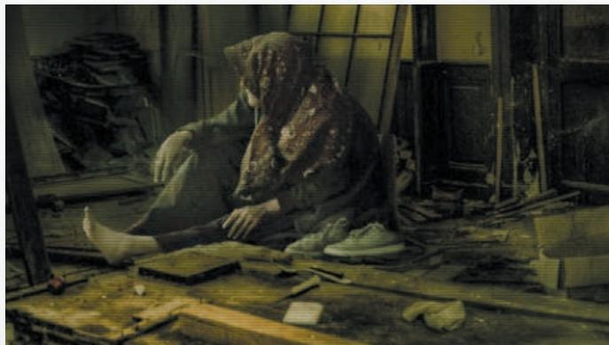{.art-body-right}

> Keeper's Notes
> 
> On a nearby table, there is an open metal box with drug paraphernalia, including several syringes, rubber tubing, and a plastic bag that contains a small amount of heroin. As a recovering heroin addict, Peter will recognize it immediately, and the Keeper may want to have him make a POW check to resist the urge to pocket it for later use, particularly if he has already encountered something that caused him to lose Sanity.
> 
> If the Keeper wants to ramp up the creepiness, they can include a lone heroin addict ‘sleeping’ beneath a pile of rags in the attic. The investigators may hear something upstairs or see a figure in an attic window as they approach the house.
> 
> When they go to investigate, they'll have to make a Spot Hidden check to notice a hand sticking out from beneath what appears to be a pile of rags in the corner. If they specifically search the pile rags in the corner, then no roll is necessary. They'll immediately see the fingers move, causing them to think he's still alive.
> 
> His name was Angelo Russo (though he no longer remembers this), and he originally came out here ten years ago with a group of friends for a night of drinking in Beggar's Cove. When Angelo passed out, his friends decided it would be a funny prank to leave him there and come back in a few hours.
> 
> Believing that his friends had actually abandoned him, Angelo decided to explore the rest of the island in the hopes of finding some way to signal for help, and he was never heard from again. His friends all agreed to lie and claim they had no idea what happened to him.
> 
> Angelo was quickly corrupted by the island, and after finding a supply of heroin in the abandoned hospital, he tried desperately to make the pain stop. He managed to last a week before he overdosed, but of course his torment wasn't to end there. The corruption wouldn't let him die and he became cursed to remain until Hastalÿk was released and he could join with it.
> 
> Now he only begs for the merciful death that was denied him. To the Investigators he'll appear to be a nearly dead junkie, a rusted needle fused to his arm. He reaches out to them pleadingly and says: "Vi prego uccidetemi. Questo è un inferno. Nel nome di Dio, abbiate pietà. Vi prego." This translates to: "Please kill me. I've been here for so long. This is hell. In the name of god, have mercy. Please." If they refuse to help, he'll return to his sofa and his own personal hell, sobbing uncontrollably, though his tears have long since dried up. Discovering Angelo's situation triggers a Sanity check (1/1D4).

First Floor – Sitting amongst a small copse of overgrown trees, the Administrator's House is modest, with a living room, dining room, and kitchen on the first floor. It's furnished with Victorian era furniture and appliances, though the elements have had their way with them. The place reeks of mold and rat urine, and a hole in the roof has caused significant water damage in the southeast corner. The stairs to the second floor are at the rear of the main entry hall.

Second Floor – The second floor has a main bedroom, bathroom, study, and a spare bedroom. Both bedrooms are furnished with four-poster beds, dressers, and ornate wardrobes, while the study is fine paneled wood with a large maple desk, several chairs, and shelves of moldering medical books from the 1950s. The spare bedroom is a ruin of collapsed plaster and swollen wood. A massive hole in the roof is open to the night sky, and the floor has been severely weakened by water damage.

If anyone attempts to step into the room, the floor groans loudly and collapses, dropping the decayed furniture into the kitchen below. If anyone happens to be below, they hear the groan a moment before the ceiling falls in, which should give them time to get out. If they don't, the Keeper should have them suffer 1D4 points of damage from falling debris, but nothing serious.

Attic – The attic is accessed through a narrow staircase in the southwestern section of the second floor. It leads to a door that opens onto a large open space that has a simple, unfinished wooden floor and exposed rafters. The southeast corner of the attic is open to the sky due to a fallen branch, giving the Investigators a magnificent view of the lemon grove and the lighthouse.

##### Hospital, Second Floor

The second floor is very similar to the Ground Floor, though there seems to be more weather damage up here. This is largely due to the fact that the attic has been flooding, and water damage has caused large sections of plaster ceiling to collapse everywhere, leaving piles of debris and mold everywhere. The floor is still sturdy enough except in the Upper Dining Hall where it has mostly collapsed.

**2A. Head Nurse's Office** – Above the Administrator's Office is the head Nurse's Office. It is somewhat simpler, with a smaller desk and a number of filing cabinets which once held active patient files.

**2B. Mental Ward** – This ward was used to house infirmed patients suffering from mental illness – usually shell shock victims from both World Wars (called Post Traumatic Stress Disorder or PTSD today). The beds have prominent leather restraints, though they are all decayed and rotten. The room reeks of ammonia and mildew, and a hole in the ceiling looks into the darkened attic.

**2C. Kitchen** – The second floor kitchen has several commercial warming cabinets, serving carts, and piles of cafeteria trays. The food was apparently prepared downstairs and transferred to this upper kitchen via the kitchen lift. There are bins of steel silverware, plates, bowls, and a cabinet of moldering napkins. Piles of glass tumblers lie broken on the floor near a collapsed wooden table.

**2D. Upper Dining and Recreation Hall** – This hall once had a dozen long tables and chairs, but the floor has almost entirely collapsed, dumping them into the hall below. Tall windows look to the south where, even through the filthy glass, you can make out the sea in the distance. In the southeast and northeast corners are stairs that lead down to the first floor, though crossing to them looks extremely dangerous. The damage to the roof is extensive, leaving most of the room open to the dark sky.

##### Hospital, Second Floor, West Wing

The upstairs of this wing is very much like on the first floor, though the weather damage seems more extensive up here due to sections of the ceiling that have collapsed from the water damage in the attic.

**2E. Isolation Ward** – [See 1J](#viral-isola-hospital-room-1j-isolation-ward).

**2F. Recovery Ward** – [See 1K](#viral-isola-hospital-room-1k-recovery-ward).

**2G. Infectious Ward** – [See 1L](#viral-isola-hospital-room-1l-infectious-ward)

**2H. Terminal Ward** – [See 1M](#viral-isola-hospital-room-1m-terminal-ward).

##### Hospital, Second Floor, East Wing

Like the West Wing and the central area of the second floor, the East Wing suffers from extensive weather and water damage that has resulted in collapsed ceilings in many areas.

**2I. Acute Ward** – [See 1O](#viral-isola-hospital-room-1o-acute-ward).

**2J. Recent Ward** – [See 1P](#viral-isola-hospital-room-1p-recent-ward).

##### Hospital, Third Floor

The attic of the hospital is mostly empty except for racks of stored linen in the middle of the room. The cloth rotted into tattered piles a long time ago, and countless holes in the roof have allowed the floor to flood over and over throughout the decades. The southern half of the central roof is almost entirely collapsed, allowing one to look out over the Mediterranean in the distance. The view would be breathtaking if not for the wreckage and smell. Most of the floor is quite obviously on the verge of collapse.

> Keeper's Notes
> 
> If anyone dares to walk out onto the attic floor, they should make a Luck roll. Failure means that the floor beneath them gives way, dropping them to the floor below and inflicting 2D4 points of damage. The Keeper can allow them a DEX check to avoid falling through.

#### 6. Mass Graves

Description. The roughly football field-sized patch of ground on the south of the hospital is marked with several dozen tattered red flags in a grid pattern. Each has a yellow biohazard symbol and a series of numbers at the bottom, presumably to mark coordinates on some map in a folder at the bottom of a forgotten government drawer. You know that these must mark the mass graves that were discovered back in the 1950s, and that by all accounts, the bodies are still there.

> Keeper's Notes
> 
> Closer examination reveals that a number of holes were dug and refilled, presumably when they found the graves. If anyone digs in those areas, they'll get down about a foot before they find a body. This should be a disturbing moment since they'll probably either brush the dead skin with their hand or cut into the corpse with a spade. The skin of the victim is extremely soft and sloughs off at the slightest touch, clinging momentarily to the digging tool, or worse, the Investigator's hand. This should trigger a Sanity check (1D3/1D6).
> 
> If and when Hastalÿk rises, the dead buried here rise as well. They may appear to be walking towards the Investigators, but their true purpose is to merge with Hastalÿk to be absorbed into his mass, causing him to grow even bigger. Seeing this triggers a brutal Sanity check (1D4/2D4).
> 
> These undead are extremely fragile, and if attacked by a Investigator, they break apart with a single blow, falling apart like a chicken that has been pressure cooked too long. An Investigator that destroys one should make a Luck roll to avoid being covered with rotted, infected flesh (see [Infected Flesh in the The Reliquae](#viral-appendix-new-mythos-horrors-reliquae-infection) on p.67).

> Possible Vision from The Sight
> 
> The sound of gagged screaming fills your ears. You look across the burial site and see a large pit that two human-sized shadows are tossing the body of a woman into. She is bound, weeping, and begging to be spared. Her body sails into the pit below and you hear a loud crack, a groan of pain, then silence. The shadows move toward the pit and begin chanting something in Latin while scattering a white powdery substance below.

#### 7. Cremation Pit

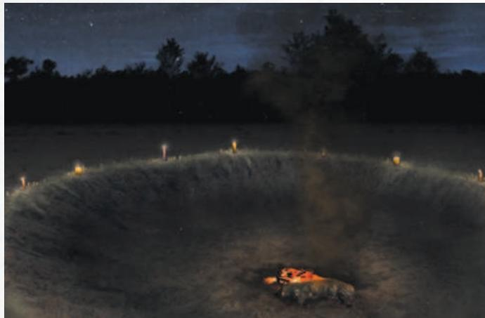{.art-body-right}

Description. A Cremation Pit sits at the center of a large clearing. It's a forty foot diameter crater hollowed out of the ground with a three foot mound of dirt surrounding it. The pit itself is about ten feet deep, though its true depth is impossible to tell since the bottom is filled with ash and charred bones. In the center is what looks like the blackened and smoldering corpse of a large animal, like a dog or a pig, that has been burned recently.

The rim of the pit is marked with the stubs of several hundred candles which have fused into a mass of wax from decades of previous candles, forming a pale ring around this profane golgotha ([Handout #33](#viral-handout-33)).

> Keeper's Notes
> 
> At a distance, the burned remains appear to be some sort of pig. If anyone has the Natural World, Science (Biology), or similar skill (Keeper's discretion), a Hard success will identify it as some kind of giant rodent, similar to a ground hog or perhaps an opossum, but much larger. In any case, no such animal should be found on this island.

> Possible Vision from The Sight
> 
> Your ears are filled with a squealing similar to a rat in pain. Tied up in the center of the pit appears to be a huge rat... or maybe a pig... that is currently being burned alive. A shadowy figure stands nearby, their features indistinguishable, holding a burning torch.

#### 8. Isola di Malamente Dock

Description. The island's only dock consists of a 250 foot long paved jetty at the far end of which is a 150 foot wood and concrete pier perpendicular to the jetty. While the jetty is more or less intact, the pier is a ruin, several large sections having collapsed into the sea. Partially submerged in the water near the broken sections are a dozen or so partially rusted steel barrels that are held together by some sort of black fungal mass.

> Keeper's Notes
> 
> The pier is stable enough to allow someone to walk out to the far end without any risk of further collapse. If more than five people are on the pier however, everyone should make a Luck roll. Up to three failures and the pier only creaks, but if four or more fail, the pier collapses, dropping everyone on the pier into the water.
> 
> The barrels once contained biological waste from the hospital that was to be dumped at sea, but a storm surge caused the pier to fail under their weight. The black mass is actually a mutated form of algae that is horrific to look at, but is more or less harmless. If an Investigator examines the barrels, they can make a Spot Hidden roll. Success means that they recognize a biohazard symbol still visible on one of the barrels. A Hard success means that they notice blackened fragments of human bone within the algae.

> Possible Visions from The Sight
> 
> Your view changes to that of someone looking through the bars of a cage. You realize you are chained up and can't remember the last time you ate or drank. It is night time and the noise of insects and the sea fills your ears. Looking up, you see you are chained up inside a box and are then thrown to the roof as the box you are in clatters onto a wooden floor. You hear someone being scolded nearby; told that the monks prefer their sacrifices to arrive undamaged. A knot of fear causes you to start screaming in a panic and then everything goes black.

#### 9. Overlook Point

Description. The road leading to the northeast ends in a wide circular turnaround. A faded, half-toppled sign reads Punta Bellavista (Overlook Point) with an arrow pointing to an overgrown, but clearly marked path through the low crumpled trees. The gravel trail leads more or less north, following the broken and irregular ground. After a hundred and fifty feet or so the trees become more stunted and thin, and you can see the rocky bit of land that marks the northernmost point of Isola di Malamente. From here you can just make out the lights of the Sicilian shore in the distance.

A crudely cut path leads to the very tip of Overlook Point. At the far end, a dilapidated wooden platform clings precariously to a large, flat boulder that juts out twenty feet over the water.

> Keeper's Notes
> 
> The path over the rocks is difficult to travel at the best of times, but at night, even with a flashlight, it's downright treacherous. Anyone attempting to walk the 200 feet out to the point must make a DEX check every 50 feet. Success means that they manage to reach the point without issues. Failure means twisting an ankle which reduces the Investigator's speed by 1 for a couple of days. A Hard failure means falling prone, and suffering 1 point of damage, while an Extreme failure means a broken leg. If someone is taking special care, it takes them twice as long to reach the end, but they gain a Bonus Die on their DEX checks. On the other hand, if they're moving with urgency they can reach the end in half the time, but must make their checks with a Penalty Die. A Penalty Die is also added if they have no light source.
> 
> Reaching the end has the reward of allowing the Investigator to see a small dark boat anchored a few hundred feet off the shore. This is the Vedetta, an Esploratore-class patrol boat with a crew of 16 and armed with three machine guns. A successful Spot Hidden check allows them to notice figures moving around the boat. A Hard success means that they can hear the crew speaking Italian, and an Extreme success means that they can identify them as members of the Italian Navy.
> 
> The crew of the Vedetta is aware of the Investigator(s), and will take one of two actions: rescue them or open fire with the intent of killing them to prevent any infection from leaving the island. The Keeper can decide which, or the Investigators can make a Luck roll. This can be played out in various ways depending on when it happens during the scenario. If it's early on, the crew ignores them and remains silent, or if the Investigators are being pursued by some sort of unspeakable horror, the crew will attempt to stop them from leaving the island at all costs.

#### 10. Chapel & Crypt

Description, Cemetery. The headstones in the chapel's cemetery are old and weathered. Even to the untrained eye, they look as if they date back centuries. In fact, there don't seem to be any recent ones at all.

> Keeper's Notes
> 
> The weathering has made most of the headstones illegible, and what can be read is in Italian. About fifteen minutes of searching and a Hard Spot Hidden check reveals that the newest stones are from the late 1800s.

Description, Chapel. The old chapel is little more than a hollowed out ruin, though it's stable enough. Anything that was going to collapse did so a long time ago. The old stone apse is surprisingly intact, with a more or less solid dome overhead. A dark pile at the top of the steps was presumably a wooden altar at one point, but over the centuries has decomposed to little more than an overgrown mound of peculiar vines with variegated leaves of dusty olive and a purple so dark it's almost black.

To either side of the mound steps curve down towards each other. The right hand stairs are partially blocked with debris, but the left hand stairs are clear, apart from the vines that hang across the dark opening like a curtain.

> Keeper's Notes
> 
> The fresco on the dome crumbled to dust long ago, so little can be discerned of its original design except that it had a distinctly Mediterranean style. Near the edges, the Investigators can make out the occasional hand or partial face. An Extreme Spot Hidden check allows them to notice a depiction of a monk holding some sort of bowl over his head as a kind of offering. Investigators that see this should make a POW check. Success means that they see the head of the monk in the fresco move slightly to look at them, causing a Sanity check (1/1D4). This will be easy enough to justify as the light playing tricks on them of course.

Description, Crypt. Parting the curtain of foliage and descending the stairs, you find yourselves in the chapel's crypt. The crypt itself is roughly sixty feet long and forty feet wide with broad pillars supporting a low vaulted ceiling. Along the walls are dozens of crypts, each sealed with a heavy stone block. At the eastern end there are three alcoves, with the central one almost ten feet deep. The northern one contains the statue of a monk with his head bowed, his face completely obscured in shadow. The central alcove contains a stone pedestal at the far end with an iron box on top. The box is about eighteen inches wide by thirty inches long, and ten inches thick. The box is secured with a medieval looking padlock that, judging by the thick layer of rust and corrosion, hasn't been opened in centuries.

The southern alcove once contained a statue, but all the remains are remnants of the sandaled feet still on the filthy dais. The back wall of the alcove is marked with some curious writing that is neither Italian or Greek. In fact it bears more of a resemblance to Hebrew, but is clearly not that either.

In the very center of the crypt is an ancient slab of stone that has been carved to form a low rectangular table or altar. Judging by the proportions (four feet wide by seven feet long by three feet tall), it may have been used to lay out bodies in preparation for burial, or perhaps some ancient funeral rite ([Handout #34](#viral-handout-34)).

> Keeper's Notes
> 
> The crypt altar is where Maya recommended using the Witch Board. A Spot Hidden check reveals that there used to be rings of iron near the corners, suggesting a more sinister use. All that remains now however are rusted stumps.
> 
> The Witch Board. The Witch Board connects with The Plague Monk directly. Obviously the Investigators will be asking questions, and the Keeper should begin by playing along like a normal witch board session. Things should escalate as they go on, until the planchette is literally pulled from their hands to begin spelling things on its own. The final word is HASTALYK, and as soon as it finishes, there is a massive convulsion in the ground that cracks the altar and causes the stairs up to the chapel to collapse. The Investigators should make DEX checks to avoid being thrown to the ground and suffering 1D3 points of damage. They should additionally make Luck rolls. Failure means they are struck by falling debris that inflicts 1D6 points of damage.

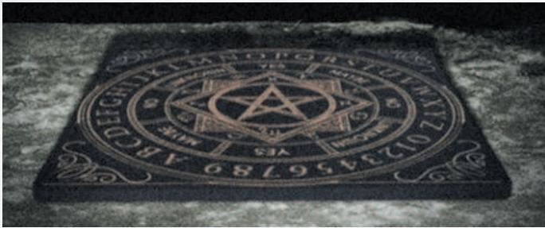{.art-body-right}

It shouldn't take them long to discover that the shaking opened a passage in the rear of the southern alcove, which is now the only means they have to get out of the crypt. The tunnel is only about two and a half feet wide, and immediately descends in stair-like steps. The passage turns slightly back and forth, so it's impossible to tell how far it goes. If they test for air flow using a flame, there definitely seems to be a draft leading into that passage.

> Possible Visions from The Sight
> 
> You get flashes of images from previous times. Sacrifice, after sacrifice. Metal against stone. Scratching. Fingers worn to the bone. Blood flows from the very walls. Screaming and begging fills the air. And above all, chanting. Deep guttural chanting that seems to be calling something forth from some hidden place...

#### 11. Catacomb Entrance

Description. Emerging from the narrow passage, you find yourself in some sort of catacomb that looks like it dates back to the 3rd Century CE or earlier. Around the walls there are dozens of shelves cut into the stone. Each contains human remains that consist mainly of bones and dust. Looking around, it seems the only exit is a two foot wide passage on the far wall. The ceiling here is only about six feet.

On a nearby stone shelf you notice an ancient book. Most of it has turned to dust and crumbling brown flakes, but there is a single fragment that seems to be intact ([Handout #35](#viral-handout-35)).

> Keeper's Notes
> 
> When describing the catacombs, the Keeper should stress the claustrophobic nature of this place by describing how their shoulders rub the walls and their heads occasionally brush the ceiling. If they're wearing anything bulky like a backpack, they'll get wedged every now and then, forcing the Investigator to pause to get themselves loose. Every so often, the Investigators should make a Luck roll to see if they accidentally knock any bones off the shelves. The first time this happens, everyone should make a Sanity check (0/1) for the jump scare it causes.
> 
> Some of the passages are a bit wider, so this can be a slight relief to the Investigators, and when they come to the next narrower passage, it will feel all the more claustrophobic. If anyone has a Bout of Madness while down here, they're likely to develop actual claustrophobia which can cause them to either panic or become momentarily frozen into inaction.

> Live Stream
> 
> At this point, the live stream has been cut by the Italian government, but the Investigators will not realize it. The only thing they might notice (if they look) is that the number of people viewing has dropped to two. One of these is the DSS monitor and the other is UltimaUnum who offers them \$10,000 to continue.
> 
> Maya is aware that the feed is cut, but she is having a difficult time communicating with them. The Keeper can have her break through with audio every now and then with a garbled message as she desperately tries to circumvent the DSS operator. The Keeper should use this as cinematically as possible to drip feed the Investigators information. If the Investigators are moving too slowly, the Keeper can have her break through with something like: “...Italian soldiers coming... get out!” Near the end, she intercepts the DSS plan to bomb the island and warns them.
> 
> During all of this, the DSS has been in communication with the British authorities, and so the Keeper could have Maya's home raided right in the middle of the conversation as she's warning them. So the Investigators may hear the door bursting open, and even gun shots.

#### 12. Catacombs

Description. The tunnels feel like a maze cutting through the living rock of the island. You pass countless loculi or niches piled with bones and skulls. You can't help but notice the occasional reflection of trinkets and minor valuables, presumably left as final offerings to the dead that rest here. Every so often, the tunnel opens up a bit, but around the next corner, it tightens up again. The occasional side passage goes left or right... or maybe you're on the branch passage now. It's so difficult to tell ([Handout #36](#viral-handout-36)).

> Keeper's Notes
> 
> If the Investigators attempt to steal any grave goods, they'll have to make a Sanity check to succeed. Failure means that they are unable to do so, feeling an irresistible compulsion to leave them alone. If they succeed, they'll only have a brief moment to examine their shiny trinket before a worm infested arm reaches out of the dark recesses of the shelf and attempts to grab them. This obviously triggers a Sanity check (1D3/1D6), and the thief is grabbed by the clothing. They can either escape with a successful STR roll, or shed the clothing that was grabbed (Keeper's discretion).
> 
> If they shine a light in the recess, they'll see a rot-covered corpse wrapped in ragged cloth (see [Plague Zombie](#viral-appendix-new-mythos-horrors-reliquae-infection)). The flesh that hangs loosely from its bones is infested with pale worms and fungus. Its eyes are swollen milky orbs that stare with malevolence at the thief. In the depths of the shadows behind there are more sets of eyes peering from the darkness.
> 
> At this point, the [Reliquae](#viral-appendix-new-mythos-horrors-reliquae) (see Appendix p.66) begin climbing out of the shelf to get the Investigators. The Keeper can decide how many pursue.
> 
> Scattered throughout the catacombs are rooms for various purposes. Many are simply junctions where several tunnels meet, while others are preparation chambers. Several contain closed sarcophagi, presumably for those of higher social station. The tops are nearly impossible to open without tools, and even then requires an hour or more ([Handout #37](#viral-handout-37)).

> Possible Vision from The Sight
> 
> Your ears are filled with the wind that blows through these tunnels. You start to hear a deep voice that seems to be speaking in all languages, and yet none – “Join with us.”

#### 13. Temple of Morbus

Description, Temple. Unlike the other chambers you've encountered in the catacombs, this one has smooth stone stairs that ascend into a much larger room. This appears to be some sort of temple from the Roman era based on the architecture. A high vaulted ceiling overhead is supported by broad pillars carved with worn carvings that depict terrifying images of skeletal bodies being dumped into pits, gigantic worms swallowing men whole, and standing above, groups of robed men engaged in zealous worship of a tall, narrow shape that the eye cannot define.

It extends left and right for eighty feet with the far wall about fifty feet in front of you. An archway is directly ahead, and you can see a shaft of dusty moonlight in the chamber beyond!

> Possible Vision from The Sight
> 
> You are chained by the hands and feet and are suddenly pushed to the floor in a chamber lit by torches that smell of stale decay. The drone of flies fills the air. Looking back, you see a Roman Legionnaire, gladius drawn and pointed at you, speaking to somebody you can't see in the flickering shadows. Even though it is in Latin, you can understand exactly what is being said.
> 
> "I come as part of a delegation from Rome. The pox has gripped the city, and it is feared we may have angered Morbus in some unknowable way. Rome offers tribute in the form of sacrifice, that you would pray for us to be spared."

Description, The Birthing Pit. The chamber beyond seems older than the Roman temple. It is some sort of carved grotto with tapered pillars reaching up towards the arched ceiling above. In the middle of the floor is a ten foot opening, like a well. From within you can hear a kind of thick sloshing.

In the center of the ceiling is a round opening covered with an iron grate. You spot something tied to the grate, and as your eyes follow it down, you see a robed figure suspended over the pit by the neck, its masked head bowed low in front. The Plague Monk. You can't see the face, but the hands appear to be desiccated, as if it's been here for a very long time.

> Keeper's Notes
> 
> As soon as they see him, the monk's head will rise to look at them with a series of popping cracks. This triggers a Sanity check (1/1D8). Anyone with sufficient [Taint](#viral-appendix-new-rules-the-taint) should make a POW check or feel compelled to look in the pit unless someone stops them. Anyone that steps within five feet sees a terrifying slurry of putrid flesh and fluids that swirls slowly within. Another POW check may be necessary to avoid throwing themselves into the pit (see [Taint](#viral-appendix-new-rules-the-taint) on p.62).

### Hastalÿk Awakens

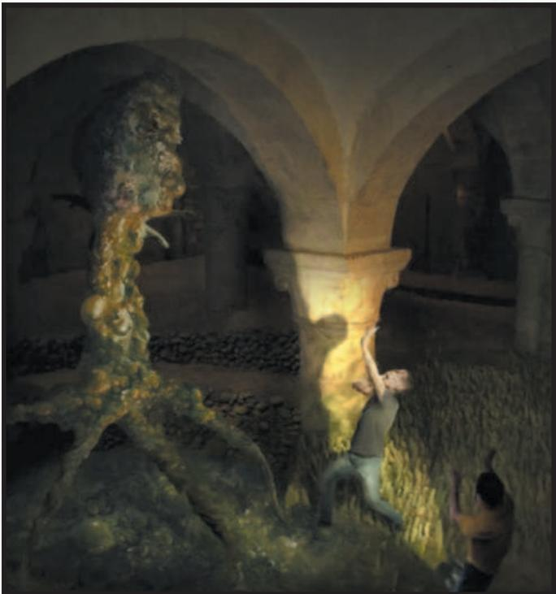{.art-body-right}

The body plummets like a tattered ragdoll into the pit below. There is a crunch that sounds like bones hitting mud, followed by a moment's silence. Then suddenly, the floor shakes and buckles as the gurgling from the pit intensifies. A moment later, cracks radiate out across the floor from the pit and the ground ruptures. Fleshy hands reach grasping from the moist floor beneath you.

Corpses pull themselves loose from the desecrated earth, and begin stumbling, crawling, and dragging themselves towards the pit. They are dressed in clothing from various time periods – Nazi, Italian, British, and American soldiers, monks in rotted brown cowls, priests in decayed cassocks, slaves in rusted chains, and even Roman Legionaries – and they chant a single word...

"Hastalÿk... Hastalÿk... Hastalÿk..."

Then the smell hits you. You retch as the bodies start throwing themselves into the pit with thick, slurping splashes. Behind you comes the sound of crackling, snapping and shuffling as the desiccated corpses of ages passed emerge from the catacombs. You are trapped.

The earth shudders a second time, and a crack tears open behind the pit, running up the wall to the ceiling. It collapses inward, creating a rough, sloping passageway up. A diseased lemon tree plummets through the rift, landing with a loud crack. It falls against the slope, wedging itself between the floor and ceiling. There's an immediate gust of wind that brings the sickly sweet odor of rotten fruit and a hint of salty sea air. Looking up the collapsed slope you can see the lemon grove and the night sky above.

Hastalÿk Rises. As you struggle to take all this in, there's a third rumble and you look in horror as a huge, blackened, insect-like leg reaches out of the pit. It's covered in vicious barbs that help it find purchase as five more legs emerge around the pit's crumbling lip.

The vile abomination that heaves itself out a moment later resembles a massive viral bacteriophage that nearly reaches the vaulted ceiling. It appears to be composed of infected flesh that is forming itself into some horrific avatar of Hastalÿk. Its translucent corpse-gray membranous skin bulges with screaming faces that shift and writhe within. The 'head' is a bruise-colored mass shaped vaguely like an icosahedron covered in inky pulsating cysts. It lets out an ululating chitter that causes more dust and soil to fall from above.

The bodies of the fallen, after a moment's abeyance almost in wonder at the sight before them, suddenly hurl themselves toward their blasphemous god and are absorbed into its mass. Its outer membrane rips and seethes as it grows, its massive bulk smacking against the stone ceiling. The roof cracks as more stones rain down into the chamber. Mercifully, the thing from the pit has not noticed you so far, basking in the glory of its own loathsome birth ([Handout #38](#viral-handout-38)).

> Keeper's Notes
> 
> When the floor breaks, the Investigators should make a DEX check to remain on their feet. When the smell hits, they need to make a CON check to avoid being paralyzed with nausea for one round.
> 
> As soon as Hastalÿk appears, everyone in the room must make a Sanity check (1D8/4D10) and gain 2 levels of Taint. Any who fail their Sanity check are unable to move for one round as Hastalÿk forms before their eyes.
> 
> If an Investigator has less than 10 levels of Taint, they will be able to escape Hastalÿk – if they want to. There are three obvious means of effecting an easy escape before Hastalÿk's biomass expands to the point where it can attack the Investigators. This takes five rounds.

Escape! The Investigators have three obvious options to escape the crumbling temple. Each involves varying levels of danger and chances of success, and of course, if the Keeper chooses, they can waive any checks and simply allow the Investigators to flee if they wish. If the players come up with alternatives not mentioned here, the Keeper is encouraged to reward such cleverness in the face of this overwhelming horror.

Going Back. The way back is dangerous due to the overwhelming flow of the living dead that wish to offer themselves up to Hastalÿk. Luckily, the series of quakes that heralded its arrival have split the ceiling in the chapel open allowing escape. It takes five rounds to get from the birthing chamber to the entrance. However, that way is fraught with danger. In order to escape, each Investigator must make a Luck check each round of Hastalÿk's growth to duck and dodge their way back through the catacombs. A failed check results in 5 points of damage from the crush of corpses, jutting bones, being trampled, falling debris, and the like – a successful Dodge roll can drop this to 3. If the Dodge roll is failed, the Investigator gains a point of Taint. If at any time an Investigator increases his level of Taint to ten while in the catacombs, this causes them to stop, turn around, and start following the Reliquae back to Hastalÿk to offer themselves to their new-born God. It takes five rounds to get back to the entrance, which is clear.

Split in the Wall. The second quake that shook the island and caused the grove above to collapse below has also split the wall at the back. This has opened a former smugglers' tunnel that was sealed up at a point in the past when the monks decided that Hastalÿk's birth was to be kept a secret from the outside world. The tunnel leads off into darkness without any indication of where it ends, but if any Investigator takes the winding passage, they find that it leads to a point near the Weeping Bridge and the water below. If an Investigator takes a moment to inspect this passageway, a successful Spot Hidden check with a Penalty Die means that they notice the fresh smell of the sea amidst the stench of decay. If they run down this passageway full speed they get to the end in five rounds. Of course, it's pitch dark and has some tight spots, so larger members of the group could momentarily get wedged.

> Keeper's Notes
> 
> Play this out for effect, but let the players off without making a roll – make them feel lucky.

Diseased Lemon Tree. As explained, one of the lemon trees has fallen down from above and landed at roughly a $45^{\circ}$ angle that allows them to climb up it to the Lemon Grove above and get out. At this point, the aspect of Hastalÿk, though rapidly growing, is not really paying any attention to them. This should allow them a chance to escape.

It will take three rounds to climb out. This is a STR check each round with a Bonus Die due to the abundance of branches and handholds. Three successful attempts gets them to the top and freedom. If what would ordinarily be a Critical is rolled, they manage to double-move. A failure means they don't move at all. If what would ordinarily be a fumble is rolled, then they lose their grip and slide back down a step. Two people can climb the tree at any one time. If someone makes it to the top and decides to try and help rather than get out of Dodge, they can spot members, shout encouragement or even break off a branch of another tree nearby and use it as a guide or something to grab onto. This gives a further Bonus Die to one climber. Similarly, if someone below is doing the same – spotting them, shouting encouragement or pushing them up, they gain another Bonus Die. Anyone still at the bottom after five rounds will be attacked by the pseudopods on the underside of Hastalÿk, who will remain here to devour anybody that has not fled.

> Why Not Use the Climb Skill?
> 
> There are a number of reasons. Firstly, most Investigators just don't 'do' climbing, and putting points in the Climb skill foreshadows that it is going to be used at some point – which we want to avoid. From the perspective of using it in game, even clumsy people can use a ladder without dying and children often climb trees with no instruction. The use of Climb in the context of Call of Cthulhu, we feel, belongs in the realm of testing things like climbing a vertical cliff, a rope, or the side of a building. That being said, we want to give the Investigators at least a fighting chance of escaping being devoured by Hastalÿk, and there is nothing more infuriating than constantly failing rolls and waiting for the inevitable. If you really want to use Climb, give the players a flat Bonus Die due to the handholds available from the tree.

Hastalÿk Unleashed. As the Investigators flee the terrifying avatar of Hastalÿk, it continues to absorb the Reliquae, as well as all of the corrupt flora and fauna on the island, growing bigger and bigger until it towers over all. Its form is now colossal, reaching several stories in height from absorbing the biomass of the island, and its grotesque head is now encircled by a profane halo of droning flies, in some blasphemous mockery of Christianity.

The Investigators can now see it from literally anywhere on the island, and whichever way they choose to run, it follows them, or if they split up, it pursues the group with the lowest collective Luck.

In addition to the corruption being drawn to Hastalÿk, the Investigators also see untainted nature retreating from it. Birds on the smaller island take flight, schools of fish stir up the waters as they retreat, and even the sea itself will pull away from the island, leaving a stretch of mud and sand around it.

If the Investigators flee across the Weeping Bridge (assuming the Elder Sign is still intact), Hastalÿk is unable to follow them. Somehow sensing their living presence it hurls itself forward, slamming into an invisible wall that rises up momentarily into a globe of sparkling white light that completely encapsulates the island above and below. It will pause momentarily, seeming to be trapped... until it senses the Wi-Fi repeater. If the Investigators look back they'll see the halo of flies detach itself from Hastalÿk and form into a swarm that envelops the repeater. A moment later, flies begin to pour from any Wi-Fi-connected electronic device they have on them. In the unlikely situation where they don't have any such electronics on them, flies begin swarming around the lighthouse as they pour through the base station.

The Keeper should adjust the timing of this process to allow the Investigators the opportunity to destroy the equipment or watch in horror as Hastalÿk shatters the lighthouse, cutting off their escape.

As all of this happens, a pair of helicopters off the coast illuminate the horrific form of Hastalÿk in spotlight beams. A moment later the Investigators hear the roar of incoming military jets overhead, preparing to make their attack run on the island. Again, the timing of this is up to the Keeper, but it should ideally happen at the most cinematic moment possible.

It's important to remember that Hastalÿk is trying to reach the water so that it can spread itself around the world. The Italian military will not let that happen, so if the Investigators are anywhere near Hastalÿk when the bombs hit, they're unlikely to survive. But at least the world will be saved. A particularly generous Keeper could allow each Investigator a Luck roll to spot someplace to escape certain death. Perhaps there is a leftover bomb shelter from WW II or a small cave that could potentially protect them from the incoming firestorm that's about to scour the island.

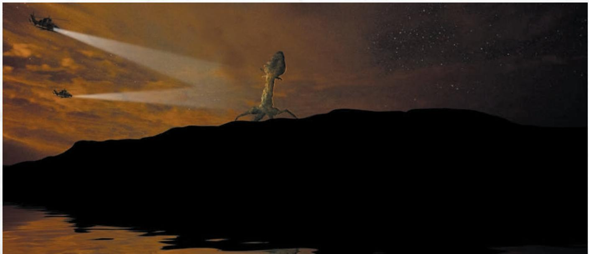{.art-body-right}

The Desolation of Isola di Malamente. The Italian military will absolutely obliterate the island in a series of aerial bombing runs. Once again, the timeline of this can be adjusted for cinematic effect, but if the Investigators have reached any kind of safety, whether at the southern edge of the small island, Overlook Point at the northern end of the large island, or if they used the overturned rowboat in Beggar's Cove, they will witness the destruction.

When the first bombs hit, the fireballs illuminate the entire island. Silhouetted against the flames is the writhing form of Hastalÿk, shrieking to the sky as it burns furiously. The sound of heavy cannon fire from the jets tears massive chunks from the thing as it sends out pseudopods in a vain attempt to swat the jets from the sky ([Handout #39](#viral-handout-39)).

If the Investigators are far enough away, they see the explosions before feeling the shockwave and the accompanying heat blast that makes the sultry night feel almost cool by comparison. The bombardment continues for several minutes as every remnant of Hastalÿk, as well as every structure on Isola di Malamente is reduced to rubble and ash. In less than ten minutes, the island has been scoured clean, leaving only sporadic fires and pillars of oily black smoke.

If Enoch is in the boat, he will recognize the fulfillment of his earlier vision (if the player doesn't figure it out first).

## Epilogue

If the Keeper wants to have some sort of wrap-up, they can have the Investigators picked up by the Italian DSS and questioned, and essentially threatened into silence about what actually happened (see [Expanded Ending](#viral-epilogue-expanded-ending) on p.56). The Investigators shouldn't underestimate the power of the DSS to discredit them and/or make their lives difficult if they choose to not keep their mouths shut.

If one of the survivors calls Maya, she's more than a little shaken after receiving a visit from an MI6 operative who pretty much gave her the same kind of interrogation and warning to keep quiet. When she's about to hang up the phone Maya makes a disgusted sound and says, "Where the hell did all these bloody flies come from?" Then the phone goes dead.

### Rewards

If the Investigators manage to survive, they immediately begin to lose their corruption. They lose 1 level of Taint per day until it's gone, though they will always retain a shadow of it on their soul.

Assuming that Hastalÿk is destroyed, they gain 1D10 Sanity points from the realization that the world has been saved... for now. They gain an additional 1D3 for every Krew member (other than themselves) that managed to escape the island. If they rescue anyone (such as Emily Lavigne) from the island, they gain 1D4 Sanity. Finally, if the Keeper goes with the creepy epilogue where Maya mentions the flies, they lose 1D6 Sanity.

Additional rewards could include a call from The Discovery Channel about hosting a new ghost hunting/cryptid show, a call from a major media outlet offering them a great deal of money for ‘the true story’, or a visit from a shadowy government agency that recruits people who have experienced these sorts of horrors to work for them. Whether this last is a reward or not, only time will tell.

### Cinematic Ending

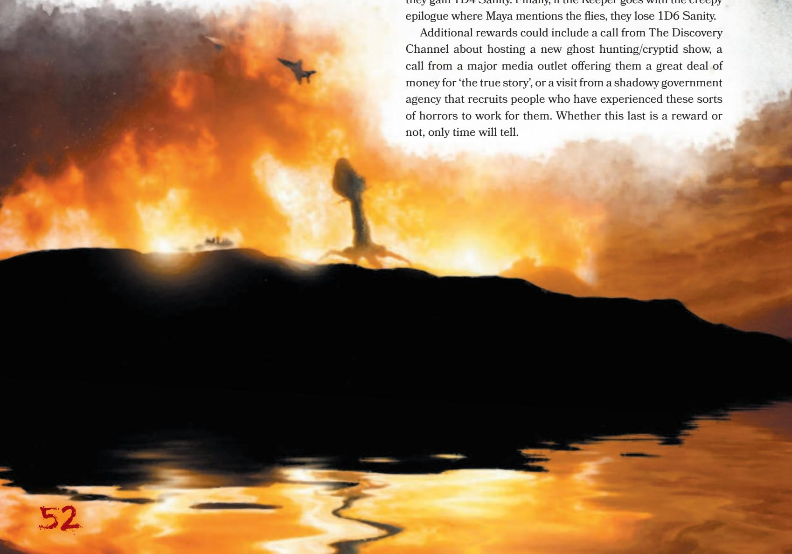{.art-body-right}

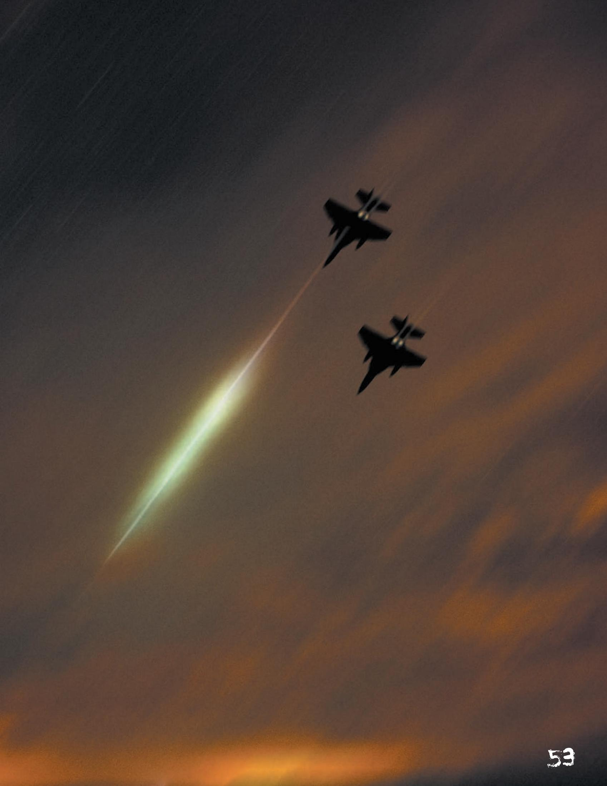{.art-body-right}

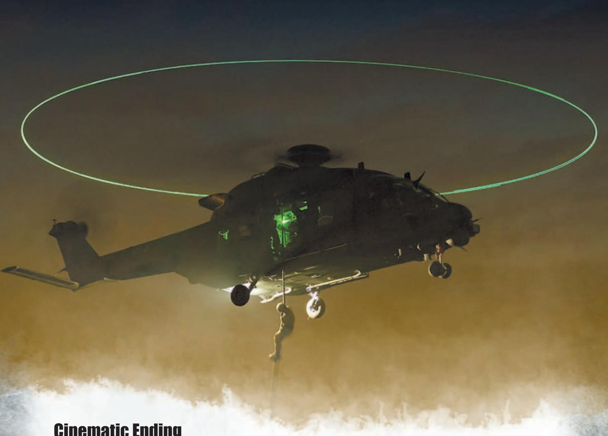{.art-body-right}

This option is provided should the Keeper want to have a more dramatic climax to the scenario. This naturally leads into the [Expanded Ending](#viral-epilogue-expanded-ending) (see p.56), which can in turn lead to an extended campaign. Once the investigators are on the surface of the island, fleeing from Hastalÿk, read the following:

As you flee the titanic form rising from the corrupted ground, you hear a deep, rhythmic thud-thud-thud overhead. Spotlights pan across the island, mercilessly illuminating the towering abomination behind you.

Four helicopters move in to form a circle, focusing their lights upon the thing as it reaches out with whip-like pseudopods, swiping at the aircraft. One of the choppers suddenly swerves into another, sending both careening out of control.

One spirals off the coast, slamming into the muddy ground recently exposed by the retreating water. There is a brilliant flash, followed a moment later by a deafening boom that shakes the ground beneath you.

> Keeper's Notes
> 
> The investigators can make an Idea roll to realize the helicopter crashed into one or more exposed sea mines.

You barely have time to react when the other helicopter hits the ground and tumbles toward you, sending shattered rotor fragments into the surrounding foliage nearby like giant throwing knives, churning up the ground and sending sparks into the night air.

The burning wreck slides to a stop only a few yards from you, raking across a previously hidden symbol carved into a large circular stone and causing it to break with a thunderous crack. You see what looks like silver vapor blowing away from the shattered sigil, and for a moment all is silent except for the two remaining helicopters circling overhead.

> Keeper's Notes
> 
> If they didn't notice the previous symbol at the Weeping Bridge, then the Keeper can simply improvise using the [description](#viral-isola-location-03-the-weeping-bridge) on page 35.

The abomination has stopped, its head swaying slightly as if sensing something. The helicopter door slams open with a startling bang and swarms of flies erupt from the dark interior. A blood-soaked Italian soldier pulls himself out onto the ground. The badly wounded man begins shouting desperately at you in broken English.

"It must not reach water! If do... all dies! Everything... everything dies!"

The soldier holds out a kind of bandoleer hung with hand grenades and shakes them at you.

"Pull pin and throw! Ten... secondi... eh, seconds and BOOM! Must not reach water! Please!"

You are deafened by the sudden trill from the abomination as it begins stampeding directly towards you!

The soldier looks at The Devourer with horror, followed quickly by resignation. He takes out his pistol and end his own life, not wanting to live in a world corrupted by Hastalÿk. Almost immediately flies erupt from his radio headset and his corpse lurches to his feet and starts shambling toward The Devourer.

Ideally, the investigators want to stop the end of the world, and use the grenades to slow the abomination now charging towards them.

There are twelve incendiary grenades in all, and these have been specially designed by the DSS to produce a massive fireball that burns at close to $1,500^{\circ}$ F for several seconds.

> **DSS Incendiary Grenades (12)**
> Skill: Throw, Damage:\* 4D10/3 yards, Range: STR/5 yards, Uses per Round: ½, Malfunction: 99
> \*Delivers 4D10 damage to those within 3 yards, 2D10 to those within 6 yards and 1D10 to those within 9 yards. Continues to inflict 2D10 fire damage for 3 rounds.

The Devourer is repelled by fire, so even if the investigators manage to land a grenade within 10 yards, it will cause the thing to pause for a round.

> Keeper's Notes
> 
> The Devourer realizes immediately that one of the Elder Signs that holds it on the island has been broken by the exploding sea mines. There are a number of these seals placed around the island by the DSS, and so the Keeper should have the damaged one near the investigators.

The two remaining helicopters are managing to slow [The Devourer](#viral-appendix-new-mythos-horrors-hastalyk) a bit, which should give the investigators a chance to get close enough to lob grenades at it. Note that if they get within 10 yards, they risk being attacked by a pseudopod and possibly being absorbed into [The Devourer](#viral-appendix-new-mythos-horrors-hastalyk) (see p.65).

If unhindered, The Devourer will definitely reach the shore before the island is firebombed. The Keeper should decide how many rounds it will take The Devourer to reach the water, and whatever that number is, the jets arrive 10 rounds after, unless the investigators intervene to delay The Devourer.

While the grenades do damage Hastalÿk, they are not enough to stop it entirely. Each has the chance of delaying its progress by one to four rounds depending on how successful they are at throwing. Keepers are recommended to give any investigator with a Dexterity of 60 or higher a Bonus Die on their throw. Alternately, the Keeper may opt to simply have them make a Dexterity check since they are throwing at such a big target with a weapon that affects a large area.

| Throw Result | Range | Result |
| --- | --- | --- |
| Fumble | None | See Below |
| Failure | 11+ Yards | No Delay |
| Normal Success | 10 Yards | Delayed 1 Round |
| Hard Success | 6 Yards | Delayed 2 Rounds |
| Extreme Success | 3 Yards | Delayed 3 Rounds |
| Critical Success | Direct Hit | Delayed 4 Rounds |

If the throw is fumbled, the grenade is dropped. The Keeper can give the investigator the opportunity to find and throw the grenade far enough to avoid damage or they can simply run. The former will require a Hard Dexterity check, or suffer 4D10 points of damage. The latter requires a Strength check, with the result determining the damage (if any). Failure means suffering 4D10 damage, while a Regular success means 2d10 damage. A Hard success reduces the damage to 1D10, and an Extreme success means avoiding all damage.

Note that these attacks are cumulative, so that if two investigators manage to land grenades within 6 yards, The Devourer would be delayed for a total of 4 rounds.

Of course the investigators may devise other ways to distract or delay the monster, so the Keeper will have to decide if and how effective their tactics will be. That being said, it is always a good idea to reward clever thinking, so if an investigator comes up with a particularly good idea, it is going to be a lot more fun to give it a decent chance of success.

Escaping the Island. If the investigators are on the island when the jets arrive, they have the opportunity to make a Luck roll to survive the attack. Success means that they manage to find a hiding place that allows them to avoid the fire, heat, and concussive blast. Failure means that the investigator suffers 4D10 points of damage.

If they manage to get off the island somehow, they suffer no damage and end up watching the firestorm engulfing the island from the water. The survivors, illuminated by the blaze, can feel the heat of the fires and smell the strong odor of burning petroleum and corrupted flesh.

### Expanded Ending

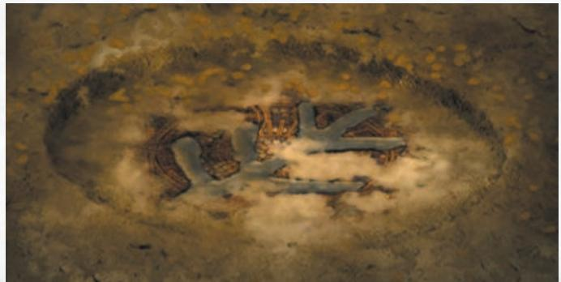{.art-body-right}

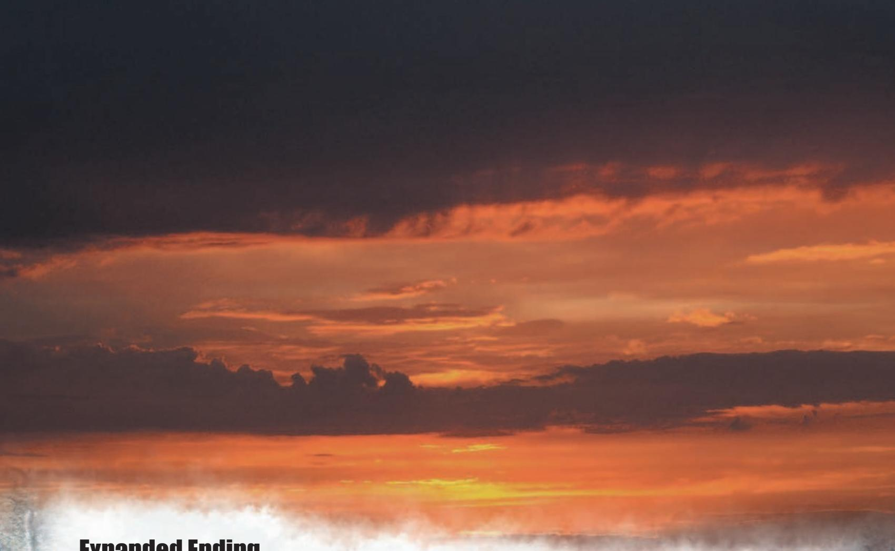{.art-body-right}

If the Investigators look back they see the halo of flies detach itself from Hastalÿk and form into a swarm that envelops the repeater. When the essence of Hastalÿk enters the repeater, it rapidly proceeds to infect the internet in order to hide its presence. Moving at the speed of thought the Taint scours the web looking for a way to remain hidden. It finds a solution by hacking a secret DSS database that contains data on experimental memory-wiping. Hastalÿk refines the process so that it actually works and transmits the signal to everybody watching and listening to the Spektral Krew's broadcast, simultaneously deleting all available records of the stream from the internet. This includes deleting the Spektral Krew's channel and removing all mentions of them online.

Those watching the stream will see a series of flashing images and hear bursts of static. This will cause them to go into a trance-like state as the virus removes any trace of the stream and the Spektral Krew from their device. It finishes by shutting it down and compelling the viewer to go about their day. The bursts of static have the same effect as the visuals in order to affect those merely listening to it.

Unfortunately, the essence of Hastalÿk sets off an alarm which alerts the DSS to the location of the hack. A nearby Italian nuclear submarine is instructed to immediately retrieve, capture, and detain anybody they find on or near the island and bring them to Research Station Omega, a secret DSS base in the Mediterranean.

#### New Epilogue

Should there be any survivors in the boat at the end, and the Keeper wants to continue the scenario, read them the following:

As the water retreats from Isola di Malamente, the small rowboat you are on is swept away from the island, and out into the pitch black of the Mediterranean. The darkness is illuminated only by the smoldering ruin that is Isola di Malamente which has small fires across it, spewing thick black smoke into the night air. You hear the sound of fighter jets streaking away, and the thud of helicopters fading into the distance.

No amount of paddling against the retreating waves can stop the boat being carried further and further away from land. At this point, let the players discuss what happened and possibly mourn the death of their companions. At the appropriate moment the following occurs:

Without warning, the water in front of the rowboat churns and explodes upwards as the huge steel gray hull of a submarine emerges from the depths, splashing you with sea water. Its conning tower is marked with Italian naval insignias. There is a metallic clank as the hatch opens, followed by the sound of voices shouting orders in Italian.

A dozen or more silhouettes climb out onto the conning tower and the lower deck of the sub. You hear a crack, and the rowboat is suddenly illuminated with blinding white spotlights from the sail of the submarine. Green laser dots from several assault rifles dance across your bodies, and one of the sailors throws a long rope toward the boat, gesturing for it to be tied to the cleat.

The investigators are warned three times (in heavily accented English) to tie off the rope and remain in the boat or they will be shot. If by the third time they have not done so, they are gunned down mercilessly, though this is not the end for them. Due to the taint of Hastalÿk filling the air, they are unable to die. Everything simply fades to black for now.

If they comply the boat is be pulled toward the ladder on the side of the submarine, and they are forced at gunpoint to climb aboard. At that point, they are locked in a very small room and the vessel submerges, leaving the rowboat as the only evidence that anybody was there.

If anybody is stupid enough to attack armed Italian soldiers, they find themselves heavily out-gunned, outnumbered, and outmatched. The soldiers will attempt to beat them into unconsciousness (see Knock-Out Blows on p.125 in the Keeper Rulebook), though they are not above shooting the prisoners if they become too troublesome.

If anybody takes their chances and tries to swim to shore, they must make three Extreme Swim checks as well as three Constitution checks. If they make it, well... good for them. They have miraculously escaped capture by the Italian Navy, but they are now removed from the scenario, not to mention that they are now stuck in a backwater Sicilian village with just the cash they have on hand, no phone, and no dry clothes.

If only some of the characters die (or are already dead), no need to worry. Their story will continue in the upcoming sequel: Quarantine.

## Appendix

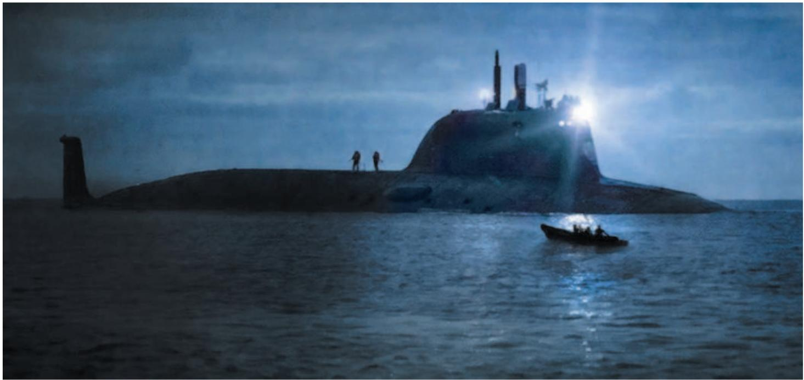{.art-body-right}

### Encounters

These encounters are guidelines for the Keeper, and don't represent all possible phenomena. They can be rolled randomly (D12) or selected based on the Investigator or situation. The Keeper should have milder encounters earlier during the investigation, and slowly escalate things as the night progresses. Each encounter has a suggestion for Sanity loss, but even these should be adjusted based on the intensity of the event and the specific situation. Early encounters aren't likely to trigger a Sanity check, while later encounters will almost certainly have some sort of impact on the Investigators' Sanity.

At first, everything will seem like the typical haunting investigation that the Investigators have experienced a hundred times before. By turning up the creepiness slowly, they won't necessarily notice when they make the transition to something that is genuinely supernatural. When describing any of these encounters, the Keeper should try to leave room for some sort of rational explanation. For example, if they see a light through the trees, they may go to investigate and notice that some of the lights from the mainland are visible. This gives them a plausible explanation that should make them comfortable enough to keep investigating.

Remember that the goal is to lure the Investigators into the crypt at midnight for the witch board session. If an encounter really seems to rattle an Investigator, maybe one of the viewers offers \$500 for them to continue. It's surprising what a little hard cash can do to justify a risk.

#### Outdoor Encounters

| Roll | Phenomenon Encountered |
| --- | --- |
| 1 | Swarm of Flies – There are flies all over the island, but these encounters are different. The Investigators are surrounded by a cloud of tiny black flies that get in the eyes, nose, and mouth. If it's later in the investigation, the flies could pour out when someone opens a satchel or pocket. [Sanity Loss (0/1)] |
| 2 | Cold Spot – It may just feel a little cooler early in the investigation, but as things become more 'real' they could see their breath and have frost form on smooth surfaces like metal and glass. [Sanity Loss (0/1)] |
| 3 | Mutated Animal – This creature could include a rat, bat, dog, cat, or something unidentifiable (Keeper's discretion). Depending on where they are in the investigation, the creature could just be an albino, or it could be hairless with extra appendages. [Sanity Loss (0/1D3)] |
| 4 | Formless Vapor – Some sort of mist that appears to move with purpose. It may or may not look vaguely humanoid. [Sanity Loss (0/1)] |
| 5 | Orbs – More often than not, these phenomena are caught only on camera, but later in the evening, they may be seen with the naked eye. If things are getting really weird, the orbs might even swarm the Investigators. [Sanity Loss (0/1)] |
| 6 | Voices – Their audio devices begin picking up what sound like voices in the distance. They may be able to get a general direction, but when they reach the location, they find nothing. Later on the voices may become more distinct and... personal. They may hear voices of people they know or eerie chanting in the darkness. [Sanity Loss (0/1)] |
| 7 | Lights in the Distance – Through the trees or in an upstairs window there is a light, but it can't be one of the Krew since they're all accounted for. Later in the investigation, they might see a figure holding an old fashioned oil lamp or lantern. [Sanity Loss (0/1)] |
| 8 | Phantom Odor – The Investigator(s) might smell something rotten, burning, or simply an odor that is incongruent with the situation. For example, they might smell bread baking or the strong scent of roses. [There's no Sanity loss for this one since people are prone to these sort of phantom odors that are often associated with strong memories. If it's something deeply personal, there could be mild Sanity loss (0/1)] |
| 9 | Physical Contact – This could be as simple as an Investigator feeling something brush their neck, or they could suffer a physical attack where they get a sensation of pain and find a corresponding red mark on their body. [Sanity Loss (0/1)] |
| 10 | Dead Birds – A room with the floor littered with the corpses of birds of all regional types. They all have a black ooze coming out of their eyes and mouth similar to that found on the half submerged rowboat and in the rickety dock. [Sanity Loss (0/1)] |
| 11 | Sudden Nausea – The Investigator is gripped by nausea and begins to wretch uncontrollably for 1D10 rounds. If the result is more than 5 rounds, they vomit something terrible. [Sanity Loss (0/1)] |
| 12 | The Plague Monk – In the shadows a figure stands watching them. It appears to be a monk dressed in a dark brown cassock, but a moment later there is nothing. A Spot Hidden check allows them to see that the cassock is stained with blood, and on his face is what looks like a cross between a medieval plague mask and a WWI gas mask. The shiny glass lenses reflect the lights of the cameras. [Sanity Loss (0/1) if they fail their Spot Hidden, and (1/1D4) if they succeed.] |

#### Hospital Encounters

| Roll | Phenomenon Encountered |
| --- | --- |
| 1 | Flies! – An entire room is choked with bloated black flies and the floor is crawling with maggots. |
| 2 | Sacrifice – A dead animal hangs from a pipe or light fixture. It has been gutted and hung using its own entrails. The sticky, unidentifiable viscera beneath it suggests that it was done within the last day or so. |
| 3 | Phantom Patient – A figure can be seen in a doorway dressed in a filthy hospital gown. When the Investigators approach, it turns away into the darkness. Examining the area finds no sign of it. Optionally, the Keeper could have them find a print in the dust of a bare human foot with a Hard Spot Hidden check |
| 4 | Phantom Sounds – The Investigators hear footsteps, bangs, or muffled voices. If they play back any voice sounds, the Keeper should make it something creepy, perhaps even mentioning one of the Investigators (or a loved one) by name. |
| 5 | Collapse! – A section of floor or ceiling collapses, possibly as a result of the Investigators moving around the building. This could happen right after they pass, causing a jump scare, or it could potentially cause an injury. If the ceiling collapses, the Investigators should make a successful Luck roll or suffer 1D3 points of damage from falling debris. If the floor gives way beneath them, they should make a DEX check. Success means that they only fall prone, but failure means they plummet through the floor, suffering 2D4 points of damage. A major wound would almost certainly mean a broken leg. |
| 6 | Sudden Power Drain – All electronic devices suddenly lose power and reboot or power down. In the darkness, those who make a Spot Hidden roll see figures moving around in the darkness – walking near them, but not towards them. They all seem to wear long white hospital gowns. When the power is returned, nobody is to be found. |
| 7 | Blood Patch – One of the Krew (determined randomly) steps in a sticky pool of blood. It looks fairly fresh and there are blood drops leading away. If followed, they lead to a blank exterior wall. This triggers a Sanity check (0/1). |
| 8 | Cockroaches – As their flashlight pans down a corridor or room, a swarm of large brown cockroaches scatters in all directions and disappears into cracks in the walls, under doors etc. Though unnerving, it is not Sanity draining. If this is rolled again, the cockroaches won't scatter and instead turn to face the Investigators, but do nothing more, even if approached. If someone tries to scatter them, they flee down the corridor as a harmless, but disgusting swarm. If any of the Krew are in the corridor, the roaches get tangled in hair, equipment, down the back of coats, and so on. Everyone present gains 1 level of Taint. |
| 9 | Syringes – The Investigators find an old syringe filled with a black fluid. If they are foolish enough to inject it into themselves, they jump to maximum Taint (10 levels) and are doomed to join with Hastalÿk as a reward for their flagrant stupidity. Additionally, they hear whispers (similar to what Enoch experiences, but not the same as The Sight) and lose 1D3 Sanity. If Enoch injects it, the second effect doesn't happen as he already suffers similar effects from possessing The Sight. |
| 10 | EVP – Their passive noise detector begins flashing during a quiet moment, indicating it has picked up a sound when no noise was being made. If they listen back to it live, they either hear distant screams, an almost demonic howl RIGHT into the microphone, a male voice saying something unidentifiable, a door slamming, or whatever seems most creepy and appropriate for the mood. This triggers a Sanity check (0/1). |
| 11 | Black Smoke – One of the Krew's night vision cameras picks up a patch of wispy black smoke moving from the ceiling of one of the rooms and disappearing into the room below. There is no smell or trace left of it. It can be viewed again if they play it back. |
| 12 | The Shadow Person – Everyone paying attention must make a Spot Hidden Roll. If they succeed, they see a man-sized shadow person dart quickly across a doorway. If investigated, they find only a solid wall, triggering a Sanity check (0/1). |

#### Catacomb Encounters

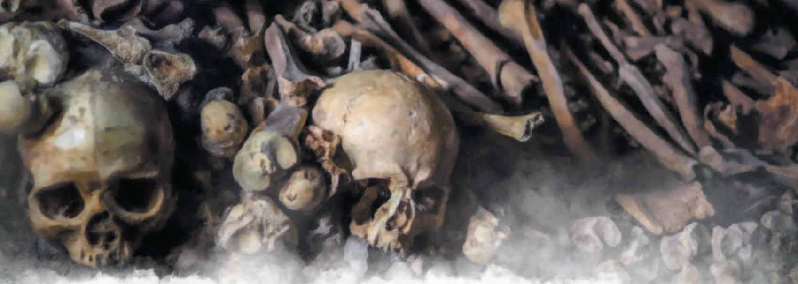{.art-body-right}

| Roll | Phenomenon Encountered |
| --- | --- |
| 1 | Reliquae Attack – The Investigators hear something stir in the darkness and watch in horror as a corpse begins to crawl from one of the niches. Its desiccated flesh cracks and crunches as it moves, and something inside sloshes around like a bag of wet oatmeal. The abomination reaches toward the Investigators speaking to them in Italian, Latin, Spanish, or Greek (Keeper's choice). If anyone speaks the language, they know that the cursed soul is begging to be allowed to die. This triggers a Sanity check (1D3/1D8). |
| 2 | Rat Swarm – Several holes in the wall erupt with a swarm of bloated hairless rats with blind, milky-white eyes. They try to claw their way up the Investigators' legs, biting and squeaking as they do so. This triggers a Sanity check (1/1D6). |
| 3 | Maggot Swarm – One of the corpses on an upper niche creaks and bursts, spilling a viscous, maggot-filled fluid onto the Investigators. The maggots get in their hair, faces, and clothes. This triggers a Sanity check (1/1D6). |
| 4 | Reliquae Swarm – Corpses begin moving all around the Investigators. They climb out of their niches and shamble towards them, all begging in different languages to be put out of their misery. This triggers a Sanity check (1D4/2D4). |
| 5 | Disturbing Manifestation – A loved one appears up ahead in the darkness looking absolutely terrified. They run before the investigator can say anything. |
| 6 | Vile Rain – A drop hits an Investigator's cheek. Looking up, they see the low ceiling is perforated with thousands of tiny holes, like those made by termites in wood. Suddenly the ceiling of the catacomb begins raining worm-infested blood that reeks of copper and putrescence. The floor becomes slick and everyone must make a CON check to avoid violent nausea incapacitating them for 1D6 rounds. This triggers a Sanity roll (1/1D6). |

### New Rules

#### The Sight

"I See Dead People. When? All The Time... Unless I'm Drunk."

Those who don't know any better call this a gift, but to the unfortunate souls burdened with it, it's more of a curse. To be sensitive in this manner means being regularly assailed by phenomena that are not normally perceivable by humans. Some refer to it as The Sight, but this isn't exactly true since it acts through all of the senses, and often more than one at a time.

The Sighted individual may experience visions of a past or present event, sense ghosts and other invisible entities, identify the rough whereabouts of a missing object or person, detect whether a tragic event occurred in a certain place, and so on. They may see amorphous blobs of energy, vaguely humanoid-shaped mist, or even full body apparitions that seem as real as anyone else. They may hear voices speaking directly to them, the sound of footsteps running down a corridor, or hear a distant scream. They may notice strange odors that seem out of place, feel something tug on their clothes, or they might just get a bad feeling about a place.

Full apparitions are often simply echoes of the dead acting out the same routine over and over, like a scratch on the record of reality. Occasionally these manifestations are aware of their own existence, and may even interact with the Sighted Investigator. These more vivid encounters are rare and often traumatic to the person with The Sight, with the dead pleading for help or screaming for vengeance for their untimely death.

All manifestations of The Sight should be handled through the narrative by the Keeper in as cinematic a fashion as possible. The Investigator may see an additional person standing in the background covered in blood or they could appear as a reflection in the mirror. These manifestations should be dramatic and startling. These jump scares can be very effective if handled properly, but the Keeper should be conservative about Sanity loss, reserving Sanity checks for only the most disturbing visions. The key is to balance the benefits and the drawbacks to avoid overly penalizing the Investigator with The Sight.

Using the Sight. The Sight is a double-edged sword, potentially providing the Investigator with valuable information while simultaneously exposing them to visions and horrors that attack their Sanity. Someone burdened with The Sight can receive visions without warning, particularly if a location or object has experienced a particularly horrific event, such as a brutal murder. The Keeper should use this sparingly to avoid unfairly punishing the Investigator with The Sight. They may get an initial flash of something that causes them to react, but at that point the Keeper should allow the Investigator the opportunity to at least attempt to close their mind if they wish. There are essentially two ways we advise using The Sight: Simple and Mechanical.

Simple – The Keeper will let the player know when their Investigator feels any ‘supernatural vibrations’. It is up to the player to decide if their Investigator opens themselves up to them. If someone with The Sight suffers SAN loss when opening themselves up, MP can be spent instead. When they run out, SAN can be spent as normal or they have the option of spending POW to mitigate this loss, though that would need to be under extreme circumstances.

Mechanical – Someone who has had The Sight for some time may have developed the means to control what they see and possibly mitigate the negative effects through the use of Magic Points (MP). Should the Keeper want to use it as a full-blown mechanic, it has a number of different uses. This involves making a successful POW check, with the difficulty based on the intensity of the vision (Keeper's discretion).

Below are a number of examples, though the player and Keeper are free to improvise others depending on the situation and personal taste.

> Open the Sight
> 
> This means opening the mind to whatever impressions might be in the area. This is the most dangerous option because it leaves the Investigator defenseless against any dark entities or traumatic visions. This provides the most information, but also risks the most Sanity loss. [Cost: 1 MP]

> Close the Sight
> 
> This means shutting out all external psychic forces, often in response to an attack or a particularly traumatic vision. The base cost is 2 MP, though this may increase with a more intense vision or a powerful entity. If another entity wishes to push through the Investigator's defenses, they can make an opposed POW check to do so at the Keeper's discretion. [Cost: Special]

> Sensing a Presence
> 
> The Sighted Investigator tries to sense if there is some sort of supernatural entity nearby. If the entity is self-aware and willing, the Sighted Investigator can attempt to communicate with them. Of course certain entities could trigger a Sanity check (Keeper's discretion). This is a more passive act, and so doesn't open the Investigator to a great deal of danger, though the information it provides is correspondingly vague. [Cost: 3 MP]

> Echoes of the Past
> 
> By touching an object or location, the Sighted Investigator can possibly get impressions or visions about the past. For example, an object might provide insight into who owned it, or a murder scene might provide a clue as to what happened, though traumatic events are likely to trigger a Sanity check, with the loss depending on the intensity of the event (Keeper's discretion). While this ability is usually limited to feelings the Sighted Investigator can sometimes see a vision of the past. More often than not it's through the eyes of the one experiencing the greatest emotion. In the case of a murder, they could just as easily see things from the point-of-view of the killer, feeling their rage or ecstasy, which could leave the Investigator shaken from the experience. [Cost: 4 MP]

> Precognition
> 
> By opening The Sight just a little, the Investigator can gain knowledge about the immediate future as it relates to them. For example, if someone is waiting to jump them in a dark alley, they might get a sense of dread about going there. [Cost: 5 MP]

> Calm the Mind
> 
> If the Investigator experiences a vision or entity that causes the loss of Sanity, they can choose to make a POW check to reduce the loss by half (round down). Sanity loss of four or less requires a Regular success, while Sanity loss of five or more requires a Hard success. If halving the Sanity loss means that they lose less than five, then they do not experience a bout of madness, unless of course they have already reached their threshold. The MP cost equals the number of Sanity points reduced. [Cost: Special]

Drinking and hard drugs can block out The Sight to a degree, but this form of self-medication comes with its own risks. When drunk or high on drugs, the Sighted individual gets a Bonus Die on their POW check to close their mind to unwanted visions. Of course they also suffer from the penalties associated with those substances, which could include Penalty Dice, reduced awareness, addiction, or even serious health problems from continued use.

> Keeper's Notes
> 
> It's important to note that The Sight only shows what might be, and not what will be. The visions represent the most probable future based on the current situation, but if an effort is made to change things, the future can change.

#### The Taint

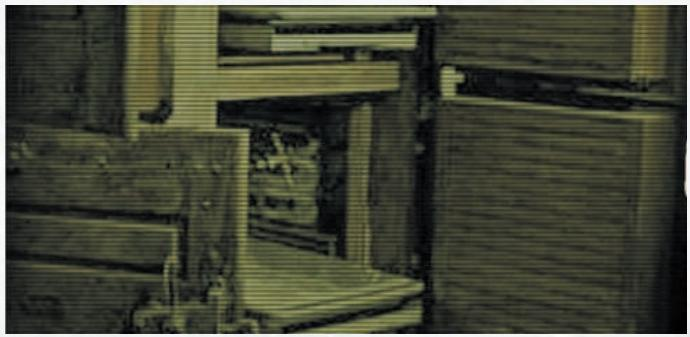{.art-body-right}

Hastalÿk's presence has a mutagenic effect on all living things, and this corruption covers the entire southern half of the main island. This effect is unnatural, and is therefore undetectable by any means known to human science. The corruption is subtle at first, but the longer a life form remains within the sphere of Hastalÿk's influence, the more severe the mutations.

As the mutations progress, the victim is drawn to Hastalÿk and will eventually become compelled to join with him. Any creature gripped by this compulsion will do whatever they must to reach him to become absorbed into his repulsive mass.

Taint Level. At certain points in the scenario, the Investigators gain levels of Taint. This is intended to represent Hastaÿk's corruption of the Investigators so that they can be absorbed into him. This is marked as a tracker on the pre-gens called Exposure - it is named in this way to limit meta-gaming. If anyone reaches 10 levels of Taint, the Keeper should tell the player to cross the number out and just behave normally. They'll understand when they reach the finale.

Gaining Taint. As soon as they set foot on the main island, they immediately gain 1 level of Taint. After that, there are a number of ways to gain another level of Taint, including: experiencing a Bout of Madness, eating a lemon from the grove, seeing The Plague Monk, using the witch board, or reading about Hastalÿk (including the book fragment). Of course the Keeper can come up with other options, or increase the amount of the Taint gained.

Hastalÿk Rises. Anyone present when Hastalÿk rises must make a POW check to resist a desire to join with it. Failure means that they walk as if in a trance to hurl themselves into the pit or embrace Hastalÿk. This check is modified by the amount of Taint the victim has acquired ([see Taint Levels](#viral-appendix-new-rules-the-taint-levels) below).

##### TAINT LEVELS

| Level | Modifiers | Effect |
| --- | --- | --- |
| 1 | 2 Bonus Dice | The victim becomes aware that there’s something ‘wrong’ about the island, but they can’t quite put their finger on it. |
| 2 | 2 Bonus Dice | The victim begins to sweat more, but this can be attributed to the heat and humidity. Every half hour or so, the Keeper can have them make a Constitution roll. Failure means that they feel slightly dizzy from dehydration. |
| 3 | 1 Bonus Die | The victim begins suffering chills. Since they’re ghost hunting, the Keeper can describe it in terms of finding a ‘cold spot’. |
| 4 | 1 Bonus Die | As their Taint level grows, organic materials around them are now being affected. Milk begins to curdle when they pick it up. Fruits and vegetables begin rotting as they hold them, becoming inedible in an hour or so. Processed foods, like the meat in their sandwiches, starts to smell off, turning gray and a little slimy – they can eat or drink these decaying and rotting foods with no ill effect and they taste fine. |
| 5 | None | The victim experiences bouts of nausea. Again, the Keeper can frame these bouts in terms of malevolent spirits being nearby. |
| 6 | None | The victim develops a rash on their arms and legs that begins to itch. It’s probably just poison ivy, right? |
| 7 | 1 Penalty Die | The rash spreads and starts to turn crusty and rough. On the bright side, it no longer itches. |
| 8 | 1 Penalty Die | The victim is clearly becoming sick. Their nails develop fungal growths. Their hair starts falling out in clumps. Wounds become infected with painful abscesses. Animals begin to sense their taint, causing cats to hiss and dogs to growl at the victim. They develop an odor of decay about them that they themselves cannot smell. |
| 9 | 2 Penalty Dice | The victim’s skin erupts in massive cysts that leak puss. They now have a Penalty Die to all actions. |
| 10 | N/A | The victim suddenly begins to feel better. The nausea and sweating is gone, and the cysts are beginning to close. Unfortunately, they are now driven by a compulsion to join with Hastalÿk at all costs. No POW check will allow them to resist. This manifests when the victim sees Hastalÿk’s avatar rise. Optionally, the Keeper may want to allow the Investigator a Hard POW check each round to resist the urge. In addition to this, they are now prevented from leaving the main island by the Elder Sign at the bridge. |

#### Insanity and Bouts of Madness

{.art-body-right}

Due to the corrupt nature of this location, the Sanity rules have been slightly modified to reflect this. When an Investigator experiences a Bout of Madness, they automatically gain 1 level of Taint and the Keeper should have the player roll a D10 on the following chart. Note that only the Investigator suffering the Bout of Madness sees any of this, and when the episode ends (after 1D10 rounds), there is no sign of whatever they experienced.

| D10 Roll | Result |
| --- | --- |
| 1 | Body Horror – The Investigator experiences something terrible happening to their body. This could include their skin rotting and falling off, their nails and hair falling out, or perhaps parasites writhing beneath their skin. If the Keeper can make it more personal to the Investigator, so much the better. |
| 2 | Bugs - Beetles begin pouring from the Investigators sleeves, pockets, and other parts of their clothing. They swarm all over their skin, causing them to drop whatever they're holding as they try to get the bugs off. |
| 3 | Flies – A swarm of flies erupts from an electronic device that the Investigator is holding. The small black flies swarm around their head, getting into their eyes, nose, and mouth. |
| 4 | The Plague Monk - Somewhere within the Investigators field of vision, they see The Plague Monk looking at them. If the Bout of Madness was caused by seeing The Plague Monk, then he allows them to remove his mask, revealing the horror beneath. This causes them to gain 2 more levels of Taint. |
| 5 | Blood – The Investigators companions all begin bleeding from their eyes, nose, mouth, and ears. After a moment, the blood is pouring from their pores, though they don't seem to notice. If no companions are around, something else will bleed, like the walls, the ceiling, or it might simply begin to rain blood. |
| 6 | Vision – Whether the Investigator has The Sight or not, they suddenly experience a vision associated with Hastalÿk or his cult. The Keeper should improvise something based on the situation. For example, they might see The Plague Monk being hanged over the Charnel Pit, or they might get flashes of the raid back in 1954. |
| 7 | Paranoia - The Investigator sees evidence that their companions are behind all of the strange things that are happening. They might think they see one of the others snickering behind their back, or they could see someone guiltily stuffing their hand in their pocket. Ideally, the Keeper should have what they see relates to what triggered the Bout of Madness. (An obvious candidate for this is Peter, who has been surreptitiously placing items around the island.) |
| 8 | Asphyxiation – The Investigator is suddenly unable to breath, feeling as if their lungs have seized up, refusing to move. If this bout lasts for more than 6 rounds, they fall unconscious and begin breathing normally. They awake 1D4 rounds later. |
| 9 | Violence – The Investigator flies into a rage and attempts to destroy the source of their Bout of Madness. They could even throw some of their delicate and expensive equipment at it. The Keeper should adjust this to fit the scene. |
| 10 | The Charnel Pit – They see the Charnel Pit as if standing above looking in, though they have no idea where it's located. As they watch, the corrupt slurry begins to swirl around and the Investigator hears a voice in his head say, “Join with me!" The language is unknown to the Investigator, but they somehow know what it means. They immediately gain 3 additional levels of Taint. |

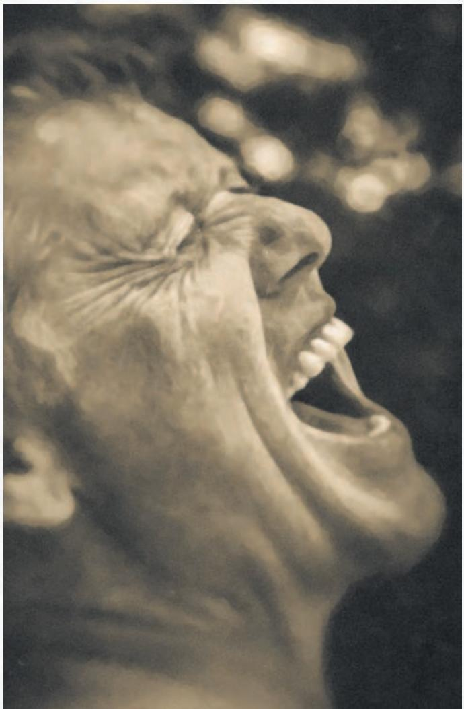{.art-body-right}

> Appropriate Phobias
> 
> The following phobias are appropriate if an Investigator suffers a Bout of Madness and acquires a phobia:
> 
> Entomophobia – Fear of Insects
> 
> Fructophobia – Fear of Fruit
> 
> Musophobia – Fear of Rats and Mice
> 
> Mysophobia – Fear of Germs, Dirt, or Contamination
> 
> Nosocomephobia – Fear of Hospitals
> 
> Nyctophobia – Fear of Darkness

#### Paranormal Phenomena

These are some possible examples of the kind of paranormal phenomena that the Spektral Krew could encounter while exploring the island and hospital. This isn't intended to be an exhaustive list, and the Keeper should feel free to roll on it as is, or use it for inspiration for their own phenomena. The idea is to provide paranormal experiences to keep them interested, while making them ambiguous enough to be dismissed with more naturalistic explanations by those who prefer not to believe in such things.

| D10 Roll | Result |
| --- | --- |
| 1 | Echoes of the Past – The Krew hears what sounds like gunshots and yelling through their earbuds. They sound distant, and although they can make out that the language being spoken is Italian, they are unable to identify specific words. The sounds don’t seem to be coming from a specific direction, and if they pull the earbuds out, the sounds suddenly stop. |
| 2 | Shadows – As the Krew is exploring, one of the cameras suddenly picks up a shadow behind one of the Krew members. The shadow puts a hand on their shoulder, and they immediately feel a sharp pain. The shadow vanishes, and when they examine the area, they find a red mark (like a burn) in the shape of a human hand print. This requires a Sanity check (0/1). |
| 3 | Cold Spot – The temperature drops significantly. Those in the area begin seeing their breath and frost forms on metal and glass surfaces. These can be stationary, lasting for 30+ minutes, or transitional, lasting for only 1D10 minutes. |
| 4 | Voices – One of the Krew hears the voice of someone significant to them calling for help. None of the other Krew members hear them. When they go to investigate they may find nothing, or perhaps an ambiguous token that is associated with that person. For example, they might smell a hint of their mother's perfume or a wrapper from a candy that their brother loved. Note that the Keeper can use this to get Investigators to go someplace interesting. |
| 5 | Orbs – The Krew see small glowing orbs with the naked eye. They appear to be gathered in a particular area, but disperse when the Investigators approach. Perhaps they find something interesting at that location, or when they review their video footage, they don’t see the orbs. |
| 6 | EVP – The EVP (Electronic Voice Phenomena) recorder picks up someone speaking in the room. It is indistinct at first, but suddenly resolves into a deep, clear voice speaking in Latin. It says: "Omnes unum sumus," which translates as "We will all be one." |
| 7 | EM Spike – One of the Krew's EM (Electro-Magnetic) meters begins slowly beeping. The tempo begins to pick up, until there is a sudden spike that causes the device to short out with a loud pop. Smoke pours from the dead reader that is now surrounded by small, buzzing flies. |
| 8 | The Stalker – In the distance, one of the cameras picks up a robed figure, like a monk. When they look with the naked eye however, they see nothing. When they look again, it's closer and walking towards them, though still nothing when they look without the camera. If they let it reach them, the area turns frigid ([see Cold Spot](#viral-appendix-encounters-outdoor-cold-spot)). Either way, they must make a Sanity check (1/1D3). |
| 9 | Footsteps – Somewhere in the darkness, the Krew hears footsteps and perhaps something being dragged. When they investigate, they find a drag mark in the dirt that looks about right for the size of a human body. If they follow the drag, it just ends after ten feet or so with no other signs. Alternatively, the Keeper could have them find the skeletal remains of a soldier who was dragged and hidden. Their dog tags indicate that they were Italian military, and that they died in 1954. Maya will obviously cut the stream if they see a body, and everyone must make a Sanity check (0/1). |
| 10 | Rats! – While exploring, the Krew is suddenly swarmed with rats. If outdoors, they erupt from a hole in the ground, and if in a building, they burst from a wall. Either way, the rats run across the feet and up the legs of the Krew. This triggers a Sanity check (0/1). Optionally, the Keeper can have the Investigators make a Luck roll or suffer 1 hit point of damage from multiple diseased rat bites. |

### New Mythos Horrors

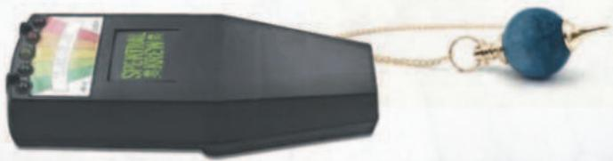{.art-body-right}

#### Hastalÿk (HAS-tah-lik)

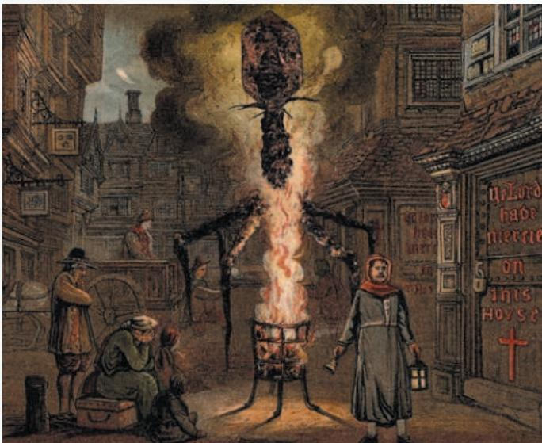{.art-body-right}

The Contagion, Emperor of Flies, the Grand Corruption, Sickness Emboldened

"Seemingly formless, its touch corrupts entire worlds. Composed of many parts, all interconnected, it ranges the void seeking out life to be changed and consumed. None may stand before it."

One of the most insidious and powerful Great Old Ones, Hastalÿk is the embodiment and amplifier of disease and infection. When great epidemics or even localized outbreaks of a disease occur, Hastalÿk may be to blame. Hastalÿk is not the disease, but instead acts as an amplifier for a native contagion. It turns an outbreak into an epidemic.

Appearance. This avatar of Hastalÿk harvests the flesh of the living and the dead to manifest this terrifying aspect. It begins as a massive colony of infected pulp, but once The Plague Monk joins with it, The Contagion emerges from the pit. The colossal abomination that arises bears more than a passing resemblance to a viral bacteriophage, though much of its surface is covered with pulsating cysts. Its 'head' is a kind of capsid that allows it to effectively see and hear in all directions. It emits a chilling sound, like a kind of high-pitched ululation or chittering that must presumably be generated by some unseen internal organ. Occasionally the faces of its past victims scream silently from beneath its translucent, membranous skin.

Beneath its head is a fleshy shaft that sways slightly and ends in an amorphous base with six long insectoid legs that allow it to scuttle and climb in any direction with alarming speed and agility. The underside of the thing has several gelatinous pseudopods that shoot out like a frog's tongue to grab victims. The struggling creature is then pulled beneath the monster where a tongue-like tube sprays the victim with a dark, acidic fluid that instantly reduces them to gray sludge that is then slurped up by the obscene tongue. The Devourer then visibly grows in size.

##### The Devourer — Aspect of Hastalÿk

| Field | Value |
| --- | --- |
| STR | 150 |
| CON | 150 |
| SIZ | 200\* |
| POW | 250 |
| DEX | 100 |
| HP | 35 |
| Damage Bonus | 3D6 |
| Build | 4\* |
| Magic Points | 50 |
| Move | 7 |

\* Starting Stats

###### Attacks

**Attacks per round.** 3

**Grab.** The Devourer can reach out with pseudopods to grab victims within 30 feet and draw them in at a rate of 10 feet per round. Once they reach The Devourer, the victim is absorbed into the entity's mass. While in contact with the tendril, the victim continues to take damage as their flesh rots (1D6 damage per round). The victim can break free with a Hard STR or DEX roll, or by inflicting 10 hit points of damage (fire or slashing) to the tendril that's holding them.

Additionally, every round that the victim is held by Hastalÿk, their Taint increases by one. If they reach 10 levels of Taint, the victim surrenders willingly and becomes part of the Great Old One.

**Grab (mnvr).** 70% (35/14), damage 1D6 + 1D6 per round (see above).

**Dodge.** 50% (25/10)

**Armor.** none; can only be harmed with fire. It regenerates 5 HP/round of slashing damage, but cannot regenerate fire damage.

**Spells.** Augury, Awaken the Beast, Bind Soul, Cloud Memory, Command Animal, Command Plants, Control Elements, Dampen Light, Enthrall Victim, Fury, Healing (variant), Human Shrub, The Red Sign, Return of the Beloved, Summon/Bind Dark Young

**Sanity Loss.** 1D8/4D10

###### Special Abilities

**Devour.** This avatar of Hasalÿk can absorb any organic matter that comes into contact with it, which then adds to its mass. This process involves using its long pseudopods to grab and pull in whatever it intends to absorb, at which point it extends a long, fleshy proboscis that covers the material in a kind of acidic digestive enzyme that reduces it to a gray viscous fluid. The fluid is then greedily sucked up through the proboscis. When any flesh (living or dead) is absorbed in this manner, half of that mass is added to The Devourer. In other words, if The Devourer has a SIZ 150, and it absorbs a human with a SIZ of 55, The Devourer's new SIZ is 177 (150+27). Its Hit Points increase accordingly.

**Swarm of Flies.** The first time The Devourer is struck a physical blow in combat, its body tears open and releases a cloud of flies that gets in all of the orifices of the person striking, giving them a Penalty Die for further attacks. The flies add to the cacophony of noise that is being emitted by The Devourer.

#### The Plague Monk

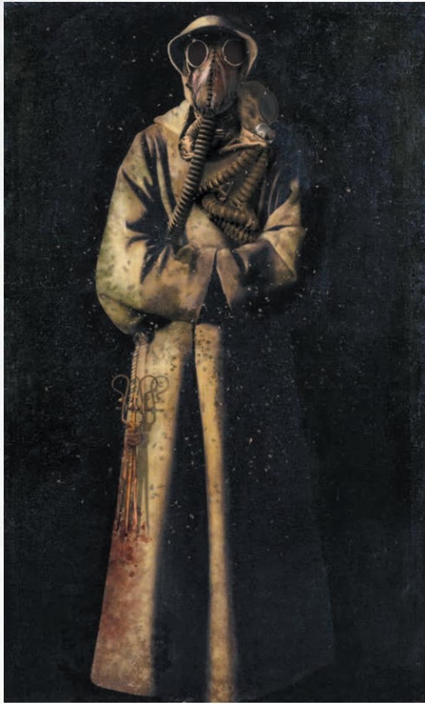{.art-body-right}

Servant of Hastalÿk

The Plague Monk is the last of his order since the raid back in '54. Performing one final ritual, he hung himself by the neck above the Charnel Pit, leaving him in a state between life and death. Hastalÿk gave him the ability to reach out with his mind to anyplace on the main island. The monk immediately began looking for more fleas to feed into the pit so that, when the time was right, Hastalÿk could be brought wholly into the world, and consume it into himself.

The monk has no physical abilities, but he can project an avatar of himself, possess Reliquae, or see through the eyes of beasts. More recently, he has been able to reach out through radio, phones, and the Internet, though these have been more limited... at least until the Spektral Krew arrived on the island. Once they created the satellite uplink, the monk was able to access the Investigators' devices, phones, and even Maya's computer back in the UK.

Since his primary goal is to lure the Krew to the Charnel Pit, all of his actions are made with that in mind.

#### The Reliquae

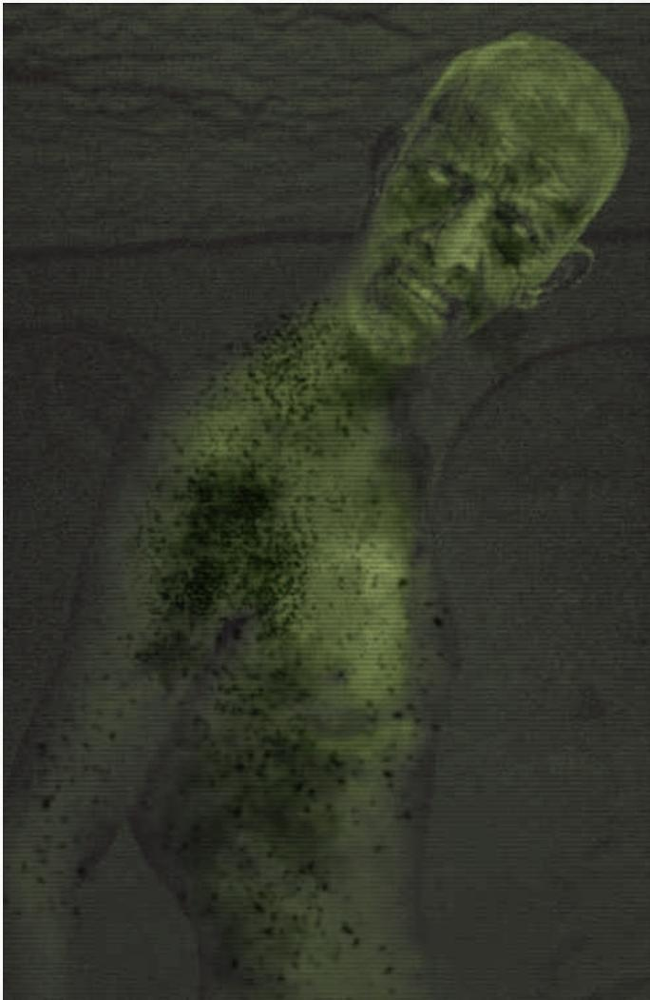{.art-body-right}

{.art-body-right}

These poor souls are neither living nor dead, but trapped in a torturous existence as they await for Hastalÿk to appear so that they may achieve apotheosis with it. They are essentially people who died with eight or more levels of Taint. More often than not they were sacrificed by the monks, but others succumbed to whatever affliction brought them to Isola di Malamente.

##### Cursed Plague Zombies

| Field | Value |
| --- | --- |
| STR | 50 |
| CON | 25 |
| SIZ | 55 |
| DEX | 55 |
| INT | 50 |
| APP | 10 |
| POW | — |
| HP | 8 |
| Damage Bonus | 0 |
| Build | 0 |
| Move | 5 |

###### Attacks

**Attacks per round.** 1

The Reliquae tries to grab any living human and infect them ([see Infection](#viral-appendix-new-mythos-horrors-reliquae-infection)).

**Fighting.** Fighting (Brawl) 50% (25/10), damage 1D3

**Dodge.** 27%

**Armor.** none; The Reliquae are animated by the worms inside them, and so all physical weapons only do minimum damage. Note that damage to the arms hinder their grabbing and damage to legs slows or even stops them.

**Sanity Loss.** 1D3/1D8 upon seeing one, and 1D4/2D4 if the Reliquae vomits on them.

###### Special Abilities

**Infected Flesh.** The Reliquae carry a number of illnesses from the Bubonic Plague to Smallpox. Once they grab hold of an Investigator, they vomit infected bile on them. The victim must make a CON check. Success means that they avoid contracting any serious diseases. Failure means that they become violently nauseous and contract something more serious, and an Extreme failure means a more deadly infection. The Keeper should use the chart below to determine what disease the victim contracts. Note that any Bout of Madness or long term insanity probably results in becoming germaphobic.

| Roll | Infection, Serious |
|---:|---|
| 1 | Bubonic Plague |
| 2 | Yellow Fever |
| 3 | Syphilis |
| 4 | Anthrax |
| 5 | Influenza (New Variant) |
| 6 | Tuberculosis |
| 7 | Hepatitis |
| 8 | Measles |

| Roll | Infection, Deadly |
|---:|---|
| 1 | Ebola |
| 2 | Haemorrhagic Fever |
| 3 | Smallpox |
| 4 | Dengue |
| 5 | Rabies |
| 6 | Leprosy |
| 7 | Polio |
| 8 | Something New (This is likely to become the next pandemic if the Investigator makes it off the island alive.) |

### New Mythos Tome

{.art-body-right}

#### Iuramentum Corruptionis

The book is roughly the size of a large Bible, but instead of a cross or similar iconography on the front, there is a peculiar symbol fashioned out of silver that looks like a series of twisted knots bent into the shape of a bluebottle fly. The text is written in Latin, and it is heavily illustrated with graphic and disturbing illuminated images that depict ritualistic procedures being done to human bodies, including children and infants.

This book was written by one of the nameless Plague Monks during the late 14th century after the monastery was built. It contains the knowledge of Hastalÿk that the cult has collected over the countless millennia. It contains the darkest of rituals involving the corruption of life, and particularly the human body. The images alone are sanity-breaking, but the text is worse. In addition to the mind-wrenching knowledge it imparts, it has a physical effect on the reader, causing their DNA to mutate.

Even examining the symbol on the cover requires a Sanity check (0/1). Looking through it for fifteen minutes causes the individual to lose 1D4 Sanity points, and gain 1 level of Taint. If the reader has a Latin skill of 30% or greater and attempts to read it, they understand more and lose 2D4 and gain 2 levels of Taint.

Sanity Loss: 2D10

Cthulhu Mythos: +3/+10 percentiles

Mythos Rating: 24

Study: 84 weeks

Skills Gained: +05% Medicine, +05% Science: Biology

Suggested Spells: Call Hastalÿk, Cause Blindness, Contact Hastalÿk, Control Reliquae\*, Death Spell, Green Decay, Melt Flesh, Shrivelling, Summon Crawling One, Wither Limb, Wrack

\* New Spell

### New Spell

#### Control Reliquae

Cost: 2 Magic Points, 1D4 Sanity, and gain 2 levels of Taint Casting Time: 1 round

This series of ancient words allow the caster to gain control of a Reliquae they can see within a hundred feet. They also gain some contact with the remains of the mind to whom the body once belonged, and may be able to glean information from them with a Hard POW check.

The control can last for up to six hours before it must be recast. While under the caster's control, the Reliquae will do anything the caster wants, except an act that would be explicitly counter to the will of Hastalÿk, their ultimate master (Keeper's discretion).

This control requires a great deal of concentration, and so as long as the caster is imposing their will on the Reliquae, they cannot cast another spell, read, or perform any activity that requires a high degree of mental focus (Keeper's discretion). If the caster suffers any pain or damage, the spell is broken, and the Reliquae is released. When this happens, they will sit down and become dormant.

> A Few Pointers on Running Viral from Bud
> 
> As someone who ran the scenario many times during playtesting, I thought it would be worth giving some handy tips for potential Keepers on how to get the best out of the scenario.
> 
> The Live Stream Chat
> 
> The live stream chat and the cash they donate essentially dictates to Marco what the Krew should do next – and Marco almost always follows the money. Use this to your advantage in order to get the Investigators involved in the general foulness of Isola di Malamente. Don’t start off with big amounts and have nowhere to go. Keep it somewhat realistic to begin with and only start using higher cash amounts as you near the finale. Don’t forget, Hastalÿk has essentially infected the Internet and can pull money from almost unlimited places and make it available.
> 
> Maya
> 
> Use Maya to keep everything on track and make sure the Investigators don't do anything outrageous. Remember, she can cut the feed and go to VT at any point, and will do so if anything happens on stream that could potentially get the channel demonetized (think dead bodies, gore, and general nastiness). Make sure, however, to use her sparingly – Marco is the boss here.
> 
> Enoch and The Sight
> 
> Don't forget to give whoever is playing Enoch prompts when there is a chance he can channel the supernatural. If the scenario is run remotely on VTT, use private messaging. At the table, use whatever method you would normally use. In all of the times I ran Viral, only one group guessed he was psychic and around half of them guessed that Corrina was a charlatan. Keep them guessing.
> 
> Peter's Sabotage
> 
> Similarly, with Peter you should encourage him to plant false supernatural evidence whenever possible – use the same method of passing messages as Enoch. Remember, Peter wants the cash to keep on flowing and will do anything he can to try to remain undiscovered.
> 
> Hyeon's Skepticism
> 
> Hyeon is yet to see a single thing on their investigations that he would class as inexplicable, though this should change when he witnesses the horrors on the island. During the many playtests we had, the conflict between Hyeon and Corrina was at its best when Hyeon was debunking her acting and any evidence they came upon. Ultimately, when Hastalÿk emerges from the pit, that is slightly harder to debunk, but until things start getting harder to explain, Hyeon's skepticism should be actively encouraged by Marco.
> 
> Marco
> 
> During playtesting every single player portrayed him as an entitled jock douchebag. In my mind he is a mix between Christopher Moltistani from The Sopranos and Zak Bagans from Ghost Adventures (though he has mellowed over the years). I discovered that people found him really enjoyable to play due to these overtones.
> 
> Time
> 
> Remember, if you are running Viral as the one or two session scenario that it was intended to be, then time is a determining factor. Luckily, the Krew have somebody watching the clock for them – Maya. If they are lingering too long or investigating fairly uninteresting places, then she will try to reel them back in.
> 
> Urban Decay
> 
> Remember to play up the worn, reclaimed by nature and general abandoned state that the island is in. It will help build the atmosphere and set the scene. If possible, use some light wind and sea sound effects to illustrate the general absence of anything living here.
> 
> Hastalÿk
> 
> The Great Old One has spread its influence to the Internet and will masquerade as whoever or whatever it can in order to lure the Investigators to the Charnel Pit beneath the island, even mimicking voices and easily hacking normally ‘unhackable’ devices (yes, even Apple devices are no match for the otherworldly intelligence of a Great Old One). Use this viral quality whenever it suits your purposes.
> 
> Also, don't forget to do the Sanity check for seeing Hastalÿk as it emerges first as this can affect Taint levels.
> 
> Hope these hints help.
> 
> Bud out.

## Player Handouts

- [Handout 1: Isola di Malamente – Original Google Map](#viral-handout-01)
- [Handout 2a: The Sight: Player Reference Sheet](#viral-handout-02a)
- [Handout 2b: The Sight: Player Reference Sheet](#viral-handout-02b)
- [Handout 3a: How to Be a Ghost Hunter: Getting into the Mindset](#viral-handout-03a)
- [Handout 3b: How to Be a Ghost Hunter: Recommended Viewing](#viral-handout-03b)
- [Handout 4: Marco's Emails, first panel](#viral-handout-04)
- [Handout 5: Marco's Emails, second panel](#viral-handout-05)
- [Handout 6: Maya's Emails (1 of 2), first panel](#viral-handout-06)
- [Handout 7: Maya's Emails (1 of 2), second panel](#viral-handout-07)
- [Handout 8: Maya's Emails (2 of 2)](#viral-handout-08)
- [Handout 9: Printout of Island Map with Notes](#viral-handout-09)
- [Handout 10: Saint Roche's Hospital – Photocopy from Maya (Player's Map)](#viral-handout-10)
- [Handout 11: Enoch's Vision](#viral-handout-11)
- [Handout 12: Corrina's Research](#viral-handout-12)
- [Handout 13: Marco's Intro Script](#viral-handout-13)
- [Handout 14: Isola di Malamente Lighthouse](#viral-handout-14)
- [Handout 15: The Stream Begins/The Weeping Bridge](#viral-handout-15)
- [Handout 16: Lemon Grove](#viral-handout-16)
- [Handout 17: The Cremation Pit](#viral-handout-17)
- [Handout 18: Mass Graves](#viral-handout-18)
- [Handout 19: Outside the Hospital](#viral-handout-19)
- [Handout 20: Administrator's House](#viral-handout-20)
- [Handout 21: Inside the Hospital #1](#viral-handout-21)
- [Handout 22: Inside the Hospital #2](#viral-handout-22)
- [Handout 23: Inside the Hospital #3: The Secret Rooms](#viral-handout-23)
- [Handout 24: The Chapel](#viral-handout-24)
- [Handout 25: The Crypt: The Witch Board Ritual](#viral-handout-25)
- [Handout 26: The Crypt: Following the Collapse](#viral-handout-26)
- [Handout 27: The Catacombs and Beyond](#viral-handout-27)
- [Handout 28: The Weeping Bridge](#viral-handout-28)
- [Handout 29: The Elder Sign](#viral-handout-29)
- [Handout 30: Something in the Window (The Plague Monk)](#viral-handout-30)
- [Handout 31: Something in the Window (Just Curtains)](#viral-handout-31)
- [Handout 32: Lemon Grove](#viral-handout-32)
- [Handout 33: Cremation Pit](#viral-handout-33)
- [Handout 34: The Witch Board](#viral-handout-34)
- [Handout 35: Book Fragment](#viral-handout-35)
- [Handout 36: The Catacombs](#viral-handout-36)
- [Handout 37: The Forgotten Knight](#viral-handout-37)
- [Handout 38: Hastalÿk Rises](#viral-handout-38)
- [Handout 39: Hastalÿk Destroyed](#viral-handout-39)

### *Handout #1*

Isola di Malamente – Original Google Map

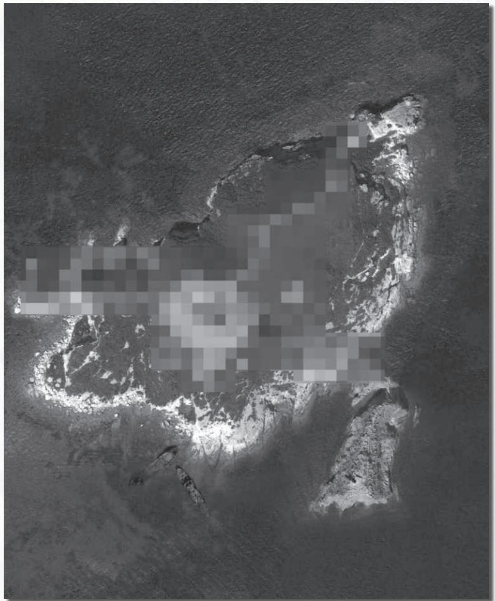{.art-handout-page}

### *Handout #2a*

The Sight: Player Reference Sheet

"I See Dead People. When? All The Time... Unless I'm Drunk."

Those who don't know any better call this a gift, but to the unfortunate souls burdened with it, it's more of a curse. To be sensitive in this manner means being regularly assailed by phenomena that are not normally perceivable by humans. Some refer to it as The Sight, but this isn't exactly true since it acts through all of the senses, and often more than one at a time.

The Sighted individual may experience visions of a past or present event, sense ghosts and other invisible entities, identify the rough whereabouts of a missing object or person, detect whether a tragic event occurred in a certain place, and so on. They may see amorphous blobs of energy, vaguely humanoid-shaped mist, or even full body apparitions that seem as real as anyone else. They may hear voices speaking directly to them, the sound of footsteps running down a corridor, or hear a distant scream. They may notice strange odors that seem out of place, feel something tug on their clothes, or they might just get a bad feeling about a place.

Full apparitions are often simply echoes of the dead acting out the same routine over and over, like a scratch on the record of reality. Occasionally these manifestations are aware of their own existence, and may even interact with the Sighted Investigator. These more vivid encounters are rare and often traumatic to the person with The Sight, with the dead pleading for help or screaming for vengeance for their untimely death.

All manifestations of The Sight should be handled through the narrative by the Keeper in as cinematic a fashion as possible. The Investigator may see an additional person standing in the background covered in blood or they could appear as a reflection in the mirror. These manifestations should be dramatic and startling. These jump scares can be very effective if handled properly, but the Keeper should be conservative about Sanity loss, reserving Sanity checks for only the most disturbing visions. The key is to balance the benefits and the drawbacks to avoid overly penalizing the Investigator with The Sight.

Using the Sight. The Sight is a double-edged sword, potentially providing the Investigator with valuable information while simultaneously exposing them to visions and horrors that attack their Sanity. Someone burdened with The Sight can receive visions without warning, particularly if a location or object has experienced a particularly horrific event, such as a brutal murder. The Keeper should use this sparingly to avoid unfairly punishing the Investigator with The Sight. They may get an initial flash of something that causes them to react, but at that point the Keeper should allow the Investigator the opportunity to at least attempt to close their mind if they wish. There are essentially two ways we advise using The Sight: Simple and Mechanical.

Simple – The Keeper will let the player know when their Investigator feels any ‘supernatural vibrations’. It is up to the player to decide if their Investigator opens themselves up to them. If someone with The Sight suffers SAN loss when opening themselves up, MP can be spent instead. When they run out, SAN can be spent as normal or they have the option of spending POW to mitigate this loss, though that would need to be under extreme circumstances.

Mechanical – Someone who has had The Sight for some time may have developed the means to control what they see and possibly mitigate the negative effects through the use of Magic Points (MP). Should the Keeper want to use it as a full-blown mechanic, it has a number of different uses. This involves making a successful POW check, with the difficulty based on the intensity of the vision (Keeper's discretion).

Below are a number of examples, though the player and Keeper are free to improvise others depending on the situation and personal taste.

### *Handout #2b*

The Sight: Player Reference Sheet

Open the Sight

This means opening the mind to whatever impressions might be in the area. This is the most dangerous option because it leaves the Investigator defenseless against any dark entities or traumatic visions. This provides the most information, but also risks the most Sanity loss. [Cost: 1 MP]

Close the Sight

This means shutting out all external psychic forces, often in response to an attack or a particularly traumatic vision. The base cost is 2 MP, though this may increase with a more intense vision or a powerful entity. If another entity wishes to push through the Investigator's defenses, they can make an opposed POW check to do so at the Keeper's discretion. [Cost: Special]

Sensing a Presence

The Sighted Investigator tries to sense if there is some sort of supernatural entity nearby. If the entity is self-aware and willing, the Sighted Investigator can attempt to communicate with them. Of course certain entities could trigger a Sanity check (Keeper's discretion). This is a more passive act, and so doesn't open the Investigator to a great deal of danger, though the information it provides is correspondingly vague. [Cost: 3 MP]

Echoes of the Past

By touching an object or location, the Sighted Investigator can possibly get impressions or visions about the past. For example, an object might provide insight into who owned it, or a murder scene might provide a clue as to what happened, though traumatic events are likely to trigger a Sanity check, with the loss depending on the intensity of the event (Keeper's discretion). While this ability is usually limited to feelings the Sighted Investigator can sometimes see a vision of the past. More often than not it's through the eyes of the one experiencing the greatest emotion. In the case of a murder, they could just as easily see things from the point-of-view of the killer, feeling their rage or ecstasy, which could leave the Investigator shaken from the experience. [Cost: 4 MP]

Precognition

By opening The Sight just a little, the Investigator can gain knowledge about the immediate future as it relates to them. For example, if someone is waiting to jump them in a dark alley, they might get a sense of dread about going there. [Cost: 5 MP]

Calm the Mind

If the Investigator experiences a vision or entity that causes the loss of Sanity, they can choose to make a POW check to reduce the loss by half (round down). Sanity loss of four or less requires a Regular success, while Sanity loss of five or more requires a Hard success. If halving the Sanity loss means that they lose less than five, then they do not experience a bout of madness, unless of course they have already reached their threshold. The MP cost equals the number of Sanity points reduced. [Cost: Special]

Drinking and hard drugs can block out The Sight to a degree, but this form of self-medication comes with its own risks. When drunk or high on drugs, the Sighted individual gets a Bonus Die on their POW check to close their mind to unwanted visions. Of course they also suffer from the penalties associated with those substances, which could include Penalty Dice, reduced awareness, addiction, or even serious health problems from continued use.

### *Handout #3a*

How to Be a Ghost Hunter: Getting into the Mindset

If you've ever seen a ghost hunting show, they almost always involve the same few elements that are presented as evidence for ghosts. These include: light orbs, temperature changes, mysterious noises, electromagnetic fields, voices coaxed out of static, photographs, and of course, personal feelings. The ghost hunters of the Spektral Krew are no different, and they carry all the same paraphernalia as other supernatural investigators. The following is a list of typical phenomena and how the average ghost hunter interprets it:

Orbs. Orbs only appear on video or static photos. Some ghost hunters claim that these circular manifestations are the spirits of the dead, but many are more skeptical. Most professional paranormal investigators believe them to be nothing more than motes of dust or other particles that are easier to pick up with modern compact and ultra-compact digital cameras.

Temperature Changes. So-called cold spots have been associated with ghosts for centuries, and are still taken to be an indication of a possible haunting by modern ghost hunters. These usually manifest as a deep chill that may be measurable with some device, or it could affect a single person. The typical cold spot is only a few degrees different than the surrounding air, with skeptics pointing to drafts in older structures being the most likely explanation.

Other temperature-related phenomena can show up on FLIR cameras that are designed to read heat signatures. Ghost hunters will often use them to detect cold spots or other visual artifacts. Many appear to be areas of cold or warmth moving through a room, or lingering in a corner.

Noises. The typical haunting noises include knocks, footsteps, groans, or even distant voices. Occasionally a ghost hunter might hear a loud bang, and after investigating discover that an object has mysteriously fallen. Of course, many such phenomena can be explained as normal noises that are ubiquitous in old houses that are known for their odd creaks and groans. A distant voice could be a trick of the wind or a voice carried through a nearby vent.

EM Fields. Electromagnetic fields are very popular with ghost hunters who often use EMF Detectors (available for less than \$30 from places like Amazon) to search for supernatural phenomena. Investigators often read EMF spikes as evidence of a ghostly presence or paranormal activity. Of course, many old houses have poor and inconsistent wiring that many skeptics point to as obvious sources for these EMF readings.

EVP. Sound recording devices are popular tools in the ghost hunter's arsenal. They are used to find Electronic Voice Phenomena (or EVP) which are sounds found on any electronic recordings that are interpreted as spirit voices. These can either be recorded unintentionally (while recording other phenomena) or intentionally recorded using a digital recorder or a Spirit Box, an electronic device specifically designed to record EVP.

The EVP is often not heard or understood at the moment it was recorded and must be run through a number of filters to tease the voice out of the background noise. These are then interpreted by the ghost hunters, who attempt to understand their meaning. Skeptics are quick to point out that this is auditory pareidolia which is the human tendency to see or hear patterns in the world around them. Visually these can appear as faces or shapes, and with sound, it can manifest as a voice or some other familiar sound.

Photographs. One of the most classic methods of recording a ghost is a good old-fashioned photograph. In the old days, it was far more difficult to take a picture, requiring a great deal of equipment and set-up time, but today just about everyone has a high definition camera right in their pocket. Interestingly, the number of ghosts appearing in photos is directly proportional to the quality of the camera. Other factors include lighting, shutter speed, and of course, the photographer's access to photo manipulation software.

Many so-called ghost photos can be attributed to reflections or pareidolia, but occasionally a photograph will come along that is more difficult to debunk. For most ghost hunters, this is the holy grail. If they can get that one perfect photo that gets them on the cover of National Geographic, then all of those blurry pictures of curtained upstairs windows will not have been in vain.

Psychics. One of the more subjective methods of ghost hunting is the use of a medium or psychic. In recent years many self-proclaimed psychics have been debunked as frauds by baiting them with false information about a location and exposing them when they claim that the fictional spirit is there speaking to them. Other psychics are not so easy to dismiss.

Some of the most successful working psychics have a success rate that is slightly above average, making their claims a bit more plausible than most. Most psychics and mediums will claim to sense spirits, speak with the dead, and even receive visions. The key to a good psychic impression is keeping it vague. The more specific the details, the easier it is to debunk. Then again, it may just be that the spirit's message was distorted passing through the veil. Who can say?

### *Handout #3b*

How to Be a Ghost Hunter: Recommended Viewing

Here is a small selection of recommended viewing that should enable you to comprehend how these people do what they do, and understand some of the tropes present in the typical ghost hunting experience:

Ghost Adventures: The Documentary (2004) – This was the catalyst for the success of the Ghost Adventures TV series, having been put together as an independent film in a documentary style. Three guys with recording equipment being locked into various places overnight to find evidence of hauntings. If you can find a copy, it is often considered one of the best examples of ghost hunting available, and the team insists to this day that everything they captured was 100% genuine. Make sure to watch to the very end.

Ghost Adventures: S03E03 Poveglia Island (2009) – The inspiration behind Viral where the Ghost Adventures crew head out to Venice to conduct an overnight investigation on the plague island of Poveglia. The three of them are dropped off there and left to their own devices. It was the first episode of the show that was broadcast in an extended format due to the amount of evidence they captured.

Ghost Adventures: S03E06 Linda Vista Hospital (2009) – The Ghost Adventures team head to the abandoned Linda Vista Hospital in East Los Angeles. The evidence begins manifesting before they have even finished setting up for the investigation with strange noises, humming, screams, banging, and moaning seeming to issue from the very walls. A very creepy place that they actually returned to years later for further investigation.

Ghost Lab: S02E13 Deadwood (2011) – Ghost Lab was about a group of investigators who at least tried to look at things in a ‘scientific’ manner (well to a degree...). When they set up their equipment in the bloodstained town of Deadwood, they recorded all manner of interesting evidence.

Dead Famous: S03E10 (2006) – A show that had psychic medium Chris Fleming journeying with the host Gail Porter to try to find the spirit of the famous singer, Janis Joplin. The evidence they capture is interesting to say the least.

Most Haunted (2001-2006) – A show far more infamous for the drama portrayed by the frankly huge investigative team than the evidence it discovered, often pointing their camera at their own faces when paranormal occurrences happened in order to treat the audience with the terror they displayed. The team included the famous English ‘spiritualist medium’ – the late Derek Acorah – and the hilarity that ensued has to be seen to be believed. Especially check out the Bodmin Gaol episode where Derek claims to become possessed by the spirit of a South African man called Kreed Kafer – this was revealed later to be a name that was an anagram of ‘Derek Faker’, that was made-up and planted by resident parapsychologist and skeptic Dr Ciarán O’Keeffe in order to put Derek’s ‘psychic powers’ to the test.

### *Handout #4*

Marco's Emails, first panel

From: the\_marco\_proudfoot@spektralkrew.com

To: Mayaa@hushmail.com

CC: crystal\_flower@spektralkrew.com; enoch@spektralkrew.com; peter\_j\_wharton5517786@spektralkrew.com; ku\_hyeon@spektralkrew.com

Subject: BIG NEWS!!!

OK guys, here's the thing. Get your passports ready because we are going to Italy baby! The Old Country! So, according to Maya, we are just one live stream away from hitting the one million sub mark. You know what that means? Better sponsorship, getting on talk shows... maybe even a TV deal! More green on the table! It's so close I can fucking TASTE it.

So Maya hits me up and tells me about this island, see, just off the west coast of Italy. If you look on Google Maps, it's got nuthin on it, but on this map she grabbed from one of her people online it's got buildings and trees and what looks like a bombed-out chapel. This island had this order of monks living on it... the Order of the Lamb of the Living Jesus or some shit... anyway this island has been populated since the Bronze Age. This order, they took in the sick when the plague punched Europe in the face back in the day. I mean if anywhere is going to be haunted it's this place right? This place makes Poveglia look like a frickin' kids movie!

### *Handout #5*

Marco's Emails, second panel

So here's the plan. We fly out next week. I've got the gear being shipped over there PRIORITY. When we arrive in the local town; Maya has arranged for someone to get us to the island. From there we will set up and do a live broadcast right under the dumb noses of the Eyetalian Navy. They'll never even know we were there.

Now Hyeon - I know, I know... you're going to mention signals and all that tech stuff. I get it my man. We're screwed if we get there and can't broadcast. Don't worry brother - I've got us covered. See, it turns out there is an old abandoned listening post from the second World War there. Maya has paid for someone local to break in there and hook it up with all the right cables and shit so we can spit out a signal! Should be A1 crystal clear baby!

OK - so any questions?

### *Handout #6*

Maya's Emails (1 of 2), first panel

From: Mayaa@hushmail.com

To: the\_marco\_proudfoot@spektralkrew.com

CC: crystal\_flower@spektralkrew.com; enoch@spektralkrew.com; peter\_j\_wharton5517786@spektralkrew.com; ku\_hyeon@spektralkrew.com

Subject: Isola di Malamente

Hey Marco babez,

OK - so everything is arranged, and this is where we are up to.

My contact in the local village has paid a small tour operator (Nuncio Vendra) to get you to the island (the invoice is sent to you in a separate mail). He's apparently known around those parts for taking people to places they are not meant to go - right up our street eh?!

Apparently, the island is surrounded by underwater mines, some from WWII (because of the listening post) but my contact reckons that some of them are newly installed by the Italian Navy. What are they trying to hide? Colour me intrigued.

The night is special around those parts because it is known as Notta della Peste - fricking Plague Night! It's some old superstitious thing where the locals lock themselves away until the following

### *Handout #7*

Maya's Emails (1 of 2), second panel

morning and hang trinkets on their doors and windows to ward off evil spirits. The upshot of us that “ain't fraid of no ghost” is that it is a night that the local police and lifeguards relax as everyone is usually indoors - it's ideal.

I've sent Hyeon instructions to hook the listening post up to use the aerial to boost the broadcast. They are step-by-step and he's stupid clever, so it should only take him a few minutes to work it out. I managed to get someone from the mainland to get over there and wire it up so you literally have to just plug shizzle in. The thing is, he had to break the padlock to get in, but replaced it with one that was fairly identical. Look out for a rock nearby with a white circle painted on it - the key is underneath that.

I've enclosed a map of the island grabbed from WorldMap+ where I’ve made some notes on roads and buildings. The thing is, on Google Maps this was pixelated out but one of my contacts in the “community” managed to find an unredacted one that slipped through the cracks.

As usual, I will be monitoring everything here in Blighty. I'll feed anything interesting to Hyeon.

Here's to a millions subs babez!

Love and kisses,

XX Maya XX

### *Handout #8*

Maya's Emails (2 of 2)

P.S. I have also included the usual “read to camera” bit for the beginning of the stream — sent a reminder to Hyeon to put them on the auto-cue. And yes, yes, I remembered to plug the Zazzle merch this time around!

P.P.S. Meant to tell you: a rough translation of Isola di Malamente is something like “island of the mentally ill”. I gotta be honest, babez, I’m glad I am watching this one from home.

Attachment [5.3M]

### *Handout #9*

Printout of Island Map with Notes

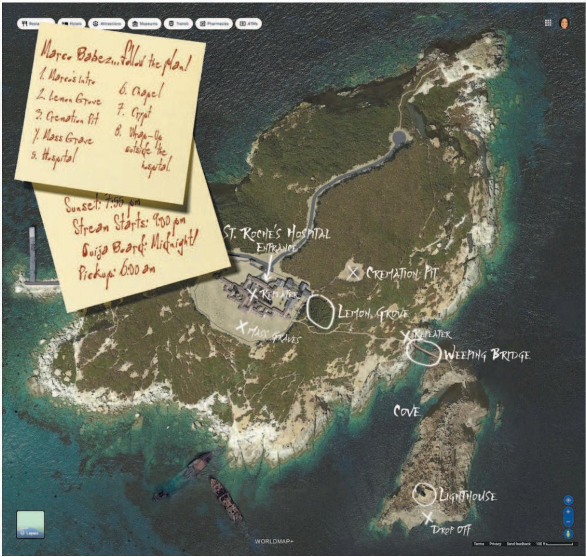{.art-handout-page}

### *Handout #10*

Saint Roche's Hospital – Photocopy from Maya (Player's Map)

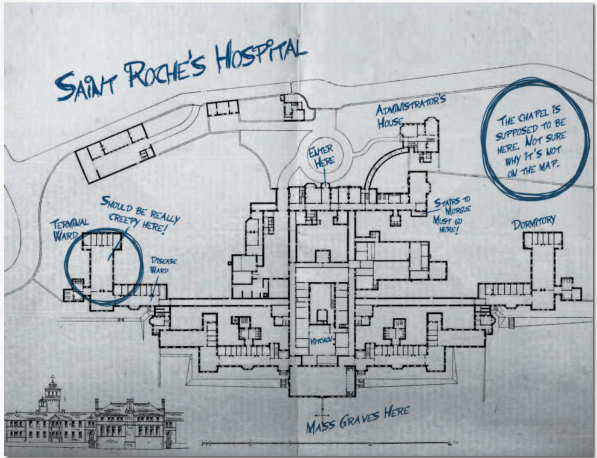{.art-handout-page}

### *Handout #11*

Enoch's Vision

You are lying looking up at a velvet black sky, the stars like pin-pricks of light, piercing the veil of darkness. To all sides, flames leap into the air, high and hot. Circling in the sky are birds composed of red, crackling, fire (maybe hawks) leaving streaks of green flame that scar the sky like tattoos as they let out a high pitched shriek, occasionally spitting white balls of flame into the night.

### *Handout #12*

Corrina's Research

Corrina has looked up information regarding Isola di Malamente so that she can have more accurate “visions" during the live stream. She wasn't able to learn a lot, but she managed to find the following:

- Legends say that the monks used to burn lepers and the mentally ill in the cremation pit, with some of the victims still alive.
- Dr. Enzo Bianco was the last hospital administrator, and he committed suicide in his office when the hospital was raided in the 1950s. Reports say he was found with the back of his head blown out and a revolver on his desk.
- One of the witnesses to the raid described several monks setting fire to themselves in the old crypt beneath the chapel.
- The Weeping Bridge is believed to be haunted by a young girl named Catena La Rosa. According to the stories, she came to the island with her grandmother in 1960 to leave a doll for the spirits to heal her sick brother, but when she leaned over the railing to tie it on, she lost her balance and fell to her death in the water below. Her body was never recovered. At night, she waits on the bridge for her grandmother to come and get her.
- Some of the locals describe seeing a light in the upstairs window of the hospital at night this time of year. The most popular story is that it was a nurse killed during the raid, and she still walks the wards trying to attend to her patients.

### *Handout #13*

Marco's Intro Script

[Intro Script]

My name is Marco Proudfoot, and we are the Spektral Krew! We go places and do things you would never do. This evening we are broadcasting live from Sicily. The forsaken island of Malamente!

We've managed to get to this forbidden place and are going to try tonight to push our subscriber count over the one million mark!

It's a warm and sticky evening here just off the coast and we've managed to find a way to get to this lost island to investigate the ghosts and demons that are reputed to be in residence on this cursed place, trapped in a hellish prison. As with our other live streams, we will be doing shout-outs and taking requests throughout the evening, until we get to the witching hour where Enoch, Corrina, and myself will be performing a seance on the altar that we have it on good authority remains here beneath the chapel using Corrina's own special witch board. And if you follow along Krewers, then we hope to conjure the spirits that are bound here.

Don't forget to like, subscribe, and click the notifications icon so you get more quality Spektral Krew content in the future. Also, make sure to check out our top quality official merchandise on Zazzle.

Now with a bit of the history of this place, here's some VT.

Hey Marco Babez, make sure you emphasize the bold parts when you're doing your thing. You've got this! It's going to be the best stream EVER!

### *Handout #14*

Isola di Malamente Lighthouse

Black-and-white photograph of a lighthouse with a dome and a small building in the foreground (no visible text or symbols)

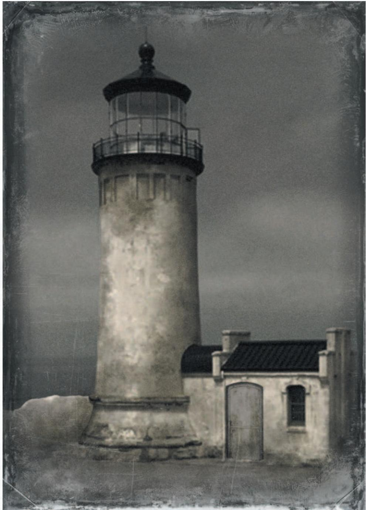{.art-handout-page}

### Hyeon's iPads

The Stream Begins

Hyeon has three feeds coming to him on three dedicated iPad Minis. They are mounted in a chest harness that allows easy access to each, or he can close them up against his chest if he wants to get them out of the way. The first (on the left) is the dedicated chat to Maya so she can give direction and information as needed. This iPad also shows all of the device connections, the satellite uplink, Wi-Fi signal strength, etc.

The second (middle) iPad is used to monitor any of the device feeds. Hyeon can call up any camera to see what it sees at any time. This iPad is also used to fly the drone.

The third (right) iPad has the live stream comments scrolling by. Hyeon can control the slow or pause the comments, delete trolls, and save important comments to a separate list with the swipe of a finger. This feed is critical because Hyeon can monitor the overall mood of the viewers, keep an eye on the numbers, relay questions, and announce Super Chats. Maya has promised the viewers that they can donate money through Super Chats to get the Krew to go places and do things. Of course, Marco has the final say, and would veto anything that is too dangerous... wouldn't he?

When accessing the iPads, Hyeon has gotten into the habit of turning off his head cam feed.

> Keeper's Notes
> 
> These handouts are limited since the Investigators' actions are very unpredictable. It is suggested that the Keeper make additional chat handouts as needed based on the situation. Even better would be to use some sort of electronic feed such as phone texts or private messages to feed the information to the player running Hyeon to help with the immersion, while limiting the chances that they're just parroting what the Keeper describes.

### *Handout #15*

The Stream Begins/The Weeping Bridge

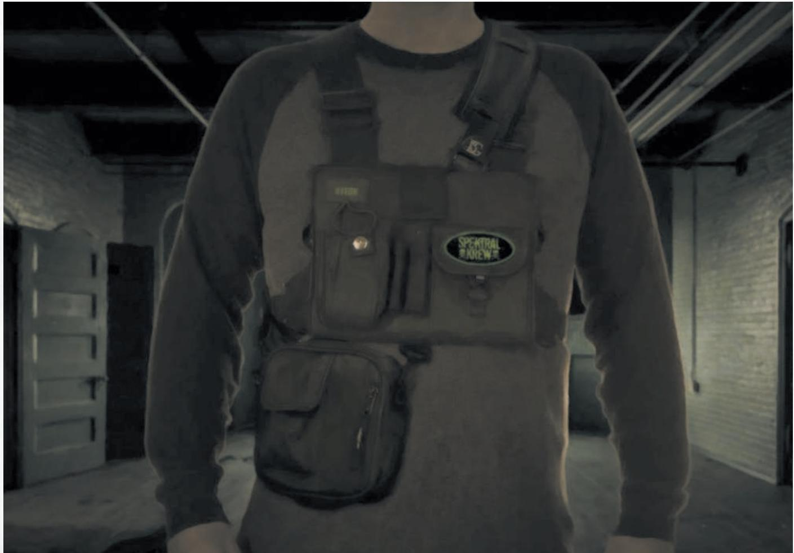{.art-handout-page}

iPad One

- Maya has you double check all of the feeds, so you ask each team member in turn to make sure their gear is on. After a minute, you see that everything is up and running.
- You see the list of devices connected to the router, and all have good signals.
- As soon as Marco finishes at the bridge, Maya suggests going to the Lemon Grove next since it's on the way.

Hyeon should relay this to Marco.

iPad Two

- As a default, Hyeon has Peter's feed on the screen since that's the primary video for the stream. Peter is supposed to stay on Marco and follow his directions on where to point the camera, unless he sees something too exciting to miss. Hyeon can switch to any feed, so just keep track of which feed is up at the moment.

iPad Three

- When the stream begins, the hardcore fans come in first with all the usual comments: Hey Marco! First! This is gonna be great! Spektral Krew Rox!!!! And so on. Feel free to make up new ones along the same line if asked.
- Viewers 244; Subscribers 890,421; Patrons 363
- Several Super Chats are already coming in, including:
- SethFromTexas: \$20
- LoosyGoosy: \$5
- GhostFan44: \$10
- UltimaUnum: \$20
- EvilDude69: \$2
- GrimmMomm: \$10
- ScottBronco931: \$15
- Keith&Jenelle: \$20
- TheFrickmeister: \$35
- Paul-B-Dee: \$50
- TaylorIsBored: \$20
- Doc\_Gryph: \$8
- The rest of the comments are all very positive, with everyone excited about the Spektral Krew's live stream.

### *Handout #16*

Lemon Grove

iPad One

- Maya cuts between the various feeds, showing different views of the grove.
- All of the devices are looking good.
- Maya reminds you to set up the final repeater at the hospital before moving onto another location. She has ten minutes of VT ready to go as soon as you're done at the Lemon Grove.
- There are a lot of people asking to see the Cremation Pit. Ask Marco to go there next.

iPad Two

- Hyeon's Choice

iPad Three

- Viewers 583; Subscribers 890,588; Patrons 366
- The stream is fascinated by the bizarre fruit hanging from the trees. Almost immediately someone suggests that Marco take a bite of one of the lemons. Others jump on board and begin repeating the call for Marco to eat a lemon. More Super Chats are coming in. Most want Marcus to bite a lemon.
- MadAlice561: \$10 ...Take a bite!
- GhostFan44: \$5 ...EAT ONE!!!
- MikeMangyMoose12: \$10 ...Don't be a pussy!
- UltimaUnum: \$50 ...I'll give a hundred more if Marco bites a lemon.
- BloodyCarrotKing: \$20 ...eat those nassssssssty things!!!
- Pentagram666: \$10 ...YUMYUMYUM

### *Handout #17*

The Cremation Pit

iPad One

- Maya focuses on Peter's feed. She suggests walking around the pit while filming for a more dynamic look.
- All of the devices are looking good.
- When they spot the burnt remains, Maya asks: "What is that in the pit? Ready to go to VT if it will demonetize us. Let me know ASAP!" When it's clear that it's not a person, Maya decides to continue the feed.

iPad Two

- Hyeon's Choice

iPad Three

- Viewers 719; Subscribers 890,652; Patrons 372
- The stream is asking about the burned thing in the pit. One joker suggests that Marco eat some of it, but Maya quickly deletes his comment and bans him from the stream. Other comments include:
- "Is that a dog?"
- "Shit just got real!"
- “OMG!!!"
- “IS IT FUCKIN' SATANSIST?!!!"
- "Oh come on! That's SO fake!"
- The Super Chats are still coming in:
- BrutusBong: \$30
- Harvey3189: \$10 ...Get closer!
- MaryMary71: \$15 ...Is this for real?
- KimKuntral: \$20 ...What the hell is that?!

### *Handout #18*

Mass Graves

iPad One

- Maya focuses on Peter's feed.
- All of the devices are looking good.
- Maya says: "Ask Peter to get close-ups of the markers. Ready to cut to VT if we see an actual body. Try to warn me if you can."

iPad Two

- Hyeon's Choice

iPad Three

- Viewers 945; Subscribers 890,866; Patrons 380
- Many of the viewers are suggesting that they use the Spirit Box and try to get some EVP. Comments include:
- "This is unbelievable!"
- "Are there still bodies buried there?!"
- “OMG!!!"
- "What's that near the fence?!"
- "This is soooo sad."
- The Super Chats are still coming in:
- MonicaOfMonaco5: \$20
- EvilPiper: \$20 ...Get closer!
- TheRavenKing: \$25 ...Marco should lay down in one of the holes!
- IronWheelchairDemon: \$10 ...Hey Marco!
- UltimaUnum: \$40 ...Dig.

### *Handout #19*

Outside the Hospital

iPad One

- Maya says that the signal from the repeater is good. Have Marco give a presentation in front of the Hospital.
- All of the devices are looking good.
- Maya says: "Take it slow babez. We have all night, so don't rush it. Once you're in, you can split up, and I'll let you know if you need to pause."

iPad Two

- Hyeon's Choice

iPad Three

- Viewers 1,023; Subscribers 891,023; Patrons 411
- The viewers are getting excited. Comments include:
- "Oh this place is DEFINITELY haunted!"
- "I thought I saw somebody in the second floor window!!!"
- "This is going to get wild!"
- "Marco, you are a fucking BOSS!"
- "You'd never get me in that place!"
- The Super Chats are still coming in:
- GreedyMouse: $30
- BlindFiddler: $10 ...There is going to be some great EVP here!
- SethFromTexas: $20 ...You have GOT to check out the morgue!!!
- NotAFanOfBill: $30 ...There's no way this place isn't haunted as HELL!

### *Handout #20*

Administrator's House

iPad One

- Maya suggests making a circuit of the house with a voiceover by Marco. Maybe something like, "Who ran this place and what were their true intentions" or something like that...
- Maya says that she's getting sporadic static from the audio feed. Check the connections when you get a chance. Could be the humidity.
- Maya says: "Probably no need to go through the entire house. Maybe a few interior shots of the entryway, but if it looks interesting, take ten minutes. See if Corrina 'feels' anything."

iPad Two

- Hyeon's Choice

iPad Three

- Viewers 5,023; Subscribers 902,313; Patrons 524
- The viewers are intrigued by the Victorian house. Comments include:
- "Wow, the classic haunted house!"
- "I bet there are bodies in the basement"
- "That looks like my mom's house"
- "Marco looks nervous!"
- "Looks like the administrators were living well."
- The Super Chats are still coming in:
- Bang_O_Rang: $20
- EternalHobo: $30 ...Hey, you guys should grab a souvenir!
- UncleBensGhost: $15
- BaronessKessler: $10

### *Handout #21*

Inside the Hospital #1

iPad One

- Let's keep this movin' babez. We're coming up on Witch Board time, and we can't miss that deadline. Most of the folks hanging with us are here for that!
- Double check the feed. I'm picking up some kind of radio chatter in the background.

iPad Two

- Hyeon's Choice

iPad Three

- Viewers 7,875; Subscribers 902,624; Patrons 531
- The viewers absolutely love this location. Comments include:
- "I've been waiting for this!!"
- "They're sweating SO much."
- "I can feel the evil through the screen!"
- "Corrina is going to get attacked for sure."
- "I keep seeing things moving in the darkness. Is it just me?"
- The Super Chats are still coming in:
- BloodSportJr: $40 ...You guys have gotta go to the morgue!
- UltimaUnum: $300 ...Go to the morgue. Another $200 if Marco climbs in one of the body drawers.
- MrBill: $10 ...Yeah! Let's see the morgue!!!
- Ann6721: $15 ...You guys are fearless!

### *Handout #22*

Inside the Hospital #2

iPad One

- The viewer UltimaUnum has dropped some serious cash tonight! I triple-checked, and the money is legit. I mean, we need to stay safe, but let's keep this guy or gal happy and donating. We're seeing others upping their donations because of them.

iPad Two

- Hyeon's Choice

iPad Three

- Viewers 8,112; Subscribers 937,888; Patrons 704
- The viewers are hooked. Comments include:
- "Fuck, I need to get to bed, but I can't stop watching!"
- "Can anyone else hear that buzzing? Sounds like flies!"
- "Is that a blood stain?"
- "These guys had to be up to some evil shit."
- "I am so cold. Let us out."
- The Super Chats are still coming in:
- BarnyTheMoose: $30 ...Oh man, this is the best show out there!
- SteamingSkull327: $15 ...Great work guys!
- UltimaUnum: $500 ...Go to the Staff Dormitory. If there's an answer, it's there.
- Aaron811: $50 ...Hell yeah!
- OompaLoompaJoe: $45 ...Who the hell were these guys?

### *Handout #23*

Inside the Hospital #3: The Secret Rooms

iPad One

- A secret fucking passage?! Are you kidding me?! Get Marco in there first, and let him know that I'm ready to cut the feed and go to VR if there's anything that will get us taken down. Be careful, babez!

iPad Two

- Hyeon's Choice

iPad Three

- Viewers 10,934; Subscribers 966,121; Patrons 828
- The viewers are hooked. Comments include:
- "WTF?!!!"
- "Are those bullet holes?"
- "Is this for real?"
- "I can't stop watching."
- "What does Corrina make of it?"
- The Super Chats are still coming in:
- EbonyMoth: $40 ...This is amazing!
- BallGagGranny: $30 ...What the hell is THAT?!
- Aaron811: $50 ...Hell yeah!
- OompaLoompaJoe: $45 ...Who the hell were these guys?
- UltimaUnum: $250 ...Find the book.

### *Handout #24*

The Chapel

iPad One

- We're almost there babez. Get some shots of the chapel and maybe some VO from Marco.
- Meanwhile, maybe Enoch and Peter can get the static cameras set up in the crypt? We're almost there!

iPad Two

- Hyeon's Choice

iPad Three

- Viewers 14,219; Subscribers 998,665; Patrons 1,091
- The viewers are hooked. Comments include:
- "This place is off the hook!"
- "Where the hell is that buzzing coming from?"
- "Almost time! I can't wait!"
- "There have definitely been human sacrifices in this place."
- "You guys should get out. I have a bad feeling about this."
- The Super Chats are still coming in:
- BlindFiddler: $50 ...You guys are BEASTS!!
- InternetExplorer4Ever: $5 ...First!
- RainMan2: $35 ...What's that on the ceiling?
- HPHatecraft: $20 ...Oh come on with the seance already! I've got to be up for work in an hour!
- UltimaUnum: $650 ...the crypt awaits.
- Netscape4Ever: $6 ...First! Damn!
- The Super Chats are now at $13,681.

### *Handout #25*

The Crypt: The Witch Board Ritual

iPad One

- We just got a PayPal donation from UltimaUnum for $5,000! It's confirmed! This is amazing babez!
- We just hit 1 million subscribers!!! We have officially GONE VIRAL!!

iPad Two

- Hyeon's Choice

iPad Three

- Viewers 16,652; Subscribers 1,002,121; Patrons 1,200
- The comments are going by too fast to read, but the viewers are going nuts.
- The Super Chats are also coming in fast, but Hyeon is focused on keeping the feeds going to Maya.
- The Super Chats are now at $20,100.

### *Handout #26*

The Crypt: Following the Collapse

The stream drops, and there are only two users – DSS and UltimaUnum. Any messages receive the same response: ERROR 401. User DSS remains silent, but UltimaUnum begins commenting in Latin, urging the Investigators onwards. At this point UltimaUnum will pledge a huge amount of cash in the Superchat (big enough that Marco will find it impossible to refuse), and urge them to continue moving on.

### *Handout #27*

The Catacombs and Beyond

The feed is cut completely once the Investigators enter the catacombs due to the amount of stone between them and the Wi-Fi receivers. Maya cannot reach them by telephone or the Internet. When Hastalÿk appears, the viral interference of its immense otherworldly presence scrambles and corrupts all Internet capable devices causing them to go into boot-loops, glitching, and eventually, making them useless – even the Apple devices. Analog equipment (such as the walkie-talkies) remains unaffected.

### *Handout #28*

The Weeping Bridge

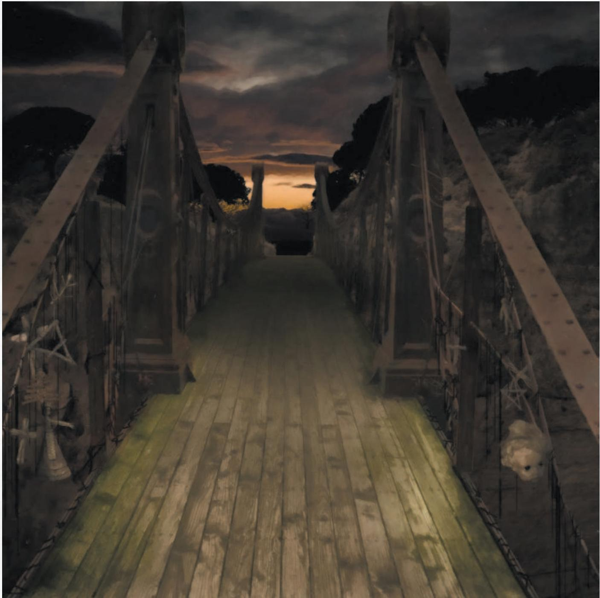{.art-handout-page}

### *Handout #29*

The Elder Sign

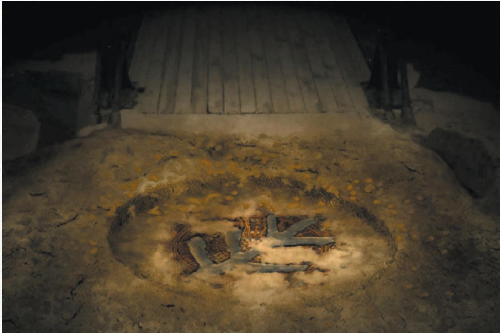{.art-handout-page}

### *Handout #30*

Something in the Window (The Plague Monk)

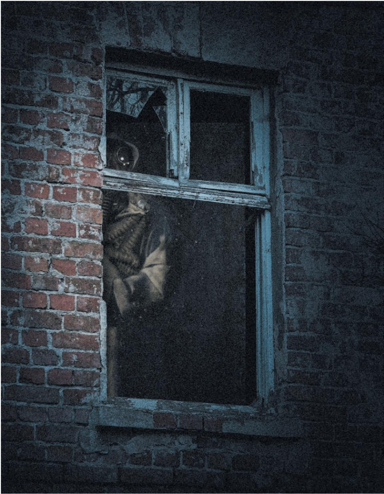{.art-handout-page}

### *Handout #31*

Something in the Window (Just Curtains)

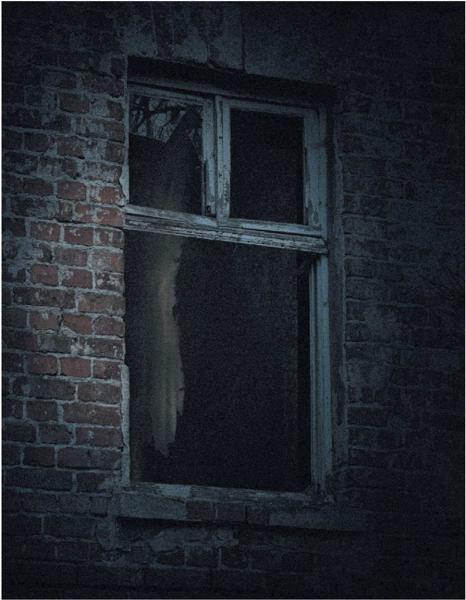{.art-handout-page}

### *Handout #32*

Lemon Grove

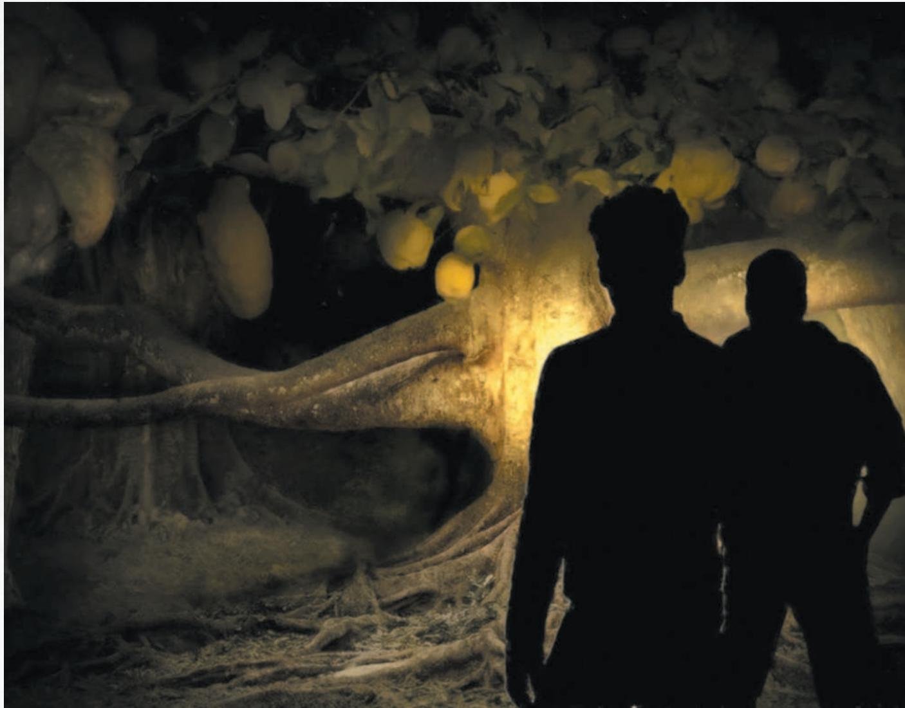{.art-handout-page}

### *Handout #33*

Cremation Pit

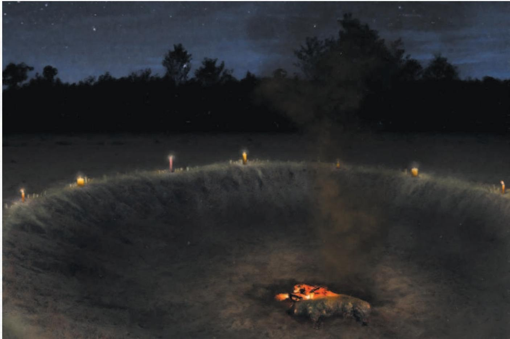{.art-handout-page}

### *Handout #34*

The Witch Board

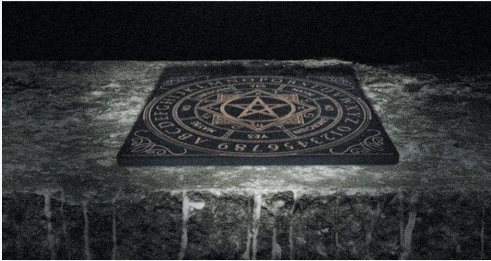{.art-handout-page}

### *Handout #35*

Book Fragment

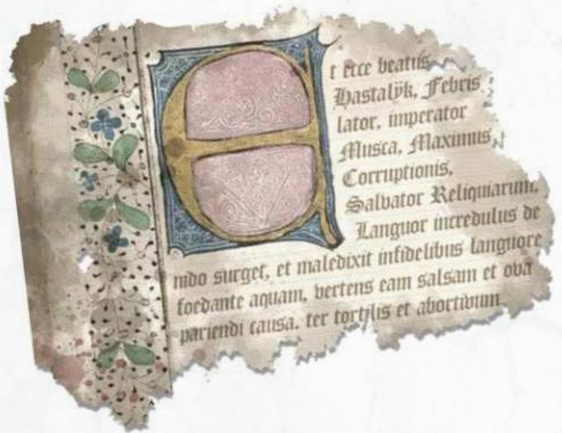{.art-handout-page}

**Book Fragment text (Latin):** Et ecce beatus Hastalÿk, febris lator, imperator Musca, magna corruptio, Salvator Reliquiarum, morbus hortato e nido surgit, et maledicit infideles cum morbus aquae pollens, ea salsa faciente terque tortis et infertilis ovis avibus gignit.

**Book Fragment Translation (English):** And lo' did Blessed Hastalÿk, Bringer of Fever, Fly Emperor, The Grand Corruption, Savior of the Remains, Sickness Emboldened rise from his nest and curse the unbelievers with a sickness which did befoul water, turning it salted and cause poultry to lay eggs thrice twisted and stillborn.

### *Handout #36*

The Catacombs

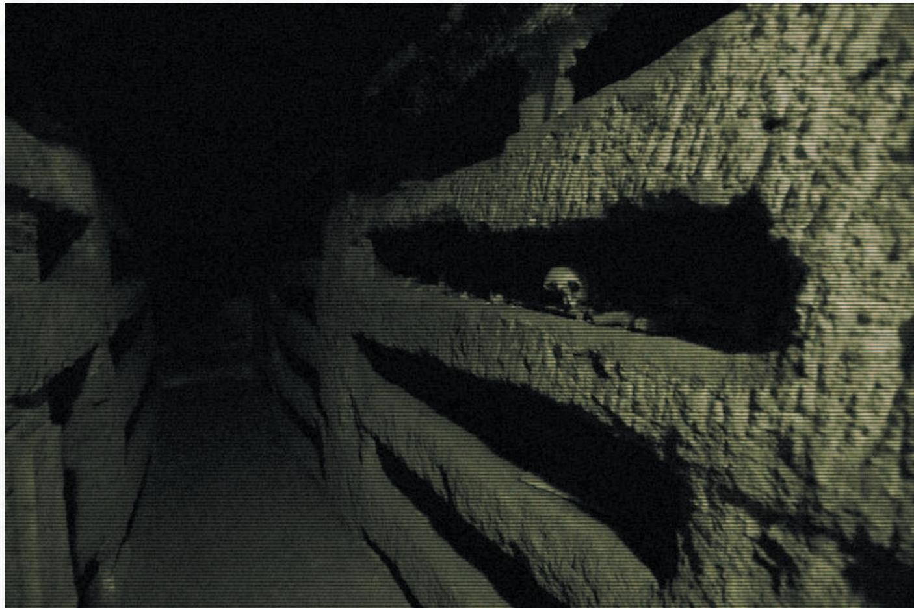{.art-handout-page}

### *Handout #37*

The Forgotten Knight

{.art-handout-page}

### *Handout #38*

Hastalÿk Rises

{.art-handout-page}

### *Handout #39*

Hastalÿk Destroyed

{.art-handout-page}

## Keeper Maps

{.art-body-right}

- [Isola Location](#viral-keeper-map-isola-location)
- [Isola Overview](#viral-keeper-map-isola-overview)
- [Ground Floor and Basement](#viral-keeper-map-ground-floor-basement)
- [Second and Third Floors](#viral-keeper-map-second-third-floors)
- [Administrator's House, East Wing, and Attic](#viral-keeper-map-administrators-house-east-wing-attic)
- [Secret Underground](#viral-keeper-map-secret-underground)

Note that this is only an approximate location for Isola di Malamente. It's specific location was classified by the Italian government on September 14th, 2019. It's actual location remains unknown.

### Isola di Malamente

1. Baia del Mendicante [Beggar's Cove]

2. Abandoned Lighthouse & Former World War II Listening Station

3. Il Ponte Piangente [The Weeping Bridge]

4. Abbondante Frutteto [Lemon Grove]

5. Ospedale Sant'Esposito [Saint Esposito Hospital]

6. Mass Graves

7. Cremation Pit

8. Isola di Malamente Dock

9. Punta Bellavista [Overlook Point]

{.art-full-page}

### Ground Floor & Basement

Key

{.art-full-page}

{.art-full-page}

> Map pages: 106, 107
> Key: A. Administrator's Office
> B. Admission Ward
> C. Laundry Ward
> D. Boiler Room
> E. Operating Room
> F. Exam Room
> G. Kitchen
> H. Dining Room & Rec. Hall
> I. West Corridor
> J. Isolation Ward
> K. Recovery Ward
> L. Infectious Ward
> M. Terminal Ward
> N. East Corridor
> O. Acute Ward
> P. Recent Ward
> Q. Office Suite
> R. Staff Dormitory
> S. Shrine of Bones
> T. Torture Room
> U. Operating Room
> V. Cast-Offs
> Legend: Important Areas; Dangerous Areas; Secret Rooms; Chapel Ruins; Crypt.
> Scale: 0–100 feet.

### Second & Third Floors

{.art-full-page}

A. Head Nurse's Office

B. Mental Ward

C. Kitchen

D. Upper Dining and Rec. Hall

E. Isolation

F. Recovery

G. Infectious Ward

H. Terminal Ward

I. Acute Ward

J. Recent Ward

Legend: Dangerous Areas. Scale: 0–100 feet.

### Administrator's House, East Wing, and Hospital Attic

{.art-full-page}

### Secret Underground

{.art-full-page}

## Pregenerated Investigators

- [Marco front](#viral-pregen-marco-front)
- [Marco background](#viral-pregen-marco-background)
- [Corrina front](#viral-pregen-corrina-front)
- [Corrina background](#viral-pregen-corrina-background)
- [Enoch front](#viral-pregen-enoch-front)
- [Enoch background](#viral-pregen-enoch-background)
- [Peter front](#viral-pregen-peter-front)
- [Peter background](#viral-pregen-peter-background)
- [Ku Hyeon front](#viral-pregen-ku-hyeon-front)
- [Ku Hyeon background](#viral-pregen-ku-hyeon-background)
- [Blank front](#viral-pregen-blank-front)
- [Blank background](#viral-pregen-blank-background)

### Marco Proudfoot — Investigator Sheet

{.art-pregen-fullpage}

### Marco Proudfoot — Background and Equipment

{.art-pregen-fullpage}

**Background**

**Personal Description.** Marco is muscular with swept back hair. He dresses very fashionably and usually wears a pair of cool shades. He wears a Gucci black leather jacket at all times and in any weather... unless he has a chance to show his "guns" of course.

**Ideology/Beliefs.** Marco is an absolute believer in demons and often claims that EVERYTHING is demonic. He claims to be of Native American heritage (he is 1/16th Cherokee on his fathers side) and has adopted the name 'Proudfoot' to sound more mysterious.

**Significant People.** The Spektral Krew, but particularly Corrina. He believes everything she says without question. He also loves his Mom and Dad, and his "homies" back in Queens.

**Meaningful Locations.** His home in Queens.

**Treasured Possessions.** His Gucci leather jacket. He would literally sacrifice his friends to save it.

**Traits.** Marco is a narcissist. If there's a mirror, he's checking himself out. He comes from a rich family who fund his every whim, so he tends to throw money at problems.

**Injuries & Scars.**

**Phobias & Manias.** Narcissism. Outwardly Marco is extremely confident, but would probably shit a brick if he saw a real paranormal event.

**Arcane Tomes, Spells & Artifacts.**

**Encounters with Strange Entities.**

**Gear and Possessions**

- Spektral Krew™ Satchel
- Headcam (Normal and Night Vision Settings)
- EMF Meter
- Smartphone w/ FLIR Camera
- EVP SCD1
- Glowsticks (20)

**Cash and Assets**

- Spending Level: $5,000
- Cash: $36,000
- Assets: Marco is the heir to the family fortune, so although his personal Credit Rating is more modest, he has access (through his mother) to greater resources if needed. Additionally, he runs The Spektral Krew, which has great potential value.

**Quick Reference Rules**

- Pushing Rolls: Must justify reroll; Cannot Push Combat or Sanity Rolls.
- First Aid heals 1 HP; Medicine heals +1d3 HP.
- Major Wound = loss of ≥ ½ max HP in one attack.
- Reach 0 HP without Major Wound = Unconscious.
- Reach 0 HP with Major Wound = Dying.
- Dying: First Aid = temp. stabilised; then require Medicine.
- Natural Heal rate (non Major Wound): recover 1 HP per day.
- Natural Heal rate (Major Wound): weekly healing roll.

**Marco's Responsibilities**

Marco is the primary voice and face of the Spektral Krew. He handles all of the intros and outros, provides primary commentary and direction for the investigation, and makes the big decisions about every aspect of the show. He actively encourages live disagreements on the air as he is well aware that this is something that his audience loves.

### Corrina Trench — Investigator Sheet

{.art-pregen-fullpage}

### Corrina Trench — Background and Equipment

{.art-pregen-fullpage}

**Background**

**Personal Description.** Corrina is 5'7" with long, slightly unkempt brown hair that has a streak of purple through it, and a small diamond piercing in nose. She wears a long parka, stripy leggings, and Doc Marten boots.

**Ideology/Beliefs.** Corrina is a believer in auras, crystals, ghosts, and the like. She considers herself a medium from the TV psychic school of play acting. Sadly, she is as spiritually connected as a teapot.

**Significant People.** Marco. She has a good life due to his unwavering belief in her, so she will protect that at all costs.

**Meaningful Locations.** The Blue House. This is the "hippie commune" where she grew up, and she still has strong connections with most of them, including the commune's patriarch Felix Blue.

**Treasured Possessions.** Father Blue taught her to abandon attachments, and so she is supposed to have no real treasured possessions. That being said, her Witch Board is very important to her.

**Traits.** Corrina has a talent for pretending to be psychic, though clever people see right through it.

**Injuries & Scars.**

**Phobias & Manias.** While not a full blown phobia, Corrina desperately fears that if Marco finds out that she's a fraud he'll give her the boot (which is true).

**Arcane Tomes, Spells & Artifacts.**

**Encounters with Strange Entities.**

**Gear and Possessions**

- Spektral Krew™ Satchel
- Headcam (Normal and Night Vision Settings)
- Spirit Box
- Witch Board
- Glowsticks (20)

**Cash and Assets**

- Spending Level: $200
- Cash: $1,280
- Assets: Corrina owns a car back home but little else of real value.

**Quick Reference Rules**

- Pushing Rolls: Must justify reroll; Cannot Push Combat or Sanity Rolls.
- First Aid heals 1 HP; Medicine heals +1d3 HP.
- Major Wound = loss of ≥ ½ max HP in one attack.
- Reach 0 HP without Major Wound = Unconscious.
- Reach 0 HP with Major Wound = Dying.
- Dying: First Aid = temp. stabilised; then require Medicine.
- Natural Heal rate (non Major Wound): recover 1 HP per day.
- Natural Heal rate (Major Wound): weekly healing roll.

**Corrina's Responsibilities**

Every good ghost hunting show needs a psychic, and that's Corrina. She gets the second most amount of camera time after Marco, and he always calls her in to ramp up the creepiness and drama. She's the one who operates the Spirit Box, and often performs seances, dowsing, and of course uses her Witch Board to communicate with the dead. This latter item she bought on Etsy.

### Enoch Jeremiah Eakins — Investigator Sheet

{.art-pregen-fullpage}

### Enoch Jeremiah Eakins — Background and Equipment

{.art-pregen-fullpage}

**Background**

**Personal Description.** Enoch is a mountain of a man at 6'6" tall. He wears a white button up shirt, jeans, open-toed sandals, and a Spektral Krew baseball cap. He has a full beard, kind blue eyes, and a prominent scar on his face.

**Ideology/Beliefs.** He has "The Sight" and so doesn't always believe what he sees and hears. He really does want to believe in God, but just can't. He's a gentle, troubled soul.

**Significant People.** His mother, father, and sister, though he really doesn't talk about them much to others.

**Meaningful Locations.** The Amish community where he grew up.

**Treasured Possessions.** A crucifix made out of two hobnails that his father made for him.

**Traits.** Enoch has a tendency to see and hear everything. He knows Corrina is a fake, but feels it's not his place to say. He believes she'll expose herself eventually.

**Injuries & Scars.** Enoch has a prominent scar down the left side of his face from a farming accident as a boy.

**Phobias & Manias.** Enoch is addicted to alcohol and weed since they seem to be the only things that keep "The Sight" at bay.

**Arcane Tomes, Spells & Artifacts.**

**Encounters with Strange Entities.** Enoch sees dead people, except when he's drunk or high.

**Gear and Possessions**

- Spektral Krew™ Satchel
- Headcam (Normal and Night Vision Settings)
- Wi-Fi Repeaters (2)
- Static Night Vision Cameras (6)
- Glowsticks (20)

**Cash and Assets**

- Spending Level: $200
- Cash: $920
- Assets: Enoch owns a van back home, and rents a small apartment above a delicatessen.

**Quick Reference Rules**

- Pushing Rolls: Must justify reroll; Cannot Push Combat or Sanity Rolls.
- First Aid heals 1 HP; Medicine heals +1d3 HP.
- Major Wound = loss of ≥ ½ max HP in one attack.
- Reach 0 HP without Major Wound = Unconscious.
- Reach 0 HP with Major Wound = Dying.
- Dying: First Aid = temp. stabilised; then require Medicine.
- Natural Heal rate (non Major Wound): recover 1 HP per day.
- Natural Heal rate (Major Wound): weekly healing roll.

**Enoch's Responsibilities**

Officially, Enoch is basically the Krew's 'roadie' who moves all of the heavier equipment, sets up gear, and ensures that everyone is safe. Enoch also serves as the secondary camera operator, and usually focuses on Corrina. Unofficially, Enoch is Marco's personal bodyguard. And of course, Enoch has strange powers that he keeps to himself.

### Peter Wharton — Investigator Sheet

{.art-pregen-fullpage}

### Peter Wharton — Background and Equipment

{.art-pregen-fullpage}

**Background**

**Personal Description.** Peter is 5'9" and rakishly thin with slightly unkempt hair and a five-o-clock shadow. He wears a green Burberry waterproof jacket over a lumberjack shirt, torn blue jeans, and a pair of Doc Martens boots.

**Ideology/Beliefs.** A career criminal and former heroin addict, Peter is determined to get his life back on track. He'll do anything to make sure that The Spektral Krew succeeds, even if that includes faking evidence to produce exciting content.

**Significant People.** Marco Proudfoot. Peter genuinely likes and respects Marco for not instantly judging him.

**Meaningful Locations.** None.

**Treasured Possessions.** Peter loves his green Burberry jacket (gifted to him by Marco) and the brown leather boots that he wears at all times.

**Traits.** Usually quiet unless he is praising Marco. Peter's eyes are always darting around, and he usually has a cigarette in the corner of his mouth.

**Injuries & Scars.**

**Phobias & Manias.** He has kleptomaniac tendencies that he is currently keeping under control.

**Arcane Tomes, Spells & Artifacts.**

**Encounters with Strange Entities.**

**Gear and Possessions**

- Spektral Krew™ Satchel
- Headcam (Normal and Night Vision Settings)
- EMF Meter
- EVP recorder
- Smart Phone
- Burner Smart Phone
- Various fishing wires, and the saboteur items that can be easily palmed
- Voice recorder w/ moans
- Glowsticks (20)

**Cash and Assets**

- Spending Level: $40
- Cash: $180
- Assets: $550. Peter is pretty much living day-to-day, and is barely scraping by. He pretty much lives out of his car, but has not told that to any of the Krew.

**Quick Reference Rules**

- Pushing Rolls: Must justify reroll; Cannot Push Combat or Sanity Rolls.
- First Aid heals 1 HP; Medicine heals +1d3 HP.
- Major Wound = loss of ≥ ½ max HP in one attack.
- Reach 0 HP without Major Wound = Unconscious.
- Reach 0 HP with Major Wound = Dying.
- Dying: First Aid = temp. stabilised; then require Medicine.
- Natural Heal rate (non Major Wound): recover 1 HP per day.
- Natural Heal rate (Major Wound): weekly healing roll.

**Peter's Responsibilities**

While many cameras are used to capture all the action, the primary camera is operated by Peter and he tries to make sure that Marco always looks awesome to the audience. His secondary responsibilities include taking EM readings, and acting as a sounding board for Marco, so he's not just talking to himself. Peter rarely appears on camera, but does show up occasionally on the secondary cameras and some of the FLIR footage.

### Ku Hyeon — Investigator Sheet

{.art-pregen-fullpage}

### Ku Hyeon — Background and Equipment

{.art-pregen-fullpage}

**Background**

**Personal Description.** Hyeon is 6'2" with an average build and black hair. He wears a leather bomber jacket, jeans, and a pair of fashionable black-framed glasses.

**Ideology/Beliefs.** Hyeon is honest to the point of being annoying. He enjoys debunking ghost evidence.

**Significant People.** Mother and Father. While Hyeon loves his parents, they disapprove of his life choices and constantly threaten to send someone over to NYC to bring him back home.

**Meaningful Locations.** His home in Seoul.

**Treasured Possessions.** Customized Laptop. Hyeon has put a lot of time, money, and effort into building his custom laptop that allows him to stream and coordinate all of The Spektral Krew's video and audio feeds.

**Traits.** Hyeon is a dyed-in-the-wool skeptic.

**Injuries & Scars.**

**Phobias & Manias.**

**Arcane Tomes, Spells & Artifacts.**

**Encounters with Strange Entities.**

**Gear and Possessions**

- Spektral Krew™ Satchel
- Headcam (Normal and Night Vision Settings)
- iPhone
- Streaming Rig (three iPads worn in a harness on his chest)
- Glowsticks (20)

**Cash and Assets**

- Spending Level: $300
- Cash: $1,920
- Assets: $48,000 (The bulk of that is savings, but a significant portion is ties up in video and audio gear.)

**Quick Reference Rules**

- Pushing Rolls: Must justify reroll; Cannot Push Combat or Sanity Rolls.
- First Aid heals 1 HP; Medicine heals +1d3 HP.
- Major Wound = loss of ≥ ½ max HP in one attack.
- Reach 0 HP without Major Wound = Unconscious.
- Reach 0 HP with Major Wound = Dying.
- Dying: First Aid = temp. stabilised; then require Medicine.
- Natural Heal rate (non Major Wound): recover 1 HP per day.
- Natural Heal rate (Major Wound): weekly healing roll.

**Hyeon's Responsibilities**

Hyeon manages all the tech, keeping the equipment charged and running normally. During live streams he reads and moderates the comments from the fans, passing on the good ones. He helps direct the show, suggesting shots and the like.

Hyeon feeds Maya all of the video and audio, and Maya goes through Hyeon to communicate with the Krew.

Hyeon also records EVP, which is always running while filming, and he can play back the feed anytime.

### Blank Spektral Krew Investigator Template

{.art-pregen-fullpage}

### Blank Spektral Krew Investigator Template — Background

{.art-pregen-fullpage}

**Background**

**Personal Description.**

**Traits.**

**Ideology/Beliefs.**

**Injuries & Scars.**

**Significant People.**

**Phobias & Manias.**

**Meaningful Locations.**

**Arcane Tomes, Spells & Artifacts.**

**Treasured Possessions.**

**Encounters with Strange Entities.**

**Gear and Possessions**

**Cash and Assets**

- Spending Level:
- Cash:
- Assets:

**Quick Reference Rules**

- Pushing Rolls: Must justify reroll; Cannot Push Combat or Sanity Rolls.
- First Aid heals 1 HP; Medicine heals +1d3 HP.
- Major Wound = loss of ≥ ½ max HP in one attack.
- Reach 0 HP without Major Wound = Unconscious.
- Reach 0 HP with Major Wound = Dying.
- Dying: First Aid = temp. stabilised; then require Medicine.
- Natural Heal rate (non Major Wound): recover 1 HP per day.
- Natural Heal rate (Major Wound): weekly healing roll.

**Fellow Investigators**
